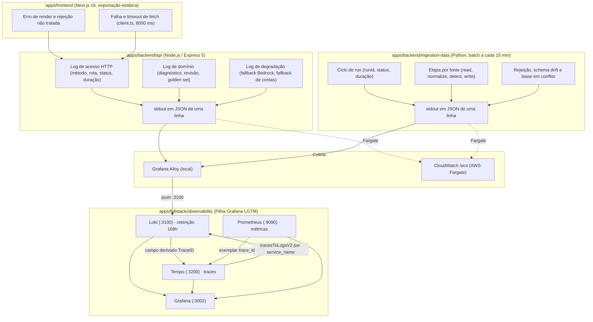

# Mapeamento de Logs de Monitoramento e Observabilidade da Plataforma View Show

&emsp; **Escopo Exclusivo:** `apps/frontend` (Dashboard Next.js) e `apps/backend` (API Express & Ingestion Service)  
&emsp; **Parceiro:** Grupo Globo (Globoplay) · CCMD7  
&emsp; **Turma / Grupo:** Inteli · Módulo 7 · Grupo 05  
&emsp; **Sprint:** 3  
&emsp; **Data:** Setembro de 2026  
&emsp; **Ambiente e Região:** Pilha Local Grafana LGTM & AWS Fargate (`us-east-1`)  
&emsp; **Sinal Coberto:** Logs (destino: Grafana Loki, porta `3100`)  
&emsp; **Documento Irmão:** [Mapeamento de Métricas](./mapeamento-metricas-observabilidade.md) e [Mapeamento de Traces](./mapeamento-traces-observabilidade.md)

> [!NOTE]
> **Atualização (out/2026).** Este mapeamento é normativo e foi escrito na Sprint 3, quando a API
> era JavaScript e não tinha logger. As seções 1.3, 5 e 10 descrevem esse estado e o plano de
> então (`console.*`, pino, `src/*.js`) e devem ser lidas como histórico. A API atual (TypeScript)
> implementa o contrato do envelope (seção 3) com estas diferenças: mensagens em inglês, campo
> `status` (não `status_code`), `route: "unmatched"` para rotas sem casamento, `error_code` de
> negócio na linha de acesso e `/health` e `/metrics` sem linha. A redação (seção 3.5) é feita no
> logger por nome de campo e por padrão de valor, e o envio ao Loki é em lote com buffer limitado.
> O estado implementado, os eventos emitidos e o passo a passo estão em
> [`observability/README.md`](../README.md).

---

## Sumário

- [1. Introdução e Delimitação de Escopo](#1-introdução-e-delimitação-de-escopo)
  - [1.1 Escopo Restrito: apps/frontend e apps/backend](#11-escopo-restrito-appsfrontend-e-appsbackend)
  - [1.2 Dualidade: Registro de Evento de Negócio vs. Log de Execução](#12-dualidade-registro-de-evento-de-negócio-vs-log-de-execução)
  - [1.3 Estado Atual: O Que Existe Hoje no Código](#13-estado-atual-o-que-existe-hoje-no-código)
  - [1.4 Lacuna Estrutural Fechada: Coleta Fora da Aplicação](#14-lacuna-estrutural-fechada-coleta-fora-da-aplicação)
- [2. Arquitetura de Coleta e Centralização de Logs](#2-arquitetura-de-coleta-e-centralização-de-logs)
- [3. Contrato Canônico da Linha de Log](#3-contrato-canônico-da-linha-de-log)
  - [3.1 Campos Obrigatórios do Envelope](#31-campos-obrigatórios-do-envelope)
  - [3.2 Níveis de Severidade e Critério de Uso](#32-níveis-de-severidade-e-critério-de-uso)
  - [3.3 Rótulos do Loki vs. Metadados Estruturados](#33-rótulos-do-loki-vs-metadados-estruturados)
  - [3.4 Colisão de Nome: `trace_id` do OpenTelemetry vs. `trace_id` do DynamoDB](#34-colisão-de-nome-trace_id-do-opentelemetry-vs-trace_id-do-dynamodb)
  - [3.5 Sanitização, PII e Segredos](#35-sanitização-pii-e-segredos)
- [4. Logs de apps/frontend (Painel Next.js)](#4-logs-de-appsfrontend-painel-nextjs)
  - [4.1 Restrição de Arquitetura: Exportação Estática](#41-restrição-de-arquitetura-exportação-estática)
  - [4.2 Catálogo de Eventos de Log do Navegador](#42-catálogo-de-eventos-de-log-do-navegador)
- [5. Logs de apps/backend/api (API Express & Camada Agêntica)](#5-logs-de-appsbackendapi-api-express--camada-agêntica)
  - [5.1 Log de Acesso HTTP](#51-log-de-acesso-http)
  - [5.2 Autenticação, Sessão e Criação de Conta](#52-autenticação-sessão-e-criação-de-conta)
  - [5.3 Incidentes, Evidências e Hipóteses](#53-incidentes-evidências-e-hipóteses)
  - [5.4 Orquestrador, Agente, Golden Set e Bedrock](#54-orquestrador-agente-golden-set-e-bedrock)
  - [5.5 Acesso ao DynamoDB](#55-acesso-ao-dynamodb)
  - [5.6 Ciclo de Vida do Processo](#56-ciclo-de-vida-do-processo)
- [6. Logs de apps/backend/ingestion-data (Data Ingestion Service)](#6-logs-de-appsbackendingestion-data-data-ingestion-service)
  - [6.1 Ciclo de Run e Encerramento](#61-ciclo-de-run-e-encerramento)
  - [6.2 Por Fonte e Por Estágio do Pipeline](#62-por-fonte-e-por-estágio-do-pipeline)
  - [6.3 Lease e Concorrência](#63-lease-e-concorrência)
  - [6.4 Rejeições, Schema Drift e Erros Sanitizados](#64-rejeições-schema-drift-e-erros-sanitizados)
  - [6.5 Projeções e Watermarks](#65-projeções-e-watermarks)
- [7. Retenção, Volume e Limites](#7-retenção-volume-e-limites)
- [8. Matriz de Rastreabilidade: Requisitos ↔ Logs ↔ Alertas](#8-matriz-de-rastreabilidade-requisitos--logs--alertas)
- [9. Consultas LogQL de Referência](#9-consultas-logql-de-referência)
- [10. Roteiro Prático de Instrumentação](#10-roteiro-prático-de-instrumentação)

---

## 1. Introdução e Delimitação de Escopo

&emsp; Este documento estabelece o **mapeamento normativo de logs** da plataforma **View Show**. Ele é o segundo dos três pilares de observabilidade documentados pelo grupo e complementa o mapeamento de métricas: onde a métrica responde *"quanto e com que frequência"*, o log responde *"o que exatamente aconteceu nesta execução"*.

### 1.1 Escopo Restrito: apps/frontend e apps/backend

&emsp; O escopo contempla **exclusivamente** as aplicações que constituem a solução definitiva do projeto:

1. **`apps/frontend`:** Painel em **Next.js 16 (App Router)** e **React 19**, compilado como **exportação estática** (`output: "export"` em `apps/frontend/next.config.ts`). Isso muda radicalmente o modelo de log do frontend e é tratado na seção [4.1](#41-restrição-de-arquitetura-exportação-estática).
2. **`apps/backend/api`:** API HTTP em **Node.js (Express 5)**, com rotas de autenticação, incidentes, golden set, ML e dashboard, acesso ao **Amazon DynamoDB** e integração opcional com o **Amazon Bedrock**.
3. **`apps/backend/ingestion-data`:** Serviço batch em **Python** (arquitetura hexagonal), implementado com backfill/sync, checkpoints, leases e outbox, executado pelas tasks ECS `view-show-ingestion-backfill` e `view-show-ingestion-sync`.

> [!IMPORTANT]
> O MVP básico da Sprint 1 (`apps/basica`, API Flask e frontend estático) está fora deste levantamento, exceto por uma menção: `apps/frontend/lib/data/client.ts` ainda aponta a base `telemetria` para essa API. Enquanto essa dependência existir, as falhas de leitura de telemetria aparecerão nos logs do navegador descritos na seção [4.2](#42-catálogo-de-eventos-de-log-do-navegador).

### 1.2 Dualidade: Registro de Evento de Negócio vs. Log de Execução

&emsp; Assim como nas métricas, os logs operam em dois níveis que **não devem ser misturados no mesmo fluxo**:

* **Evento de negócio persistido (dado do produto):** o incidente, a evidência e a hipótese gravados em `view-show-operacional`, e os erros de ingestão gravados em `INGESTION#RUN#<runId> / ERROR#<sequence>`. São **dado do domínio**, consultados pela API, com retenção regida por TTL e pelo contrato de ingestão (90 dias para erros sanitizados). **Não vão para o Loki.**
* **Log de execução (telemetria do View Show):** a linha emitida em `stdout` pelas nossas aplicações descrevendo o que a execução fez, quanto demorou e por que falhou. **É o objeto deste documento** e o único que segue para o Loki.

&emsp; A regra prática: se o painel precisa ler aquilo para desenhar uma tela, é dado de domínio e vive no DynamoDB; se apenas um engenheiro de plantão precisa ler para entender uma falha, é log e vive no Loki.

### 1.3 Estado Atual: O Que Existe Hoje no Código

&emsp; A API possui hoje **12 pontos de log**, todos via `console.*`, em texto livre, sem nível estruturado, sem correlação e sem destino configurado:

| Arquivo e Linha | Chamada | Mensagem Atual | Classificação Alvo |
|:---|:---|:---|:---|
| `src/index.js:8` | `console.log` | `API rodando em http://localhost:${PORT}` | `INFO` · ciclo de vida |
| `src/routes/incidents.js:15` | `console.error` | `Falha ao listar incidentes` | `ERROR` · consulta operacional |
| `src/routes/incidents.js:26` | `console.error` | `Falha ao buscar incidente` | `ERROR` · consulta operacional |
| `src/routes/incidents.js:36` | `console.error` | `Falha ao buscar evidências` | `ERROR` · consulta operacional |
| `src/routes/incidents.js:49` | `console.error` | `Falha ao buscar hipótese` | `ERROR` · consulta operacional |
| `src/routes/incidents.js:81` | `console.error` | `Falha ao revisar hipótese` | `ERROR` · escrita sensível |
| `src/routes/incidents.js:92` | `console.error` | `Falha ao diagnosticar incidente` | `ERROR` · camada agêntica |
| `src/routes/dashboard.js:40` | `console.error` | `Falha ao montar resumo do dashboard` | `ERROR` · consulta operacional |
| `src/routes/goldenSet.js:27` | `console.error` | `Falha ao consultar golden set` | `ERROR` · consulta curada |
| `src/routes/auth.js:85` | `console.error` | `Falha ao criar conta` | `ERROR` · identidade |
| `src/services/bedrockService.js:66` | `console.warn` | `Bedrock indisponível, usando fallback por template` | `WARN` · degradação prevista |
| `src/services/userService.js:29` | `console.warn` | `DynamoDB indisponível para contas; usando registro em memória` | `WARN` · degradação prevista |

&emsp; Três limitações desse estado merecem registro explícito:

1. **Não há log de acesso.** Nenhuma requisição bem-sucedida deixa rastro. Só existe linha quando algo estoura, o que impede reconstruir o que o operador fez antes da falha.
2. **O objeto `error` é concatenado na mensagem.** `console.error("Falha ao listar incidentes:", error)` imprime o stack trace inteiro em texto multilinha, que o Loki indexa como várias linhas independentes e sem estrutura.
3. **`userService.js` silencia repetições.** A flag `warnedMemoryFallback` faz o aviso de queda do DynamoDB aparecer **uma única vez por processo**. Isso é bom para o terminal e ruim para observabilidade: o alerta não reaparece se a falha persistir por horas.

```text
┌─────────────────────────────────────────────────────────────────────────────┐
│                          STATUS DOS LOGS POR APLICAÇÃO                      │
├──────────────────────────────────────┬──────────────────────────────────────┤
│ O QUE JÁ EXISTE                      │ O QUE VAI SER IMPLEMENTADO           │
├──────────────────────────────────────┼──────────────────────────────────────┤
│ • apps/backend/api:                  │ • apps/backend/api:                  │
│   - 12 chamadas console.* em texto   │   - Logger JSON (pino) com nível,    │
│     livre (tabela acima).            │     service_name e trace_id.         │
│   - Envelope de erro HTTP com        │   - Middleware de log de acesso.     │
│     message, já padronizado.         │   - requestId propagado ao envelope  │
│ • apps/fullstack/observability:                │     de erro do contrato da API.      │
│   - Loki 3.7.7 na porta 3100.        │   - Redação de senha, cookie e       │
│   - Retenção de 168h e compactor     │     e-mail antes da serialização.    │
│     com retention_enabled.           │ • apps/frontend:                     │
│   - allow_structured_metadata: true. │   - Captura de erro de render e de   │
│   - Campos derivados TraceID e       │     falha de fetch no navegador.     │
│     TraceIDJson no data source Loki. │   - Envio ao coletor (não há server).│
│                                      │ • apps/backend/ingestion-data:       │
│                                      │   - Log JSON por run, fonte e etapa. │
│                                      │   - runId, watermark e contagens.    │
│                                      │ • apps/fullstack/observability:                │
│                                      │   - Coletor de logs (Grafana Alloy). │
└──────────────────────────────────────┴──────────────────────────────────────┘
```

### 1.4 Lacuna Estrutural Fechada: Coleta Fora da Aplicação

> [!NOTE]
> O `apps/fullstack/docker-compose.observability.yml` inclui o Grafana Alloy. Ele
> lê `stdout`/`stderr` dos containers pelo socket do Docker e envia as linhas ao
> Loki, mantendo os workers fora do caminho de rede dos logs.

&emsp; Existem dois caminhos para fechar essa lacuna, e a escolha muda o que precisa ser escrito na aplicação:

| Caminho | Como Funciona | Vantagem | Custo |
|:---|:---|:---|:---|
| **A. Coletor externo (recomendado)** | A aplicação escreve JSON em `stdout`; um contêiner **Grafana Alloy** lê os logs do Docker (ou o arquivo no ECS) e faz push ao Loki. | A aplicação não conhece o Loki. Mesmo código roda local e no Fargate, onde o `awslogs` já entrega ao CloudWatch. | Um serviço a mais no compose e um arquivo de configuração. |
| **B. Transporte direto na aplicação** | A API usa um transporte (`pino-loki`) que faz `POST` em `http://localhost:3100/loki/api/v1/push`. | Nada novo na pilha; funciona em minutos. | Acopla a aplicação ao Loki, perde linha em queda de rede e não vale para o Fargate. |

&emsp; **Decisão adotada neste mapeamento para os workers:** caminho **A**. Eles
escrevem em `stdout` e o Alloy faz o transporte. A API mantém um envio remoto
assíncrono na AWS, além do `stdout` entregue ao CloudWatch.

---

## 2. Arquitetura de Coleta e Centralização de Logs

&emsp; O diagrama mostra o caminho da linha de log desde a emissão até a correlação com trace e métrica no Grafana:



> [!NOTE]
> As setas entre Loki, Tempo e Prometheus não são fluxo de dados: são as correlações **já provisionadas** em `apps/fullstack/observability/grafana/provisioning/datasources/datasources.yml`. Elas funcionam sozinhas assim que os campos da seção [3.1](#31-campos-obrigatórios-do-envelope) estiverem presentes.

---

## 3. Contrato Canônico da Linha de Log

&emsp; Toda linha emitida por qualquer uma das três aplicações segue o mesmo envelope. Uma linha, um objeto JSON, sem quebra interna.

### 3.1 Campos Obrigatórios do Envelope

| Campo | Tipo | Obrigatório | Origem | Descrição |
|:---|:---|:---:|:---|:---|
| `timestamp` | ISO 8601 UTC | Sim | Logger | Instante da emissão, com milissegundos. |
| `level` | enum | Sim | Logger | Ver seção [3.2](#32-níveis-de-severidade-e-critério-de-uso). |
| `service_name` | string | Sim | Config | `view-show-api`, `view-show-ingestion` ou `view-show-painel`. **Deve ser idêntico ao `service.name` do OpenTelemetry.** |
| `environment` | enum | Sim | Config | `local`, `dev` ou `prod`. Espelha o `external_labels.environment` do Prometheus. |
| `event` | string | Sim | Chamador | Identificador estável e em inglês do evento, ex.: `incident.diagnose.failed`. É o que se filtra, não a mensagem. |
| `message` | string | Sim | Chamador | Frase legível em português para o humano de plantão. |
| `trace_id` | hex 32 | Condicional | OpenTelemetry | ID do trace ativo. **Obrigatório sempre que houver span em contexto.** Ver a ressalva da seção [3.4](#34-colisão-de-nome-trace_id-do-opentelemetry-vs-trace_id-do-dynamodb). |
| `span_id` | hex 16 | Condicional | OpenTelemetry | ID do span ativo no momento da emissão. |
| `request_id` | string | Condicional | Middleware | Correlaciona a linha ao `error.requestId` devolvido ao frontend pelo contrato da API. |
| `duration_ms` | número | Condicional | Chamador | Presente em toda linha que fecha uma operação cronometrada. |
| `error.type` | string | Condicional | Handler | Classe ou nome do erro, ex.: `ResourceNotFoundException`. |
| `error.message` | string | Condicional | Handler | Mensagem do erro, já sanitizada. |
| `error.stack` | string | Condicional | Handler | Stack em **campo próprio**, nunca concatenado em `message`. Apenas em `ERROR` e `FATAL`. |

&emsp; Exemplo de uma linha de fechamento de diagnóstico bem-sucedido na API:

```json
{
  "timestamp": "2026-09-03T14:22:07.481Z",
  "level": "info",
  "service_name": "view-show-api",
  "environment": "local",
  "event": "incident.diagnose.completed",
  "message": "Diagnóstico concluído",
  "trace_id": "4bf92f3577b34da6a3ce929d0e0e4736",
  "span_id": "00f067aa0ba902b7",
  "request_id": "req_01K2F8BAYX",
  "incidentId": "inc_01K2F6YQ9G",
  "diagnosisSource": "golden-set",
  "explanationSource": "template",
  "score": 0.82,
  "evidenceCount": 4,
  "duration_ms": 142
}
```

&emsp; Exemplo de uma falha, com o erro em campo próprio:

```json
{
  "timestamp": "2026-09-03T14:23:11.902Z",
  "level": "error",
  "service_name": "view-show-api",
  "environment": "local",
  "event": "incident.list.failed",
  "message": "Falha ao listar incidentes",
  "trace_id": "9c1b7e2f4a8d40c1b6e3f5a7d9c2b4e6",
  "span_id": "b7ad6b7169203331",
  "request_id": "req_01K2F8BB7Q",
  "route": "GET /api/v1/incidents",
  "window": "6h",
  "bucketsQueried": 7,
  "error": {
    "type": "ProvisionedThroughputExceededException",
    "message": "Throughput exceeds the current capacity for table view-show-operacional",
    "stack": "ProvisionedThroughputExceededException: Throughput exceeds..."
  }
}
```

### 3.2 Níveis de Severidade e Critério de Uso

&emsp; O critério é o **destino da linha**, não a gravidade sentida por quem escreveu o código:

| Nível | Critério Objetivo | Acorda Alguém? | Exemplos no View Show |
|:---|:---|:---:|:---|
| `fatal` | O processo não consegue continuar e vai encerrar. | Sim | Falha de bind na porta; região diferente de `us-east-1` rejeitada pelo ingestion. |
| `error` | Uma operação do usuário ou do lote falhou e ninguém a recuperou. | Sim, por taxa | Os 8 `console.error` da tabela [1.3](#13-estado-atual-o-que-existe-hoje-no-código); run com status `FAILED`. |
| `warn` | Algo saiu do caminho feliz, mas houve recuperação automática. | Não, por tendência | Fallback do Bedrock; fallback de contas em memória; `SKIPPED_LOCKED`; registro rejeitado com flag. |
| `info` | Marco de negócio ou de ciclo de vida que se quer poder reconstruir depois. | Não | Login, revisão de hipótese, promoção ao golden set, início e fim de run. |
| `debug` | Detalhe de diagnóstico útil só durante investigação. | Não | Chaves `pk`/`sk` consultadas, tamanho de página, cursor de retomada. |
| `trace` | Volume alto demais para deixar ligado. | Não | Corpo do prompt enviado ao Bedrock, linha a linha de um chunk. |

&emsp; **Padrão por ambiente:** `info` em `local` e `prod`; `debug` habilitável por variável de ambiente (`LOG_LEVEL`) sem novo deploy. `trace` nunca é padrão em nenhum ambiente.

> [!IMPORTANT]
> Um `error` que não exige ação humana é ruído e treina o time a ignorar o painel. O fallback do Bedrock em `bedrockService.js:66` é o exemplo canônico: o sistema previu a falha, tratou e devolveu resposta útil. Ele é `warn`, e o sinal de alarme é a **taxa** de fallback, não a ocorrência isolada.

### 3.3 Rótulos do Loki vs. Metadados Estruturados

&emsp; Esta é a decisão de maior impacto no custo e no desempenho da consulta. O Loki indexa **rótulos** (labels); cada combinação distinta de valores de rótulo cria um **stream** separado, com seus próprios chunks em disco. Rótulo de alta cardinalidade destrói o Loki.

&emsp; O `apps/fullstack/observability/loki/loki-config.yml` já habilita `allow_structured_metadata: true`, o que dá o lugar certo para os campos de alta cardinalidade sem transformá-los em rótulo.

| Categoria | Campos | Onde Vive | Justificativa |
|:---|:---|:---|:---|
| **Rótulo indexado** | `service_name`, `environment`, `level` | Label do stream | Cardinalidade fechada e pequena: 3 serviços × 3 ambientes × 6 níveis = 54 streams no pior caso. |
| **Metadado estruturado** | `trace_id`, `span_id`, `request_id`, `runId` | Structured metadata | Cardinalidade ilimitada, mas precisa ser filtrável rápido para o salto log ↔ trace. |
| **Corpo JSON** | `incidentId`, `event`, `duration_ms`, `route`, `source_dataset`, `error.*` | Linha | Filtrado com o parser `| json` em tempo de consulta. |

> [!WARNING]
> **Nunca** promova a rótulo: `incidentId`, `trace_id`, `request_id`, `runId`, `recordId`, `userEmail`, `route` com path param interpolado (`/api/v1/incidents/inc_01K2F6YQ9G`). Cada valor novo cria um stream permanente. A rota deve ser sempre o **template** (`/api/v1/incidents/:id`), como já é convenção nas métricas RED.

&emsp; O rótulo `service_name` não é escolha estética. O data source do Tempo está provisionado com:

```yaml
tracesToLogsV2:
  datasourceUid: loki
  tags:
    - key: service.name
      value: service_name
```

&emsp; Ou seja, o Grafana traduz o atributo `service.name` do span para o rótulo `service_name` do Loki. **Se o rótulo tiver outro nome, o botão "Logs for this span" volta vazio.**

### 3.4 Colisão de Nome: `trace_id` do OpenTelemetry vs. `trace_id` do DynamoDB

> [!CAUTION]
> Este é o achado mais delicado deste mapeamento e precisa ser tratado antes da primeira linha de log estruturado.

&emsp; A tabela `view-show-operacional` tem um GSI chamado `trace-index` cuja chave de partição é um atributo **literalmente chamado `trace_id`**. Em `apps/backend/api/src/services/evidenceService.js`:

```javascript
const items = await operationalTable.query({
  IndexName: "trace-index",
  KeyConditionExpression: "trace_id = :id",
  ExpressionAttributeValues: { ":id": incidentId },
});
```

&emsp; O valor desse `trace_id` é o **`incidentId`** (ex.: `inc_01K2F6YQ9G`), não um trace ID W3C de 32 caracteres hexadecimais. É um agrupador de domínio, usado para trazer incidente, evidências e hipótese em um único `Query`.

&emsp; Ao mesmo tempo, `datasources.yml` configura dois campos derivados no Loki que transformam qualquer `trace_id` em link para o Tempo:

```yaml
derivedFields:
  - name: TraceID
    matcherType: label
    matcherRegex: trace_id
    datasourceUid: tempo
  - name: TraceIDJson
    matcherType: regex
    matcherRegex: '"trace_id"\s*:\s*"(\w+)"'
    datasourceUid: tempo
```

&emsp; **A consequência:** se um item do DynamoDB for despejado no log e seu campo `trace_id` for serializado, o Grafana renderizará um botão "Ver trace" que faz uma busca por `inc_01K2F6YQ9G` no Tempo. Essa busca nunca encontra nada, e o engenheiro de plantão conclui que o tracing está quebrado quando o problema é um nome reaproveitado.

| Regra | Detalhe |
|:---|:---|
| **O nome `trace_id` no log é reservado** | Exclusivo para o trace ID de 32 hex do OpenTelemetry. Nenhum outro valor pode ocupá-lo. |
| **O agrupador de domínio se chama `incidentId` no log** | É o nome já usado pelo contrato público da API (`data.incident.id`) e pelo próprio item (`item.incidentId` em `saveHypothesis`). |
| **Item do banco nunca é logado inteiro** | Proibido `logger.info({ item })`. Selecione campos: `incidentId`, `component`, `status`. Isso também evita vazar `pk`, `sk` e `ttl`, que o contrato da API veta em resposta pública. |
| **O GSI permanece como está** | Renomear atributo de chave de GSI no DynamoDB exige recriar o índice. O custo não se justifica: a correção é barata na fronteira do log. |

### 3.5 Sanitização, PII e Segredos

&emsp; O contrato de ingestão já define a regra para os erros persistidos, e ela é estendida aqui a **toda** linha de log:

> Não contêm payload completo, PII, segredo, DSN ou stack trace com parâmetros.
> ([`ingestao-e-dados.md`, seção 14](../../../../artefatos/arquitetura/ingestao-e-dados.md#14-erros-e-qualidade))

| Dado | Tratamento | Onde Aparece Hoje |
|:---|:---|:---|
| Senha | **Nunca logada**, em nenhum nível. Removida antes da serialização. | `req.body.password` em `POST /auth/login` e `POST /auth/register`. |
| Cookie de sessão | **Nunca logado.** O valor é um HMAC que autentica; logá-lo equivale a logar a credencial. | Header `Cookie` em toda rota com `requireAuth`. |
| E-mail do usuário | Mascarado como `d***@globoplay.com` em `info`; íntegro apenas em `audit` de escrita sensível (revisão de hipótese e promoção ao golden set), onde a autoria é o próprio requisito. | `req.userEmail`, `curated_by`, `reviewedBy`. |
| DSN e credencial da origem MySQL | **Nunca logados.** A string de conexão do Argus vem de segredo. Em erro de conexão, logar host e porta, nunca usuário e senha. | Adapter `argus_mysql` do ingestion. |
| Payload canônico completo | **Nunca logado.** Logar `recordId`, `payloadHash` e o dataset. O payload íntegro já está no DynamoDB. | `CanonicalRecordSink`. |
| Prompt e resposta do Bedrock | Apenas em `trace`, nunca padrão. O prompt em `bedrockService.js` interpola descrições de evidência que podem carregar identificadores de conteúdo. | `callBedrock()`. |

&emsp; A redação é implementada **no logger**, por lista de caminhos, e não confiada à disciplina de cada chamador:

```javascript
// apps/backend/api/src/logger.js
const pino = require("pino");

module.exports = pino({
  level: process.env.LOG_LEVEL || "info",
  base: {
    service_name: "view-show-api",
    environment: process.env.NODE_ENV === "production" ? "prod" : "local",
  },
  timestamp: pino.stdTimeFunctions.isoTime,
  redact: {
    paths: [
      "password", "*.password", "req.body.password",
      "req.headers.cookie", "req.headers.authorization",
      "*.session", "prompt",
    ],
    censor: "[REDACTED]",
  },
});
```

---

## 4. Logs de apps/frontend (Painel Next.js)

### 4.1 Restrição de Arquitetura: Exportação Estática

&emsp; `apps/frontend/next.config.ts` declara `output: "export"`, e o comentário do próprio arquivo explica a razão:

> O painel é inteiramente client-side: não há middleware, route handler nem componente de servidor que busque dados.

&emsp; Três consequências diretas para logs:

1. **Não existe log de servidor no frontend.** Não há processo Node em execução em produção; há um bucket servindo HTML pelo Amplify. Nenhum `stdout` para o Alloy coletar.
2. **Todo log do frontend nasce no navegador do operador** e só chega ao Loki se for **enviado por rede** para um endpoint que aceite recebê-lo.
3. **Esse endpoint precisa existir.** Como não há servidor Next, o receptor natural é a própria `apps/backend/api`, com uma rota dedicada, ou um coletor OTLP com CORS habilitado. Expor o Loki diretamente ao navegador está fora de questão: `auth_enabled: false` no `loki-config.yml` significa que qualquer origem poderia injetar linhas arbitrárias.

&emsp; **Rota proposta:** `POST /api/v1/telemetry/logs`, sem autenticação obrigatória (o erro pode ocorrer na tela de login), com limite de tamanho de corpo, limite de taxa por IP e reescrita do `service_name` para `view-show-frontend` no servidor. O cliente **nunca** define o próprio `service_name`, para que um agente externo não consiga se passar pela API nas consultas do Grafana.

### 4.2 Catálogo de Eventos de Log do Navegador

| Evento | Nível | Gatilho no Código | Campos Adicionais | Requisito |
|:---|:---|:---|:---|:---|
| `frontend.render.error` | `error` | Error Boundary do React captura exceção de render. | `component`, `route`, `error.type`, `error.message` | RNF06 |
| `frontend.unhandled.rejection` | `error` | `window.onunhandledrejection`. | `route`, `error.message` | RNF06 |
| `frontend.api.fetch.failed` | `warn` | `apiGet` de `lib/data/client.ts` recebe status não OK. | `apiTarget` (`operacional` ou `telemetria`), `endpoint`, `status`, `duration_ms` | RNF09 |
| `frontend.api.fetch.timeout` | `warn` | `AbortController` dispara no `REQUEST_TIMEOUT` de 8000 ms. | `apiTarget`, `endpoint`, `timeout_ms: 8000` | RNF14 |
| `frontend.resource.degraded` | `info` | Recurso resolvido com `availability` em `partial` ou `unavailable`. | `resource`, `availability`, `source`, `warnings[]` | RF05, RNF11 |
| `frontend.example.data.served` | `warn` | `ALLOW_EXAMPLE_DATA` permite conjunto de exemplo na tela. | `resource`, `route` | RF05 |
| `frontend.auth.session.expired` | `info` | Resposta 401 em rota do painel, com redirecionamento ao login. | `route` | RNF04 |
| `frontend.rootcause.path` | `info` | Operador alcança a tela de evidências; registra o caminho percorrido. | `clicks`, `entryRoute`, `incidentId` | RNF10 |

> [!NOTE]
> `frontend.example.data.served` é deliberadamente `warn`. Servir conjunto de exemplo é comportamento correto do código e desastroso em produção: o operador tomaria decisão sobre número inventado. O nível reflete o risco operacional, não a corretude da execução.

&emsp; O `frontend.rootcause.path` é o par em log da métrica `operator_clicks_to_root_cause` do mapeamento de métricas. A métrica dá a distribuição; o log diz **qual caminho** o operador tomou nas vezes em que passou de cinco cliques, que é o que permite corrigir a navegação.

---

## 5. Logs de apps/backend/api (API Express & Camada Agêntica)

### 5.1 Log de Acesso HTTP

&emsp; É a lacuna mais grave do estado atual e a primeira a fechar: um middleware registrado **antes** dos roteadores em `src/app.js`, emitindo uma linha por requisição concluída.

| Campo | Exemplo | Observação |
|:---|:---|:---|
| `event` | `http.request.completed` | Único para toda requisição encerrada, com ou sem erro. |
| `method` | `GET` | |
| `route` | `/api/v1/incidents/:id/evidence` | **Template do Express**, nunca o path com o ID interpolado. Ver [3.3](#33-rótulos-do-loki-vs-metadados-estruturados). |
| `status_code` | `200` | |
| `duration_ms` | `87` | Medido com `process.hrtime.bigint()`. |
| `request_id` | `req_01K2F8BAYX` | Gerado no middleware; devolvido em `error.requestId` quando a resposta é de erro. |
| `trace_id` / `span_id` | hex | Do span do servidor HTTP. |
| `user_email_masked` | `d***@globoplay.com` | Só quando `req.userEmail` existe. |
| `response_size_bytes` | `14820` | Espelha a métrica `http_response_size_bytes`. |
| `query` | `{ "window": "6h", "deviceType": "smart-tv" }` | Apenas as chaves reconhecidas, jamais a query string bruta. |

&emsp; **Nível pelo status:** `2xx` e `3xx` em `info`; `4xx` em `warn`; `5xx` em `error`. A exceção é `GET /health`, que roda a cada poucos segundos no ALB e deve sair em `debug` para não inundar o Loki.

### 5.2 Autenticação, Sessão e Criação de Conta

| Evento | Nível | Gatilho | Campos | Requisito |
|:---|:---|:---|:---|:---|
| `auth.login.succeeded` | `info` | `POST /auth/login` com credencial válida. | `email_masked`, `userType` (`fixed` ou `registered`) | RNF04 |
| `auth.login.failed` | `warn` | `routes/auth.js` devolve 401. | `email_masked`, `reason: invalid_credentials` | RNF04 |
| `auth.register.rejected` | `warn` | Validação de nome, e-mail, tamanho de senha ou e-mail já registrado. | `reason` (`missing_name`, `invalid_email`, `weak_password`, `email_taken`) | RNF04 |
| `auth.register.succeeded` | `info` | Conta criada e sessão aberta. | `email_masked` | RNF04 |
| `auth.register.failed` | `error` | `console.error` de `routes/auth.js:85`. | `error.*` | RNF04 |
| `auth.session.rejected` | `warn` | `middleware/requireAuth.js` não valida o cookie. | `route`, `reason` (`missing` ou `invalid_signature`) | RNF04 |
| `auth.sso.not_implemented` | `info` | `GET /auth/sso` devolve 501. | | RNF04 |
| `account.store.degraded` | `warn` | `userService.warnMemory()`. | `error.message`, `fallback: memory` | RNF06 |

> [!IMPORTANT]
> `auth.login.failed` é o insumo direto do alarme de RNF04 (mais de 20 tentativas inválidas por minuto). Para que a contagem funcione, a linha precisa sair **em toda** tentativa negada. Hoje o `return res.status(401)` de `routes/auth.js` é silencioso, e nenhum ataque de força bruta deixaria rastro.

> [!IMPORTANT]
> `account.store.degraded` precisa perder a flag `warnedMemoryFallback`. Com ela, a queda do DynamoDB aparece uma vez e some. A substituição correta é emitir a linha sempre e **amostrar no logger** (por exemplo, uma a cada 100 ocorrências, com o contador acumulado no campo `suppressed_count`), preservando o sinal para o alerta sem inundar o Loki.

### 5.3 Incidentes, Evidências e Hipóteses

| Evento | Nível | Rota / Serviço | Campos | Substitui |
|:---|:---|:---|:---|:---|
| `incident.list.completed` | `info` | `GET /api/v1/incidents` | `window`, `windowMinutes`, `bucketsQueried`, `resultCount`, `filters`, `duration_ms` | (novo) |
| `incident.list.failed` | `error` | idem | `error.*`, `window` | `incidents.js:15` |
| `incident.get.notfound` | `warn` | `GET /api/v1/incidents/:id` | `incidentId` | (novo) |
| `incident.get.failed` | `error` | idem | `incidentId`, `error.*` | `incidents.js:26` |
| `incident.evidence.failed` | `error` | `GET /:id/evidence` | `incidentId`, `error.*` | `incidents.js:36` |
| `incident.hypothesis.failed` | `error` | `GET /:id/hypothesis` | `incidentId`, `error.*` | `incidents.js:49` |
| `hypothesis.review.submitted` | `info` | `PATCH /:id/hypothesis/review` | `incidentId`, `verdict`, `reviewedBy`, `duration_ms` | (novo) |
| `hypothesis.review.rejected` | `warn` | Status fora de `confirmed`/`refuted` (400). | `incidentId`, `received_status` | (novo) |
| `hypothesis.review.failed` | `error` | idem | `incidentId`, `error.*` | `incidents.js:81` |
| `dashboard.summary.failed` | `error` | `GET /api/v1/dashboard/summary` | `error.*` | `dashboard.js:40` |

> [!NOTE]
> `incident.list.completed` carrega `bucketsQueried` porque `evidenceService.bucketsForWindow()` dispara **um `Query` por bucket de hora, em paralelo**. Uma janela de 24 horas produz 25 consultas simultâneas ao DynamoDB. Quando a latência da rota subir, esse campo diz na hora se a causa é o tamanho da janela pedida, e é o log que fecha o diagnóstico que a métrica `dynamodb_items_read_per_query` apenas insinua.

&emsp; `hypothesis.review.submitted` é log de **auditoria**, não de depuração: é o único caminho de escrita na golden set em todo o código (ADR-005). Ele registra o e-mail íntegro em `reviewedBy`, porque a autoria da curadoria é parte do requisito, e é o candidato natural a uma retenção maior que os 7 dias do Loki local.

### 5.4 Orquestrador, Agente, Golden Set e Bedrock

| Evento | Nível | Gatilho em `orchestrator/index.js` e serviços | Campos |
|:---|:---|:---|:---|
| `diagnose.started` | `debug` | Entrada de `orchestrator.diagnose()`. | `incidentId` |
| `diagnose.goldenset.hit` | `info` | `findMatchingCase()` retorna caso curado. | `incidentId`, `signature`, `component`, `expected_score` |
| `diagnose.goldenset.miss` | `info` | Nenhum caso; delega ao agente. | `incidentId`, `signature` |
| `diagnose.agent.completed` | `info` | `agent.investigate()` retorna. | `incidentId`, `score`, `model` (`mock-v0`), `evidenceCount` |
| `diagnose.completed` | `info` | Fim de `diagnose()`. | `incidentId`, `diagnosisSource`, `explanationSource`, `score`, `duration_ms` |
| `diagnose.failed` | `error` | `console.error` de `incidents.js:92`. | `incidentId`, `error.*` |
| `goldenset.query.notfound` | `warn` | `GET /api/v1/golden-set` devolve 404. | `signature` |
| `goldenset.query.failed` | `error` | `console.error` de `goldenSet.js:27`. | `signature`, `error.*` |
| `goldenset.case.promoted` | `info` | `promoteCase()` grava caso curado. | `signature`, `source_incident_id`, `curated_by` |
| `bedrock.invocation.started` | `debug` | Entrada de `callBedrock()`. | `model_id`, `incidentId` |
| `bedrock.invocation.completed` | `info` | Resposta válida do Bedrock. | `model_id`, `duration_ms`, `input_tokens`, `output_tokens` |
| `bedrock.fallback.used` | `warn` | `console.warn` de `bedrockService.js:66`. | `reason` (`disabled`, `empty_response`, `throttled`, `timeout`, `sdk_error`), `error.message` |

> [!IMPORTANT]
> O `bedrock.fallback.used` de hoje perde a distinção mais útil. `bedrockService.explain()` tem **dois** caminhos para o template: a flag `BEDROCK_ENABLED` desligada (que nem loga) e a exceção capturada (que loga). São situações opostas: a primeira é configuração deliberada, a segunda é falha. Sem o campo `reason` separando `disabled` de `throttled`, a taxa de fallback fica sem significado operacional.

&emsp; O campo `diagnosisSource` merece um cuidado de nomenclatura já sinalizado no próprio código: o comentário de `orchestrator/index.js` avisa que ele é **deliberadamente diferente** do `source` de cada item de evidência, que identifica o sistema de telemetria de origem (ex.: `Youbora`). No log, os dois nunca compartilham o nome `source`: use `diagnosisSource` e `evidenceSource`.

### 5.5 Acesso ao DynamoDB

&emsp; A instrumentação aqui é feita **uma vez**, em `src/db/operationalTable.js` e `src/db/goldenSetTable.js`, e não em cada chamador. Esses dois arquivos são as únicas portas de baixo nível para as tabelas (ADR-004), o que torna o ponto de interceptação natural.

| Evento | Nível | Campos |
|:---|:---|:---|
| `dynamodb.operation.completed` | `debug` | `operation` (`Query`, `PutItem`, `UpdateItem`, `GetItem`), `table`, `index`, `duration_ms`, `item_count`, `scanned_count`, `consumed_capacity` |
| `dynamodb.operation.throttled` | `warn` | `operation`, `table`, `attempt`, `error.type: ProvisionedThroughputExceededException` |
| `dynamodb.operation.failed` | `error` | `operation`, `table`, `error.type`, `error.message` |

&emsp; Pedir `ReturnConsumedCapacity: "TOTAL"` nos comandos permite que `consumed_capacity` alimente tanto o log quanto a métrica `dynamodb_scanned_to_returned_ratio` do mapeamento de métricas. Quando o par `item_count` / `scanned_count` divergir muito no log, o gargalo de RCU descrito lá tem nome, tabela e índice.

### 5.6 Ciclo de Vida do Processo

| Evento | Nível | Gatilho | Campos |
|:---|:---|:---|:---|
| `process.started` | `info` | Substitui o `console.log` de `index.js:8`. | `port`, `node_version`, `commit_sha`, `bedrock_enabled`, `operational_table`, `region` |
| `process.config.invalid` | `fatal` | Variável obrigatória ausente na subida. | `missing[]` |
| `process.shutdown.started` | `info` | `SIGTERM` recebido (o ECS envia ao desprovisionar a task). | `signal` |
| `process.shutdown.completed` | `info` | Servidor fechou as conexões. | `duration_ms`, `in_flight_drained` |
| `process.uncaught.exception` | `fatal` | `process.on("uncaughtException")`. | `error.*` |
| `process.unhandled.rejection` | `fatal` | `process.on("unhandledRejection")`. | `error.*` |

&emsp; O `process.started` é a linha mais barata e mais útil do sistema: em qualquer investigação, a primeira pergunta é *"qual versão está rodando e com qual configuração?"*. Incluir `commit_sha` e `bedrock_enabled` responde antes de alguém precisar perguntar. O `index.js` atual imprime apenas a porta.

## 6. Logs de `apps/backend/ingestion-data` (ARGUS 2.0)

&emsp; O serviço existe no repositório e é batch-only. O backfill manual possui
evidência AWS; sync, gate e controle do Scheduler estão implementados, mas
permanecem desabilitados até prova live. Logs são JSON
redigido e constituem evidência de operação, mas não substituem o manifesto,
Athena ou a prova de AWS.

### 6.1 Contrato efetivo

Cada linha contém `timestamp`, `level`, `service_name`, `environment`,
`event` e `message`. A execução acrescenta `traceId`, `runId`,
`command`, estado, `datasetVersion`, janela e contagens quando esses valores
existirem. Campos cujo nome sugere segredo, token, senha, payload, body ou
conexão são redigidos recursivamente.

| Evento | Nível | Uso |
| --- | --- | --- |
| `ingestion.run.started` | info | início no estado `STARTING` |
| `ingestion.run.finished` | info | terminal `SUCCEEDED` ou `PARTIAL`, duração e contagens |
| `ingestion.run.failed` | error | erro sanitizado e terminal `FAILED` |
| `ingestion.command.invalid` | error | argumentos incompatíveis; processo retorna 2 |

O logger não deve produzir uma linha por registro. Cada aplicação pode acrescentar
eventos de lease, schema, archive, partição, ativação e outbox, desde que
preserve `runId`, não inclua dump/payload bruto e mantenha o vocabulário de
estados da máquina de run.

### 6.2 Correlação e operação

`recordId` usa o prefixo `rid_` seguido do SHA-256 hexadecimal de identidade
canônica; ele não é derivado de base32. A correlação principal é `runId` +
`traceId`; `datasetVersion` é derivada do checksum do dump e versões do
contrato, não de uma importação HTTP. Procure pendências SQS por outbox e GSI
`outbox-pending-index`; um terminal `PARTIAL` pós-ativação pede
`publish-outbox`.

Os 23 valores permitidos de `source_dataset` são definidos pelo registry
ARGUS 2.0. Não registre tabela fora dessa lista como métrica/label de alta
cardinalidade. A referência de contrato é
[Ingestão e dados](../../../../artefatos/arquitetura/ingestao-e-dados.md).


## 7. Retenção, Volume e Limites

| Parâmetro | Valor Atual | Onde Está Configurado |
|:---|:---|:---|
| Retenção de logs (local) | **168 horas (7 dias)** | `limits_config.retention_period` em `loki/loki-config.yml` |
| Compactação e expurgo | Habilitados | `compactor.retention_enabled: true`, `delete_request_store: filesystem` |
| Metadados estruturados | Habilitados | `limits_config.allow_structured_metadata: true` |
| Autenticação do Loki | **Desabilitada** | `auth_enabled: false` |
| Linhas por consulta no Grafana | 1000 | `jsonData.maxLines` no data source Loki |
| Retenção de logs (AWS) | 7 dias | `CloudWatch /ecs/view-show-ingestion-{backfill,sync}` provisionado pelo Terraform |
| Retenção de erros de ingestão | 90 dias | Contrato de ingestão, itens `ERROR#<sequence>` |

> [!WARNING]
> `auth_enabled: false` e armazenamento em disco local com fator de replicação 1 são adequados ao ambiente de desenvolvimento e **inadequados a produção**, como o próprio `README.md` de `apps/fullstack/observability` declara. Nenhum endpoint do Loki pode ser exposto fora da rede `view-show-observability`, e o envio de logs do navegador (seção [4.1](#41-restrição-de-arquitetura-exportação-estática)) precisa obrigatoriamente passar pela API, nunca direto.

&emsp; **Estimativa de volume da API:** com log de acesso em `info` e uma linha por requisição de aproximadamente 600 bytes, 50 requisições por segundo produzem cerca de 2,6 GB por dia antes da compressão. Nos 7 dias de retenção local, aproximadamente 18 GB, o que é aceitável em disco de desenvolvimento mas justifica manter `GET /health` em `debug` e não promover nenhum campo de alta cardinalidade a rótulo.

---

## 8. Matriz de Rastreabilidade: Requisitos ↔ Logs ↔ Alertas

| Requisito | Descrição | Evento de Log Observado | Regra de Alerta | Gravidade |
|:---|:---|:---|:---|:---|
| **RNF01** | Escalar sob picos sem acúmulo | `ingestion.run.finished{status="SKIPPED_LOCKED"}` | Mais de 2 execuções consecutivas puladas por lock | Alto |
| **RNF02** | Ponta a ponta em até 2 min | `ingestion.run.finished` com `duration_ms` | `duration_ms > 120000` em 2 runs seguidos | Crítico |
| **RNF03** | Payload inválido isola sem parar o lote | `ingestion.record.rejected`, `ingestion.run.partial`, `ingestion.run.failed` | Qualquer `ingestion.run.failed`; taxa de rejeição acima de 1% dos lidos | Alto |
| **RNF04** | Acesso restrito ao domínio `@globo.com` | `auth.login.failed`, `auth.session.rejected` | Mais de 20 ocorrências por minuto na mesma origem | Alto |
| **RNF05** | 30 dias em hot storage com TTL | `ingestion.watermark.published`, `dynamodb.operation.failed` | Falha de escrita por expiração inesperada de item | Médio |
| **RNF06** | Contêiner autônomo por variáveis de ambiente | `process.config.invalid`, `process.uncaught.exception`, `ingestion.validate.failed` | Qualquer linha `fatal` | Crítico |
| **RNF08** | Diagnóstico com F1-Score de no mínimo 80% | `hypothesis.review.submitted{verdict="refuted"}` | Proporção de refutadas acima de 20% em 7 dias | Crítico |
| **RNF09** | Disponibilidade da API de no mínimo 99,9% | `http.request.completed{status_code=~"5.."}` | Taxa de 5xx acima de 0,1% em janela de 5 min | Crítico |
| **RNF10** | Causa raiz em até 5 cliques | `frontend.rootcause.path` | `clicks > 5` em mais de 10% das sessões | Baixo |
| **RNF11** | Normalizar múltiplos schemas | `ingestion.schema.drift` | Qualquer ocorrência | Alto |
| **RNF14** | Busca filtrada com p95 de até 2 s | `http.request.completed` com `duration_ms` e `route="/api/v1/incidents"` | `duration_ms > 2000` em mais de 5% das linhas | Crítico |
| **RNF15** | Alerta em até 30 s após degradação | Diferença entre `ingestion.watermark.published` e o alerta emitido | Intervalo acima de 30 s | Alto |
| **ADR-004** | Bedrock nunca decide hipótese | `bedrock.fallback.used`, `diagnose.completed` | Taxa de fallback acima de 30% em 1 hora | Médio |
| **ADR-005** | Golden set só cresce por revisão humana | `goldenset.case.promoted` sem `hypothesis.review.submitted` correspondente no mesmo `trace_id` | Qualquer ocorrência | Crítico |

> [!NOTE]
> A última linha é um controle de integridade que **só o log consegue fazer**. Nenhuma métrica detecta uma promoção ao golden set sem revisão humana associada, porque o sinal é a correlação entre dois eventos, não uma contagem. É o argumento mais forte a favor de propagar `trace_id` em toda linha.

---

## 9. Consultas LogQL de Referência

&emsp; Consultas prontas para o Grafana em `http://localhost:3002`, data source **Loki**.

**Erros da API na última hora, agrupados por evento:**

```logql
sum by (event) (
  count_over_time(
    {service_name="view-show-api", level="error"} | json [1h]
  )
)
```

**Latência p95 da rota de incidentes, calculada a partir do log de acesso:**

```logql
quantile_over_time(0.95,
  {service_name="view-show-api"}
    | json
    | event = "http.request.completed"
    | route = "/api/v1/incidents"
    | unwrap duration_ms [5m]
)
```

**Todas as linhas de um diagnóstico específico, atravessando os três serviços:**

```logql
{service_name=~"view-show-.*"} | json | incidentId = "inc_01K2F6YQ9G"
```

**Tentativas de login negadas por minuto (insumo do alarme de RNF04):**

```logql
sum(
  count_over_time(
    {service_name="view-show-api", level="warn"}
      | json
      | event = "auth.login.failed" [1m]
  )
)
```

**Taxa de fallback do Bedrock, separada por motivo:**

```logql
sum by (reason) (
  count_over_time(
    {service_name="view-show-api"}
      | json
      | event = "bedrock.fallback.used" [1h]
  )
)
```

**Último run de ingestão de cada fonte, com contagens:**

```logql
{service_name="view-show-ingestion"}
  | json
  | event = "ingestion.source.finished"
  | line_format "{{.source_dataset}} lidos={{.records_read}} escritos={{.records_written}} rejeitados={{.records_rejected}} watermark={{.published_watermark}}"
```

**Runs que não terminaram em sucesso nas últimas 6 horas:**

```logql
{service_name="view-show-ingestion"}
  | json
  | event = "ingestion.run.finished"
  | status != "SUCCEEDED"
```

**Salto do log para o trace:** ao expandir qualquer linha que contenha `trace_id`, o campo derivado `TraceID` renderiza o botão **Ver trace**, que abre o span correspondente no Tempo. É a correlação já provisionada em `datasources.yml`, e ela só funciona se a regra da seção [3.4](#34-colisão-de-nome-trace_id-do-opentelemetry-vs-trace_id-do-dynamodb) for respeitada.

---

## 10. Roteiro Prático de Instrumentação

### Passo 1: Configurar o coletor de logs da pilha

&emsp; `apps/fullstack/observability/alloy/config.alloy` lê os contêineres do
Docker e envia suas linhas ao Loki. A configuração de referência é:

```alloy
discovery.docker "containers" {
  host = "unix:///var/run/docker.sock"
}

loki.source.docker "app_logs" {
  host       = "unix:///var/run/docker.sock"
  targets    = discovery.docker.containers.targets
  forward_to = [loki.process.json.receiver]
}

// Extrai level e service_name do JSON e os promove a rótulo.
loki.process "json" {
  stage.json {
    expressions = {
      level        = "level",
      service_name = "service_name",
      environment  = "environment",
    }
  }
  stage.labels {
    values = { level = "", service_name = "", environment = "" }
  }
  // trace_id e span_id como metadado estruturado, nunca como rótulo.
  stage.structured_metadata {
    values = { trace_id = "", span_id = "", request_id = "" }
  }
  forward_to = [loki.write.default.receiver]
}

loki.write "default" {
  endpoint {
    url = "http://loki:3100/loki/api/v1/push"
  }
}
```

&emsp; E o serviço correspondente em `apps/fullstack/docker-compose.observability.yml`:

```yaml
  alloy:
    image: grafana/alloy:v1.12.0
    container_name: vs-alloy
    restart: unless-stopped
    command:
      - run
      - --server.http.listen-addr=0.0.0.0:12345
      - /etc/alloy/config.alloy
    volumes:
      - ./apps/fullstack/observability/alloy/config.alloy:/etc/alloy/config.alloy:ro
      - /var/run/docker.sock:/var/run/docker.sock:ro
    depends_on:
      - loki
    networks:
      - observability
```

### Passo 2: Instalar e configurar o logger na API

```bash
cd apps/backend/api
npm install pino@9 pino-http@10
npm install --save-dev pino-pretty@13
```

&emsp; Criar `src/logger.js` com o conteúdo da seção [3.5](#35-sanitização-pii-e-segredos) e registrar o middleware de acesso **antes** dos roteadores em `src/app.js`:

```javascript
const pinoHttp = require("pino-http");
const logger = require("./logger");

app.use(pinoHttp({
  logger,
  genReqId: () => `req_${crypto.randomUUID().replace(/-/g, "").slice(0, 10).toUpperCase()}`,
  customLogLevel: (req, res, err) => {
    if (req.url === "/health") return "debug";
    if (res.statusCode >= 500 || err) return "error";
    if (res.statusCode >= 400) return "warn";
    return "info";
  },
  customSuccessMessage: () => "Requisição concluída",
  customProps: (req, res) => ({
    event: "http.request.completed",
    route: req.route ? `${req.method} ${req.baseUrl}${req.route.path}` : req.method,
    duration_ms: res.responseTime,
  }),
}));
```

### Passo 3: Substituir as 12 chamadas `console.*`

&emsp; Trocar cada linha da tabela da seção [1.3](#13-estado-atual-o-que-existe-hoje-no-código) pela chamada estruturada equivalente. O padrão da substituição, usando `incidents.js:15` como exemplo:

```javascript
// Antes
console.error("Falha ao listar incidentes:", error);

// Depois
req.log.error(
  {
    event: "incident.list.failed",
    window,
    error: { type: error.name, message: error.message, stack: error.stack },
  },
  "Falha ao listar incidentes",
);
```

&emsp; O `req.log` do `pino-http` já carrega `request_id`, `trace_id` e `span_id` do contexto, o que evita repetir esses campos em cada chamada.

### Passo 4: Injetar o `trace_id` do OpenTelemetry

&emsp; Depois que o SDK do OpenTelemetry estiver ativo (Passo 2 do [Mapeamento de Traces](./mapeamento-traces-observabilidade.md)), acrescentar ao `src/logger.js`:

```javascript
const { trace, context } = require("@opentelemetry/api");

// Em pino, mixin() é avaliado a cada linha emitida.
mixin() {
  const span = trace.getSpan(context.active());
  if (!span) return {};
  const { traceId, spanId } = span.spanContext();
  return { trace_id: traceId, span_id: spanId };
},
```

&emsp; A partir daqui, os campos derivados `TraceID` e `TraceIDJson` do `datasources.yml` passam a renderizar o botão **Ver trace** em toda linha, sem nenhuma mudança no Grafana.

### Passo 5: Endpoint de recepção dos logs do navegador

&emsp; Criar `src/routes/telemetry.js` com `POST /api/v1/telemetry/logs`, registrado em `src/app.js`. Regras obrigatórias:

1. Limitar o corpo a 64 KB (`express.json({ limit: "64kb" })` só nesta rota).
2. Limitar a taxa por IP.
3. **Sobrescrever** `service_name` para `view-show-frontend` no servidor, ignorando o que o cliente enviar.
4. Aceitar apenas `level` em `warn`, `error` e `info`, descartando `debug` e `trace`.
5. Reemitir a linha pelo logger da API, para que ela siga o mesmo caminho de coleta.

### Passo 6: Verificação de ponta a ponta

```bash
# 1. Subir a pilha com o novo coletor
docker compose -f apps/fullstack/docker-compose.observability.yml up -d

# 2. Gerar tráfego na API
curl -s "http://localhost:3000/api/v1/incidents?window=1h" > /dev/null

# 3. Conferir que a linha chegou ao Loki
curl -sG "http://localhost:3100/loki/api/v1/query_range" \
  --data-urlencode 'query={service_name="view-show-api"}' \
  --data-urlencode 'limit=5' | head -40

# 4. Conferir os rótulos indexados (deve haver poucos, e nenhum de alta cardinalidade)
curl -s "http://localhost:3100/loki/api/v1/labels"
curl -s "http://localhost:3100/loki/api/v1/label/service_name/values"
```

&emsp; O quarto comando é o mais importante da verificação: se `trace_id`, `incidentId` ou `request_id` aparecerem na lista de rótulos, a configuração do Passo 1 promoveu campo de alta cardinalidade a label e precisa ser corrigida antes de qualquer carga real.
