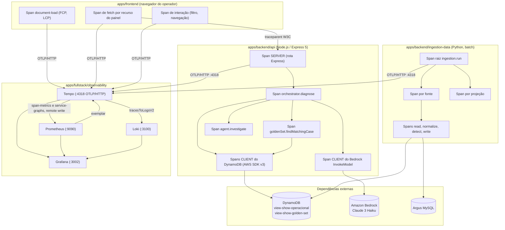

# Mapeamento de Traces de Monitoramento e Observabilidade da Plataforma View Show

&emsp; **Escopo Exclusivo:** `apps/frontend` (Dashboard Next.js) e `apps/backend` (API Express & Ingestion Service)  
&emsp; **Parceiro:** Grupo Globo (Globoplay) · CCMD7  
&emsp; **Turma / Grupo:** Inteli · Módulo 7 · Grupo 05  
&emsp; **Sprint:** 3  
&emsp; **Data:** Setembro de 2026  
&emsp; **Ambiente e Região:** Pilha Local Grafana LGTM & AWS Fargate (`us-east-1`)  
&emsp; **Sinal Coberto:** Traces (destino: Grafana Tempo, portas `4317` OTLP/gRPC e `4318` OTLP/HTTP)  
&emsp; **Documento Irmão:** [Mapeamento de Métricas](./mapeamento-metricas-observabilidade.md) e [Mapeamento de Logs](./mapeamento-logs-observabilidade.md)

> [!NOTE]
> **Atualização (out/2026).** Este mapeamento é normativo e foi escrito na Sprint 3, quando nenhuma
> aplicação emitia spans. A seção 1.3 ("zero instrumentação") e o roteiro da seção 11 descrevem
> esse estado e devem ser lidos como histórico: a API TypeScript já exporta traces ao Tempo com o
> SDK OpenTelemetry. Diferenças em relação ao texto: o span SERVER usa o template da rota
> (`GET /api/v1/incidents`), os spans de middleware do Express e de rede (`tcp.connect`) estão
> desligados, sondas `/health` e `/metrics` não geram trace, e os atributos próprios são
> `viewshow.request_id`, `viewshow.dataset_version` e `viewshow.error_code`. A query string é
> redigida antes de sair (`code`, `state` e tokens). O estado implementado e o passo a passo estão
> em [`observability/README.md`](../README.md).

---

## Sumário

- [1. Introdução e Delimitação de Escopo](#1-introdução-e-delimitação-de-escopo)
  - [1.1 Escopo Restrito: apps/frontend e apps/backend](#11-escopo-restrito-appsfrontend-e-appsbackend)
  - [1.2 O Que o Trace Responde e os Outros Dois Sinais Não](#12-o-que-o-trace-responde-e-os-outros-dois-sinais-não)
  - [1.3 Estado Atual: Zero Instrumentação, Pilha Pronta](#13-estado-atual-zero-instrumentação-pilha-pronta)
  - [1.4 O Que a Pilha Já Entrega Sem Código Adicional](#14-o-que-a-pilha-já-entrega-sem-código-adicional)
- [2. Arquitetura de Rastreamento Distribuído](#2-arquitetura-de-rastreamento-distribuído)
- [3. Convenções de Rastreamento](#3-convenções-de-rastreamento)
  - [3.1 Atributos de Recurso (Resource Attributes)](#31-atributos-de-recurso-resource-attributes)
  - [3.2 Nomenclatura de Spans](#32-nomenclatura-de-spans)
  - [3.3 Propagação de Contexto e a Barreira do CORS](#33-propagação-de-contexto-e-a-barreira-do-cors)
  - [3.4 Reserva do Nome `trace_id`](#34-reserva-do-nome-trace_id)
  - [3.5 Amostragem (Sampling)](#35-amostragem-sampling)
  - [3.6 Registro de Erro no Span](#36-registro-de-erro-no-span)
- [4. Traces de apps/frontend (Painel Next.js)](#4-traces-de-appsfrontend-painel-nextjs)
  - [4.1 Restrição de Arquitetura: Exportação Estática](#41-restrição-de-arquitetura-exportação-estática)
  - [4.2 Catálogo de Spans do Navegador](#42-catálogo-de-spans-do-navegador)
- [5. Traces de apps/backend/api (API Express & Camada Agêntica)](#5-traces-de-appsbackendapi-api-express--camada-agêntica)
  - [5.1 Árvore de Spans do Diagnóstico](#51-árvore-de-spans-do-diagnóstico)
  - [5.2 Catálogo de Spans da API](#52-catálogo-de-spans-da-api)
  - [5.3 Spans do DynamoDB](#53-spans-do-dynamodb)
  - [5.4 Span do Amazon Bedrock](#54-span-do-amazon-bedrock)
  - [5.5 Dois Gargalos Que o Trace Expõe de Imediato](#55-dois-gargalos-que-o-trace-expõe-de-imediato)
- [6. Traces de apps/backend/ingestion-data (Data Ingestion Service)](#6-traces-de-appsbackendingestion-data-data-ingestion-service)
  - [6.1 Batch Não Tem Requisição de Entrada](#61-batch-não-tem-requisição-de-entrada)
  - [6.2 Árvore de Spans do Run](#62-árvore-de-spans-do-run)
  - [6.3 Catálogo de Spans da Ingestão](#63-catálogo-de-spans-da-ingestão)
  - [6.4 Controle de Cardinalidade e Tamanho do Trace](#64-controle-de-cardinalidade-e-tamanho-do-trace)
- [7. Correlação Entre os Três Sinais](#7-correlação-entre-os-três-sinais)
- [8. Retenção, Volume e Limites](#8-retenção-volume-e-limites)
- [9. Matriz de Rastreabilidade: Requisitos ↔ Spans ↔ Alertas](#9-matriz-de-rastreabilidade-requisitos--spans--alertas)
- [10. Consultas TraceQL de Referência](#10-consultas-traceql-de-referência)
- [11. Roteiro Prático de Instrumentação](#11-roteiro-prático-de-instrumentação)

---

## 1. Introdução e Delimitação de Escopo

&emsp; Este documento estabelece o **mapeamento normativo de traces** da plataforma **View Show**, fechando o terceiro pilar de observabilidade. Métrica responde *"quanto"*, log responde *"o que aconteceu"* e trace responde *"onde foi o tempo e em que ordem"*.

### 1.1 Escopo Restrito: apps/frontend e apps/backend

&emsp; Valem as mesmas três aplicações dos documentos irmãos, com uma diferença de peso relativo importante: **o rastreamento distribuído rende mais na API do que no frontend**, porque é na API que uma única requisição do operador se desdobra em consultas ao DynamoDB, decisão de golden set, investigação do agente e chamada ao Bedrock. O frontend é um consumidor de uma API só; a API é um orquestrador de quatro dependências.

> [!IMPORTANT]
> O MVP básico da Sprint 1 (`apps/basica`, API Flask) está fora do escopo de instrumentação. Ele aparece neste documento apenas como o destino `telemetria` em `apps/frontend/lib/data/client.ts`: enquanto essa dependência existir, o trace do navegador terminará em um span de `fetch` sem continuação do lado do servidor, e isso é esperado.

### 1.2 O Que o Trace Responde e os Outros Dois Sinais Não

&emsp; Três perguntas concretas deste projeto que só o trace responde:

1. **"A rota `/api/v1/incidents` demorou 3 segundos. Foi o DynamoDB ou o processamento em memória?"** A métrica `http_request_duration_seconds` mostra os 3 segundos; o log mostra `duration_ms: 3012`. Nenhum dos dois reparte esse tempo. O trace mostra 25 spans de `Query` paralelos somando 2,7 s e 300 ms de filtragem em `matchesFilters`.
2. **"O diagnóstico consultou o banco quantas vezes?"** A métrica dá a taxa agregada de `Query`; o trace dá a contagem exata **daquela** requisição, com a árvore de quem chamou quem. Ver a seção [5.5](#55-dois-gargalos-que-o-trace-expõe-de-imediato).
3. **"O Bedrock caiu no fallback porque estourou o tempo ou porque foi limitado por taxa?"** O log registra a `reason`; o trace mostra **quanto tempo** a chamada consumiu antes de desistir e quanto do total da requisição isso representou.

### 1.3 Estado Atual: Zero Instrumentação, Pilha Pronta

&emsp; A situação é assimétrica e vale registrar com clareza: **a infraestrutura de tracing está inteiramente pronta e nenhuma aplicação emite um único span.**

```text
┌─────────────────────────────────────────────────────────────────────────────┐
│                        STATUS DO RASTREAMENTO DISTRIBUÍDO                   │
├──────────────────────────────────────┬──────────────────────────────────────┤
│ O QUE JÁ EXISTE                      │ O QUE VAI SER IMPLEMENTADO           │
├──────────────────────────────────────┼──────────────────────────────────────┤
│ • apps/fullstack/observability:                │ • apps/backend/api:                  │
│   - Tempo 3.0.3 com receptores OTLP  │   - SDK OpenTelemetry para Node.     │
│     em 4317 (gRPC) e 4318 (HTTP).    │   - Instrumentação automática de     │
│   - live_store com blocos de 30s.    │     Express, HTTP e AWS SDK v3.      │
│   - stream_over_http_enabled: true.  │   - Spans manuais do orquestrador,   │
│   - metrics_generator com os         │     agente, golden set e Bedrock.    │
│     processadores span-metrics,      │ • apps/frontend:                     │
│     service-graphs e local-blocks.   │   - SDK web com document-load, fetch │
│   - remote_write ao Prometheus com   │     e propagação de traceparent.     │
│     send_exemplars: true.            │   - Endpoint de recepção OTLP, pois  │
│   - Data source Tempo provisionado   │     não há servidor Next.            │
│     com tracesToLogsV2,              │ • apps/backend/ingestion-data:       │
│     tracesToMetrics, serviceMap e    │   - Span raiz por run e spans por    │
│     nodeGraph habilitados.           │     fonte, etapa e chunk.            │
│   - Retenção de 168h alinhada ao     │   - Span links para reprocessamento. │
│     Loki.                            │                                      │
├──────────────────────────────────────┴──────────────────────────────────────┤
│ • Nenhuma das três aplicações tem dependência de @opentelemetry instalada.  │
│ • Nenhum span jamais chegou às portas 4317 ou 4318.                         │
└─────────────────────────────────────────────────────────────────────────────┘
```

&emsp; A verificação é direta: `apps/backend/api/package.json` lista `@aws-sdk/client-bedrock-runtime`, `@aws-sdk/client-dynamodb`, `@aws-sdk/lib-dynamodb`, `cors`, `dotenv` e `express`. Nenhum pacote `@opentelemetry/*`.

### 1.4 O Que a Pilha Já Entrega Sem Código Adicional

&emsp; Isso muda o custo-benefício da instrumentação: o primeiro span que chegar ao Tempo aciona **quatro** capacidades que já estão configuradas e hoje estão ociosas.

| Capacidade | Como Está Configurada | O Que Passa a Funcionar |
|:---|:---|:---|
| **Métricas RED derivadas de span** | `processors: [span-metrics]` em `tempo.yml` | O Tempo passa a gravar `traces_spanmetrics_calls_total` e `traces_spanmetrics_latency_*` no Prometheus por remote write. **Parte das métricas RED do mapeamento de métricas nasce de graça**, sem `prom-client`. |
| **Mapa de serviços** | `processors: [service-graphs]` mais `serviceMap.datasourceUid: prometheus` | O Grafana desenha o grafo frontend → API → DynamoDB / Bedrock a partir de `traces_service_graph_*`, sem nenhuma declaração manual de topologia. |
| **Salto span → logs** | `tracesToLogsV2` com `tags: service.name → service_name` | Botão "Logs for this span" em qualquer span, filtrando pelo `trace_id`. Exige o rótulo `service_name` do [Mapeamento de Logs](./mapeamento-logs-observabilidade.md). |
| **Salto métrica → trace** | `exemplarTraceIdDestinations` no data source Prometheus e `send_exemplars: true` no Tempo | Clicar em um pico do gráfico de latência abre o trace exato daquela amostra. |

> [!NOTE]
> O `span-metrics` não substitui o `prom-client`. Ele cobre bem taxa, erro e duração por span, mas não conhece `nodejs_eventloop_lag_seconds`, `nodejs_heap_size_used_bytes` nem `dynamodb_scanned_to_returned_ratio`. As duas instrumentações são complementares, e a ordem recomendada é começar pelo trace justamente porque ele entrega RED e mapa de serviços no mesmo esforço.

---

## 2. Arquitetura de Rastreamento Distribuído



---

## 3. Convenções de Rastreamento

### 3.1 Atributos de Recurso (Resource Attributes)

&emsp; Todo span carrega o recurso que o produziu. Estes atributos são fixos por processo e definidos na inicialização do SDK:

| Atributo | Valor | Por Que É Obrigatório |
|:---|:---|:---|
| `service.name` | `view-show-api`, `view-show-ingestion`, `view-show-painel` | Chave do mapa de serviços, das métricas de span e do salto para o Loki. **Deve ser idêntico ao rótulo `service_name` dos logs.** |
| `service.version` | SHA do commit | Permite comparar latência antes e depois de um deploy, que é exatamente a `timeline.delta_minutes` da tela de evidências aplicada ao nosso próprio sistema. |
| `deployment.environment.name` | `local`, `dev`, `prod` | Impede que trace de desenvolvimento se misture ao de produção nas consultas. |
| `service.instance.id` | ID da task ECS ou hostname | Isola o comportamento de uma réplica específica em contêineres de 0,25 vCPU. |
| `cloud.region` | `us-east-1` | Fixo por decisão de arquitetura. |

> [!CAUTION]
> O valor de `service.name` não é livre. O data source do Tempo está provisionado com `tracesToLogsV2.tags: [{ key: service.name, value: service_name }]`. Se o span disser `viewshow-api` e o log disser `view-show-api`, o botão "Logs for this span" retorna vazio, sem mensagem de erro. Os dois nomes precisam ser gerados da **mesma constante**, e não digitados duas vezes.

### 3.2 Nomenclatura de Spans

&emsp; O nome do span é de **baixa cardinalidade**: ele identifica a operação, nunca a instância dela.

| Regra | Correto | Errado |
|:---|:---|:---|
| Span de servidor HTTP usa o template da rota | `GET /api/v1/incidents/:id/evidence` | `GET /api/v1/incidents/inc_01K2F6YQ9G/evidence` |
| Span de cliente AWS segue a convenção do OTel | `DynamoDB.Query` | `Query em view-show-operacional para inc_01K2F6YQ9G` |
| Span interno usa `módulo.operação` | `orchestrator.diagnose` | `Diagnosticando incidente inc_01K2F6YQ9G` |
| O identificador vai em **atributo**, nunca no nome | nome `orchestrator.diagnose`, atributo `incident.id` | nome com o ID interpolado |

&emsp; A razão é operacional e imediata: o `span-metrics` do Tempo gera uma série temporal no Prometheus **por nome de span**. Um nome com ID interpolado cria uma série nova a cada incidente e derruba o Prometheus, exatamente como um rótulo de alta cardinalidade derruba o Loki.

&emsp; **Tipos de span usados no projeto:**

| Tipo (`SpanKind`) | Uso no View Show |
|:---|:---|
| `SERVER` | Requisição HTTP recebida pela API Express. |
| `CLIENT` | Chamada ao DynamoDB, ao Bedrock, ao MySQL do Argus e ao `fetch` do navegador. |
| `INTERNAL` | Orquestrador, agente, serviço de ML, montagem de projeção. |
| `CONSUMER` | Reservado para quando o SQS entrar (seção 21 da arquitetura de ingestão). |
| `PRODUCER` | Reservado para o `SqsPublisher` futuro. |

### 3.3 Propagação de Contexto e a Barreira do CORS

&emsp; A propagação usa o padrão **W3C Trace Context**: o cabeçalho `traceparent` viaja do navegador para a API, e o span do servidor se torna filho do span de `fetch` do navegador. Sem isso existem dois traces desconectados em vez de um.

&emsp; O `apps/backend/api/src/app.js` configura o CORS assim:

```javascript
app.use(cors({ origin: process.env.FRONTEND_ORIGIN || true, credentials: true }));
```

&emsp; Três consequências práticas, e elas importam porque em produção o painel roda no Amplify e a API atrás do ALB, em **origens diferentes**:

1. **`traceparent` não é um cabeçalho seguro da lista do CORS.** Adicioná-lo transforma toda chamada da API em requisição não simples, o que dispara uma **preflight `OPTIONS`** antes de cada `GET`. O tempo de ida e volta do painel aumenta, e as `OPTIONS` passam a aparecer nos traces e nos logs de acesso.
2. **O middleware `cors` reflete os cabeçalhos pedidos.** Como `allowedHeaders` não está declarado, o pacote devolve em `Access-Control-Allow-Headers` o que o navegador pediu em `Access-Control-Request-Headers`. Ou seja, `traceparent` **é aceito sem mudança de configuração**. Mesmo assim, vale declará-lo explicitamente para que a intenção fique registrada no código e não dependa de um comportamento padrão da biblioteca.
3. **A preflight deve sair do trace de negócio.** O span da `OPTIONS` é ruído: recomenda-se filtrá-lo na instrumentação HTTP (`ignoreIncomingRequestHook`) ou mantê-lo em amostragem separada.

&emsp; Ajuste recomendado em `src/app.js`:

```javascript
app.use(cors({
  origin: process.env.FRONTEND_ORIGIN || true,
  credentials: true,
  allowedHeaders: ["Content-Type", "traceparent", "tracestate"],
  exposedHeaders: ["Server-Timing"],
  maxAge: 600, // reduz o custo da preflight
}));
```

&emsp; O `exposedHeaders: ["Server-Timing"]` permite que o navegador leia de volta o ID do trace do servidor e o associe ao seu próprio span, que é a convenção do OpenTelemetry para correlação de RUM quando a resposta não é rastreável de outra forma.

> [!WARNING]
> **O receptor OTLP do Tempo não aceita requisição de navegador por padrão.** O bloco `distributor.receivers.otlp.protocols.http` de `tempo.yml` não declara `cors`, então uma chamada `fetch` de `http://localhost:3001` para `http://localhost:4318/v1/traces` é bloqueada pelo navegador antes de sair. Para o trace do frontend funcionar **em desenvolvimento local**, o receptor precisa de:
> ```yaml
> http:
>   endpoint: 0.0.0.0:4318
>   cors:
>     allowed_origins: ["http://localhost:3001"]
>     allowed_headers: ["*"]
> ```
> Em produção esse caminho **não** é usado: o Tempo não é exposto à internet. Ver a seção [4.1](#41-restrição-de-arquitetura-exportação-estática).

### 3.4 Reserva do Nome `trace_id`

&emsp; A colisão está documentada em detalhe na [seção 3.4 do Mapeamento de Logs](./mapeamento-logs-observabilidade.md#34-colisão-de-nome-trace_id-do-opentelemetry-vs-trace_id-do-dynamodb) e é repetida aqui porque tem efeito direto nos atributos de span.

&emsp; A tabela `view-show-operacional` tem um GSI `trace-index` sobre um atributo chamado `trace_id`, cujo valor é o **`incidentId`** e não um trace ID W3C. Em spans, a regra é:

| Contexto | Nome Correto |
|:---|:---|
| ID do trace do OpenTelemetry | Campo nativo do span. **Nunca** replicado como atributo. |
| Agrupador de domínio do incidente | Atributo `incident.id`, com valor `inc_01K2F6YQ9G`. |
| Nome do índice consultado | Atributo `aws.dynamodb.index_name`, com valor `trace-index`. |

&emsp; Um span que declare `trace_id="inc_01K2F6YQ9G"` como atributo produz uma busca TraceQL que nunca casa e um link quebrado do Grafana. O nome `trace_id` é reservado.

### 3.5 Amostragem (Sampling)

&emsp; O volume do View Show não justifica amostragem agressiva, mas a política precisa estar decidida antes do primeiro deploy, porque mudá-la depois invalida comparações históricas.

| Ambiente | Estratégia | Taxa | Justificativa |
|:---|:---|:---|:---|
| `local` | `AlwaysOn` | 100% | Volume desprezível e o objetivo é depurar. |
| `dev` | `ParentBased(TraceIdRatioBased)` | 100% | Mantém o comportamento previsível durante os testes de carga k6. |
| `prod` | `ParentBased(TraceIdRatioBased)` | 10% do tráfego de leitura | O painel tem poucos operadores simultâneos; 10% já dá volume estatístico para latência. |
| `prod`, exceções | `AlwaysOn` | 100% | `POST /:id/diagnose`, `PATCH /:id/hypothesis/review` e todo run de ingestão. |

&emsp; As exceções não são arbitrárias. `diagnose` e `review` são operações raras, caras e de alto valor diagnóstico: `review` é o único caminho de escrita na golden set em todo o código (ADR-005), e perder metade dessas execuções na amostragem inviabiliza a auditoria descrita na matriz do documento de logs. O run de ingestão roda quatro vezes por hora; amostrá-lo não economiza nada e cria buracos.

&emsp; **`ParentBased` é obrigatório** em todos os casos: quando o navegador decide amostrar um trace, a API precisa respeitar a decisão, senão o trace chega ao Tempo pela metade.

> [!NOTE]
> A amostragem por cabeça (head sampling) descarta antes de saber se houve erro. A alternativa ideal, **tail sampling** (decidir depois do trace completo, guardando 100% dos que falharam), exige um OpenTelemetry Collector intermediário, que a pilha ainda não tem. Fica registrado como evolução: enquanto não existir, `prod` mantém 10% mais as exceções acima.

### 3.6 Registro de Erro no Span

&emsp; Um `try/catch` que devolve 500 sem tocar no span produz um trace verde descrevendo uma requisição que falhou. Os oito `console.error` da API estão hoje exatamente nessa situação em potencial.

&emsp; Padrão obrigatório em todo bloco de tratamento:

```javascript
const { SpanStatusCode } = require("@opentelemetry/api");

} catch (error) {
  span.recordException(error);
  span.setStatus({ code: SpanStatusCode.ERROR, message: error.message });
  span.setAttribute("error.type", error.name);
  req.log.error({ event: "incident.list.failed", /* ... */ }, "Falha ao listar incidentes");
  res.status(500).json({ error: { message: "Falha ao listar incidentes" } });
}
```

&emsp; O `setStatus` é o que faz o span contar como erro nas métricas `traces_spanmetrics_calls_total{status_code="STATUS_CODE_ERROR"}` geradas pelo Tempo, e é o que permite a busca TraceQL por `{ status = error }` da seção [10](#10-consultas-traceql-de-referência). O `recordException` guarda tipo, mensagem e stack como evento do span.

&emsp; **Degradação prevista não é erro de span.** O fallback do Bedrock em `bedrockService.js:66` deve marcar o span do Bedrock como `ERROR` (a chamada externa de fato falhou) e manter o span pai `orchestrator.diagnose` como `OK`, porque o diagnóstico foi entregue. Confundir os dois faz a taxa de erro da API refletir uma indisponibilidade da AWS que o sistema tratou por projeto.

---

## 4. Traces de apps/frontend (Painel Next.js)

### 4.1 Restrição de Arquitetura: Exportação Estática

&emsp; `apps/frontend/next.config.ts` declara `output: "export"`. Não há servidor Next em produção: há HTML estático publicado no Amplify. Isso define todo o modelo de tracing do frontend:

1. **Não existe span de servidor no frontend.** Nenhum middleware, route handler ou componente de servidor para instrumentar. O trace do frontend é inteiramente do navegador.
2. **O navegador precisa de um endpoint OTLP alcançável.** Em desenvolvimento, o Tempo na porta 4318 com CORS habilitado (ver o aviso da seção [3.3](#33-propagação-de-contexto-e-a-barreira-do-cors)). Em produção, o Tempo roda em rede privada e **não pode** receber tráfego do navegador.
3. **Em produção, o receptor é a API.** Uma rota `POST /api/v1/telemetry/traces` na `apps/backend/api` recebe o payload OTLP/HTTP do navegador e o reencaminha ao coletor, pelo mesmo motivo e com as mesmas regras da rota de logs: limite de tamanho, limite de taxa e `service.name` sobrescrito no servidor.

| Ambiente | Caminho do Span do Navegador |
|:---|:---|
| `local` | Navegador → `http://localhost:4318/v1/traces` (Tempo, com `cors.allowed_origins`) |
| `prod` | Navegador → `POST /api/v1/telemetry/traces` (API, atrás do ALB) → Tempo |

> [!IMPORTANT]
> O peso do SDK web no bundle é uma preocupação real e está diretamente ligada ao **RNF07 (FCP em até 30 s)**. Instrumentar o navegador para medir desempenho e, com isso, piorar o desempenho é autodestrutivo. Mitigações: carregar o SDK de forma diferida após o primeiro paint, incluir apenas as instrumentações de `document-load` e `fetch`, e nunca a de `user-interaction` completa, que faz patch em todos os manipuladores de evento.

### 4.2 Catálogo de Spans do Navegador

| Span | Tipo | Origem | Atributos |
|:---|:---|:---|:---|
| `documentLoad` | `INTERNAL` | Instrumentação `@opentelemetry/instrumentation-document-load` | `http.url`, além dos eventos `fetchStart`, `domContentLoaded` e `loadEnd`; alimenta FCP e LCP do RNF07 |
| `documentFetch` | `CLIENT` | idem | `http.url`, `http.response.status_code` |
| `resourceFetch` | `CLIENT` | idem | Um por asset (JS, CSS, fonte); útil para diagnosticar bundle pesado |
| `HTTP GET` (por recurso do painel) | `CLIENT` | `@opentelemetry/instrumentation-fetch` sobre `apiGet` de `lib/data/client.ts` | `http.url`, `http.request.method`, `http.response.status_code`, `viewshow.api_target` (`operacional` ou `telemetria`), `viewshow.resource` |
| `route.change` | `INTERNAL` | Manual, no App Router | `route.from`, `route.to` |
| `filter.apply` | `INTERNAL` | Manual, na `filter-bar` | `filter.timeRange`, `filter.device`, `filter.region`, `filter.appVersion` |
| `rootcause.navigation` | `INTERNAL` | Manual, span de longa duração | `clicks`, `incident.id`; par em trace da métrica `operator_clicks_to_root_cause` (RNF10) |

&emsp; O atributo `viewshow.api_target` distingue as **duas** APIs que o painel consome, conforme documentado em `lib/data/client.ts`: a `operacional` (Express, com sessão) e a `telemetria` (Flask do MVP básico). Sem esse atributo, os spans de `fetch` das duas ficam indistinguíveis no Tempo, e o mapa de serviços mostra um único destino difuso.

&emsp; O timeout de 8000 ms declarado em `REQUEST_TIMEOUT` produz um span abortado. A instrumentação deve marcá-lo com `error.type: "AbortError"` e `viewshow.timeout_ms: 8000`, o que separa no TraceQL a lentidão do servidor da desistência do cliente.

---

## 5. Traces de apps/backend/api (API Express & Camada Agêntica)

### 5.1 Árvore de Spans do Diagnóstico

&emsp; `POST /api/v1/incidents/:id/diagnose` é a rota mais profunda do sistema e o melhor caso de uso de tracing. A árvore abaixo reflete o caminho real do código em `orchestrator/index.js`, considerando o desfecho em que **não** há caso na golden set:

```text
SERVER  POST /api/v1/incidents/:id/diagnose                       [~1850 ms]
│
├── INTERNAL  orchestrator.diagnose                               [~1840 ms]
│   │
│   ├── INTERNAL  evidenceService.getIncidentBundle               [~120 ms]
│   │   └── CLIENT  DynamoDB.Query                                [~115 ms]
│   │       aws.dynamodb.table_names = [view-show-operacional]
│   │       aws.dynamodb.index_name  = trace-index
│   │       aws.dynamodb.item_count  = 6
│   │
│   ├── INTERNAL  goldenSet.findMatchingCase                      [~40 ms]
│   │   └── CLIENT  DynamoDB.GetItem                              [~35 ms]
│   │       aws.dynamodb.table_names = [view-show-golden-set]
│   │       viewshow.golden_set.hit  = false
│   │
│   ├── INTERNAL  agent.investigate                               [~2 ms]
│   │   └── INTERNAL  ml.analyze                                  [~0 ms]
│   │       viewshow.ml.model = mock-v0
│   │
│   ├── INTERNAL  evidenceService.saveHypothesis                  [~160 ms]
│   │   ├── CLIENT  DynamoDB.Query                                [~118 ms]  ← repetida
│   │   │   aws.dynamodb.index_name = trace-index
│   │   └── CLIENT  DynamoDB.PutItem                              [~38 ms]
│   │
│   └── INTERNAL  bedrock.explain                                 [~1510 ms]
│       └── CLIENT  Bedrock.InvokeModel                           [~1505 ms]
│           gen_ai.request.model = anthropic.claude-3-haiku-20240307-v1:0
│           gen_ai.usage.input_tokens  = 212
│           gen_ai.usage.output_tokens = 88
```

&emsp; A leitura dessa árvore é imediata e é o argumento inteiro a favor de instrumentar: **82% do tempo está no Bedrock** e **há um `Query` duplicado** no `trace-index`. Nenhuma métrica agregada mostraria essas duas coisas na mesma tela.

### 5.2 Catálogo de Spans da API

| Span | Tipo | Origem no Código | Atributos Específicos |
|:---|:---|:---|:---|
| `GET /api/v1/incidents` | `SERVER` | `routes/incidents.js:9` | `viewshow.window`, `viewshow.buckets_queried`, `viewshow.result_count`, `viewshow.filters_applied` |
| `GET /api/v1/incidents/:id` | `SERVER` | `routes/incidents.js:20` | `incident.id`, `viewshow.found` |
| `GET /api/v1/incidents/:id/evidence` | `SERVER` | `routes/incidents.js:31` | `incident.id`, `viewshow.evidence_count` |
| `GET /api/v1/incidents/:id/hypothesis` | `SERVER` | `routes/incidents.js:41` | `incident.id`, `viewshow.found` |
| `PATCH /api/v1/incidents/:id/hypothesis/review` | `SERVER` | `routes/incidents.js:60` | `incident.id`, `viewshow.verdict`, `viewshow.promoted_to_golden_set` |
| `POST /api/v1/incidents/:id/diagnose` | `SERVER` | `routes/incidents.js:85` | `incident.id`, `viewshow.diagnosis_source`, `viewshow.explanation_source` |
| `GET /api/v1/dashboard/summary` | `SERVER` | `routes/dashboard.js:14` | `viewshow.incident_count`, `viewshow.buckets_queried` |
| `GET /api/v1/golden-set` | `SERVER` | `routes/goldenSet.js` | `viewshow.signature`, `viewshow.found` |
| `POST /auth/login` | `SERVER` | `routes/auth.js:35` | `viewshow.auth.result`, `viewshow.auth.user_type`. **Nunca** e-mail ou senha em atributo. |
| `POST /auth/register` | `SERVER` | `routes/auth.js:52` | `viewshow.auth.rejection_reason` |
| `middleware.requireAuth` | `INTERNAL` | `middleware/requireAuth.js` | `viewshow.session.valid` |
| `orchestrator.diagnose` | `INTERNAL` | `orchestrator/index.js:12` | `incident.id`, `viewshow.diagnosis_source`, `viewshow.score`, `viewshow.evidence_count` |
| `goldenSet.findMatchingCase` | `INTERNAL` | `services/goldenSetService.js` | `viewshow.signature`, `viewshow.golden_set.hit` |
| `goldenSet.promoteCase` | `INTERNAL` | `services/goldenSetService.js` | `viewshow.signature`, `viewshow.source_incident_id` |
| `agent.investigate` | `INTERNAL` | `agent/index.js` | `viewshow.evidence_count`, `viewshow.score` |
| `ml.analyze` | `INTERNAL` | `services/mlService.js` | `viewshow.ml.model`, `viewshow.ml.anomaly_score`, `viewshow.ml.label` |
| `evidenceService.getIncidentBundle` | `INTERNAL` | `services/evidenceService.js:66` | `incident.id`, `viewshow.bundle.evidence_count`, `viewshow.bundle.hypothesis_count` |
| `evidenceService.listIncidents` | `INTERNAL` | `services/evidenceService.js:43` | `viewshow.window_minutes`, `viewshow.buckets_queried`, `viewshow.filtered_out` |
| `evidenceService.saveHypothesis` | `INTERNAL` | `services/evidenceService.js:97` | `incident.id`, `viewshow.diagnosis_source` |
| `bedrock.explain` | `INTERNAL` | `services/bedrockService.js:70` | `viewshow.bedrock.enabled`, `viewshow.explanation_source`, `viewshow.fallback_reason` |

> [!NOTE]
> O prefixo `viewshow.` nos atributos próprios não é decorativo: a especificação do OpenTelemetry reserva os namespaces sem prefixo (`http.`, `db.`, `aws.`, `gen_ai.`) para as convenções semânticas oficiais. Misturar atributo próprio nesses namespaces quebra quando o padrão evoluir e confunde ferramentas que os interpretam.

&emsp; O `ml.analyze` merece um span próprio mesmo custando cerca de zero milissegundo hoje: `mlService.analyze()` é um mock que devolve valores fixos. Quando o modelo real entrar, esse span passa a ser o principal candidato a dominar a latência do diagnóstico, e ter a série histórica desde o mock permite medir exatamente o que ele adicionou.

### 5.3 Spans do DynamoDB

&emsp; A instrumentação é **automática** via `@opentelemetry/instrumentation-aws-sdk`, que envolve o AWS SDK v3 usado em `db/client.js`. Nenhum código manual é necessário nos quatro arquivos de `src/db/`.

| Atributo | Origem | Uso Operacional |
|:---|:---|:---|
| `rpc.system` | Automático (`aws-api`) | |
| `rpc.service` / `rpc.method` | Automático (`DynamoDB` / `Query`) | Nome do span. |
| `aws.dynamodb.table_names` | Automático | Separa `view-show-operacional` de `view-show-golden-set`. |
| `aws.dynamodb.index_name` | Automático | Identifica o uso do GSI `trace-index`. |
| `aws.dynamodb.consumed_capacity` | Requer `ReturnConsumedCapacity: "TOTAL"` no comando | Insumo do gargalo de RCU do mapeamento de métricas. |
| `aws.dynamodb.item_count` | Automático | |
| `aws.request_id` | Automático | Correlaciona com o suporte da AWS quando há throttling. |

&emsp; **Ponto de atenção:** `db/client.js` cria o `DynamoDBDocumentClient` no momento em que o módulo é carregado. A instrumentação do OpenTelemetry precisa estar registrada **antes** disso, o que só é garantido inicializando o SDK em um arquivo separado carregado com `--require` ou como primeira linha de `src/index.js`, antes de qualquer `require` da aplicação. Inicializar o SDK dentro de `app.js` chega tarde demais e produz spans de DynamoDB ausentes sem nenhum erro visível.

### 5.4 Span do Amazon Bedrock

&emsp; A chamada em `bedrockService.callBedrock()` usa o `BedrockRuntimeClient`, também coberto pela instrumentação do AWS SDK. Sobre ela, aplicam-se as convenções semânticas de IA generativa:

| Atributo | Valor | Observação |
|:---|:---|:---|
| `gen_ai.system` | `aws.bedrock` | |
| `gen_ai.operation.name` | `chat` | |
| `gen_ai.request.model` | `anthropic.claude-3-haiku-20240307-v1:0` | Vem de `BEDROCK_MODEL_ID`. |
| `gen_ai.request.max_tokens` | `200` | Fixo no código. |
| `gen_ai.usage.input_tokens` | Da resposta | Alimenta `bedrock_tokens_total` do mapeamento de métricas. |
| `gen_ai.usage.output_tokens` | Da resposta | idem |
| `viewshow.explanation_source` | `bedrock` ou `template` | |
| `viewshow.fallback_reason` | `disabled`, `empty_response`, `throttled`, `timeout`, `sdk_error` | Só quando houve fallback. |

> [!IMPORTANT]
> **O conteúdo do prompt e da resposta não vai para o span.** O prompt montado em `callBedrock()` interpola `evidence.map(item => item.description)`, e descrições de evidência podem carregar identificadores de conteúdo do Globoplay. Traces não têm o mecanismo de redação por caminho que o logger tem, e o Tempo não oferece expurgo seletivo por atributo. A regra é a mesma da seção 3.5 do documento de logs, aplicada com rigor maior: contagem de tokens sim, texto não.

&emsp; O import tardio do SDK do Bedrock (`require` dentro de `callBedrock`, não no topo do arquivo) é deliberado no código, para que uma falha de módulo ou credencial não afete quem roda com o flag desligado. Isso funciona bem com o OpenTelemetry: a instrumentação faz patch no momento do `require`, então o primeiro `callBedrock()` já sai instrumentado.

### 5.5 Dois Gargalos Que o Trace Expõe de Imediato

&emsp; Os dois padrões abaixo estão no código hoje, são invisíveis para métrica e log, e aparecem na primeira árvore de span capturada.

**1. Consulta duplicada ao `trace-index` em toda escrita.**

&emsp; `orchestrator.diagnose()` chama `evidenceService.getIncidentBundle(incidentId)` na primeira linha. Mais adiante chama `evidenceService.saveHypothesis(incidentId, ...)`, e a primeira linha de `saveHypothesis` é:

```javascript
const incident = await getIncidentById(incidentId);   // → getIncidentBundle → Query
```

&emsp; O mesmo `Query` sobre o mesmo GSI, com o mesmo resultado, executado duas vezes na mesma requisição. O padrão se repete em `PATCH /:id/hypothesis/review`: `reviewHypothesis()` chama `getLatestHypothesis()` (um bundle) e, quando o veredito é `confirmed`, a rota chama `getIncidentById()` (outro bundle) antes de `promoteCase`. Em ambos os casos o `bundle` já estava em mãos e poderia ter sido repassado.

&emsp; No trace isso aparece como dois spans `DynamoDB.Query` irmãos, idênticos nos atributos, dentro do mesmo span pai. É o tipo de desperdício que sobrevive anos em produção porque cada chamada isolada parece correta.

**2. Rajada de `Query` proporcional à janela pedida.**

&emsp; `evidenceService.bucketsForWindow()` calcula um bucket de hora por hora da janela e dispara todos em paralelo:

```javascript
const results = await Promise.all(
  buckets.map((pk) => operationalTable.query({ /* ... */ })),
);
```

| Janela pedida | Buckets | `Query` simultâneos |
|:---|---:|---:|
| `15m`, `30m`, `1h` | 2 | 2 |
| `6h` (padrão) | 7 | 7 |
| `24h` | 25 | 25 |

&emsp; `GET /api/v1/dashboard/summary` chama `listIncidents({ window: "24h" })` de forma fixa: **toda carga da tela de visão geral dispara 25 consultas paralelas ao DynamoDB**. No trace, são 25 spans irmãos sob `evidenceService.listIncidents`, e a largura do bloco mostra na hora se eles realmente correram em paralelo ou se o event loop os serializou, que é exatamente a saturação de CPU observada nos testes de carga k6 em contêineres de 0,25 vCPU.

&emsp; Nenhum dos dois é um defeito de correção, e nenhum precisa ser corrigido para este mapeamento ficar completo. Estão registrados porque são a demonstração mais econômica do valor do trace: dois achados concretos, no código atual, que os outros dois sinais não produzem.

---

## 6. Traces de `apps/backend/ingestion-data` (Data Ingestion Service)

### 6.1 Estado atual e fronteira

A ingestão é batch-only; ela cria `runId` e `traceId` para correlação nos
logs JSON e é executada pelas tasks ECS `view-show-ingestion-backfill` e
`view-show-ingestion-sync`. A infraestrutura de Scheduler, filas e alarmes já é
provisionada; a exportação OpenTelemetry ao Tempo continua uma fronteira de
instrumentação a comprovar. Os spans abaixo descrevem esse contrato sem alegar
que a exportação já ocorreu. Backfill é acionado manualmente; o controle de sync
e Scheduler está implementado, mas a integração nasce desabilitada e aguarda a
prova com origem live.

### 6.2 Árvore proposta

```text
INTERNAL ingestion.run
├── ingestion.restore
├── ingestion.validate
├── ingestion.dataset (um por dataset ARGUS 2.0)
├── ingestion.project
├── ingestion.archive
├── ingestion.activate
└── ingestion.publish_outbox
```

O span raiz deve ter `viewshow.run_id`, `viewshow.command`,
`viewshow.dataset_version` e estado. Os estágios refletem
`STARTING`, `RESTORING`, `VALIDATING`, `INGESTING`, `PROJECTING`,
`ARCHIVING`, `ACTIVATING`, `PUBLISHING` e o terminal. Um terminal
`PARTIAL` representa publicação pendente após ativação; deve manter link para
a outbox, não reverter o manifesto.

### 6.3 Cardinalidade e privacidade

Nunca crie span por registro, dump ou query contendo valores. Use um span por
dataset/partição e contagens como atributos. `rid_`, chave natural, payload,
segredo do MySQL, URL pré-assinada e SQL interpolado não devem ser atributos.
O futuro reprocessamento pode usar span link para o run original, preservando
`datasetVersion` e a identidade do snapshot.

A fonte normativa para dados, estados e outbox é
[Ingestão e dados](../../../../artefatos/arquitetura/ingestao-e-dados.md).


## 7. Correlação Entre os Três Sinais

&emsp; O valor da observabilidade não está em nenhum dos três sinais isolados, e sim nos saltos entre eles. A pilha já tem os quatro saltos provisionados; falta apenas que os campos existam.

| Salto | Mecanismo | Configuração | Pré-requisito na Aplicação |
|:---|:---|:---|:---|
| **Métrica → Trace** | Exemplar do Prometheus | `exemplarTraceIdDestinations` no data source Prometheus; `send_exemplars: true` no `metrics_generator` | Histograma exposto com exemplar contendo `trace_id` |
| **Trace → Logs** | `tracesToLogsV2` | `tags: [{ key: service.name, value: service_name }]`, `filterByTraceID: true` | Rótulo `service_name` no Loki idêntico ao `service.name` do span |
| **Log → Trace** | Campo derivado | `derivedFields` `TraceID` (por rótulo) e `TraceIDJson` (por regex no JSON) | Campo `trace_id` na linha de log com o valor hex de 32 do OTel |
| **Trace → Métrica** | `tracesToMetrics` | `tags: [{ key: service.name, value: service }]` | Métricas de span geradas pelo Tempo, automáticas |

&emsp; **O percurso completo de uma investigação real**, usando os três sinais na ordem:

```text
1. Alarme dispara: p95 de http_request_duration_seconds{route="/api/v1/incidents"} > 2,0 s   (RNF14)
                                    │
2. Painel do Grafana: clicar no exemplar do pico do histograma                       [métrica → trace]
                                    │
3. Tempo abre o trace: 25 spans DynamoDB.Query irmãos, serializados em vez de paralelos
                                    │
4. No span raiz, botão "Logs for this span"                                          [trace → logs]
                                    │
5. Loki filtra por trace_id: linha http.request.completed com window="24h",
   bucketsQueried=25, duration_ms=3012, e um dynamodb.operation.throttled em warn
                                    │
6. Conclusão: a janela de 24 h da tela de visão geral esgotou a capacidade de leitura
   sob concorrência, e o event loop serializou o que deveria correr em paralelo.
```

&emsp; Esse percurso é impossível hoje, e nenhuma de suas etapas exige infraestrutura nova: exige `trace_id` no log, `service_name` alinhado e um SDK inicializado.

> [!IMPORTANT]
> O elo mais frágil da corrente é a **igualdade exata** entre `service.name` (span), `service_name` (rótulo do Loki) e o valor usado nos alertas do Prometheus. Três lugares, três tecnologias, um valor. A recomendação é declarar esse nome em uma única variável de ambiente (`OTEL_SERVICE_NAME`) e derivar dela o `base.service_name` do logger, em vez de digitar a string duas vezes.

---

## 8. Retenção, Volume e Limites

| Parâmetro | Valor Atual | Onde Está Configurado |
|:---|:---|:---|
| Retenção de traces | **168 horas (7 dias)** | `backend_scheduler.provider.compaction.compaction.block_retention` em `tempo.yml` |
| Duração do bloco no live store | 30 segundos | `live_store.max_block_duration`; blocos curtos deixam o trace consultável mais rápido |
| Recepção OTLP | gRPC em `0.0.0.0:4317`, HTTP em `0.0.0.0:4318` | `distributor.receivers.otlp.protocols` |
| CORS no receptor OTLP | **Não configurado** | Bloqueia trace de navegador; ver seção [3.3](#33-propagação-de-contexto-e-a-barreira-do-cors) |
| Busca em streaming | Habilitada | `stream_over_http_enabled: true` e `streamingEnabled.search: true` no data source |
| Processadores de geração de métrica | `service-graphs`, `span-metrics`, `local-blocks` | `overrides.defaults.metrics_generator.processors` |
| Destino das métricas de span | Prometheus, com exemplares | `metrics_generator.storage.remote_write` |
| Armazenamento | Disco local (`/var/tempo/blocks`) | `storage.trace.backend: local` |

> [!WARNING]
> A retenção de traces (168 h) é **idêntica** à do Loki e menor que a do Prometheus (15 dias). Isso é intencional e está documentado no `README.md` de `apps/fullstack/observability`, mas tem uma consequência a antecipar: um alerta de métrica disparado com mais de 7 dias de idade aponta para um exemplar cujo trace já foi expurgado. Em investigação retroativa, a métrica sobrevive e o trace não.

&emsp; **Estimativa de volume da API:** um trace de `POST /:id/diagnose` completo tem aproximadamente 12 spans; um `GET /api/v1/dashboard/summary` tem cerca de 28 (25 `Query` mais os internos). A 50 requisições por segundo com amostragem de 10% em produção, o volume fica na casa de poucas centenas de spans por segundo, confortável para uma instância monolítica do Tempo em disco local durante o desenvolvimento. O `local-blocks`, necessário para TraceQL de métricas, é o processador que mais consome disco e pode ser removido de `processors` se o espaço apertar.

---

## 9. Matriz de Rastreabilidade: Requisitos ↔ Spans ↔ Alertas

| Requisito | Descrição | Span Observado | Regra de Alerta | Gravidade |
|:---|:---|:---|:---|:---|
| **RNF01** | Escalar sob picos sem acúmulo | `evidenceService.listIncidents` e seus filhos | Spans de `Query` irmãos serializados em vez de paralelos (duração total próxima da soma) | Alto |
| **RNF02** | Ponta a ponta em até 2 min | `ingestion.run` | Duração do span raiz acima de 120 s | Crítico |
| **RNF03** | Payload inválido isola sem parar o lote | `ingestion.source` com `status = error` | Span `ingestion.run` com status de erro (e não apenas um filho com erro) | Alto |
| **RNF04** | Acesso restrito ao domínio `@globo.com` | `POST /auth/login`, `middleware.requireAuth` | Taxa de `viewshow.session.valid = false` acima do normal | Alto |
| **RNF06** | Contêiner autônomo por variáveis de ambiente | `ingestion.validate_environment` | Qualquer span com status de erro | Crítico |
| **RNF07** | FCP do painel em até 30 s | `documentLoad` do navegador | p95 do span acima de 30 s | Médio |
| **RNF08** | Diagnóstico com F1-Score de no mínimo 80% | `orchestrator.diagnose` com `viewshow.diagnosis_source` | Proporção de `agent` sobre `golden-set` crescendo de forma sustentada | Crítico |
| **RNF09** | Disponibilidade da API de no mínimo 99,9% | Todos os spans `SERVER` | `traces_spanmetrics_calls_total{status_code="STATUS_CODE_ERROR"}` acima de 0,1% | Crítico |
| **RNF10** | Causa raiz em até 5 cliques | `rootcause.navigation` | `clicks` acima de 5 em mais de 10% dos traces | Baixo |
| **RNF11** | Normalizar múltiplos schemas | `ingestion.schema.validate` | Qualquer `viewshow.schema_ok = false` | Alto |
| **RNF13** | Contexto do modelo de no máximo 5 h de logs | `bedrock.explain` | Janela de evidência acima de 5 h em atributo | Alto |
| **RNF14** | Busca filtrada com p95 de até 2 s | `GET /api/v1/incidents` | p95 do span acima de 2,0 s | Crítico |
| **RNF15** | Alerta em até 30 s após degradação | `ingestion.watermark.publish` com `viewshow.lag_seconds` | Intervalo entre o span e o alerta acima de 30 s | Alto |
| **ADR-004** | Bedrock nunca decide hipótese | `bedrock.explain` filho de `orchestrator.diagnose` | Span de Bedrock aparecendo **antes** de `agent.investigate` na árvore | Crítico |
| **ADR-005** | Golden set só cresce por revisão humana | `goldenSet.promoteCase` | Span sem ancestral `PATCH /:id/hypothesis/review` no mesmo trace | Crítico |

> [!NOTE]
> As duas últimas linhas são verificações de **arquitetura**, não de desempenho, e só o trace as sustenta. O ADR-004 determina que o Bedrock apenas redija a explicação e nunca decida hipótese ou score; a ordem dos spans na árvore é a prova executável dessa regra. O ADR-005 determina que a golden set só cresça por revisão humana confirmada; a ausência do span da rota de revisão como ancestral de `goldenSet.promoteCase` denuncia uma promoção por outro caminho. Nenhuma métrica e nenhum log isolado detecta violação de ordem causal.

---

## 10. Consultas TraceQL de Referência

&emsp; Consultas prontas para o Grafana em `http://localhost:3002`, data source **Tempo**. A busca em streaming já está habilitada, então os resultados aparecem progressivamente.

**Requisições da API que falharam:**

```traceql
{ resource.service.name = "view-show-api" && status = error }
```

**Buscas de incidente acima da meta de 2 s do RNF14:**

```traceql
{ name = "GET /api/v1/incidents" && duration > 2s }
```

**Diagnósticos que caíram no fallback do Bedrock, por motivo:**

```traceql
{ span.viewshow.explanation_source = "template" && span.viewshow.fallback_reason != "disabled" }
```

**Traces em que o Bedrock consumiu mais de 80% do tempo total:**

```traceql
{ name = "POST /api/v1/incidents/:id/diagnose" } >> { name = "bedrock.explain" && duration > 1500ms }
```

**A consulta duplicada ao `trace-index` da seção 5.5:**

```traceql
{ name = "orchestrator.diagnose" } | count() > 1
```

&emsp; Ou, de forma mais direta, contando os `Query` sobre o GSI dentro de um mesmo diagnóstico:

```traceql
{ name = "POST /api/v1/incidents/:id/diagnose" } >> { span.aws.dynamodb.index_name = "trace-index" } | count() > 1
```

**Runs de ingestão que estouraram o RNF02:**

```traceql
{ name = "ingestion.run" && duration > 120s }
```

**Runs que pularam por conflito de lease:**

```traceql
{ name = "ingestion.run" && span.viewshow.run_status = "SKIPPED_LOCKED" }
```

**Etapas de ingestão mais lentas, por fonte:**

```traceql
{ name =~ "ingestion.stage.*" && span.viewshow.source_dataset = "signal_bucket" } | avg(duration)
```

**Promoções ao golden set (auditoria do ADR-005):**

```traceql
{ name = "goldenSet.promoteCase" }
```

&emsp; Cada resultado deve ter `PATCH /api/v1/incidents/:id/hypothesis/review` como span raiz. Qualquer outro raiz é violação da regra e merece investigação imediata.

**Traces de um incidente específico, atravessando navegador e API:**

```traceql
{ span.incident.id = "inc_01K2F6YQ9G" }
```

---

## 11. Roteiro Prático de Instrumentação

### Passo 1: Habilitar CORS no receptor OTLP do Tempo (apenas desenvolvimento)

&emsp; Em `apps/fullstack/observability/tempo/tempo.yml`, no receptor HTTP:

```yaml
distributor:
  receivers:
    otlp:
      protocols:
        grpc:
          endpoint: 0.0.0.0:4317
        http:
          endpoint: 0.0.0.0:4318
          # Necessário apenas em desenvolvimento, para o SDK web do painel
          # (localhost:3001) enviar spans direto. Em produção o navegador
          # envia para a API, que reencaminha; o Tempo fica em rede privada.
          cors:
            allowed_origins:
              - "http://localhost:3001"
            allowed_headers:
              - "*"
```

&emsp; Reiniciar apenas o Tempo: `docker compose -f apps/fullstack/docker-compose.observability.yml restart tempo`.

### Passo 2: Instrumentar a API com o SDK do OpenTelemetry

```bash
cd apps/backend/api
npm install \
  @opentelemetry/sdk-node@0.208 \
  @opentelemetry/api@1 \
  @opentelemetry/auto-instrumentations-node@0.68 \
  @opentelemetry/exporter-trace-otlp-http@0.208 \
  @opentelemetry/resources@2 \
  @opentelemetry/semantic-conventions@1
```

&emsp; Criar `src/tracing.js`. Este arquivo **não** importa nada da aplicação:

```javascript
/**
 * Inicialização do OpenTelemetry. Precisa rodar antes de qualquer require da
 * aplicação: db/client.js cria o DynamoDBDocumentClient no carregamento do
 * módulo, e a instrumentação só o alcança se já estiver registrada.
 */
const { NodeSDK } = require("@opentelemetry/sdk-node");
const { OTLPTraceExporter } = require("@opentelemetry/exporter-trace-otlp-http");
const { getNodeAutoInstrumentations } = require("@opentelemetry/auto-instrumentations-node");
const { resourceFromAttributes } = require("@opentelemetry/resources");
const {
  ATTR_SERVICE_NAME,
  ATTR_SERVICE_VERSION,
} = require("@opentelemetry/semantic-conventions");

const sdk = new NodeSDK({
  resource: resourceFromAttributes({
    // Mesma constante usada pelo logger: o salto trace → logs depende
    // de service.name (span) casar com service_name (rótulo do Loki).
    [ATTR_SERVICE_NAME]: process.env.OTEL_SERVICE_NAME || "view-show-api",
    [ATTR_SERVICE_VERSION]: process.env.COMMIT_SHA || "dev",
    "deployment.environment.name": process.env.NODE_ENV === "production" ? "prod" : "local",
    "cloud.region": process.env.AWS_REGION || "us-east-1",
  }),
  traceExporter: new OTLPTraceExporter({
    url: `${process.env.OTEL_EXPORTER_OTLP_ENDPOINT || "http://localhost:4318"}/v1/traces`,
  }),
  instrumentations: [
    getNodeAutoInstrumentations({
      // O health check do ALB roda a cada poucos segundos e não carrega
      // informação de diagnóstico; a preflight de CORS é ruído do traceparent.
      "@opentelemetry/instrumentation-http": {
        ignoreIncomingRequestHook: (req) =>
          req.url === "/health" || req.method === "OPTIONS",
      },
      // Ruidosa e sem valor para esta aplicação.
      "@opentelemetry/instrumentation-fs": { enabled: false },
    }),
  ],
});

sdk.start();

process.on("SIGTERM", () => {
  sdk.shutdown().finally(() => process.exit(0));
});
```

&emsp; Carregá-lo **antes** de tudo em `src/index.js`:

```javascript
require("./tracing");            // precisa ser a primeira linha
require("dotenv").config({ quiet: true });

const app = require("./app");
// ...
```

&emsp; Alternativa sem tocar no código, útil para comparar comportamento com e sem instrumentação:

```json
"scripts": {
  "start": "node --require ./src/tracing.js src/index.js",
  "dev": "nodemon --require ./src/tracing.js src/index.js"
}
```

### Passo 3: Ajustar o CORS para aceitar `traceparent`

&emsp; Aplicar em `src/app.js` a configuração da seção [3.3](#33-propagação-de-contexto-e-a-barreira-do-cors), com `allowedHeaders`, `exposedHeaders` e `maxAge`.

### Passo 4: Adicionar os spans manuais da camada agêntica

&emsp; A instrumentação automática cobre Express, HTTP e AWS SDK, mas não conhece o orquestrador. Criar `src/tracer.js`:

```javascript
const { trace } = require("@opentelemetry/api");
module.exports = trace.getTracer("view-show-api");
```

&emsp; E envolver as operações do catálogo da seção [5.2](#52-catálogo-de-spans-da-api). Exemplo em `orchestrator/index.js`:

```javascript
const tracer = require("../tracer");

async function diagnose(incidentId) {
  return tracer.startActiveSpan("orchestrator.diagnose", async (span) => {
    span.setAttribute("incident.id", incidentId);
    try {
      const bundle = await evidenceService.getIncidentBundle(incidentId);
      if (!bundle.incident) {
        span.setAttribute("viewshow.found", false);
        return null;
      }
      // ... corpo atual ...
      span.setAttributes({
        "viewshow.diagnosis_source": diagnosisSource,
        "viewshow.explanation_source": explanationSource,
        "viewshow.score": score,
        "viewshow.evidence_count": evidence.length,
      });
      return { /* ... */ };
    } catch (error) {
      span.recordException(error);
      span.setStatus({ code: SpanStatusCode.ERROR, message: error.message });
      throw error;
    } finally {
      span.end();
    }
  });
}
```

### Passo 5: Ligar o `trace_id` ao logger

&emsp; Aplicar o `mixin()` descrito no Passo 4 do [Mapeamento de Logs](./mapeamento-logs-observabilidade.md#10-roteiro-prático-de-instrumentação). Sem essa etapa os dois sinais existem e não se falam, e os campos derivados do `datasources.yml` continuam ociosos.

### Passo 6: Instrumentar o navegador (frontend)

```bash
cd apps/frontend
npm install \
  @opentelemetry/sdk-trace-web \
  @opentelemetry/instrumentation-fetch \
  @opentelemetry/instrumentation-document-load \
  @opentelemetry/exporter-trace-otlp-http \
  @opentelemetry/context-zone
```

&emsp; Pontos obrigatórios da configuração:

1. **Carga diferida** após o primeiro paint, para não penalizar o RNF07.
2. `propagateTraceHeaderCorsUrls` apontando para a base da API `operacional`, sem o que o `traceparent` não é enviado em requisição cross-origin.
3. Apenas `document-load` e `fetch` nas instrumentações.
4. `BatchSpanProcessor` com `sendBeacon` no descarregamento da página, para não perder o span da última interação.

### Passo 7: Instrumentar o serviço de ingestão

```bash
pip install \
  opentelemetry-sdk \
  opentelemetry-exporter-otlp-proto-http \
  opentelemetry-instrumentation-botocore \
  opentelemetry-instrumentation-pymysql
```

&emsp; A inicialização vai em `bootstrap/container.py`, e o span raiz em `bootstrap/cli.py`, envolvendo o comando inteiro. Como a task termina logo após o run, o **`force_flush()` antes da saída é obrigatório**: sem ele o `BatchSpanProcessor` é destruído com spans ainda na fila e o trace chega truncado ou não chega.

```python
try:
    run_command(args)
finally:
    tracer_provider.force_flush(timeout_millis=10000)
    tracer_provider.shutdown()
```

### Passo 8: Verificação de ponta a ponta

```bash
# 1. Subir a pilha e a API instrumentada
docker compose -f apps/fullstack/docker-compose.observability.yml up -d
cd apps/backend/api && npm run dev

# 2. Gerar um trace com profundidade real
curl -s -X POST "http://localhost:3000/api/v1/incidents/inc_01K2F6YQ9G/diagnose" > /dev/null

# 3. Confirmar que o Tempo recebeu (deve listar view-show-api)
curl -s "http://localhost:3200/api/search/tags" | head
curl -s "http://localhost:3200/api/v2/search/tag/resource.service.name/values"

# 4. Buscar o trace por TraceQL
curl -sG "http://localhost:3200/api/search" \
  --data-urlencode 'q={ resource.service.name = "view-show-api" }' \
  --data-urlencode 'limit=5'

# 5. Confirmar que o metrics_generator começou a gravar no Prometheus
curl -sG "http://localhost:9090/api/v1/query" \
  --data-urlencode 'query=traces_spanmetrics_calls_total' | head -c 500

# 6. Confirmar o mapa de serviços
curl -sG "http://localhost:9090/api/v1/query" \
  --data-urlencode 'query=traces_service_graph_request_total' | head -c 500
```

&emsp; Os passos 5 e 6 são a confirmação de que as capacidades ociosas descritas na seção [1.4](#14-o-que-a-pilha-já-entrega-sem-código-adicional) entraram em operação. Se o passo 4 devolver traces e os passos 5 e 6 vierem vazios após alguns minutos, o `metrics_generator` não está processando: verificar o bloco `overrides.defaults.metrics_generator.processors` em `tempo.yml` e a conectividade do `remote_write` com o Prometheus.
