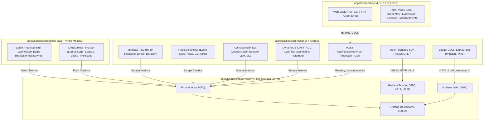

# Mapeamento de métricas e observabilidade

Este artefato passou a ter uma única fonte canônica junto da infraestrutura
de observabilidade, evitando três cópias divergentes no repositório:

[Consultar o mapeamento de métricas](../../apps/fullstack/observability/documentation/mapeamento-metricas-observabilidade.md).

## Sumário

- [1. Introdução e Delimitação de Escopo](#1-introdução-e-delimitação-de-escopo)
  - [1.1 Escopo Restrito: apps/frontend e apps/backend](#11-escopo-restrito-appsfrontend-e-appsbackend)
  - [1.2 Dualidade da Observabilidade: Dados Exibidos vs. Saúde das Aplicações](#12-dualidade-da-observabilidade-dados-exibidos-vs-saúde-das-aplicações)
  - [1.3 Estado das Aplicações: Implementado vs. A Implementar](#13-estado-das-aplicações-implementado-vs-a-implementar)
- [2. Arquitetura Geral de Observabilidade das Aplicações](#2-arquitetura-geral-de-observabilidade-das-aplicações)
- [3. Métricas de apps/frontend (Painel Next.js)](#3-métricas-de-appsfrontend-painel-nextjs)
  - [3.1 Métricas de Negócio e QoE Apresentadas no Painel](#31-métricas-de-negócio-e-qoe-apresentadas-no-painel)
    - [3.1.1 Visão Geral (`/visao-geral`)](#311-visão-geral-visao-geral)
    - [3.1.2 Incidentes (`/incidentes`)](#312-incidentes-incidentes)
    - [3.1.3 Evidências e Diagnóstico (`/evidencias`)](#313-evidências-e-diagnóstico-evidencias)
    - [3.1.4 Eventos Correlacionados (`/eventos`)](#314-eventos-correlacionados-eventos)
    - [3.1.5 Monitoramento Operacional de Pipeline (`/monitoramento`)](#315-monitoramento-operacional-de-pipeline-monitoramento)
  - [3.2 Métricas Técnicas de Execução do Frontend (RUM e Desempenho)](#32-métricas-técnicas-de-execução-do-frontend-rum-e-desempenho)
- [4. Métricas de apps/backend/api (API Express & Camada Agêntica)](#4-métricas-de-appsbackendapi-api-express--camada-agêntica)
  - [4.1 Padrão RED da API HTTP (Rate, Errors, Duration)](#41-padrão-red-da-api-http-rate-errors-duration)
  - [4.2 Métricas de Runtime do Node.js e Event Loop](#42-métricas-de-runtime-do-nodejs-e-event-loop)
  - [4.3 Métricas da Camada Agêntica, Orquestrador e Bedrock LLM](#43-métricas-da-camada-agêntica-orquestrador-e-bedrock-llm)
  - [4.4 Métricas de Acesso ao Banco de Dados (DynamoDB Client)](#44-métricas-de-acesso-ao-banco-de-dados-dynamodb-client)
- [5. Métricas de apps/backend/ingestion-data (Data Ingestion Service)](#5-métricas-de-appsbackendingestion-data-data-ingestion-service)
  - [5.1 Vazão, Volume e Eficiência de Ingestão](#51-vazão-volume-e-eficiência-de-ingestão)
  - [5.2 Latência por Etapa do Pipeline Batch (Meta RNF02)](#52-latência-por-etapa-do-pipeline-batch-meta-rnf02)
  - [5.3 Frescor, Lag da Fonte e Cobertura](#53-frescor-lag-da-fonte-e-cobertura)
  - [5.4 Resiliência, Leases e Rejeições de Schema](#54-resiliência-leases-e-rejeições-de-schema)
  - [5.5 Métricas de Mensageria Assíncrona (SQS / DLQ)](#55-métricas-de-mensageria-assíncrona-sqs--dlq)
- [6. Matriz de Rastreabilidade: Requisitos ↔ Métricas ↔ Alarmes](#6-matriz-de-rastreabilidade-requisitos--métricas--alarmes)
- [7. Roteiro Prático de Instrumentação na Pilha Grafana LGTM](#7-roteiro-prático-de-instrumentação-na-pilha-grafana-lgtm)

---

## 1. Introdução e Delimitação de Escopo

&emsp; Este documento estabelece o **mapeamento normativo de métricas de monitoramento e observabilidade** a serem implementadas na plataforma **View Show**.

### 1.1 Escopo Restrito: apps/frontend e apps/backend

&emsp; O escopo deste levantamento contempla **exclusivamente** as aplicações que constituem a solução definitiva do projeto:

1. **`apps/frontend`:** Aplicação web construída em **Next.js 16 (App Router)** e **React 19**, responsável por renderizar o painel de visualização de incidentes, gráficos temporais de QoE, evidências causais, eventos normalizados e monitoramento do pipeline de telemetria.
2. **`apps/backend`:**
   - **`apps/backend/api`:** Microsserviço de API HTTP construído em **Node.js (Express)**, responsável por servir o dashboard, autenticar usuários (`@globo.com`), orquestrar o diagnóstico causal através de agentes e modelos de linguagem (Amazon Bedrock / Claude 3 Haiku), acessar o **Amazon DynamoDB** (`monitoracao-operacional` e `monitoracao-golden-set`) e expor endpoints REST.
   - **`apps/backend/ingestion-data`:** Serviço em **Python (arquitetura hexagonal/DDD)** responsável pela ingestão de dados agregados e de telemetria do Argus/MySQL, controle de checkpoints e *leases*, normalização para schemas canônicos e gravação dos *read models* no DynamoDB.

> [!IMPORTANT]
> O MVP básico inicial da Sprint 1 (`apps/basica`, API Flask e frontend estático) foi **completamente descontinuado e ignorado** neste documento. Toda a análise foca na arquitetura moderna contida em `apps/frontend` e `apps/backend`.

### 1.2 Dualidade da Observabilidade: Dados Exibidos vs. Saúde das Aplicações

&emsp; A observabilidade neste ecossistema opera em dois níveis correlacionados:

* **Métricas DE Negócio / Telemetria (Observabilidade DO Globoplay):** Os indicadores que o sistema coleta, agrega e projeta para os engenheiros da Globo analisarem a experiência dos assinantes (ex.: tempo de início de vídeo, taxa de erros, rebuffer, sessões ativas).
* **Métricas DE Sistema / Aplicação (Observabilidade DO View Show):** Os indicadores de telemetria interna das nossas próprias aplicações (ex.: latência das rotas Express, consumo de CPU/Heap do Node.js, tempo de execução das tasks de ingestão, taxa de acerto do Bedrock e tempo de renderização no Next.js).

### 1.3 Estado das Aplicações: Implementado vs. A Implementar

```text
┌─────────────────────────────────────────────────────────────────────────────┐
│                            STATUS DAS APLICAÇÕES                            │
├──────────────────────────────────────┬──────────────────────────────────────┤
│ O QUE JÁ FOI IMPLEMENTADO            │ O QUE VAI SER IMPLEMENTADO           │
├──────────────────────────────────────┼──────────────────────────────────────┤
│ • apps/frontend (Next.js 16):        │ • apps/frontend:                     │
│   - Rotas: /visao-geral, /incidentes,│   - Integração completa dos endpoints│
│     /evidencias, /eventos,           │     reais da API com meta.measurement│
│     /monitoramento, /configuracoes.  │   - Coleta de Web Vitals (FCP, LCP)  │
│   - Componentes visuais com mocks e  │   - Telemetria de cliques até a causa│
│     protótipo de alta fidelidade.    │     raiz (RNF10 ≤ 5 cliques).        │
│   - Autenticação e cookies de sessão.│ • apps/backend/api:                  │
│ • apps/backend/api (Node/Express):   │   - Instrumentação prom-client       │
│   - Rotas operacionais (/incidents,  │     expondo rota GET /metrics.       │
│     /evidence, /hypothesis, /review, │   - Tracing distribuído via OTel SDK │
│     /diagnose, /summary, /golden-set)│     apontando para Tempo (4318/OTLP).│
│   - Serviços: evidenceService,       │   - Logs JSON estruturados com       │
│     goldenSetService, mlService,     │     trace_id injetado para o Loki.   │
│     bedrockService (com fallback).   │   - Endpoints do novo contrato:      │
│   - Persistência DynamoDB com GSI    │     /overview, /events, /monitoring. │
│     trace-index e PAY_PER_REQUEST.   │ • apps/backend/ingestion-data:       │
│ • apps/fullstack/observability (LGTM Stack):   │   - Implementação das portas e CLI de│
│   - Docker Compose com Grafana       │     sincronização periódica (15 min).│
│     (3002), Prometheus (9090),       │   - Checkpoints e locks via DynamoDB.│
│     Loki (3100) e Tempo (3200/4318). │   - Métricas de execução batch.      │
└──────────────────────────────────────┴──────────────────────────────────────┘
```

---

## 2. Arquitetura Geral de Observabilidade das Aplicações

&emsp; O diagrama a seguir ilustra o fluxo de coleta e centralização de métricas geradas por `apps/frontend` e `apps/backend` direcionadas à pilha de observabilidade **Grafana LGTM**:



---

## 3. Métricas de apps/frontend (Painel Next.js)

&emsp; O frontend Next.js atua tanto como consumidor de métricas de telemetria para apresentação visual aos operadores quanto como emissor de métricas técnicas sobre sua própria execução no navegador.

### 3.1 Métricas de Negócio e QoE Apresentadas no Painel

&emsp; Estas métricas são calculadas pelo backend e consumidas pelos componentes do frontend nas cinco rotas principais do painel.

#### 3.1.1 Visão Geral (`/visao-geral`)
Consome dados consolidados para fornecer a fotografia instantânea da saúde de reprodução do Globoplay:

| Métrica no Painel | Identificador Técnico na API | Tipo | Unidade | Descrição / Semântica | Requisito | Status |
|:---|:---|:---|:---|:---|:---|:---|
| **Taxa de Erros** | `errors_per_minute` | Gauge | erros/min | Frequência de erros observados por minuto na janela selecionada. | RF06, RF08 | Implementado no Seed / API |
| **Variação da Taxa** | `errors_per_minute.comparison.changeRatio` | Gauge | decimal | Variação percentual da taxa de erros em relação à baseline histórica. | RF07 | Implementado no Seed / API |
| **Tempo de Início (p95)** | `startup_time_p95` | Gauge | `ms` | Percentil 95 do tempo decorrido até o primeiro quadro de vídeo. | RF06, RF08 | Em Contrato / API |
| **Sessões Afetadas** | `affected_sessions` | Gauge | sessões | Quantidade absoluta de sessões de assinantes impactadas por erros. | RF07, RF08 | Implementado no Seed / API |
| **Fatia de Impacto** | `affected_sessions.shareOfObservedSessions` | Gauge | ratio (0–1) | Proporção de sessões afetadas sobre a audiência total observada. | RF07 | Em Contrato / API |
| **Série de Saúde** | `experienceHealth.points` | Série Temporal | erros/min | Curva temporal de erros ao longo da janela (resolução 900s). | RF07 | Implementado no Mock / API |
| **Janelas de Anomalia** | `experienceHealth.anomalyWindows` | Intervalo | timestamps | Intervalos de tempo em que a métrica excedeu o desvio padrão da linha de base. | RF07, RNF15 | Implementado no Mock / API |
| **Contagem de Incidentes** | `active_incidents` / `critical_incidents` | Gauge | contagem | Total de incidentes ativos e classificados como severidade P1/P2. | RF07 | Implementado em `dashboard.js` |

#### 3.1.2 Incidentes (`/incidentes`)
Permite a busca filtrada, priorização e visualização agregada de anomalias operacionais:

| Métrica no Painel | Identificador Técnico na API | Tipo | Unidade | Descrição / Semântica | Requisito | Status |
|:---|:---|:---|:---|:---|:---|:---|
| **Dispositivos Afetados** | `affected_devices` | Gauge | dispositivos | Quantidade estimada de aparelhos afetados por um incidente específico. | RF07, RF08 | Implementado em `incidents.js` |
| **Volume por Severidade** | `incidents_volume_by_priority` | Série Empilhada | incidentes | Contagem de incidentes ativos fatiada por gravidade (P1, P2, P3, P4). | RF07 | Implementado no Frontend |
| **Facetas de Dispositivos**| `facets.deviceTypes` | Agregado | contagem | Distribuição de incidentes por tipo de aparelho (Smart TV, Mobile, Web). | RF07 | Implementado no Mock / API |
| **Facetas Regionais** | `facets.regions` | Agregado | contagem | Distribuição de incidentes por macrorregião ou UF. | RF07 | Implementado no Mock / API |

#### 3.1.3 Evidências e Diagnóstico (`/evidencias`)
Exibe a explicação analítica da causa provável de um incidente com evidências rastreáveis:

| Métrica no Painel | Identificador Técnico na API | Tipo | Unidade | Descrição / Semântica | Requisito | Status |
|:---|:---|:---|:---|:---|:---|:---|
| **Confiança da Hipótese** | `hypothesis.confidence` | Gauge | `%` (0–100) | Grau de certeza probabilística atribuído à causa raiz diagnosticada. | RF07, RNF08 | Implementado na API / Bedrock |
| **Razão de Concentração** | `concentration.percentage` | Gauge | `%` | Percentual de concentração de falhas em um atributo (ex: 80% em webOS 6.0). | RF07, RNF10 | Implementado no Seed / API |
| **Força da Evidência** | `evidence.strength` | Categórico | `forte \| neutra \| contra` | Grau de correlação causal da métrica com a hipótese proposta. | RF07 | Implementado em `evidenceService` |
| **Buffering Ratio na Crise** | `qoe.buffering_ratio_series` | Série Temporal | `%` | Curva de taxa de rebuffer antes e depois do deploy ou evento causador. | RF06, RF07 | Implementado no Mock / API |
| **Discrepância Temporal** | `timeline.delta_minutes` | Gauge | minutos | Diferença temporal entre o deploy/mudança de infraestrutura e o início das falhas. | RF07 | Implementado no Mock / API |

#### 3.1.4 Eventos Correlacionados (`/eventos`)
Apresenta o fluxo de eventos brutos e normalizados das seis categorias canônicas (US-ENG-02 e US-ENG-03):

| Métrica no Painel | Identificador Técnico na API | Tipo | Unidade | Descrição / Semântica | Requisito | Status |
|:---|:---|:---|:---|:---|:---|:---|
| **Volume por Categoria** | `categoryStats.count` | Contador | eventos | Contagem na janela para: `request`, `vitals`, `screen_view`, `video_view`, `session`, `error`. | RF06 | Implementado no Frontend |
| **Taxa por Categoria** | `categoryStats.ratePerMinute` | Gauge | eventos/min | Frequência instantânea de eventos por categoria. | RF06 | Implementado no Frontend |
| **Latência HTTP da Sessão**| `normalized.durationMs` | Histograma | `ms` | Latência da chamada HTTP completada (schema `request.v1`). | RF06 | Implementado no Mock / API |
| **Duração do ANR** | `normalized.value` | Histograma | segundos | Tempo de congelamento da interface em Smart TVs (schema `vitals.v1`). | RF01, RF06 | Implementado no Mock / API |
| **Tempo de Inicialização** | `normalized.startupTimeMs` | Histograma | `ms` | Tempo de carga de mídia na sessão (schema `video_view.v1`). | RF06 | Implementado no Mock / API |

#### 3.1.5 Monitoramento Operacional de Pipeline (`/monitoramento`)
Acompanha o fluxo de processamento e a integridade das fontes de dados:

| Métrica no Painel | Identificador Técnico na API | Tipo | Unidade | Descrição / Semântica | Requisito | Status |
|:---|:---|:---|:---|:---|:---|:---|
| **Vazão Global de Ingestão**| `kpis.ingestionPerMinute` | Gauge | mi registros/min | Volume consolidado de registros absorvidos pelas fontes de telemetria. | RNF01 | Implementado no Frontend |
| **Latência de Processamento**| `kpis.processingLatency` | Gauge | segundos | Média ponderada do tempo gasto para disponibilizar os eventos (Meta ≤ 120s). | RNF02 | Implementado no Frontend |
| **Profundidade da Fila** | `kpis.queueDepth` | Gauge | mil mensagens | Mensagens aguardando processamento no buffer do pipeline. | RNF01 | Implementado no Frontend |
| **Mensagens em DLQ** | `kpis.deadLetters` / `newDeadLetters` | Gauge | mensagens | Falhas retidas na fila de mensagens mortas e novos ingressos na janela. | RNF03 | Implementado no Frontend |
| **Cobertura da Fonte** | `source.coverage` | Gauge | `%` (0–100) | Percentual de eventos esperados que chegaram íntegros da fonte upstream. | RF05, RNF11 | Implementado no Frontend |
| **Lag da Fonte Upstream** | `source.updatedSecondsAgo` | Gauge | segundos | Segundos transcorridos desde a última atualização válida da fonte. | RF08 | Implementado no Frontend |
| **Instabilidade por Estado**| `geography.instability_ratio` | Gauge | `%` por UF | Índice de falhas de playback segmentado por Unidade Federativa. | RF08, RF09 | Implementado no Frontend |

---

### 3.2 Métricas Técnicas de Execução do Frontend (RUM e Desempenho)

&emsp; Métricas emitidas pelo runtime do navegador do operador enquanto utiliza o painel Next.js:

| Métrica Técnica | Identificador Técnico | Tipo | Unidade | Meta Operacional | Destino |
|:---|:---|:---|:---|:---|:---|
| **First Contentful Paint** | `frontend_web_vitals_fcp_seconds` | Histograma | segundos | **≤ 30,0 s** (RNF07) | API RUM → Prometheus |
| **Largest Contentful Paint** | `frontend_web_vitals_lcp_seconds` | Histograma | segundos | ≤ 2,5 s | API RUM → Prometheus |
| **Interaction to Next Paint**| `frontend_web_vitals_inp_ms` | Histograma | `ms` | ≤ 200 ms | API RUM → Prometheus |
| **Cumulative Layout Shift** | `frontend_web_vitals_cls` | Gauge | pontuação | ≤ 0,1 | API RUM → Prometheus |
| **Erros de Renderização** | `frontend_client_errors_total` | Contador | erros | 0 erros não tratados | API RUM → Prometheus / Loki |
| **Falhas de Fetch na API** | `frontend_api_fetch_errors_total` | Contador | erros | taxa < 0,1% | API RUM → Prometheus / Loki |
| **Cliques até a Causa Raiz** | `operator_clicks_to_root_cause` | Histograma | cliques | **≤ 5 cliques** (RNF10) | API RUM → Prometheus |

---

## 4. Métricas de apps/backend/api (API Express & Camada Agêntica)

&emsp; Mede a saúde, vazão, erros, latência interna e uso de recursos do serviço Node.js localizado em `apps/backend/api`.

### 4.1 Padrão RED da API HTTP (Rate, Errors, Duration)

&emsp; Coletadas via middleware Express usando a biblioteca `prom-client`:

| Métrica / Nome Técnico | Tipo | Labels | Descrição / SLA |
|:---|:---|:---|:---|
| `http_requests_total` | Contador | `method`, `route`, `status_code` | Taxa de requisições atendidas pela API (Rate). |
| `http_requests_failed_total` | Contador | `method`, `route`, `status_code` | Contagem de requisições com status 4xx e 5xx (Errors). |
| `http_request_duration_seconds` | Histograma | `method`, `route`, `status_code` | Duração das requisições HTTP. **Meta RNF14: p95 ≤ 2,0 s** para buscas filtradas em `/api/v1/incidents`. |
| `http_requests_in_flight` | Gauge | `method`, `route` | Requisições sendo processadas concorrentemente no momento. |
| `http_response_size_bytes` | Histograma | `route` | Tamanho do payload de resposta serializado (monitora pacotes grandes sem paginação). |

Buckets recomendados para o histograma de latência:
`[0.05, 0.1, 0.25, 0.5, 1.0, 1.5, 2.0, 3.0, 5.0, 10.0]` (em segundos).

### 4.2 Métricas de Runtime do Node.js e Event Loop

&emsp; Fundamentais para prevenir travamentos como os observados nos testes de carga k6 (saturação de CPU em contêineres de 0,25 vCPU):

| Métrica / Nome Técnico | Tipo | Unidade | Descrição / Diagnóstico |
|:---|:---|:---|:---|
| `nodejs_eventloop_lag_seconds` | Gauge | segundos | Atraso no ciclo de eventos. Valores > 0,1s indicam bloqueio síncrono da thread por parsing excessivo de JSON ou filtragem pesada em memória. |
| `nodejs_gc_duration_seconds` | Histograma | segundos | Duração das coletas de lixo V8 (labels: `scavenge`, `mark-sweep-compact`). |
| `process_cpu_user_seconds_total` | Contador | segundos | Segundos de CPU gastos em código de usuário. |
| `process_cpu_system_seconds_total`| Contador | segundos | Segundos de CPU gastos em chamadas de sistema do kernel. |
| `nodejs_heap_size_used_bytes` | Gauge | bytes | Memória Heap efetivamente alocada por objetos JavaScript. |
| `nodejs_heap_size_total_bytes` | Gauge | bytes | Tamanho total reservado para a Heap V8. |
| `process_resident_memory_bytes` | Gauge | bytes | Memória física residente ocupada pelo contêiner (RSS). |
| `nodejs_active_handles` | Gauge | contagem | Sockets de rede e descritores de arquivos abertos. |

### 4.3 Métricas da Camada Agêntica, Orquestrador e Bedrock LLM

&emsp; Medem o desempenho da investigação automatizada e da geração de explicações:

> [!WARNING]
> As métricas `bedrock_*` são **condicionais à disponibilidade do serviço na
> conta de deploy**. O AWS Academy Learner Lab usado pelo projeto não concede
> acesso ao Bedrock; por isso `apps/fullstack/variables.tf` mantém
> `bedrock_habilitado=false` e a API responde com a explicação por template.
> Não basta alterar `BEDROCK_ENABLED`: antes é necessário confirmar permissão
> de conta, modelo e região. Os riscos R4 e R6 de
> `artefatos/sprint2/arquitetura-inicial.md` permanecem abertos, pois o Bedrock
> ficou desativado em todos os testes e sua latência e seu consumo de tokens
> ainda não foram medidos.

| Métrica / Nome Técnico | Tipo | Labels | Descrição / Racional | Status |
|:---|:---|:---|:---|:---|
| `agent_investigation_duration_seconds` | Histograma | `diagnosis_source` | Tempo total de execução de `orchestrator.diagnose()` (labels: `golden-set` vs `agent`). | A implementar — independente do Bedrock |
| `bedrock_invocation_duration_seconds` | Histograma | `model_id`, `status` | Tempo de resposta da chamada ao Amazon Bedrock (`anthropic.claude-3-haiku-20240307-v1:0`). | **Bloqueada no Learner Lab**; validar somente após obter acesso |
| `bedrock_invocations_total` | Contador | `status: success \| failure \| throttled` | Total de chamadas de geração de texto efetivamente enviadas ao Bedrock. | **Condicional ao acesso ao Bedrock** |
| `bedrock_fallback_total` | Contador | `reason: disabled \| access_denied \| throttled \| timeout \| error` | Disparos do fallback por template quando o Bedrock está desabilitado ou indisponível (ADR-004). | **Condicional**; `reason="disabled"` pode ser medido agora, demais razões exigem acesso |
| `bedrock_tokens_total` | Contador | `token_type: input \| output` | Quantidade de tokens de entrada e saída informada pela resposta do modelo. | **Bloqueada no Learner Lab**; não há tokens sem invocação real |
| `golden_set_matches_total` | Contador | `component` | Diagnósticos resolvidos deterministicamente via caso curado sem acionar o agente LLM. | A implementar — independente do Bedrock |
| `golden_set_promotions_total` | Contador | `component` | Casos promovidos ao Golden Set através de revisão humana confirmada (`status="confirmed"`). | A implementar — independente do Bedrock |
| `hypothesis_review_submissions_total` | Contador | `verdict: confirmed \| refuted` | Avaliações de hipótese submetidas por engenheiros na rota `/review`. | A implementar — independente do Bedrock |

### 4.4 Métricas de Acesso ao Banco de Dados (DynamoDB Client)

&emsp; Medem a interação de `evidenceService` e `goldenSetService` com o DynamoDB:

| Métrica / Nome Técnico | Tipo | Labels | Descrição / Diagnóstico de Desempenho |
|:---|:---|:---|:---|
| `dynamodb_client_duration_seconds` | Histograma | `operation: Query \| GetItem \| PutItem \| UpdateItem`, `table` | Latência da chamada ao DynamoDB vista pelo SDK AWS. |
| `dynamodb_client_errors_total` | Contador | `operation`, `error_code` | Erros de comunicação, timeouts ou rejeições do banco. |
| `dynamodb_scanned_to_returned_ratio` | Gauge | `operation`, `table` | **Métrica do Gargalo de Carga:** Razão entre registros varridos e registros devolvidos. Valores > 2,0 indicam desperdício de RCU e leitura de itens indesejados. |
| `dynamodb_items_read_per_query` | Histograma | `route` | Quantidade bruta de itens retornados por uma `Query` de janela horária. |

---

## 5. Métricas de apps/backend/ingestion-data (Data Ingestion Service)

&emsp; Mede a execução periódica do worker modular em Python responsável por transferir e consolidar os dados do Argus no DynamoDB.

### 5.1 Vazão, Volume e Eficiência de Ingestão

| Métrica / Nome Técnico | Tipo | Labels | Descrição |
|:---|:---|:---|:---|
| `ingestion_records_read_total` | Contador | `source_dataset` | Total de registros lidos da origem (ex.: `signal_bucket`, `live_active_15min`, `geo_hourly`). |
| `ingestion_records_written_total` | Contador | `source_dataset` | Registros canônicos gravados na tabela `monitoracao-operacional`. |
| `ingestion_records_unmodified_total` | Contador | `source_dataset` | Registros cujo `payloadHash` coincidiu com o estado anterior (escrita evitada). |
| `ingestion_records_rate_per_minute` | Gauge | `worker`, `source_dataset` | Vazão efetiva de processamento de registros por minuto de execução. |
| `ingestion_bytes_transferred_total` | Contador | `direction: read \| write` | Volume em bytes trafegado na rede durante a sincronização. |

### 5.2 Latência por Etapa do Pipeline Batch (Meta RNF02)

| Métrica / Nome Técnico | Tipo | Labels | Descrição / SLA |
|:---|:---|:---|:---|
| `ingestion_pipeline_run_duration_seconds`| Histograma | `command: sync \| backfill` | Duração total da task ECS do ciclo. **Meta RNF02: ≤ 120 segundos** para disponibilidade do dado. |
| `ingestion_stage_duration_seconds` | Histograma | `stage: read \| normalize \| detect \| write` | Tempo consumido individualmente em cada porta da arquitetura hexagonal. |
| `ingestion_chunk_processing_seconds` | Histograma | `source_dataset` | Duração de processamento de cada chunk paginado por chave natural (sem `OFFSET`). |
| `ingestion_projections_rebuild_seconds` | Histograma | `projection_name` | Tempo de reconstrução dos read models (`VIEW#OVERVIEW`, `VIEW#INCIDENTS`, etc.). |

### 5.3 Frescor, Lag da Fonte e Cobertura

| Métrica / Nome Técnico | Tipo | Labels | Descrição / Alerta |
|:---|:---|:---|:---|
| `ingestion_source_lag_seconds` | Gauge | `source_dataset` | Diferença temporal entre `now()` e o `observedThrough` da fonte. Alerta se ultrapassar o SLA da fonte. |
| `ingestion_coverage_ratio` | Gauge | `source_dataset` | Razão entre buckets de tempo íntegros recebidos e esperados (0,0 a 1,0). |
| `ingestion_watermark_timestamp_seconds` | Gauge | `watermark_type: source \| materialized \| projection` | Posição temporal do cursor de checkpoint consolidado no banco. |
| `ingestion_last_successful_sync_timestamp`| Gauge | `source_dataset` | Epoch timestamp do último run concluído com status `SUCCEEDED`. |

### 5.4 Resiliência, Leases e Rejeições de Schema

| Métrica / Nome Técnico | Tipo | Labels | Descrição |
|:---|:---|:---|:---|
| `ingestion_records_rejected_total` | Contador | `source_dataset`, `reason` | Registros rejeitados por falha de parse ou quebra de contrato. **Atende ao RNF03 (isolamento sem parar o lote).** |
| `ingestion_schema_drift_total` | Contador | `source_dataset` | Ocorrências de incompatibilidade de colunas no schema físico da origem. |
| `ingestion_lease_acquisitions_total` | Contador | `scope: global \| source` | Total de locks distribuídos adquiridos via escrita condicional no DynamoDB. |
| `ingestion_lease_conflicts_total` | Contador | `scope` | Execuções concorrentes barradas com status `SKIPPED_LOCKED`. |
| `ingestion_runs_total` | Contador | `status: SUCCEEDED \| PARTIAL \| FAILED` | Contagem de ciclos de execução por status final. |

### 5.5 Métricas de Mensageria Assíncrona (SQS / DLQ)

*Modelagem para quando o desacoplamento por fila for ativado no pipeline (conforme RNF01 e RNF03):*

| Métrica / Nome Técnico | Tipo | Unidade | Descrição |
|:---|:---|:---|:---|
| `sqs_queue_depth_messages` | Gauge | mensagens | Profundidade da fila principal (*ApproximateNumberOfMessagesVisible*). |
| `sqs_dead_letter_queue_messages` | Gauge | mensagens | Mensagens corrompidas isoladas na DLQ (*ApproximateNumberOfMessagesVisible*). |
| `sqs_oldest_message_age_seconds` | Gauge | segundos | Idade da mensagem mais antiga na fila sem processamento. |

---

## 6. Matriz de Rastreabilidade: Requisitos ↔ Métricas ↔ Alarmes

&emsp; Esta matriz correlaciona os Requisitos Não Funcionais (RNF) especificados na norma ISO/IEC 25010 com as métricas monitoradas e suas regras de alarme:

| Requisito | Categoria | Descrição | Métrica Observada | Limiar de Alarme | Gravidade |
|:---|:---|:---|:---|:---|:---|
| **RNF01** | Capacidade | Escalar sob picos sem acúmulo de mensagens | `ingestion_records_rate_per_minute` / `process_cpu_user_seconds_total` | Taxa de CPU > 85% por mais de 5 min | Crítico |
| **RNF02** | Tempo | Ponta a ponta entre captura e consulta ≤ 2 min | `ingestion_pipeline_run_duration_seconds` | `p95(duration) > 120s` em 2 execuções seguidas | Crítico |
| **RNF03** | Tolerância a Falhas | Payload inválido isola mensagem sem parar lote | `ingestion_records_rejected_total` / `ingestion_runs_total{status="PARTIAL"}` | Falha que aborta o lote inteiro (`status="FAILED"`) | Alto |
| **RNF04** | Segurança | Acesso exclusivo com domínio `@globo.com` | `http_requests_total{route="/auth/login", status_code="401\|403"}` | Tentativas inválidas > 20 req/min | Alto |
| **RNF05** | Recursos | 30 dias em hot storage e expiração via TTL | `dynamodb_table_item_count` / registros TTL | Itens expirados há mais de 48h sem exclusão | Médio |
| **RNF06** | Portabilidade | Contêiner Docker autônomo por variáveis de ambiente | `nodejs_heap_size_used_bytes` / falhas de boot | Falha de inicialização ou crash do contêiner | Crítico |
| **RNF07** | Tempo | FCP do painel Next.js ≤ 30 segundos | `frontend_web_vitals_fcp_seconds` | `p95(FCP) > 30,0s` em auditorias web | Médio |
| **RNF08** | Correção ML | Diagnóstico com F1-Score ≥ 80% | `ml_diagnosis_f1_score` | `F1_Score < 0.80` no conjunto holdout | Crítico |
| **RNF09** | Disponibilidade | Disponibilidade do serviço da API ≥ 99,9% | `http_requests_failed_total{status_code=~"5.."}` | Taxa de erro 5xx > 0,1% em janela de 5 min | Crítico |
| **RNF10** | Usabilidade | Operador localiza causa raiz em até 5 cliques | `operator_clicks_to_root_cause` | `p90(cliques) > 5` em testes guiados | Baixo |
| **RNF11** | Interoperabilidade| Normalizar múltiplos schemas sem mudar cliente | `ingestion_records_rejected_total{reason="schema_drift"}` | Erros de schema drift > 0 | Alto |
| **RNF12** | Testabilidade | Cobertura de testes automatizados ≥ 70% | Relatório de cobertura no GitLab CI | Cobertura total < 70% (bloqueia pipeline) | Crítico (CI) |
| **RNF13** | Recursos | Modelo de ML usa contexto de no máximo 5h de logs | `ml_feature_window_duration_hours` | Janela de logs enviada ao modelo > 5,0 horas | Alto |
| **RNF14** | Tempo | Busca filtrada na API com p95 ≤ 2 segundos | `http_request_duration_seconds{route="/api/v1/incidents"}` | `p95(duration) > 2.0s` | Crítico |
| **RNF15** | Recuperação | Alerta emitido em até 30s após degradação | `anomaly_time_to_signal_seconds` | Intervalo até emissão do alerta > 30s | Alto |

---

## 7. Roteiro Prático de Instrumentação na Pilha Grafana LGTM

&emsp; Para colocar este levantamento em operação na pilha local existente em `apps/fullstack/observability`, deve-se executar:

### Passo 0: Coletar e enviar RUM no `apps/frontend`

1. Instalar `web-vitals` em `apps/frontend` e criar um componente client-only
   (por exemplo, `app/web-vitals-reporter.tsx` com `"use client"`) carregado pelo
   layout raiz. Registrar `onFCP`, `onLCP`, `onINP` e `onCLS`; converter FCP e
   LCP de milissegundos para segundos antes do envio. Os listeners globais de
   `error` e `unhandledrejection`, o wrapper central de `fetch` e o evento de
   abertura da evidência de causa raiz completam as outras três métricas da
   Seção 3.2.
2. Resolver `NEXT_PUBLIC_API_BASE_URL="/"` para `window.location.origin`, como
   já faz `lib/data/client.ts`, e enviar cada observação com
   `fetch(..., { method: "POST", keepalive: true })` para
   `/api/v1/telemetry/rum` nessa base. Como o frontend usa `output: "export"`, o
   coletor roda somente no navegador e a variável é incorporada durante o
   build; nenhum segredo pode ser colocado nela. O contrato mínimo da
   requisição é:
   ```json
   {
     "schemaVersion": 1,
     "name": "frontend_web_vitals_lcp_seconds",
     "value": 1.84,
     "unit": "seconds",
     "metricId": "v5-123",
     "path": "/incidentes",
     "navigationType": "navigate",
     "occurredAt": "2026-09-06T18:30:00.000Z",
     "rating": "good"
   }
   ```
   Não enviar URL completa, query string, e-mail, cookie, stack trace sem
   sanitização ou outro dado pessoal. O backend deve aceitar apenas os sete
   nomes da Seção 3.2 e normalizar `path` para evitar cardinalidade ilimitada.
3. Criar na API Express o endpoint público e limitado
   `POST /api/v1/telemetry/rum`, com limite de corpo, rate limit e validação do
   payload. Ele deve responder `202 Accepted` e atualizar no `prom-client` o
   histograma, gauge ou contador correspondente; erros sanitizados também podem
   ser registrados no logger JSON para consulta no Loki. O endpoint não envia
   métricas diretamente ao Tempo: o Prometheus as coleta em `GET /metrics`.
4. Configurar a origem antes de testar:
   - no deploy atual, o Amplify encaminha `/api/*` e
     `NEXT_PUBLIC_API_BASE_URL="/"`, portanto navegador e endpoint são da mesma
     origem;
   - em chamada direta para outro host, definir `FRONTEND_ORIGIN` na API com a
     origem HTTPS exata do Amplify (ou a origem local no desenvolvimento),
     permitir `POST`, `OPTIONS` e `Content-Type`, e manter
     `credentials: true`; não usar `Access-Control-Allow-Origin: *` junto com
     credenciais;
   - validar no navegador que o preflight `OPTIONS` retorna a origem permitida
     e que uma origem diferente é recusada.
5. Confirmar no Prometheus que as sete séries aparecem após uso real do painel
   e criar um teste de contrato do endpoint cobrindo payload válido, nome fora
   da allowlist, corpo excedente e origem CORS não autorizada.

### Passo 1: Instrumentar `apps/backend/api` com Prometheus
1. Instalar a biblioteca no backend:
   ```bash
   cd apps/backend/api
   npm install prom-client@15
   ```
2. Criar o módulo de métricas (`src/metrics.js`) inicializando `collectDefaultMetrics()` e registrando as métricas RED (`http_requests_total`, `http_request_duration_seconds`).
3. Registrar o endpoint no Express:
   ```javascript
   app.get("/metrics", async (req, res) => {
     res.set("Content-Type", register.contentType);
     res.end(await register.metrics());
   });
   ```
4. Em `apps/fullstack/observability/prometheus/prometheus.yml`, descomentar o alvo `view-show-api` apontando para `host.docker.internal:3000`.

### Passo 2: Instrumentar Rastreamento OTLP com Tempo
1. Instalar `@opentelemetry/sdk-node`, `@opentelemetry/auto-instrumentations-node` e `@opentelemetry/exporter-trace-otlp-http`.
2. Configurar o endpoint OTLP para `http://localhost:4318/v1/traces`.
3. Injetar `trace_id` em spans de chamadas externas:
   - Requisição HTTP recebida no Express.
   - Chamada ao DynamoDB (SDK Client).
   - Invocação do modelo no Amazon Bedrock.

### Passo 3: Envio de Logs Estruturados ao Loki
1. Padronizar o logger da aplicação em JSON estruturado incluindo os atributos:
   ```json
   {
     "level": "info",
     "message": "Diagnóstico concluído",
     "trace_id": "3b2c1a4e5f6d7c8b",
     "incidentId": "INC-4821",
     "duration_ms": 142
   }
   ```
2. O Loki correlacionará o `trace_id` com o Tempo via derived field configurado em `apps/fullstack/observability/grafana/provisioning/datasources/datasources.yml`.

### Passo 4: Dashboards Declarativos no Grafana
1. Criar `apps/fullstack/observability/grafana/provisioning/dashboards/dashboards.yml`.
2. Provisionar três painéis:
   - **Painel 1: Performance da API (RED + Node.js + DynamoDB):** Vazão req/s, latência p95 (meta 2s), erros 5xx, event loop lag e RCU consumidos.
   - **Painel 2: QoE Globoplay (Dados do Frontend):** Taxa de erros por minuto, startup time p95, sessões afetadas, buffer ratio e mapa de calor por UF.
   - **Painel 3: Pipeline de Ingestão e Diagnóstico:** Latência de execução batch (meta 120s), volume de registros lidos/escritos, taxa de acerto do Golden Set e, somente quando houver acesso confirmado, latência do Bedrock. Enquanto `BEDROCK_ENABLED=false`, exibir explicitamente “Bedrock indisponível/não habilitado” em vez de interpretar a ausência de séries como latência zero.
