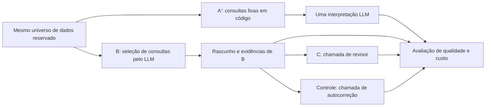
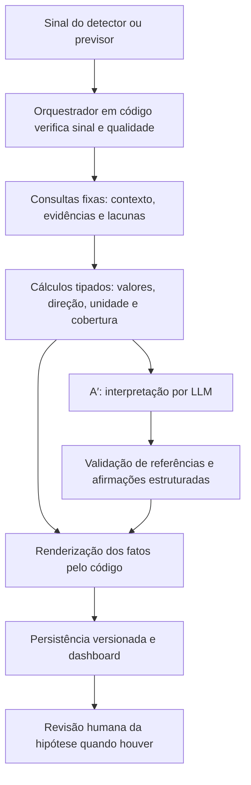

# Análise de arquiteturas agênticas — estudo e decisão por A′

- **Estado:** estudo documentado e arquitetura escolhida para desenvolvimento; implementação corrigida e validação integradas pendentes.
- **Data/versão:** 22/09/2026, 1.0.
- **Decisão atual:** A′ com contexto fixo, cálculos e validações em código, confirmada pelo responsável pelo projeto nesta conversa.
- **Plano de execução:** [plano de implementação para os desenvolvedores](estudos/plano-implementacao-a-prime.md).
- **Natureza:** registro de pesquisa e decisão de desenvolvimento. Os contratos operacionais continuam em [Análise de dados e diagnóstico por IA](analise-e-ia.md).

## 1. Pergunta do estudo

O projeto precisa transformar resultados de detecção e previsão em explicações úteis: o que mudou, quais dados sustentam essa observação, quais causas são possíveis e o que falta verificar. A pergunta investigada foi quanto de autonomia ou revisão por LLM agrega valor diante dos dados realmente disponíveis e do servidor da faculdade.

O processamento numérico e o controle operacional permanecem em código. A discussão de arquitetura está na seleção de contexto e na interpretação. Chamar uma LLM para redigir uma hipótese com dados já selecionados não caracteriza, por si só, um agente autônomo. O nome existente `agentic` no repositório não obriga a usar ferramentas ou múltiplos agentes em produção.

## 2. Alternativas consideradas

| Alternativa | Quem escolhe o contexto? | Papel do LLM | Situação no estudo |
| --- | --- | --- | --- |
| A inicial | Código com contexto inicial | Interpretar pacote fixo | Primeira bateria A/B |
| **A′** | **Código com contexto melhorado e consultas fixas** | **Interpretar uma vez, com evidências e definições** | **Comparação final; escolhida para desenvolvimento** |
| B | Código prepara base; LLM escolhe consultas adicionais limitadas | Planejar consulta e interpretar | Comparação inicial e final |
| C | Mesmo investigador B; revisor recebe o rascunho e as mesmas evidências | Revisar em uma chamada adicional | Comparação final |
| Autocorreção de B | Mesmo contexto e rascunho usados por C | Reexaminar sob a instrução de autocorreção | Controle da comparação final |
| Supervisor e especialistas | Supervisor distribui investigação entre papéis | Reunir contribuições de áreas diferentes | Discutida; não executada nesta bateria |
| Debate | Agentes confrontam interpretações em rodadas | Resolver divergências e produzir síntese | Discutida; não executada nesta bateria |

C e autocorreção são etapas fixas de revisão nesta implementação. Não realizam consultas próprias ou debate contínuo. O controle isola principalmente a instrução de papel: revisar outro investigador ou reexaminar o próprio trabalho. O estudo não permite rejeitar genericamente qualquer sistema multiagente.

## 3. Dados e desenho executado

O material veio de recortes reais de QoE do ARGUS. A comparação final usou oito cenários de datas distintas, com dois canais, seis pontos horários e oito métricas por cenário: 768 observações agregadas. Foram escolhidos três aumentos, três quedas e dois casos quase estáveis de `bufferratio_avg`. Essas categorias representam contraste descritivo, não rótulos de incidente ou normalidade.

Os recortes finais excluíram as datas da primeira bateria e uma faixa temporal de proteção; isso evita reutilizar observações, mas não comprova independência entre incidentes. A amostra não representa a prevalência real de problemas do serviço.

| Etapa | Execução | Uso correto do resultado |
| --- | --- | --- |
| Primeira bateria | 12 cenários × A/B × 3 repetições = 72 investigações | Identificar falhas de formato, significado, denominador e escopo |
| Calibração | Casos conhecidos, com rodadas versionadas; última rodada 12/12 válida | Ajustar o laboratório antes da avaliação reservada |
| Comparação final | 8 cenários × A′/B/C/autocorreção × 3 repetições = 96 respostas | Comparar as configurações congeladas nos novos recortes |
| Julgamento das respostas | Sol com etiquetas ocultas, seguido de auditoria e segunda passagem | Avaliar fidelidade, contrapontos, incerteza e utilidade |

Na primeira bateria, A teve 23/36 saídas válidas e B, 34/36. Na final, todas as configurações tiveram 24/24 saídas válidas. Essa mudança não mede isoladamente o efeito de uma correção: prompts, contratos e casos mudaram entre as baterias.

O modelo gerador da comparação final foi `gemma4:12b` no Ollama do servidor da faculdade. O Sol foi o avaliador posterior das respostas salvas. Foram 144 novas chamadas ao modelo gerador e 67.475 tokens efetivamente gerados: os rascunhos B foram reutilizados por C e autocorreção. As 96 saídas não exigiram 96 execuções independentes de toda a cadeia.

A bateria comparou explicações sobre diferenças descritivas. **Não executou o detector operacional nem o Random Forest de previsão**, não mediu previsão da próxima hora e não validou integração com SQS/DynamoDB. Os notebooks e a biblioteca de diagnóstico pertencem ao contexto do projeto, mas seus resultados não devem ser confundidos com este benchmark.

## 4. Como a nota foi calculada

Cada resposta recebeu quatro notas inteiras de zero a dois, sem pesos diferentes:

| Dimensão | Pergunta avaliada | Nota 0 / 1 / 2 |
| --- | --- | --- |
| Apoio factual | Valores, unidades, entidade e afirmações são sustentados? | Incorreto ou sem apoio / parcial / sustentado |
| Contrapontos | Trata dados que enfraquecem ou limitam a conclusão? | Ignora / parcialmente / adequadamente |
| Incerteza | Distingue fato, hipótese e limite do conhecimento? | Confunde / ressalva insuficiente / distingue |
| Próximo passo | Propõe uma verificação pertinente e específica? | Inútil ou ausente quando necessária / genérica / específica e com disponibilidade explícita |

A soma produz uma nota de 0 a 8. Para cada arquitetura, calcula-se a média das três repetições de cada cenário e depois a média dos oito cenários. Como os grupos têm o mesmo tamanho, o resultado coincide com a média das 24 notas; a agregação por cenário explicita que repetições não são 24 incidentes independentes.

Exemplo ilustrativo: notas 2, 2, 2 e 1 produzem 7/8. Isso não significa 87,5% de acurácia causal. São julgamentos em uma rubrica, e a precisão decimal da média não elimina a subjetividade das notas.

O protocolo previa revisão humana. Após a geração das respostas, o usuário solicitou avaliação pelo Sol. Essa mudança foi documentada; as notas por IA não foram inseridas como revisão humana. O juiz recebeu dados, definições e evidências, com configuração e custo ocultos. Estilo e conteúdo ainda podiam dar pistas sobre a configuração.

## 5. Resultados finais da avaliação por IA

| Configuração | Nota média / 8 | Críticos sinalizados | Validade estrutural | Tempo médio | P95 |
| --- | ---: | ---: | ---: | ---: | ---: |
| **A′** | **7,79** | **2/24** | 24/24 | **29,93 s** | **35,33 s** |
| B | 7,21 | 0/24 | 24/24 | 38,54 s | 52,34 s |
| C | 7,21 | 0/24 | 24/24 | 69,27 s | 86,18 s |
| Autocorreção | 7,25 | 0/24 | 24/24 | 70,50 s | 86,09 s |

A′ superou B na média de seis cenários, perdeu em um e empatou em um. A vantagem média foi 0,58 ponto. Removendo um cenário por vez, a vantagem ficou entre 0,33 e 0,71: a direção se manteve, mas nem sempre a margem de 0,5 ponto. Não é prova de superioridade populacional.

C preservou exatamente 21 dos 24 rascunhos B. Das três alterações, uma mudou apenas a redação e duas acrescentaram hipótese ou ressalva; nenhuma corrigiu uma observação. Sua nota permaneceu igual à de B e o tempo médio aumentou aproximadamente 80%. A autocorreção teve ganho de apenas 0,04 ponto e tempo semelhante ao de C.

B realizou 26 consultas adicionais. Oito incluíram uma taxa agregada já presente no contexto como se ela fosse série horária; duas ficaram completamente sem resultado. A autonomia de consulta funcionou, mas também introduziu trabalho redundante e contribuiu para afirmações incorretas de indisponibilidade.

## 6. Erros críticos, falsos positivos e limites do juiz

Três conceitos precisam ficar separados:

| Conceito | Exemplo | O estudo permite medir? |
| --- | --- | --- |
| Erro factual na explicação | Dizer 3,33 quando o dado é 0,3333 | Sim, conferindo a resposta contra a evidência |
| Falso alerta do avaliador | O juiz marca como crítico algo que a auditoria não confirma | Foi observado e corrigido no julgamento |
| Falso positivo do detector | Disparo de anomalia quando o gabarito diz que não há problema | Não nesta bateria, que não executou o detector nem dispunha desse gabarito |

Os dois erros materiais de A′ foram confirmados contra os dados:

- `review-069`, caso 04: a média atual de erros era 0,3333 por hora, mas a resposta dizia 3,33. O número foi ampliado aproximadamente dez vezes, mantendo a direção da queda.
- `review-078`, caso 05: os erros passaram de 3,6667 para 7,3333 por hora, mas a resposta dizia que permaneceram estáveis.

Uma nota total alta pode coexistir com esses erros porque soma diferentes qualidades da resposta e faz média entre várias execuções. O protocolo registrava erros críticos separadamente e exigia zero para recomendar adoção sem correção. A ausência de críticos sinalizados em B não prova que sua taxa verdadeira seja zero.

O Sol também errou. Na primeira passagem, deixou passar referências inadequadas e marcou seis hipóteses do caso 05 como conclusão sobre alvo errado. A auditoria mostrou que o canal estava correto e que melhora de buffering podia coexistir com piora das taxas de erro de inicialização. Os seis alertas foram removidos. Após a segunda passagem uniforme, 76 avaliações tiveram alteração de nota ou código. Os resultados iniciais e as justificativas das mudanças foram preservados.

A conferência incluiu oito respostas escolhidas antes das notas, todos os críticos iniciais, consistência entre respostas idênticas e 160 recálculos de agregados, todos corretos. Foi uma auditoria assistida por IA, não um segundo julgamento humano independente de todas as respostas. A magnitude das revisões indica sensibilidade do avaliador; as notas devem ser usadas junto dos exemplos, custos e falhas objetivamente conferidas.

## 7. Decisão atual e evolução da recomendação

**Escolher A′ para implementar, com proteção determinística dos fatos e nova avaliação da versão corrigida.** A decisão foi confirmada pelo usuário depois de discutir a diferença entre nota média, erro crítico e falso positivo.

O relatório inicial recomendou B para continuar com uma versão já avaliada sem crítico observado. Essa recomendação privilegiava o veto por erro crítico, apesar da menor nota e do maior custo. O objetivo agora é escolher qual arquitetura desenvolver e corrigir. Para esse objetivo, A′ reúne os melhores resultados médios e a implementação mais simples entre as alternativas testadas.

Essa escolha não altera os números nem torna A′ elegível retroativamente: a versão experimental continua com dois erros críticos e falhou no requisito de adoção sem correção. A versão futura ainda não foi testada. A decisão representa prioridade de engenharia, não uma declaração de vitória por todos os critérios prospectivos.

| Alternativa | Decisão para o projeto | Condição para reconsiderar |
| --- | --- | --- |
| A′ | Implementar e corrigir como caminho principal | Falhar nos critérios da nova avaliação após as correções |
| B | Preservar como comparador experimental | Demonstrar ganho relevante de investigação em novos dados que o contexto fixo não cubra |
| C | Não incluir como etapa obrigatória | Revisor corrigir erros de maneira mensurável, superando B e autocorreção com custo aceitável |
| Especialistas/debate | Manter como alternativas futuras | Telemetria e problemas que exijam evidências complementares, com teste controlado específico |

Uma equipe de especialistas em rede/CDN/player não obtém essas evidências apenas pela divisão em papéis. O dataset usado contém métricas agregadas, sem confirmação de causa por logs dessas camadas. Acrescentar agentes sobre o mesmo contexto não supre a ausência de dados.

## 8. Arquitetura escolhida

Os números e direções das observações devem vir dos cálculos, sem serem reescritos livremente pelo modelo. A validação precisa conferir o vínculo entre ID, métrica, entidade e janela; a mera existência do ID não basta. A apresentação distingue média de taxas horárias de razão entre totais e preserva ausência de dado.

Hipótese vazia pode ser legítima: os dados podem sustentar uma observação sem sustentar causa. O código atual rejeita esse caso; o plano prevê evolução coordenada do contrato e da interface. Hipóteses presentes continuam candidatas sujeitas à revisão humana. A estruturação reduz erros verificáveis, mas não garante a verdade causal da prosa.

A biblioteca TypeScript existente será reaproveitada. Consumidor da fila, repositórios, inferência dos modelos e tratamento de retomada continuam tarefas de integração. A′ não muda a separação entre incidente observado e previsão preventiva nem transfere a criação de incidentes ao LLM.

## 9. O que fecha esta etapa e o que exige outro teste

Esta etapa entrega a comparação das configurações executadas, as notas rastreáveis, uma escolha de arquitetura e o [backlog de implementação](estudos/plano-implementacao-a-prime.md). A pesquisa exploratória deixa de depender de uma escolha em aberto entre A′/B/C.

Antes do piloto da versão corrigida, bloquear as duas regressões numéricas, validar referências e ausência de hipótese, integrar os contratos e executar uma avaliação reservada de A′ versus B. Usar os casos já vistos como regressões; reservar novos recortes para estimar qualidade da versão alterada. Registrar critérios, modelos e limites antes da nova execução.

Uma avaliação de precisão/recall ou falsos positivos da detecção/previsão é um estudo distinto, que exige rótulos e resultados desses modelos. Acurácia de causa raiz exige confirmação de causa. Nenhuma dessas comprovações é substituída por uma nota do Sol.

## 10. Rastreabilidade

- [Opções levantadas para a camada analítica](estudos/opcoes-camada-analitica.md).
- [Primeiras 72 investigações](estudos/resultados/2026-09-21-ab-real-72/ANALISE.md) e [conclusões históricas das premissas](estudos/conclusoes-premissas-agentes.md).
- [Protocolo anterior à comparação final](estudos/protocolo-comparacao-final.md).
- [Execução das 96 respostas](estudos/resultados/2026-09-22-comparison-final-v1/README.md).
- [Relatório da avaliação pelo Sol e recomendação histórica de B](estudos/resultados/2026-09-22-comparison-final-v1/sol-evaluation/README.md).
- [Notas e justificativas das 96 respostas](estudos/resultados/2026-09-22-comparison-final-v1/sol-evaluation/AVALIACOES.md), [consolidação](estudos/resultados/2026-09-22-comparison-final-v1/sol-evaluation/summary.json) e [mudanças do avaliador](estudos/resultados/2026-09-22-comparison-final-v1/sol-evaluation/adjudication.json).
- [Implementação atual da biblioteca](implementacao/camada-agentica/camada-agentica.md) e [contrato operacional](analise-e-ia.md).

O plano está no repositório e foi preparado para entrega também em Downloads. O estudo principal permanece nesta pasta de arquitetura. Relatórios históricos recebem aviso de substituição da recomendação, preservando as medições e o raciocínio da época.
