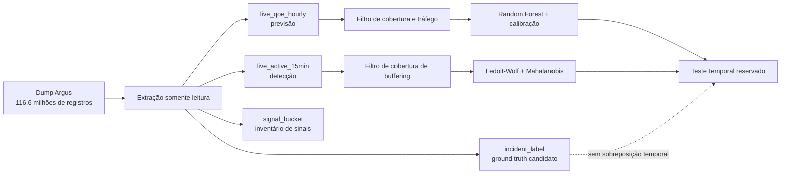

# Avaliação do Worker de Análise com o Argus

> Complemento de 24/09: a ausência de sobreposição abaixo se refere ao
> `incident_label`. A auditoria ampliada confirmou 276 tickets de vídeo no
> período, com limitações de escopo e campos de causa removidos. Consulte
> [a análise de viabilidade](viabilidade-diagnostico-previsao-argus.md) para os
> cruzamentos entre fontes e a sondagem de previsão de erros.

- **Data da execução:** 23/09/2026
- **Estado:** candidato treinado; não aprovado para produção
- **Dump:** `argus_dump(1).sql.gz`
- **SHA-256 do dump:** `c1d86081679d66c392b63710bda4517b047f029c5403ad1502d731ab5ac126ea`
- **Bundle local não versionado:** `argus-2026-09-01-unapproved.json`
- **SHA-256 do bundle:** `b6b2eaac704d5bf977b2460f783955b2f949e7490ac205c2a7802f9478f43804`

## 1. O que foi executado

O dump sanitizado foi lido como texto, sem executar SQL e sem copiá-lo para o
repositório. O extrator valida o CRC do gzip e grava os recortes na pasta
`apps/backend/agentic/data/`, ignorada pelo Git.



Foram extraídas 118.160 linhas horárias de 304 canais, 440.959 linhas de 15
minutos, 6.206.726 sinais materializados e 20 rótulos. Os recortes gerados
ocupam cerca de 92 MB comprimidos e permanecem fora do controle de versão.

## 2. Seleção dos dados

O treino da previsão rejeitou o identificador desconhecido `?`, canais com menos
de 336 horas e canais com mediana de até 10 sessões por hora. Restaram 145 dos
304 canais e 102.674 exemplos com quatro horas contíguas de histórico. Essa
seleção evita que canais eventuais, alguns com apenas uma observação, definam o
comportamento do modelo.

O detector multivariado exigiu ao menos 96 vetores e presença de
`bufferratio_avg` em 80% ou mais dos instantes do escopo. Foram treinados 138
escopos e 144 foram recusados. Os limiares foram calculados no período de
calibração, separado do ajuste da média e da matriz de precisão.

| Período | Uso | Limite temporal |
|---|---|---|
| treino | ajustar Random Forest, média e precisão | até 20/08/2026 00:00 UTC |
| calibração | converter valor previsto em risco e calibrar limiar multivariado | até 25/08/2026 23:00 UTC |
| teste | medir generalização sem reajustar | desde 26/08/2026 00:00 UTC |

## 3. Resultado da previsão

O teste reservado contém 20.767 previsões. O Random Forest reduziu o MAE de
0,3584, obtido ao repetir o valor da última hora, para 0,2858. Isso representa
uma redução relativa de aproximadamente 20,3%. O RMSE foi 0,6481 e o Brier
score da probabilidade calibrada foi 0,0567.

O evento crítico usado nesta execução é `bufferratio_avg > 1,2037`, o percentil
90 do treino. Esse limite é experimental e não equivale a um SLO aprovado.

| Limiar de risco | Precisão | Recall | Taxa de falso positivo |
|---:|---:|---:|---:|
| 0,20 | 49,4% | 59,9% | 6,06% |
| 0,30 | 55,3% | 55,5% | 4,42% |
| 0,40 | 59,5% | 50,5% | 3,40% |
| **0,50** | **67,9%** | **36,8%** | **1,72%** |
| 0,70 | 74,7% | 25,7% | 0,86% |
| 0,80 | 83,4% | 13,7% | 0,27% |

O limiar 0,50 permanece no bundle para tornar o candidato executável, mas não
está aprovado. A escolha depende do custo aceitável de avisos preventivos e de
previsões perdidas. Com 0,50, o modelo privilegia redução de falso positivo e
deixa de encontrar a maior parte dos eventos críticos definidos pelo percentil
90.

## 4. Resultado da detecção

No teste reservado, 77.133 vetores completos produziram 2.378 ultrapassagens do
limiar multivariado: taxa de alerta de 3,08%. Houve ao menos uma ultrapassagem em
117 dos 138 escopos. Esse número mede carga bruta de sinais antes de correlação,
deduplicação e abertura de incidente; ele não mede falsos positivos.

O volume é alto para promoção direta a incidentes. O replay do worker deve
agrupar os sinais por janela e aplicar o gate de qualidade antes de envolver a
LLM. Mesmo assim, não há base para aprovar o detector até medir quantos grupos
representam ocorrências reais.

## 5. Por que a avaliação ainda não comprova o detector

Os 20 rótulos disponíveis têm as seguintes proveniências:

| Proveniência | Quantidade | Uso permitido |
|---|---:|---|
| `rca-confirmed` | 1 | ground truth forte |
| `team-confirmed` | 5 | ground truth forte |
| `itsm` | 7 | ocorrência possível; exige mapeamento de escopo e revisão |
| `detector-derived` | 7 | não usar para medir o detector que ajudou a produzi-los |

As séries começam em 02/08/2026, enquanto o último rótulo termina antes desse
dia. A sobreposição temporal é zero. Assim, qualquer precisão, recall ou taxa de
falso positivo atribuída ao detector com este pacote seria inventada. A taxa de
3,08% acima informa somente o volume de alertas.

## 6. Inconsistência de unidade

A documentação descreve `bufferratio_avg` como uma razão, mas, nos canais
elegíveis, 14,2% dos valores são maiores que 1; o máximo é 94,21. Isso pode
significar percentual em vez de fração, uma transformação anterior ou valores
inválidos. O treino preservou a escala recebida para não introduzir uma
conversão sem evidência. Antes da aprovação é necessário confirmar a semântica
com o responsável pelo Argus e fixá-la no contrato canônico.

## 7. Decisão e próximos critérios

O pipeline técnico funciona sobre o dump real e o modelo de previsão supera o
baseline simples. O bundle continua **não aprovado** porque faltam quatro
decisões verificáveis:

1. confirmar a unidade e os limites válidos de `bufferratio_avg`;
2. escolher o limiar de risco a partir do custo de falso aviso e de previsão
   perdida;
3. obter rótulos sobrepostos ao período de agosto ou realizar revisão humana
   cega dos grupos de alertas do replay;
4. executar pelo menos sete dias do worker em modo sombra, medindo grupos de
   alertas, incidentes propostos, cobertura, latência e custo da hipótese A′.

Somente depois desses passos o comando de aprovação deve assinar um bundle. A
aprovação não é consequência automática de o treino terminar.

## 8. Reprodução

```bash
python3 apps/backend/agentic/scripts/prepare-argus.py \
  /caminho/argus_dump.sql.gz \
  apps/backend/agentic/data/argus-2026-09-01 \
  --include-signal-bucket

python3 apps/backend/agentic/scripts/train-models.py \
  --qoe-csv apps/backend/agentic/data/argus-2026-09-01/qoe.csv.gz \
  --detector-csv apps/backend/agentic/data/argus-2026-09-01/detector.csv.gz \
  --output apps/backend/agentic/models/argus-2026-09-01-unapproved.json \
  --dataset-version argus-2026-09-01-c1d86081 \
  --version 2026.09.argus.4 \
  --min-channel-rows 336 \
  --min-median-sessions 10
```

Os hashes das fontes, filtros, cortes, métricas e escopos recusados ficam dentro
do próprio bundle para auditoria.
