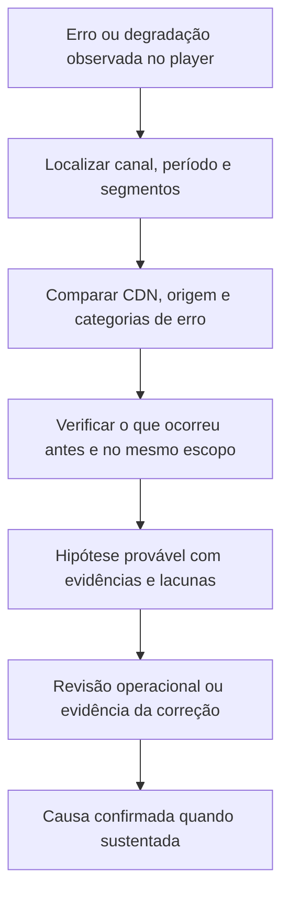

# Viabilidade de detecção, diagnóstico e previsão com o Argus

Data: 24/09/2026. Estado: auditoria de dados e sondagem exploratória concluídas; nenhuma mudança da arquitetura A′ ou aprovação de modelo operacional.

## Conclusão

O snapshot sustenta detecção de sintomas e investigação de causas prováveis em parte da operação. Não sustenta prometer causa raiz confirmada para todo alerta, nem previsão de qualquer tipo de incidente e de seu instante exato. Há sinal preditivo exploratório para degradação de erros do player, mas o teste realizado ainda não demonstra antecipação operacional suficiente.

| Objetivo | Evidência disponível | Conclusão |
|---|---|---|
| Detectar degradação de experiência | sessões, erros, falhas de início, buffering, jointime | Viável; validar materialidade, sazonalidade e alertas por episódio |
| Localizar o segmento/camada afetada | canal, CDN/origem, player, dispositivo, categorias de erro | Viável em recortes com chaves e cobertura compatíveis |
| Sugerir causa provável | coocorrência, sequência temporal, eventos de mudança, métricas de recursos | Viável com incerteza explícita; associação não confirma causalidade |
| Confirmar causa raiz | RCA, intervenção corretiva, topologia e registros detalhados | Insuficiente para uma promessa geral neste snapshot |
| Antecipar degradação específica | histórico multivariado e algum calendário conhecido antecipadamente | Investigável; sondagem atual insuficiente para aprovação |
| Prever instante exato e tipo de qualquer falha | exigiria precursores observáveis para cada família de falha | Não sustentado |

## Verificações executadas no dump

Origem: mesmo dump de SHA-256 `c1d86081679d66c392b63710bda4517b047f029c5403ad1502d731ab5ac126ea`. Recortes locais em `apps/backend/agentic/data/feasibility/`, ignorados pelo Git. O Markdown fornecido foi confrontado com contagens reais; algumas descrições da documentação estão desatualizadas.

- `incidents`: 745 registros, dos quais 276 abertos na janela de agosto.
- `incidents_platform`: 647, dos quais 413 na janela; pertencem a times diferentes e não são automaticamente verdade de referência para vídeo.
- `incident_label`: 20, nenhum sobreposto à telemetria, conforme auditoria anterior.
- `finding_status_log`: 123 transições, 83 na janela; são saídas automáticas, não confirmação humana.
- `investigation_feedback`: um registro, insuficiente para avaliar diagnóstico em escala.
- `tsuru_event`: 1.710 eventos em 37 aplicações, incluindo 117 deploys e 1.356 eventos de autoscaling.
- `live_event`: 287 linhas; 161 slots na janela, correspondentes a 78 confrontos. Só 50 dessas linhas têm `first_seen_ts < start_ts`.
- `collector_run`: 5.838 registros, 3.514 na janela. A descrição de tabela quase vazia não representa esta cópia.

Os tickets são uma referência complementar, mas a auditoria encontrou restrições adicionais: nos 276 tickets da janela, os campos de causa livre estão vazios; os indicadores de impacto externo e de causa por deploy são `false` em todos. Esses campos constantes não fornecem duas classes para treinar ou avaliar esses diagnósticos. A origem desses valores deve ser confirmada antes de interpretá-los como negativos confiáveis. `cmdb_ci` é amplo: 238 tickets dizem apenas `Globoplay`. Há 31 com serviço de negócio explicitamente de consumo ao vivo/simulcast; os demais incluem VOD, cobrança e outras atividades fora do alvo de QoE ao vivo.

Portanto, a conclusão anterior sobre ausência de rótulos deve ser delimitada: faltam **rótulos curados sobrepostos**; existem tickets contemporâneos, mas eles exigem triagem e associação ao escopo antes de qualquer avaliação.

## Ligações que realmente existem

O cruzamento por igualdade de canal entre QoE e `signal_bucket` encontrou:

| Fonte | Entidades distintas | Correspondências exatas com canais QoE |
|---|---:|---:|
| `cdn_live_errors` | 158 | 158 |
| `origin_live_errors` | 111 | 111 |
| `origin_cdn_live_errors` | 111 | 111 |

A união dessas fontes alcança 90.410 observações canal-hora, em 158 canais, das 118.160 linhas QoE. Dessas observações, 87.543 têm valor de CDN, 42.676 de origem e 18.042 de origem-CDN. Existência de valor não significa cobertura completa dos quatro intervalos de 15 minutos, nem taxa sem filtragem.

Os nomes dos 37 aplicativos de Tsuru casam exatamente com entidades de Prometheus em 23 casos. Isso possibilita procurar mudanças de recursos antes/depois de deploys no mesmo aplicativo. Não demonstra que a aplicação atende determinado canal, nem que o deploy causou uma falha. Outras fontes usam vocabulários diferentes; falta de igualdade não significa ausência de relação, mas exige catálogo explícito de correspondências.

O calendário contém slugs de canais fechados nesta cópia, além de `globo`; a descrição de cobertura exclusiva de TV aberta não se aplica integralmente. O slug genérico `globo` não identifica a praça. Só se pode usar como preditor o conteúdo conhecido até a emissão da previsão: `first_seen_ts` não garante que todos os campos da versão final da linha já fossem conhecidos naquela data.

## O que constitui evidência de causa



Exemplo real inspecionado: uma hora do canal `pfc2` tem 237 sessões com erro em 492 sessões (48,17%), `bufferratio_avg` de aproximadamente 0,377 e sinal positivo de erros na origem. Isso demonstra que buffering baixo não exclui falhas relevantes. É uma seleção exploratória por alta taxa de erro, não um incidente confirmado ou um exemplo representativo de frequência.

Os valores horários das fontes de entrega usados nesta inspeção são médias descritivas dos buckets disponíveis, não taxas ponderadas pelo tráfego. Zeros em `signal_bucket` podem resultar dos gates de materialidade do Argus; não podem ser usados para inocentar CDN ou origem. Categorias como entrega, acesso, origem e player ajudam a delimitar a família do problema, mas a taxonomia também é uma classificação de sintomas, não uma prova causal.

Um diagnóstico sustentado deve apresentar observações, ordem temporal, hipótese, alternativas e a verificação faltante. Uma frase como “o deploy causou a falha” exige mais que proximidade temporal. O A′ pode organizar essas evidências; não cria as relações ausentes no dataset.

## Sondagem de previsão executada

Para testar algo além de buffering, foi treinado um classificador de erro elevado por canal, sem alterar o worker. Alvo exploratório: na hora-alvo, `errors/sessions` acima do maior entre 5% e o percentil 95 do canal no treino, com pelo menos 100 sessões na hora-alvo. Isso define um estado de degradação mensurável, não um incidente confirmado.

Elegibilidade dos canais e limiares calculados somente antes de 20/08. Emissão avaliada apenas com pelo menos 100 sessões na hora atual; o volume futuro não foi usado para selecionar exemplos de teste. Features: taxas atuais de erro e início, sessões, buffering, jointime, três lags de taxas/sessões e calendário BRT. Random Forest com 100 árvores, profundidade 8, folha mínima 30 e semente 42; limiar de decisão fixo 0,5, sem calibração ou busca de hiperparâmetros. Treino com alvos anteriores a 20/08; teste com horas de entrada desde 26/08 e alvos anteriores a setembro.

| Medida | Hora seguinte | Terceira hora após a atual |
|---|---:|---:|
| Exemplos de teste | 17.273 | 16.997 |
| Estados positivos | 530 | 498 |
| Precisão RF, limiar 0,5 | 75,0% | Indefinida: nenhum alerta |
| Recall RF | 10,2% | 0% |
| Precisão de persistência | 56,3% | 23,3% |
| Recall de persistência | 59,1% | 25,7% |
| Average precision RF | 0,578 | 0,246 |
| Average precision da persistência | 0,563 | 0,233 |

Persistência significa usar a condição atual como previsão da condição futura. Average precision compara o ranking ao variar o corte; as precisões de um único limiar não indicam, isoladamente, superioridade de um modelo. Com prevalência de cerca de 3%, há informação no ranking, mas a vantagem sobre persistência foi pequena e não recebeu intervalo de confiança.

Separando situações atualmente abaixo do limiar, o RF encontrou apenas **6 de 217** estados elevados na hora seguinte: recall de **2,76%**, em nove alertas. Para a terceira hora, houve 370 estados elevados entre situações atualmente normais, sem alertas a 0,5. Esse recorte não certifica o instante de início nem que todo o intervalo intermediário permaneceu normal; mede transição entre os dois estados observados.

Esses resultados não provam impossibilidade: o teste não incorporou sinais de infraestrutura, não calibrou o corte e cobre seis dias de um único mês. Também não comprovam prevenção suficiente. A janela de teste já foi explorada em estudos anteriores; deve ser tratada como desenvolvimento, não como confirmação final independente.

### Quando a previsão fica disponível

Se a entrada representa 10h–11h, ela só está completa às 11h, mais o atraso da ingestão. Prever 11h–12h não dá uma hora de aviso antes do início da janela: a antecedência ao início é zero. Prever 13h–14h a partir da mesma entrada dá duas horas até o início, menos a latência. Precisamos medir antecedência ao início do episódio, além de acertar um estado futuro.

## Decisão recomendada

Manter A′ e o worker. Ampliar o conjunto de evidências por escopo, sem tratar uma troca de LLM ou um sistema multiagente como solução para falta de observabilidade. O modelo de buffering permanece uma referência de previsão de sintoma; a nova sondagem não o substitui em produção.

A primeira entrega defensável é detectar degradações com impacto, localizar a camada provável e produzir hipóteses auditáveis. A previsão deve ser apresentada por família de problema, canal e janela, com probabilidade e abstenção quando faltam dados. Não apresentar hora exata, causa confirmada ou previsão universal.

Para comprovar evolução:

1. Selecionar canais com histórico, volume e cobertura de CDN/origem; fixar regras de materialidade por família de problema antes de testar.
2. Construir episódios com começo/fim revisados, incluindo casos não alertados. Tickets auxiliam a revisão; ausência de ticket não rotula normalidade.
3. Comparar persistência, sazonalidade BRT, RF atual e RF com evidências adicionais em cortes temporais móveis. Medir eventos novos separadamente de continuação, antecedência real, precisão por orçamento de alertas e cobertura.
4. Revisar causas com evidências independentes quando disponíveis. Avaliar separadamente localização da camada, hipótese plausível e causa confirmada.
5. Reservar outra janela temporal para confirmação final. Aprovar um alvo preventivo apenas se superar os baselines com antecedência útil e carga de alertas aceitável.

## Reprodução e limites

A sondagem pode ser repetida com:

```bash
python3 apps/backend/agentic/experiments/feasibility/forecast_probe.py \
  --qoe apps/backend/agentic/data/argus-2026-09-01/qoe.csv.gz \
  --output apps/backend/agentic/data/feasibility/prediction-probe-onsets.json
```

Os resumos locais `context-summary.json`, `signal-joins.json` e `prediction-probe-onsets.json` preservam as contagens e métricas da inspeção. A auditoria não avaliou causalmente cada deploy, nem treinou um modelo para cada categoria de falha. Suas conclusões delimitam a viabilidade observada e as lacunas; não são uma certificação do produto completo.
