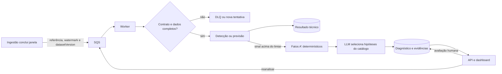
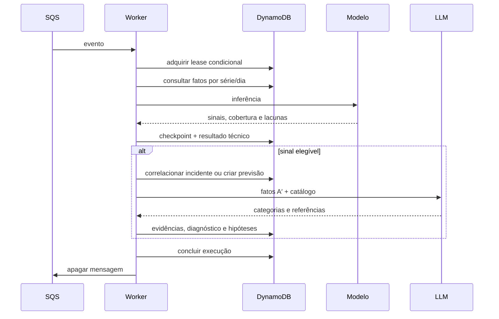

# Worker de análise — implementação de referência

## Estado da implementação

O worker transforma o estudo dos notebooks em um serviço assíncrono. O código implementa consumo SQS, validação de janelas, detecção por MAD e Mahalanobis, previsão por Random Forest, interpretação A′, persistência no DynamoDB, idempotência, renovação de lease, retentativa, DLQ e reanálise solicitada pela API.

O repositório não contém um modelo “de produção”. O treinamento exporta um bundle inicialmente não aprovado; a aprovação exige outro comando, uma referência da decisão humana e o SHA-256 exato do bundle avaliado. A infraestrutura permanece desabilitada por padrão até que imagem, catálogo e bundle aprovado sejam fornecidos.



## Responsabilidades

| Parte | Responsabilidade | O que não decide |
|---|---|---|
| Ingestão | Publicar janela completa e fatos canônicos | Se existe incidente |
| Orquestrador do worker | Deduplicar, carregar dados, executar etapas, correlacionar e persistir | A causa técnica |
| Detector | Medir desvio atual contra histórico anterior | Causa e texto do diagnóstico |
| Preditor | Estimar `bufferratio_avg` da próxima hora e calibrar risco | Criar incidente observado |
| Preparador A′ | Calcular fatos comparáveis e registrar lacunas | Explicação causal |
| LLM | Selecionar hipóteses permitidas e evidências existentes | Valores, métricas ou “confiança” numérica |
| Pessoa revisora | Confirmar, refutar ou marcar inconclusivo | Alterar o resultado técnico original |

Uma previsão elevada é gravada como prevenção em `PREDICTION#...`. Ela recebe diagnóstico preventivo, mas não cria incidente. O incidente nasce apenas de uma anomalia observada, com histórico mínimo e cobertura completa.

## Fluxo de dados

1. A ingestão publica `ANOMALY_DETECTION` para uma janela fechada de 15 minutos ou `QOE_FORECAST` para uma hora fechada.
2. O worker valida duração, alinhamento, watermark, versão do dataset, modelo e escopo.
3. O `analysisRunId` deriva do tipo e da chave de idempotência. Um lease no DynamoDB impede duas entregas SQS de publicarem o mesmo resultado.
4. O leitor consulta somente partições diárias e séries declaradas no catálogo. Não há `Scan` nem escolha dinâmica de chave pela LLM.
5. O modelo grava seus sinais antes de chamar a LLM. Assim, uma indisponibilidade do modelo de linguagem não apaga a detecção ou a previsão.
6. Quando há sinal elegível acima do limiar, o código calcula fatos das duas janelas adjacentes. Para taxas de erro, usa razão entre somas de eventos e sessões; não usa média de percentuais.
7. A LLM recebe apenas o contexto limitado, escolhe zero a três categorias fixas e referencia os identificadores dos fatos. O código confere todas as referências e produz o texto final.
8. O resultado fica disponível para a API. A revisão humana atualiza apenas os campos de revisão da hipótese.



## Modelos portados e melhorias

O detector univariado replica a regra do notebook: mediana e MAD escalado por `1,4826`, histórico estritamente anterior ao dia corrente, até sete dias, no mínimo três dias e 96 pontos. MAD degenerado é registrado como lacuna, não como score zero. O detector multivariado usa média, precisão Ledoit–Wolf e distância de Mahalanobis; a matriz exportada precisa ser simétrica e positiva definida.

O preditor preserva as onze variáveis do notebook e o Random Forest com 300 árvores, profundidade máxima 8, mínimo de 20 amostras por folha e semente 42. A exportação melhora o estudo em quatro pontos:

- lags só são construídos entre horas realmente contíguas;
- treino, calibração e teste são separados no tempo em 60/20/20;
- o valor previsto é convertido em risco por calibração isotônica fora do treino;
- o relatório inclui MAE, RMSE, baseline da última hora, Brier score, contagens, cortes temporais e hashes das fontes.

O bundle exportado contém `trainedThrough`. O runtime rejeita qualquer evento anterior a esse instante, impedindo vazamento temporal. Também rejeita versão de modelo ou dataset diferente da indicada no evento.

A primeira execução com o dump sanitizado do Argus, seus resultados e os
bloqueios de aprovação estão em
[`avaliacao-worker-argus.md`](avaliacao-worker-argus.md). Os recortes e o bundle
continuam fora do Git; somente o extrator, o treinamento reproduzível e as
métricas auditáveis são versionados.

## Persistência no DynamoDB

| Registro | Chave principal |
|---|---|
| Execução e lease | `ANALYSIS#RUN#<runId> / META` |
| Checkpoint por escopo | `ANALYSIS#RUN#<runId> / SCOPE#<scopeId>` |
| Incidente | `DATASET#<datasetVersion>#INCIDENT#<incidentId> / META` |
| Evidência | mesma PK / `EVIDENCE#<factId>` |
| Diagnóstico da execução | mesma PK / `DIAGNOSIS#<runId>` |
| Hipótese | mesma PK / `HYPOTHESIS#<runId>_<id>` |
| Previsão | `PREDICTION#<predictionId> / META` |
| Índice de previsão por escopo | `DATASET#<datasetVersion>#PREDICTIONS#<scopeId>` |

Cada gravação analítica verifica o dono e a validade do lease na mesma transação. Hipóteses são criadas condicionalmente para que uma repetição nunca apague uma revisão humana. O índice `trace-index` reúne o incidente e seus filhos para a API. As visões diárias carregam a versão do dataset; a API lê `CONTROL#DATASET / ACTIVE` e mantém compatibilidade com as chaves antigas enquanto a migração estiver em andamento.

Previsões anteriores são avaliadas quando a janela-alvo já está disponível. O worker registra `TP`, `FP`, `TN`, `FN` ou `UNKNOWN`, preservando o limiar usado na previsão original.

## Operação e falhas

O lease dura 300 segundos e é renovado a cada 60 segundos junto com a visibilidade SQS. Falhas transitórias retornam com esperas de 30, 120, 300 e 900 segundos. Contrato inválido vai diretamente para a DLQ com identificadores e hash do corpo; o payload e a resposta bruta da LLM não são copiados. Após cinco recebimentos, a falha também vai para a DLQ.

As variáveis obrigatórias são:

- `OPERATIONAL_TABLE_NAME`, `ANALYSIS_QUEUE_URL` e `ANALYSIS_DLQ_URL`;
- `ANALYSIS_MODEL_LOCATION`, `ANALYSIS_SCOPE_CATALOG_LOCATION` e, no S3, `ANALYSIS_MODEL_SHA256`;
- `LLM_PROVIDER`, `LLM_MODEL_ID` e `OLLAMA_BASE_URL` quando aplicável.

O catálogo mapeia métricas para os `seriesId` produzidos pela ingestão. A função pública `seriesId`, em `apps/backend/agentic/src/worker/series-id.ts`, é o contrato único: aplica SHA-256 à identidade canônica formada por dataset lógico, fonte, entidade, métrica e dimensões ordenadas. A ingestão deve usar essa função ao gravar cada série. O worker apenas consome o identificador; uma divergência entre catálogo e fato impede a análise.

O piloto real está em `apps/backend/agentic/config/scope-catalog.pilot.json`. Ele contém os dez canais de maior volume que também aparecem no modelo treinado e possuem cobertura nas três fontes de entrega: CDN, origem e origem-CDN. Cada escopo reúne QoE de 15 minutos, features horárias da previsão e taxas de erro de entrega no mesmo canal. O script `scripts/build-pilot-catalog.py` regenera o arquivo a partir dos agregados preparados e do bundle avaliado, sem versionar o dump.

No piloto, uma anomalia só abre incidente quando a janela contém ao menos 25 sessões ativas. Esse valor inicial limita alertas sem impacto e deve ser recalibrado com os episódios revisados. Sinais consecutivos com distância menor que duas horas atualizam o mesmo episódio; o intervalo é medido desde o último sinal, preservando o início original. Evidências de CDN e origem podem sustentar uma hipótese de camada provável, mas continuam descritas como associação temporal, não como causa confirmada.

A correlação informa se o episódio acabou de ser criado. O A′ e a LLM são
executados somente na abertura; buckets seguintes atualizam `lastObservedAt` e
persistem a análise determinística no mesmo incidente. Uma reanálise solicitada
por pessoa continua autorizando uma nova execução do A′. No replay ampliado,
essa regra reduz o teto de chamadas de diagnóstico de 1.459 buckets para 104
aberturas de episódio, além de evitar hipóteses repetidas no dashboard.

Toda saída do Random Forest é persistida com `experimental: true`. Ela pode aparecer para validação e receber TP, FP, FN ou TN depois da janela-alvo, porém não deve ser apresentada como modelo aprovado até superar persistência e sazonalidade em uma janela temporal reservada.

### Replay sem escrita do piloto

O comando `npm run replay:pilot` executa os mesmos validadores, detectores,
preditor e preparação de contexto do worker diretamente sobre os agregados
locais. Ele não acessa DynamoDB, SQS nem LLM e grava somente um relatório JSON
no caminho escolhido. Isso permite medir o comportamento antes da ativação.
O script `scripts/export-episode-review.py` converte esse relatório em uma ficha
CSV sem respostas pré-preenchidas, com campos para relevância, camada provável,
suficiência das evidências e observações da revisão humana.

Cada linha da ficha inclui `peak_evidence_json`, com referência, valor corrente,
direção, unidade e cobertura dos fatos no bucket de maior margem do episódio.
O revisor preenche `is_relevant` e `evidence_sufficient` com `yes` ou `no`, e
`probable_layer` com `cdn`, `origin`, `player`, `traffic`, `measurement` ou
`unknown`. `is_relevant` responde se o episódio merece aparecer para operação;
`evidence_sufficient` responde se os dados mostrados permitem sustentar a
camada indicada. Uma anomalia real pode ter evidência insuficiente.

O avaliador recusa fichas incompletas em vez de tratar campos vazios como
negativos:

```bash
python3 scripts/evaluate-episode-review.py \
  --review data/review/episodes-2026-08-26-a-2026-09-01.csv \
  --output data/review/evaluation-2026-08-26-a-2026-09-01.json
```

### Triagem assistida por segundo modelo

Uma revisão cega com `gpt-5.6-sol` recebeu apenas a ficha e as regras acima. O
arquivo original permaneceu intacto; a saída usa `review_source`, confiança e
justificativa por linha. Das 104 linhas, o modelo marcou 57 episódios relevantes
e 47 não relevantes. As camadas foram: 18 CDN, 2 origem, 31 player, 35 tráfego,
1 medição e 17 desconhecida. A evidência foi considerada suficiente em 87 casos.

As regras determinísticas confirmaram preenchimento completo e não encontraram
atribuição de CDN ou origem sem aumento da métrica correspondente. Nove linhas
ficaram com confiança abaixo de 0,70. Para medir erro sistemático sem repetir as
104 classificações, foi criada uma auditoria de 20 casos: os nove incertos mais
11 casos de alta confiança amostrados entre relevância e camadas diferentes.

Essas classificações servem para triagem e desenvolvimento. Elas não são rótulos
humanos independentes e não podem, sozinhas, aprovar o detector ou o modelo de
previsão. A auditoria humana verifica se o segundo modelo aplicou os critérios
de forma aceitável antes de qualquer calibração baseada nessa ficha.

No recorte de 27/08/2026 UTC, os dez canais produziram 960 janelas de detecção,
todas acima do gate inicial de 25 sessões. Houve 308 sinais acima de algum
limiar, agrupados em 27 episódios; todos tinham ao menos uma evidência de CDN ou
origem disponível no contexto. A frequência bruta de sinais é alta e confirma
que o dashboard deve mostrar episódios, não cada bucket. Esses números não
medem precisão porque o recorte não possui rótulos curados sobrepostos.

A previsão experimental foi avaliável em 230 janelas: 21 TP, 2 FP, 14 FN e 193
TN no limiar atual. Esse resultado de um único dia é apenas um teste funcional;
o bundle continua `approved: false` e a decisão exige replay temporal maior,
comparação com baselines e uma janela reservada.

O replay ampliado cobriu os seis dias posteriores ao corte de treino, de 26/08
a 01/09. Em 5.760 janelas, 5.751 passaram o gate de volume. Os detectores
emitiram 1.459 sinais, agrupados em 104 episódios. Telemetria de entrega estava
disponível em 1.449 buckets, mas houve aumento simultâneo de CDN ou origem em
apenas 449. No nível de episódio, 48 de 104 apresentaram esse aumento. Portanto,
disponibilidade não é evidência favorável: somente os 48 episódios permitem à
camada A′ sustentar uma hipótese de entrega; os demais devem apontar a lacuna ou
outras famílias de hipótese.

Elevar o mínimo de sessões reduziria pouco a carga: os sinais cairiam de 1.459
com mínimo 25 para 1.373 com 100, 1.243 com 500 e 1.121 com 1.000. Sem rótulos,
essa perda de cobertura não justifica mudar o gate agora. A redução deve vir da
calibração dos detectores e da apresentação por episódio.

Nas 1.430 previsões avaliáveis do replay ampliado, o Random Forest obteve 74 TP,
18 FP, 87 FN e 1.251 TN: precisão de 80,4%, recall de 46,0% e FPR de 1,42%. A
persistência simples obteve 102 TP, 62 FP, 59 FN e 1.207 TN: precisão de 62,2%,
recall de 63,4% e FPR de 4,89%. O modelo troca cobertura por menos falsos
positivos; a preferência depende do orçamento operacional de alertas. O recorte
foi usado durante o desenvolvimento e não serve como confirmação independente.

```bash
npm run replay:pilot -- \
  --data data/argus-2026-09-01 \
  --model models/argus-2026-09-01-unapproved.json \
  --catalog config/scope-catalog.pilot.json \
  --start 2026-08-27T00:00:00Z \
  --end 2026-08-28T00:00:00Z \
  --output /tmp/analysis-pilot-replay.json
```

## Treinamento, aprovação e execução

```bash
python3 scripts/train-models.py \
  --qoe-csv qoe_hourly.csv \
  --detector-csv detector_15m.csv \
  --dataset-version dsv_... \
  --version 2026.09.1 \
  --output models/candidate.json

sha256sum models/candidate.json
python3 scripts/approve-model.py \
  --input models/candidate.json \
  --expected-sha256 <hash-do-candidato> \
  --reference <ata-ou-resultado-da-avaliacao> \
  --output models/approved.json
```

Depois da aprovação, publique o arquivo e o catálogo no S3, construa a imagem pelo Dockerfile do módulo e habilite `analysis_worker_habilitado` com URIs e checksum no Terraform. O serviço não é habilitado automaticamente.

## Fechamento independente do módulo

O módulo pode ser verificado sem esperar frontend, API ou ingestão. A fronteira
foi congelada por fixtures em `apps/backend/agentic/contracts/fixtures`, e o
pipeline executa o mesmo parser usado pelo runtime. O teste com DynamoDB Local
prova o lease, a leitura do fato canônico e a correlação idempotente de dois
buckets no mesmo episódio. A suíte também prova os dois destinos de uma falha
de dependência: `RETRY_PENDING` com backoff antes da quinta entrega e `FAILED`
com DLQ na quinta.

Critérios de pronto do Worker de Análise:

| Critério | Evidência | Estado |
| --- | --- | --- |
| contrato de eventos estável | três fixtures v1 validadas pelo parser de produção | atendido |
| contrato do fato canônico | fixture v1 e leitura pelo adaptador DynamoDB | atendido |
| idempotência e episódio | lease e dois buckets correlacionados no DynamoDB Local | atendido |
| falhas e recuperação | contrato inválido, backoff, quinta tentativa e DLQ | atendido |
| modelos determinísticos | testes de bundle, detecção, previsão e replay temporal | atendido como candidato |
| diagnóstico A′ | validação estrutural, ancoragem em fatos e chamada só na abertura | atendido |
| CI próprio | job `validate_analysis_worker` | atendido |
| qualidade estatística | recorte temporal medido, sem rótulo humano independente | pendente de validação de produto |
| ativação produtiva | catálogo de séries e bundle aprovado | pendente de integração |

Assim, “módulo pronto” significa que suas regras e adaptadores funcionam contra
seus contratos. Não significa que a previsão esteja aprovada para alertar o
usuário: o modelo continua explicitamente experimental até a validação no fluxo
integrado.

## O que falta validar no ambiente real

O código e os testes locais não substituem a validação com as séries canônicas do ARGUS. Antes da ativação, ainda é necessário:

1. integrar a função compartilhada de `seriesId` à escrita de fatos da ingestão e confirmar que os identificadores do catálogo piloto são os realmente gravados;
2. treinar e avaliar o bundle no corte temporal completo, registrar a decisão e aprová-lo;
3. executar o teste já coberto em DynamoDB Local também com uma tabela temporária e SQS reais;
4. executar replay sem escrita de pelo menos uma semana, medir falsos positivos, falsos negativos, cobertura e custo;
5. ativar primeiro um único worker e acompanhar DLQ, latência, calibração da previsão e revisões humanas.

Essas etapas são condições de implantação, não partes simuladas pela implementação.
