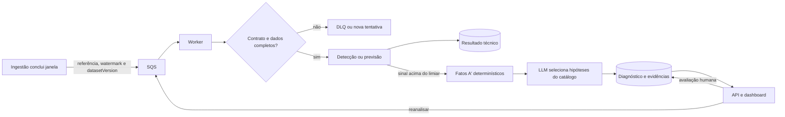
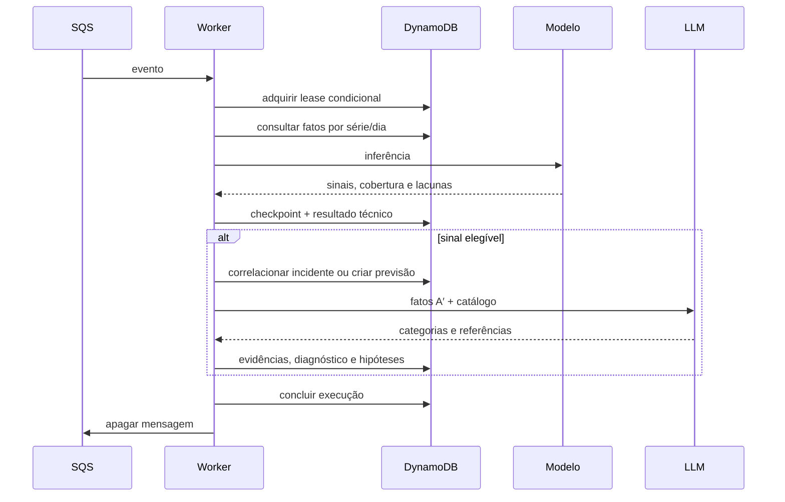

# Worker de análise — implementação de referência

## Estado da implementação

O worker transforma o estudo dos notebooks em um serviço assíncrono. O código implementa consumo SQS, validação de janelas, detecção por MAD e Mahalanobis, previsão por Random Forest, interpretação A′, persistência no DynamoDB, idempotência, renovação de lease, retentativa, DLQ e reanálise solicitada pela API.

O repositório não contém um modelo “de produção”. O treinamento exporta um bundle inicialmente não aprovado; a aprovação exige outro comando, uma referência da decisão humana e o SHA-256 exato do bundle avaliado. A infraestrutura permanece desabilitada por padrão até que imagem, catálogo e bundle aprovado sejam fornecidos.



## Responsabilidades

| Parte | Responsabilidade | O que não decide |
|---|---|---|
| Ingestão | Publicar janela completa e fatos canônicos | Se existe incidente |
| Orquestrador do worker | Deduplicar, carregar dados, executar etapas, correlacionar e persistir | A causa técnica |
| Detector | Medir desvio atual contra histórico anterior | Causa e texto do diagnóstico |
| Preditor | Estimar `bufferratio_avg` da próxima hora e calibrar risco | Criar incidente observado |
| Preparador A′ | Calcular fatos comparáveis e registrar lacunas | Explicação causal |
| LLM | Selecionar hipóteses permitidas e evidências existentes | Valores, métricas ou “confiança” numérica |
| Pessoa revisora | Confirmar, refutar ou marcar inconclusivo | Alterar o resultado técnico original |

Uma previsão elevada é gravada como prevenção em `PREDICTION#...`. Ela recebe diagnóstico preventivo, mas não cria incidente. O incidente nasce apenas de uma anomalia observada, com histórico mínimo e cobertura completa.

## Fluxo de dados

1. A ingestão publica `ANOMALY_DETECTION` para uma janela fechada de 15 minutos ou `QOE_FORECAST` para uma hora fechada.
2. O worker valida duração, alinhamento, watermark, versão do dataset, modelo e escopo.
3. O `analysisRunId` deriva do tipo e da chave de idempotência. Um lease no DynamoDB impede duas entregas SQS de publicarem o mesmo resultado.
4. O leitor consulta somente partições diárias e séries declaradas no catálogo. Não há `Scan` nem escolha dinâmica de chave pela LLM.
5. O modelo grava seus sinais antes de chamar a LLM. Assim, uma indisponibilidade do modelo de linguagem não apaga a detecção ou a previsão.
6. Quando há sinal elegível acima do limiar, o código calcula fatos das duas janelas adjacentes. Para taxas de erro, usa razão entre somas de eventos e sessões; não usa média de percentuais.
7. A LLM recebe apenas o contexto limitado, escolhe zero a três categorias fixas e referencia os identificadores dos fatos. O código confere todas as referências e produz o texto final.
8. O resultado fica disponível para a API. A revisão humana atualiza apenas os campos de revisão da hipótese.



## Modelos portados e melhorias

O detector univariado replica a regra do notebook: mediana e MAD escalado por `1,4826`, histórico estritamente anterior ao dia corrente, até sete dias, no mínimo três dias e 96 pontos. MAD degenerado é registrado como lacuna, não como score zero. O detector multivariado usa média, precisão Ledoit–Wolf e distância de Mahalanobis; a matriz exportada precisa ser simétrica e positiva definida.

O preditor preserva as onze variáveis do notebook e o Random Forest com 300 árvores, profundidade máxima 8, mínimo de 20 amostras por folha e semente 42. A exportação melhora o estudo em quatro pontos:

- lags só são construídos entre horas realmente contíguas;
- treino, calibração e teste são separados no tempo em 60/20/20;
- o valor previsto é convertido em risco por calibração isotônica fora do treino;
- o relatório inclui MAE, RMSE, baseline da última hora, Brier score, contagens, cortes temporais e hashes das fontes.

O bundle exportado contém `trainedThrough`. O runtime rejeita qualquer evento anterior a esse instante, impedindo vazamento temporal. Também rejeita versão de modelo ou dataset diferente da indicada no evento.

## Persistência no DynamoDB

| Registro | Chave principal |
|---|---|
| Execução e lease | `ANALYSIS#RUN#<runId> / META` |
| Checkpoint por escopo | `ANALYSIS#RUN#<runId> / SCOPE#<scopeId>` |
| Incidente | `DATASET#<datasetVersion>#INCIDENT#<incidentId> / META` |
| Evidência | mesma PK / `EVIDENCE#<factId>` |
| Diagnóstico da execução | mesma PK / `DIAGNOSIS#<runId>` |
| Hipótese | mesma PK / `HYPOTHESIS#<runId>_<id>` |
| Previsão | `PREDICTION#<predictionId> / META` |
| Índice de previsão por escopo | `DATASET#<datasetVersion>#PREDICTIONS#<scopeId>` |

Cada gravação analítica verifica o dono e a validade do lease na mesma transação. Hipóteses são criadas condicionalmente para que uma repetição nunca apague uma revisão humana. O índice `trace-index` reúne o incidente e seus filhos para a API. As visões diárias carregam a versão do dataset; a API lê `CONTROL#DATASET / ACTIVE` e mantém compatibilidade com as chaves antigas enquanto a migração estiver em andamento.

Previsões anteriores são avaliadas quando a janela-alvo já está disponível. O worker registra `TP`, `FP`, `TN`, `FN` ou `UNKNOWN`, preservando o limiar usado na previsão original.

## Operação e falhas

O lease dura 300 segundos e é renovado a cada 60 segundos junto com a visibilidade SQS. Falhas transitórias retornam com esperas de 30, 120, 300 e 900 segundos. Contrato inválido vai diretamente para a DLQ com identificadores e hash do corpo; o payload e a resposta bruta da LLM não são copiados. Após cinco recebimentos, a falha também vai para a DLQ.

As variáveis obrigatórias são:

- `OPERATIONAL_TABLE_NAME`, `ANALYSIS_QUEUE_URL` e `ANALYSIS_DLQ_URL`;
- `ANALYSIS_MODEL_LOCATION`, `ANALYSIS_SCOPE_CATALOG_LOCATION` e, no S3, `ANALYSIS_MODEL_SHA256`;
- `LLM_PROVIDER`, `LLM_MODEL_ID` e `OLLAMA_BASE_URL` quando aplicável.

O catálogo mapeia métricas para os `seriesId` produzidos pela ingestão. O exemplo em `apps/backend/agentic/config/scope-catalog.example.json` precisa receber os identificadores reais; o worker não tenta adivinhá-los.

## Treinamento, aprovação e execução

```bash
python3 scripts/train-models.py \
  --qoe-csv qoe_hourly.csv \
  --detector-csv detector_15m.csv \
  --dataset-version dsv_... \
  --version 2026.09.1 \
  --output models/candidate.json

sha256sum models/candidate.json
python3 scripts/approve-model.py \
  --input models/candidate.json \
  --expected-sha256 <hash-do-candidato> \
  --reference <ata-ou-resultado-da-avaliacao> \
  --output models/approved.json
```

Depois da aprovação, publique o arquivo e o catálogo no S3, construa a imagem pelo Dockerfile do módulo e habilite `analysis_worker_habilitado` com URIs e checksum no Terraform. O serviço não é habilitado automaticamente.

## O que falta validar no ambiente real

O código e os testes locais não substituem a validação com as séries canônicas do ARGUS. Antes da ativação, ainda é necessário:

1. gerar o catálogo com os `seriesId` realmente gravados pela ingestão;
2. treinar e avaliar o bundle no corte temporal completo, registrar a decisão e aprová-lo;
3. executar um teste de integração com DynamoDB Local ou uma tabela temporária e SQS real;
4. executar replay sem escrita de pelo menos uma semana, medir falsos positivos, falsos negativos, cobertura e custo;
5. ativar primeiro um único worker e acompanhar DLQ, latência, calibração da previsão e revisões humanas.

Essas etapas são condições de implantação, não partes simuladas pela implementação.
