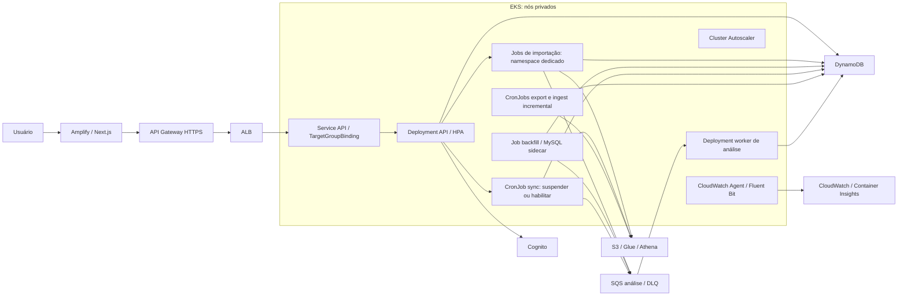

# Arquitetura implementada em Kubernetes

O port usa Amazon EKS 1.35 em sub-redes privadas da VPC dedicada. O frontend Next.js permanece no Amplify. O API Gateway HTTPS encaminha ao ALB existente, que recebe os IPs dos Pods da API por TargetGroupBinding. API e análise usam Deployments; os cinco tipos de ingestão usam Jobs ou CronJobs.

IRSA vincula cada ServiceAccount a uma role exclusiva. Importação tem namespace próprio, sem permissões Kubernetes para ler Secrets, e policy de dados que bloqueia alteração do manifesto ACTIVE. Cada Job importa um snapshot versionado; o MySQL sidecar é efêmero e sua prontidão precede o worker. Volume gravável e ownership substituem o init container `chown` do ECS.

HPA usa CPU do Metrics Server e Cluster Autoscaler dimensiona o managed node group entre os limites configurados. Os nós têm IMDSv2 com hop limit 1 e role de infraestrutura; aplicações usam identidade própria. NetworkPolicies bloqueiam ingress dos workers e liberam somente a porta HTTP da API. PodDisruptionBudget e distribuição entre hosts acompanham deploys graduais.

CronJobs conservam frequências de 15/15/5 minutos e impedem sobreposição da mesma agenda. O estado de sync pertence ao painel e é preservado durante upgrades Helm. Jobs não repetem automaticamente imports e retêm evidência por sete dias. O campo histórico `taskArn` armazena a identidade Kubernetes com UID, preservando o formato dos registros existentes sem schema novo.

O [runbook](../../apps/kubernetes/README.md) contém deploy, transição com manutenção, validação e rollback. Os artefatos de sprints anteriores documentam entregas ECS históricas; esta página descreve a implementação desta branch.
