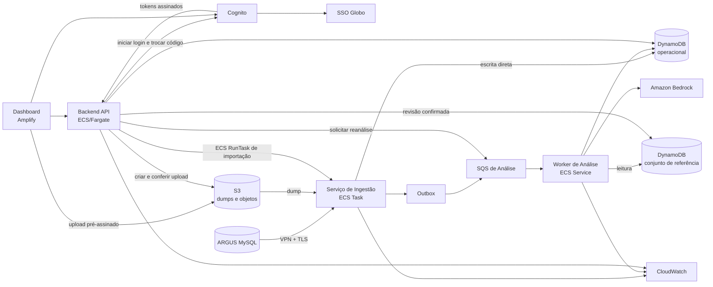
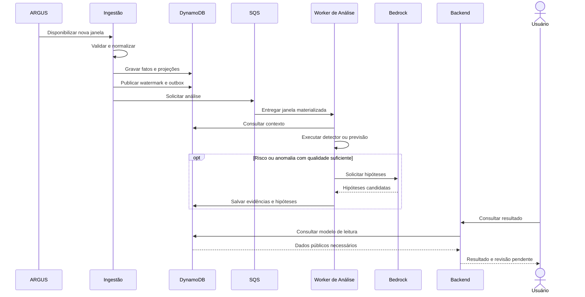

# Visão geral da arquitetura

- **Status:** aprovado para implementação
- **Versão:** 1.0
- **Última atualização:** 06/09/2026
- **Responsáveis:** equipe de arquitetura
- **Região AWS:** `us-east-1`

## 1. Objetivo

Este documento apresenta como os componentes do View Show se relacionam e registra as decisões que orientam o desenvolvimento. Os contratos detalhados de dados, mensagens e HTTP estão nos documentos especializados desta pasta.

O View Show recebe dados operacionais do ARGUS, materializa consultas no DynamoDB, executa modelos de análise e apresenta previsões, incidentes, evidências e hipóteses em um dashboard autenticado.

## 2. Limites do sistema

O ARGUS e o SSO corporativo pertencem ao ambiente interno da Globo. O View Show consome esses serviços, mas não administra seus bancos, usuários ou regras. O Amazon Bedrock é uma dependência gerenciada utilizada para apoiar a formulação de hipóteses; a confirmação da causa permanece sob responsabilidade humana.

Não fazem parte da primeira versão:

- treinamento online de modelos;
- escrita de volta no ARGUS;
- alteração automática de incidentes no ServiceNow;
- confirmação automática de causa raiz;
- armazenamento em RDS;
- exposição pública dos workers.

## 3. Componentes

### 3.1 Dashboard

Aplicação Next.js entregue pelo Amplify. Ela apresenta dados, inicia uploads, consulta o progresso das tarefas e envia decisões humanas. Não acessa o DynamoDB, a SQS ou o ARGUS diretamente.

### 3.2 Backend API

Aplicação Node/Express executada em ECS/Fargate. Ela valida a sessão, converte os modelos de leitura em DTOs públicos, inicia importações, publica reanálises e registra revisões. Campos físicos do DynamoDB não aparecem nas respostas.

### 3.3 Serviço de Ingestão

Aplicação batch Python executada como ECS Task. O EventBridge inicia `sync` a cada 15 minutos; importações e reprocessamentos utilizam tarefas sob demanda. Ela lê o ARGUS ou um MySQL temporário restaurado, normaliza dados, grava fatos e projeções diretamente no DynamoDB e publica solicitações de análise pela outbox.

### 3.4 Worker de Análise

Consumidor Python da SQS executado como ECS Service. Ele realiza detecção a cada janela de 15 minutos, previsão a cada janela horária e reanálise sob demanda. O orquestrador e o agente diagnóstico são módulos internos deste componente.

### 3.5 Persistência

O DynamoDB `monitoracao-operacional` armazena fatos, projeções, previsões, incidentes, evidências, hipóteses e controles de execução. Fatos e projeções são isolados por `datasetVersion`, e um ponteiro identifica a versão ativa. O DynamoDB `monitoracao-golden-set` conserva apenas diagnósticos confirmados. Dumps e objetos grandes ficam no S3; não existe RDS na solução.

## 4. Comunicação entre componentes

| Origem | Destino | Comunicação | Finalidade |
| --- | --- | --- | --- |
| ARGUS | Ingestão | MySQL sobre VPN e TLS | leitura de dados operacionais |
| Dashboard | S3 | HTTPS com URL pré-assinada | upload multipart do dump |
| Backend | Cognito | HTTPS/OIDC | iniciar login e trocar o código de autorização por tokens |
| Backend | S3 | AWS SDK | criar URLs pré-assinadas e conferir o upload multipart |
| Backend | ECS/Fargate | AWS SDK, `RunTask` | iniciar a restauração e a importação do dump |
| Backend | SQS | AWS SDK, assíncrona | solicitar reanálise de um incidente |
| Ingestão | DynamoDB | AWS SDK | fatos, projeções e controle |
| Ingestão | SQS | AWS SDK, assíncrona | solicitar análise de uma janela pronta |
| SQS | Worker | long polling | distribuir e repetir análises |
| Worker | Bedrock | AWS SDK | gerar hipóteses candidatas |
| Dashboard | Backend | HTTPS/JSON | consultas e comandos do usuário |
| Backend | DynamoDB | AWS SDK | ler projeções, controlar importações e registrar revisões |
| Backend | CloudWatch | logs e métricas | registrar latência, falhas e identificadores de acompanhamento |
| Cognito | SSO Globo | OIDC ou SAML | autenticar identidade corporativa |

Comunicação síncrona é usada quando o solicitante precisa da resposta para continuar. Processamentos demorados retornam HTTP 202 e são acompanhados por consulta periódica. SQS é usada quando a análise pode ocorrer depois que a ingestão já concluiu sua parte.

## 5. Fluxo principal

Os fluxos completos, com alternativas e falhas, estão em [Fluxos integrados](fluxos.md).

## 6. Decisões arquiteturais

### D1 — AWS como ambiente de execução

Frontend, APIs, processamento, mensageria, armazenamento, identidade e observabilidade são provisionados na AWS. A comunicação com o ARGUS ocorre por conectividade privada autorizada pela Globo.

### D2 — DynamoDB como banco operacional

O sistema utiliza modelos de leitura orientados às consultas e evita joins no momento do request. Não haverá RDS na primeira versão. Itens grandes e dumps ficam no S3.

### D3 — Escrita direta da ingestão

A ingestão grava fatos e projeções diretamente no DynamoDB. A SQS recebe apenas solicitações de análise, reduzindo componentes e evitando um consumidor criado somente para repetir a persistência.

### D4 — Comunicação assíncrona para análise

Detecção, previsão e reanálise são desacopladas pela SQS. Duplicidade e entrega fora de ordem são tratadas por identificadores idempotentes.

### D5 — Outbox para publicação confiável

O watermark da janela e um item de outbox por evento são persistidos na mesma transação. A detecção de anomalia e a previsão horária possuem `eventId`, `idempotencyKey` e estado independentes; uma execução posterior recupera somente os itens pendentes quando a SQS estiver indisponível.

### D6 — Orquestrador dentro do Worker de Análise

O orquestrador é um módulo interno e não possui repositório, deploy ou API próprios inicialmente. Essa separação poderá ser revista se ele precisar de escala ou ciclo de entrega independentes.

### D7 — IA produz hipóteses, não decisões

O Bedrock ajuda a explicar sinais encontrados pelos modelos. Toda hipótese é marcada como pendente até uma pessoa autenticada confirmá-la ou refutá-la.

### D8 — Conjunto de referência separado

Diagnósticos confirmados ficam em uma tabela separada. A ingestão não possui acesso; o Worker de Análise pode consultar; somente o Backend promove uma decisão humana.

### D9 — Importação assíncrona e ativação versionada

O navegador envia o dump diretamente ao S3. O Backend devolve HTTP 202 após iniciar a restauração, e o dashboard acompanha `ImportJob` até `COMPLETED` ou `FAILED`. A tarefa grava fatos, projeções e watermarks em um namespace identificado por `candidateDatasetVersion`; somente depois da validação troca condicionalmente `activeDatasetVersion`. O `recordId` permanece estável entre versões.

### D10 — Contratos versionados

Eventos, itens persistidos e respostas públicas possuem versão. Alterações incompatíveis criam uma nova versão; campos opcionais podem ser acrescentados quando consumidores tratam sua ausência.

## 7. Segurança

- Usuários são autenticados pelo Cognito federado ao SSO da Globo.
- O navegador recebe cookie de sessão `HttpOnly`, `Secure` e `SameSite`.
- Workers permanecem em sub-redes privadas e não expõem portas públicas.
- Cada componente utiliza role IAM de menor privilégio.
- Secrets Manager conserva credenciais e parâmetros sensíveis.
- Dumps no S3 usam criptografia, acesso restrito e política de retenção.
- Contextos enviados ao Bedrock são limitados e sanitizados.
- Logs não incluem tokens, credenciais ou payloads operacionais completos.

## 8. Disponibilidade e recuperação

Falhas da origem impedem apenas a publicação da janela afetada. Falhas da SQS deixam a outbox pendente. Falhas do Worker preservam dados intermediários e podem resultar em nova tentativa ou DLQ. Falhas do Bedrock não apagam a previsão, o incidente ou suas evidências.

Dumps inválidos não substituem o dataset disponível. Durante uma importação, fatos, projeções e watermarks são gravados sob a versão candidata, enquanto todas as consultas continuam usando `activeDatasetVersion`. O conjunto anterior permanece consultável até a troca do ponteiro; uma falha deixa a candidata invisível e não mistura seus registros aos da versão ativa.

## 9. Observabilidade

Todos os componentes propagam `traceId`. Ingestão e análise acrescentam `runId`, `eventId` e identificadores de janela. O CloudWatch reúne logs, métricas e alarmes de atraso, erro, fila, DLQ, duração e disponibilidade.

## 10. Documentos relacionados

- [Ingestão e dados](ingestao-e-dados.md)
- [Análise de dados e diagnóstico por IA](analise-e-ia.md)
- [API do dashboard](api-dashboard.md)
- [Fluxos integrados](fluxos.md)
- [Status de implementação](status-implementacao.md)
