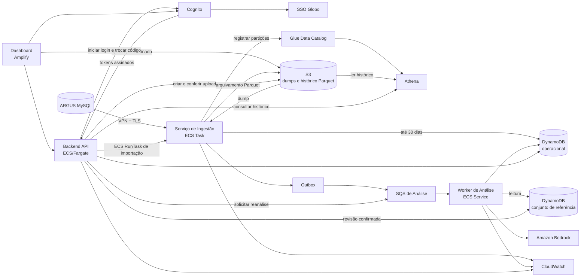
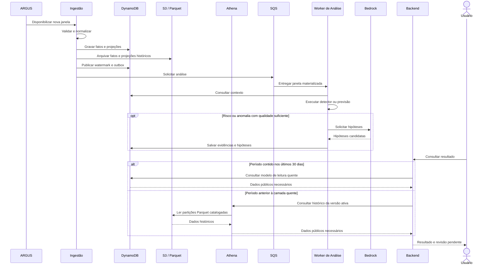

# Visão geral da arquitetura

- **Status:** aprovado para implementação incremental
- **Versão:** 2.0
- **Última atualização:** 11/09/2026
- **Responsáveis:** equipe de arquitetura
- **Região AWS:** `us-east-1`

## 1. Objetivo

Este documento apresenta como os componentes do View Show se relacionam e registra as decisões que orientam o desenvolvimento. Os contratos detalhados de dados, mensagens e HTTP estão nos documentos especializados desta pasta.

O View Show recebe dados operacionais do ARGUS, mantém até 30 dias de dados no DynamoDB, arquiva os 11 meses anteriores em Parquet no S3, executa modelos de análise e apresenta previsões, incidentes, evidências e hipóteses em um dashboard autenticado.

## 2. Limites do sistema

O ARGUS e o SSO corporativo pertencem ao ambiente interno da Globo. O View Show consome esses serviços, mas não administra seus bancos, usuários ou regras. O Amazon Bedrock é uma dependência gerenciada utilizada para apoiar a formulação de hipóteses; a confirmação da causa permanece sob responsabilidade humana.

Não fazem parte da primeira versão:

- treinamento online de modelos;
- escrita de volta no ARGUS;
- alteração automática de incidentes no ServiceNow;
- confirmação automática de causa raiz;
- armazenamento em RDS;
- exposição pública dos workers.

## 3. Componentes

O diagrama representa o conjunto atual e o alvo. Já houve um ciclo anterior de
`apply` e `destroy`; o bucket compatível da ingestão permaneceu como previsto.
O novo plano integrado e a prova com o dump reduzido de 23 tabelas ainda estão
pendentes. Esse dump é smoke funcional, não validação de capacidade.

### 3.1 Dashboard

Aplicação Next.js entregue pelo Amplify. Ela apresenta dados e envia decisões
humanas sem acessar DynamoDB, SQS ou ARGUS diretamente. O runtime atual também
emite RUM; upload e acompanhamento de importação permanecem capacidades-alvo.

### 3.2 Backend API

Aplicação Node/Express executada em ECS/Fargate privado. Ela valida a sessão,
converte modelos de leitura em DTOs públicos e registra revisões. O runtime atual
autentica diretamente no Cognito por usuário e senha; federação SSO, importação
HTTP, reanálise e consultas históricas Athena permanecem integrações parciais ou
alvo. A adoção do manifesto `ACTIVE` deve preservar as consultas já funcionais
da `develop` e falhar fechada apenas quando a versão estiver ausente ou
incompatível.

### 3.3 Serviço de Ingestão

Aplicação batch Python executada como ECS Task, sem endpoint HTTP. O backfill
manual restaura um snapshot versionado em MySQL sidecar efêmero, normaliza os 23
datasets ARGUS 2.0, grava DynamoDB e Parquet, reconcilia Glue/Athena e publica
pela outbox. O gate live e o controle autenticado do Scheduler estão
implementados; a agenda nasce desabilitada e a integração não deve ser ativada
até haver conectividade e prova específicas na AWS.

### 3.4 Worker de Análise

A camada agêntica preservada da `develop` implementa localmente contratos,
quality gate, providers e prompts. O consumidor SQS como serviço AWS, sua
persistência integrada e a operação com Bedrock ainda são arquitetura-alvo.

### 3.5 Persistência

O DynamoDB `monitoracao-operacional` armazena os fatos e as projeções dos últimos 30 dias, além de previsões, incidentes, evidências, hipóteses e controles de execução. O S3 conserva em Parquet os fatos e as projeções dos 11 meses anteriores, completando um horizonte de 12 meses; o Glue Data Catalog registra seus schemas e partições, e o Athena executa as consultas históricas. Todos os dados temporais são isolados por `datasetVersion`, e um manifesto identifica a versão ativa e seus dois níveis de armazenamento. O DynamoDB `monitoracao-golden-set` conserva apenas diagnósticos confirmados. Dumps de importação e objetos grandes também ficam no S3; não existe RDS na solução.

## 4. Comunicação entre componentes

| Origem | Destino | Comunicação | Finalidade |
| --- | --- | --- | --- |
| ARGUS | Ingestão | MySQL sobre VPN e TLS | leitura de dados operacionais |
| Dashboard | S3 | HTTPS com URL pré-assinada | upload multipart do dump |
| Backend | Cognito | HTTPS/OIDC | iniciar login e trocar o código de autorização por tokens |
| Backend | S3 | AWS SDK | criar URLs pré-assinadas e conferir o upload multipart |
| Backend | ECS/Fargate | AWS SDK, `RunTask` | iniciar a restauração e a importação do dump |
| Backend | SQS | AWS SDK, assíncrona | solicitar reanálise de um incidente |
| Ingestão | DynamoDB | AWS SDK | fatos, projeções e controle |
| Ingestão | S3 | AWS SDK | arquivar fatos e projeções em Parquet |
| Ingestão | Glue Data Catalog | AWS SDK | registrar schemas e partições históricas |
| Ingestão | SQS | AWS SDK, assíncrona | solicitar análise de uma janela pronta |
| SQS | Worker | long polling | distribuir e repetir análises |
| Worker | Bedrock | AWS SDK | gerar hipóteses candidatas |
| Dashboard | Backend | HTTPS/JSON | consultas e comandos do usuário |
| Backend | DynamoDB | AWS SDK | ler projeções, controlar importações e registrar revisões |
| Backend | Athena | AWS SDK, SQL assíncrono | consultar períodos anteriores aos 30 dias da camada quente |
| Backend | CloudWatch | logs e métricas | registrar latência, falhas e identificadores de acompanhamento |
| Cognito | SSO Globo | OIDC ou SAML | autenticar identidade corporativa |

Comunicação síncrona é usada quando o solicitante precisa da resposta para continuar. Processamentos demorados retornam HTTP 202 e são acompanhados por consulta periódica. SQS é usada quando a análise pode ocorrer depois que a ingestão já concluiu sua parte.

## 5. Fluxo principal

Os diagramas completos, com alternativas e falhas, estão na [Seção 5 da modelagem](../sprint3/modelagem.md#5-diagramas-de-sequência); o [índice de fluxos](fluxos.md) relaciona cada cenário aos contratos técnicos aplicáveis.

## 6. Decisões arquiteturais

### D1 — AWS como ambiente de execução

Frontend, APIs, processamento, mensageria, armazenamento, identidade e
observabilidade pertencem à arquitetura AWS. A stack atual declara VPC dedicada
em duas AZs, API e workers em sub-redes privadas, ALB, bastion, Flow Logs,
Cognito e autoscaling. A comunicação live com o ARGUS ainda depende de
conectividade privada autorizada pela Globo.

### D2 — Armazenamento temporal em camadas

O sistema utiliza modelos de leitura orientados às consultas e evita `Scan` no caminho operacional. O DynamoDB mantém até 30 dias de fatos e projeções para acesso de baixa latência. Os 11 meses anteriores permanecem em Parquet no S3, com schema e partições no Glue Data Catalog e consultas pelo Athena. Não haverá RDS na primeira versão.

### D3 — Persistência sob responsabilidade da ingestão

A ingestão grava diretamente a camada quente no DynamoDB e o arquivo histórico no S3. A SQS recebe apenas solicitações de análise, reduzindo componentes e evitando um consumidor criado somente para repetir a persistência.

### D4 — Comunicação assíncrona para análise

Detecção, previsão e reanálise são desacopladas pela SQS. Duplicidade e entrega fora de ordem são tratadas por identificadores idempotentes.

### D5 — Outbox para publicação confiável

O watermark da janela e um item de outbox por evento são persistidos na mesma transação. A detecção de anomalia e a previsão horária possuem `eventId`, `idempotencyKey` e estado independentes; uma execução posterior recupera somente os itens pendentes quando a SQS estiver indisponível.

### D6 — Orquestrador dentro do Worker de Análise

O orquestrador é um módulo interno e não possui repositório, deploy ou API próprios inicialmente. Essa separação poderá ser revista se ele precisar de escala ou ciclo de entrega independentes.

### D7 — IA produz hipóteses, não decisões

O Bedrock ajuda a explicar sinais encontrados pelos modelos. Toda hipótese é marcada como pendente até uma pessoa autenticada confirmá-la ou refutá-la.

### D8 — Conjunto de referência separado

Diagnósticos confirmados ficam em uma tabela separada. A ingestão não possui acesso; o Worker de Análise pode consultar; somente o Backend promove uma decisão humana.

### D9 — Importação assíncrona e ativação versionada

Hoje o operador envia o dump ao S3 e dispara `RunTask` por scripts. Upload
direto pelo navegador, HTTP 202 e acompanhamento de `ImportJob` são o desenho
alvo. Em ambos os casos, a tarefa grava sob uma `candidateDatasetVersion` e só
troca o manifesto ativo depois de validar as camadas; o `recordId` permanece
estável entre versões.

### D10 — Contratos versionados

Eventos, itens persistidos e respostas públicas possuem versão. Alterações incompatíveis criam uma nova versão; campos opcionais podem ser acrescentados quando consumidores tratam sua ausência.

## 7. Segurança

- Hoje usuários são autenticados diretamente pelo Cognito; federação com o SSO
  da Globo permanece o modelo-alvo.
- O navegador recebe cookie de sessão `HttpOnly`, `Secure` e `SameSite`.
- Workers permanecem em sub-redes privadas e não expõem portas públicas.
- Cada componente utiliza role IAM de menor privilégio.
- Secrets Manager conserva credenciais e parâmetros sensíveis.
- Dumps e arquivos Parquet no S3 usam criptografia, acesso restrito e políticas de retenção distintas.
- As consultas do Athena são limitadas ao prefixo da versão ativa e gravam seus resultados em um prefixo isolado.
- Contextos enviados ao Bedrock são limitados e sanitizados.
- Logs não incluem tokens, credenciais ou payloads operacionais completos.

## 8. Disponibilidade e recuperação

Falhas da origem impedem apenas a publicação da janela afetada. Falhas da SQS deixam a outbox pendente. Falhas do Worker preservam dados intermediários e podem resultar em nova tentativa ou DLQ. Falhas do Bedrock não apagam a previsão, o incidente ou suas evidências.

Dumps inválidos não substituem o dataset disponível. Durante uma importação, fatos, projeções, arquivos Parquet, partições e watermarks são gravados sob a versão candidata, enquanto todas as consultas continuam usando o manifesto ativo. O conjunto anterior permanece consultável até a troca condicional; uma falha deixa a candidata invisível e não mistura seus registros aos da versão ativa.

## 9. Observabilidade

A API propaga request/trace IDs e métricas RED; o frontend emite RUM. Ingestão
e camada agêntica possuem logs estruturados e hooks OpenTelemetry, acrescentando
`runId`, `eventId` e identificadores de janela quando aplicáveis. CloudWatch,
Flow Logs e a stack LGTM opcional reúnem as evidências operacionais.

## 10. Documentos relacionados

- [Ingestão e dados](ingestao-e-dados.md)
- [Análise de dados e diagnóstico por IA](analise-e-ia.md)
- [API do dashboard](api-dashboard.md)
- [Fluxos integrados](fluxos.md)
- [Status de implementação](status-implementacao.md)
