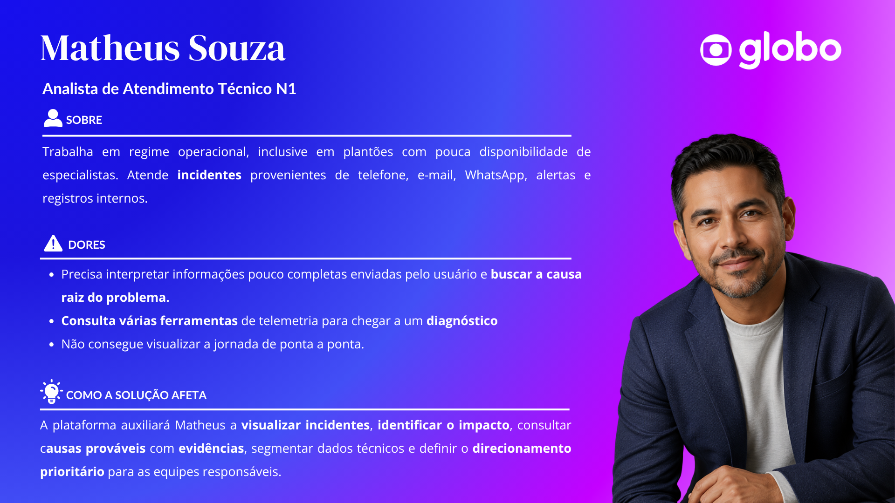
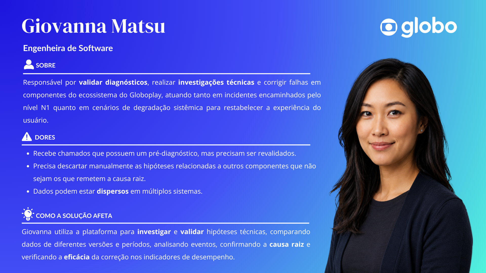
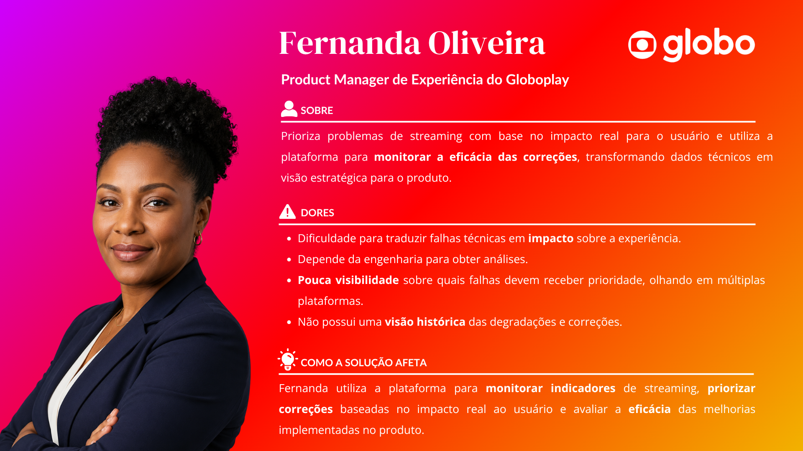

# Entendimento da Experiência do Usuário

Este documento apresenta o entendimento de experiência do usuário da solução de observabilidade e diagnóstico de incidentes do Globoplay. O conteúdo reúne as três personas mapeadas para o projeto, suas necessidades e dores, além das User Stories que orientam a construção dos fluxos de interação.

## Sumário

- [1. Introdução](#1-introdução)
- [2. Personas](#2-personas)
  - [2.1 Persona 1 — Matheus Souza](#21-persona-1--matheus-souza)
  - [2.2 Persona 2 — Giovanna Matsu](#22-persona-2--giovanna-matsu)
  - [2.3 Persona 3 — Fernanda Oliveira](#23-persona-3--fernanda-oliveira)
- [3. User Stories](#3-user-stories)
  - [3.1 Critérios INVEST](#31-critérios-invest)
  - [3.2 User Stories da Persona 1](#32-user-stories-da-persona-1)
  - [3.3 User Stories da Persona 2](#33-user-stories-da-persona-2)
  - [3.4 User Stories da Persona 3](#34-user-stories-da-persona-3)
  - [3.5 Priorização](#35-priorização)
- [4. Correlação entre personas, necessidades e User Stories](#4-correlação-entre-personas-necessidades-e-user-stories)
- [5. Conclusão](#5-conclusão)
- [6. Referências](#6-referências)

## 1. Introdução

O Globoplay opera em um ecossistema heterogêneo, formado por navegadores, dispositivos móveis, televisores e diferentes versões de sistemas operacionais. Nesse cenário, uma falha pode atingir somente um recorte específico da audiência e permanecer oculta em indicadores agregados. Além disso, os dados necessários ao diagnóstico podem estar distribuídos entre diferentes fontes, com granularidades e vocabulários distintos.

A solução proposta centraliza eventos de telemetria, normaliza os dados e apoia a investigação de incidentes. Sua interface deve permitir que as pessoas usuárias compreendam o impacto de uma degradação, consultem hipóteses de causa provável e suas evidências, aprofundem a análise até os eventos e sessões relacionados e acompanhem a recuperação dos indicadores após uma correção.

Foram mapeadas três personas complementares, apresentadas na ordem de participação na jornada: atendimento técnico N1, engenharia de software e gestão de produto. Cada uma possui uma decisão central diferente:

1. O atendimento N1 precisa identificar a prioridade e encaminhar o incidente à equipe mais provável, com evidências.
2. A engenharia precisa validar tecnicamente a hipótese, investigar a causa e verificar a recuperação.
3. A gestão de produto precisa priorizar problemas de experiência e acompanhar melhorias mensuráveis.

## 2. Personas

### 2.1 Persona 1 — Matheus Souza

**Cargo:** Analista de Atendimento Técnico N1  
**Classificação:** Persona operacional primária  
**Responsabilidade:** Receber incidentes, interpretar evidências, estimar a criticidade e direcionar cada caso ao time adequado.

Matheus trabalha em regime operacional, inclusive durante plantões com pouca disponibilidade de especialistas. Recebe incidentes por telefone, e-mail, WhatsApp, alertas e registros internos. Frequentemente precisa tomar decisões a partir de informações incompletas e consultar diferentes ferramentas de telemetria para compreender a jornada do usuário e buscar a causa raiz.

*Figura 1 — Persona 1: Matheus Souza. Fonte: autoria própria, 2026.*

#### Principais dores

- Interpretar informações incompletas enviadas por usuários.
- Consultar várias ferramentas de telemetria para chegar a um diagnóstico.
- Não possuir uma visão ponta a ponta da jornada afetada.
- Definir a prioridade e a equipe responsável sem evidências consolidadas.

#### Necessidades na solução

- Visualizar incidentes e degradações detectados.
- Identificar quantas sessões ou pessoas usuárias foram afetadas.
- Consultar causas prováveis, níveis de confiança e evidências.
- Segmentar dados por dispositivo, versão, região, conteúdo, sinal, CDN e componente.
- Receber uma indicação justificada da equipe ou fila responsável.

#### Decisão central

> Para qual equipe devo encaminhar este incidente e quais evidências justificam essa decisão?

Matheus não corrige código, altera métricas nem configura componentes de produção por meio da plataforma.

### 2.2 Persona 2 — Giovanna Matsu

**Cargo:** Engenheira de Software  
**Classificação:** Persona técnica primária  
**Responsabilidade:** Validar diagnósticos, investigar tecnicamente as falhas, corrigir o componente sob sua responsabilidade e verificar se a experiência foi restabelecida.

Giovanna recebe incidentes encaminhados pelo atendimento N1 e também atua em degradações sistêmicas. Embora o chamado possa conter um pré-diagnóstico, ela precisa revalidar a hipótese, descartar relações com outros componentes e correlacionar dados dispersos em múltiplos sistemas. A investigação pode depender de combinações específicas de dispositivo, sistema, versão, região, conteúdo ou infraestrutura.

*Figura 2 — Persona 2: Giovanna Matsu. Fonte: autoria própria, 2026.*

#### Principais dores

- Revalidar pré-diagnósticos recebidos de outras equipes.
- Descartar manualmente hipóteses relacionadas a componentes que não originaram a falha.
- Interpretar fontes com métricas, granularidades e vocabulários diferentes.
- Investigar dados dispersos em múltiplos sistemas.
- Identificar falhas concentradas em uma combinação específica do ecossistema.

#### Necessidades na solução

- Acessar as evidências detalhadas de cada hipótese.
- Alternar entre o evento normalizado e a fonte original.
- Comparar versões, releases e períodos.
- Analisar os eventos anteriores e posteriores à falha.
- Confirmar, refutar ou marcar uma hipótese como inconclusiva.
- Comparar indicadores antes e depois de uma correção.

#### Decisão central

> A hipótese apresentada é tecnicamente válida e o que preciso corrigir no meu componente?

A correção, o deploy e o rollback permanecem nos repositórios e pipelines existentes; a plataforma apoia a investigação e a validação.

### 2.3 Persona 3 — Fernanda Oliveira

**Cargo:** Product Manager de Experiência do Globoplay  
**Classificação:** Persona secundária, direcionada à evolução posterior ao núcleo técnico  
**Responsabilidade:** Priorizar problemas de experiência e acompanhar se as correções produziram melhorias técnicas mensuráveis.

Fernanda acessa a plataforma periodicamente para transformar dados técnicos em uma visão estratégica do produto. Ela precisa compreender quais problemas afetam mais sessões e segmentos, comparar a experiência entre plataformas e acompanhar o histórico de degradações. Sua análise utiliza dados agregados e não exige acesso a logs brutos.

*Figura 3 — Persona 3: Fernanda Oliveira. Fonte: autoria própria, 2026.*

#### Principais dores

- Traduzir falhas técnicas em impacto sobre a experiência.
- Depender da engenharia para obter análises.
- Ter pouca visibilidade sobre quais falhas devem receber prioridade.
- Consultar múltiplas plataformas para construir uma visão consolidada.
- Não possuir uma visão histórica das degradações e correções.

#### Necessidades na solução

- Consultar sessões e segmentos afetados de forma agregada.
- Comparar plataformas, versões, dispositivos e regiões.
- Acompanhar buffering, falhas de inicialização, latência e erros.
- Visualizar problemas recorrentes ordenados por impacto.
- Comparar indicadores antes e depois de uma correção.

#### Decisão central

> Qual problema de experiência deve ser priorizado e quanto a correção melhorou o produto?

A plataforma não deve atribuir causalidade a retenção, conversão, NPS ou satisfação enquanto essas fontes externas não estiverem integradas.

## 3. User Stories

As histórias foram escritas no formato **“como [quem], eu quero [o que], para [por que]”**. Cada história representa uma ação útil, vinculada a uma necessidade específica de uma persona e acompanhada por critérios de aceitação observáveis.

### 3.1 Critérios INVEST

As User Stories foram revisadas conforme os princípios INVEST:

| Critério | Aplicação neste documento |
|---|---|
| **Independente** | Cada história entrega uma capacidade identificável e pode ser priorizada separadamente, ainda que compartilhe dados e componentes com outras histórias. |
| **Negociável** | A história descreve a necessidade e o valor esperado; decisões detalhadas de interface e implementação permanecem abertas à discussão do time. |
| **Valiosa** | O benefício está explícito e associado a uma dor ou decisão da persona. |
| **Estimável** | O escopo e os critérios de aceitação tornam o trabalho compreensível para estimativa. |
| **Pequena** | Cada história se concentra em uma única intenção principal e pode ser entregue incrementalmente. |
| **Testável** | Os critérios de aceitação permitem verificar objetivamente o comportamento esperado. |

### 3.2 User Stories da Persona 1

#### US-N1-01 — Visualizar incidentes priorizados

**User Story:** Como analista de atendimento técnico N1, eu quero visualizar os incidentes e as degradações detectados, ordenados por severidade e quantidade de usuários afetados, para identificar rapidamente quais ocorrências exigem atendimento prioritário.

**Critérios de aceitação:**

- O sistema deve apresentar uma lista de incidentes ativos.
- Cada incidente deve exibir severidade, horário de início, status, quantidade estimada de usuários ou sessões afetadas e plataforma ou componente provavelmente envolvido.
- A lista deve permitir ordenação por severidade, impacto e horário.
- O sistema deve distinguir incidentes ativos, reconhecidos e encerrados.
- Incidentes sem estimativa confiável devem ser identificados como “impacto ainda não determinado”.

**Fundamentação:** Matheus precisa transformar ocorrências vindas de diferentes canais em uma decisão de encaminhamento. O impacto estimado é um dos elementos centrais para definir a prioridade.

#### US-N1-02 — Consultar hipótese de causa provável

**User Story:** Como analista de atendimento técnico N1, eu quero visualizar a causa provável de um incidente e o nível de confiança dessa hipótese, para direcionar o chamado sem depender exclusivamente de tentativa e erro entre diferentes filas.

**Critérios de aceitação:**

- O sistema deve apresentar pelo menos uma hipótese de causa provável quando houver evidência suficiente.
- Hipóteses múltiplas devem ser ordenadas por probabilidade.
- Cada hipótese deve indicar componente associado, percentual ou faixa de confiança, resumo da justificativa e momento em que foi gerada.
- A interface não deve apresentar uma hipótese como causa confirmada.
- Quando não houver evidência suficiente, o sistema deve informar que a causa permanece inconclusiva.

**Fundamentação:** Um incidente pode circular entre equipes de player, CDN, TV, web, identidade e backend. A hipótese reduz encaminhamentos por tentativa e erro sem eliminar a validação humana.

#### US-N1-03 — Consultar evidências do diagnóstico

**User Story:** Como analista de atendimento técnico N1, eu quero consultar as evidências que sustentam a hipótese apresentada, para justificar o encaminhamento do incidente à equipe responsável.

**Critérios de aceitação:**

- Cada hipótese deve possuir uma seção de evidências associadas.
- As evidências devem indicar fonte, horário e relação com o incidente.
- O sistema deve contemplar evidências como aumento de erros, alteração de latência, queda de sessões e concentrações por dispositivo, versão, região ou CDN.
- Cada evidência deve poder ser expandida para exibir detalhes adicionais.
- Evidências ausentes, atrasadas ou de baixa qualidade devem ser sinalizadas.

**Fundamentação:** O encaminhamento precisa ser justificável mesmo quando a telemetria apresenta perda, atraso, duplicidade ou baixa qualidade.

#### US-N1-04 — Segmentar o incidente

**User Story:** Como analista de atendimento técnico N1, eu quero filtrar um incidente por dispositivo, versão do sistema, versão do aplicativo, região, conteúdo, CDN e componente, para identificar o recorte específico em que a falha está concentrada.

**Critérios de aceitação:**

- O sistema deve disponibilizar filtros cumulativos para período, dispositivo, sistema operacional, versão do aplicativo, região, UF ou POP, ISP, CDN, conteúdo ou sinal, componente e tipo de evento, conforme a disponibilidade dos dados.
- Os filtros devem sugerir apenas valores existentes no conjunto consultado.
- A quantidade de sessões e usuários afetados deve ser atualizada após a aplicação dos filtros.
- A pessoa usuária deve conseguir limpar todos os filtros.
- O recorte aplicado deve permanecer ao navegar entre telas relacionadas ao mesmo incidente.

**Fundamentação:** Médias gerais podem ocultar falhas que atingem uma combinação específica de modelo de TV, versão, região, ISP, conteúdo ou CDN.

#### US-N1-05 — Identificar a equipe responsável

**User Story:** Como analista de atendimento técnico N1, eu quero receber uma indicação da equipe ou fila mais provável para tratar o incidente, para reduzir encaminhamentos incorretos e o tempo gasto entre diferentes áreas.

**Critérios de aceitação:**

- O sistema deve sugerir uma fila ou equipe com base na hipótese mais provável.
- A sugestão deve estar associada a um componente, como player, CDN, backend, identidade, web, iOS, Android ou aplicação de TV.
- A plataforma deve apresentar a justificativa da recomendação.
- A pessoa usuária deve poder copiar ou registrar um resumo com hipótese, evidências e recorte afetado.
- Quando a hipótese envolver mais de um componente, o sistema deve indicar a possível necessidade de investigação conjunta.
- A plataforma não deve corrigir código, alterar configurações nem publicar mudanças.

**Fundamentação:** O papel do N1 é interpretar as informações e encaminhar o incidente ao time com maior probabilidade de resolvê-lo.

### 3.3 User Stories da Persona 2

#### US-ENG-01 — Validar tecnicamente uma hipótese

**User Story:** Como engenheira de software especialista de componente, eu quero analisar a hipótese de causa provável e as evidências técnicas associadas, para confirmar ou refutar se o meu componente originou a degradação.

**Critérios de aceitação:**

- O sistema deve apresentar a hipótese, o nível de confiança e os componentes correlacionados ao incidente.
- A engenheira deve conseguir acessar todas as evidências relacionadas à hipótese e identificar suas fontes originais.
- A hipótese deve poder ser registrada como confirmada, refutada ou inconclusiva.
- O feedback não deve alterar automaticamente os dados históricos.
- A plataforma deve manter a decisão, a autoria e o horário do registro para consulta posterior.

**Fundamentação:** Especialistas precisam confirmar ou contestar hipóteses sem que o motor de diagnóstico dependa integralmente de revisão humana para funcionar.

#### US-ENG-02 — Navegar entre dado normalizado e fonte original

**User Story:** Como engenheira de software especialista de componente, eu quero alternar entre o evento normalizado e o dado bruto da fonte original, para verificar se a transformação preservou as informações necessárias ao diagnóstico.

**Critérios de aceitação:**

- O sistema deve disponibilizar a visualização do dado normalizado.
- Quando disponível, o dado bruto correspondente também deve ser acessível.
- A interface deve identificar fonte, entidade, métrica, timestamp, tags e valor.
- O sistema deve preservar a associação entre o registro normalizado e sua origem.
- Dados sem correspondência direta devem ser sinalizados.
- A visualização deve respeitar as regras de anonimização.

**Fundamentação:** A camada normalizada unifica os dados, mas a investigação técnica pode exigir a consulta às fontes detalhadas.

#### US-ENG-03 — Inspecionar a linha do tempo de uma sessão

**User Story:** Como engenheira de software especialista de componente, eu quero visualizar os eventos anteriores e posteriores a uma falha em uma única linha do tempo de sessão, para reconstruir a sequência técnica que levou ao problema.

**Critérios de aceitação:**

- Os eventos devem ser apresentados em ordem cronológica.
- A linha do tempo deve contemplar os tipos mínimos `request`, `vitals`, `screen_view`, `video_view`, `session` e `error`.
- Cada evento deve exibir horário, tipo, origem e principais atributos.
- Eventos correlacionados devem ser visualmente associados.
- Duplicidades, lacunas e atrasos de telemetria devem ser sinalizados.
- A linha do tempo deve permitir filtros por tipo de evento e componente.

**Fundamentação:** A reconstrução cronológica ajuda a compreender o contexto anterior à falha e seus efeitos posteriores.

#### US-ENG-04 — Comparar versões, releases e períodos

**User Story:** Como engenheira de software especialista de componente, eu quero comparar métricas entre versões, releases e períodos diferentes, para identificar se uma alteração recente está associada ao início da degradação.

**Critérios de aceitação:**

- O sistema deve permitir a seleção de dois ou mais períodos para comparação.
- A comparação deve contemplar versão do aplicativo, versão do sistema operacional, modelo de dispositivo e release ou momento de deploy, quando disponível.
- A interface deve apresentar a evolução temporal das métricas e destacar alterações relevantes após uma mudança de versão.
- O mesmo recorte de dispositivo, região ou conteúdo deve ser preservado entre os períodos.
- Quando a amostra for insuficiente, o sistema deve informar a limitação.

**Fundamentação:** Alterações de player ou aplicação podem provocar degradações concentradas em um modelo ou uma versão específica e desaparecer nos indicadores gerais.

#### US-ENG-05 — Verificar a recuperação após uma correção

**User Story:** Como engenheira de software especialista de componente, eu quero acompanhar os indicadores antes e depois da aplicação de uma correção, para verificar se a experiência retornou ao comportamento esperado.

**Critérios de aceitação:**

- A engenheira deve poder informar o momento aproximado da correção ou selecionar um marco registrado.
- O sistema deve comparar janelas anteriores e posteriores equivalentes.
- A comparação deve exibir taxa de erro, latência p95 e p99, tempo de início do vídeo, taxa de buffering, falha de inicialização, sessões afetadas e ANR, conforme a disponibilidade.
- O sistema deve indicar se os indicadores melhoraram, permaneceram estáveis ou pioraram.
- O resultado deve permanecer disponível no histórico do incidente.
- A plataforma não deve realizar rollback, deploy nem alteração de código.

**Fundamentação:** A correção ocorre nas ferramentas de engenharia; a plataforma verifica se os indicadores retornaram ao baseline esperado.

### 3.4 User Stories da Persona 3

As histórias da Persona 3 representam uma evolução posterior ao núcleo técnico. Elas utilizam informações agregadas e não pressupõem correlação comprovada com retenção, conversão, NPS ou satisfação enquanto essas fontes não estiverem integradas.

#### US-PM-01 — Priorizar problemas por impacto técnico

**User Story:** Como Product Manager de Experiência do Globoplay, eu quero visualizar os problemas recorrentes ordenados pelo número de sessões afetadas e pela intensidade da degradação, para priorizar as melhorias com maior impacto técnico sobre a experiência.

**Critérios de aceitação:**

- O sistema deve apresentar um ranking de problemas recorrentes.
- Cada problema deve indicar sessões afetadas, usuários estimados, duração, recorrência, plataformas afetadas e severidade.
- A lista deve permitir ordenação por impacto, frequência ou duração.
- A visão deve utilizar dados agregados e não exigir a leitura de stack traces ou logs brutos.
- O sistema não deve afirmar impacto em retenção, conversão ou NPS sem integração com essas fontes.

**Fundamentação:** Fernanda precisa decidir qual problema deve ser priorizado sem depender da engenharia para traduzir cada falha técnica.

#### US-PM-02 — Comparar a experiência entre segmentos

**User Story:** Como Product Manager de Experiência do Globoplay, eu quero comparar indicadores de experiência entre plataformas, versões, dispositivos e regiões, para identificar segmentos prejudicados mesmo quando os indicadores gerais parecem normais.

**Critérios de aceitação:**

- A interface deve permitir comparações por plataforma, dispositivo, sistema operacional, versão do aplicativo, região ou UF, ISP, CDN e conteúdo ou sinal.
- O sistema deve mostrar o tamanho de cada segmento analisado.
- A comparação deve incluir métricas de qualidade de experiência.
- Segmentos com amostra insuficiente devem ser sinalizados.
- Os resultados devem ser agregados e não expor identificadores individuais.

**Fundamentação:** Indicadores nacionais podem ocultar falhas graves em segmentos que representam uma parcela menor da audiência.

#### US-PM-03 — Acompanhar indicadores de qualidade de experiência

**User Story:** Como Product Manager de Experiência do Globoplay, eu quero acompanhar buffering, tempo de início do vídeo, falhas de inicialização, latência e erros, para avaliar a evolução técnica da experiência de streaming.

**Critérios de aceitação:**

- O sistema deve disponibilizar Video Start Time, Rebuffer Rate, Empty Buffer Video Seconds, bitrate médio, resolução, latência, falhas de inicialização e sessões com erro, conforme a disponibilidade.
- Os indicadores devem ser exibidos ao longo do tempo.
- Filtros globais devem poder ser aplicados à visualização.
- A interface deve informar a definição de cada indicador.
- Os dados devem ser agregados.
- A solução deve separar qualidade técnica de experiência de métricas externas de satisfação.

**Fundamentação:** As fontes de telemetria permitem acompanhar a qualidade técnica percebida sem inferir resultados de negócio ainda não integrados.

#### US-PM-04 — Avaliar a evolução após uma correção

**User Story:** Como Product Manager de Experiência do Globoplay, eu quero comparar os indicadores de experiência antes e depois de uma correção, para verificar se a mudança produziu uma melhoria técnica mensurável no segmento afetado.

**Critérios de aceitação:**

- A PM deve poder selecionar um incidente ou uma correção concluída.
- O sistema deve apresentar períodos comparáveis antes e depois da alteração.
- O mesmo segmento afetado deve ser preservado na comparação.
- A variação absoluta e percentual das métricas deve ser apresentada.
- A interface deve informar quando a diferença não for conclusiva.
- O sistema deve diferenciar correlação temporal de causalidade comprovada.
- A plataforma não deve atribuir melhoria de NPS, retenção ou conversão à correção sem dados externos.

**Fundamentação:** O escopo atual permite demonstrar a evolução técnica da experiência, mas não comprovar efeitos em indicadores externos de produto.

#### US-PM-05 — Consultar o histórico de degradações

**User Story:** Como Product Manager de Experiência do Globoplay, eu quero consultar o histórico de degradações e correções por período, plataforma e segmento, para identificar problemas recorrentes e orientar o planejamento do produto.

**Critérios de aceitação:**

- O sistema deve disponibilizar o histórico de incidentes e degradações.
- A PM deve poder filtrar um período de até um ano, conforme a retenção disponível.
- Cada registro deve apresentar início e fim da degradação, segmento afetado, impacto técnico, causa confirmada ou hipótese final, status da correção e evolução posterior.
- O sistema deve permitir a comparação de períodos sazonais equivalentes.
- Eventos planejados e testes de carga devem ser diferenciados de falhas não planejadas.
- A interface deve permitir identificar reincidências de um mesmo problema.

**Fundamentação:** O histórico possibilita reconhecer recorrências e comparar eventos sazonais, considerando a política de retenção da solução.

### 3.5 Priorização

A prioridade considera o núcleo de diagnóstico do incidente, a continuidade da investigação técnica e a evolução estratégica do produto. A ordem das personas foi preservada na documentação; a prioridade indica a sequência recomendada de implementação e validação dos fluxos.

| Prioridade | User Stories | Justificativa |
|---|---|---|
| **P0 — Essencial** | US-N1-01, US-N1-02, US-N1-03, US-N1-04, US-N1-05, US-ENG-01, US-ENG-02, US-ENG-03 | Forma o fluxo ponta a ponta de identificar, contextualizar, encaminhar e validar tecnicamente um incidente. |
| **P1 — Importante** | US-ENG-04, US-ENG-05 | Aprofunda a investigação e permite verificar a recuperação após uma mudança. |
| **P2 — Evolução** | US-PM-01, US-PM-02, US-PM-03, US-PM-04, US-PM-05 | Amplia o uso para acompanhamento agregado, priorização de produto e análise histórica. |

## 4. Correlação entre personas, necessidades e User Stories

| Persona | Necessidade central | User Stories relacionadas |
|---|---|---|
| **Matheus Souza** | Priorizar e encaminhar incidentes com contexto e evidências. | US-N1-01, US-N1-02, US-N1-03, US-N1-04 e US-N1-05 |
| **Giovanna Matsu** | Validar a causa, aprofundar a investigação e verificar a recuperação. | US-ENG-01, US-ENG-02, US-ENG-03, US-ENG-04 e US-ENG-05 |
| **Fernanda Oliveira** | Priorizar melhorias e acompanhar a evolução técnica da experiência. | US-PM-01, US-PM-02, US-PM-03, US-PM-04 e US-PM-05 |

## 5. Conclusão

As personas representam etapas complementares da resposta a incidentes do Globoplay. Matheus transforma sinais dispersos em um encaminhamento justificado; Giovanna valida tecnicamente a hipótese e acompanha a recuperação; Fernanda utiliza informações agregadas para priorizar melhorias e reconhecer recorrências. As quinze User Stories mantêm esse encadeamento sem confundir as responsabilidades de cada perfil e fornecem critérios testáveis para orientar o desenvolvimento e a futura construção dos fluxos do protótipo.

## 6. Referências

- ADAPTWORKS. [Como escrever as melhores User Stories com INVEST](https://blog.adapt.works/como-escrever-as-melhores-user-stories-com-invest/). 2020. Acesso em: 11 ago. 2026.
- GLOBO; INTELI. *Sessão da tarde: requisitos, MVP, personas e User Stories*. Material de projeto fornecido pelo parceiro, 2026.
