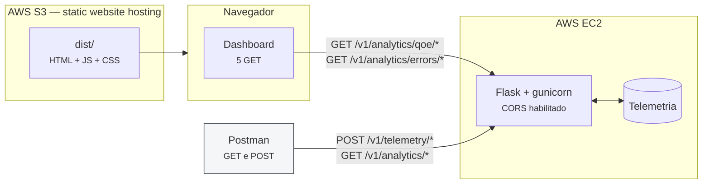

# Planejamento do MVP Inicial — Sprint 1

> Plano de execução da entrega `mvp-inicial.md`, organizado para maximizar o critério de avaliação.
> Frente coberta aqui: **frontend, organização do repositório e evidências**. A API Flask e a EC2 são de outro integrante.

---

## Sumário

1. [Como a nota é composta](#1-como-a-nota-é-composta)
2. [Escopo](#2-escopo)
3. [Stack](#3-stack)
4. [Arquitetura](#4-arquitetura)
5. [Tokens de design](#5-tokens-de-design)
6. [Telas e endpoints](#6-telas-e-endpoints)
7. [Estrutura de pastas](#7-estrutura-de-pastas)
8. [Contrato de API](#8-contrato-de-api)
9. [Deploy na AWS](#9-deploy-na-aws)
10. [Execução local e Codespaces](#10-execução-local-e-codespaces)
11. [Documentação do código](#11-documentação-do-código)
12. [Relatório de testes Postman](#12-relatório-de-testes-postman)
13. [Vídeo de demonstração](#13-vídeo-de-demonstração)
14. [Cronograma](#14-cronograma)
15. [Checklist do critério de avaliação](#15-checklist-do-critério-de-avaliação)
16. [Riscos](#16-riscos)

---

## 1. Como a nota é composta

| Item | Peso | Responsável |
|:---|:---|:---|
| (1) Aplicação web atendendo GET e POST em EC2 | **4,0** | Backend (outro integrante) |
| (2) Relatório de testes GET e POST via Postman | **4,0** | Esta frente |
| (3) Vídeo de 2–3 min do frontend em página estática | **2,0** | Esta frente |

**A consequência prática é contraintuitiva: o frontend vale 2,0, e o relatório de testes vale o dobro disso.**

Um frontend com seis telas não pontua mais do que um com três — o item 3 pede "vídeo demonstrando o frontend implementado em página estática", e o teto é 2,0 em qualquer cenário. Já o item 2 tem 4,0 inteiros disponíveis e costuma ser tratado como print de última hora.

**Alocação de esforço:**

| Frente | Esforço | Retorno |
|:---|:---|:---|
| Frontend (3 telas) | ~3 dias | Item 3 (2,0) |
| Relatório Postman | ~1,5 dia | Item 2 (4,0) |
| README, JSDoc, estrutura, Codespaces | ~1 dia | Critérios 2, 3 e 4 |
| Vídeo | ~0,5 dia | Item 3 (2,0) |

### 1.1 O que separa "chegou lá" de "foi mais longe"

O critério é aplicado **por item**:

| Item | Chegou lá (7,1–9,0) | Foi mais longe (9,1–10) |
|:---|:---|:---|
| (2) Relatório | Endpoints testados, prints do Postman, status 200 documentado | Casos de erro além do caminho feliz, testes automatizados em cada request, fluxo ponta a ponta provando persistência, coleção exportada e reproduzível por terceiros, latências medidas |
| (3) Vídeo/frontend | Frontend no S3, navegação demonstrada, dentro de 2–3 min | Dados reais vindos da EC2 (não mockados), detalhamento em profundidade a partir de um filtro, narração que explica o problema antes da tela, interface fiel ao design |

Cada linha da coluna da direita virou uma decisão explícita neste plano.

---

## 2. Escopo

### 2.1 A restrição que define a arquitetura

> *"Vídeo demonstrando o frontend implementado em **página estática** hospedada em AWS S3 ou EC2."*

Página estática ⇒ sem SSR, sem rota de servidor. O build produz apenas `.html`, `.js`, `.css` e assets, publicados em um bucket S3. Toda a lógica roda no navegador, chamando a API na EC2 — o que torna **CORS obrigatório** no backend.

### 2.2 Divisão de papéis: o frontend só faz GET

O diagrama do backend tem duas APIs com atores distintos: a de **ingestão** (3 POST, chamada por dispositivos e SDK) e a de **dashboard** (15 GET, chamada pela UI). Um dashboard de observabilidade não envia telemetria — quem envia são os dispositivos.

Nesta sprint, portanto:

- **Os POSTs são exercitados exclusivamente pelo Postman**, que é o entregável formal do item 2 e vale 4,0. Não há simulação de ingestão no frontend.
- **O frontend consome apenas GETs.**

Não há exceção: o frontend desta sprint não emite nenhum POST.

### 2.3 Recorte: 5 endpoints

Dos 15 GETs de analytics, o frontend consome os grupos **QoE** e **Erros**:

| Endpoint | Uso |
|:---|:---|
| `GET /v1/analytics/qoe/metrics` | Indicadores de VST, rebuffer e bitrate |
| `GET /v1/analytics/qoe/timeseries` | Evolução temporal da qualidade |
| `GET /v1/analytics/errors/summary` | Crash-free e volume de erros |
| `GET /v1/analytics/errors/top` | Ranking de erros por impacto |
| `GET /v1/analytics/errors/{error_code}/details` | Detalhe e raio de impacto de um erro |

Os demais 10 GETs (`realtime/*`, `breakdown/*`, `rca/*`) ficam fora do frontend nesta sprint. Isso **não os retira do backend nem do relatório** — a coleção Postman cobre tudo que a API expuser. Alinhar com o backend quais endpoints estarão implementados até a data do teste.

### 2.4 O que fica fora do frontend

- Tela de login e autenticação (RF04) — o dashboard abre direto na visão geral. Entra em sprint futura, declarada como limitação no relatório
- Exportação CSV/PDF (RF10)
- Testes automatizados de frontend
- Responsividade mobile — o alvo é a resolução da gravação
- Console de validação de endpoints — redundante com o Postman, que já cobre isso formalmente e vale 4,0

---

## 3. Stack

| Camada | Ferramenta | Por quê |
|:---|:---|:---|
| Build | **Vite 6** | Gera o `dist/` estático que vai para o S3 |
| UI | **React 19 + TypeScript** | Padrão de mercado; tipagem documenta o contrato |
| Rotas | **React Router v7** | SPA sem servidor |
| Dados | **TanStack Query v5** | `isLoading`/`isError`/`retry` prontos — atende o critério 4.b com pouco código próprio |
| Estilo | **Tailwind CSS v4** | Tokens do Figma como variáveis CSS |
| Gráficos | **Recharts** | `AreaChart` e `BarChart` cobrem as visualizações previstas |
| Fonte | **@fontsource/poppins** | Auto-hospedada; nenhuma CDN externa para falhar durante a gravação |
| Qualidade | **ESLint + Prettier** | — |

**Deliberadamente fora:**

| Descartado | Motivo |
|:---|:---|
| Next.js | SSR não roda em S3 estático |
| Zod | Validação de contrato é papel do Postman nesta entrega. Tipos TypeScript bastam para 5 endpoints |
| MSW | Substituído por fixtures estáticas em `src/fixtures/` com a flag `VITE_USE_FIXTURES`. Mesmo efeito, sem service worker no build |
| Redux / Zustand | Não há estado global relevante; sessão cabe em um `Context` |
| Biblioteca de componentes | O Figma tem identidade própria; adaptar tema de terceiro custaria mais que escrever 6 componentes |
| Vitest / Testing Library | Não está no critério da sprint |

Menos código próprio também significa **menos superfície a documentar** — o critério 3 exige JSDoc em todas as funções.

---

## 4. Arquitetura



Dentro do frontend, a regra de dependência é: componente → hook → serviço → `apiClient`. Nenhum componente chama `fetch` direto, então mudança de contrato afeta um arquivo e não três telas.

---

## 5. Tokens de design

**Tipografia:** Poppins nos pesos 400, 500 e 600.

**Cores** (amostradas do arquivo de paleta):

| Token | Hex |
|:---|:---|
| Azul (ação primária, série principal) | `#06A5FF` |
| Roxo (destaque, navegação ativa) | `#8400F8` |
| Magenta (série secundária) | `#A203C9` |
| Vermelho (crítico, erro) | `#FF181E` |
| Amarelo (atenção) | `#FFBD08` |

**Rampa de severidade:** `#F52539` → `#F84021` → `#F96716` → `#FB8119` → `#FA951A`

**Neutros:** texto `#414750`, superfície `#F5F6F7`, borda `#E3E5E8`

**Duas pendências de design:**
- O swatch vermelho está rotulado `#FF81E` — cinco dígitos, hex inválido. O pixel real é `#FF181E`.
- A rampa termina no laranja, mas a tela inicial mostra tiles verdes. Faltam os tons finais. Proposta: `#EAE81C` → `#B9E01B` → `#7FD41E`.

---

## 6. Telas e endpoints

Três telas cobrindo os 5 endpoints. O dashboard abre direto na visão geral, sem autenticação:

| Rota | Base no Figma | Endpoints | Conteúdo |
|:---|:---|:---|:---|
| `/` | Tela Inicial | `errors/summary`, `errors/top` | Headline dinâmica — "Tudo bem por aqui!" quando o crash-free está acima do limite, mensagem de criticidade caso contrário — sobre a grade de tiles de severidade alimentada pelo ranking de erros |
| `/qualidade` | Tela Dashboard | `qoe/metrics`, `qoe/timeseries` | Indicadores de VST, rebuffer e bitrate no topo; série temporal em área abaixo; seletor de período de 24h, 7d e 30d |
| `/erros` | Tela Recursos | `errors/top`, `errors/{error_code}/details` | Barra de filtros, tabela de ranking, e painel lateral com o raio de impacto do erro selecionado |

`errors/top` aparece em duas telas com visualizações diferentes — tiles de severidade na visão geral, tabela filtrável na tela de erros. É o mesmo dado servindo a dois níveis de profundidade.

**Componentes-base:** `AppShell` (sidebar + conteúdo), `StatusState` (carregando / vazio / erro — implementa a Tela Erro do Figma), `KpiCard`, `ChartCard`, `SeverityTile`, `DataTable`.

A Tela Login do Figma fica documentada como design pronto para a próxima sprint, quando houver backend de autenticação.

---

## 7. Estrutura de pastas

```
apps/basica/
├── backend/                    # outro integrante
└── frontend/
    ├── src/
    │   ├── api/client.ts       # fetch + baseURL + ApiError + latência
    │   ├── types/              # tipos TypeScript dos 5 payloads
    │   ├── services/           # 1 função por endpoint
    │   ├── hooks/              # 1 hook por endpoint
    │   ├── components/
    │   ├── pages/
    │   ├── fixtures/           # dados de exemplo para dev sem backend
    │   └── styles/theme.css
    ├── .env.example
    └── package.json
```

---

## 8. Contrato de API

Alinhar com o backend **antes de construir qualquer tela**. Convenções mínimas:

- Coleções sempre em `{ "items": [...], "total": n }` — nunca array na raiz
- Timestamps ISO-8601 UTC com sufixo `Z`
- Erros no envelope `{ "error": { "code": "...", "message": "..." } }`
- Filtros de período por query string: `?from=&to=&app_target=`

Exemplo — `GET /v1/analytics/errors/summary`:

```json
{
  "window": "24h",
  "total_errors": 48213,
  "crash_free_sessions": 0.9942,
  "affected_users": 3120,
  "updated_at": "2026-08-11T14:02:00Z"
}
```

Exemplo — `GET /v1/analytics/errors/top`:

```json
{
  "items": [
    {
      "error_code": "DNS_RESOLVE_FAIL",
      "title": "Falha de DNS em LG webOS 2017",
      "severity": "P1",
      "occurrences": 8412,
      "affected_users": 3120,
      "app_target": "dom-lg-webos-2017"
    }
  ],
  "total": 27
}
```

O documento completo vira `artefatos/contrato-api.md`, cobrindo os endpoints do frontend **e** os que só serão testados via Postman — escrever uma vez, usar nas duas pontas.

---

## 9. Deploy na AWS

Backend na EC2, frontend no S3.

```bash
VITE_API_BASE_URL=http://<IP-EC2> npm run build

aws s3 mb s3://g05-telemetry-frontend
aws s3 website s3://g05-telemetry-frontend \
  --index-document index.html \
  --error-document index.html      # necessário para as rotas da SPA
aws s3 sync dist/ s3://g05-telemetry-frontend --delete
```

Liberar acesso público (o bloqueio vem ativo por padrão):

```bash
aws s3api put-public-access-block --bucket g05-telemetry-frontend \
  --public-access-block-configuration "BlockPublicPolicy=false,RestrictPublicBuckets=false"

aws s3api put-bucket-policy --bucket g05-telemetry-frontend --policy '{
  "Version": "2012-10-17",
  "Statement": [{
    "Effect": "Allow", "Principal": "*", "Action": "s3:GetObject",
    "Resource": "arn:aws:s3:::g05-telemetry-frontend/*"
  }]
}'
```

### Armadilhas que quebram a entrega

| Armadilha | Sintoma | Prevenção |
|:---|:---|:---|
| Frontend em HTTPS chamando EC2 em HTTP | Chamadas bloqueadas por *mixed content*; tela vazia no vídeo | **Não usar CloudFront nesta sprint** — o endpoint de website do S3 já é HTTP |
| Rota profunda retorna 404 | `/erros` aberto direto quebra | `--error-document index.html`. Plano B: `createHashRouter` |
| IP público da EC2 muda ao reiniciar | Build publicado aponta para IP morto | Elastic IP, ou refazer build + `sync` antes de gravar |
| CORS ausente no Flask | Nenhuma chamada funciona a partir do S3 | Combinar explicitamente: `CORS(app, origins=["http://<bucket>.s3-website-..."])` |
| Sessão do AWS Academy expira | Tudo fora do ar | Não gravar em cima do prazo |

---

## 10. Execução local e Codespaces

O critério 4.c pede que o projeto rode "bastando acionar o comando Run ou os scripts disponíveis".

```bash
cd apps/basica/frontend
cp .env.example .env
npm install
npm run dev            # http://localhost:5173
```

| Script | Função |
|:---|:---|
| `npm run dev` | Servidor de desenvolvimento |
| `npm run dev:fixtures` | Roda sem backend, usando dados de exemplo |
| `npm run build` | Build estático |
| `npm run preview` | Serve o build local — **validar antes de publicar** |
| `npm run deploy` | `build` + `aws s3 sync` |

`.devcontainer/devcontainer.json` com Node 22 e Python 3.12, `postCreateCommand` instalando as duas pontas e `forwardPorts` para 5173 e 8000 — assim o Codespace abre pronto.

---

## 11. Documentação do código

O critério 3 exige cabeçalho em cada módulo e documentação de parâmetros, retorno e funcionamento em **todas** as funções. Em TypeScript, o padrão é JSDoc/TSDoc:

```ts
/**
 * @module services/errors
 * Acesso aos endpoints GET de erros consumidos pelo dashboard.
 */

/**
 * Busca o ranking de erros por impacto no período informado.
 *
 * @param period - Janela de agregação: `'24h'`, `'7d'` ou `'30d'`.
 * @returns Lista de erros ordenada por número de usuários afetados.
 * @throws {ApiError} Quando o status HTTP não é 2xx.
 */
export async function getTopErrors(period: Period = '24h'): Promise<TopErrors> {
```

Documentar **junto com o código**, não em mutirão na véspera. O critério é avaliado por amostragem, e arquivo sem cabeçalho é o que aparece primeiro.

---

## 12. Relatório de testes Postman

**Peso 4,0 — o item de maior retorno desta frente, e o único lugar onde os POSTs são exercitados.**

### Coleção `G05 - Telemetria`

**Pasta 1 — Ingestão (POST).** Os 3 endpoints de `/v1/telemetry/*`, cada um com três casos:
- payload válido → `202`
- payload malformado → `400` com o envelope de erro
- campo obrigatório ausente → `400`

**Pasta 2 — Analytics (GET).** Todos os endpoints que o backend expuser, com e sem filtros de query. Incluir os que têm parâmetro de path com IDs válidos.

**Pasta 3 — Fluxo ponta a ponta.** `POST /v1/telemetry/errors` → `GET /v1/analytics/errors/top`, verificando que o erro recém-enviado aparece no ranking.

Essa terceira pasta é o que separa "os endpoints respondem" de "a aplicação funciona", e é o argumento mais forte disponível para o item 2.

### Testes automatizados em cada request

```js
pm.test("status 200", () => pm.response.to.have.status(200));
pm.test("responde em menos de 1s", () => pm.expect(pm.response.responseTime).to.be.below(1000));
pm.test("contrato: items e total", () => {
  const body = pm.response.json();
  pm.expect(body).to.have.property("items").that.is.an("array");
  pm.expect(body).to.have.property("total").that.is.a("number");
});
```

Rodar pelo **Collection Runner contra a EC2** e salvar os prints do resumo.

Exportar coleção e environment para `artefatos/postman/` — coleção reproduzível por terceiros é o que a faixa "foi mais longe" chama de profundidade.

### Estrutura do `artefatos/mvp-inicial.md`

Este arquivo **ainda não existe** e é o entregável formal do item 2.

1. Objetivo
2. Ambiente testado — URL da EC2, URL do S3, data e hora da execução
3. Tabela de resultados: endpoint, método, payload, status esperado × obtido, latência, resultado
4. Prints do Collection Runner
5. Evidências do frontend
6. **Link do vídeo** — exigido explicitamente pelo enunciado do item 3
7. Limitações conhecidas

Declarar as limitações: dados sintéticos, ausência de autenticação, e o frontend consumindo 5 dos endpoints de analytics nesta sprint. Assumir custa menos do que ser descoberto.

---

## 13. Vídeo de demonstração

**Peso 2,0.** Duração obrigatória de 2 a 3 minutos, com a URL do S3 visível na barra de endereço — é o que comprova a hospedagem estática exigida.

| Tempo | Conteúdo |
|:---|:---|
| 0:00–0:25 | Problema: telemetria do Globoplay fragmentada entre plataformas heterogêneas, e o que o dashboard resolve |
| 0:25–1:05 | URL do S3 na barra de endereço; Visão Geral com crash-free e tiles de severidade, dados reais vindos da EC2 |
| 1:05–1:50 | Qualidade: indicadores de VST e rebuffer, série temporal, troca de período disparando nova consulta |
| 1:50–2:40 | Erros: aplicar filtro, selecionar um erro do ranking e abrir o detalhamento com o raio de impacto |
| 2:40–2:55 | Arquitetura em uma frase (S3 → EC2 → banco) e próximos passos |

O bloco de 1:50 é o mais valioso: o detalhamento a partir de um filtro é o que demonstra profundidade de análise, e não apenas telas que carregam.

Vale mencionar em narração que os dados vêm da API na EC2 — a diferença entre um frontend com dados reais e um com dados fixos é exatamente o que separa as duas faixas superiores do item 3.

Ensaiar antes. Confirmar que a EC2 está no ar e que o build publicado aponta para o IP atual.

---

## 14. Cronograma

| Período | Entregas |
|:---|:---|
| **Semana 1, dias 1–2** | `.gitignore`, logos, pastas, branches · contrato de API acordado · projeto Vite · ESLint · tokens |
| **Semana 1, dias 3–5** | `apiClient` · serviços e hooks · fixtures · `AppShell` · `StatusState` · Visão Geral |
| **Semana 2, dias 1–2** | Qualidade · Erros · JSDoc |
| **Semana 2, dia 3** | Integração com a EC2 · deploy no S3 · **frontend publicado e funcionando** |
| **Semana 2, dias 4–5** | Coleção Postman · vídeo · relatório · README · tag `SPRINT1` |

**Marco inegociável:** frontend publicado no S3 no **dia 3 da semana 2**. Se escorregar, vídeo e relatório entram em risco — e juntos valem 6,0.

O critério 1.c cobra commits distribuídos ao longo das duas semanas, então o cronograma precisa ser seguido de fato, não comprimido no fim.

---

## 15. Checklist do critério de avaliação

| Exigência | Como é atendida |
|:---|:---|
| (1) App web GET e POST em EC2 — 4,0 | Backend (outro integrante); frontend consome os GETs via CORS |
| (2) Relatório Postman — 4,0 | §12: 3 pastas, casos de erro, testes automatizados, fluxo E2E, coleção exportada |
| (3) Vídeo do frontend em S3 — 2,0 | §13: roteiro cronometrado, dados reais da EC2, detalhamento em profundidade |
| 1.a — Tag `SPRINT1` | Criada na data da entrega, no commit publicado |
| 1.b — Commits de todos os membros | Divisão por fatia vertical entre integrantes |
| 1.c — Commits distribuídos | Cronograma da §14 |
| 2.a — Raiz limpa | ⚠️ Faltam `.gitignore` e as logos |
| 2.b — README completo | ⚠️ O README atual é o template padrão do GitLab |
| 2.a — Apps em subpastas de `/apps` | `apps/basica/frontend` e `apps/basica/backend` |
| 3 — Documentação do código | §11: JSDoc no frontend, docstrings no backend |
| 4.a — Roda na AWS | §9 |
| 4.b — Sem falhas críticas | `StatusState` + `ErrorBoundary`: API fora do ar vira mensagem tratada, não tela branca |
| 4.c — Roda localmente / Codespaces | §10 + devcontainer |

**Dois itens de organização pendentes que não dependem de código nenhum** — os pontos mais baratos da sprint:
1. O `README.md` da raiz ainda é o boilerplate do GitLab, sem logos, título, integrantes ou instruções.
2. Não existe `.gitignore` — necessário antes do primeiro `npm install`.

---

## 16. Riscos

| Risco | Impacto | Mitigação |
|:---|:---|:---|
| O backend é hoje um `Flask()` vazio, sem nenhum endpoint | Alto | Fixtures locais destravam o frontend; combinar a data em que os 5 endpoints estarão no ar |
| A branch com `apps/` não está integrada à linha de trabalho do frontend | Médio | Alinhar branches antes de iniciar |
| Origem dos dados não definida (banco real ou seed sintético) | Alto | Seed sintético para o MVP, declarado como tal no relatório |
| CORS não habilitado no Flask | Alto | Nenhuma chamada funciona a partir do S3 — combinar explicitamente, não assumir |
| IP da EC2 muda entre sessões do AWS Academy | Alto no dia da entrega | Elastic IP; rebuild antes de gravar |
| `errors/{error_code}/details` sem códigos válidos para demonstrar | Médio | O seed precisa gerar códigos estáveis, usados no vídeo e na coleção Postman |
| Divergência entre o que o backend implementa e o que a coleção Postman testa | Médio | Congelar a lista de endpoints implementados até o fim da semana 1 |

---

<sup>Documento produzido pelos autores — Grupo 05, Inteli, 2026.</sup>
