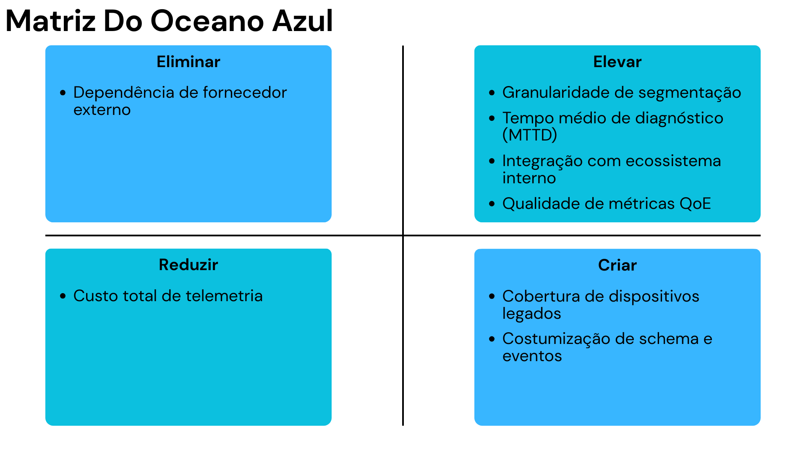

# Matriz de Avaliação de Valor – Estratégia do Oceano Azul

&nbsp;&nbsp;&nbsp;&nbsp;A Matriz de Avaliação de Valor do Oceano Azul é uma ferramenta estratégica que permite comparar, de forma estruturada, a proposta de valor de um projeto em relação às soluções existentes no mercado. A partir da identificação de atributos relevantes para o cliente, a matriz orienta decisões sobre quais fatores devem ser **Reduzidos**, **Eliminados**, **Aumentados** ou **Criados** (framework ERRC), com o objetivo de simultaneamente reduzir custos e elevar o valor percebido pelo cliente.  

&nbsp;&nbsp;&nbsp;&nbsp;No contexto deste projeto, a matriz foi construída considerando a realidade operacional do Globoplay e o cenário competitivo de ferramentas de monitoramento/telemetria de frontend disponíveis no mercado (por exemplo, soluções de RUM/APM voltadas a aplicações web e mobile). A análise toma como referência um conjunto de oito atributos considerados críticos para os times de engenharia, SRE e produto, permitindo visualizar como a plataforma proprietária proposta se diferencia das alternativas tradicionais.

<figure>
  
  <figcaption>
  </figcaption>
</figure>
<strong>Figura 1:</strong> Matriz Do Oceano Azul.  
    <em>Fonte: Grupo 05 (2026).</em>

---

## Atributos considerados

&nbsp;&nbsp;&nbsp;&nbsp;Foram definidos oito atributos de valor que sintetizam as principais preocupações e expectativas do cliente em relação a uma plataforma de telemetria para frontends multiplataforma:

1. **Custo total de telemetria** – gastos anuais com coleta, processamento e visualização de dados, incluindo licenças de ferramentas externas.
2. **Cobertura de dispositivos legados** – capacidade de coletar telemetria de TVs e dispositivos antigos, com protocolos ou limitações não atendidos por soluções modernas.
3. **Granularidade de segmentação** – nível de detalhe disponível para análise por device family, modelo, versão de app, OS, região, CDN, tipo de playback, entre outros.
4. **Tempo médio de diagnóstico (MTTD/MTTR)** – rapidez para identificar e resolver a causa raiz de incidentes.
5. **Customização de schema e eventos** – flexibilidade para definir modelos de dados e eventos alinhados às necessidades específicas de streaming.
6. **Integração com ecossistema interno** – facilidade de integração com data lakes, sistemas de alerta, ferramentas de ticket e dashboards já utilizados pelo Globoplay.
7. **Qualidade de métricas de QoE** – adequação e precisão das métricas de qualidade de experiência do usuário (TTFF, falha de playback, rebuffer, etc.).
8. **Dependência de fornecedor externo** – grau de exposição estratégica a ferramentas de terceiros para capacidade crítica de observabilidade.

&nbsp;&nbsp;&nbsp;&nbsp;Com base nesses atributos, a estratégia do projeto foi desenhada utilizando as quatro ações do Oceano Azul: Reduzir, Eliminar, Aumentar e Criar. A seguir, detalhamos cada quadrante, com exemplos de pontuação comparativa e justificativas.

---

## Reduzir

### Custo total de telemetria

**Ação:** Reduzir  
**Atributo:** Custo total de telemetria  

**Descrição e motivação**  
&nbsp;&nbsp;&nbsp;&nbsp;O custo associado a ferramentas de observabilidade de mercado é diretamente proporcional ao volume de eventos e sessões monitoradas. Em um serviço de streaming de grande porte, que precisa acompanhar milhões de sessões diárias com nível de detalhe elevado, o modelo tradicional de cobrança por volume gera um custo anual muito alto. Em resposta, a solução proposta busca **reduzir significativamente esse custo total**, substituindo parte do stack de ferramentas externas por uma plataforma proprietária otimizada para a realidade do Globoplay.

**Exemplo de pontuação comparativa (0 a 10, menor = menor custo):**

- Nossa solução (plataforma proprietária): **3**  
- Concorrente A (ferramenta de RUM A): **9**  
- Concorrente B (ferramenta de RUM B): **8**

**Justificativa**  
&nbsp;&nbsp;&nbsp;&nbsp;Ao internalizar coleta e processamento de telemetria, a empresa passa a ter um custo mais associado à infraestrutura e operação, com **custo marginal decrescente conforme a escala aumenta**. Isso contrasta com soluções de mercado, em que o custo cresce linearmente com o volume monitorado. Reduzir esse atributo não diminui o valor percebido pelo cliente; pelo contrário, libera orçamento para outras frentes de melhoria do produto.

---

## Eliminar

### Dependência de fornecedor externo

**Ação:** Eliminar  
**Atributo:** Dependência de fornecedor externo  

**Descrição e motivação**  
&nbsp;&nbsp;&nbsp;&nbsp;Atualmente, grande parte da capacidade de observabilidade de frontend depende de ferramentas de terceiros. Essa dependência exige adaptação contínua a contratos, modelos de preço, roadmaps e limitações técnicas definidos por outros. A proposta da plataforma é **eliminar, na medida do possível, essa dependência estratégica**, reduzindo o risco de vendor lock-in em um componente crítico da operação.

**Exemplo de pontuação comparativa (0 a 10, menor = menor dependência):**

- Nossa solução: **0**  
- Concorrente A: **8**  
- Concorrente B: **8**

**Justificativa**  
&nbsp;&nbsp;&nbsp;&nbsp;Ao eliminar a dependência de fornecedor externo como elemento central da telemetria, o Globoplay ganha **autonomia sobre dados, arquitetura e evolução da plataforma**, podendo priorizar o que faz sentido para o produto e não apenas o que está disponível no catálogo de um vendor. Essa eliminação reduz riscos de aumento de preços, descontinuações e restrições técnicas impostas por terceiros.

---

## Aumentar

### Granularidade de segmentação

**Ação:** Aumentar  
**Atributo:** Granularidade de segmentação  

**Descrição e motivação**  
&nbsp;&nbsp;&nbsp;&nbsp;As soluções de mercado geralmente oferecem segmentações genéricas (por exemplo, por tipo de browser ou país). Para o contexto de streaming, isso é insuficiente: é necessário diferenciar comportamento por modelo de TV, firmware, versão de app, sistema operacional, rota de CDN e tipo de conteúdo. A plataforma proposta busca **aumentar significativamente esse nível de granularidade**, oferecendo filtros alinhados à realidade operacional do Globoplay.

**Exemplo de pontuação comparativa (0 a 10, maior = maior granularidade):**

- Nossa solução: **9**  
- Concorrente A: **6**  
- Concorrente B: **6**

**Justificativa**  
&nbsp;&nbsp;&nbsp;&nbsp;Elevar a granularidade de segmentação permite que as equipes de engenharia e SRE passem de uma visão agregada para uma **análise de causa muito mais precisa**, identificando rapidamente quais combinações de device, versão e região estão sofrendo degradação. Isso aumenta o valor percebido sem necessariamente elevar os custos operacionais de forma proporcional.

---

### Tempo médio de diagnóstico (MTTD/MTTR)

**Ação:** Aumentar (no sentido de performance: reduzir tempo)  
**Atributo:** Tempo médio de diagnóstico  

**Descrição e motivação**  
&nbsp;&nbsp;&nbsp;&nbsp;A velocidade com que um incidente é detectado e diagnosticado é crucial para a qualidade de experiência percebida pelo usuário. Ao criar uma plataforma integrada, com correlação por sessão e filtros cumulativos, o objetivo é **aumentar a capacidade de diagnóstico rápido**, reduzindo tanto o tempo para detectar (MTTD) quanto o tempo para resolver (MTTR).

**Exemplo de pontuação comparativa (0 a 10, maior = melhor desempenho de diagnóstico):**

- Nossa solução: **9**  
- Concorrente A: **6**  
- Concorrente B: **6**

**Justificativa**  
&nbsp;&nbsp;&nbsp;&nbsp;Ao elevar esse atributo, a plataforma torna o processo de investigação mais eficiente, reduzindo a dependência de múltiplas ferramentas e cruzamentos manuais. O ganho é percebido diretamente na operação (menos tempo em incidentes) e indiretamente pelo usuário final (menos tempo de degradação de serviço).

---

### Integração com ecossistema interno

**Ação:** Aumentar  
**Atributo:** Integração com ecossistema interno  

**Descrição e motivação**  
&nbsp;&nbsp;&nbsp;&nbsp;Ferramentas externas frequentemente exigem conectores adicionais, exportações e ajustes específicos para integrar com data lakes, ferramentas de alerta, Jira, sistemas internos de monitoramento, entre outros. A plataforma proprietária é desenhada desde o início para **se integrar profundamente ao ecossistema existente do Globoplay**, aumentando este atributo acima do padrão de mercado.

**Exemplo de pontuação comparativa (0 a 10, maior = melhor integração):**

- Nossa solução: **8**  
- Concorrente A: **6**  
- Concorrente B: **6**

**Justificativa**  
&nbsp;&nbsp;&nbsp;&nbsp;Ao aumentar a integração, a solução reduz retrabalho e barreiras técnicas entre equipes, facilitando automações, criação de alertas customizados e análises avançadas em data lakes. Isso gera valor operacional sem impactar negativamente o custo total.

---

### Qualidade de métricas de QoE

**Ação:** Aumentar  
**Atributo:** Qualidade de métricas de QoE  

**Descrição e motivação**  
&nbsp;&nbsp;&nbsp;&nbsp;Métricas genéricas de RUM (como tempo de carregamento de página ou erro de JavaScript) não são suficientes para gerenciar um serviço de streaming. A plataforma proposta eleva a qualidade das métricas de QoE ao incluir indicadores específicos como **tempo até o início do vídeo (TTFF), taxa de falha de playback, rebuffer ratio e variação de bitrate**, sempre associados ao contexto do dispositivo e da rota de entrega.

**Exemplo de pontuação comparativa (0 a 10, maior = melhor qualidade de QoE):**

- Nossa solução: **9**  
- Concorrente A: **6**  
- Concorrente B: **6**

**Justificativa**  
&nbsp;&nbsp;&nbsp;&nbsp;Ao aumentar esse atributo, o projeto fornece **informações mais diretamente acionáveis** para times de vídeo, engenharia e produto, alinhando a telemetria aos objetivos reais do serviço (qualidade de reprodução e satisfação do usuário).

---

## Criar

### Cobertura de dispositivos legados

**Ação:** Criar  
**Atributo:** Cobertura de dispositivos legados  

**Descrição e motivação**  
&nbsp;&nbsp;&nbsp;&nbsp;A maioria das soluções de mercado assume um conjunto de capacidades modernas nos dispositivos (bibliotecas atualizadas, suporte a SDKs recentes, protocolos padronizados). Isso deixa uma parcela significativa da base – especialmente TVs e set-top boxes mais antigos – sem telemetria útil. A plataforma proposta **cria um atributo que praticamente não existe no mercado hoje**: cobertura sistemática e observável de dispositivos legados, por meio de APIs unificadas e adaptadores de protocolo.

**Exemplo de pontuação comparativa (0 a 10, maior = maior cobertura de legados):**

- Nossa solução: **9**  
- Concorrente A: **3**  
- Concorrente B: **4**

**Justificativa**  
&nbsp;&nbsp;&nbsp;&nbsp;Criar esse atributo permite que o Globoplay deixe de tratar uma parcela importante da audiência como “invisível”. A capacidade de monitorar legados amplia o campo de visão operacional e reduz o risco de incidentes concentrados em segmentos que antes não eram detectados.

---

### Customização de schema e eventos

**Ação:** Criar  
**Atributo:** Customização de schema e eventos  

**Descrição e motivação**  
&nbsp;&nbsp;&nbsp;&nbsp;Ferramentas externas oferecem schemas de eventos pré-definidos, com certo grau de customização, mas normalmente limitados pelo modelo de dados e pelo foco do produto (RUM genérico, por exemplo). O projeto cria a possibilidade de **definir um schema canônico próprio**, orientado às necessidades de streaming do Globoplay, bem como eventos específicos (por exemplo, `video_view` com campos ricos de QoE e contexto de conteúdo).

**Exemplo de pontuação comparativa (0 a 10, maior = maior nível de customização):**

- Nossa solução: **9**  
- Concorrente A: **5**  
- Concorrente B: **5**

**Justificativa**  
&nbsp;&nbsp;&nbsp;&nbsp;Ao criar esse atributo, a plataforma permite que a telemetria evolua junto com o produto, sem ficar limitada à taxonomia de eventos de um vendor. Isso gera **um salto de valor** em termos de relevância dos dados coletados e de aderência às perguntas que a operação e o negócio realmente precisam responder.

---

## Conclusão

&nbsp;&nbsp;&nbsp;&nbsp;A Matriz de Avaliação de Valor do Oceano Azul mostra que a plataforma de telemetria proposta não busca apenas “ser mais uma ferramenta de monitoramento”, mas reconstruir o espaço de valor desse tipo de solução para o contexto específico do Globoplay. Ao **reduzir** o custo total de telemetria e **eliminar** a dependência estratégica de fornecedores externos, o projeto ataca diretamente as limitações econômicas e de governança da abordagem atual.  

&nbsp;&nbsp;&nbsp;&nbsp;Simultaneamente, ao **aumentar** granularidade de segmentação, capacidade de diagnóstico, integração com o ecossistema interno e qualidade das métricas de QoE, a solução eleva o nível de serviço entregue às equipes técnicas. Por fim, ao **criar** cobertura estruturada para dispositivos legados e um modelo de dados customizável, a plataforma oferece atributos que o mercado praticamente não disponibiliza, gerando uma nova curva de valor alinhada às necessidades reais da operação de streaming em um país continental.  

&nbsp;&nbsp;&nbsp;&nbsp;Dessa forma, a matriz evidencia que a estratégia do projeto está em linha com os princípios do Oceano Azul: **reduzir e eliminar fatores que aumentam custo sem agregar valor proporcional** e, ao mesmo tempo, **aumentar e criar fatores que ampliam significativamente o valor percebido pelos clientes internos e, indiretamente, pelos usuários finais do serviço de streaming**.