# Matriz de Risco e Oportunidades

> Este documento identifica, avalia e prioriza os riscos (ameaças) e as oportunidades do projeto de monitoramento de frontend do Globoplay (codinome interno do parceiro: **Argus**). Além dos artefatos de [requisitos](requisitos.md) e de [análise financeira](analise_financeira.md), este levantamento usa como fonte primária o Termo de Abertura de Projeto (TAPI), o anexo de fontes de dados e a documentação técnica do dataset entregues pelo parceiro - os dois últimos contêm um capítulo de "armadilhas conhecidas" e uma seção chamada literalmente "a oportunidade real", que fundamentam boa parte dos itens abaixo. Cada item recebe um código único (**R0X** para riscos, **O0X** para oportunidades) que serve de ponte entre este documento e a matriz visual de probabilidade × impacto.
---

## Sumário

1. [Visão geral e metodologia](#1-visão-geral-e-metodologia)
2. [Escala de Probabilidade, Impacto e Estratégias de Resposta](#2-escala-de-probabilidade-impacto-e-estratégias-de-resposta)
   - 2.1. [Probabilidade](#21-probabilidade)
   - 2.2. [Impacto e Nível de Risco (Probabilidade × Impacto)](#22-impacto-e-nível-de-risco-probabilidade-impacto)
   - 2.3. [Estratégias de Resposta](#23-estratégias-de-resposta)
3. [Riscos (Ameaças)](#3-riscos-ameaças)
4. [Oportunidades](#4-oportunidades)
5. [Processo de revisão e atualização](#5-processo-de-revisão-e-atualização)
6. [Referências](#6-referências)

---

## 1. Visão geral e metodologia

&emsp; Este documento identifica, avalia e prioriza os riscos (eventos que podem prejudicar o projeto) e as oportunidades (eventos que podem beneficiá-lo além do planejado) do projeto de monitoramento de frontend do Globoplay. A abordagem segue a lógica de gestão de riscos do PMBOK (PROJECT MANAGEMENT INSTITUTE, 2021) e da ISO 31000 (INTERNATIONAL ORGANIZATION FOR STANDARDIZATION, 2018): cada item é avaliado em duas dimensões independentes, probabilidade e impacto (Seção 2), classificado em um nível objetivo e associado a uma estratégia de resposta (Seção 2.3), em vez de depender apenas de percepção qualitativa.

&emsp; Cada risco recebe o código **RXX** e cada oportunidade o código **OXX**, numerados sequencialmente nas Tabelas 6 e 7. Esse código é a unidade de transporte entre este documento e a matriz visual a ser construída no Figma (reproduzida também como imagem mais adiante neste documento): a descrição completa, a categoria e a estratégia de resposta permanecem neste documento como fonte da verdade, enquanto o Figma recebe apenas o código posicionado na célula de probabilidade × impacto correspondente.

&emsp; A maior parte dos itens abaixo não é uma suposição genérica de projeto de software: é extraída diretamente da documentação técnica que o parceiro entregou junto com o dataset (o correlator **Argus** e seu anexo de fontes de dados), que já documenta explicitamente armadilhas conhecidas do problema (Seção 7 daquele documento) e aponta, em uma seção própria, onde está "a oportunidade real" (Seção 8.3 daquele documento) - ambas citadas nas Tabelas 6 e 7 abaixo. Este é um documento vivo: novos riscos e oportunidades identificados ao longo do módulo devem ser adicionados seguindo o processo descrito na Seção 5.

---

## 2. Escala de Probabilidade, Impacto e Estratégias de Resposta

### 2.1. Probabilidade

&emsp; A probabilidade estima a chance de o evento (risco ou oportunidade) ocorrer - ou, quando já é um fato documentado sobre os dados/sistema atuais, a chance de ele afetar o projeto caso a equipe não trate o ponto conscientemente - durante as 10 semanas do módulo, em uma escala de 1 (rara) a 5 (quase certa).

Tabela 1: Escala de Probabilidade

| Nível | Classificação | Descrição | Chance estimada ao longo do módulo |
|:---|:---|:---|:---|
| **1** | Rara | Não há indício de que o evento ocorra; depende de uma combinação improvável de fatores. | < 10% |
| **2** | Improvável | Pode ocorrer em situação excepcional, mas não há sinal atual de que vá acontecer. | 10% – 30% |
| **3** | Possível | Pode ocorrer em algum momento do módulo; já há indício ou precedente semelhante. | 30% – 50% |
| **4** | Provável | Há forte indício de que o evento vai ocorrer, ou já é um fato documentado sobre os dados/sistema atuais. | 50% – 70% |
| **5** | Quase certa | O evento já está ocorrendo ou é esperado com alta confiança dado o contexto atual. | > 70% |

Fonte: Material produzido pelos autores (2026), com base no PMBOK (PROJECT MANAGEMENT INSTITUTE, 2021).

### 2.2. Impacto e Nível de Risco (Probabilidade × Impacto)

&emsp; O impacto estima o efeito do evento sobre prazo, custo, escopo/qualidade ou a relação com a Globo, caso ele se concretize, também em uma escala de 1 (insignificante) a 5 (catastrófico).

Tabela 2: Escala de Impacto

| Nível | Classificação | Descrição |
|:---|:---|:---|
| **1** | Insignificante | Desvio mínimo em prazo, custo ou escopo; absorvido sem ajuste no planejamento; nenhum efeito perceptível para a Globo. |
| **2** | Menor | Pequeno desvio, corrigido com ajuste de rotina da equipe; não compromete nenhuma entrega do módulo. |
| **3** | Moderado | Atraso, retrabalho ou custo adicional perceptível em uma entrega parcial, ainda recuperável dentro das 10 semanas do módulo. |
| **4** | Maior | Compromete uma entrega significativa (ex.: um RNF crítico ou parte do MVP) ou reduz a confiança da Globo no andamento do projeto. |
| **5** | Catastrófico | Inviabiliza a entrega do MVP ao parceiro dentro do módulo ou compromete a parceria/confidencialidade acordada com a Globo. |

Fonte: Material produzido pelos autores (2026), com base no PMBOK (PROJECT MANAGEMENT INSTITUTE, 2021).

&emsp; O nível de cada item é obtido multiplicando sua Probabilidade pelo seu Impacto (Probabilidade × Impacto), resultando em uma pontuação de 1 a 25, classificada conforme a Tabela 3. Para oportunidades, a mesma pontuação é lida como prioridade de ação - quanto maior, maior o benefício potencial a capturar - e não como severidade a mitigar.

Tabela 3: Faixas de Pontuação e Nível

| Pontuação (P × I) | Nível | Cor de referência (Figma) |
|:---|:---|:---|
| 1 – 4 | **Baixo** | Verde |
| 5 – 9 | **Médio** | Amarelo |
| 10 – 14 | **Alto** | Laranja |
| 15 – 25 | **Crítico** | Vermelho |

Fonte: Material produzido pelos autores (2026).

### 2.3. Estratégias de Resposta

&emsp; Cada risco ou oportunidade recebe uma estratégia de resposta alinhada ao seu nível e ao grau de controle do grupo sobre sua causa, seguindo o vocabulário padrão do PMBOK (PROJECT MANAGEMENT INSTITUTE, 2021).

Tabela 4: Estratégias de Resposta a Riscos (Ameaças)

| Estratégia | Descrição | Quando usar |
|:---|:---|:---|
| **Evitar** | Eliminar a causa do risco, mudando o plano para que a ameaça deixe de existir. | Riscos Críticos/Altos com causa controlável pelo grupo. |
| **Mitigar** | Reduzir a probabilidade e/ou o impacto a um nível aceitável, sem eliminar totalmente o risco. | Riscos Altos/Médios com causa parcialmente controlável. |
| **Transferir** | Repassar a responsabilidade (ou parte do impacto) a terceiros ou ao parceiro. | Riscos ligados a sistemas/decisões fora do controle do grupo (ex.: SSO da Globo). |
| **Aceitar** | Reconhecer o risco sem ação proativa, apenas monitorando sua evolução. | Riscos Baixos/Médios ou fora do controle do grupo dentro do prazo do módulo. |

Fonte: Material produzido pelos autores (2026), com base no PMBOK (PROJECT MANAGEMENT INSTITUTE, 2021).

Tabela 5: Estratégias de Resposta a Oportunidades

| Estratégia | Descrição | Quando usar |
|:---|:---|:---|
| **Explorar** | Agir para garantir que a oportunidade se concretize. | Oportunidades Altas/Críticas com alto controle do grupo. |
| **Melhorar** | Aumentar a probabilidade e/ou o impacto positivo da oportunidade. | Oportunidades Médias com ação viável dentro do prazo do módulo. |
| **Compartilhar** | Unir forças com o parceiro (Globo) ou terceiros para viabilizar a oportunidade. | Oportunidades que dependem de decisão ou recurso do parceiro. |
| **Aceitar** | Aproveitar a oportunidade apenas se ela ocorrer naturalmente, sem ação proativa. | Oportunidades Baixas ou de baixo controle do grupo. |

Fonte: Material produzido pelos autores (2026), com base no PMBOK (PROJECT MANAGEMENT INSTITUTE, 2021).

---

## 3. Riscos (Ameaças)

&emsp; A Tabela 6 relaciona os riscos identificados. Os itens R01 a R06 vêm da documentação técnica do dataset (Argus) e do anexo de fontes de dados - material que o próprio parceiro já testou em produção e documentou como fonte real de erro; os itens R07 a R12 vêm dos artefatos de requisitos, do TAPI e da análise financeira.

Tabela 6: Riscos (Ameaças) Identificados

| ID | Descrição | Categoria | P | I | Nível (P × I) | Estratégia | Responsável |
|:---|:---|:---|:---|:---|:---|:---|:---|
| **R01** | O golden set de rótulos de causa-raiz (`incident_label`) tem apenas 53 registros no total, dos quais só 4 (nível 3/ITSM, com timestamp impreciso) têm telemetria correspondente dentro da janela de retenção de 30 dias; os rótulos de melhor qualidade (`rca-confirmed`, `team-confirmed`) descrevem incidentes anteriores à janela e servem só como estudo de caso, e os rótulos `detector-derived` são circulares - medem concordância com o Argus atual, não acurácia real, penalizando um modelo que encontre incidentes que o Argus perdeu. Isso inviabiliza, dentro do prazo do módulo, o cálculo de Precision/Recall/F1-Score com confiança estatística exigido pelo RNF08. | **Dados/ML** *(Ground Truth e Avaliação)* | 4 | 5 | 20 - Crítico | Mitigar | Squad ML/Dados (G05) |
| **R02** | As fontes de qualidade de experiência percebida (NPAW/Youbora) têm latência estrutural de ~28 horas no pipeline batch via BigQuery - as últimas ~28h dessas tabelas chegam vazias ou parciais por desenho, não por falha -, o que conflita com o requisito de latência ponta a ponta de até 2 minutos do RNF02 sempre que o diagnóstico ou alerta depender de sinais de QoE (buffering, tempo de início de vídeo, quedas de sessão) para o instante presente. | **Técnico** *(Arquitetura/Latência)* | 4 | 4 | 16 - Crítico | Mitigar | Squad Backend/Arquitetura (G05) |
| **R03** | Armadilhas de semântica documentadas nos dados brutos - picos de memória que na verdade são o limite do cgroup e não uso real (caso `gg-gateway-rpaas-be`, falso pico de 33×), o campo `latency_2xx` que é contagem de requisições e não latência, zeros forçados nas séries de CDN abaixo do volume mínimo, e granularidade mista de 5 min/1h numa mesma tabela do New Relic sem coluna que distinga - geram conclusões erradas se o pipeline de normalização não tratar cada exceção já mapeada pela fonte original. | **Técnico** *(Qualidade e Semântica dos Dados)* | 4 | 3 | 12 - Alto | Mitigar | Squad Backend/Dados (G05) |
| **R04** | A lógica padrão de detecção (`positive_only: true`) ignora degradações representadas por queda de métrica - sessões caindo (player travou), Apdex caindo (pior satisfação) ou regressão silenciosa de QoE sem aumento de erro (caso Roku documentado) -, e a ausência de correlação com eventos de bloqueio do Cloud Armor pode atribuir a bugs internos picos de tráfego/CPU causados por ataques ou rate-limiting mitigado. | **Produto/ML** *(Lógica de Detecção)* | 3 | 4 | 12 - Alto | Mitigar | Squad ML/Dados (G05) |
| **R05** | O dataset e sua documentação técnica são classificados como uso interno, com liberação condicionada à aprovação prévia de Segurança da Informação e Jurídico da Globo; a contrapartida exigida (uso restrito à finalidade acadêmica do convênio, não redistribuição fora da turma, revisão prévia da Globo antes de qualquer publicação/apresentação, descarte das cópias locais ao fim do semestre) pode ser descumprida por descuido operacional da equipe. | **Contratual/Segurança** *(Confidencialidade)* | 2 | 5 | 10 - Alto | Evitar | Liderança de projeto (G05); ponto focal Globo |
| **R06** | Os arquivos de referência do parceiro (pasta `ref/`, com topologia de infraestrutura de produção e dados de uso interno) não estavam versionados nem ignorados pelo Git; um `git add` amplo os incluiria no repositório compartilhado do GitLab, violando a cláusula de não redistribuição do dataset e a restrição contratual de não compartilhar dados com terceiros (RESTR01). **Mitigado nesta versão** com a adição de `ref/` ao `.gitignore` - reavaliar se a pasta for movida ou renomeada. | **Processo** *(Governança de Repositório)* | 2 | 5 | 10 - Alto | Evitar | Liderança de projeto (G05) |
| **R07** | Um pico de tráfego equivalente a grandes eventos ao vivo (ex.: final do BBB, ~50 milhões de eventos simultâneos) supera a capacidade de auto-scaling do worker de normalização, gerando acúmulo crítico de mensagens na fila e perda de dados (RNF01, RNF03). | **Técnico** *(Capacidade)* | 3 | 5 | 15 - Crítico | Mitigar | Squad Backend/Infra (G05) |
| **R08** | A alta heterogeneidade de Smart TVs legadas (fabricadas entre 2013 e 2017, com schemas próprios e pouca capacidade de processamento) causa falhas ou perda de campos na normalização de um subconjunto de dispositivos, comprometendo a cobertura mínima de eventos do MVP (RF01, RF03, RNF11). | **Técnico** *(Compatibilidade)* | 4 | 3 | 12 - Alto | Mitigar | Squad Backend/Dados (G05) |
| **R09** | Uma indisponibilidade ou mudança de contrato na API do serviço corporativo de autenticação da Globo (SSO, RIE01) bloqueia o acesso de todos os usuários ao dashboard e às APIs de consulta, mesmo com o restante do sistema operacional. | **Integração** *(Dependência Externa)* | 2 | 4 | 8 - Médio | Transferir | Squad Backend (G05); ponto focal técnico Globo |
| **R10** | O dataset é entregue como um snapshot único (não um feed contínuo): qualquer recorte novo precisa ser pedido e regerado pelo parceiro. Combinado ao tempo já investido nas fases de elicitação e discovery, isso cria uma dependência externa que pode atrasar a conclusão do escopo mínimo do MVP dentro das 10 semanas do módulo. | **Cronograma** *(Escopo do MVP e Dependência de Dataset)* | 3 | 4 | 12 - Alto | Mitigar | Liderança de projeto (G05) |
| **R11** | As estimativas de CAPEX, OPEX e valor gerado (análise financeira, Seções 2 a 4) baseiam-se em benchmarking de mercado, não em dados reais de contrato da Globo - o que o próprio TAPI confirma ao não trazer orçamento algum -, e podem estar subdimensionadas frente ao custo real do parceiro. | **Financeiro** *(Estimativas)* | 4 | 2 | 8 - Médio | Mitigar | Liderança de projeto (G05) |
| **R12** | Os times internos da Globo (engenharia, observabilidade e produto) adotam a plataforma mais lentamente do que a curva premissada (10/20/30/40% trimestral), adiando o ponto de equilíbrio do Ano 1 (análise financeira, Seções 5 e 6). | **Negócio** *(Adoção)* | 3 | 3 | 9 - Médio | Aceitar | Liderança de projeto (G05) |

Fonte: Material produzido pelos autores (2026), com base na documentação do dataset Argus, no anexo de fontes de dados, no TAPI e nos artefatos de requisitos e de análise financeira do projeto.

---

## 4. Oportunidades

&emsp; A Tabela 7 relaciona as oportunidades identificadas - catorze ao todo, para dar à equipe um leque real de opções ao montar a matriz no Figma. As seis primeiras (O01–O06) reproduzem, quase literalmente, a lista que o próprio material do parceiro chama de "onde há mais espaço para ganho" em relação ao baseline atual do Argus - incluindo a seção que o documento intitula "a oportunidade real". As demais (O07–O14) vêm de outras partes do mesmo material (dicionário de dados, apêndices de tabelas, TAPI): mecanismos já desenhados mas ainda vazios ou não usados, e regras de baixo esforço com limiar já documentado pelo próprio parceiro.

Tabela 7: Oportunidades Identificadas

| ID | Descrição | Categoria | P | I | Nível (P × I) | Estratégia | Responsável |
|:---|:---|:---|:---|:---|:---|:---|:---|
| **O01** | O próprio material do parceiro afirma que o gargalo do sistema atual não é o algoritmo de detecção, e sim a quantidade de ground truth disponível: expandir e curar o golden set de rótulos (`incident_label`) a partir da telemetria e dos tickets históricos, com critério documentado e revisão cruzada, produz um ativo que a Globo hoje não possui - e que tem valor mesmo sem superar o baseline estatisticamente. | **Dados/ML** *(Ground Truth e Avaliação)* | 4 | 5 | 20 - Crítico | Explorar | Squad ML/Dados (G05) |
| **O02** | O calendário de transmissões ao vivo (`live_event`, com horário, time e competição) está disponível desde a revisão mais recente do dataset, mas ainda não é usado pelo detector em produção; é apontado como a maior fonte remanescente de falso positivo (picos de audiência de grandes jogos/eventos confundidos com anomalia) - ou seja, "ganho disponível, ganho não capturado". | **Produto/ML** *(Sazonalidade)* | 4 | 4 | 16 - Crítico | Explorar | Squad ML/Dados (G05) |
| **O03** | Hoje a detecção agrupa anomalias que coincidem no tempo, sem inferir direção de causa e efeito; um grafo de dependência entre serviços já existe no repositório do parceiro e está subutilizado, abrindo espaço para diagnósticos de causa raiz mais precisos do que correlação puramente temporal. | **Produto/ML** *(Causalidade)* | 2 | 4 | 8 - Médio | Melhorar | Squad ML/Dados (G05) |
| **O04** | O gate de corroboração (exigir anomalia em ≥2 fontes distintas) esconde colapsos reais de fonte única - caso documentado da Globoplay Search API, com taxa de erro de 11% contra baseline de 0,02%, só detectada uma hora depois; propor um critério melhor sem reintroduzir o ruído que levou a Globo a desligar o modo `single_source` é indicado pelo próprio parceiro como bom alvo de pesquisa. | **Produto/ML** *(Sensibilidade de Detecção)* | 3 | 3 | 9 - Médio | Melhorar | Squad ML/Dados (G05) |
| **O05** | Cada série é avaliada isoladamente hoje, com a correlação entre fontes vindo somente depois da detecção; um modelo que observe o vetor de estado completo pode capturar padrões que nenhuma série individual denuncia sozinha. | **Produto/ML** *(Detecção Multivariada)* | 2 | 4 | 8 - Médio | Melhorar | Squad ML/Dados (G05) |
| **O06** | O score de anomalia em produção é heurístico (soma ponderada do z-score pelo número de fontes corroborantes), não uma probabilidade calibrada; introduzir calibração (ex.: Platt scaling) aumentaria a interpretabilidade do ranking de alertas para o operador (RF08, RNF10). | **Produto/ML** *(Calibração)* | 3 | 2 | 6 - Médio | Melhorar | Squad ML/Dados (G05) |
| **O07** | Os resultados do MVP entregue ao final do módulo, incluindo o ganho documentado sobre o baseline do Argus, demonstram valor suficiente para justificar a continuidade da parceria Inteli–Globo em uma fase seguinte - alinhado à dimensão de Parcerias do TAPI, que já aponta potencial de evolução para integração com outros sistemas internos da Globo. | **Negócio** *(Continuidade da Parceria)* | 3 | 4 | 12 - Alto | Compartilhar | Liderança de projeto (G05) |
| **O08** | O peso de audiência por canal/PoP (`cdn_entity_tier`: tier 1 ≥100 req/s, tier 2 ≥10 req/s, tier 3 o resto) já existe e é indicado pelo próprio parceiro como "um bom peso para função de custo"; usá-lo para descontar alertas em entidades de baixo tráfego reduz fadiga de alerta sem exigir novo modelo. | **Produto/ML** *(Priorização de Alertas)* | 3 | 3 | 9 - Médio | Melhorar | Squad ML/Dados (G05) |
| **O09** | A tabela `investigation_feedback` (voto humano - agree/partial/disagree, causa corrigida) existe no schema mas está vazia neste snapshot; pilotar esse fluxo desde o MVP cria, desde já, uma fonte contínua de rótulos de qualidade para alimentar o golden set (O01), em vez de depender só de rotulagem retroativa. | **Dados/ML** *(Retroalimentação Humana)* | 3 | 3 | 9 - Médio | Melhorar | Squad ML/Dados (G05) |
| **O10** | O parceiro já documentou o limiar de anomalia nos quatro vhosts de playback (baseline ~5% de 4xx, surto para 37% = falha real de autorização de token) - uma regra de alerta pronta, escopada e de baixo esforço, em contraste com a maioria dos vhosts, onde 4xx é comportamento normal do cliente e geraria ruído se tratado como sinal. | **Produto/ML** *(Alerta de Alta Precisão)* | 4 | 3 | 12 - Alto | Explorar | Squad ML/Dados (G05) |
| **O11** | `dashboard_artifact` já contém a saída pré-computada do Argus atual para o mesmo período do snapshot; construir uma comparação lado a lado (baseline vs. sistema do grupo) como funcionalidade nativa do dashboard (RF07) entrega, de forma visual e imediata, evidência do ganho sobre o baseline exigido pelo RNF08. | **Produto** *(Benchmarking)* | 4 | 3 | 12 - Alto | Explorar | Squad Backend/ML (G05) |
| **O12** | O NPAW já classifica erros de player em 5 categorias acionáveis e auditáveis (entrega, origem, acesso, player, outros), com regra determinística e versionada; adotar essa taxonomia pronta em vez de construir uma nova do zero economiza esforço de modelagem sem perder rigor. | **Produto/ML** *(Reuso de Taxonomia)* | 4 | 2 | 8 - Médio | Melhorar | Squad ML/Dados (G05) |
| **O13** | O anexo de fontes de dados cita Amplitude (jornada/cliques no app) e métricas de Redis (saturação de cache, `rejected_rate`, `evicted_rate`) como fontes existentes mas ainda fora do escopo do MVP; integrá-las em uma fase seguinte ampliaria a cobertura de diagnóstico para jornada do usuário e causas-raiz na camada de cache. | **Produto** *(Extensão de Escopo)* | 2 | 4 | 8 - Médio | Aceitar | Squad Backend/Dados (G05) |
| **O14** | O ODS de Parcerias do TAPI já enquadra o projeto como "inovação em infraestrutura tecnológica nacional" num mercado dominado por sistemas de monitoração multinacionais; reforçar esse posicionamento (propriedade intelectual nacional, não apenas substituição de custo) fortalece o argumento estratégico do projeto para além da economia já quantificada (análise financeira, Seção 4). | **Negócio** *(Posicionamento Estratégico)* | 2 | 3 | 6 - Médio | Compartilhar | Liderança de projeto (G05) |

Fonte: Material produzido pelos autores (2026), com base na documentação do dataset Argus (Seções 5, 8.3, 10 e Apêndice A) e no TAPI do projeto.

---

Figura 1: Matriz de Probabilidade × Impacto - Riscos e Oportunidades

Fonte: elaborado pelo grupo G05 (2026), a partir dos riscos e oportunidades detalhados nas Tabelas 6 e 7.

---

## 5. Processo de revisão e atualização

&emsp; Esta matriz deve ser revisada a cada entrega do módulo, ou sempre que um novo risco ou oportunidade relevante for identificado, seguindo os passos abaixo:

1. Descrever o evento e enquadrá-lo como risco (ameaça) ou oportunidade.
2. Atribuir o próximo código sequencial disponível (RXX ou OXX) e a categoria mais próxima das já usadas nas Tabelas 6 e 7.
3. Classificar Probabilidade (Tabela 1) e Impacto (Tabela 2) e calcular o Nível pela Tabela 3.
4. Definir a estratégia de resposta (Tabela 4 ou 5) e o responsável.
5. Posicionar o código na célula correspondente da matriz visual e manter a imagem deste documento e o quadro no Figma atualizados.

&emsp; Riscos e oportunidades classificados como Alto ou Crítico - em particular a insuficiência do golden set para o RNF08 (R01/O01) e a latência estrutural do NPAW frente ao RNF02 (R02) - devem ter sua reavaliação compartilhada com os pontos focais da Globo (Igor Thurow - líder técnico; Carlos Papani - líder do projeto; Thiago Frensch - ponto focal backup), na mesma lógica de validação já adotada para as premissas financeiras (ver análise financeira, Seção 1). R01 e R02 em particular indicam que o plano de testes do RNF08 e do RNF02 pode precisar de ajuste fino de escopo - uma conversa a ter com o professor orientador (Tomaz Mikio Sasaki) e com a Globo antes de travar os critérios de aceite finais.

---

## 6. Referências

GRUPO GLOBO; INTELI. **Argus - Documentação do Dataset**: correlator de incidentes, Globoplay. Versão 1.3. [S.l.]: parceria acadêmica Globo × Inteli, 2026. Documento interno de distribuição restrita.

GRUPO GLOBO; INTELI. **Anexo - Fontes de Dados**: Monitoração Agêntica, Grupo Globo × Inteli (CCMD7). [S.l.], jun. 2026. Anexo técnico ao termo de parceria CCMD7.

INTELI. **Termo de Abertura de Projeto Interdisciplinar (TAPI)**: Turma 15, Ciência da Computação, Módulo 7 - Projeto Parceiro Globo, CCMD7. São Paulo: Inteli, 2026.

PROJECT MANAGEMENT INSTITUTE. **A Guide to the Project Management Body of Knowledge (PMBOK Guide)**. 7. ed. Newtown Square: PMI, 2021.

INTERNATIONAL ORGANIZATION FOR STANDARDIZATION. **ISO 31000:2018**: risk management - guidelines. Geneva: ISO, 2018.
