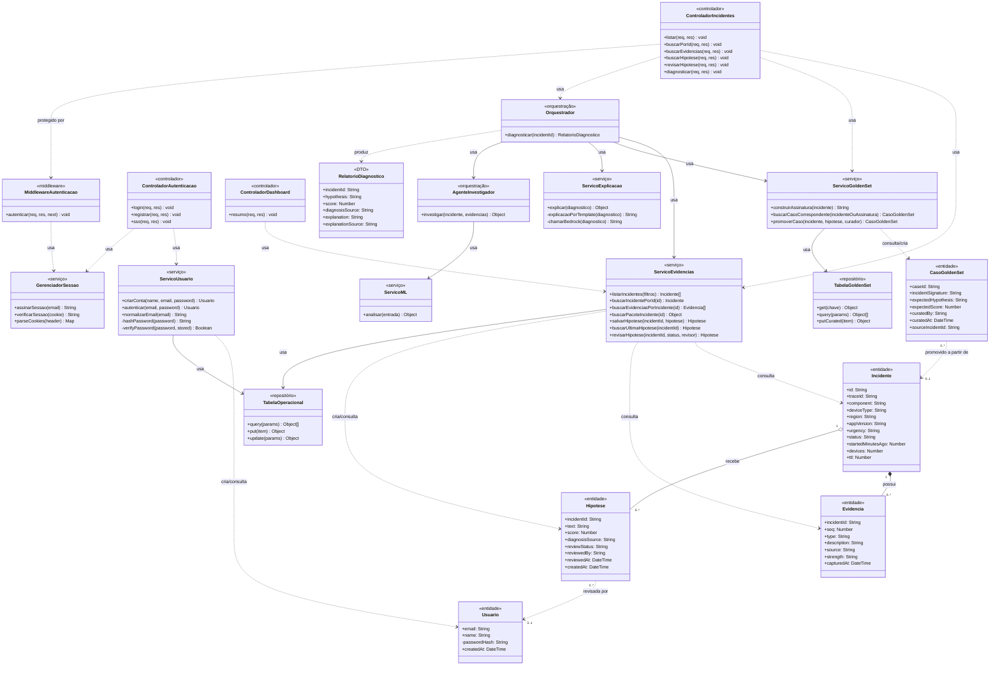

# Modelagem do Sistema — Monitoramento de Frontend Globoplay

> O objetivo deste artefato é modelar o sistema com base nos requisitos e funcionalidades
> definidos, utilizando diagramas UML e descrições textuais para representar os elementos
> estruturais e comportamentais da aplicação.

**Grupo:** G05 · **Parceiro:** Grupo Globo (Globoplay) — Projeto (CCMD7)

## Sumário

1. [Diagrama de casos de uso](#1-diagrama-de-casos-de-uso)
2. [Diagrama de classes UML](#2-diagrama-de-classes-uml)
   - 2.1. [Objetivo e escopo](#21-objetivo-e-escopo)
   - 2.2. [Diagrama](#22-diagrama)
   - 2.3. [Descrição das classes](#23-descrição-das-classes)
   - 2.4. [Relacionamentos](#24-relacionamentos)
   - 2.5. [Regras e invariantes do modelo](#25-regras-e-invariantes-do-modelo)
   - 2.6. [Decisões de modelagem](#26-decisões-de-modelagem)
3. [Diagrama de sequência](#3-diagrama-de-sequência)
4. [Referências](#4-referências)

---

## 1. Diagrama de casos de uso

> **Pendente.** Este item (Peso 4.0) — diagrama de casos de uso e as descrições em estilo
> completo (Escopo, Nível, Atores, Interessados e interesses, Pré-condições, Pós-condições,
> Fluxo Básico, Fluxos alternativos, Requisitos especiais, Lista de variantes, Frequência de
> ocorrência, Problemas em aberto) — será desenvolvido em uma tarefa separada, com base no
> modelo de "processar venda em estilo completo" (LARMAN, seções 6.8 e 6.9) e nos requisitos
> funcionais já levantados em [requisitos.md](sprint1/requisitos.md).

---

## 2. Diagrama de classes UML

### 2.1. Objetivo e escopo

&emsp; Este diagrama representa a visão estrutural do backend do sistema de telemetria
(API de consulta e diagnóstico), tal como implementado em `apps/backend/api`. Ele combina,
deliberadamente, duas visões que em outros contextos poderiam ser separadas: o **modelo de
domínio** (as entidades que carregam o estado do problema — incidente, evidência, hipótese,
caso da golden set e usuário) e o **desenho da aplicação em camadas** (controladores, serviços,
orquestração/agente e repositórios) que opera sobre esse domínio. A junção se justifica porque
o próprio código já impõe essa separação em camadas de forma explícita — cada arquivo de
`src/db/*.js` é a única porta de acesso à sua tabela DynamoDB, e cada serviço em `src/services/*.js`
é a única porta para sua respectiva entidade — e reproduzir essa fronteira no diagrama é o que dá
rastreabilidade direta entre a modelagem e a implementação.

&emsp; **Está fora do escopo deste diagrama**: o pipeline de ingestão/normalização de eventos
brutos (RF01–RF03, RF06), que roda como job separado do serviço aqui modelado e ainda não tem
código correspondente neste repositório; e o frontend (`apps/frontend`), cujas telas consomem
esta API mas não compartilham classes com ela.

### 2.2. Diagrama

**Figura 1 — Diagrama de classes do backend de monitoramento (API de consulta e diagnóstico).**
Fonte: Material produzido pelos autores (2026), com base em `apps/backend/api/src`.

### 2.3. Descrição das classes

Tabela 1: Classes de domínio (entidades)

| Classe | Camada | Responsabilidade | Principais atributos | Origem no código |
|:---|:---|:---|:---|:---|
| `Usuario` | Entidade | Representa uma conta cadastrada no painel; nunca guarda a senha em texto puro, apenas o hash scrypt com sal (`salt:hash`). | `email`, `name`, `passwordHash`, `createdAt` | `src/services/userService.js` (item da tabela operacional, família `USER#<email>`) |
| `Incidente` | Entidade | Agrupa a ocorrência de uma falha ou degradação detectada, com o recorte de dispositivo/região/versão afetado. | `id`, `component`, `deviceType`, `region`, `appVersion`, `status`, `urgency` | `src/db/keys.js`, item `INCIDENT#<id>` na tabela operacional |
| `Evidencia` | Entidade | Um sinal (log ou métrica) coletado em favor ou contra uma hipótese de causa raiz para um incidente. | `type`, `description`, `source`, `strength` | item `INCIDENT#<id>#EVIDENCE#<seq>` na tabela operacional |
| `Hipotese` | Entidade | A explicação de causa raiz mais recente para um incidente — gerada pela golden set ou pelo agente — e o estado da revisão humana sobre ela. | `text`, `score`, `diagnosisSource`, `reviewStatus`, `reviewedBy` | item `INCIDENT#<id>#HYPOTHESIS#<epoch>` na tabela operacional |
| `CasoGoldenSet` | Entidade | Um diagnóstico já confirmado por um humano, indexado pela assinatura `component#deviceType#region`, reaproveitado como resposta determinística para incidentes futuros com a mesma assinatura. | `caseId`, `incidentSignature`, `expectedHypothesis`, `expectedScore`, `curatedBy` | `src/services/goldenSetService.js`, tabela `monitoracao-golden-set` |
| `RelatorioDiagnostico` | DTO | Objeto de saída do orquestrador — não é persistido; agrega hipótese, score, evidências e explicação em linguagem natural num único retorno para o controlador. | `hypothesis`, `score`, `explanation`, `explanationSource` | retorno de `orchestrator.diagnose()` |

Fonte: Material produzido pelos autores (2026).

Tabela 2: Classes de aplicação (controladores, serviços, orquestração e repositórios)

| Classe | Camada | Responsabilidade | Origem no código |
|:---|:---|:---|:---|
| `ControladorAutenticacao` | Controlador | Expõe login, criação de conta e o stub de SSO; assina o cookie de sessão após autenticar. | `src/routes/auth.js` |
| `ControladorIncidentes` | Controlador | Expõe listagem, detalhe, evidências, hipótese, revisão humana da hipótese e disparo do diagnóstico de um incidente. | `src/routes/incidents.js` |
| `ControladorDashboard` | Controlador | Expõe o resumo agregado de incidentes usado na tela inicial do painel. | `src/routes/dashboard.js` |
| `MiddlewareAutenticacao` | Middleware | Barra o acesso a rotas sensíveis (revisão de hipótese) sem um cookie de sessão válido. | `src/middleware/requireAuth.js` |
| `ServicoUsuario` | Serviço | Única porta para criar e autenticar contas; aplica hash de senha com scrypt e cai para um registro em memória se o DynamoDB estiver inacessível. | `src/services/userService.js` |
| `GerenciadorSessao` | Serviço | Assina e verifica o cookie de sessão (HMAC); único lugar que conhece o segredo e o formato do cookie. | `src/auth/session.js` |
| `ServicoEvidencias` | Serviço | Única porta para incidentes, evidências e hipóteses na tabela operacional; usada tanto pelos controladores quanto pelo orquestrador. | `src/services/evidenceService.js` |
| `ServicoGoldenSet` | Serviço | Única porta de leitura para a golden set; a escrita (`promoverCaso`) só é acionada pela revisão humana de hipótese, nunca pelo orquestrador/agente. | `src/services/goldenSetService.js` |
| `ServicoML` | Serviço | Analisa incidente + evidências e devolve um score de anomalia. Mockado nesta fase (contrato fixo, saída sempre igual), ponto de extensão para o modelo real. | `src/services/mlService.js` |
| `ServicoExplicacao` | Serviço | Redige a explicação em linguagem natural do diagnóstico; usa o Bedrock quando habilitado e cai para um template determinístico em qualquer falha. | `src/services/bedrockService.js` |
| `Orquestrador` | Orquestração | Decide a fonte do diagnóstico: resolve direto se achar um caso na golden set, senão delega ao agente. Único ponto que combina hipótese + explicação num relatório. | `src/orchestrator/index.js` |
| `AgenteInvestigador` | Orquestração | Investiga um incidente ambíguo (sem caso na golden set) combinando a evidência disponível com o score do serviço de ML. | `src/agent/index.js` |
| `TabelaOperacional` | Repositório | Porta de baixo nível (Query/Put/Update) para a tabela DynamoDB `monitoracao-operacional`. | `src/db/operationalTable.js` |
| `TabelaGoldenSet` | Repositório | Porta de baixo nível para `monitoracao-golden-set`; só expõe `putCurated`, nunca um `put` genérico. | `src/db/goldenSetTable.js` |

Fonte: Material produzido pelos autores (2026).

### 2.4. Relacionamentos

Tabela 3: Relacionamentos do diagrama de classes

| Origem | Relação | Destino | Multiplicidade | Justificativa |
|:---|:---|:---|:---|:---|
| `Incidente` | Composição | `Evidencia` | `1 — 0..*` | Uma evidência só existe associada a um incidente (mesmo `trace_id`/partição); apagar o incidente não deixa evidências órfãs com sentido. |
| `Incidente` | Agregação | `Hipotese` | `1 — 0..*` | O histórico de hipóteses pertence ao incidente, mas cada hipótese também é referenciada e lida de forma independente (`getLatestHypothesis`). |
| `Hipotese` | Dependência | `Usuario` | `0..* — 0..1` | `reviewedBy` guarda o e-mail do usuário que confirmou/refutou a hipótese; não há chave estrangeira real (single-table DynamoDB), apenas o valor copiado. |
| `CasoGoldenSet` | Dependência | `Incidente` | `0..* — 0..1` | `sourceIncidentId` registra de qual incidente aquele caso foi promovido, para auditoria — sem vínculo de integridade referencial. |
| `ControladorIncidentes` | Dependência | `Orquestrador`, `ServicoEvidencias`, `ServicoGoldenSet` | — | O controlador delega toda regra de negócio; não acessa entidades ou repositórios diretamente. |
| `ControladorIncidentes` | Dependência | `MiddlewareAutenticacao` | — | A rota de revisão de hipótese (`PATCH /:id/hypothesis/review`) só é alcançada com sessão válida, pois pode promover um caso à golden set. |
| `Orquestrador` | Dependência | `ServicoEvidencias`, `ServicoGoldenSet`, `ServicoExplicacao`, `AgenteInvestigador` | — | O orquestrador é o único ponto que decide a fonte do diagnóstico e combina os resultados num `RelatorioDiagnostico`. |
| `AgenteInvestigador` | Dependência | `ServicoML` | — | O agente nunca acessa o banco diretamente; recebe incidente e evidências prontos do orquestrador e delega o score ao serviço de ML. |
| `ServicoEvidencias`, `ServicoUsuario` | Associação | `TabelaOperacional` | — | Ambos compartilham a mesma tabela física (`monitoracao-operacional`), cada um restrito à sua própria família de chaves (`INCIDENT#*` vs. `USER#*`). |
| `ServicoGoldenSet` | Associação | `TabelaGoldenSet` | — | Único serviço com acesso à tabela `monitoracao-golden-set`, e mesmo assim restrito a leitura + `putCurated`. |

Fonte: Material produzido pelos autores (2026).

### 2.5. Regras e invariantes do modelo

Tabela 4: Regras e invariantes

| ID | Classe(s) envolvida(s) | Regra |
|:---|:---|:---|
| INV-01 | `Usuario` | A senha nunca é persistida em texto puro; apenas `passwordHash` (scrypt + sal por usuário) é armazenado, e a comparação no login é feita em tempo constante. |
| INV-02 | `CasoGoldenSet` | A escrita (`promoverCaso`) só pode ser disparada a partir da revisão humana de uma hipótese com `status = "confirmed"`; o orquestrador e o agente têm acesso exclusivamente de leitura à golden set. |
| INV-03 | `Incidente`, `Evidencia`, `Hipotese` | Todo item de um mesmo incidente compartilha o mesmo `traceId`, o que permite recuperar o pacote completo (incidente + evidências + hipóteses) com uma única consulta indexada, sem `Scan`. |
| INV-04 | `Hipotese` | Existe no máximo uma hipótese "vigente" por incidente em um dado instante — a mais recente por ordem cronológica das hipóteses já geradas — mas o histórico de hipóteses anteriores é preservado, não sobrescrito. |
| INV-05 | `Orquestrador` | Um `RelatorioDiagnostico` é sempre devolvido com uma explicação preenchida: se a explicação via IA generativa falhar por qualquer motivo, o serviço de explicação cai para um template determinístico em vez de propagar uma exceção. |

Fonte: Material produzido pelos autores (2026).

### 2.6. Decisões de modelagem

- **Entidades sem métodos de negócio próprios.** No código, `Usuario`, `Incidente`, `Evidencia`,
  `Hipotese` e `CasoGoldenSet` são registros de dados (itens DynamoDB); toda regra de negócio
  vive nos serviços que os manipulam. O diagrama respeita essa escolha arquitetural — em vez de
  forçar um modelo anêmico em classes "ricas" que não existem na implementação — e concentra os
  métodos nas classes de serviço, orquestração e controlador.
- **Repositório como fronteira física, não como padrão genérico.** `TabelaOperacional` e
  `TabelaGoldenSet` não são um Repository genérico reutilizável: cada um é a única porta de
  acesso à sua tabela DynamoDB específica, e `TabelaGoldenSet` propositalmente não expõe um
  método de escrita genérico — apenas `putCurated`, chamado por um único caso de uso (revisão
  humana de hipótese). Essa assimetria de acesso foi mantida no diagrama porque é uma decisão de
  segurança/governança do sistema, não um detalhe de implementação a esconder.
- **`RelatorioDiagnostico` como DTO explícito.** Embora não seja persistido nem tenha uma classe
  correspondente no código (é um objeto literal montado em `orchestrator/index.js`), foi
  destacado como classe porque concentra o resultado observável de todo o fluxo de diagnóstico
  — é o elemento que a seção 3 (diagrama de sequência) vai rastrear até a resposta HTTP.
- **Camada de ingestão fora do diagrama.** O pipeline de ingestão/normalização de eventos
  brutos (fila, worker de normalização, modelo de ML de produção) descrito em
  [requisitos.md](sprint1/requisitos.md) ainda não tem implementação neste repositório; incluir
  classes hipotéticas para ele tornaria o diagrama especulativo em vez de rastreável ao código.
  Ele deve ser modelado à parte quando a Fase 1 (ingestão) for implementada.
- **Estereótipos por camada, não por padrão de projeto.** As anotações `«entidade»`,
  `«controlador»`, `«serviço»`, `«orquestração»`, `«repositório»`, `«middleware»` e `«DTO»`
  indicam a camada arquitetural de cada classe, coerente com a organização de pastas em
  `src/` (`routes/`, `services/`, `orchestrator/`, `agent/`, `db/`, `middleware/`), facilitando a
  navegação entre este diagrama e o código-fonte.

---

## 3. Diagrama de sequência

> **Pendente.** Este item (Peso 3.0) — diagrama(s) de sequência e descrição textual dos fluxos
> críticos (ex.: diagnóstico de um incidente via `Orquestrador`, revisão humana de hipótese com
> promoção à golden set, login/cadastro) — será desenvolvido em uma tarefa separada, usando como
> base as classes e relacionamentos definidos na Seção 2.

---

## 4. Referências

LARMAN, Craig. **Utilizando UML e padrões: uma introdução à análise e ao projeto orientados a
objetos e ao desenvolvimento iterativo**. Porto Alegre: Bookman. Disponível em:
https://integrada.minhabiblioteca.com.br/reader/books/9788577800476.

OBJECT MANAGEMENT GROUP. **Unified Modeling Language — UML**. Disponível em:
https://www.omg.org/spec/UML/.

GRUPO 05. **Especificação de requisitos: Monitoramento de Frontend Globoplay**. 2026.
Disponível em: [requisitos.md](sprint1/requisitos.md).
