# Modelagem do Sistema

> Este documento apresenta a modelagem estrutural e comportamental do View Show por meio de diagramas UML e descrições textuais. A modelagem foi construída com base nos requisitos funcionais, não funcionais e decisões arquiteturais do projeto.

## Sumário

1. [Introdução](#1-introdução)
2. [Diagrama de casos de uso](#2-diagrama-de-casos-de-uso)
3. [Descrições dos casos de uso](#3-descrições-dos-casos-de-uso)
4. [Diagrama de classes](#4-diagrama-de-classes)
5. [Diagramas de sequência](#5-diagramas-de-sequência)
6. [Rastreabilidade da modelagem](#6-rastreabilidade-da-modelagem)
7. [Referências](#7-referências)

---

## 1. Introdução

### 1.1 Objetivo

Este artefato tem como objetivo modelar o sistema View Show com base nos requisitos e funcionalidades definidos nas etapas anteriores do projeto.

A modelagem utiliza diagramas UML e descrições textuais para representar:

- as interações entre os atores e o sistema;
- os fluxos principais, alternativos e de exceção;
- a estrutura lógica das classes;
- as interações temporais entre componentes;
- a rastreabilidade entre requisitos e elementos da modelagem.

### 1.2 Escopo da modelagem

A modelagem de casos de uso contempla a aplicação web interna do View Show, utilizada por equipes do Globoplay para consultar telemetria, analisar incidentes, investigar falhas técnicas e acompanhar a qualidade da experiência (QoE). O recorte corresponde às telas de Login, Visão Geral, Incidentes, Evidências, Eventos e Monitoramento previstas para o MVP e para a Sprint 3. O recorte também contempla o ponto de entrada dos dados: a sincronização e a normalização dos registros do ARGUS (UC-08), iniciada por um ator técnico em vez de por um usuário final, pois RF01, RF02, RF03 e RIE02 definem um contrato observável que não pode ficar sem representação em nenhum caso de uso.

Não fazem parte da modelagem de casos de uso:

- a emissão de telemetria pelos frontends do Globoplay ao ARGUS, sistema interno da Globo fora da fronteira do View Show;
- os processos internos de enfileiramento, publicação em fila e armazenamento posteriores à normalização (SQS, DLQ, Glue, Athena, S3);
- a execução de correções, deploys ou rollbacks em produção.

Esses elementos viabilizam o produto, mas não constituem objetivos iniciados diretamente pelos atores na interface. A observação da integridade dos dados de telemetria, por sua vez, integra o escopo funcional porque subsidia a avaliação da confiabilidade das análises apresentadas pelo View Show.

### 1.3 Documentos de referência

| Documento | Utilização neste artefato |
| --- | --- |
| [Especificação de requisitos](sprint1/requisitos.md) | Identificação dos requisitos e casos de uso |
| [Entendimento da experiência do usuário](sprint1/entendimento_ux.md) | Identificação das personas, jornadas e objetivos observáveis no frontend |
| [Arquitetura inicial](sprint2/arquitetura-inicial.md) | Identificação de componentes e integrações |
| [Documentação de frontend](sprint2/frontend.md) | Validação dos fluxos de interface |
| [Documentação de backend](sprint2/backend-sprint-2.md) | Validação de serviços, entidades e operações |
| [Visão geral da arquitetura](arquitetura/visao-geral.md) | Fonte normativa dos componentes, limites e decisões arquiteturais representados no diagrama de classes |
| [Ingestão e dados](arquitetura/ingestao-e-dados.md) | Fonte normativa de <code>DatasetVersion</code>, <code>Manifesto</code> e das fronteiras de persistência |
| [Análise de dados e diagnóstico por IA](arquitetura/analise-e-ia.md) | Fonte normativa de <code>Previsao</code>, <code>Diagnostico</code> e do Worker de Análise |
| [API do dashboard](arquitetura/api-dashboard.md) | Fonte normativa dos DTOs, enums e estados representados no diagrama de classes |
| [Status de implementação](arquitetura/status-implementacao.md) | Registro do que já está implementado, mantido fora do diagrama de classes |

### 1.4 Convenções adotadas

- Casos de uso são identificados como `UC-XX`.
- Requisitos funcionais são identificados como `RFXX`.
- Requisitos não funcionais são identificados como `RNFXX`.
- Classes, métodos e atributos utilizam os nomes empregados no sistema.
- Cada diagrama deve possuir título, fonte e uma descrição que explique como interpretá-lo.
- Sempre que possível, a fonte editável do diagrama e sua versão em SVG devem ser versionadas no repositório.

---

## 2. Diagrama de casos de uso

&emsp;Os casos de uso descrevem o comportamento do sistema a partir dos objetivos dos atores que interagem com ele. Nessa perspectiva, o sistema é tratado como uma caixa-preta: registra-se o resultado que deve ser oferecido ao usuário, sem antecipar a divisão interna entre interfaces, serviços ou mecanismos de persistência. A modelagem desta seção adota a abordagem de Larman (2007), que recomenda priorizar casos de uso no nível de objetivo do usuário e complementar o diagrama com narrativas capazes de explicitar o contrato comportamental do sistema.

&emsp;No View Show, ações como aplicar filtros, consultar evidências e comparar períodos integram objetivos mais amplos de análise. O diagrama apresenta os atores, a fronteira do sistema e os objetivos que produzem resultados relevantes para esses atores, enquanto a Seção 3 detalha as interações necessárias para alcançá-los.

### 2.1 Atores

&emsp;Um ator representa um papel exercido na interação com o sistema, e não uma pessoa específica. O papel **Usuário corporativo** foi definido como abstrato para concentrar as capacidades comuns de acesso e consulta. Analista de Atendimento Técnico N1, Engenheira de Software e Product Manager especializam esse papel e acrescentam objetivos próprios de suas responsabilidades. O provedor de identidade é mantido como ator secundário porque participa da troca de informações necessária à autenticação, embora esteja fora da fronteira do View Show. O temporizador de sincronização (EventBridge) é um ator técnico e primário: ele, não um usuário final, inicia periodicamente a sincronização dos dados do ARGUS, que por sua vez é um ator secundário e externo — o sistema interno da Globo que já recebe a telemetria emitida pelos frontends do Globoplay, fora da fronteira do View Show.

<strong>Tabela 1: Atores do diagrama de casos de uso</strong>

| ID | Ator | Tipo | Responsabilidade principal |
| --- | --- | --- | --- |
| AT-01 | Usuário corporativo | Primário, abstrato | Acessar o View Show e consultar informações comuns aos perfis autorizados. |
| AT-02 | Analista de Atendimento Técnico N1 | Especialização de AT-01 | Priorizar incidentes e revisar as hipóteses apresentadas pelo sistema. |
| AT-03 | Engenheira de Software | Especialização de AT-01 | Validar hipóteses, investigar falhas, avaliar recuperações e monitorar a telemetria. |
| AT-04 | Product Manager | Especialização de AT-01 | Analisar QoE, priorizar problemas e avaliar resultados posteriores a correções. |
| AT-05 | Provedor de identidade/SSO | Secundário | Autenticar a conta corporativa e devolver a identidade validada. |
| AT-06 | Temporizador de sincronização (EventBridge) | Primário, técnico | Iniciar periodicamente a sincronização dos dados operacionais do ARGUS. |
| AT-07 | ARGUS | Secundário, externo | Fornecer os dados operacionais já recebidos dos frontends do Globoplay, consumidos por leitura (MySQL) pelo Serviço de Ingestão. |

Fonte: Material produzido pelos autores (2026).

### 2.2 Catálogo de casos de uso

&emsp;O catálogo apresenta oito objetivos observáveis dos atores do View Show. Cada caso de uso reúne as interações que conduzem a um resultado relevante para o ator principal, desde o acesso ao sistema até a análise de incidentes, a investigação técnica, a avaliação da qualidade da experiência, o acompanhamento da telemetria e a recepção dos eventos que alimentam essa telemetria.

<strong>Tabela 2: Catálogo dos casos de uso</strong>

| ID | Caso de uso | Ator principal | Requisitos relacionados |
| --- | --- | --- | --- |
| UC-01 | Consultar dashboard | Usuário corporativo | RF07, RF08, RF09, RF10, RNF07, RNF14 |
| UC-02 | Autenticar-se | Usuário corporativo | RF04, RNF04, RIE01, RESTR01 |
| UC-03 | Analisar incidente | Analista de Atendimento Técnico N1 | RF07, RF08, RF09, RNF08, RNF10, RNF13, RNF15 |
| UC-04 | Investigar falha técnica | Engenheira de Software | RF05, RF06, RF07, RF08, RF09, RNF05, RNF08, RNF10, RNF13, RNF14 |
| UC-05 | Avaliar recuperação após correção | Engenheira de Software e Product Manager | RF07, RF08, RF09, RNF05, RNF14 |
| UC-06 | Analisar qualidade da experiência | Product Manager | RF07, RF08, RF09, RNF05, RNF14, RNF15 |
| UC-07 | Monitorar a telemetria | Engenheira de Software | RF07, RF08, RNF01, RNF02, RNF03, RNF09, RNF15 |
| UC-08 | Sincronizar e normalizar dados do ARGUS | Temporizador de sincronização (EventBridge) | RF01, RF02, RF03, RIE02 |

Fonte: Material produzido pelos autores (2026).

&emsp;A consulta ao dashboard abrange a aplicação de filtros e a exportação de resultados. A análise de incidentes compreende a priorização das ocorrências, a consulta das hipóteses e evidências e o registro da avaliação humana. A investigação técnica aprofunda a inspeção de eventos e as comparações entre recortes. Os demais casos tratam da avaliação posterior a correções, da análise agregada de QoE, da verificação da integridade das fontes e do processamento da telemetria e, por fim, da sincronização e normalização dos dados do ARGUS, que é o ponto de entrada de dados sobre o qual todos os demais casos de uso operam. Diferentemente dos demais, o UC-08 não é iniciado por um usuário final: seu ator principal é um temporizador técnico, o que o qualifica como subfunção de suporte, e não como objetivo de usuário (ver 3.8).

### 2.3 Diagrama

&emsp;O Diagrama 1 sintetiza a fronteira funcional do View Show e as associações entre os atores e seus objetivos. Os pormenores de cada interação permanecem nas descrições textuais para que a representação visual conserve a função de oferecer uma visão geral do sistema.

<strong>Diagrama 1: Casos de uso do View Show</strong>

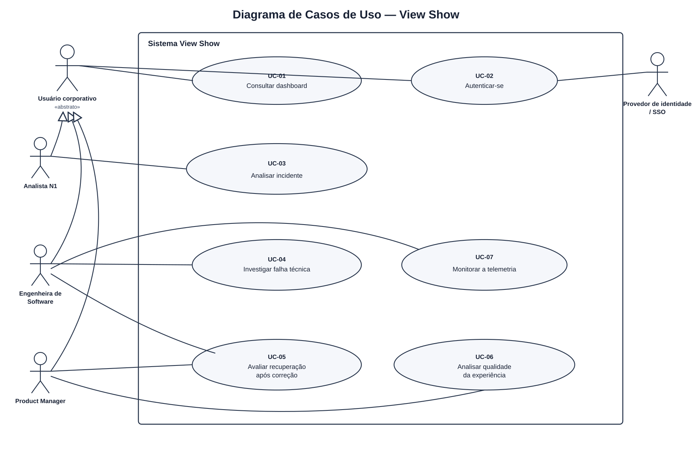

Fonte: Material produzido pelos autores (2026).

### 2.4 Critérios de construção e leitura

&emsp;A fronteira **Sistema View Show** contém as funcionalidades percebidas pelos atores durante o uso da aplicação. A sincronização e a normalização dos dados do ARGUS constituem um objetivo observável, iniciado por um ator técnico (o temporizador de sincronização) em vez de por um usuário final; por isso, são representadas separadamente em UC-08, no nível de subfunção. A emissão de telemetria pelos frontends do Globoplay para o ARGUS ocorre fora da fronteira do View Show e não é modelada: o ARGUS é o ator que já recebeu essa telemetria e fornece os dados consumidos por UC-08. Já o enfileiramento, a publicação assíncrona e o armazenamento posteriores à normalização (SQS, DLQ, Glue, Athena, S3) são processos internos que não são iniciados por nenhum ator e, por isso, não são representados como caso de uso — eles aparecem apenas nos diagramas de sequência da Seção 5, como suporte técnico ao UC-08.

&emsp;Operações como filtrar resultados, consultar evidências e comparar períodos são descritas nos fluxos dos casos de uso aos quais dão suporte. A avaliação de recuperação constitui um objetivo independente porque ocorre após uma intervenção externa e produz como resultado uma comparação entre janelas temporais equivalentes.

&emsp;A autenticação é representada como um caso de uso próprio devido à participação do provedor corporativo de identidade. Nos demais casos, a existência de uma sessão válida é estabelecida como pré-condição.

### 2.5 Relações principais

&emsp;A Tabela 3 apresenta as associações entre atores e casos de uso e as relações de generalização entre os perfis especializados e o Usuário corporativo. As associações identificam os objetivos iniciados por cada ator, enquanto as generalizações indicam o compartilhamento das capacidades comuns de acesso e consulta.

<strong>Tabela 3: Relações representadas no diagrama</strong>

| Origem | Relação | Destino | Justificativa |
| --- | --- | --- | --- |
| AT-02 | Generalização | AT-01 | O Analista N1 também executa os objetivos comuns de um usuário corporativo. |
| AT-03 | Generalização | AT-01 | A Engenheira de Software também executa os objetivos comuns. |
| AT-04 | Generalização | AT-01 | A Product Manager também executa os objetivos comuns. |
| AT-01 | Associação | UC-01 e UC-02 | Todo perfil autorizado pode autenticar-se e consultar o dashboard. |
| AT-02 | Associação | UC-03 | O Analista N1 prioriza o incidente, consulta as evidências e avalia a hipótese apresentada. |
| AT-03 | Associação | UC-04, UC-05 e UC-07 | A Engenheira investiga falhas, avalia a recuperação e monitora a telemetria. |
| AT-04 | Associação | UC-05 | A Product Manager avalia os indicadores posteriores a uma correção. |
| AT-04 | Associação | UC-06 | A Product Manager inicia a análise de QoE. |
| AT-05 | Associação | UC-02 | O provedor externo participa da autenticação corporativa. |
| AT-06 | Associação | UC-08 | O temporizador inicia periodicamente a sincronização dos dados do ARGUS. |
| AT-07 | Associação | UC-08 | O ARGUS fornece os dados operacionais consumidos pela sincronização. |
| AT-03 | Associação | UC-08 | A Engenheira de Software pode, no papel de operador de dados, importar manualmente um snapshot do ARGUS. |

Fonte: Material produzido pelos autores (2026).

---

## 3. Descrições dos casos de uso

&emsp;Larman (2007) descreve casos de uso por meio de narrativas estruturadas que caracterizam o objetivo, os participantes e o contrato comportamental estabelecido entre os atores e o sistema. Esse formato articula pré-condições, garantias de sucesso, fluxo principal, variações e requisitos especiais, permitindo especificar o comportamento observável sem antecipar decisões internas de implementação.

&emsp;Os casos de uso do View Show são apresentados segundo essa estrutura. Cada descrição delimita o resultado esperado, relaciona os requisitos que fundamentam o comportamento e registra, em **Problemas em aberto**, somente as decisões funcionais que ainda precisam ser definidas para o respectivo caso de uso.

### 3.1 UC-01 — Consultar dashboard

&emsp;Este caso de uso reúne a consulta compartilhada pelos três perfis corporativos. O objetivo é permitir que o usuário construa um recorte coerente dos dados e obtenha informações que possam ser aprofundadas nas análises de incidente, de investigação técnica ou de qualidade da experiência.

#### Escopo

Sistema View Show.

#### Nível

Objetivo do usuário.

#### Atores

- **Ator principal:** Usuário corporativo.
- **Atores secundários:** Nenhum.

#### Requisitos relacionados

- **RF07 — Dashboard de navegação em eventos:** disponibilização da navegação e da visualização gráfica da telemetria.
- **RF08 — Métricas e alertas operacionais:** apresentação de indicadores de QoE e ocorrências de falha.
- **RF09 — Consultas para análise de falhas críticas:** realização de consultas simples e filtradas sobre os eventos.
- **RF10 — Exportação de dados:** exportação do conjunto consultado nos formatos previstos.
- **RNF07 — Tempo de carregamento da interface:** carregamento dos componentes principais e filtros em até 30 segundos.
- **RNF14 — Latência de consultas filtradas:** resposta em até dois segundos no percentil 95 das solicitações.

#### Interessados e interesses

- **Usuário corporativo:** consultar rapidamente indicadores, incidentes e eventos relevantes ao seu trabalho.
- **Globo:** disponibilizar informações confiáveis, protegidas e sem exposição de dados pessoais.
- **Equipe de operação:** tornar dados parciais e indisponibilidades claramente identificáveis.

#### Pré-condições

- O usuário possui uma sessão autenticada.

#### Pós-condições

- **Em caso de sucesso:** os indicadores e incidentes do recorte selecionado são apresentados e o contexto dos filtros permanece disponível.
- **Garantia mínima:** uma falha de fonte é informada sem substituir os dados ausentes por valores fictícios.

#### Fluxo Básico

1. O usuário acessa o dashboard.
2. O sistema carrega os indicadores e incidentes do período padrão.
3. O usuário seleciona filtros como período, dispositivo, versão ou região.
4. O sistema atualiza os resultados e identifica o recorte aplicado.
5. O usuário seleciona uma ocorrência ou um conjunto de eventos.
6. O sistema apresenta os detalhes correspondentes e preserva o contexto da consulta.

#### Fluxos alternativos

- **2a. Fonte indisponível:** o sistema identifica os componentes sem dados e mantém disponíveis os componentes carregados corretamente.
- **4a. Nenhum resultado:** o sistema apresenta um estado vazio e permite alterar os filtros. O fluxo retorna ao passo 3.
- **4b. Exportação solicitada:** o usuário solicita a exportação e o sistema gera CSV, XLSX ou PDF com o período e os filtros utilizados.
- **4c. Exportação indisponível:** o sistema informa a falha e preserva a consulta atual.

#### Requisitos especiais

- Acesso restrito a usuários autorizados, conforme RNF04.
- Carregamento dos componentes principais conforme RNF07.
- Buscas filtradas com P95 de até dois segundos, conforme RNF14.
- Os resultados devem excluir informações pessoalmente identificáveis (PII).

#### Lista de variantes

- **3a. Recorte da consulta:** período, dispositivo, versão, região ou combinação desses filtros.
- **4a. Formato de exportação:** CSV, XLSX ou PDF.

#### Frequência de ocorrência

Várias vezes ao dia, com aumento durante incidentes e eventos ao vivo.

#### Problemas em aberto

- Quais informações devem compor obrigatoriamente cada formato de exportação?
- Quais telas devem preservar os filtros durante a navegação?

### 3.2 UC-02 — Autenticar-se

&emsp;Este caso de uso isola a criação da sessão corporativa utilizada pelos demais objetivos. A separação permite registrar a participação do provedor de identidade e explicitar as garantias mínimas aplicáveis quando a autenticação não é concluída.

#### Escopo

Sistema View Show.

#### Nível

Objetivo do usuário.

#### Atores

- **Ator principal:** Usuário corporativo.
- **Ator secundário:** Provedor de identidade/SSO.

#### Requisitos relacionados

- **RF04 — Autenticação corporativa:** criação e encerramento de sessões por meio do provedor de identidade corporativo.
- **RNF04 — Segurança e confidencialidade:** restrição do painel e das APIs a contas autorizadas do domínio corporativo.
- **RIE01 — Serviço corporativo de autenticação da Globo:** integração responsável por autenticar a identidade e fornecer os dados de autorização.
- **RESTR01 — Política de acesso corporativo da Globo:** delegação integral da autenticação ao serviço corporativo, sem armazenamento local de senhas.

#### Interessados e interesses

- **Usuário corporativo:** acessar a plataforma com segurança e baixa carga operacional.
- **Globo:** restringir o acesso a contas corporativas autorizadas.
- **Segurança da informação:** impedir sessões inválidas e proteger as credenciais.

#### Pré-condições

- O usuário possui uma conta autorizada.
- O provedor de identidade está configurado.

#### Pós-condições

- **Em caso de sucesso:** uma sessão autorizada é criada e o sistema disponibiliza o dashboard.
- **Garantia mínima:** nenhuma sessão é criada quando a identidade ou o domínio não são validados.

#### Fluxo Básico

1. O usuário acessa a página de entrada.
2. O usuário seleciona a autenticação corporativa.
3. O sistema encaminha a solicitação ao provedor de identidade.
4. O provedor autentica o usuário e devolve sua identidade.
5. O sistema valida o domínio e as permissões recebidas.
6. O sistema cria a sessão e apresenta o dashboard.

#### Fluxos alternativos

- **3a. Provedor indisponível:** o sistema informa a indisponibilidade sem exibir uma resposta técnica bruta.
- **4a. Credencial recusada:** o sistema informa que a autenticação não foi concluída e retorna ao passo 1.
- **5a. Domínio não autorizado:** o sistema nega o acesso e não cria uma sessão.

#### Requisitos especiais

- Acesso restrito ao domínio corporativo, conforme RNF04 e RESTR01.
- Chamadas sem autenticação ou sem autorização retornam 401 ou 403.
- Credenciais não são expostas nem armazenadas pela interface web.

#### Lista de variantes

- **3a. Protocolo de federação:** OpenID Connect (OIDC) ou SAML, conforme a configuração do provedor corporativo.
- **5a. Origem da autorização:** domínio corporativo e grupos ou perfis devolvidos pelo provedor.

#### Frequência de ocorrência

No início de cada sessão e após sua expiração.

#### Problemas em aberto

- Qual provedor corporativo e qual protocolo de federação serão utilizados no SSO?
- Quais grupos ou perfis corporativos determinarão as permissões de acesso ao View Show?

> **Divergência tecnológica/temporária.** Este caso de uso descreve o modelo-alvo, com o Cognito federado ao SSO corporativo da Globo por OIDC/SAML. No runtime atual, a autenticação ocorre por login direto de usuário e senha no Cognito, e as rotas federadas retornam `503`. O [Status de implementação](arquitetura/status-implementacao.md) detalha essa divergência e o plano de convergência para o modelo aqui descrito.

### 3.3 UC-03 — Analisar incidente

&emsp;Este caso de uso descreve a análise de um incidente pelo Atendimento N1. O sistema apresenta o impacto estimado, o recorte afetado, as hipóteses e as evidências disponíveis para que o analista avalie o diagnóstico e registre sua decisão.

#### Escopo

Sistema View Show.

#### Nível

Objetivo do usuário.

#### Atores

- **Ator principal:** Analista de Atendimento Técnico N1.
- **Atores secundários:** Nenhum.

#### Requisitos relacionados

- **RF07 — Dashboard de navegação em eventos:** apresentação dos incidentes e das evidências relacionadas.
- **RF08 — Métricas e alertas operacionais:** disponibilização do impacto, da severidade e dos indicadores associados à ocorrência.
- **RF09 — Consultas para análise de falhas críticas:** aplicação de filtros para delimitar o recorte afetado.
- **RNF08 — Confiabilidade do diagnóstico por ML:** F1-Score mínimo de 80% para a classificação da causa raiz.
- **RNF10 — Operacionalidade:** localização da causa provável em até cinco cliques a partir da tela inicial.
- **RNF13 — Janela de contexto do diagnóstico:** uso dos registros das cinco horas anteriores à falha.
- **RNF15 — Tempo de sinalização de degradações:** apresentação do alerta em até 30 segundos após o recebimento dos eventos necessários à detecção.

#### Interessados e interesses

- **Analista N1:** compreender o impacto do incidente e avaliar a hipótese apresentada pelo sistema.
- **Engenharia:** dispor de uma avaliação humana rastreável sobre a hipótese e suas evidências.
- **Globo:** reduzir o tempo de diagnóstico e incorporar a validação humana às análises de causa provável.

#### Pré-condições

- O analista está autenticado.
- Existe ao menos um incidente detectado.

#### Pós-condições

- **Em caso de sucesso:** a hipótese é registrada como confirmada, refutada ou inconclusiva; quando identificada, a causa informada pelo analista também é registrada com sua justificativa.
- **Garantia mínima:** o incidente e suas evidências permanecem inalterados quando o analista não conclui a revisão.

#### Fluxo Básico

1. O analista acessa a área de incidentes.
2. O sistema apresenta os incidentes por severidade e impacto.
3. O analista seleciona um incidente.
4. O sistema apresenta o recorte afetado e as hipóteses de causa provável.
5. O sistema apresenta confiança, justificativas e evidências de cada hipótese.
6. O analista aplica filtros para delimitar o problema.
7. O analista avalia a hipótese como confirmada, refutada ou inconclusiva.
8. Quando a hipótese é refutada e a causa é conhecida, o analista informa a causa identificada e apresenta uma justificativa.
9. O sistema registra a decisão, a justificativa, a autoria e o momento da revisão.

#### Fluxos alternativos

- **4a. Nenhuma hipótese disponível:** o sistema informa que a causa permanece inconclusiva, sem uma hipótese a ser confirmada, refutada ou reavaliada. O fluxo segue para o passo 4a.1.
  - **4a.1. Registro de causa sem revisão de hipótese:** o analista pode informar diretamente uma causa conhecida e sua justificativa, sem que exista uma hipótese a ser revisada. O fluxo segue para o passo 9.
- **5a. Evidências incompletas:** o sistema identifica as fontes ausentes ou atrasadas e segue para o passo 6.
- **6a. Nenhum resultado para o recorte:** o sistema mantém o incidente aberto e permite remover filtros. O fluxo retorna ao passo 6.
- **8a. Causa não identificada:** o analista mantém a revisão como refutada ou inconclusiva sem informar uma causa alternativa.
- **9a. Revisão cancelada:** o fluxo termina sem registrar uma nova decisão.

#### Requisitos especiais

- A causa provável deve ser localizável em até cinco cliques, conforme RNF10.
- As hipóteses exibidas devem ser produzidas por um modelo com F1-Score igual ou superior a 80%, conforme RNF08.
- O contexto fornecido ao modelo deve conter somente os registros das cinco horas anteriores à falha, conforme RNF13.
- A incerteza da hipótese deve ser apresentada explicitamente.
- O incidente não deve expor PII.
- Degradações devem ser sinalizadas conforme RNF15.
- A decisão deve registrar autoria, data, justificativa e estado da revisão.

#### Lista de variantes

- **2a. Ordenação dos incidentes:** severidade, impacto ou recência.
- **6a. Recorte do incidente:** período, dispositivo, versão, região ou conteúdo.
- **7a. Estado da revisão:** confirmada, refutada ou inconclusiva.
- **8a. Origem da causa registrada:** seleção de uma causa apresentada pelo sistema ou descrição informada pelo analista.

#### Frequência de ocorrência

Diária, podendo tornar-se contínua durante incidentes críticos.

#### Problemas em aberto

- Quais critérios mínimos devem orientar a confirmação ou a refutação de uma hipótese?
- Quais informações são obrigatórias quando o analista registra uma causa diferente da hipótese apresentada?

### 3.4 UC-04 — Investigar falha técnica

&emsp;Este caso de uso descreve a investigação técnica de uma falha por meio da análise da hipótese, dos eventos correlacionados, da linha do tempo e da comparação entre recortes equivalentes. O resultado esperado é uma conclusão fundamentada nas evidências disponíveis.

#### Escopo

Sistema View Show.

#### Nível

Objetivo do usuário.

#### Atores

- **Ator principal:** Engenheira de Software especialista no componente investigado.
- **Atores secundários:** Nenhum.

#### Requisitos relacionados

- **RF05 — Visualização de dados brutos e normalizados:** consulta ao evento original e à representação normalizada.
- **RF06 — Cobertura mínima de eventos:** disponibilidade dos eventos `request`, `vitals`, `screen_view`, `video_view`, `session` e `error`.
- **RF07 — Dashboard de navegação em eventos:** acesso gráfico aos eventos e ao contexto do incidente.
- **RF08 — Métricas e alertas operacionais:** consulta aos indicadores associados à falha.
- **RF09 — Consultas para análise de falhas críticas:** filtragem e comparação dos eventos investigados.
- **RNF05 — Retenção do histórico:** consulta a até um ano de dados, distribuídos entre armazenamento de acesso rápido e de baixo custo.
- **RNF08 — Confiabilidade do diagnóstico por ML:** F1-Score mínimo de 80% para a classificação da causa raiz.
- **RNF10 — Operacionalidade:** localização da causa provável em até cinco cliques a partir da tela inicial.
- **RNF13 — Janela de contexto do diagnóstico:** uso dos registros das cinco horas anteriores à falha.
- **RNF14 — Latência de consultas filtradas:** resposta em até dois segundos no percentil 95 das solicitações.

#### Interessados e interesses

- **Engenharia:** confirmar ou refutar uma hipótese com evidências rastreáveis.
- **Atendimento N1:** consultar a conclusão técnica associada ao incidente.
- **Globo:** reduzir o tempo de identificação da causa raiz.

#### Pré-condições

- A engenheira está autenticada.
- Existe um incidente selecionado para investigação.

#### Pós-condições

- **Em caso de sucesso:** a hipótese é registrada como confirmada, refutada ou inconclusiva, com autoria e justificativa.
- **Garantia mínima:** nenhuma alteração é executada em produção pelo View Show.

#### Fluxo Básico

1. A engenheira abre o diagnóstico do incidente.
2. O sistema apresenta a hipótese, a confiança e as evidências relacionadas.
3. A engenheira inspeciona os eventos brutos e normalizados.
4. O sistema apresenta a linha do tempo da sessão e destaca o momento da falha.
5. A engenheira compara versões, dispositivos ou períodos equivalentes.
6. A engenheira registra sua conclusão e justificativa.
7. O sistema armazena a decisão com autoria e data, sem executar alterações em produção.

#### Fluxos alternativos

- **3a. Evento bruto indisponível:** o sistema informa que a comparação com o evento normalizado não pode ser realizada.
- **4a. Marcação temporal inconfiável:** o sistema sinaliza a limitação e não afirma uma ordem precisa para os eventos.
- **5a. Evidências conflitantes:** a hipótese permanece inconclusiva e o fluxo segue para o passo 6.
- **6a. Hipótese já revisada:** o sistema apresenta a decisão vigente e impede que uma revisão concorrente a sobrescreva sem confirmação.
- **6b. Registro cancelado:** o fluxo termina sem alterar a hipótese.

#### Requisitos especiais

- Suporte aos eventos definidos no RF06.
- Visualização de dados brutos e normalizados, conforme RF05.
- As hipóteses exibidas devem ser produzidas por um modelo com F1-Score igual ou superior a 80%, conforme RNF08.
- O contexto fornecido ao modelo deve conter somente os registros das cinco horas anteriores à falha, conforme RNF13.
- Histórico de até um ano, conforme RNF05.
- A causa provável deve ser localizável em até cinco cliques a partir do dashboard, conforme RNF10.
- As buscas filtradas devem apresentar P95 de até dois segundos, conforme RNF14.
- Registro da autoria e do momento da conclusão.

#### Lista de variantes

- **3a. Evento inspecionado:** request, vitals, screen_view, video_view, session ou error.
- **5a. Dimensão de comparação:** versão, dispositivo, região ou período equivalente.

#### Frequência de ocorrência

Sempre que um incidente exigir investigação técnica especializada.

#### Problemas em aberto

- Qual tolerância temporal deve ser considerada ao ordenar eventos com timestamps divergentes?
- Qual política será adotada para resolver revisões concorrentes de uma mesma hipótese?

### 3.5 UC-05 — Avaliar recuperação após correção

&emsp;Este caso de uso descreve a avaliação dos indicadores após uma correção realizada fora do View Show. A comparação utiliza janelas temporais equivalentes para determinar se o comportamento observado apresenta melhora, estabilidade, piora ou resultado inconclusivo.

#### Escopo

Sistema View Show.

#### Nível

Objetivo do usuário.

#### Atores

- **Atores principais:** Engenheira de Software ou Product Manager.
- **Atores secundários:** Nenhum.

#### Requisitos relacionados

- **RF07 — Dashboard de navegação em eventos:** apresentação dos indicadores anteriores e posteriores à correção.
- **RF08 — Métricas e alertas operacionais:** disponibilização das métricas utilizadas para avaliar a recuperação.
- **RF09 — Consultas para análise de falhas críticas:** seleção de períodos e segmentos equivalentes para comparação.
- **RNF05 — Retenção do histórico:** acesso a até um ano de dados para compor as janelas temporais.
- **RNF14 — Latência de consultas filtradas:** resposta em até dois segundos no percentil 95 para consultas em armazenamento de acesso rápido.

#### Interessados e interesses

- **Engenharia:** verificar, com indicadores rastreáveis, se o comportamento técnico foi restabelecido.
- **Product Manager:** compreender se a experiência do segmento afetado melhorou após a intervenção.
- **Globo:** registrar resultados sem atribuir causalidade além do que os dados sustentam.

#### Pré-condições

- O ator está autenticado.
- Existe um incidente ou problema analisado e uma correção externa concluída ou um marco temporal aproximado para a intervenção.

#### Pós-condições

- **Em caso de sucesso:** a comparação anterior e posterior à correção é classificada e registrada com seus períodos, indicadores e limitações.
- **Garantia mínima:** o sistema não afirma causalidade, não executa implantação ou reversão e identifica quando os dados não permitem concluir sobre a recuperação.

#### Fluxo Básico

1. O ator seleciona o incidente ou problema cuja recuperação deseja avaliar.
2. O sistema apresenta o segmento afetado e o marco temporal associado à correção.
3. O ator confirma ou ajusta o marco temporal e as janelas equivalentes de comparação.
4. O sistema recupera os indicadores anteriores e posteriores à correção.
5. O sistema compara, conforme a disponibilidade, taxa de erros, latências P95 e P99, tempo de inicialização do vídeo, buffering, sessões afetadas e ocorrências de ANR.
6. O sistema apresenta as variações absolutas e percentuais, o tamanho das amostras e a classificação do resultado como melhora, estabilidade, piora ou inconclusivo.
7. O ator registra uma conclusão e as limitações observadas.
8. O sistema armazena a avaliação com autoria e data.

#### Fluxos alternativos

- **2a. Marco temporal inexistente:** o ator informa uma estimativa para a correção e o sistema identifica a aproximação na avaliação.
- **4a. Dados em armazenamento de longo prazo:** o sistema informa que a recuperação da consulta pode demandar mais tempo.
- **4b. Amostra insuficiente:** o sistema classifica a avaliação como inconclusiva e identifica os indicadores afetados.
- **5a. Períodos não comparáveis:** o sistema informa a diferença encontrada e retorna ao passo 3.
- **7a. Avaliação cancelada:** o fluxo termina sem registrar uma nova conclusão.

#### Requisitos especiais

- O histórico deve observar a retenção de 30 dias em armazenamento de acesso rápido e 11 meses em armazenamento de baixo custo, conforme RNF05.
- As buscas filtradas devem apresentar P95 de até dois segundos quando os dados estiverem em armazenamento de acesso rápido, conforme RNF14.
- Cada janela deve conter ao menos 20 observações enquanto não houver um limiar específico definido para o indicador analisado.
- As janelas devem possuir a mesma duração e preservar dispositivo, versão, região, conteúdo e demais filtros que definem o segmento comparado.
- O resultado é classificado como melhora quando a distância em relação à linha de base diminui sem piora de indicador crítico; como piora quando essa distância aumenta ou um indicador crítico ultrapassa seu limiar; como estabilidade quando nenhuma variação relevante ocorre; e como inconclusivo quando as condições de amostra ou comparabilidade não são atendidas.
- Os dados devem permanecer anonimizados e não expor PII.
- A classificação deve explicitar amostra, período e limitações, sem tratar correlação temporal como prova de causalidade.
- O View Show não deve executar implantação, reversão ou qualquer alteração no ambiente de produção.

#### Lista de variantes

- **2a. Marco da correção:** data registrada, evento correlacionado ou estimativa informada pelo ator.
- **4a. Camada de armazenamento:** dados recentes em armazenamento de acesso rápido ou dados históricos recuperados do armazenamento de baixo custo.
- **5a. Conjunto de indicadores:** disponibilidade definida pelo tipo de incidente e pelo segmento afetado.

#### Frequência de ocorrência

Após correções externas relacionadas a incidentes ou degradações relevantes.

#### Problemas em aberto

- Qual deve ser a amostra mínima para cada indicador utilizado na avaliação?
- Quais dados identificam o marco da correção e sua associação com o incidente analisado?

### 3.6 UC-06 — Analisar qualidade da experiência

&emsp;Este caso de uso representa a análise agregada realizada pela área de produto. Seu objetivo é reconhecer problemas recorrentes, comparar segmentos afetados e acompanhar a evolução dos indicadores para apoiar a priorização das melhorias na experiência.

#### Escopo

Sistema View Show.

#### Nível

Objetivo do usuário.

#### Atores

- **Ator principal:** Product Manager.
- **Atores secundários:** Nenhum.

#### Requisitos relacionados

- **RF07 — Dashboard de navegação em eventos:** visualização gráfica dos indicadores e das degradações de QoE.
- **RF08 — Métricas e alertas operacionais:** apresentação das métricas de qualidade da experiência e dos alertas relacionados.
- **RF09 — Consultas para análise de falhas críticas:** filtragem por segmento, plataforma, dispositivo, versão, região ou conteúdo.
- **RNF05 — Retenção do histórico:** acesso a até um ano de dados para análise de tendências.
- **RNF14 — Latência de consultas filtradas:** resposta em até dois segundos no percentil 95 das solicitações.
- **RNF15 — Tempo de sinalização de degradações:** apresentação do alerta em até 30 segundos após o recebimento dos eventos necessários à detecção.

#### Interessados e interesses

- **Product Manager:** priorizar problemas pelo impacto técnico na experiência.
- **Engenharia:** receber recortes comparáveis e tecnicamente fundamentados.
- **Globo:** acompanhar tendências sem atribuir causalidade indevida.

#### Pré-condições

- A Product Manager está autenticada.
- Existem dados agregados para o período consultado.

#### Pós-condições

- **Em caso de sucesso:** os problemas recorrentes e os segmentos prioritários são apresentados com seus indicadores e sua evolução histórica.
- **Garantia mínima:** indicadores ausentes e amostras insuficientes são identificados sem inferência de valores ou causalidade.

#### Fluxo Básico

1. A Product Manager acessa os indicadores de QoE.
2. O sistema apresenta um ranking de problemas recorrentes por quantidade de sessões afetadas, severidade e recência.
3. A Product Manager seleciona um problema e o segmento que deseja analisar.
4. O sistema apresenta buffering, tempo de inicialização do vídeo, latência e erros para o recorte selecionado.
5. A Product Manager aplica filtros de plataforma, dispositivo, versão, região ou conteúdo.
6. O sistema compara os segmentos utilizando os mesmos indicadores e explicita o tamanho das amostras.
7. A Product Manager consulta o histórico de degradações e identifica a prioridade do problema.

#### Fluxos alternativos

- **2a. Indicador indisponível:** o sistema identifica a lacuna sem inferir valores.
- **2b. Nenhum problema recorrente:** o sistema apresenta os indicadores gerais do período sem produzir um ranking vazio.
- **5a. Nenhum resultado para o recorte:** o sistema preserva a seleção anterior e permite remover filtros. O fluxo retorna ao passo 5.
- **6a. Amostra insuficiente:** o segmento é marcado como inconclusivo.
- **7a. Histórico em armazenamento de longo prazo:** o sistema informa que a recuperação da consulta pode demandar mais tempo.

#### Requisitos especiais

- Cada indicador deve apresentar definição, unidade, período e tamanho da amostra.
- As buscas filtradas devem apresentar P95 de até dois segundos, conforme RNF14.
- As degradações devem ser sinalizadas em até 30 segundos após o recebimento dos eventos que permitam sua detecção, conforme RNF15.
- Os dados devem permanecer anonimizados.
- O histórico deve seguir a política definida no RNF05.

#### Lista de variantes

- **2a. Critério do ranking:** sessões afetadas, severidade ou recência.
- **4a. Indicador analisado:** buffering, inicialização, latência ou erro.
- **5a. Segmento:** plataforma, dispositivo, versão, região ou conteúdo.
- **7a. Período histórico:** dados em armazenamento de acesso rápido ou de longo prazo.

#### Frequência de ocorrência

Diária ou semanal, com maior frequência durante incidentes ou eventos relevantes.

#### Problemas em aberto

- Qual será a amostra mínima aceita em uma comparação?
- Como os critérios de sessões afetadas, severidade e recência serão ponderados no ranking?

### 3.7 UC-07 — Monitorar a telemetria

&emsp;Este caso de uso descreve o acompanhamento da integridade e da atualidade da telemetria utilizada pelo View Show. A engenheira observa as fontes e os indicadores de processamento para distinguir degradações da experiência de lacunas, atrasos ou falhas nos dados que sustentam as análises.

#### Escopo

Sistema View Show.

#### Nível

Objetivo do usuário.

#### Atores

- **Ator principal:** Engenheira de Software.
- **Atores secundários:** Nenhum.

#### Requisitos relacionados

- **RF07 — Dashboard de navegação em eventos:** apresentação visual dos dados e do estado das fontes de telemetria.
- **RF08 — Métricas e alertas operacionais:** disponibilização dos indicadores e alertas relacionados à operação.
- **RNF01 — Capacidade de processamento:** acompanhamento do consumo durante picos equivalentes a 50 milhões de eventos simultâneos.
- **RNF02 — Latência ponta a ponta:** limite de dois minutos entre a captura e a disponibilidade do evento para consulta.
- **RNF03 — Tolerância a falhas:** isolamento de mensagens inválidas sem interrupção do processamento.
- **RNF09 — Disponibilidade:** disponibilidade mínima de 99,9% para o dashboard e as APIs de consulta.
- **RNF15 — Tempo de sinalização de degradações:** apresentação do alerta em até 30 segundos após o recebimento dos eventos necessários à detecção.

#### Interessados e interesses

- **Engenharia:** identificar rapidamente fontes, filas ou componentes degradados que comprometam a confiabilidade das análises.
- **Equipe de operação:** distinguir falhas de telemetria de falhas reais na experiência dos usuários.
- **Globo:** manter disponibilidade, atualidade e capacidade de processamento durante picos de audiência.

#### Pré-condições

- A engenheira está autenticada.
- O pipeline de telemetria está configurado para publicar métricas operacionais.

#### Pós-condições

- **Em caso de sucesso:** a fonte ou o componente degradado é identificado e o contexto de monitoramento permanece disponível para uma ação externa.
- **Garantia mínima:** dados parciais, atrasados ou indisponíveis são identificados e não são apresentados como íntegros.

#### Fluxo Básico

1. A engenheira acessa a área de monitoramento.
2. O sistema apresenta a taxa de ingestão, a latência de processamento, o volume em fila, as mensagens isoladas e a cobertura por fonte e região.
3. A engenheira seleciona período, fonte, plataforma ou região.
4. O sistema atualiza os indicadores e destaca as degradações detectadas.
5. A engenheira seleciona uma fonte ou um componente degradado.
6. O sistema apresenta lacunas, atrasos, falhas de processamento e o instante da última atualização.
7. A engenheira identifica a ação operacional externa necessária e preserva o recorte para acompanhamento.

#### Fluxos alternativos

- **2a. Nenhuma degradação:** o sistema informa que os indicadores se encontram dentro dos limites monitorados.
- **2b. Métricas parciais:** o sistema identifica os componentes sem dados e apresenta somente as medições disponíveis.
- **4a. Fonte sem atualização:** o sistema sinaliza a defasagem e informa o instante do último evento recebido.
- **6a. Detalhes indisponíveis:** o sistema preserva o alerta e informa que a causa operacional não pôde ser determinada.

#### Requisitos especiais

- O monitoramento deve permitir verificar a escalabilidade do consumidor durante picos equivalentes a 50 milhões de eventos simultâneos, conforme RNF01.
- O tempo entre captura, normalização, inferência e disponibilidade para consulta não deve ultrapassar dois minutos, conforme RNF02.
- Mensagens inválidas devem ser isoladas sem interromper o processamento do lote, conforme RNF03.
- O dashboard e as APIs de consulta devem manter disponibilidade mínima de 99,9%, conforme RNF09.
- Uma degradação deve ser sinalizada em até 30 segundos após o recebimento dos eventos que permitam sua detecção, conforme RNF15.
- Métricas operacionais não devem expor PII.

#### Lista de variantes

- **2a. Fonte das métricas:** telemetria publicada pelo serviço, métricas da fila ou estado informado pelo componente monitorado.
- **3a. Recorte operacional:** período, fonte, plataforma ou região.
- **4a. Atualização da interface:** releitura automática periódica ou atualização manual solicitada pela engenheira.

#### Frequência de ocorrência

Várias consultas ao dia, com acompanhamento prolongado durante incidentes e eventos ao vivo.

#### Problemas em aberto

- Quais limites operacionais devem caracterizar atraso, cobertura parcial e indisponibilidade em cada fonte?
- Qual granularidade temporal deve ser apresentada no histórico das métricas operacionais?

### 3.8 UC-08 — Sincronizar e normalizar dados do ARGUS

&emsp;Este caso de uso descreve como o View Show obtém os dados que sustentam todos os demais objetivos do sistema. Periodicamente, o Serviço de Ingestão lê os registros operacionais do ARGUS — sistema interno da Globo que já recebe a telemetria emitida pelos frontends do Globoplay —, normaliza-os para o esquema interno padronizado e os disponibiliza às demais análises. Um operador de dados pode complementar essa sincronização com a importação manual de um snapshot do ARGUS, sem interromper o conjunto de dados vigente.

#### Escopo

Sistema View Show.

#### Nível

Subfunção (processo técnico de suporte, iniciado por um temporizador, não por um usuário final).

#### Atores

- **Ator principal:** Temporizador de sincronização (EventBridge).
- **Atores secundários:** ARGUS (fonte dos dados operacionais) e Operador de dados — papel exercido por um Usuário corporativo com a permissão `data:import`, tipicamente a Engenheira de Software — no fluxo alternativo de importação manual de snapshot.

#### Requisitos relacionados

- **RF01 — Ingestão de eventos multiplataforma:** os registros já cobrem dispositivos e plataformas distintas porque o ARGUS os recebeu previamente de toda a base instalada do Globoplay.
- **RF02 — Ingestão de eventos:** recebimento e armazenamento dos eventos publicados pelas aplicações frontend do Globoplay, realizado indiretamente pela leitura periódica do ARGUS.
- **RF03 — Normalização dos dados:** normalização dos registros lidos do ARGUS, independentemente do protocolo ou formato de origem, para o formato padronizado interno antes da persistência.
- **RIE02 — Frontends do Globoplay (Smart TV, mobile, web):** contrato original de uma API de ingestão que recebe eventos diretamente dos frontends; hoje satisfeito indiretamente, pois o ARGUS já implementa esse recebimento fora da fronteira do View Show (ver nota de substituição tecnológica abaixo).

#### Interessados e interesses

- **Engenharia:** dispor de dados normalizados, atualizados e auditáveis, com baixa necessidade de intervenção manual.
- **Globo:** preservar a fidelidade dos dados do ARGUS na sincronização periódica, com uma via de reprocessamento por snapshot quando necessário.
- **Demais atores do View Show:** dependem indiretamente deste caso de uso, pois todas as análises partem dos dados aqui sincronizados.

#### Pré-condições

- O ARGUS está acessível pela rede privada autorizada, ou um snapshot válido foi fornecido por um operador de dados.

#### Pós-condições

- **Em caso de sucesso:** os registros novos ou alterados do ARGUS estão normalizados, persistidos no DynamoDB (ou arquivados no S3 quando ultrapassam a janela quente) e as solicitações de análise correspondentes foram publicadas na fila.
- **Garantia mínima:** nenhum evento é publicado na fila sem que seu registro tenha sido persistido antes; uma sincronização concorrente não corrompe o checkpoint nem duplica o processamento de uma mesma janela.

#### Fluxo Básico

1. O temporizador inicia a sincronização periódica.
2. O sistema adquire um bloqueio temporário para a execução.
3. O sistema obtém as credenciais do ARGUS e conecta-se pela rede privada.
4. O sistema lê os registros do ARGUS a partir do último checkpoint.
5. O sistema valida e normaliza cada registro para o esquema interno padronizado.
6. O sistema persiste os registros novos ou alterados e atualiza o checkpoint.
7. O sistema publica na fila as solicitações de análise decorrentes da janela sincronizada.
8. O sistema libera o bloqueio e registra a execução.

#### Fluxos alternativos

- **1a. Importação manual de snapshot:** um operador de dados envia, pela interface, um snapshot do ARGUS. O sistema restaura o snapshot em um banco temporário isolado e segue a partir do passo 4 sobre esse snapshot, ativando a nova versão do conjunto de dados ao final sem interromper o conjunto vigente.
- **2a. Bloqueio já adquirido por outra execução:** o sistema encerra a execução como ignorada e não altera checkpoint nem watermark. O fluxo termina.
- **3a. Schema do ARGUS incompatível:** o sistema registra falha permanente e não avança checkpoint nem watermark. O fluxo termina.
- **7a. Falha ao publicar um item na fila:** o item permanece pendente e é republicado pela execução seguinte com a mesma chave de idempotência.

#### Requisitos especiais

- Cobertura de plataformas heterogêneas preservada por herança do ARGUS, conforme RF01: o View Show não reprocessa o protocolo de origem do dispositivo, apenas os registros já recebidos.
- Nenhuma publicação na fila ocorre para um registro que ainda não foi persistido, preservando a garantia comportamental de RIE02 (confirmação apenas após persistência) mesmo sem uma API de recebimento própria.
- A importação manual de snapshot exige a permissão `data:import`.

#### Lista de variantes

- **1a. Origem da sincronização:** automática, pelo temporizador, ou manual, por snapshot enviado por um operador de dados.
- **5a. Tipo de evento normalizado:** `request`, `vitals`, `screen_view`, `video_view`, `session` ou `error`.

#### Frequência de ocorrência

A cada 15 minutos, automaticamente; a importação manual ocorre sob demanda, tipicamente para reprocessamento ou recuperação.

#### Problemas em aberto

- Qual granularidade de erro deve ser reportada ao operador quando um snapshot falha na restauração?
- O ARGUS deve continuar sendo a única fonte de dados, ou o View Show deverá, no futuro, expor uma API de recebimento direto dos frontends, como originalmente descrito em RIE02?

> **Substituição tecnológica documentada.** RIE02, tal como redigido em [Especificação de requisitos §3](sprint1/requisitos.md), descreve uma API de ingestão que recebe eventos diretamente dos frontends do Globoplay e confirma o recebimento somente após a publicação na fila. A arquitetura-alvo aprovada em [Ingestão e dados](arquitetura/ingestao-e-dados.md) substitui esse contrato por um modelo de leitura periódica do ARGUS — sistema interno da Globo que já recebe essa telemetria antes do View Show, fora de sua fronteira. A garantia comportamental de RIE02 (nenhuma confirmação sem persistência prévia) é preservada pelo par checkpoint + outbox transacional do Serviço de Ingestão (DS-01A), mesmo sem uma API de recebimento própria dos frontends.

### 3.9 Síntese das descrições

&emsp;As oito narrativas delimitam os objetivos dos atores e os resultados que o View Show deve oferecer. Sete delas descrevem objetivos de usuário, no nível definido por Larman (2007) para casos de uso primários; a oitava (UC-08) descreve uma subfunção técnica, iniciada por um temporizador em vez de por um usuário final, mas necessária para que RF01, RF02, RF03 e RIE02 tenham representação explícita no modelo. Os fluxos básicos descrevem os cenários de sucesso, enquanto os fluxos alternativos registram indisponibilidades, ausência de dados, amostras insuficientes e demais condições que modificam o percurso principal.

&emsp;A descrição em caixa-preta mantém o foco nas responsabilidades observáveis do sistema, conforme a abordagem de Larman (2007). Dessa forma, os casos de uso fornecem uma base comum para a análise dos requisitos, a definição das interações e a verificação posterior do comportamento esperado.

---

## 4. Diagrama de classes

### 4.1. Objetivo e escopo

&emsp;Esta seção modela exclusivamente a arquitetura-alvo final do View Show, definida nos documentos de [Visão geral da arquitetura](arquitetura/visao-geral.md), [Ingestão e dados](arquitetura/ingestao-e-dados.md), [Análise de dados e diagnóstico por IA](arquitetura/analise-e-ia.md) e [API do dashboard](arquitetura/api-dashboard.md), e alinhada aos casos de uso da Seção 2 e aos diagramas de sequência da Seção 5 deste documento. As classes, os estados e os relacionamentos representados aqui não são derivados dos arquivos, rotas ou módulos hoje presentes no repositório: eles descrevem a solução aprovada para implementação, independentemente do que já foi construído.

&emsp;Elementos transitórios do protótipo — autenticação local, hash de senha, nomes de arquivos e módulos atuais, o schema v1/v2 da tabela operacional e demais limitações momentâneas da implementação — não são modelados nesta seção. Essas informações permanecem registradas no [Status de implementação](arquitetura/status-implementacao.md), que compara o código existente com o contrato-alvo sem redefini-lo.

&emsp;A modelagem é dividida em três visões complementares, para não misturar conceitos de natureza diferente na mesma figura:

- **Visão de domínio** (4.2.1): as entidades e os objetos de valor que persistem através do tempo de vida de um incidente, de uma previsão ou de uma importação, independentemente de qual componente os manipula.
- **Visão de aplicação** (4.2.2): os serviços e as fronteiras que operam sobre o domínio — a API do dashboard, o Worker de Análise, a autorização e os repositórios — segundo os componentes definidos na [Visão geral da arquitetura](arquitetura/visao-geral.md#3-componentes).
- **Visão de persistência** (4.2.3): o mapeamento entre as classes de domínio e as camadas físicas de armazenamento (DynamoDB, S3/Parquet, Glue e Athena), sem transformar esses componentes de infraestrutura em classes de domínio.

&emsp;O Serviço de Ingestão e seus registros canônicos (`SignalObservation`, `DimensionalMetricAggregate`, `Incident` físico) possuem contrato próprio e detalhado em [Ingestão e dados](arquitetura/ingestao-e-dados.md); nesta seção, a Ingestão aparece apenas como fronteira de serviço na visão de aplicação, para não duplicar um contrato já normativo em outro documento. O frontend permanece fora do escopo porque apenas consome a API do dashboard.

### 4.2. Diagramas

#### 4.2.1. Modelo de domínio

<strong>Diagrama 2: Modelo de domínio do View Show</strong>

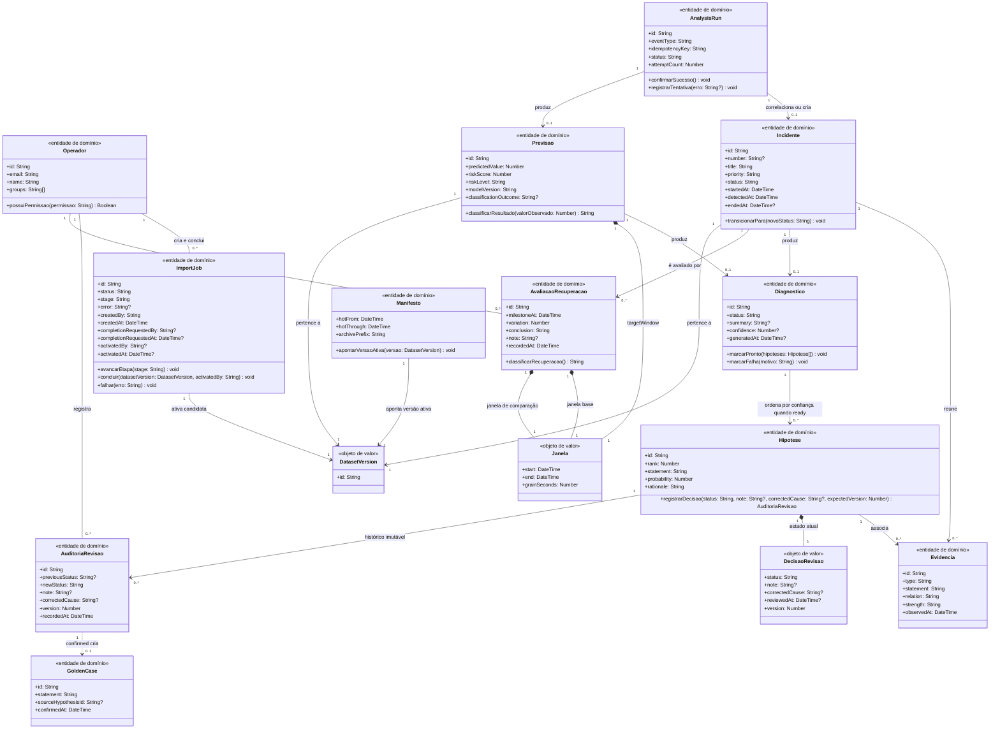

Fonte: Material produzido pelos autores (2026).

&emsp;`Operador` substitui qualquer noção de conta local: representa a identidade corporativa validada pelo Cognito federado ao SSO da Globo (RF04, RNF04, RIE01, RESTR01), sem atributo de senha, hash ou cadastro próprio. Os perfis especializados do diagrama de casos de uso — Analista N1, Engenheira de Software e Product Manager — são papéis de autorização sobre essa mesma identidade, não classes de domínio adicionais; a permissão `data:import`, concedida pelo grupo Cognito `data-operator`, é o que autoriza um `Operador` a criar ou concluir um `ImportJob`.

&emsp;`Incidente` representa uma degradação já observada; `Previsao` representa uma estimativa de risco futuro. Essa distinção é proposital: uma previsão nunca se torna um incidente automaticamente, e cada uma pode originar, no máximo, um `Diagnostico`. O `Diagnostico` agrega de zero a muitas `Hipotese` candidatas — cada uma associada às evidências que a sustentam — e permanece com `status = PENDING`/`not_started`, `processing` ou `failed` sem nenhuma hipótese associada; a multiplicidade `0..*` entre `Diagnostico` e `Hipotese` só é preenchida quando `status = ready`, conforme o fluxo alternativo "4a. Nenhuma hipótese disponível" do UC-03.

&emsp;`AnalysisRun` representa a execução idempotente de uma mensagem da SQS de Análise (`ANOMALY_DETECTION`, `QOE_FORECAST` ou `REANALYSIS_REQUESTED`); seu `idempotencyKey` garante que uma entrega duplicada ou fora de ordem não produza um `Incidente` ou uma `Previsao` repetidos. Cada execução correlaciona ou cria, no máximo, um `Incidente` (detecção) ou produz, no máximo, uma `Previsao` (previsão preventiva), nunca os dois ao mesmo tempo.

&emsp;`DecisaoRevisao` modela apenas o **estado atual** da revisão de uma `Hipotese` — os quatro estados definidos pelo contrato da API (`pending`, `confirmed`, `refuted`, `inconclusive`) e a `version` usada na concorrência otimista. Cada transição desse estado, incluindo `inconclusive → confirmed/refuted` (DS-02B), grava uma `AuditoriaRevisao` imutável e independente: um registro histórico de `0..*` por `Hipotese`, com o status anterior, o novo status, quem decidiu e quando. Separar as duas classes evita que o histórico de revisões concorrentes seja perdido a cada sobrescrita do estado atual. Apenas a `AuditoriaRevisao` que registra a transição para `confirmed` cria um `GoldenCase`; `refuted` pode registrar `correctedCause` quando o revisor conhece uma causa diferente; `inconclusive` não é terminal e permanece revisável com uma nova versão. `confirmed` e `refuted` são estados finais e não podem ser sobrescritos.

&emsp;`AvaliacaoRecuperacao` persiste o resultado do DS-02C: o `milestoneAt` (marco temporal da correção externa), a `variation` calculada entre a janela de base e a janela de comparação — ambas modeladas pelo mesmo objeto de valor `Janela` já usado por `Previsao` —, a `conclusion` registrada pelo ator e a autoria da avaliação. Sem essa entidade, o marco temporal e as janelas comparadas do UC-05 não teriam representação estrutural, apesar de serem efetivamente armazenados ao final do fluxo ("Armazenar avaliação, autoria e data").

&emsp;`DatasetVersion` identifica a versão física ativada por uma importação; `Incidente`, `Previsao` e `ImportJob` referenciam a versão sob a qual foram produzidos, e o `Manifesto` aponta qual `DatasetVersion` está ativa e delimita a fronteira entre a camada quente (`hotFrom`/`hotThrough`, no DynamoDB) e o arquivo histórico (`archivePrefix`, em Parquet no S3). Um `ImportJob` só ativa sua `candidateDatasetVersion` como versão do `Manifesto` depois de validar as duas camadas; uma falha preserva a versão anterior. O próprio `ImportJob` registra `createdBy`, `completionRequestedBy` e `activatedBy` — a identidade do operador autenticado em cada etapa — além dos respectivos `createdAt`, `completionRequestedAt` e `activatedAt`, conforme exigido pelo DS-01B; nenhum desses dados depende de uma entidade de auditoria à parte, pois o próprio ciclo de vida do `ImportJob` é o registro de auditoria da importação.

#### 4.2.2. Serviços e fronteiras da aplicação

<strong>Diagrama 3: Serviços e fronteiras da arquitetura-alvo</strong>

```mermaid
classDiagram
    direction TB

    namespace APIDashboard {
        class AutenticacaoSessaoB {
            <<interface>>
            +obterSessao() Sessao
            +iniciarLogin() RedirectUrl
            +concluirCallback(code: String, state: String) Sessao
            +encerrarSessao() void
        }
        class VisaoGeralIncidentesEventosB {
            <<interface>>
            +consultarVisaoGeral() VisaoGeralDTO
            +consultarIncidente(incidentId: String) IncidenteDTO
            +consultarDiagnostico(incidentId: String) DiagnosticoDTO
        }
        class RevisaoHipoteseB {
            <<interface>>
            +revisarHipotese(hypothesisId: String, status: String, expectedVersion: Number, idempotencyKey: String) DecisaoRevisao
        }
        class ImportacaoDumpB {
            <<interface>>
            +iniciarImportacao() ImportJob
            +concluirImportacao(importId: String, idempotencyKey: String) ImportJob
            +consultarImportacao(importId: String) ImportJob
        }
        class ReanaliseB {
            <<interface>>
            +solicitarReanalise(alvoId: String) AnalysisRun
        }
        class MonitoramentoB {
            <<interface>>
            +consultarSaudeTelemetria(window: String, source: String[], worker: String[]) MonitoringOverviewDTO
        }
    }

    namespace ServicosDeAplicacao {
        class ServicoAutorizacao {
            <<control>>
            +resolverSessao(cookie: String) Operador
            +verificarPermissao(operador: Operador, permissao: String) Boolean
        }
        class ServicoImportacao {
            <<control>>
            +criarImportJob(operador: Operador) ImportJob
            +concluirUpload(importJob: ImportJob, operador: Operador, idempotencyKey: String) ImportJob
        }
        class ServicoRevisao {
            <<control>>
            +aplicarDecisao(hipotese: Hipotese, status: String, expectedVersion: Number, operador: Operador) AuditoriaRevisao
            +promoverGoldenCase(auditoria: AuditoriaRevisao) GoldenCase
        }
    }

    namespace WorkerDeAnalise {
        class AnalysisOrchestrator {
            <<control>>
            +orquestrarAnalise(mensagem: AnalysisRun) void
        }
        class AnomalyDetector {
            <<control>>
            +detectarAnomalia(janela: Janela) Boolean
        }
        class QoEForecastModel {
            <<control>>
            +preverRisco(janela: Janela) Previsao
        }
        class DiagnosticAgent {
            <<control>>
            +diagnosticar(contexto: String) Hipotese[]
        }
    }

    namespace Repositorios {
        class RepositorioOperacional {
            <<repository>>
            +salvarIncidente(incidente: Incidente) void
            +salvarImportJob(job: ImportJob) void
            +buscarDiagnostico(incidentId: String) Diagnostico
        }
        class RepositorioConjuntoReferencia {
            <<repository>>
            +salvarGoldenCase(caso: GoldenCase) void
            +listarGoldenCases() GoldenCase[]
        }
        class RepositorioHistorico {
            <<repository>>
            +consultarParticoes(datasetVersion: DatasetVersion, periodo: Janela) DimensionalMetricAggregate[]
        }
    }

    namespace TiposAuxiliares {
        class Sessao {
            <<value object>>
            +operador: Operador
            +expiresAt: DateTime
        }
        class RedirectUrl {
            <<value object>>
            +url: String
        }
        class VisaoGeralDTO {
            <<DTO>>
            +indicadores: DimensionalMetricAggregate[]
            +incidentesAbertos: Incidente[]
        }
        class IncidenteDTO {
            <<DTO>>
            +incidente: Incidente
            +evidencias: Evidencia[]
            +diagnostico: DiagnosticoDTO?
        }
        class DiagnosticoDTO {
            <<DTO>>
            +diagnostico: Diagnostico
            +hipoteses: Hipotese[]
        }
        class MonitoringOverviewDTO {
            <<DTO>>
            +cobertura: DimensionalMetricAggregate[]
            +degradacoes: String[]
        }
    }

    class Cognito {
        <<external>>
    }
    class AmazonBedrock {
        <<external>>
    }
    class SQSAnalise {
        <<external>>
    }
    class ECSFargate {
        <<external>>
    }
    class ServicoDeIngestao {
        <<external>>
    }

    AutenticacaoSessaoB ..> Sessao
    AutenticacaoSessaoB ..> RedirectUrl
    VisaoGeralIncidentesEventosB ..> VisaoGeralDTO
    VisaoGeralIncidentesEventosB ..> IncidenteDTO
    VisaoGeralIncidentesEventosB ..> DiagnosticoDTO
    MonitoramentoB ..> MonitoringOverviewDTO
    AutenticacaoSessaoB ..> ServicoAutorizacao
    VisaoGeralIncidentesEventosB ..> ServicoAutorizacao
    RevisaoHipoteseB ..> ServicoAutorizacao
    ImportacaoDumpB ..> ServicoAutorizacao
    ReanaliseB ..> ServicoAutorizacao
    MonitoramentoB ..> ServicoAutorizacao
    ServicoAutorizacao ..> Cognito

    RevisaoHipoteseB ..> ServicoRevisao
    ImportacaoDumpB ..> ServicoImportacao
    ReanaliseB ..> SQSAnalise

    ServicoRevisao ..> RepositorioOperacional
    ServicoRevisao ..> RepositorioConjuntoReferencia
    ServicoImportacao ..> ECSFargate
    ServicoImportacao ..> RepositorioOperacional
    VisaoGeralIncidentesEventosB ..> RepositorioOperacional
    VisaoGeralIncidentesEventosB ..> RepositorioHistorico
    MonitoramentoB ..> RepositorioOperacional

    ServicoDeIngestao ..> RepositorioOperacional
    ServicoDeIngestao ..> RepositorioHistorico
    ServicoDeIngestao ..> SQSAnalise

    AnalysisOrchestrator ..> SQSAnalise : consome
    AnalysisOrchestrator ..> AnomalyDetector
    AnalysisOrchestrator ..> QoEForecastModel
    AnalysisOrchestrator ..> DiagnosticAgent
    AnalysisOrchestrator ..> RepositorioOperacional
    AnalysisOrchestrator ..> RepositorioConjuntoReferencia : leitura
    DiagnosticAgent ..> AmazonBedrock
```

Fonte: Material produzido pelos autores (2026).

&emsp;O Backend é a única fronteira pública do View Show, conforme a invariante transversal registrada em [Fluxos integrados](arquitetura/fluxos.md#3-invariantes-transversais); nenhum outro componente expõe endpoint diretamente ao Dashboard. O Serviço de Autorização concentra a validação da sessão federada e das permissões associadas ao `Operador`, incluindo `data:import`, antes de qualquer fronteira delegar a uma consulta ou a um comando.

&emsp;O orquestrador de análise (`Analysis Orchestrator`), o detector de anomalias, o modelo de previsão e o agente diagnóstico permanecem módulos internos do Worker de Análise, conforme a decisão D6 da [Visão geral da arquitetura](arquitetura/visao-geral.md#d6--orquestrador-dentro-do-worker-de-análise): eles não possuem repositório, API ou ciclo de implantação próprios nesta versão. O Worker consulta o Repositório do conjunto de referência apenas para leitura; somente o Serviço de Revisão, acionado pela fronteira de revisão do Backend, possui permissão de escrita nesse repositório (decisão D8).

&emsp;Cada repositório é a única porta de acesso à sua área de persistência — o Repositório operacional concentra incidentes, evidências, diagnósticos, hipóteses, auditorias de revisão, avaliações de recuperação, previsões, `ImportJob` e o `Manifesto`; o Repositório do conjunto de referência isola os `GoldenCase` confirmados; o Repositório histórico encapsula as consultas ao Athena sobre o arquivo Parquet no S3. ARGUS, Cognito/SSO, Amazon Bedrock, a SQS de Análise e o ECS/Fargate são integrações externas ou serviços gerenciados pela AWS: aparecem como dependências da aplicação, não como classes de domínio.

&emsp;O namespace **Tipos auxiliares** declara os tipos usados nas assinaturas das interfaces da API do Dashboard que não são entidades de domínio nem DTOs de persistência. `Sessao` e `RedirectUrl` são objetos de valor produzidos pelo fluxo de autenticação federada; `VisaoGeralDTO`, `IncidenteDTO`, `DiagnosticoDTO` e `MonitoringOverviewDTO` são objetos de transferência que agregam, para uma única resposta HTTP, entidades e objetos de valor já modelados na visão de domínio (4.2.1). `DimensionalMetricAggregate`, referenciado nessas assinaturas e no Repositório histórico, não é redeclarado aqui porque seu contrato completo já é normativo em [Ingestão e dados §9.2](arquitetura/ingestao-e-dados.md#92-dimensionalmetricaggregate); duplicá-lo nesta seção criaria duas fontes de verdade para o mesmo tipo.

#### 4.2.3. Mapeamento de persistência

&emsp;A tabela a seguir liga cada classe de domínio à área de armazenamento física correspondente, sem promover tabelas, buckets ou filas a classes de domínio. Os contratos completos de chaves, partições e watermarks estão em [Ingestão e dados](arquitetura/ingestao-e-dados.md#10-contrato-de-persistência).

| Classe de domínio | Repositório | Armazenamento físico |
|:---|:---|:---|
| <code>Incidente</code>, <code>Evidencia</code>, <code>Diagnostico</code>, <code>Hipotese</code> | Repositório operacional | DynamoDB <code>monitoracao-operacional</code> (até 30 dias) e arquivo Parquet no S3 para o período histórico da mesma <code>DatasetVersion</code> |
| <code>AuditoriaRevisao</code> | Repositório operacional | DynamoDB <code>monitoracao-operacional</code>, item de auditoria imutável anexo à hipótese |
| <code>AvaliacaoRecuperacao</code> | Repositório operacional | DynamoDB <code>monitoracao-operacional</code>, item vinculado ao incidente avaliado |
| <code>Previsao</code> | Repositório operacional | DynamoDB <code>monitoracao-operacional</code> |
| <code>ImportJob</code> | Repositório operacional | DynamoDB <code>monitoracao-operacional</code>, item de controle de importação, com <code>createdBy</code>, <code>completionRequestedBy</code> e <code>activatedBy</code> |
| <code>Manifesto</code> | Repositório operacional | DynamoDB <code>monitoracao-operacional</code>, item <code>CONTROL#DATASET/ACTIVE</code> |
| <code>GoldenCase</code> | Repositório do conjunto de referência | DynamoDB <code>monitoracao-golden-set</code>, sem TTL |
| <code>Operador</code> | Nenhum — identidade federada | Cognito federado ao SSO da Globo; o View Show não mantém tabela própria de contas nem credenciais |

### 4.3. Descrição dos elementos

#### 4.3.1. Modelo de domínio

| Elemento | Tipo | Responsabilidade | Fonte normativa |
|:---|:---|:---|:---|
| <code>Operador</code> | Entidade de domínio | Identidade corporativa autenticada, portadora dos grupos que autorizam operações sensíveis como a importação de dump. | [Visão geral §7](arquitetura/visao-geral.md#7-segurança); RF04, RNF04, RIE01, RESTR01 |
| <code>Incidente</code> | Entidade de domínio | Agrupa uma degradação efetivamente observada, da detecção ao encerramento. | [API do dashboard §6](arquitetura/api-dashboard.md#6-incidentes) |
| <code>Evidencia</code> | Entidade de domínio | Sinal que sustenta ou contesta uma hipótese diagnóstica. | [API do dashboard §7](arquitetura/api-dashboard.md#7-diagnóstico-e-evidências) |
| <code>Diagnostico</code> | Entidade de domínio | Agrega de zero a muitas hipóteses candidatas de um incidente ou de uma previsão de risco elevado; permanece sem hipóteses enquanto não estiver <code>ready</code>. | [Análise e IA §9](arquitetura/analise-e-ia.md#9-orquestração-e-diagnóstico) |
| <code>Hipotese</code> | Entidade de domínio | Causa provável ranqueada por confiança, sujeita a revisão humana. | [Análise e IA §9](arquitetura/analise-e-ia.md#9-orquestração-e-diagnóstico) |
| <code>DecisaoRevisao</code> | Objeto de valor | Estado atual da revisão de uma hipótese, com concorrência otimista por versão. | [API do dashboard §8](arquitetura/api-dashboard.md#8-revisão-de-hipótese) |
| <code>AuditoriaRevisao</code> | Entidade de domínio, imutável | Histórico de 0..* transições de revisão de uma hipótese, uma por decisão registrada. | [API do dashboard §8](arquitetura/api-dashboard.md#8-revisão-de-hipótese) |
| <code>GoldenCase</code> | Entidade de domínio | Diagnóstico confirmado, usado como referência para análises futuras. | [Análise e IA §10](arquitetura/analise-e-ia.md#10-persistência-de-incidentes-e-diagnósticos) |
| <code>Previsao</code> | Entidade de domínio | Estimativa de risco de degradação para a janela horária seguinte. | [Análise e IA §7](arquitetura/analise-e-ia.md#7-previsão-preventiva) |
| <code>Janela</code> | Objeto de valor | Intervalo temporal e granularidade de uma previsão ou de uma avaliação de recuperação. | [Análise e IA §7](arquitetura/analise-e-ia.md#7-previsão-preventiva) |
| <code>AvaliacaoRecuperacao</code> | Entidade de domínio | Registro do marco temporal, das janelas comparadas e da conclusão de uma avaliação de recuperação após correção. | [DS-02C §5.4.3](#543-ds-02c--avaliação-da-recuperação-após-correção) deste documento; o contrato de endpoint ainda não está formalizado em [API do dashboard](arquitetura/api-dashboard.md) (ver Q-04) |
| <code>ImportJob</code> | Entidade de domínio | Acompanha o upload, a restauração e a ativação de um dump do ARGUS, com auditoria de autoria e horário em cada etapa. | [Visão geral §D9](arquitetura/visao-geral.md#d9--importação-assíncrona-e-ativação-versionada) |
| <code>DatasetVersion</code> | Objeto de valor | Identifica a versão física de um conjunto de dados. | [Ingestão e dados §10.5](arquitetura/ingestao-e-dados.md#105-controle) |
| <code>Manifesto</code> | Entidade de domínio | Aponta a <code>DatasetVersion</code> ativa e a fronteira entre as camadas quente e histórica. | [Ingestão e dados §10.5](arquitetura/ingestao-e-dados.md#105-controle) |
| <code>AnalysisRun</code> | Entidade de domínio | Execução idempotente de uma mensagem de análise; evita duplicar incidentes ou previsões em reentregas. | [Análise e IA §5](arquitetura/analise-e-ia.md#5-idempotência-e-estado-da-execução) |

#### 4.3.2. Serviços e fronteiras

| Elemento | Camada | Responsabilidade | Fonte normativa |
|:---|:---|:---|:---|
| Autenticação e sessão | Fronteira (boundary) | Conclui o fluxo OIDC com o Cognito e emite o cookie de sessão. | [API do dashboard §11](arquitetura/api-dashboard.md#11-autenticação-federada-e-sessão) |
| Visão geral, incidentes e eventos | Fronteira (boundary) | Expõe consultas de leitura sobre o Repositório operacional e o Repositório histórico. | [API do dashboard §5, §6, §9](arquitetura/api-dashboard.md#5-visão-geral) |
| Revisão de hipótese | Fronteira (boundary) | Recebe a decisão humana e delega ao Serviço de revisão. | [API do dashboard §8](arquitetura/api-dashboard.md#8-revisão-de-hipótese) |
| Importação de dump | Fronteira (boundary) | Inicia e acompanha o <code>ImportJob</code>. | [API do dashboard §12](arquitetura/api-dashboard.md#12-importação-assíncrona-de-dump) |
| Reanálise | Fronteira (boundary) | Publica uma solicitação <code>REANALYSIS_REQUESTED</code> na SQS de Análise. | [API do dashboard §13](arquitetura/api-dashboard.md#13-solicitação-de-reanálise) |
| Monitoramento | Fronteira (boundary) | Expõe a saúde das fontes e do pipeline de ingestão e análise. | [API do dashboard §10](arquitetura/api-dashboard.md#10-monitoramento) |
| Serviço de autorização | Serviço (control) | Resolve a sessão corporativa e verifica permissões como <code>data:import</code>. | [Visão geral §7](arquitetura/visao-geral.md#7-segurança) |
| Serviço de importação | Serviço (control) | Cria o <code>ImportJob</code>, gera URLs pré-assinadas e inicia a tarefa Fargate. | [Visão geral §D9](arquitetura/visao-geral.md#d9--importação-assíncrona-e-ativação-versionada) |
| Serviço de revisão | Serviço (control) | Aplica a concorrência otimista da <code>DecisaoRevisao</code>, grava a <code>AuditoriaRevisao</code> e promove o <code>GoldenCase</code>. | [Análise e IA §10](arquitetura/analise-e-ia.md#10-persistência-de-incidentes-e-diagnósticos) |
| Analysis Orchestrator | Serviço (control), interno ao Worker | Decide quando investigar, reúne contexto e aciona o agente diagnóstico. | [Análise e IA §9](arquitetura/analise-e-ia.md#9-orquestração-e-diagnóstico); decisão D6 |
| Anomaly Detector | Serviço (control), interno ao Worker | Aplica MAD e distância de Mahalanobis à janela de 15 minutos. | [Análise e IA §6](arquitetura/analise-e-ia.md#6-detecção-reativa) |
| QoE Forecast Model | Serviço (control), interno ao Worker | Estima o risco de degradação da hora seguinte. | [Análise e IA §7](arquitetura/analise-e-ia.md#7-previsão-preventiva) |
| Diagnostic Agent | Serviço (control), interno ao Worker | Estrutura o contexto enviado ao Bedrock e ranqueia as hipóteses recebidas. | [Análise e IA §9](arquitetura/analise-e-ia.md#9-orquestração-e-diagnóstico) |
| Repositório operacional | Repositório | Única porta de acesso à tabela <code>monitoracao-operacional</code>. | [Ingestão e dados §10.1](arquitetura/ingestao-e-dados.md#101-tabelas-físicas) |
| Repositório do conjunto de referência | Repositório | Única porta de acesso à tabela <code>monitoracao-golden-set</code>; leitura pelo Worker, escrita pelo Serviço de revisão. | Decisão D8 |
| Repositório histórico | Repositório | Encapsula as consultas ao Athena sobre o arquivo Parquet do S3. | [Ingestão e dados §10.3](arquitetura/ingestao-e-dados.md#103-arquivo-histórico) |

#### 4.3.3. Estados e enumerações

| Elemento | Estados possíveis | Transição relevante |
|:---|:---|:---|
| <code>Incidente.status</code> | <code>detected</code>, <code>investigating</code>, <code>confirmed</code>, <code>resolved</code>, <code>closed</code> | Criado como <code>detected</code> pelo Analysis Orchestrator ao correlacionar uma anomalia; demais transições dependem da investigação e da revisão humana. |
| <code>Diagnostico.status</code> | <code>not_started</code>, <code>processing</code>, <code>ready</code>, <code>failed</code> | Avança para <code>processing</code> quando há qualidade suficiente para investigar; <code>failed</code> preserva evidências já produzidas. |
| <code>DecisaoRevisao.status</code> | <code>pending</code>, <code>confirmed</code>, <code>refuted</code>, <code>inconclusive</code> | <code>confirmed</code> e <code>refuted</code> são terminais; toda transição, incluindo <code>inconclusive → confirmed/refuted</code>, grava uma <code>AuditoriaRevisao</code>; apenas a transição para <code>confirmed</code> cria um <code>GoldenCase</code>. |
| <code>Previsao.classificationOutcome</code> | <code>TP</code>, <code>FP</code>, <code>TN</code>, <code>FN</code>, <code>UNKNOWN</code> | Calculado ao avaliar a previsão anterior contra o valor efetivamente observado na janela seguinte. |
| <code>ImportJob.status</code> | <code>UPLOADING</code>, <code>PROCESSING</code>, <code>COMPLETED</code>, <code>FAILED</code> | <code>ImportJob.stage</code> detalha <code>PROCESSING</code> em <code>VALIDATING</code>, <code>RESTORING</code>, <code>INGESTING</code> e <code>ACTIVATING</code>. |
| <code>AnalysisRun.status</code> | <code>PROCESSING</code>, <code>RETRY_PENDING</code>, <code>SUCCEEDED</code>, <code>FAILED</code> | Uma execução <code>SUCCEEDED</code> confirma a mensagem sem reprocessar; uma execução incompleta retoma a partir da última etapa persistida. |

### 4.4. Relacionamentos e dependências

| Origem | Relação | Destino | Multiplicidade | Justificativa |
|:---|:---|:---|:---|:---|
| <code>Incidente</code> | Associação | <code>Evidencia</code> | <code>1 — 0..*</code> | Um incidente reúne todas as evidências coletadas em seu favor ou contra suas hipóteses. |
| <code>Incidente</code> | Associação | <code>Diagnostico</code> | <code>1 — 0..1</code> | Um incidente possui, no máximo, um diagnóstico em andamento ou concluído. |
| <code>Previsao</code> | Associação | <code>Diagnostico</code> | <code>1 — 0..1</code> | Uma previsão com risco elevado pode originar um diagnóstico preventivo, sem se tornar um incidente. |
| <code>Diagnostico</code> | Associação | <code>Hipotese</code> | <code>1 — 0..*</code> | O agente diagnóstico ranqueia zero ou mais hipóteses candidatas por confiança; permanece vazio enquanto o diagnóstico não estiver <code>ready</code> (UC-03, 4a. "Nenhuma hipótese disponível"). |
| <code>Hipotese</code> | Associação | <code>Evidencia</code> | <code>1 — 0..*</code> | Cada hipótese cita as evidências que a sustentam. |
| <code>Hipotese</code> | Composição | <code>DecisaoRevisao</code> | <code>1 — 1</code> | O estado atual da revisão só existe enquanto a hipótese existir. |
| <code>Hipotese</code> | Associação | <code>AuditoriaRevisao</code> | <code>1 — 0..*</code> | Cada transição de revisão, inclusive as intermediárias em <code>inconclusive</code>, grava um registro imutável no histórico. |
| <code>AuditoriaRevisao</code> | Dependência | <code>GoldenCase</code> | — | A auditoria que registra a transição para <code>confirmed</code> cria o caso na mesma transação; as demais não o alteram. |
| <code>Operador</code> | Associação | <code>AuditoriaRevisao</code> | <code>1 — 0..*</code> | A identidade do revisor de cada decisão vem exclusivamente da sessão autenticada. |
| <code>Operador</code> | Associação | <code>AvaliacaoRecuperacao</code> | <code>1 — 0..*</code> | A identidade de quem registra a avaliação vem exclusivamente da sessão autenticada. |
| <code>Operador</code> | Associação | <code>ImportJob</code> | <code>1 — 0..*</code> | Um operador com <code>data:import</code> cria e conclui a importação; <code>createdBy</code>, <code>completionRequestedBy</code> e <code>activatedBy</code> guardam a autoria de cada etapa. |
| <code>Previsao</code> | Composição | <code>Janela</code> | <code>1 — 1</code> | A janela-alvo é parte inseparável da previsão. |
| <code>Incidente</code> | Associação | <code>AvaliacaoRecuperacao</code> | <code>1 — 0..*</code> | Um incidente pode ser avaliado mais de uma vez após correções ou ajustes sucessivos. |
| <code>AvaliacaoRecuperacao</code> | Composição | <code>Janela</code> | <code>1 — 2</code> | A janela de base e a janela de comparação são partes inseparáveis da avaliação. |
| <code>Incidente</code>, <code>Previsao</code> | Associação | <code>DatasetVersion</code> | <code>* — 1</code> | Toda previsão ou incidente é produzido sob uma versão específica do conjunto de dados. |
| <code>ImportJob</code> | Associação | <code>DatasetVersion</code> | <code>1 — 1</code> | O job ativa sua <code>candidateDatasetVersion</code> somente após validar as duas camadas. |
| <code>Manifesto</code> | Associação | <code>DatasetVersion</code> | <code>1 — 1</code> | O manifesto aponta exatamente uma versão ativa por vez. |
| <code>AnalysisRun</code> | Associação | <code>Incidente</code> | <code>1 — 0..1</code> | Uma detecção reativa correlaciona ou cria, no máximo, um incidente. |
| <code>AnalysisRun</code> | Associação | <code>Previsao</code> | <code>1 — 0..1</code> | Uma previsão preventiva produz, no máximo, uma previsão. |
| Fronteiras da API do dashboard | Dependência | Serviço de autorização | — | Nenhuma fronteira acessa dados sem validar sessão e permissões antes. |
| Analysis Orchestrator | Dependência | Anomaly Detector, QoE Forecast Model, Diagnostic Agent | — | O orquestrador combina os três módulos internos do Worker de Análise. |
| Analysis Orchestrator, Serviço de revisão | Dependência | Repositório do conjunto de referência | — | O Worker apenas lê; somente o Serviço de revisão escreve (decisão D8). |
| Diagnostic Agent | Dependência | Amazon Bedrock | — | O agente delega a geração das hipóteses candidatas ao modelo gerenciado. |

### 4.5. Regras, garantias e limitações

| ID | Elemento(s) | Regra, garantia ou limitação |
|:---|:---|:---|
| INV-01 | <code>Operador</code> | Nenhuma senha, hash ou credencial é persistida pelo View Show; a autenticação é sempre delegada ao Cognito federado ao SSO da Globo (RF04, RNF04, RIE01, RESTR01). |
| INV-02 | <code>AuditoriaRevisao</code>, <code>GoldenCase</code> | A promoção ao conjunto de referência ocorre somente quando a auditoria registra <code>newStatus = confirmed</code>, na mesma transação que grava a decisão; o Worker de Análise não possui permissão de escrita nesse repositório. |
| INV-03 | <code>DecisaoRevisao</code> | <code>confirmed</code> e <code>refuted</code> são estados finais e não podem ser sobrescritos; <code>inconclusive</code> admite nova revisão com a versão vigente. |
| INV-04 | <code>Incidente</code>, <code>Previsao</code> | Uma previsão nunca é registrada como incidente observado; um incidente só é criado ou atualizado quando uma anomalia efetivamente observada o sustenta. |
| INV-05 | <code>AuditoriaRevisao</code> | Todo registro de auditoria é imutável: uma vez gravado, não é editado nem removido, inclusive os registros de transições intermediárias em <code>inconclusive</code>. |
| REG-05 | <code>DecisaoRevisao</code> | Toda escrita exige a versão esperada (<code>expectedVersion</code>); uma versão obsoleta é rejeitada por concorrência otimista, sem alterar a hipótese. |
| REG-06 | <code>ImportJob</code>, <code>Manifesto</code> | A <code>candidateDatasetVersion</code> só se torna a versão ativa do manifesto depois de validar as camadas quente e histórica; uma falha preserva a versão anterior. |
| REG-07 | <code>Operador</code>, <code>ImportJob</code> | Criar ou concluir um <code>ImportJob</code> exige a permissão <code>data:import</code>, concedida pelo grupo Cognito <code>data-operator</code>; a identidade e a autorização vêm exclusivamente da sessão, nunca de claims no corpo da requisição. Essa identidade é o que preenche <code>createdBy</code>, <code>completionRequestedBy</code> e <code>activatedBy</code>. |
| GAR-01 | <code>Diagnostico</code> | Uma falha na chamada ao Bedrock não remove a previsão, o incidente ou as evidências já produzidas; o diagnóstico é marcado como recuperável. |
| LIM-01 | <code>GoldenCase</code> | Um caso confirmado referencia a hipótese de origem para fins de auditoria, mas não mantém vínculo estrutural com o incidente original, pois serve como referência atemporal para análises futuras. |
| GAR-02 | <code>AnalysisRun</code> | Mensagens duplicadas ou fora de ordem são identificadas por <code>idempotencyKey</code>; uma execução já <code>SUCCEEDED</code> é confirmada sem reprocessar e sem criar um segundo <code>Incidente</code> ou uma segunda <code>Previsao</code>. |

### 4.6. Decisões de modelagem

- **Arquitetura-alvo como única fonte.** Todas as classes, estados e relacionamentos desta seção vêm dos documentos normativos de arquitetura e dos contratos já consolidados nas Seções 2, 3 e 5 deste artefato, nunca dos arquivos, rotas ou módulos atualmente implementados. O [Status de implementação](arquitetura/status-implementacao.md) é o local correto para registrar o quanto do código já corresponde a este modelo.
- **Três visões para não misturar naturezas distintas.** Domínio, aplicação e persistência foram separados porque cada um responde a uma pergunta diferente: o que existe, quem opera sobre o que existe e onde isso é fisicamente guardado. Fundi-las produziria um diagrama denso e menos rastreável aos documentos de origem.
- **Autenticação sem estado local.** <code>Operador</code> não possui atributo de senha nem tabela própria porque a arquitetura-alvo delega toda a autenticação ao Cognito/SSO; qualquer implementação com sessão local ou hash de senha é uma divergência a ser corrigida, não uma variação válida do modelo.
- **Previsão e incidente como conceitos distintos.** Separar <code>Previsao</code> de <code>Incidente</code> evita que uma estimativa de risco seja tratada como uma degradação confirmada, preservando a distinção normativa entre previsão preventiva e detecção reativa.
- **Estado atual separado do histórico de revisão.** <code>DecisaoRevisao</code> modela apenas o estado atual da hipótese, necessário para a concorrência otimista por <code>version</code>; cada transição — inclusive as intermediárias em <code>inconclusive</code>, que o DS-02B permite reabrir para <code>confirmed</code> ou <code>refuted</code> — grava uma <code>AuditoriaRevisao</code> imutável e independente. Um único objeto de valor não poderia representar as duas coisas sem perder o histórico a cada sobrescrita ou sem deixar de ser um objeto de valor.
- **Nomenclatura única para o conjunto de referência.** A classe usa o nome <code>GoldenCase</code>, o mesmo empregado pelos contratos normativos ([Fluxos integrados §3](arquitetura/fluxos.md#3-invariantes-transversais), [API do dashboard §8](arquitetura/api-dashboard.md#8-revisão-de-hipótese)) e pelos diagramas de sequência DS-02B e DS-04 desta seção, para que não exista um segundo nome (<code>CasoGoldenSet</code>) para o mesmo conceito dentro do próprio artefato.
- **Diagnóstico sem hipótese não é uma exceção.** A multiplicidade <code>0..*</code> entre <code>Diagnostico</code> e <code>Hipotese</code> reflete os estados <code>not_started</code>, <code>processing</code> e <code>failed</code>, nos quais nenhuma hipótese existe ainda, e o fluxo alternativo "4a. Nenhuma hipótese disponível" do UC-03; a cardinalidade <code>1..*</code> presumiria incorretamente que todo diagnóstico chega a ter ao menos uma hipótese.
- **Avaliação de recuperação como entidade, não como resultado efêmero de consulta.** O DS-02C armazena o marco temporal, as janelas comparadas, a conclusão e a autoria da avaliação; <code>AvaliacaoRecuperacao</code> torna esse dado persistido visível no modelo estrutural, reaproveitando o objeto de valor <code>Janela</code> já definido para <code>Previsao</code> em vez de duplicá-lo.
- **Operações típadas nas classes com comportamento relevante.** Entidades cujo ciclo de vida é regido por uma regra de negócio explícita nesta seção — transições de <code>Incidente</code> e <code>Diagnostico</code>, registro de decisão em <code>Hipotese</code>, avanço de etapas em <code>ImportJob</code>, confirmação idempotente em <code>AnalysisRun</code> — recebem operações com assinatura tipada; objetos de valor e entidades puramente descritivas (<code>Operador</code>, <code>Janela</code>, <code>DatasetVersion</code>, <code>GoldenCase</code>) permanecem apenas com atributos, por não possuírem comportamento normatizado além da leitura.
- **Serviços e fronteiras como classDiagram, não como flowchart.** A Seção 4.2.2 usa um <code>classDiagram</code> com estereótipos <code>&lt;&lt;interface&gt;&gt;</code>, <code>&lt;&lt;control&gt;&gt;</code> e <code>&lt;&lt;repository&gt;&gt;</code> e operações tipadas derivadas dos endpoints e mensagens já contratados nos diagramas de sequência da Seção 5, para que a checklist da Seção 7.1 ("atributos e operações possuem tipos") também se aplique à visão de aplicação, e não somente ao modelo de domínio.
- **Infraestrutura mapeada, não modelada como domínio.** DynamoDB, S3/Parquet, Glue, Athena, SQS e ECS aparecem apenas na visão de aplicação, como dependências externas, e no mapeamento de persistência da Seção 4.2.3 — nunca como classes com atributos e operações próprias.
- **Ingestão tratada como fronteira, não repetida em detalhe.** O contrato interno do Serviço de Ingestão já está descrito normativamente em outro documento; repeti-lo aqui violaria a regra de manutenção de [Fluxos integrados](arquitetura/fluxos.md#5-regra-de-manutenção), que reserva a esta modelagem apenas a representação estrutural de mais alto nível.

---

## 5. Diagramas de sequência

&emsp;Os diagramas de sequência são diagramas de interação da UML utilizados para representar, em ordem temporal, as mensagens trocadas entre os participantes de um comportamento. A disposição das linhas de vida e das mensagens permite identificar responsabilidades, dependências e caminhos alternativos durante a realização de um cenário. Essa representação segue os conceitos de interação definidos pela especificação UML 2.5.1 (OBJECT MANAGEMENT GROUP, 2017) e a abordagem apresentada por Larman (2007).

&emsp;Larman (2007) diferencia os Diagramas de Sequência do Sistema, que tratam o sistema como uma caixa-preta, dos diagramas de interação empregados no projeto orientado a objetos, que detalham os participantes internos e suas mensagens. Nesta seção, adota-se a segunda perspectiva em nível de componentes e serviços. Por esse motivo, os diagramas apresentam elementos internos do View Show, como o Backend, os workers, as filas e os serviços de armazenamento.

&emsp;No View Show, esses diagramas descrevem como os dados saem do ARGUS, tornam-se informações analisáveis e chegam aos usuários. A seção contempla a ingestão periódica e por snapshot, a autenticação, a consulta, a revisão humana, a previsão de degradações, a detecção de incidentes e a recuperação de falhas. Cada diagrama é acompanhado por uma explicação de seu objetivo e das decisões arquiteturais necessárias para compreender o fluxo.

&emsp;Os diagramas apresentam a arquitetura-alvo do View Show e especificam as responsabilidades dos participantes em cada cenário. As interações são descritas independentemente do estágio de implementação dos componentes.

> **Aviso de estágio de implementação.** S3, Glue, Athena, SQS/DLQ, o Worker de Análise, a sincronização com o ARGUS e o Amazon Bedrock representam a arquitetura-alvo descrita nesta seção; eles não constituem, na `develop` atual, um fluxo operacional completo de ponta a ponta. O [Status de implementação](arquitetura/status-implementacao.md) registra o que já está em execução e o que ainda depende desses componentes.

### 5.1 Catálogo de diagramas de sequência

&emsp;Os nove diagramas foram organizados por cenário e vinculados aos casos de uso que realizam ou apoiam. A Tabela 4 funciona como índice da seção e diferencia as interações iniciadas pelo usuário dos processos técnicos executados de forma assíncrona.

<strong>Tabela 4: Catálogo dos diagramas de sequência</strong>

| ID | Cenário | Casos de uso relacionados | Tipo de fluxo |
| --- | --- | --- | --- |
| DS-01A | Sincronização com o MySQL vivo | UC-01, UC-03, UC-04, UC-06, UC-07, UC-08 | Suporte técnico |
| DS-01B | Importação de snapshot pela interface | UC-01, UC-03, UC-04, UC-06, UC-07, UC-08 | Suporte técnico/alternativo |
| DS-02A | Autenticação federada e consulta | UC-01, UC-02 | Básico |
| DS-02B | Revisão concorrente e promoção ao conjunto de referência | UC-03, UC-04 | Concorrente |
| DS-02C | Avaliação da recuperação após correção ⚠️ *(fluxo proposto, sem contrato de API formalizado)* | UC-05 | Básico/alternativo |
| DS-03A | Previsão preventiva e validação posterior | UC-06 | Suporte técnico/assíncrono |
| DS-03B | Detecção reativa e diagnóstico por IA | UC-03, UC-04, UC-06 | Suporte técnico/assíncrono |
| DS-03C | Falha, novas tentativas, DLQ e reanálise | UC-04, UC-07 | Exceção/alternativo |
| DS-04 | Visão geral ponta a ponta | UC-01, UC-02, UC-03, UC-04, UC-06 | Resumo |

Fonte: Material produzido pelos autores (2026).

&emsp;Os diagramas automáticos de ingestão e análise representam mecanismos técnicos que viabilizam os objetivos dos usuários. Por isso, sua relação com os casos de uso é de suporte. A importação de snapshot e a solicitação de reanálise são apresentadas como variações operacionais dos fluxos de disponibilização e análise dos dados.

### 5.2 Convenções

&emsp;As mensagens estão dispostas de cima para baixo na ordem em que ocorrem. Os fragmentos `alt`, `opt`, `loop` e `par` indicam, respectivamente, alternativas exclusivas, comportamentos condicionais, repetições e atividades concorrentes. As mensagens enviadas à SQS representam comunicação assíncrona; retornos e chamadas diretas representam comunicação síncrona. Horários são registrados em UTC e as operações repetíveis empregam identificadores idempotentes, de modo que uma mesma solicitação possa ser repetida sem duplicar seu efeito.

&emsp;Os diagramas representam componentes lógicos da aplicação. Os participantes identificam papéis ou serviços responsáveis por cada interação, enquanto as mensagens expressam as responsabilidades exercidas no cenário. Elementos como sub-redes, rotas, ALB e NAT Gateway pertencem ao diagrama de implantação e foram omitidos para preservar a legibilidade. O termo `Prediction` identifica uma previsão de risco futuro, enquanto `Incident` identifica uma degradação já observada nos dados.

### 5.3 Ingestão e disponibilização dos dados

&emsp;A ingestão transforma os registros operacionais do ARGUS em fatos e projeções consultáveis pelo View Show. O mesmo serviço processa tanto a fonte MySQL ativa quanto os snapshots enviados pela interface, preservando as regras de normalização e persistência. Esses fluxos realizam a sincronização e a normalização descritas em UC-08 e fornecem os dados utilizados nos demais casos de uso, UC-01, UC-03, UC-04, UC-06 e UC-07.

#### 5.3.1 DS-01A — Sincronização com o MySQL vivo

&emsp;A sincronização periódica mantém no DynamoDB os últimos 30 dias dos dados produzidos pelo ARGUS e arquiva no S3, em formato Parquet, os 11 meses anteriores. A cada 15 minutos, o EventBridge inicia uma tarefa no Fargate e o Serviço de Ingestão tenta obter no DynamoDB um **bloqueio temporário com expiração**. Esse bloqueio, também denominado *lease*, concede a uma única execução o direito de atualizar a janela; caso a tarefa seja interrompida, a expiração permite que uma execução posterior continue o processamento.

<strong>Diagrama 4: DS-01A — Sincronização dos dados do MySQL vivo do ARGUS</strong>

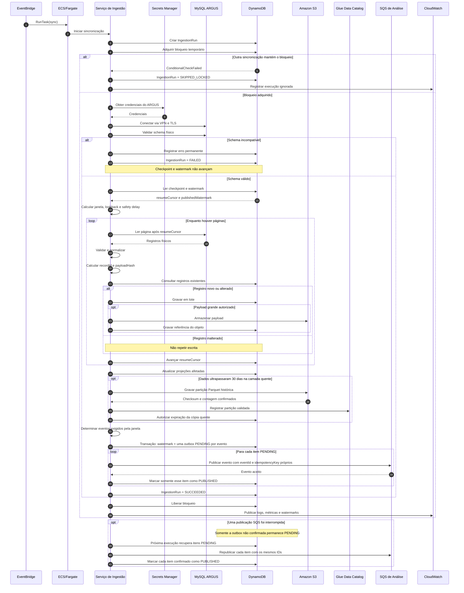

Fonte: Material produzido pelos autores (2026).

&emsp;Depois de obter o bloqueio, o serviço recupera as credenciais no Secrets Manager e acessa o MySQL pela rede privada, com transporte protegido por TLS. Os registros são lidos em páginas, normalizados e identificados por `recordId`. O `payloadHash` permite reconhecer quando o conteúdo não mudou e evita escritas desnecessárias. Registros novos ou alterados permanecem no DynamoDB durante a janela quente. Ao ultrapassarem 30 dias, são consolidados em partições Parquet no S3 e registrados no Glue Data Catalog; a expiração da cópia quente somente é autorizada após a validação do arquivo histórico.

&emsp;O marcador da última janela completa publicada é denominado *watermark*. Sua atualização ocorre na mesma transação que cria um item de saída pendente, conhecido como *outbox*, para cada evento exigido. Toda janela produz uma detecção, e o fechamento horário também produz uma previsão; cada item possui identificadores e estado próprios. Se uma publicação falhar, a execução seguinte republica somente os itens `PENDING` com as mesmas chaves de idempotência. Se outra sincronização mantiver o bloqueio, a nova tentativa é encerrada como `SKIPPED_LOCKED`, sem interferir na tarefa ativa.

#### 5.3.2 DS-01B — Importação de snapshot pela interface

&emsp;A importação de snapshot permite carregar pela interface uma cópia do banco do ARGUS sem interromper o conjunto de dados que já está disponível. O arquivo é enviado diretamente ao S3 por partes, mediante endereços temporários gerados pelo Backend. Concluído o envio, uma tarefa Fargate restaura o dump em um MySQL 8 isolado e reutiliza o mesmo processo de normalização empregado na sincronização periódica. Enquanto a tarefa é executada, o Dashboard consulta periodicamente o estado do `ImportJob`, prática denominada *polling*, para apresentar o progresso ao usuário.

<strong>Diagrama 5: DS-01B — Importação assíncrona de um snapshot do ARGUS</strong>

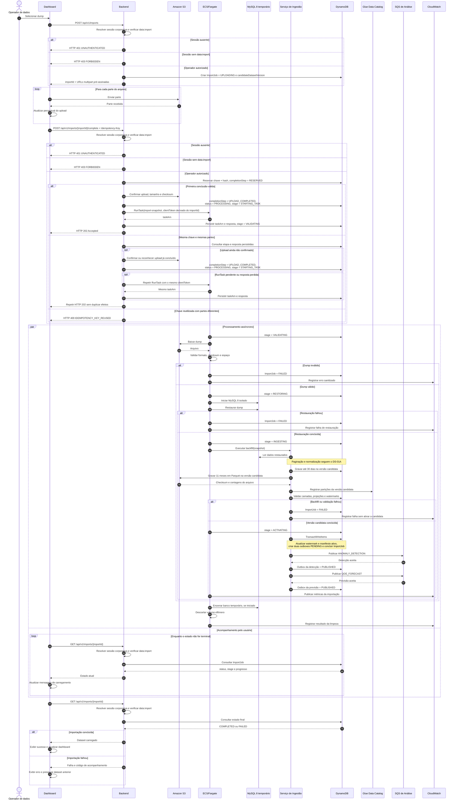

Fonte: Material produzido pelos autores (2026).

&emsp;O ator deste fluxo é o `Operador de dados`: o Backend resolve a sessão corporativa e exige `data:import`, concedida somente pelo grupo Cognito `data-operator`, antes de criar ou consultar o `ImportJob` e antes de acessar S3 ou ECS. Sessão ausente recebe HTTP 401 com `UNAUTHENTICATED`; sessão válida sem a permissão recebe HTTP 403 com `FORBIDDEN`. Claims no body ou em headers não concedem essa autorização. O Backend responde com HTTP 202 porque a restauração e a ingestão continuam de forma assíncrona. A conclusão reserva condicionalmente a chave de idempotência e o hash canônico das partes no `ImportJob`; cada etapa alcançada, o `taskArn` e a resposta são persistidos. Se a chamada for repetida ou interrompida, o Backend retoma a etapa pendente e utiliza o mesmo `clientToken` no `RunTask`, sem criar outra tarefa. O `ImportJob` registra `createdBy`, `completionRequestedBy` e `activatedBy` a partir da sessão autorizada, além de `createdAt`, `completionRequestedAt` e `activatedAt`; `activatedBy` guarda o operador cujo comando autorizado iniciou o processamento. Ele recebe uma `candidateDatasetVersion`, usada nas chaves do DynamoDB, nos prefixos do S3, nas partições do Glue e nos watermarks. O dashboard continua consultando o manifesto anterior até que os dois níveis da candidata sejam validados. Depois da validação, uma transação troca o manifesto ativo, cria itens independentes de outbox para a detecção e para a previsão e conclui o job. O `recordId` permanece estável entre versões.

&emsp;As falhas são tratadas de modo a preservar um estado utilizável. Dump inválido, falha de restauração, backfill incompleto ou validação inconsistente encerram o `ImportJob` como `FAILED` sem alterar o manifesto ativo; a versão candidata permanece invisível e pode ser removida posteriormente. Falhas de publicação mantêm apenas o item correspondente da outbox como `PENDING`. O encerramento do MySQL e o descarte do volume são executados no caminho comum após sucesso ou falha, sem remover o dump retido no S3. A ingestão não consulta nem modifica o conjunto de diagnósticos confirmados.

### 5.4 Backend, autenticação e revisão

&emsp;Os fluxos do Backend representam as interações iniciadas pelos usuários corporativos. O primeiro garante uma sessão autenticada antes de disponibilizar o dashboard; o segundo registra a decisão humana sobre uma hipótese diagnóstica; o terceiro compara os indicadores anteriores e posteriores a uma correção externa. Essas interações realizam os casos de uso UC-01, UC-02, UC-03, UC-04 e UC-05. O Dashboard atua como interface, enquanto o Backend concentra a validação da sessão, a consulta aos dados e a aplicação das regras de revisão e comparação.

> **Divergência tecnológica/temporária.** O DS-02A a seguir modela a federação alvo (Cognito ↔ SSO corporativo por OIDC/SAML). No runtime atual, o Cognito realiza login direto por usuário e senha, e as rotas de federação retornam `503` — ver [Status de implementação](arquitetura/status-implementacao.md).

#### 5.4.1 DS-02A — Autenticação federada e consulta

&emsp;A autenticação federada permite que o View Show reconheça a identidade corporativa sem armazenar senhas. Quando não existe sessão válida, o Backend direciona o usuário ao Cognito, que delega a autenticação ao SSO da Globo. Somente depois da validação do retorno o sistema cria a sessão e consulta o modelo de leitura da visão geral.

<strong>Diagrama 6: DS-02A — Autenticação federada e consulta do dashboard</strong>

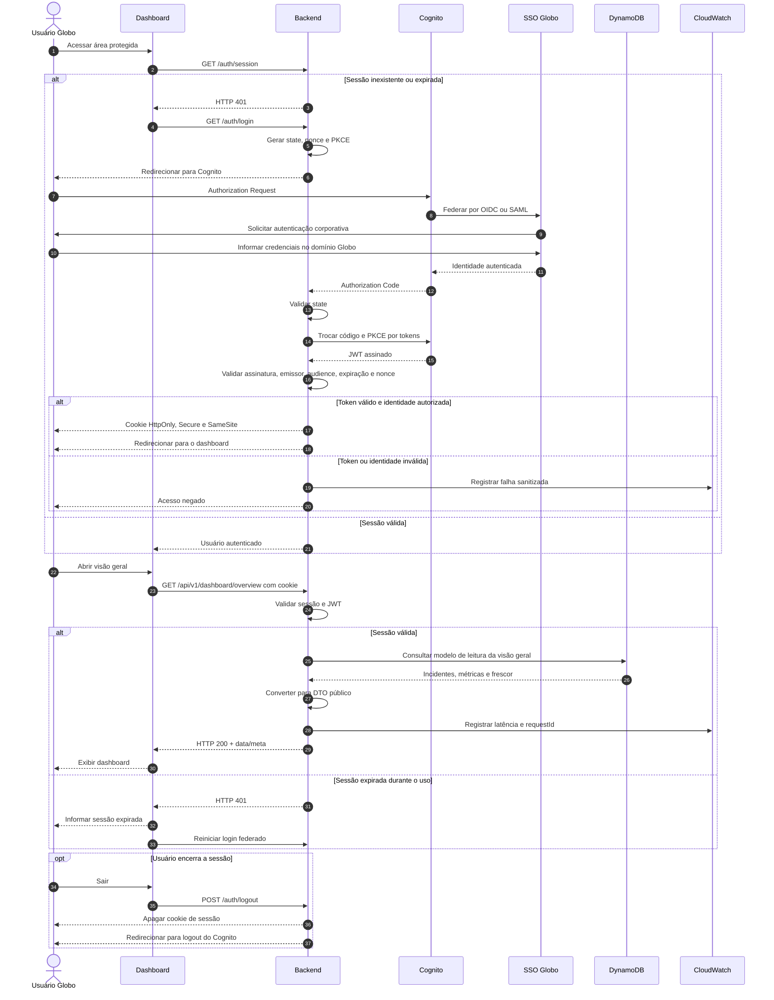

Fonte: Material produzido pelos autores (2026).

&emsp;O SSO da Globo autentica o usuário, enquanto o Cognito atua como intermediário de identidade e emite tokens assinados no formato JWT. O Backend conclui o fluxo OAuth segundo o padrão *Backend for Frontend* (BFF). O padrão PKCE (*Proof Key for Code Exchange*) vincula o pedido de autenticação à troca posterior do código, reduzindo o risco de sua utilização indevida. O navegador recebe somente um cookie `HttpOnly`, `Secure` e `SameSite`, inacessível ao JavaScript. As respostas públicas também ocultam chaves e detalhes físicos das camadas de armazenamento.

&emsp;Uma sessão inexistente, expirada ou associada a uma identidade não autorizada interrompe a consulta antes do acesso aos dados. As falhas são registradas sem credenciais ou tokens e o usuário é direcionado novamente ao processo de autenticação.

#### 5.4.2 DS-02B — Revisão concorrente e promoção ao conjunto de referência

&emsp;A revisão de hipóteses permite que uma pessoa confirme, refute ou marque como inconclusiva a causa provável apresentada pelo sistema. Como dois usuários podem abrir o mesmo diagnóstico, o Backend utiliza a versão conhecida pelo revisor para aceitar somente a decisão compatível com o estado e a versão atuais. Uma hipótese confirmada passa a integrar o *golden set*, isto é, o conjunto de diagnósticos humanos confirmados que serve como referência para análises futuras. Uma decisão inconclusiva permanece revisável e não promove a hipótese.

<strong>Diagrama 7: DS-02B — Revisão concorrente e promoção de hipótese ao conjunto de referência</strong>

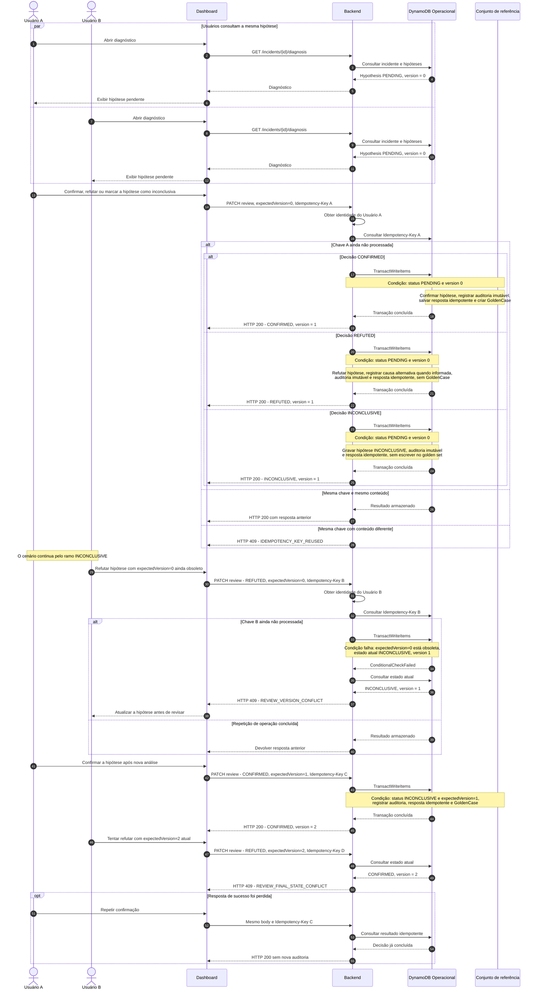

Fonte: Material produzido pelos autores (2026).

&emsp;A identidade do revisor vem da sessão. A requisição informa `Idempotency-Key` e `expectedVersion`; a escrita exige a versão esperada e aceita `PENDING` ou `INCONCLUSIVE`. `CONFIRMED` e `REFUTED` são terminais. `INCONCLUSIVE` grava uma decisão humana, mas não é terminal: outra revisão pode decidir `CONFIRMED` ou `REFUTED` com nova `Idempotency-Key` e a versão atual. Somente `CONFIRMED` inclui a criação do `GoldenCase` na transação; `REFUTED` e `INCONCLUSIVE` permanecem no histórico operacional.

&emsp;Requisições sem a versão esperada são rejeitadas sem alterar a hipótese. Uma requisição com versão obsoleta recebe `REVIEW_VERSION_CONFLICT`; uma tentativa de alterar `CONFIRMED` ou `REFUTED` com a versão atual recebe `REVIEW_FINAL_STATE_CONFLICT`. Toda decisão grava auditoria imutável. A chave de idempotência permite devolver o mesmo resultado quando uma requisição é repetida, sem duplicar a auditoria ou o caso confirmado.

#### 5.4.3 DS-02C — Avaliação da recuperação após correção

&emsp;A avaliação de recuperação ocorre depois de uma correção realizada fora do View Show. A Engenheira de Software ou a Product Manager seleciona o incidente, confirma o marco temporal da intervenção e solicita a comparação de janelas equivalentes. O fluxo realiza UC-05 sem atribuir ao sistema a implantação da correção nem transformar uma associação temporal em afirmação de causalidade.

> **Fluxo proposto.** Diferentemente dos demais diagramas desta seção, o DS-02C ainda não possui contrato de endpoint formalizado em [API do dashboard](arquitetura/api-dashboard.md) (ver Q-04 na rastreabilidade da Seção 6). As mensagens abaixo representam a solução proposta para UC-05, sujeita a ajuste quando o contrato for consolidado.

<strong>Diagrama 8: DS-02C — Avaliação da recuperação após correção (fluxo proposto)</strong>

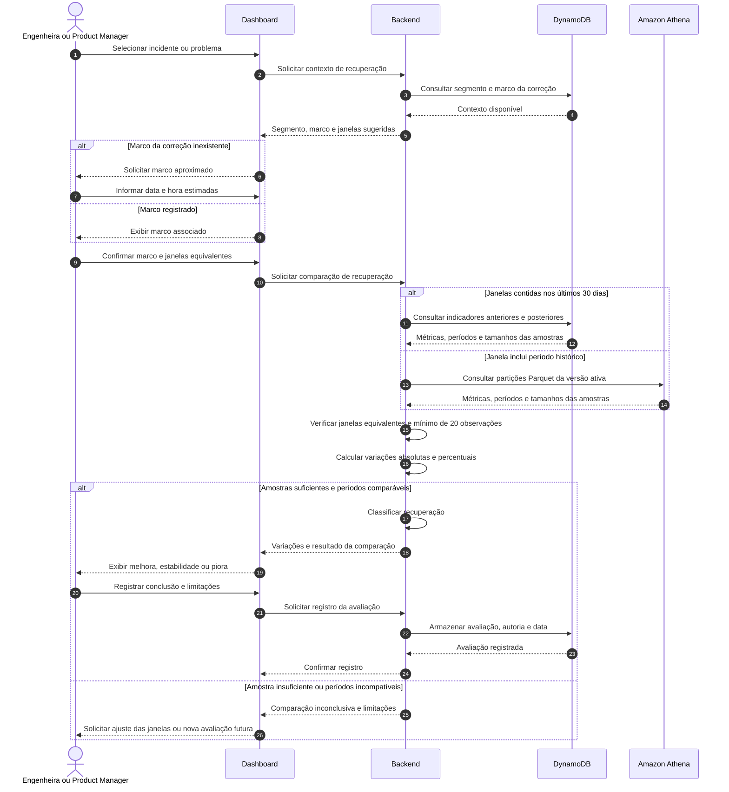

Fonte: Material produzido pelos autores (2026).

&emsp;O componente responsável pela comparação deverá devolver os períodos, os tamanhos das amostras e as variações absolutas e percentuais para que o resultado permaneça auditável. Consultas de até 30 dias utilizam o DynamoDB, enquanto períodos anteriores são obtidos pelo Athena a partir dos arquivos Parquet no S3. No MVP, a classificação conclusiva exige janelas de mesma duração, os mesmos filtros de segmento e ao menos 20 observações em cada janela; nos demais cenários, a interface informa a limitação e preserva o contexto para ajuste ou repetição posterior.

&emsp;A conclusão registrada representa a interpretação do ator a partir dos indicadores disponíveis. O View Show não executa implantação ou reversão e não afirma que a correção causou a variação observada. Essa delimitação mantém o diagrama coerente com a fronteira funcional definida em UC-05.

### 5.5 Worker de Análise

&emsp;O Worker de Análise consome de forma assíncrona as janelas materializadas pela ingestão e coordena três responsabilidades: antecipar degradações, reconhecer anomalias já observadas e recuperar processamentos interrompidos. Essas atividades não são iniciadas diretamente pelos atores, mas fornecem previsões, incidentes, evidências, hipóteses e informações operacionais para os casos de uso UC-03, UC-04, UC-06 e UC-07.

&emsp;O orquestrador de análise permanece um módulo interno do Worker. Ele combina os resultados dos modelos, recupera informações do DynamoDB e consulta casos humanos confirmados antes de solicitar ao agente diagnóstico uma explicação para o risco ou incidente. O Amazon Bedrock apoia a geração das hipóteses, mas não substitui a decisão humana.

#### 5.5.1 DS-03A — Previsão preventiva e validação posterior

&emsp;A previsão preventiva estima, a cada janela horária completa, o risco de degradação da experiência na hora seguinte. Antes de produzir uma nova previsão, o Worker compara a estimativa anterior com o valor efetivamente observado. Essa validação permite acompanhar a qualidade do modelo e registrar se ele reconheceu corretamente a ocorrência ou a ausência de uma degradação.

<strong>Diagrama 9: DS-03A — Previsão preventiva e validação da previsão anterior</strong>

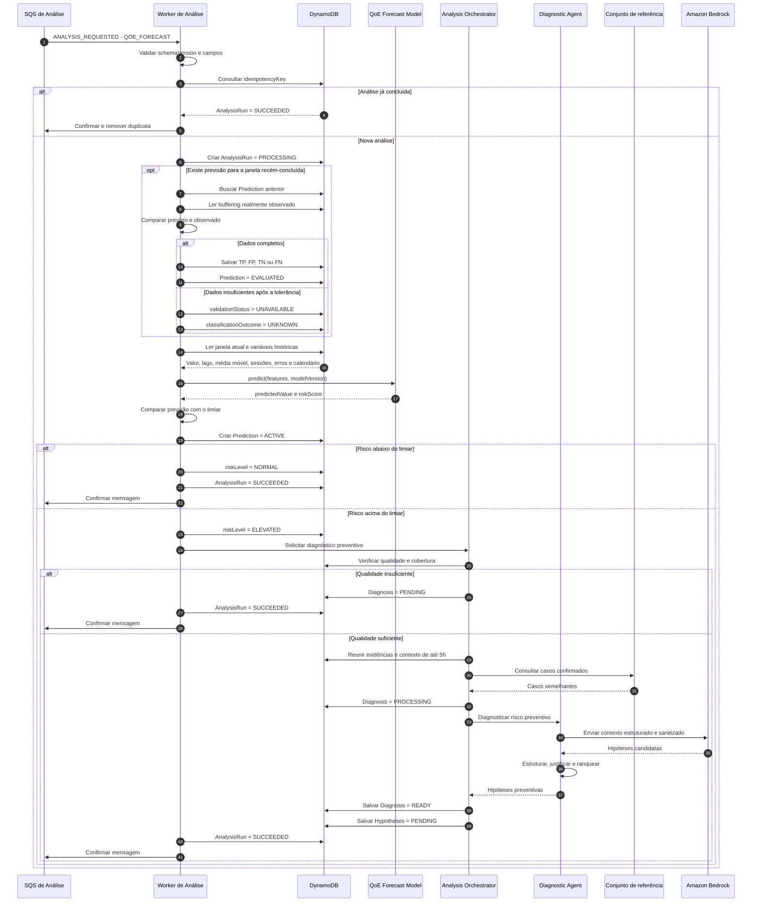

Fonte: Material produzido pelos autores (2026).

&emsp;A previsão executa após uma janela horária completa e registra o limiar e a versão do modelo. A mesma execução compara a previsão anterior com o valor observado e classifica o resultado como `TP`, `FP`, `TN`, `FN` ou `UNKNOWN`. Risco normal não aciona o agente; risco elevado exige qualidade mínima. Uma hipótese preventiva não é um incidente e continua sujeita à revisão humana. As classificações `TP`, `FP`, `TN` e `FN` representam, respectivamente, verdadeiro positivo, falso positivo, verdadeiro negativo e falso negativo; `UNKNOWN` indica que os dados disponíveis não permitem avaliar a previsão.

#### 5.5.2 DS-03B — Detecção reativa e diagnóstico por IA

&emsp;A detecção reativa examina cada nova janela de 15 minutos para identificar alterações relevantes em relação ao comportamento histórico. O detector aplica o desvio absoluto mediano (MAD) às séries individuais e a distância de Mahalanobis ao conjunto de variáveis correlacionadas. A primeira técnica identifica valores afastados do padrão de uma métrica; a segunda verifica se a combinação entre várias métricas se tornou atípica.

<strong>Diagrama 10: DS-03B — Detecção reativa e diagnóstico automático por IA</strong>

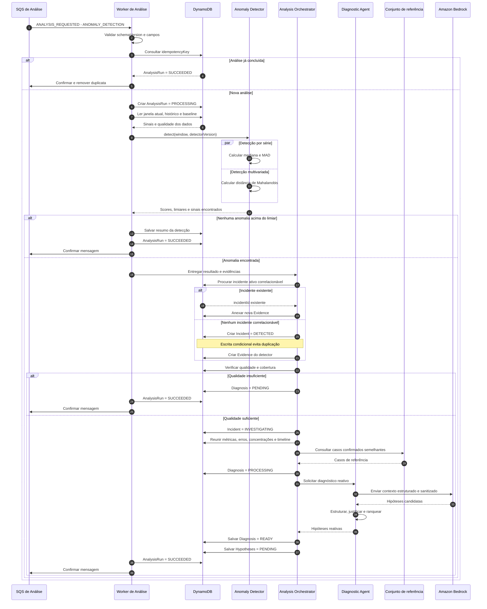

Fonte: Material produzido pelos autores (2026).

&emsp;MAD e Mahalanobis permanecem módulos internos do mesmo Worker. O detector produz scores e evidências; o `Analysis Orchestrator` cria ou correlaciona o incidente. O resultado estatístico torna-se uma evidência associada ao incidente. Quando há qualidade e cobertura suficientes, o agente consulta o contexto de até cinco horas anteriores à falha e o conjunto de casos confirmados para produzir hipóteses justificadas. Eventos individuais ficam restritos ao mesmo dispositivo; quando existirem apenas agregados, são usadas métricas do segmento afetado e o diagnóstico recebe qualidade limitada. O incidente permanece disponível mesmo quando o diagnóstico por IA não pode ser concluído.

#### 5.5.3 DS-03C — Recuperação de falhas, mensagens não processadas e reanálise

&emsp;A recuperação de falhas evita que uma indisponibilidade transitória descarte o resultado já produzido. O Worker registra cada tentativa e retoma a partir da última etapa persistida. Entre as tentativas, aplica-se uma espera progressiva, denominada *backoff*, para reduzir a pressão sobre a dependência indisponível. Depois do limite configurado, a mensagem segue para a *Dead-Letter Queue* (DLQ), fila separada que conserva mensagens não processadas para inspeção e reenvio controlado. O mesmo fluxo permite que um usuário autenticado solicite uma nova análise do incidente.

<strong>Diagrama 11: DS-03C — Recuperação de falhas, DLQ e reanálise</strong>

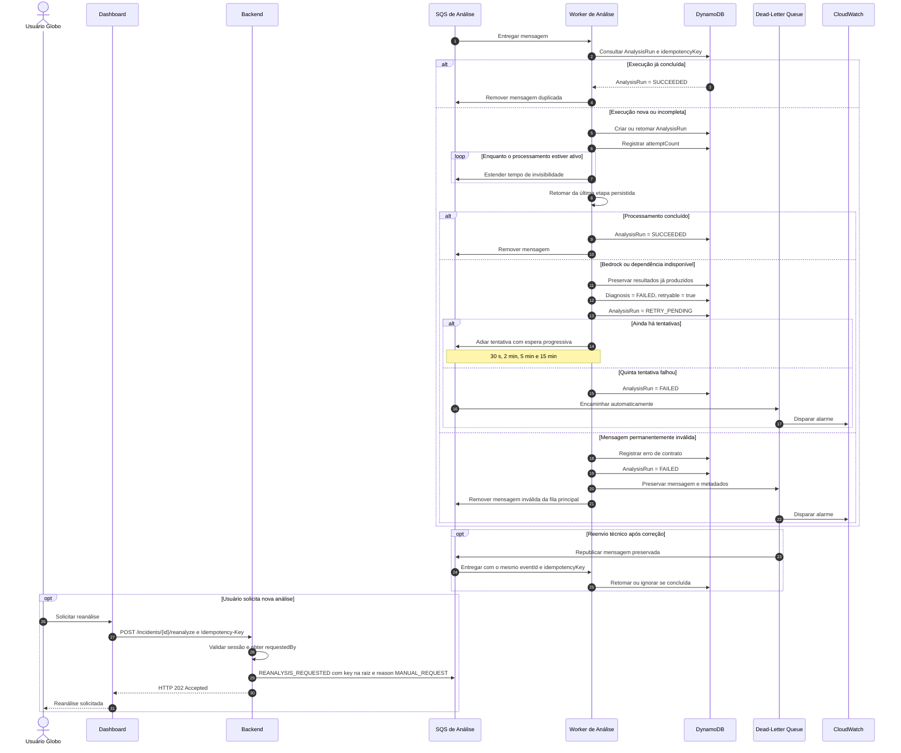

Fonte: Material produzido pelos autores (2026).

&emsp;Os valores iniciais adotados para a fila foram reunidos na Tabela 5. Eles delimitam o tempo concedido a cada processamento, o número de tentativas e o período disponível para uma recuperação manual.

<strong>Tabela 5: Parâmetros operacionais da fila de análise</strong>

| Configuração | Valor inicial |
| --- | ---: |
| Tipo da fila | SQS Standard |
| Tempo de invisibilidade da mensagem | 5 minutos |
| Renovação durante o processamento | A cada 60 segundos |
| Máximo de recebimentos | 5 |
| Retenção da fila principal | 4 dias |
| Retenção da DLQ | 14 dias |
| Espera máxima por novas mensagens | 20 segundos |
| Alarme | Uma ou mais mensagens na DLQ |

Fonte: Material produzido pelos autores (2026).

&emsp;Mensagens duplicadas são tratadas por idempotência. O Worker retoma da última etapa persistida, e uma falha no Bedrock não remove previsão, incidente ou evidências nem produz uma hipótese artificial. Erros permanentes seguem diretamente para a DLQ; falhas transitórias usam a espera progressiva e o reenvio automático após o quinto recebimento.

&emsp;Ao concluir uma solicitação, o Worker registra a execução como `SUCCEEDED`. Cada previsão preserva a versão do modelo, o limiar, a janela-alvo e, quando disponível, o resultado de sua validação. Toda anomalia persistida permanece associada à evidência que a fundamenta e, quando aplicável, a um incidente. As hipóteses continuam pendentes até a revisão humana, enquanto mensagens que não puderam ser processadas permanecem recuperáveis na DLQ.

### 5.6 Visão geral ponta a ponta

&emsp;O fluxo ponta a ponta sintetiza como os processos anteriores se conectam. Ele começa quando o ARGUS ou um snapshot disponibiliza dados, acompanha sua normalização e análise e termina quando o usuário consulta o resultado e decide sobre uma hipótese. Essa visão não substitui os diagramas detalhados; sua função é evidenciar a continuidade entre a origem operacional, o processamento automático e a intervenção humana.

<strong>Diagrama 12: DS-04 — Visão geral ponta a ponta da plataforma View Show</strong>

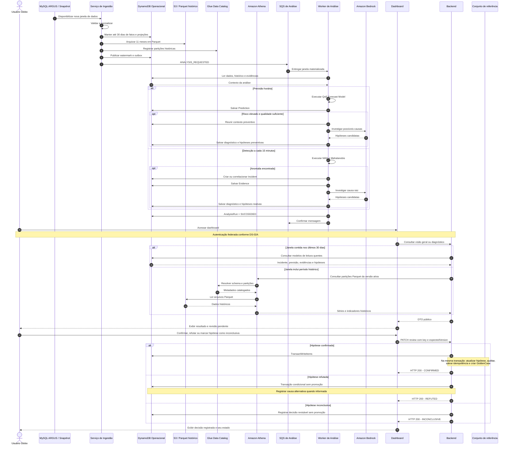

Fonte: Material produzido pelos autores (2026).

&emsp;Na primeira parte, o DS-01A detalha a sincronização do MySQL e o DS-01B detalha a importação de snapshots. Depois da publicação na fila, o DS-03A descreve a previsão horária, o DS-03B apresenta a detecção de incidentes e o DS-03C mostra a recuperação de falhas. A interação do usuário é aprofundada no DS-02A, para autenticação e consulta, no DS-02B, para revisão de hipóteses, e no DS-02C, para avaliação posterior a uma correção externa.

&emsp;Ao final do percurso, até 30 dias da janela ingerida estão disponíveis no DynamoDB e os 11 meses anteriores permanecem em Parquet no S3, sob o mesmo `datasetVersion`. Uma previsão continua distinta de um incidente observado, enquanto uma anomalia pode criar ou reforçar um incidente. As hipóteses permanecem pendentes até a decisão humana e somente as confirmadas passam a integrar o conjunto de referência; decisões refutadas podem registrar a causa alternativa informada, e decisões inconclusivas permanecem revisáveis. O `traceId`, identificador de correlação propagado entre os componentes, permite acompanhar uma execução ao longo de todo o fluxo.

### 5.7 Rastreabilidade interna

&emsp;Para evitar que os processos técnicos sejam interpretados como casos de uso independentes, a Tabela 6 registra a natureza de cada relação. Ela também resume a principal decisão arquitetural demonstrada por cada diagrama.

<strong>Tabela 6: Rastreabilidade dos diagramas de sequência</strong>

| Diagrama | Casos de uso | Natureza da relação | Decisão principal |
| --- | --- | --- | --- |
| DS-01A | UC-01, UC-03, UC-04, UC-06, UC-07, UC-08 | Suporte técnico | Persistência operacional e arquivamento histórico da telemetria |
| DS-01B | UC-01, UC-03, UC-04, UC-06, UC-07, UC-08 | Suporte técnico | Upload no S3, MySQL temporário no Fargate e ativação versionada |
| DS-02A | UC-01, UC-02 | Realização | SSO federado com Backend for Frontend |
| DS-02B | UC-03, UC-04 | Realização | Concorrência otimista, auditoria e promoção transacional |
| DS-02C | UC-05 | Realização | Comparação auditável de janelas equivalentes sem inferência indevida de causalidade |
| DS-03A | UC-06 | Suporte técnico | Previsão horária e validação posterior |
| DS-03B | UC-03, UC-04, UC-06 | Suporte técnico | Detecção a cada 15 minutos e diagnóstico por IA |
| DS-03C | UC-04, UC-07 | Exceção e alternativa | Repetição controlada, DLQ e reanálise |
| DS-04 | UC-01, UC-02, UC-03, UC-04, UC-06 | Síntese | Continuidade do dado até a decisão humana |

Fonte: Material produzido pelos autores (2026).

---

## 6. Rastreabilidade da modelagem

A rastreabilidade relaciona os casos de uso aos requisitos, às necessidades de usuário e aos demais elementos da modelagem. Essa relação permite verificar a origem de cada comportamento e identificar os conceitos que participam de sua realização.

<strong>Tabela 7: Rastreabilidade dos casos de uso</strong>

| Área | Caso de uso | Requisitos | Histórias ou telas relacionadas | Elementos conceituais | Sequências relacionadas |
| --- | --- | --- | --- | --- | --- |
| Login e acesso | UC-02 | RF04, RNF04, RIE01, RESTR01 | [Tela de Login](sprint1/entendimento_ux.md#41-login) | Usuário corporativo, sessão e provedor de identidade | DS-02A |
| Visão Geral, filtros e exportação | UC-01 | RF07, RF08, RF09, RF10, RNF07, RNF14 | [Visão Geral](sprint1/entendimento_ux.md#42-visão-geral) | Dashboard, consulta, filtro e exportação | DS-01A, DS-01B, DS-02A, DS-04 |
| Análise e revisão de incidente | UC-03 | RF07, RF08, RF09, RNF08, RNF10, RNF13, RNF15 | [US-N1-01 a US-N1-05](sprint1/entendimento_ux.md#32-user-stories-da-persona-1) | Incidente, hipótese, evidência e decisão de revisão | DS-01A, DS-01B, DS-02B, DS-03B, DS-04 |
| Investigação técnica | UC-04 | RF05, RF06, RF07, RF08, RF09, RNF05, RNF08, RNF10, RNF13, RNF14 | [US-ENG-01 a US-ENG-04](sprint1/entendimento_ux.md#33-user-stories-da-persona-2) | Incidente, evento, linha do tempo, hipótese e evidência | DS-01A, DS-01B, DS-02B, DS-03B, DS-04 |
| Avaliação posterior a uma correção | UC-05 | RF07, RF08, RF09, RNF05, RNF14 | [US-ENG-05](sprint1/entendimento_ux.md#us-eng-05---verificar-a-recuperação-após-uma-correção) e [US-PM-04](sprint1/entendimento_ux.md#us-pm-04---avaliar-a-evolução-após-uma-correção) | Incidente, marco temporal, janela de comparação e indicador | DS-02C |
| Indicadores, segmentos e histórico de QoE | UC-06 | RF07, RF08, RF09, RNF05, RNF14, RNF15 | [US-PM-01 a US-PM-05](sprint1/entendimento_ux.md#34-user-stories-da-persona-3) | Indicador de QoE, segmento, série temporal e degradação | DS-01A, DS-01B, DS-03A, DS-03B, DS-04 |
| Integridade da telemetria | UC-07 | RF07, RF08, RNF01, RNF02, RNF03, RNF09, RNF15 | [US-ENG-06](sprint1/entendimento_ux.md#us-eng-06---monitorar-a-saúde-da-telemetria) e [tela de Monitoramento](sprint1/entendimento_ux.md#56-monitoramento-da-telemetria) | Fonte de telemetria, métrica operacional, cobertura e alerta | DS-01A, DS-01B, DS-03C |
| Sincronização e normalização dos dados do ARGUS | UC-08 | RF01, RF02, RF03, RIE02 | Não modelado em [entendimento_ux.md](sprint1/entendimento_ux.md): o temporizador e o ARGUS são atores técnicos, sem persona de usuário associada | Registro do ARGUS, checkpoint, watermark e outbox | DS-01A, DS-01B |

Fonte: Material produzido pelos autores (2026).

### 6.1 Conceitos da matriz e sua representação estrutural

&emsp;Nem todo conceito citado na coluna "Elementos conceituais" da Tabela 7 corresponde a uma classe adicional do diagrama de classes: vários já são cobertos por classes existentes, por registros canônicos com contrato normativo em outro documento (Seção 4.1) ou por projeções calculadas em tempo de leitura. A Tabela 8 evita que essa ausência pareça uma omissão ao explicitar, para cada conceito, onde ele está representado ou por que permanece fora do modelo estrutural.

<strong>Tabela 8: Justificativa estrutural dos conceitos da matriz de rastreabilidade</strong>

| Conceito | Caso de uso | Representação no modelo estrutural |
| --- | --- | --- |
| Evento | UC-04 | Corresponde ao `SignalObservation`, o registro canônico de ingestão com contrato próprio em [Ingestão e dados §9.1](arquitetura/ingestao-e-dados.md#91-signalobservation); permanece fora da Seção 4 por decisão explícita de 4.1, que reserva esse contrato ao documento de ingestão para não duplicá-lo. |
| Linha do tempo | UC-04 | Não é uma entidade persistida adicional: é uma ordenação, por `startedAt`/`observedAt`, de `Incidente` e `Evidencia`, já modelados em 4.2.1, servida pela fronteira "Visão geral, incidentes e eventos" (4.2.2). |
| Indicador de QoE | UC-06 | Corresponde ao `DimensionalMetricAggregate`, registro canônico de ingestão com contrato em [Ingestão e dados §9.2](arquitetura/ingestao-e-dados.md#92-dimensionalmetricaggregate); consumido pela mesma fronteira de leitura, sem duplicar o contrato nesta seção (Seção 4.1). |
| Segmento | UC-06 | Dimensão de filtro (`device`, `region`, `version`, entre outras) sobre o `DimensionalMetricAggregate`; é um parâmetro de consulta da fronteira de leitura, não uma classe de domínio própria do View Show. |
| Fonte de telemetria | UC-07 | Corresponde ao campo `source` do contrato físico `signal_bucket` ([Ingestão e dados §5.1](arquitetura/ingestao-e-dados.md#51-signal_bucket)), que também identifica o `SignalObservation`; a saúde por fonte é uma projeção calculada em tempo de leitura pela fronteira de Monitoramento (4.2.2), sem persistência própria como classe de domínio do View Show. |
| Cobertura | UC-07 | Métrica calculada (`coverageRatio`/`measurement.status`) na resposta da fronteira de Monitoramento ([API do dashboard §10](arquitetura/api-dashboard.md#10-monitoramento)); não é um atributo persistido de nenhuma classe de domínio, e sim um valor derivado a cada consulta. |
| Alerta | UC-07 | Corresponde ao `status` calculado dos KPIs de monitoramento (mesmo contrato acima); o View Show não persiste uma entidade de alerta própria nesta versão — é registrado como questão em aberto em Q-05 (7.2). |
| Marco temporal | UC-05 | Modelado como o atributo `milestoneAt` da entidade `AvaliacaoRecuperacao` (4.2.1), persistida ao final do DS-02C. |
| Janela de comparação | UC-05 | Modelada pelas duas composições `AvaliacaoRecuperacao *-- Janela` (janela base e janela de comparação, 4.2.1 e 4.4), reaproveitando o objeto de valor já definido para `Previsao`. |

Fonte: Material produzido pelos autores (2026).

---

## 7. Referências

LARMAN, Craig. *Utilizando UML e padrões: uma introdução à análise e ao projeto orientados a objetos e ao desenvolvimento iterativo*. 3. ed. Porto Alegre: Bookman, 2007. E-book. Disponível em: https://integrada.minhabiblioteca.com.br/reader/books/9788577800476. Acesso em: 6 set. 2026.

OBJECT MANAGEMENT GROUP. *OMG Unified Modeling Language (OMG UML)*. Version 2.5.1. 2017. Disponível em: https://www.omg.org/spec/UML/2.5.1. Acesso em: 6 set. 2026.
