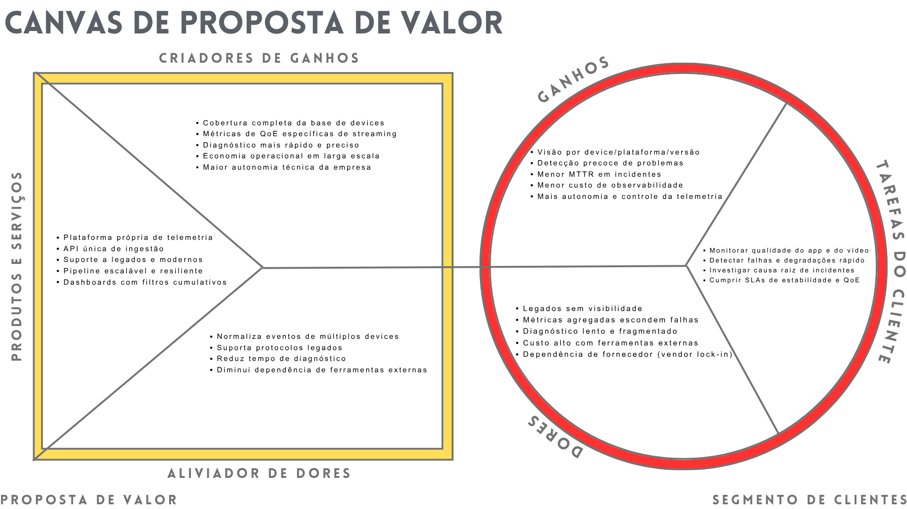

# Canvas de Proposta de Valor 

&nbsp;&nbsp;&nbsp;&nbsp;A Proposta de Valor (Value Proposition Canvas) é um modelo estratégico de posicionamento de mercado que define o conjunto de benefícios tangíveis e intangíveis que uma organização se compromete a entregar aos seus segmentos de clientes. Ela atua como o núcleo de diferenciação competitiva, alinhando as capacidades operacionais da empresa com as necessidades específicas do mercado-alvo.

---

## Perfil do Cliente 

&nbsp;&nbsp;&nbsp;&nbsp;O cliente deste projeto é o conjunto de times internos responsáveis pela operação do serviço de streaming da Globo (GloboPlay): times de Engenharia de Aplicativos (mobile, web, TV), Engenharia de Plataforma de Vídeo, SRE/Observabilidade e Produto. Esses times atuam em um contexto de alta escala e alta heterogeneidade de dispositivos, onde coexistem Smart TVs modernas, TVs com firmware antigo, set-top boxes, dispositivos móveis com diversas versões de sistema operacional e navegadores com capacidades distintas.

Internamente, esses times são cobrados por manter a qualidade de experiência (QoE) do usuário final, cumprir SLAs de disponibilidade e desempenho e controlar custos operacionais ligados à observabilidade e monitoramento. Externamente, o serviço é avaliado por milhões de usuários que esperam que o conteúdo esteja disponível rapidamente, sem travamentos e com qualidade consistente, independentemente do dispositivo.

O cliente, portanto, não é um usuário final individual, mas uma organização técnica que depende de telemetria confiável para operar o produto de streaming com segurança. A solução proposta precisa dialogar diretamente com essa realidade: alta escala, ambiente heterogêneo, necessidade de diagnóstico rápido e forte pressão por eficiência operacional e econômica.

---

## 1.1 Tarefas do Cliente 

As tarefas do cliente podem ser divididas em funcionais, sociais e emocionais, cada uma respresentando a responsabilidade da equipe em concluir a operaçao em diferentes níveis. Na proposta de valor, as tarefas funcionais são as ações práticas e objetivas que o cliente precisa realizar (como resolver um problema técnico), as tarefas sociais envolvem a busca por status, reconhecimento e como ele deseja ser visto pelo ecossistema ao seu redor, e as tarefas emocionais referem-se ao estado psicológico que ele deseja alcançar ou evitar, como a busca por segurança, paz ou alívio do estresse. Essas três dimensões revelam as reais motivações do consumidor, permitindo que o grupo Globo crie soluções que atendam tanto às necessidades utilitárias quanto aos desejos subjetivos de seu público.

### Tarefas funcionais

Funcionalmente, os times precisam:

- Monitorar a saúde do aplicativo e do player em múltiplas plataformas (mobile, web, TVs, dispositivos legados), acompanhando eventos como screen_view, video_view, request, session e error.

- Detectar rapidamente degradações de qualidade de experiência (QoE), como aumento de tempo de carregamento de vídeo, falhas de início de playback, aumento de erros de requisição ou ANRs em dispositivos específicos.

- Investigar a causa raiz de incidentes, correlacionando eventos de frontend com backend, CDN e plataforma de vídeo para responder perguntas como “o problema está no app, na API, na CDN ou na infraestrutura do dispositivo?”.

- Cumprir SLAs e metas internas, garantindo que indicadores como taxa de playback bem-sucedido, latência de startup e estabilidade por dispositivo/região se mantenham dentro de limites aceitáveis.

- Reduzir custos de observabilidade, buscando alternativas a ferramentas externas de RUM/APM que se tornam muito caras em ambientes com grande volume de sessões.

- Integrar telemetria com o ecossistema interno, exportando dados para data lakes, ferramentas de alerta, sistemas de ticket e dashboards já utilizados pela empresa.

### Tarefas sociais

No plano social, esses times precisam:

- Demonstrar para a liderança técnica e de negócios que possuem controle sobre a saúde do produto, apresentando dados claros sobre estabilidade e qualidade de experiência.

- Construir credibilidade com outras áreas, como Produto e Conteúdo, mostrando que problemas técnicos são detectados e mitigados com rapidez.

- Sustentar a imagem da empresa como uma plataforma de streaming confiável, que funciona bem nos principais eventos (jogos, finais de reality, estreias de novelas e séries).

- Coordernar resposta a incidentes entre múltiplos times, o que exige uma fonte de verdade única sobre o que está acontecendo nos dispositivos dos usuários.

### Tarefas emocionais

Em termos emocionais, há várias pressões importantes:

- Reduzir a ansiedade e o estresse durante grandes eventos, evitando a sensação de “voo às cegas” quando a audiência dispara.

- Ter segurança de que, ao lançar uma nova versão de app, os times conseguirão detectar rapidamente qualquer regressão de QoE ou estabilidade.

- Sentir autonomia técnica, sem depender totalmente de decisões de fornecedores externos para algo tão crítico quanto a observabilidade do produto.

- Orgulho profissional de operar uma plataforma de streaming com um nível de monitoramento sofisticado e adequado à realidade da base de dispositivos.

&nbsp;&nbsp;&nbsp;&nbsp;Contudo, abstraindo a responsabilidade de tarefas do cliente, é concluído que o projeto tem a responsabiliade de funcionar em todas as frentes descritas, detalhando o propósito de cada solução de arquitetura em relação as decisões estratégicas utilizadas pelo grupo Globo. 

---

## Dores do Cliente

&nbsp;&nbsp;&nbsp;&nbsp;As dores a seguir são delimitadas em relação ao projeto e descrevem problemas concretos que a solução se propõe a solucionar. 

### Pontos cegos em dispositivos legados
&nbsp;&nbsp;&nbsp;&nbsp;Parte relevante da audiência usa TVs e dispositivos legados que não suportam padrões modernos de telemetria. Hoje, esses clientes praticamente “somem” dos dashboards, o que significa que incidentes concentrados nessa base só são percebidos quando chegam em suporte, redes sociais ou indicadores indiretos. Essa falta de visibilidade compromete o controle operacional e aumenta o risco de crises em segmentos específicos.

### Métricas agregadas que escondem problemas locais
&nbsp;&nbsp;&nbsp;&nbsp;Os sistemas atuais tendem a apresentar métricas agregadas por aplicação ou região ampla. Problemas que atingem um conjunto específico de devices, versões de app ou combinações de OS e CDNs podem passar despercebidos, pois se diluem na média global. Isso leva a uma detecção tardia de incidentes e dificulta justificar que “o problema está em X e não no serviço inteiro”.

### Diagnóstico lento e fragmentado de incidentes
&nbsp;&nbsp;&nbsp;&nbsp;Quando um problema é detectado, o caminho até a causa raiz é longo. Muitas vezes é necessário cruzar manualmente dados de diferentes ferramentas (RUM, logs, APM, ferramentas de player), sem uma visão contínua da sessão do usuário. Isso resulta em MTTR elevado, maior duração dos incidentes e maior impacto na experiência do usuário.

### Custo elevado com ferramentas externas de observabilidade
&nbsp;&nbsp;&nbsp;&nbsp;Como as ferramentas de mercado cobram por volume de eventos/sessões, a combinação de alta audiência com necessidade de detalhamento gera custos anuais muito altos. Em alguns casos, a solução é reduzir o nível de detalhe ou o volume coletado, o que volta a piorar a visibilidade. Essa dor é tanto técnica (limitação de uso) quanto financeira.

### Dependência estratégica de fornecedores (vendor lock-in)
&nbsp;&nbsp;&nbsp;&nbsp;A empresa depende de ferramentas externas para uma capacidade crítica: enxergar o que está acontecendo na ponta. Mudanças de preço, de contrato, de roadmap de produto ou até a descontinuação de integrações podem impactar diretamente a operação. Isso gera risco estratégico e reduz a capacidade de planejar a longo prazo.

### Dificuldade de lidar com protocolos heterogêneos e legados
&nbsp;&nbsp;&nbsp;&nbsp;A diversidade de dispositivos implica múltiplos padrões e limitações de comunicação. Protocolos antigos, payloads limitados, falta de suporte a bibliotecas modernas de observabilidade: tudo isso torna difícil usar soluções “one size fits all”. Parte dos devices simplesmente não consegue falar com os sistemas atuais de telemetria.

### Baixa segmentação para análise investigativa
&nbsp;&nbsp;&nbsp;&nbsp;Mesmo quando há dados, a falta de filtros por device family, device model, OS version, app version, CDN e tipo de playback limita a investigação. Muitas perguntas operacionais (“acontece só na versão X?”, “só em tal marca de TV?”, “só em live?”) não podem ser respondidas de forma ágil com os dashboards disponíveis hoje.

&nbsp;&nbsp;&nbsp;&nbsp;Correlação limitada entre frontend, player e backend. Em diversas situações, é difícil saber se uma reclamação do usuário está ligada a um problema no app, na API, na CDN ou na infraestrutura local. Falta um identificador consistente de sessão e uma telemetria que conecte os vários pontos da jornada, o que leva a discussões subjetivas entre times em vez de decisões guiadas por dados.

---

## Ganhos do Cliente 

&nbsp;&nbsp;&nbsp;&nbsp;Os ganhos abaixo descrevem vantagens internas e externas que o cliente terá com a implementação da plataforma de telemetria proposta.

### Visibilidade completa da base de dispositivos
&nbsp;&nbsp;&nbsp;&nbsp;Com a criação de uma plataforma capaz de receber, normalizar e processar dados de dispositivos modernos e legados, o cliente passa a enxergar o comportamento de praticamente toda a audiência. Isso elimina pontos cegos em segmentos importantes e permite que decisões sejam tomadas com uma visão mais fiel da realidade.

### Detecção precoce de degradações e incidentes
&nbsp;&nbsp;&nbsp;&nbsp;A combinação de coleta em tempo quase real, segmentação rica e métricas específicas de QoE permite identificar degradações ainda em estágio inicial, muitas vezes antes de gerarem picos em suporte ou repercussão externa. Internamente, isso se traduz em uma operação mais proativa; externamente, em menos impacto percebido pelo usuário final.

### Redução do tempo de diagnóstico e resolução (MTTD/MTTR)
&nbsp;&nbsp;&nbsp;&nbsp;Ao fornecer dashboards com filtros cumulativos, correlação por sessão e visões segmentadas, a plataforma encurta o caminho entre “algo está errado” e “o problema está exatamente aqui”. Isso reduz MTTD (tempo para detectar) e MTTR (tempo para resolver), o que é crítico tanto para operação quanto para percepção do usuário.

### Redução de custos com ferramentas de observabilidade
&nbsp;&nbsp;&nbsp;&nbsp;Ao internalizar parte importante da telemetria e usar a plataforma própria como fonte principal, a empresa pode reduzir o uso intensivo de ferramentas externas caras. Isso diminui o custo total de observabilidade, libera orçamento para outras iniciativas e reduz a pressão para fazer trade-offs entre custo e nível de detalhamento.

### Autonomia e flexibilidade técnica
&nbsp;&nbsp;&nbsp;&nbsp;Com schema próprio, adaptadores por protocolo e APIs unificadas, a empresa ganha autonomia para evoluir a plataforma conforme surgem novas necessidades, novos tipos de dispositivos ou novas métricas de interesse. Isso diminui a dependência de roadmaps de terceiros e permite que a telemetria acompanhe mais de perto a evolução do produto.

### Métricas de QoE mais relevantes e acionáveis
&nbsp;&nbsp;&nbsp;&nbsp;A nova plataforma permite definir métricas alinhadas ao negócio de streaming, como tempo até início do vídeo, taxa de falha de playback, rebuffer ratio e impacto de certos dispositivos ou rotas de entrega. Essas métricas são mais diretamente relacionadas à experiência do usuário e às metas de produto, aumentando a qualidade das decisões internas.

### Melhor cumprimento de SLAs e metas internas
&nbsp;&nbsp;&nbsp;&nbsp;Com monitoramento mais preciso por segmento, alertas configuráveis e análises históricas, fica mais fácil acompanhar e garantir o cumprimento de SLAs de qualidade e disponibilidade. Internamente, isso reduz risco de multas e de conflitos entre áreas; externamente, reforça a imagem de confiabilidade para parceiros comerciais e para o público.

### Melhoria da experiência do usuário final e vantagem competitiva
&nbsp;&nbsp;&nbsp;&nbsp;No fim da cadeia, uma telemetria mais rica e uma operação mais eficiente se traduzem em menos travamentos, início de vídeo mais rápido e menos frustração para o usuário. Em um mercado competitivo de streaming, essa melhoria consistente de experiência é um ganho externo importante, que contribui para retenção e diferencial competitivo.

&nbsp;&nbsp;&nbsp;&nbsp;Esses benefícios estão claramente alinhados às expectativas dos clientes internos (engenharia, SRE, produto, gestão) e também refletem efeitos externos desejáveis (melhor percepção do usuário, vantagem competitiva), atendendo ao nível máximo esperado pelo grupo Globo. 

## Conclusão

&nbsp;&nbsp;&nbsp;&nbsp;A análise do Canvas de Proposta de Valor evidencia que o projeto responde de forma direta e consistente às necessidades específicas do parceiro no contexto de streaming multiplataforma. O perfil do cliente, composto por times de engenharia de aplicativos, plataforma de vídeo, SRE/observabilidade e produto, opera em um ambiente de alta escala e grande heterogeneidade de dispositivos, no qual visibilidade operacional não é um opcional, mas um pré‑requisito para manter a qualidade de experiência e cumprir SLAs.

&nbsp;&nbsp;&nbsp;&nbsp;Do ponto de vista das tarefas do cliente, a solução se posiciona como um habilitador central para monitorar a saúde do frontend, detectar degradações de QoE, investigar causa raiz de incidentes, integrar dados ao ecossistema interno e, ao mesmo tempo, controlar custos de observabilidade. As dores identificadas, especialmente os pontos cegos em dispositivos legados, a dependência de métricas agregadas, o diagnóstico lento e o custo elevado de ferramentas externas, são diretamente endereçadas pela proposta de valor por meio de APIs unificadas, suporte a protocolos legados, normalização de eventos, segmentação rica e correlação por sessão.

&nbsp;&nbsp;&nbsp;&nbsp;Em contrapartida, os ganhos mapeados, como visibilidade completa por dispositivo e plataforma, detecção precoce de problemas, redução de MTTD/MTTR, diminuição do gasto com soluções de mercado e maior autonomia técnica, derivam de capacidades concretas da solução. Internamente, isso se traduz em operação mais eficiente, menor exposição a riscos de SLA e melhor uso de recursos financeiros. Externamente, contribui para uma experiência de streaming mais estável e consistente, reforçando a percepção de confiabilidade da plataforma perante os usuários e o mercado.
