# Documentação do Backend

## Arquitetura

A aplicação (Flask) é organizada em camadas, de fora para dentro:

```
apps/basica/backend/
├── wsgi.py                    # ponto de entrada do servidor (instância WSGI `app`)
├── .env.example               # variáveis de ambiente, comentadas
├── scripts/                   # provisionamento da tabela e massa de demonstração
└── app/
    ├── __init__.py            # fábrica da aplicação (create_app)
    ├── config.py              # limites, janelas padrão e limiares de alerta
    ├── container.py           # composição das dependências (repositório + serviços)
    ├── cors.py                # origens autorizadas a consumir a API pelo navegador
    ├── errors.py              # erros de API e envelope JSON de falhas
    ├── controllers/           # rotas HTTP: leem parâmetros e delegam
    ├── services/              # regra de negócio (ingestão, QoE, erros, RCA…)
    ├── repositories/          # armazenamento dos registros de telemetria
    │   ├── base.py            #   contrato (ABC) usado pelos serviços
    │   ├── memory.py          #   backend em memória (desenvolvimento e testes)
    │   └── dynamodb.py        #   backend DynamoDB (produção)
    └── domain/                # modelos, janelas de tempo e estatística (sem Flask)
```

- **Controllers** não calculam nada: validam parâmetros de consulta e chamam um serviço.
- **Services** recebem suas dependências pelo construtor, o que permite testá-los
  sem subir a aplicação.
- **Repositories** isolam o armazenamento por trás de uma interface única. Há
  duas implementações — memória e DynamoDB — escolhidas por configuração e
  cobertas pelo mesmo conjunto de testes de contrato, que é o que garante que
  trocar o backend não muda o comportamento visto pelos serviços.
- **Domain** concentra modelos imutáveis e funções puras (percentis, correlação,
  buckets), reaproveitados por todos os serviços.

## Como executar

```bash
cd apps/basica/backend
python -m venv .venv && source .venv/bin/activate
pip install -r requirements-dev.txt          # inclui requirements.txt

python wsgi.py                               # sobe a API em http://127.0.0.1:5000
FLASK_DEBUG=1 python wsgi.py                 # com recarga automática (apenas local)
python -m unittest discover -s tests -t .    # executa a suíte de testes
ruff check . && ruff format --check .        # estilo, configurado em pyproject.toml
```

Com a API no ar, `python scripts/seed_demo.py` popula a base com telemetria
sintética pelos próprios endpoints de ingestão, para que as consultas tenham o
que devolver.

Sem configuração, a API sobe com o armazenamento **em memória** — prático para
desenvolver e testar, mas os dados somem ao reiniciar. Para usar o DynamoDB,
veja a seção adiante.

O modo debug fica **desligado por padrão** porque expõe um console interativo.
Em produção, sirva a aplicação com um servidor WSGI, nunca com o servidor
embutido do Flask:

```bash
gunicorn -w 3 -b 127.0.0.1:8000 wsgi:app
```

O ponto de entrada se chama `wsgi.py`, e não `app.py`, porque o pacote da
aplicação já ocupa o nome `app`. Um módulo homônimo ao lado do pacote fica
ofuscado por ele, e `gunicorn app:app` carregaria o pacote em vez do arquivo,
falhando com `Failed to find attribute 'app' in 'app'`.

> **Vários workers exigem armazenamento compartilhado.** O backend `memory` vive
> dentro de cada processo: com `-w 3`, um `POST` cai em um worker e o `GET`
> seguinte pode cair em outro, devolvendo resultados diferentes a cada chamada.
> Use `dynamodb` quando houver mais de um worker, ou fixe `-w 1`.

## CORS

O painel é servido por um bucket S3 e a API roda em uma EC2: são origens
diferentes, então o navegador só entrega a resposta ao JavaScript da página se a
API autorizar aquela origem. Sem isso a requisição sai, o servidor responde, e
mesmo assim o `fetch` falha no cliente — o sintoma clássico de "a API está no ar
e a tela continua vazia".

| Variável | Padrão | Papel |
| --- | --- | --- |
| `CORS_ORIGINS` | `*` | Origens autorizadas, separadas por vírgula. |

```bash
# desenvolvimento: qualquer origem
CORS_ORIGINS=*

# produção: exatamente a URL do site estático, sem barra no final
CORS_ORIGINS=http://g05-telemetria-front.s3-website-us-east-1.amazonaws.com
```

A liberação cobre apenas as rotas `/v1/*` e os métodos que a aplicação usa
(`GET`, `POST` e a verificação prévia `OPTIONS`). Postman, curl e a suíte de
testes não passam por essa checagem e não são afetados pela configuração.

## Endpoints de telemetria


## Fluxograma dos endpoints

```mermaid
flowchart TB
    dispositivos([Dispositivos / SDK])

    subgraph ingestao[API de ingestão]
        direction LR
        events[POST<br/>/v1/telemetry/events<br/><small>Eventos de reprodução</small>]
        errors[POST<br/>/v1/telemetry/errors<br/><small>Exceções e falhas</small>]
        heartbeat[POST<br/>/v1/telemetry/heartbeat<br/><small>Presença e CCU</small>]
    end

    banco[(Banco de dados<br/>de telemetria)]

    subgraph analytics[API do dashboard]
        direction TB

        subgraph visao[Visão geral e qualidade]
            direction LR
            overview[GET<br/>/v1/analytics/realtime/overview<br/><small>CCU, volume e erros</small>]
            alerts[GET<br/>/v1/analytics/realtime/alerts<br/><small>Alertas e anomalias</small>]
            qoe_metrics[GET<br/>/v1/analytics/qoe/metrics<br/><small>VST, rebuffer e bitrate</small>]
            qoe_timeseries[GET<br/>/v1/analytics/qoe/timeseries<br/><small>Evolução temporal de QoE</small>]
            error_summary[GET<br/>/v1/analytics/errors/summary<br/><small>Erros e crash-free</small>]
            error_top[GET<br/>/v1/analytics/errors/top<br/><small>Ranking de erros</small>]
            error_details[GET<br/>/v1/analytics/errors/&#123;error_code&#125;/details<br/><small>Detalhes e impacto</small>]
            devices[GET<br/>/v1/analytics/breakdown/devices<br/><small>Dispositivo, SO e app</small>]
            network[GET<br/>/v1/analytics/breakdown/network<br/><small>ISP, CDN e conexão</small>]
        end

        subgraph rca["Análise de causa raiz (RCA)"]
            direction LR
            modules[GET<br/>/v1/analytics/rca/modules-breakdown<br/><small>Módulo causador</small>]
            topology[GET<br/>/v1/analytics/rca/topology-health<br/><small>Saúde da topologia</small>]
            fingerprints[GET<br/>/v1/analytics/rca/fingerprints<br/><small>Padrões recorrentes</small>]
            fingerprint_details[GET<br/>/v1/analytics/rca/fingerprints/&#123;fingerprint_id&#125;<br/><small>Raio de impacto</small>]
            traces[GET<br/>/v1/analytics/rca/traces/&#123;trace_id&#125;<br/><small>Waterfall ponta a ponta</small>]
            correlations[GET<br/>/v1/analytics/rca/correlations<br/><small>Correlação de surtos</small>]
        end
    end

    dashboard([Dashboard UI])

    dispositivos --> events
    dispositivos --> errors
    dispositivos --> heartbeat
    events --> banco
    errors --> banco
    heartbeat --> banco

    banco --> overview
    banco --> alerts
    banco --> qoe_metrics
    banco --> qoe_timeseries
    banco --> error_summary
    banco --> error_top
    banco --> error_details
    banco --> devices
    banco --> network
    banco --> modules
    banco --> topology
    banco --> fingerprints
    banco --> fingerprint_details
    banco --> traces
    banco --> correlations

    overview --> dashboard
    alerts --> dashboard
    qoe_metrics --> dashboard
    qoe_timeseries --> dashboard
    error_summary --> dashboard
    error_top --> dashboard
    error_details --> dashboard
    devices --> dashboard
    network --> dashboard
    modules --> dashboard
    topology --> dashboard
    fingerprints --> dashboard
    fingerprint_details --> dashboard
    traces --> dashboard
    correlations --> dashboard

    classDef default fill:#fff,stroke:#222,stroke-width:1px,color:#111;
    classDef actor fill:#eee,stroke:#111,stroke-width:2px,color:#111;
    class dispositivos,dashboard actor;
    style ingestao fill:#fff,stroke:#222,stroke-width:1px;
    style analytics fill:#fff,stroke:#222,stroke-width:1px;
    style visao fill:#fff,stroke:#555,stroke-width:1px;
    style rca fill:#fff,stroke:#555,stroke-width:1px;
```



## Referência dos endpoints

### Ingestão

| Método | Endpoint | Descrição |
| --- | --- | --- |
| POST | `/v1/telemetry/events` | Recebe eventos de reprodução, individualmente ou em lote. |
| POST | `/v1/telemetry/errors` | Recebe exceções e falhas da aplicação. |
| POST | `/v1/telemetry/heartbeat` | Registra presença de sessões ativas para cálculo de CCU. |

### Dashboard e qualidade

| Método | Endpoint | Descrição |
| --- | --- | --- |
| GET | `/v1/analytics/realtime/overview` | Retorna CCU, volume de eventos e taxa de erros. |
| GET | `/v1/analytics/realtime/alerts` | Lista alertas e anomalias ativos. |
| GET | `/v1/analytics/qoe/metrics` | Retorna VST, rebuffer rate e bitrate médio. |
| GET | `/v1/analytics/qoe/timeseries` | Retorna a série temporal de métricas de QoE. |
| GET | `/v1/analytics/errors/summary` | Resume erros e a taxa de sessões sem falhas. |
| GET | `/v1/analytics/errors/top` | Lista os códigos de erro mais frequentes. |
| GET | `/v1/analytics/errors/{error_code}/details` | Detalha ocorrências de um código de erro. |
| GET | `/v1/analytics/breakdown/devices` | Segmenta métricas por dispositivo, SO e versão do app. |
| GET | `/v1/analytics/breakdown/network` | Segmenta métricas por ISP, CDN e conexão. |

### RCA

| Método | Endpoint | Descrição |
| --- | --- | --- |
| GET | `/v1/analytics/rca/modules-breakdown` | Aponta os módulos internos relacionados às falhas. |
| GET | `/v1/analytics/rca/topology-health` | Retorna a saúde da topologia e dependências. |
| GET | `/v1/analytics/rca/fingerprints` | Lista padrões recorrentes de erros. |
| GET | `/v1/analytics/rca/fingerprints/{fingerprint_id}` | Detalha os serviços e impacto de um padrão. |
| GET | `/v1/analytics/rca/traces/{trace_id}` | Retorna a trilha ponta a ponta de uma requisição. |
| GET | `/v1/analytics/rca/correlations` | Retorna correlações entre surtos de erros. |

## Contrato de ingestão

Os três endpoints de ingestão aceitam **um objeto JSON ou uma lista de objetos**
(lote de no máximo 500 registros) e respondem `202 Accepted` com o balanço do
lote. Um item inválido no meio do lote não derruba os demais: ele volta descrito
em `rejected`, com a posição original.

```jsonc
// POST /v1/telemetry/events
{"resource": "events", "received": 2, "accepted": 1,
 "rejected": [{"index": 1, "reason": "O campo `session_id` é obrigatório."}]}
```

Campos aceitos (apenas `session_id` — e `error_code`, nos erros — são obrigatórios;
`timestamp` ausente assume o instante da ingestão):

| Recurso | Campos |
| --- | --- |
| Comum | `session_id`, `timestamp`, `content_id`, `trace_id`, `device{model, os, os_version, app_version}`, `network{isp, cdn, connection_type}` |
| `events` | `event_type`, `startup_time_ms`, `rebuffer_duration_ms`, `rebuffer_count`, `playback_duration_ms`, `bitrate_kbps` |
| `errors` | `error_code`, `message`, `module`, `service`, `fatal` |
| `spans` (opcional em `events` e `errors`, exige `trace_id`) | `span_id`, `parent_span_id`, `service`, `operation`, `started_at`, `duration_ms`, `status` (`ok`/`error`) |

Os spans alimentam as visões de topologia e o waterfall de traces; `parent_span_id`
é o que define as arestas entre serviços. Como `span_id` só é único dentro de um
trace, as ligações entre serviços são resolvidas pelo par (`trace_id`, `span_id`).

Datas mais de 5 minutos à frente do relógio do servidor são recusadas: como a
retenção é medida a partir do registro mais recente, um único horário adiantado
expiraria toda a base já coletada.

## Parâmetros de consulta

Todos os endpoints de análise compartilham a mesma janela de tempo:

| Parâmetro | Padrão | Descrição |
| --- | --- | --- |
| `window` | `15m` | Janela relativa ao agora, no formato `<número><s\|m\|h\|d>`. |
| `from` / `to` | — | Janela absoluta em ISO 8601. Não pode ser combinada com `window`. |
| `interval` | derivado da janela | Granularidade das séries temporais (máx. 500 pontos). |
| `limit` | `20` | Tamanho máximo de rankings e listagens (1 a 200). |

Parâmetros específicos:

| Endpoint | Parâmetro | Valores |
| --- | --- | --- |
| `/breakdown/devices` | `dimension` | `model` (padrão), `os`, `os_version`, `app_version` |
| `/breakdown/network` | `dimension` | `cdn` (padrão), `isp`, `connection_type` |
| `/rca/correlations` | `min_correlation` | Coeficiente mínimo de Pearson, de 0 a 1 (padrão `0.6`) |

## Métricas e convenções

- **CCU**: sessões distintas com heartbeat nos últimos 2 minutos da janela.
- **Rebuffer rate**: tempo travado ÷ tempo total de visualização (reprodução + travamentos).
- **Bitrate médio**: média ponderada pela duração de reprodução de cada amostra.
- **VST**: distribuição de `startup_time_ms` (p50, p95 e média).
- **Crash-free rate**: fração das sessões observadas sem nenhum erro fatal.
- **Fingerprint**: assinatura de `error_code` + módulo + mensagem normalizada
  (números, UUIDs e literais viram marcadores), o que agrupa ocorrências do
  mesmo padrão mesmo com mensagens diferentes.
- **Correlações**: coeficiente de Pearson entre séries temporais de erros por
  código, módulo e CDN — revela surtos que acontecem juntos.
- Métricas sem amostras retornam `null` (e não `0`), para distinguir "não houve
  medição" de "medição igual a zero". Vale para `error_rate` sem eventos de
  reprodução, `crash_free_rate` sem sessões e `rebuffer.rate` sem tempo assistido.
- Datas são sempre ISO 8601 em UTC, com sufixo `Z`.

## Armazenamento no DynamoDB

O backend é escolhido por variável de ambiente; nenhum serviço muda:

| Variável | Padrão | Papel |
| --- | --- | --- |
| `TELEMETRY_BACKEND` | `memory` | `memory` ou `dynamodb`. |
| `DYNAMODB_TABLE` | `telemetry` | Nome da tabela. |
| `AWS_REGION` | — | Região; credenciais seguem a cadeia padrão da AWS. |
| `DYNAMODB_ENDPOINT_URL` | — | Endpoint alternativo (DynamoDB Local). |
| `DYNAMODB_BUCKET_SECONDS` | `3600` | Faixa de tempo de cada partição. |
| `DYNAMODB_MAX_QUERY_WORKERS` | `8` | Consultas de bucket disparadas em paralelo. |
| `LOAD_TEST_FAULTS_ENABLED` | `0` | Habilita exclusivamente as falhas controladas do teste de resiliência. |
| `LOAD_TEST_FAULT_TOKEN` | vazio | Segredo obrigatório para autorizar um header de falha quando o mecanismo está habilitado. |
| `LOAD_TEST_TIMEOUT_DELAY_MS` | `250` | Atraso de 0 a 5.000 ms antes da resposta 504 simulada. |

Provisionamento (idempotente — cria tabela, índice e TTL):

```bash
python scripts/create_dynamodb_table.py
TELEMETRY_BACKEND=dynamodb AWS_REGION=us-east-1 python wsgi.py
```

### Modelagem

Tabela única, desenhada a partir dos padrões de acesso da API:

| Atributo | Papel |
| --- | --- |
| `pk` | `{TIPO}#{início do bucket}` — ex. `ERROR#2026-08-11T12:00:00Z` |
| `sk` | `{horário}#{id}` — ordena dentro do bucket e garante unicidade |
| `trace_id` | Chave de partição do índice `trace-index`, esparso |
| `expires_at` | Epoch consumido pelo TTL nativo |

Consequências dessas escolhas:

- **Consultar uma janela é `Query`, nunca `Scan`.** Calcula-se quais buckets a
  janela cobre e cada um vira uma consulta, disparadas em paralelo.
- **O bucket define o equilíbrio entre escrita e leitura.** menores
  espalham a escrita por mais partições; maiores reduzem o número de consultas
  por janela. Uma janela de 15 min toca 1 ou 2 buckets de uma hora.
- **O índice de traces é esparso:** só entram registros com `trace_id`, então
  heartbeats não ocupam espaço nele.
- **A retenção é delegada ao TTL**, que apaga os itens vencidos sem custo de
  escrita — de forma assíncrona, em até 48h após o vencimento. Como toda
  consulta é limitada pela janela, um item ainda não coletado não aparece.
- **O horário na chave de ordenação tem largura fixa** (microssegundos sempre
  presentes) porque o DynamoDB ordena `sk` como texto: sem isso,
  `12:00:00.5Z` viria antes de `12:00:00Z`.
- Escritas usam `BatchWriteItem` em lotes de 25, reenviando o que voltar como
  `UnprocessedItems`; leituras percorrem todas as páginas, para não parar
  silenciosamente no primeiro MB.

Cada gravação gera um item novo, com identificador aleatório na chave de
ordenação: reenviar o mesmo evento duplica o registro. Para tornar a ingestão
idempotente, o SDK precisaria enviar um `event_id` próprio, que passaria a
compor a chave.

## Escala: o que já está resolvido e o que não está

Decisões tomadas para o volume crescer sem degradar a resposta:

- Os registros ficam ordenados por horário, então recortar uma janela é busca
  binária (`O(log n)`), não varredura.
- Há um índice secundário por `trace_id`: abrir um trace no dashboard é `O(1)`.
  Com 100 mil registros, a consulta caiu de ~3,4 ms para ~0,001 ms.
- O fingerprint de cada erro é derivado uma única vez, na ingestão (~5,6 µs por
  registro), e apenas lido nas consultas: `/rca/fingerprints` caiu de ~123 ms
  para ~11 ms sobre 50 mil erros.
- A retenção e o teto de registros limitam a memória; séries temporais têm teto
  de 500 pontos e listagens têm `limit` máximo, para que nenhum parâmetro de
  consulta consiga pedir trabalho ilimitado.

- Com `TELEMETRY_BACKEND=dynamodb`, o estado sai do processo: vários workers
  passam a enxergar os mesmos dados e reiniciar o servidor não perde nada.

Limites conhecidos:

- **O backend em memória continua sendo por processo.** É o padrão para
  desenvolvimento; em produção, use o DynamoDB.
- **As análises são calculadas a cada requisição** sobre os registros brutos
  (`O(n)` na janela). Acima de alguns milhões de registros, o caminho é
  pré-agregar por bucket na ingestão.
- **Janelas muito largas custam muitas consultas** no DynamoDB: com buckets de
  uma hora, 30 dias viram 720 `Query`. Elas são paralelizadas, mas o caminho
  para relatórios longos é agregar por dia na escrita.
- **A ingestão não é idempotente** (veja a modelagem acima).
- **Não há autenticação nem controle de vazão** nos endpoints de ingestão.

### Falhas controladas para teste de resiliência

`POST /v1/telemetry/events` possui um mecanismo opt-in para reproduzir, sem
alterar a infraestrutura, duas respostas de degradação: fila cheia
(`429`/`queue_full`) e timeout de dependência (`504`/`dependency_timeout`). O
mecanismo vem desabilitado, exige token quando habilitado e não persiste o lote
recusado. Sem `LOAD_TEST_FAULTS_ENABLED=1`, os headers são ignorados.

```bash
export LOAD_TEST_FAULTS_ENABLED=1
export LOAD_TEST_FAULT_TOKEN='<segredo-exclusivo-da-rodada>'
export LOAD_TEST_TIMEOUT_DELAY_MS=250
```

O cliente autorizado envia `X-View-Show-Test-Fault: queue-full|timeout` e
`X-View-Show-Test-Token: <segredo>`. O roteiro, os thresholds e os resultados
ficam em [`../sprint2/testes-carga/README.md`](../sprint2/testes-carga/README.md).
Essa injeção comprova contrato e recuperação da API, mas não substitui a rodada
contra uma fila e uma dependência reais em staging.

## Respostas de erro

Toda falha usa o mesmo envelope:

```jsonc
{"error": {"code": "validation_error",
           "message": "O parâmetro `limit` deve estar entre 1 e 200.",
           "details": []}}
```

| Status | Código | Quando ocorre |
| --- | --- | --- |
| 400 | `validation_error` | Corpo malformado ou parâmetro de consulta inválido. |
| 404 | `not_found` | Código de erro, fingerprint ou trace inexistente na janela. |
| 413 | `payload_too_large` | Lote acima do limite de registros por requisição. |
| 422 | `unprocessable_payload` | Lote bem formado, mas sem nenhum registro aproveitável. |
| 500 | `internal_error` | Falha inesperada; os detalhes ficam apenas no log. |
