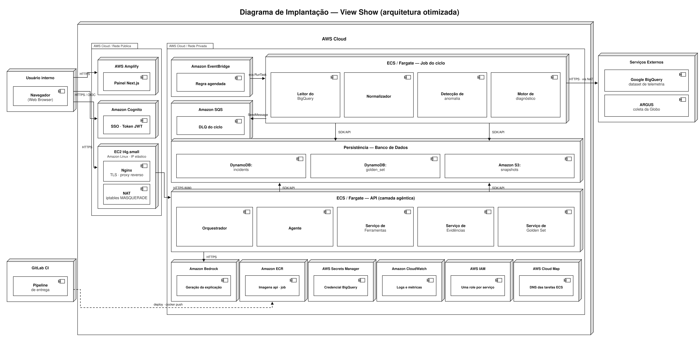
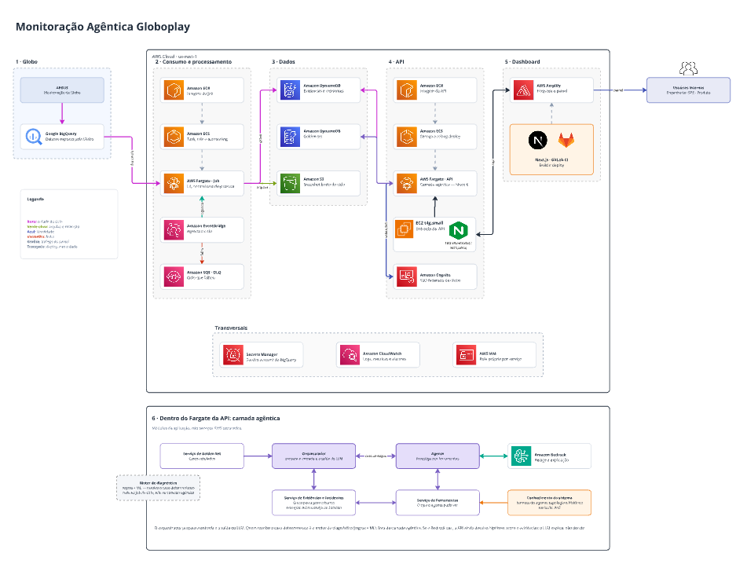
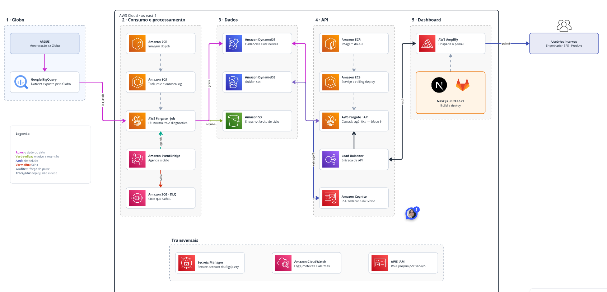
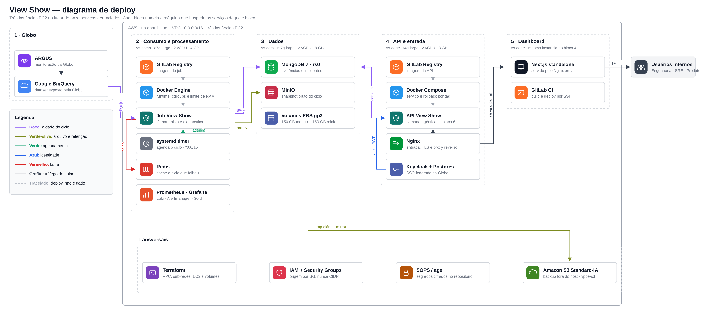

# Arquitetura da Solução — View Show

&emsp; **Projeto:** View Show — investigação automática de incidentes de qualidade
de experiência no Globoplay
&emsp; **Parceiro:** Grupo Globo
&emsp; **Turma / grupo:** Inteli · Módulo 7 · Grupo 05
&emsp; **Data:** 27 de agosto de 2026
&emsp; **Região AWS:** `us-east-1` (Norte da Virgínia)

> **Nota de evolução:** este documento registra a arquitetura discutida na
> Sprint 2 e permanece como evidência acadêmica do processo. A fonte técnica
> atual para desenvolvimento está em
> [`artefatos/arquitetura`](../arquitetura/README.md). Em caso de divergência,
> prevalecem os contratos mantidos naquela pasta.

---

## Sumário

- [0. Como ler este documento](#0-como-ler-este-documento)
- [1. Contexto e requisitos que governam a arquitetura](#1-contexto-e-requisitos-que-governam-a-arquitetura)
- [2. (a) Diagramas de implantação](#2-a-diagramas-de-implantação)
  - [2.1 Diagrama de implantação UML — visão oficial](#21-diagrama-de-implantação-uml--visão-oficial)
  - [2.2 Diagrama de infraestrutura AWS — visão por fluxo](#22-diagrama-de-infraestrutura-aws--visão-por-fluxo)
  - [2.3 Como os dois diagramas se relacionam](#23-como-os-dois-diagramas-se-relacionam)
- [3. (b) Descrição dos nós, componentes e conexões](#3-b-descrição-dos-nós-componentes-e-conexões)
  - [3.1 Nós de implantação](#31-nós-de-implantação)
  - [3.2 Componentes de software](#32-componentes-de-software)
  - [3.3 Conexões: protocolo, porta, direção e autenticação](#33-conexões-protocolo-porta-direção-e-autenticação)
  - [3.4 Modelo de dados e por que ele aparece na arquitetura](#34-modelo-de-dados-e-por-que-ele-aparece-na-arquitetura)
- [4. (c) Justificativa da arquitetura e das tecnologias](#4-c-justificativa-da-arquitetura-e-das-tecnologias)
  - [4.1 O estilo arquitetural: por que não são microsserviços](#41-o-estilo-arquitetural-por-que-não-são-microsserviços)
  - [4.2 Decisões, uma a uma](#42-decisões-uma-a-uma)
- [5. O processo: três arquiteturas avaliadas](#5-o-processo-três-arquiteturas-avaliadas)
- [6. Análise financeira na AWS Pricing Calculator](#6-análise-financeira-na-aws-pricing-calculator)
- [7. Os testes de carga e o que eles mudaram](#7-os-testes-de-carga-e-o-que-eles-mudaram)
- [8. Uma decisão revertida por medição](#8-uma-decisão-revertida-por-medição)
- [9. (d) Plano de deploy detalhado com recursos AWS](#9-d-plano-de-deploy-detalhado-com-recursos-aws)
- [10. Riscos, dívidas técnicas e trabalho futuro](#10-riscos-dívidas-técnicas-e-trabalho-futuro)
- [11. Rastreabilidade: requisito ↔ decisão de arquitetura](#11-rastreabilidade-requisito--decisão-de-arquitetura)
- [12. Referências](#12-referências)

---

## 0. Como ler este documento

&emsp; Este artefato documenta **o processo inteiro** de definição da arquitetura
do View Show, e não apenas o desenho final. Isso é deliberado: a arquitetura que
entregamos é diferente da que projetamos no início, e **cada mudança tem uma
medição por trás**. Documentar só o resultado esconderia justamente a parte mais
defensável do trabalho.

&emsp; A leitura mínima, para quem quer apenas o desenho:

| Se você quer… | Vá para |
| --- | --- |
| Ver o sistema desenhado | [§2 — diagramas](#2-a-diagramas-de-implantação) |
| Saber o que cada caixa faz | [§3 — descrição dos nós](#3-b-descrição-dos-nós-componentes-e-conexões) |
| Entender por que essas tecnologias | [§4 — justificativas](#4-c-justificativa-da-arquitetura-e-das-tecnologias) |
| Saber como se coloca isso no ar | [§9 — plano de deploy](#9-d-plano-de-deploy-detalhado-com-recursos-aws) |
| Acompanhar como chegamos aqui | [§5 a §8 — o processo](#5-o-processo-três-arquiteturas-avaliadas) |

### 0.1 Vocabulário mínimo

&emsp; Este documento é escrito para ser lido por alguém que **não** conhece AWS.
Os termos abaixo aparecem o tempo todo e são definidos aqui uma única vez.

| Termo | O que significa, em uma frase |
| --- | --- |
| **Contêiner** | Um pacote que contém a aplicação e tudo de que ela precisa para rodar. Roda igual em qualquer máquina, o que elimina o "na minha máquina funciona". |
| **Imagem** | O molde congelado de um contêiner, guardado num repositório. Cada versão publicada é uma imagem nova. |
| **Serverless** | Modelo em que você não administra o servidor: entrega o contêiner e a nuvem decide onde executá-lo. Você paga pelo tempo de execução, não pela máquina. |
| **VPC** | *Virtual Private Cloud* — a rede privada da aplicação dentro da AWS. Tudo que criamos vive dentro dela. |
| **Sub-rede pública / privada** | Pública tem caminho direto para a internet; privada não. Bancos e processadores ficam na privada. |
| **NAT** | Tradutor que deixa uma máquina da rede privada **sair** para a internet sem ficar acessível **de fora**. |
| **Load balancer** | Porta de entrada que recebe as requisições e as distribui entre as instâncias da aplicação. |
| **IAM** | O sistema de permissões da AWS. Define quem (ou qual serviço) pode fazer o quê. |
| **Nó de implantação** | Em UML, uma máquina ou ambiente de execução. Desenhado como caixa tridimensional. |
| **Componente** | Em UML, uma peça de software que roda dentro de um nó. Desenhado com o ícone de duas abas. |

### 0.2 Documentos relacionados

| Documento | O que contém |
| --- | --- |
| [`requisitos.md`](../sprint1/requisitos.md) | Os requisitos funcionais (RF) e não funcionais (RNF) citados aqui |
| [`testes-desempenho.md`](./testes-desempenho.md) | O relatório completo dos testes de carga resumidos na §7 |
| [`deploy-aws.md`](./deploy-aws.md) | O roteiro manual de implantação usado na Sprint 1 |
| [`decisoes.md`](./decisoes.md) | Registro cronológico de decisões técnicas menores |
| [`backend-sprint-2.md`](./backend-sprint-2.md) | Detalhamento da API e da camada agêntica |

---

## 1. Contexto e requisitos que governam a arquitetura

### 1.1 O problema

&emsp; O Globoplay opera em milhões de dispositivos heterogêneos — Smart TVs de
vários fabricantes, celulares iOS e Android, navegadores, aparelhos legados. Quando
a qualidade de experiência degrada (travamentos, erros de reprodução, queda de
bitrate), a equipe de engenharia precisa descobrir **a causa raiz**, e não apenas
constatar o sintoma.

&emsp; Hoje esse diagnóstico é manual: um engenheiro correlaciona painéis de
telemetria de fontes diferentes (Prometheus, New Relic, NPAW, RPaaS), cada uma com
granularidade e latência próprias. O View Show automatiza essa correlação e propõe
um diagnóstico com evidências rastreáveis.

### 1.2 O dado de entrada, e uma premissa que tivemos de corrigir

&emsp; A fonte de dados é o **ARGUS**, sistema de monitoração da Globo, exposto ao
projeto como um dataset no **Google BigQuery**.

&emsp; Durante o dimensionamento, assumimos que o BigQuery seria atualizado a cada
15 minutos, e usamos essa frequência para dimensionar o job de ingestão. **Essa
premissa não tinha fonte.** Ao verificar o documento de especificação do dataset
(`DATASET.md`), encontramos duas coisas:

1. O que recebemos é um **snapshot único**, não um fluxo contínuo. O dataset é uma
   fotografia de um momento, congelada.
2. Os **15 minutos** existem no documento, mas são outra coisa: a **granularidade
   de agregação** de duas das fontes (`signal_bucket` e `rpaas_bucket`). As demais
   fontes têm granularidades diferentes — 1 minuto no Prometheus, de 5 minutos a
   1 hora no New Relic, 1 hora nas tabelas horárias do NPAW.

&emsp; Havia ainda um terceiro fato relevante: o NPAW apresenta **latência
estrutural de aproximadamente 28 horas** entre o evento e sua disponibilidade no
dataset.

> **Consequência para a arquitetura.** O ciclo de 15 minutos permanece como
> **decisão de projeto**, agora com justificativa explícita: é a menor
> granularidade em que as fontes principais podem ser alinhadas entre si. Não é uma
> propriedade herdada da fonte. Se o sistema for para produção com acesso ao banco
> real do ARGUS, essa cadência precisa ser renegociada com a Globo, e as tabelas com
> latência de 28 horas exigem tratamento separado — não faz sentido consultá-las a
> cada 15 minutos.

&emsp; Registramos esse episódio porque ele mudou o método de trabalho do grupo:
**toda premissa numérica passou a exigir fonte citável ou medição própria.** As
seções §6 e §7 são consequência direta dessa regra.

### 1.3 Os requisitos que efetivamente restringem o desenho

&emsp; Nem todo requisito tem impacto arquitetural. Os que têm:

| Requisito | Enunciado resumido | O que ele impõe à arquitetura |
| --- | --- | --- |
| **RNF01** | Escalar para picos de 50 milhões de eventos | Processamento **assíncrono**, desacoplado por fila; workers horizontalmente escaláveis |
| **RNF02** | Menos de 2 min entre captura e disponibilidade para consulta | Limita o tamanho do lote do ciclo e proíbe processamento em lote noturno |
| **RNF03** | Payload corrompido não pode parar o lote | Exige **fila de mensagens mortas** (DLQ) e isolamento por mensagem |
| **RNF04** | Acesso só via SSO, domínio corporativo Globo | Exige provedor de identidade federado; proíbe autenticação própria |
| **RNF05** | 30 dias em acesso rápido, 11 meses em acesso barato | Exige **duas camadas de armazenamento** com transição automática |
| **RNF06** | Serviços empacotados em contêineres independentes | Proíbe funções serverless proprietárias na camada de processamento |
| **RNF09** | Disponibilidade mínima de 99,9% | Restringe pontos únicos de falha; orçamento de 43 min de indisponibilidade/mês |
| **RNF12** | Cobertura mínima de testes de 70% | Exige pipeline de CI que bloqueia integração |
| **RNF14** | **p95 < 2 s** em busca filtrada | **É o critério de aceite dos testes de carga da §7** |
| **RNF15** | Degradação sinalizada em até 30 s | Exige métricas e alarmes na camada de observabilidade |

&emsp; **RNF06 e RNF09 são os dois que mais moldaram as decisões**, e puxam em
direções opostas: RNF06 empurra para contêineres portáveis (que podemos rodar em
qualquer lugar), RNF09 empurra para serviços gerenciados da AWS (que têm redundância
pronta e SLA contratual). A §5 é, no fundo, a negociação entre esses dois.

---

## 2. (a) Diagramas de implantação

&emsp; Apresentamos **dois** diagramas. Eles não são versões alternativas do mesmo
desenho: são projeções diferentes do mesmo sistema, e um responde o que o outro
não responde.

### 2.1 Diagrama de implantação UML — visão oficial

&emsp; Este é o diagrama de implantação no sentido estrito da UML: mostra **onde
cada software executa**. Nós de implantação (caixas tridimensionais) são ambientes
de execução; componentes (caixas com o ícone de duas abas) são as peças de software
hospedadas neles; pacotes aninhados são as fronteiras de rede.



<sub>Arquivo vetorial: [`05-deploy-otimizado.svg`](../../assets/arquitetura/05-deploy-otimizado.svg)</sub>

&emsp; **Como ler:**

- A caixa externa **`AWS Cloud`** delimita tudo que roda na nuvem. Fora dela, à
  esquerda, o navegador do usuário e o servidor de integração contínua; à direita,
  os sistemas externos que não controlamos.
- Dentro, dois pacotes: **`Rede Pública`** (alcançável da internet) e **`Rede
  Privada`** (sem rota de entrada vinda de fora). Essa separação é a principal
  fronteira de segurança do desenho.
- As setas sólidas são tráfego de execução, rotuladas com o protocolo. A seta
  tracejada `deploy · docker push` é publicação de artefato, não dado de operação.

&emsp; **O que este diagrama torna visível e o outro não:** que o `Nginx` e o
`NAT` são **dois componentes na mesma máquina física**, e que a saída da rede
privada para a internet passa por ela. Numa visão por fluxo isso desapareceria.

### 2.2 Diagrama de infraestrutura AWS — visão por fluxo

&emsp; Este diagrama organiza os mesmos elementos por **etapa do processo**, e
colore as setas por natureza do que trafega. Ele responde "por onde o dado passa,
em que ordem" — pergunta que o diagrama UML não responde bem.



<sub>Arquivo vetorial: [`04-aws-otimizada.svg`](../../assets/arquitetura/04-aws-otimizada.svg)</sub>

&emsp; **Os cinco blocos:**

| Bloco | Papel |
| --- | --- |
| **1 · Globo** | Fonte externa. O ARGUS alimenta um dataset no BigQuery, ao qual temos acesso de leitura. |
| **2 · Consumo e processamento** | O ciclo periódico: lê a janela de telemetria, normaliza, detecta anomalia, produz diagnóstico. |
| **3 · Dados** | Onde o resultado do ciclo é gravado e onde a API o lê. |
| **4 · API** | A camada agêntica que serve o dashboard, e a porta de entrada com autenticação. |
| **5 · Dashboard** | O painel Next.js e sua esteira de publicação. |
| **Transversais** | Serviços que atravessam todos os blocos: segredos, observabilidade, permissões. |

&emsp; **A legenda de cores é parte do diagrama**, não decoração: separar "o dado
do ciclo" (roxo) de "tráfego do painel" (grafite) e de "deploy" (tracejado) permite
verificar, visualmente, que **nenhuma seta roxa cruza a fronteira da rede pública**.
Essa é uma propriedade de segurança auditável no desenho.

### 2.3 Como os dois diagramas se relacionam

| | Diagrama UML (§2.1) | Diagrama AWS (§2.2) |
| --- | --- | --- |
| Pergunta que responde | *Onde cada software executa?* | *Por onde o dado passa?* |
| Organização | Por fronteira de rede | Por etapa do processo |
| Mostra bem | Colocalização, topologia de rede | Ordem, causalidade, natureza do tráfego |
| Esconde | A sequência temporal | Que dois componentes dividem máquina |

&emsp; Ambos descrevem **a mesma arquitetura**. As versões anteriores, anteriores
às otimizações da §5 a §8, estão preservadas em
[`01-aws-atual.png`](../../assets/arquitetura/01-aws-atual.png) e
[`02-deploy-atual.png`](../../assets/arquitetura/02-deploy-atual.png) para efeito de
comparação.

---

## 3. (b) Descrição dos nós, componentes e conexões

### 3.1 Nós de implantação

&emsp; Um **nó** é um ambiente de execução. A tabela descreve cada um, o que o
dimensiona e por que ele existe.

#### Fora da nuvem

| Nó | O que é | Dimensionamento | Por que existe |
| --- | --- | --- | --- |
| **Usuário interno** | Navegador em máquina corporativa da Globo | — | Único cliente do sistema. Não há aplicativo móvel nem acesso público. |
| **GitLab CI** | Executor de integração contínua | — | Constrói as imagens e publica. Não participa da operação. |
| **Serviços Externos** | Google BigQuery (dataset de telemetria) e ARGUS | Fora do nosso controle | Fonte do dado. O ARGUS alimenta o BigQuery; nós lemos o BigQuery. |

#### Rede pública

| Nó | O que é | Dimensionamento | Por que existe |
| --- | --- | --- | --- |
| **AWS Amplify** | Hospedagem gerenciada do painel Next.js, com CDN | 120 min de build/mês, 10 GB | Serve arquivos estáticos e a renderização do painel. Não guarda estado. |
| **Amazon Cognito** | Provedor de identidade federado | Camada gratuita + segurança avançada | Implementa o SSO exigido pelo **RNF04**. Emite o token JWT. |
| **EC2 `t4g.small`** | Instância Graviton (ARM), Amazon Linux, IP elástico | 2 vCPU · 2 GB · 20 GB EBS gp3 | Hospeda **dois** componentes: o Nginx (entrada) e o NAT (saída). Ver §5.4. |

#### Rede privada

| Nó | O que é | Dimensionamento | Por que existe |
| --- | --- | --- | --- |
| **Amazon EventBridge** | Agendador de eventos gerenciado | 1 regra, `cron(0/15 * * * ? *)` | Dispara o ciclo. Substitui um `cron` em máquina, que seria ponto único de falha. |
| **Amazon SQS · DLQ** | Fila de mensagens mortas | Retenção de 14 dias | Recebe o ciclo que falhou. É o mecanismo que atende ao **RNF03**. |
| **ECS / Fargate — Job do ciclo** | Tarefa efêmera, executada sob demanda | 0,25 vCPU · 0,5 GB · ~3 min · 96×/dia | Executa o ciclo inteiro e encerra. Não fica de pé entre execuções. |
| **Persistência** | DynamoDB (2 tabelas lógicas) + S3 | 20 GB DynamoDB, 115 GB S3 | Estado do sistema. Ver §3.4. |
| **ECS / Fargate — API** | Serviço de longa duração | 0,25 vCPU · 0,5 GB · 1 instância · porta 3000 | Serve o dashboard. É o componente medido nos testes de carga da §7. |
| **Transversais** | Bedrock, ECR, Secrets Manager, CloudWatch, IAM, Cloud Map | — | Ver tabela de componentes abaixo. |

### 3.2 Componentes de software

&emsp; Um **componente** é software executando dentro de um nó.

#### No nó `ECS / Fargate — Job do ciclo`

| Componente | Responsabilidade | Entrada → saída |
| --- | --- | --- |
| **Leitor do BigQuery** | Consulta a janela de telemetria da fonte | Intervalo de tempo → linhas brutas |
| **Normalizador** | Converte esquemas heterogêneos (Prometheus, New Relic, NPAW, RPaaS) num formato interno único | Linhas brutas → `signal_point` padronizado. É o que atende ao **RNF11** |
| **Detecção de anomalia** | Identifica desvios estatísticos na janela | `signal_point` → candidatos a incidente |
| **Motor de diagnóstico** | Correlaciona candidatos, agrupa em incidentes e reúne evidências | Candidatos → incidente com evidências rastreáveis |

&emsp; Os quatro são **bibliotecas dentro do mesmo processo**, e não serviços
separados. A justificativa está na §4.1.

#### No nó `ECS / Fargate — API`

| Componente | Responsabilidade |
| --- | --- |
| **Orquestrador** | Recebe a requisição HTTP, valida o token, decide o caminho e monta a resposta |
| **Agente** | Camada agêntica: interpreta a pergunta do operador e escolhe as ferramentas |
| **Serviço de Ferramentas** | Catálogo de operações que o agente pode invocar (buscar incidente, buscar evidência, comparar janelas) |
| **Serviço de Evidências** | Lê e monta o pacote de evidências de um incidente. **É a rota `bundle` dos testes da §7** |
| **Serviço de Golden Set** | Lê e grava o conjunto curado de casos de referência usado para avaliar o diagnóstico |

#### Na EC2 `t4g.small`

| Componente | Responsabilidade | Configuração relevante |
| --- | --- | --- |
| **Nginx** | Termina o TLS e faz proxy reverso para a API na rede privada | Precisa da diretiva `resolver` com TTL curto — ver §3.3, nota sobre descoberta de serviço |
| **NAT** | Permite que a rede privada saia para a internet | `iptables -t nat -A POSTROUTING -o eth0 -j MASQUERADE`, com `source/dest check` desabilitado na interface |

#### Transversais

| Componente | Responsabilidade | Nota |
| --- | --- | --- |
| **Amazon Bedrock** | Geração da explicação em linguagem natural | Modelo `anthropic.claude-3-haiku-20240307-v1:0`. **Estava desativado (`BEDROCK_ENABLED=false`) durante os testes de carga** — sua latência não foi medida |
| **Amazon ECR** | Repositório das imagens de contêiner | Duas imagens: `api` e `job` |
| **AWS Secrets Manager** | Guarda a credencial de service account do BigQuery e outros 4 segredos | Nenhum segredo em variável de ambiente do repositório |
| **Amazon CloudWatch** | Logs, métricas e alarmes | É a fonte das medições da §7. Atende ao **RNF15** |
| **AWS IAM** | Uma role por serviço, com permissão mínima | O job não tem permissão de escrita na tabela da API, e vice-versa |
| **AWS Cloud Map** | DNS interno das tarefas ECS | **Existe por causa da substituição do load balancer.** Ver a nota abaixo |

> **Por que o Cloud Map entrou no desenho.** O Application Load Balancer resolvia
> descoberta de serviço de graça e de forma invisível: o próprio ECS registrava e
> desregistrava as tarefas no *target group* a cada publicação. Ao substituí-lo por
> um Nginx numa EC2, esse mecanismo desaparece. E no modo de rede `awsvpc` cada
> tarefa Fargate nasce com um IP privado novo — então um `proxy_pass` para um IP
> fixo funciona até a próxima publicação e depois aponta para um endereço morto.
> O Cloud Map registra as tarefas num nome DNS estável (`api.viewshow.local`), que o
> Nginx resolve com TTL curto. **É a única peça nova que a substituição exige**, e
> custa menos de US$ 1/mês.

### 3.3 Conexões: protocolo, porta, direção e autenticação

| # | Origem → Destino | Protocolo · porta | Autenticação | Observação |
| --- | --- | --- | --- | --- |
| 1 | Navegador → AWS Amplify | HTTPS 443 | — | Entrega do painel (HTML, JS, CSS) |
| 2 | Navegador → Amazon Cognito | HTTPS 443 (OIDC) | Domínio corporativo Globo | Fluxo de login; devolve o JWT |
| 3 | Navegador → Nginx (EC2) | HTTPS 443 | `Authorization: Bearer <JWT>` | Todas as chamadas de API do painel |
| 4 | Nginx → Fargate API | HTTP 3000 | — (tráfego interno da VPC) | Resolve o destino via Cloud Map |
| 5 | Fargate API → Cognito | HTTPS 443 | — | Valida a assinatura do JWT. **A validação está na aplicação, não na porta de entrada** |
| 6 | EventBridge → ECS | API AWS (`ecs:RunTask`) | Role IAM da regra | Dispara o job a cada 15 min |
| 7 | Fargate Job → BigQuery | HTTPS 443 | Service account (Secrets Manager) | **Sai pela rede privada através do NAT** |
| 8 | Fargate Job → DynamoDB | HTTPS 443 (SDK) | Role IAM da tarefa | Grava incidentes e evidências |
| 9 | Fargate Job → S3 | HTTPS 443 (SDK) | Role IAM da tarefa | Arquiva o snapshot bruto do ciclo |
| 10 | Fargate Job → SQS | HTTPS 443 (`SendMessage`) | Role IAM da tarefa | Só em caso de falha (**RNF03**) |
| 11 | Fargate API → DynamoDB | HTTPS 443 (SDK) | Role IAM da tarefa | Leitura de incidentes; leitura e escrita do golden set |
| 12 | Fargate API → Bedrock | HTTPS 443 (SDK) | Role IAM da tarefa | Geração da explicação. Desativado nos testes |
| 13 | GitLab CI → ECR | HTTPS 443 (`docker push`) | Credencial de CI | Publicação de artefato, não tráfego de operação |
| 14 | Fargate Job → NAT (EC2) | rota `0.0.0.0/0` | — | Caminho de saída da rede privada |

&emsp; **Propriedade que o desenho garante:** não existe conexão cujo destino seja
um nó da rede privada e cuja origem esteja fora da VPC. As únicas portas expostas à
internet são a 443 do Nginx, a do Amplify e a do Cognito — as três na rede pública.

### 3.4 Modelo de dados e por que ele aparece na arquitetura

&emsp; O DynamoDB é um banco de chave composta. Cada registro tem uma **chave de
partição** (`pk`, "em qual gaveta o registro está") e uma **chave de ordenação**
(`sk`, "em que posição da gaveta"). Consultas eficientes buscam dentro de uma gaveta,
filtrando por prefixo do `sk`.

&emsp; O sistema usa **projeto de tabela única**: incidentes, evidências e hipóteses
convivem na mesma tabela, distinguidos pelo prefixo do `sk`. A partição é um
**balde de hora** — todos os incidentes de uma mesma hora ficam na mesma gaveta.

| Entidade | `pk` | `sk` |
| --- | --- | --- |
| Incidente | balde de hora | `INCIDENT#<id>` |
| Evidência | balde de hora | `INCIDENT#<id>#EVIDENCE#001` |
| Hipótese | balde de hora | `INCIDENT#<id>#HYPOTHESIS#0000000001` |

&emsp; **Esse esquema é a causa do defeito encontrado nos testes de carga.** Os
três prefixos começam com `INCIDENT#`, então a consulta que lista incidentes lê
também todas as evidências e hipóteses, e descarta o excedente em memória. A §7
mede o custo disso; a §8 mostra a correção.

&emsp; O modelo de dados aparece neste documento de arquitetura porque, neste
sistema, **ele é uma decisão arquitetural e não de implementação**: define o custo
de cada consulta, o consumo de capacidade do banco e, por consequência, o
dimensionamento de toda a camada de API.

---

## 4. (c) Justificativa da arquitetura e das tecnologias

### 4.1 O estilo arquitetural: por que não são microsserviços

&emsp; O sistema é composto por **dois serviços** — um job em lote e uma API — que
compartilham o mesmo banco. Isso **não é** uma arquitetura de microsserviços, e a
escolha foi deliberada.

&emsp; Microsserviços resolvem um problema específico: permitir que **equipes
diferentes evoluam e publiquem partes do sistema independentemente**. O preço é
alto — rede entre componentes que antes eram chamadas de função, consistência
eventual entre bancos separados, rastreamento distribuído para depurar, e uma
esteira de publicação por serviço.

&emsp; **As condições que justificariam pagar esse preço não existem aqui:**

| Condição para microsserviços | Situação do View Show |
| --- | --- |
| Múltiplas equipes publicando em ritmos diferentes | Uma equipe, seis pessoas, publicação conjunta |
| Partes com perfis de escala muito diferentes | Só duas, e já estão separadas |
| Necessidade de tecnologias diferentes por domínio | Node.js em ambas |
| Domínios com fronteiras estáveis e bem conhecidas | Domínio em descoberta; fronteiras ainda mudam a cada sprint |

&emsp; Fragmentar o motor de diagnóstico em quatro serviços — leitor, normalizador,
detector, diagnosticador — converteria quatro chamadas de função em quatro chamadas
de rede, cada uma com latência, falha parcial e necessidade de repetição. **O
RNF02 dá 2 minutos de orçamento ponta a ponta**; gastá-lo em serialização entre
componentes que sempre executam em sequência, no mesmo ciclo, seria desperdício.

&emsp; **O que de fato adotamos** é o que a literatura de arquitetura *cloud native*
chama de decomposição por perfil de execução, e não por domínio de negócio
(Hassan, 2024; Newman, 2021):

| Serviço | Perfil de execução | Por que está separado |
| --- | --- | --- |
| **Job do ciclo** | Efêmero, agendado, uso intenso e curto de CPU | Escala por frequência do ciclo. Falhar não derruba o dashboard |
| **API** | Longa duração, uso constante e leve, sensível a latência | Escala por número de usuários. Publicar não interrompe o ciclo |

&emsp; **Essa separação é a que importa**, e ela é confirmada pela medição: nos
testes da §7, a API saturou em 99,93% de CPU enquanto o job seguiu rodando
normalmente. **O isolamento funcionou.** Uma arquitetura monolítica única teria
derrubado a ingestão junto com a consulta.

&emsp; Os quatro componentes internos do job (§3.2) são **módulos com fronteiras
explícitas**, comunicando-se por interfaces definidas. Se um deles vier a precisar
de escala própria — o motor de diagnóstico, quando o modelo de linguagem for
ativado, é o candidato natural —, ele pode ser extraído para um serviço separado
sem reescrever os outros três. **O desenho preserva essa opção sem pagar por ela
antecipadamente.**

### 4.2 Decisões, uma a uma

&emsp; Cada decisão abaixo segue o mesmo formato: a escolha, o requisito que a
motiva, as alternativas descartadas e o custo que ela impõe.

#### D1 · Contêineres em ECS/Fargate, não funções serverless

| | |
| --- | --- |
| **Escolha** | Empacotar job e API como imagens de contêiner, executadas em ECS com capacidade Fargate |
| **Requisito** | **RNF06** exige contêineres independentes, executáveis sem hardware específico |
| **Alternativa descartada** | **AWS Lambda.** Seria mais barato para o job (execução curta e esporádica), mas o limite de 15 minutos por invocação é rígido e o modelo de empacotamento é proprietário — o que viola frontalmente o RNF06 |
| **Alternativa descartada** | **EC2 com Docker Engine.** Mais barato em escala alta, mas exige administrar sistema operacional, atualizações e reinício de contêiner |
| **Custo aceito** | Fargate cobra por vCPU-segundo e GB-segundo, mais caro por unidade que EC2 reservada. Ver §6 |
| **Ganho de portabilidade** | A mesma imagem roda em ECS, em Kubernetes ou em `docker run`. Migrar de nuvem é reescrever a definição de tarefa, não a aplicação |

#### D2 · DynamoDB como banco operacional

| | |
| --- | --- |
| **Escolha** | DynamoDB em modo sob demanda, projeto de tabela única |
| **Requisito** | **RNF01** (escala sem provisionamento antecipado), **RNF05** (expiração automática por TTL) |
| **Por que serve** | O padrão de acesso é conhecido e estreito: buscar por janela de tempo. Não há consulta relacional livre. O TTL nativo implementa a política de retenção do RNF05 sem código |
| **Alternativa descartada** | **PostgreSQL (RDS).** Mais expressivo em consulta, mas exige dimensionar instância, e a instância mínima com alta disponibilidade custa mais que o DynamoDB no volume do projeto |
| **Alternativa descartada** | **MongoDB em EC2.** Avaliada seriamente e **rejeitada por medição** — ver §8 |
| **Custo aceito** | Consultas fora do padrão previsto são caras ou impossíveis. Mudança de padrão de acesso pode exigir índice novo ou remodelagem |
| **Armadilha encontrada** | O projeto de tabela única exige **disciplina rigorosa nos prefixos de chave**. Falhamos nisso, e a §7 mede o preço |

#### D3 · EventBridge + SQS, não `cron` em máquina

| | |
| --- | --- |
| **Escolha** | Agendamento por regra do EventBridge; falha de ciclo enviada a uma fila SQS |
| **Requisito** | **RNF03** (isolamento de falha), **RNF09** (disponibilidade) |
| **Por que serve** | Um `cron` numa máquina é ponto único de falha: se a máquina cai, o ciclo silenciosamente para de rodar. O EventBridge é gerenciado e redundante. A DLQ garante que um ciclo falho seja **retido e inspecionável**, não perdido |
| **Alternativa descartada** | **`systemd timer` numa EC2.** Funciona, é gratuito, e foi o que a arquitetura autoprovisionada da §5 propôs — mas reintroduz o ponto único de falha |
| **Custo aceito** | Praticamente zero: a regra do EventBridge está na camada gratuita |

#### D4 · Cognito para identidade

| | |
| --- | --- |
| **Escolha** | Amazon Cognito como provedor de identidade federado |
| **Requisito** | **RNF04** — acesso só via SSO, restrito ao domínio corporativo |
| **Por que serve** | Federa com o provedor de identidade da Globo. Nós **nunca custodiamos senha**, o que remove uma classe inteira de risco do escopo do projeto |
| **Alternativa descartada** | **Keycloak em EC2.** Sem custo de licença, mas exige administrar o serviço e um Postgres de apoio, para uma função em que uma falha é uma falha de segurança |
| **Custo aceito** | US$ 0,45/mês. Acoplamento à AWS, mitigado por o Cognito falar OIDC padrão |
| **Fato relevante para a §5** | A validação do JWT está **na aplicação**, não na porta de entrada. Por isso trocar o load balancer não afeta a identidade |

#### D5 · Next.js no Amplify

| | |
| --- | --- |
| **Escolha** | Painel em Next.js, hospedado no AWS Amplify |
| **Requisito** | **RNF07** — carregamento em menos de 30 s |
| **Por que serve** | O Amplify entrega build, CDN, certificado TLS e publicação por *branch* numa configuração só. Para um painel interno com dezenas de usuários, administrar isso à mão não se paga |
| **Alternativa descartada** | **S3 + CloudFront.** Um pouco mais barato, bastante mais configuração |
| **Custo aceito** | US$ 1,43/mês |

#### D6 · Bedrock para a explicação em linguagem natural

| | |
| --- | --- |
| **Escolha** | Amazon Bedrock, modelo Claude 3 Haiku |
| **Requisito** | **RNF10** — operador chega à causa raiz em até 5 cliques |
| **Por que serve** | O diagnóstico estruturado é produzido por regras determinísticas; o modelo apenas **redige a explicação** a partir das evidências já reunidas. Isso limita o escopo do erro possível: o modelo não decide o diagnóstico, ele o narra |
| **Alternativa descartada** | **API externa de LLM.** Sairia da VPC e exigiria enviar dado do parceiro para fora do perímetro AWS |
| **Custo aceito** | **Não modelado na §6.** Estimativa de ordem de US$ 2/mês, mas escala com uso humano e não com o ciclo. É uma lacuna reconhecida |

#### D7 · Rede privada com saída controlada

| | |
| --- | --- |
| **Escolha** | Job, API e banco em sub-rede privada; saída para a internet apenas pelo NAT |
| **Requisito** | **RNF04** (confidencialidade), **RNF09** (superfície de ataque) |
| **Por que serve** | O job precisa **sair** (para o BigQuery) mas nunca precisa ser **alcançado**. A sub-rede privada com NAT expressa exatamente isso |
| **Custo aceito** | O NAT Gateway gerenciado custa **US$ 39,60/mês** — o terceiro maior item da conta, para uma função que é essencialmente roteamento. É exatamente esse número que motiva a otimização da §5.4 |

---

## 5. O processo: três arquiteturas avaliadas

&emsp; A arquitetura das §2 a §4 é a **terceira** que o grupo desenhou. As duas
anteriores não foram descartadas por engano de projeto — foram descartadas porque
medimos, e a medição contrariou a intuição. Esta seção documenta as três.

### 5.1 Arquitetura A — totalmente gerenciada



&emsp; A primeira proposta: todo componente de infraestrutura é um serviço
gerenciado da AWS. Onze serviços no total.

| Vantagem | Desvantagem |
| --- | --- |
| Nenhuma administração de sistema operacional | Custo por unidade mais alto |
| Alta disponibilidade e SLA contratual por padrão | Acoplamento forte ao provedor |
| Publicação e reversão prontas | Preço difícil de prever antes de medir |
| Permissões granulares por serviço, nativas | — |

&emsp; **Esta é a arquitetura que estava efetivamente no ar**, e é a que foi
submetida à calculadora (§6) e aos testes de carga (§7).

### 5.2 Arquitetura B — autoprovisionada



<sub>Arquivo vetorial: [`03-alternativa-autoprovisionada.svg`](../../assets/arquitetura/03-alternativa-autoprovisionada.svg)</sub>

&emsp; A hipótese oposta: **trazer a administração para dentro**, substituindo os
serviços gerenciados por equivalentes de código aberto em três instâncias EC2.

| Serviço gerenciado | Substituto autoprovisionado | Máquina |
| --- | --- | --- |
| DynamoDB | MongoDB 7 em conjunto de réplica de um membro | `vs-data` · `m7g.large` |
| Amazon S3 | MinIO | `vs-data` |
| Application Load Balancer | Nginx | `vs-edge` · `t4g.large` |
| Amazon Cognito | Keycloak + PostgreSQL | `vs-edge` |
| Amazon SQS | Redis Streams | `vs-batch` · `c7g.large` |
| Amazon EventBridge | `systemd timer` | `vs-batch` |
| Amazon CloudWatch | Prometheus + Grafana + Loki | `vs-batch` |
| Amazon ECR | GitLab Registry | todas |
| ECS / Fargate | Docker Engine + Docker Compose | todas |

&emsp; **Por que foi descartada.** Três razões, em ordem de peso:

1. **A economia não se materializou onde importava.** Ver §8: o MongoDB numa EC2
   sai *mais caro* que o DynamoDB, uma vez corrigidos os defeitos de código.
2. **O conjunto de réplica de um membro é uma ficção de alta disponibilidade.** Ele
   dá acesso ao *oplog* (necessário para recuperação a ponto no tempo), mas não
   sobrevive à perda da instância. Contra o **RNF09**, é uma regressão.
3. **O custo real é humano, não financeiro.** Nove serviços autoadministrados
   significam atualizações de segurança, backup, monitoramento do próprio
   monitoramento, e rotina de recuperação de desastre — para uma equipe de seis
   pessoas em dez semanas.

&emsp; **O que sobreviveu dela:** a ideia de que **alguns** serviços gerenciados
não valem o preço. Não todos. A §5.4 aplica esse critério com disciplina.

### 5.3 A tentativa intermediária, e por que também falhou

&emsp; Uma versão híbrida foi considerada: manter os blocos de consumo e
processamento gerenciados, substituindo apenas o DynamoDB por MongoDB.

&emsp; **O problema é de coerência de plataforma.** O Fargate tem preço melhor
quando todo o conjunto está nele — a tarefa do job e a da API compartilham a mesma
definição de cluster, o mesmo registro de imagens e a mesma esteira de publicação.
Trocar só o banco por uma EC2 significa manter as duas disciplinas operacionais ao
mesmo tempo (definição de tarefa **e** administração de máquina) sem eliminar
nenhuma das duas. É o pior dos dois mundos.

### 5.4 Arquitetura C — otimizada, com um critério explícito

&emsp; A arquitetura final aplica uma regra que o grupo formulou depois de ver os
números da §6:

> **Só substitui-se um serviço gerenciado quando ele é caro *e* a substituição é
> simples. Onde o custo já é mínimo, o trabalho de trocar não se paga.**

&emsp; Aplicando o critério item a item, sobre o orçamento medido de US$ 211,07/mês
para 10 requisições por segundo:

| Item | Custo/mês | Vale trocar? | Decisão |
| --- | ---: | --- | --- |
| DynamoDB | 93,98 | **Não é problema de serviço, é de código** | Corrigir a chave (§8). Mantém DynamoDB |
| Fargate API | 45,05 | Não — é o núcleo do RNF06 | Mantém |
| **NAT Gateway** | **39,60** | **Sim** — é roteamento puro, caro demais para a função | **Substituir** |
| **Load balancer** | **16,66** | **Sim** — na mesma máquina do NAT, sem custo adicional | **Substituir** |
| CloudWatch | 3,00 | Não — substituir custaria mais em administração | Mantém |
| S3 | 2,65 | Não | Mantém |
| Secrets Manager | 2,00 | Não — é segurança, e o custo é trivial | Mantém |
| Job Fargate | 1,80 | Não | Mantém |
| Amplify | 1,43 | Não | Mantém |
| ECR | 0,80 | Não | Mantém |
| IPv4 público | 3,65 | Não — é cobrança fixa, incontornável | Mantém |
| Cognito | 0,45 | Não — é segurança | Mantém |

&emsp; **Sobrou uma única substituição**, que unifica dois itens numa máquina só:

> `Application Load Balancer` + `NAT Gateway` → **uma EC2 `t4g.small` rodando Nginx
> (entrada) e `iptables MASQUERADE` (saída)**

&emsp; É essa a diferença entre os diagramas `01/02` e `04/05` da §2. **Um nó
mudou.** Tudo o mais permaneceu.

&emsp; **Por que essa substituição é defensável e as outras não eram:** Nginx e NAT
são as duas funções mais simples e mais bem compreendidas de toda a lista. Não
guardam estado, não têm banco de apoio, não custodiam segredo, e a configuração
cabe em duas dezenas de linhas. O risco de operá-las é qualitativamente diferente
do risco de operar um banco de dados ou um provedor de identidade.

---

## 6. Análise financeira na AWS Pricing Calculator

### 6.1 Como o exercício foi montado

&emsp; Modelamos a arquitetura A na **AWS Pricing Calculator**, em `us-east-1`, com
dois cenários de carga agrupados no mesmo orçamento:

| Cenário | Requisições por segundo | Racional |
| --- | ---: | --- |
| **Base** | 10 | Aproximadamente 77 engenheiros consultando o painel simultaneamente |
| **Estresse** | 50 | Cinco vezes a base, para ver quais itens escalam e quais são fixos |

&emsp; **Nota importante sobre a unidade.** Requisições por segundo **não** é o
mesmo que número de pessoas. O painel não faz atualização automática — verificamos
a ausência de `setInterval` e de `refetchInterval` no código do frontend. Cada
engenheiro gera cerca de **0,13 requisição por segundo** em uso ativo. O pico
realista da equipe da Globo está na faixa de **1,3 req/s**; os 10 req/s do cenário
base já embutem folga de quase 8 vezes.

&emsp; O ciclo de ingestão foi fixado em 15 minutos (96 execuções/dia), pela
justificativa da §1.2.

### 6.2 O resultado, e o que ele revela

**Orçamento final:** [`estimativa-final-10-e-50-req.pdf`](../../assets/arquitetura/custos/estimativa-final-10-e-50-req.pdf)

| Item | 10 req/s | 50 req/s | Escala com a carga? |
| --- | ---: | ---: | --- |
| Amazon DynamoDB | **93,98** | **434,48** | **Sim, linearmente** |
| AWS Fargate — API | 45,05 | 225,25 | Sim (1 → 5 instâncias) |
| NAT Gateway | 39,60 | 39,60 | **Não** |
| Application Load Balancer | 16,66 | 17,60 | Quase não |
| Amazon CloudWatch | 3,00 | 3,00 | Não |
| Amazon S3 | 2,65 | 2,65 | Não |
| AWS Secrets Manager | 2,00 | 2,00 | Não |
| AWS Fargate — Job | 1,80 | 1,80 | **Não** — depende do ciclo, não do usuário |
| AWS Amplify | 1,43 | 1,43 | Não |
| Amazon ECR | 0,80 | 0,80 | Não |
| *Subtotal do grupo* | *206,97* | *728,61* | |
| IPv4 público (compartilhado) | 3,65 | 3,65 | Não |
| Amazon Cognito (compartilhado) | 0,45 | 0,45 | Não |
| **Total mensal** | **US$ 211,07** | **US$ 732,71** | |
| **Total anual** | **US$ 2.532,84** | **US$ 8.792,52** | |

&emsp; **Três leituras que só o agrupamento por cenário permite fazer:**

1. **O DynamoDB é 45% da conta e cresce linearmente com o uso.** Isso é o oposto do
   esperado num sistema em que o volume de *escrita* é fixo (o ciclo grava sempre a
   mesma coisa, a cada 15 minutos). Um banco cujo custo cresce com a *leitura* nessa
   proporção indica leitura ineficiente. **Foi essa anomalia no orçamento que
   motivou o teste de carga da §7.**

2. **O job custa US$ 1,80 e não escala.** A camada de ingestão inteira — a parte
   arquiteturalmente mais complexa do sistema — é financeiramente irrelevante.
   Todo o custo está na consulta.

3. **US$ 56,26/mês (27% da conta base) é infraestrutura de rede pura** — NAT mais
   load balancer — que não processa regra de negócio nenhuma e quase não escala com
   a carga. É o alvo natural de otimização, e é o que a §5.4 ataca.

### 6.3 Quatro erros de modelagem, e o que cada um ensinou

&emsp; O orçamento acima é a **quarta** iteração. As três anteriores estão
arquivadas em `assets/arquitetura/custos/` porque cada erro é instrutivo.

| # | Erro cometido | Efeito | Correção |
| --- | --- | --- | --- |
| **1** | Fargate marcado como **"5 tarefas por dia"** em vez de **"5 por mês"** | 109.500 horas-tarefa; o item saltou para **US$ 1.370,25** | Corrigir a unidade do campo |
| **2** | Duração média de conexão do ALB informada em **300 minutos** | Derivou 18.000 conexões ativas → 6 LCU → **US$ 366,83** | Corrigir para **60 segundos** → US$ 17,60 |
| **3** | Bytes processados do ALB digitados com **vírgula decimal** (`2,3`) | O campo interpretou como zero, e o LCU foi calculado por outra dimensão | Digitar `2.3` com ponto, ou usar MB com número inteiro |
| **4** | Volume de leitura do DynamoDB informado **já convertido em RCU** | A calculadora converte de novo (item de 1 KB, leitura eventualmente consistente = meia RCU), **subestimando pela metade** | Informar o número **dobrado**: 1.366.000.000 em vez de 683.000.000 |

&emsp; O erro 4 merece destaque porque é o mais traiçoeiro: **produzia um resultado
plausível**. A estimativa era US$ 168,38/mês
([`iteracao-3`](../../assets/arquitetura/custos/iteracao-3-dynamodb-sem-dobrar.pdf)) —
um número perfeitamente crível, que ninguém questionaria. Só foi detectado ao
reconferir a definição de RCU na documentação da AWS.

&emsp; A trajetória das iterações:

| Iteração | 10 req/s | 50 req/s | O que estava errado |
| --- | ---: | ---: | --- |
| [1](../../assets/arquitetura/custos/iteracao-1-alb-superestimado.pdf) | 241,78 | 1.077,84 | ALB com duração de conexão de 300 min |
| [2](../../assets/arquitetura/custos/iteracao-2-alb-conexoes.pdf) | 240,32 | 893,88 | ALB ainda superestimado |
| [3](../../assets/arquitetura/custos/iteracao-3-dynamodb-sem-dobrar.pdf) | 168,38 | 869,00 | DynamoDB subestimado pela metade |
| **[4 — final](../../assets/arquitetura/custos/estimativa-final-10-e-50-req.pdf)** | **211,07** | **732,71** | — |

&emsp; **A lição metodológica:** uma calculadora de preços não valida a coerência
dos números que recebe. Ela responde exatamente o que foi perguntado, e uma unidade
errada num campo produz um resultado com aparência de autoridade. **Toda entrada
precisa ser reconferida contra a definição publicada da métrica.**

### 6.4 Projeção da arquitetura otimizada

&emsp; Os números abaixo são **projeção aritmética sobre o orçamento medido**, e
não uma nova simulação na calculadora. A derivação está explícita para poder ser
auditada.

**Passo 1 — correção do código (§8), cenário de 10 req/s**

```
DynamoDB atual                                   93,98
  ├─ armazenamento: 20 GB × US$ 0,25/GB           5,00   (fixo)
  └─ requisições                                 88,98
       ├─ leitura   (~90%, dominante)            80,08
       └─ escrita   (~10%)                        8,90

corrigindo a chave: leitura cai ~8×    80,08 → 10,01
DynamoDB projetado          5,00 + 10,01 + 8,90 = 23,91

Economia: 93,98 − 23,91 = 70,07/mês
Conta: 211,07 → ~141,00/mês
```

**Passo 2 — consolidação de rede (§5.4)**

```
Remove:  ALB                16,66
         NAT Gateway        39,60
                          ───────
                            56,26

Adiciona: EC2 t4g.small  US$ 0,0168/h × 730 h    12,26
          EBS gp3 20 GB                            1,60
          Route 53 zona privada + Cloud Map        0,60
                                                ───────
                                                  14,46

Economia líquida: 41,80/mês
Conta: ~141,00 → ~99,20/mês
```

| | Mensal | Anual |
| --- | ---: | ---: |
| Arquitetura A, como medida | US$ 211,07 | US$ 2.532,84 |
| + correção de código | ~US$ 141,00 | ~US$ 1.692,00 |
| + consolidação de rede | **~US$ 99,20** | **~US$ 1.190,40** |
| **Redução total** | **−53%** | **−US$ 1.342,44** |

### 6.5 A conclusão financeira mais importante deste documento

&emsp; Separando as duas otimizações:

| Otimização | Economia/mês | % da conta | Esforço | Risco operacional |
| --- | ---: | ---: | --- | --- |
| **Correção do código** | **70,07** | **33%** | ~2 linhas + repovoar a base | Nenhum |
| Consolidação de rede | 41,80 | 20% | Provisionar, configurar e operar uma EC2 | Real — ver §10 |

&emsp; **A maior economia da arquitetura não veio de trocar serviço nenhum. Veio de
corrigir duas linhas de código.**

&emsp; E os US$ 41,80/mês da consolidação equivalem, a US$ 1 ≈ R$ 5,50, a cerca de
**R$ 230/mês** — algo entre uma e duas horas de trabalho de um engenheiro. Se a
manutenção da EC2 consumir mais que isso por mês, **a substituição dá prejuízo em
dinheiro**.

&emsp; Mantemos a substituição assim mesmo, mas a justificativa honesta não é
financeira: é **portabilidade**. Um Nginx com configuração declarada em arquivo
roda em qualquer lugar — na Tsuru da própria Globo, num cluster Kubernetes, numa
máquina do laboratório. Um Application Load Balancer não sai da AWS. Isso serve ao
**RNF06**, e é um argumento arquitetural, não contábil.

---

## 7. Os testes de carga e o que eles mudaram

&emsp; Esta seção é um **resumo orientado a arquitetura**. O relatório completo, com
metodologia, conceitos e todas as rodadas, está em
[`testes-desempenho.md`](./testes-desempenho.md).

### 7.1 Por que testar antes de finalizar a arquitetura

&emsp; A ordem importa. O grupo estava prestes a dimensionar a arquitetura por
estimativa — quantos vCPU, quanto de memória, quanto de armazenamento — sem base
empírica nenhuma. **Números sem fonte dimensionam a máquina errada e depois a
calculadora confirma o erro com aparência de precisão.**

&emsp; Invertemos: medir primeiro, dimensionar depois.

### 7.2 O que foi medido

| Item | Valor |
| --- | --- |
| Alvo do teste | `monitoracao-api-service` (ECS Fargate), 0,25 vCPU · 0,5 GB, 1 instância |
| Ferramenta | k6 v2.2.0, modelo de chegada aberta |
| Origem | Instância EC2 em `us-east-1` — o teste da máquina local media **135 ms só de rede**, contra **1,4 ms** de dentro da região |
| Base de dados | 300 incidentes, 2.341 registros, gerados com semente fixa |
| Critério | **RNF14**: p95 < 2.000 ms, erro < 1% |


### 7.3 Os resultados

| Rodada | Contrato | p95 | Erro | Vazão |
| --- | ---: | ---: | ---: | ---: |
| Base vazia, 1 usuário | 77,63% | 208,7 ms | 0% | 11,39 req/s |
| **Com dados, 1 usuário** | 100% | **589,3 ms** | 0% | **3,84 req/s** |
| Carga alvo (137 req/s) | 8,19% | **60 s** | **91,90%** | 39,34 req/s |
| Repetição da anterior | 5,30% | 60 s | 94,76% | 41,48 req/s |

&emsp; **O achado central:**

> **800 usuários virtuais concluíram menos requisições por segundo (~3,2) do que um
> único usuário virtual (3,84).**

&emsp; Essa é a assinatura de saturação. O sistema já estava no limite com **um
cliente sequencial**; tudo acrescentado depois virou fila.

&emsp; **Capacidade medida: cerca de 4 requisições por segundo.** O alvo eram 137.
Fator de aproximadamente **34 vezes**.

### 7.4 O grupo de controle que localizou o defeito

&emsp; O teste incluiu uma rota que busca evidências de um incidente específico por
um caminho diferente das demais — a rota `bundle`. Ela funcionou como **grupo de
controle**.

| Rota | Base vazia | Com dados | Variação |
| --- | ---: | ---: | ---: |
| `bundle` — 1 consulta | 7,52 ms | **7,58 ms** | **praticamente igual** |
| `leve` — 2 consultas | 6,67 ms | 11,03 ms | 1,7× |
| `pesada` — 25 consultas | 105,35 ms | **399,78 ms** | **3,8×** |

&emsp; Se a lentidão fosse geral — sobrecarga de máquina, de rede ou do banco — o
`bundle` teria piorado junto. **Não piorou.** Isso descarta as três hipóteses de
infraestrutura de uma vez e localiza o problema numa rota específica.

&emsp; **Esse é o argumento metodológico mais importante do teste:** sem o grupo de
controle, o diagnóstico mais provável teria sido "a instância é pequena demais" — e
a resposta teria sido aumentar a máquina, multiplicando a conta sem resolver nada.

### 7.5 A causa, medida no servidor


| Medida | Valor |
| --- | ---: |
| Uso de processamento (pico) | **99,93%** de 0,25 vCPU |
| Volume de leitura no banco | **58.000 RCU/min** (~967/s) |
| Requisições recusadas pelo banco | **zero** |

&emsp; O banco atendeu tudo. **O volume pedido é que era anormal** — cerca de oito
vezes maior do que o resultado devolvido justificaria.

&emsp; A explicação está no modelo de dados da §3.4: os três tipos de registro
começam com o prefixo `INCIDENT#`, e a consulta que lista incidentes pede
"tudo que começa com `INCIDENT#`". **Cada consulta lê a gaveta inteira** —
incidentes, evidências e hipóteses — e descarta 87% em memória.

```
a chave de ordenação não distingue incidente de evidência
        ↓
a consulta traz a gaveta inteira        → 967 RCU/s          (medido)
        ↓
o servidor converte ~2.300 objetos      → CPU em 99,93%      (medido)
        ↓
a resposta sai com 135 KB, sem limite   → 7,1 MB em 30 s     (medido)
        ↓
a capacidade trava em ~4 req/s          → 3,84 req/s         (medido)
        ↓
sob 137 req/s: 91,9% de erro, p95 de 60 s                    (medido)
```

### 7.6 Um erro de medição que documentamos de propósito


&emsp; A primeira leitura do CloudWatch indicou **0,092% de CPU** — máquina ociosa —
durante uma rodada com 91,9% de falha. Contradição evidente, que levou
temporariamente a um diagnóstico errado (esgotamento de pool de conexões).

&emsp; Eram três erros encadeados:

| # | Erro | Consequência |
| --- | --- | --- |
| 1 | Métrica lida de **outro serviço** do mesmo cluster, de nome parecido | mediu-se máquina ociosa |
| 2 | Estatística em **média** de 5 min, em vez de **máximo** | pico de 3 min diluído (74% em vez de 99,93%) |
| 3 | Volume de leitura em **média** em vez de **soma** | apareceu como "3" em vez de 58.000 |

&emsp; **Cada leitura errada apontava para uma causa e uma recomendação
diferentes.** O erro só foi detectado ao cruzar a métrica do servidor com o
comportamento observado do cliente, que era incompatível com máquina ociosa.

&emsp; O registro está aqui porque a lição é arquitetural: **observabilidade mal
configurada não produz ausência de informação, produz informação falsa e
confiante.** Isso tem consequência direta para o **RNF15** — um alarme sobre a
métrica errada, com a estatística errada, nunca dispara.

### 7.7 O impacto na arquitetura

&emsp; O teste mudou três coisas neste documento:

1. **O dimensionamento deixou de ser palpite.** A instância de 0,25 vCPU não é
   subdimensionada — ela é suficiente **depois** da correção. Sem o teste,
   teríamos aumentado a máquina.
2. **O modelo de dados subiu de categoria.** Deixou de ser detalhe de implementação
   e passou a constar como decisão arquitetural (§3.4), porque define o custo de
   toda a camada de consulta.
3. **A anomalia de custo da §6.2 ganhou explicação.** O DynamoDB ser 45% da conta e
   escalar linearmente com a leitura é exatamente o que o defeito de chave produz.
   **O orçamento e o teste de carga apontavam para o mesmo problema por caminhos
   independentes.**

### 7.8 As correções

| # | Correção | Esforço | Ganho |
| --- | --- | --- | --- |
| **1** | Separar os prefixos: `EVIDENCE#…` e `HYPOTHESIS#…` em vez de `INCIDENT#…` | ~2 linhas + repovoar | ~8× menos leitura e processamento |
| **2** | Paginar a rota de listagem (limite + marcador de continuação) | médio | põe teto no tamanho da resposta |
| **3** | Aumentar a capacidade acima de 0,25 vCPU | configuração | **só depois de 1 e 2** |

&emsp; **A ordem importa.** As correções 1 e 2 são defeitos de projeto que nenhuma
quantidade de processamento resolve: o custo por requisição continua crescendo com
o período consultado. Aumentar a máquina antes apenas desloca o ponto de travamento
e multiplica a conta.

---

## 8. Uma decisão revertida por medição

&emsp; A proposta original de otimização, que abriu todo este trabalho, era:
**substituir o DynamoDB por um MongoDB hospedado numa EC2.**

&emsp; O raciocínio era intuitivo e, à primeira vista, correto: o DynamoDB era o
maior item da conta (US$ 93,98, 45%), cobrado por requisição. Uma EC2 tem preço
fixo. Substituir um custo variável alto por um custo fixo menor parecia
aritmeticamente óbvio.

### 8.1 Por que a intuição estava errada

&emsp; O erro está na premissa. **O DynamoDB não era caro porque o DynamoDB é caro.
Era caro porque a aplicação lia oito vezes mais do que precisava.**

&emsp; Um MongoDB numa EC2 executaria exatamente a mesma consulta ineficiente. A
diferença é que a ineficiência deixaria de aparecer na fatura e passaria a aparecer
como saturação de CPU da instância — **o mesmo problema, agora invisível até
alguém investigar.** O preço fixo teria escondido o defeito em vez de eliminá-lo.

### 8.2 A comparação, depois da correção

| | DynamoDB corrigido | MongoDB em EC2 |
| --- | ---: | ---: |
| Custo mensal | **~US$ 23,91** | ~US$ 28 (`m7g.large` + EBS) |
| Alta disponibilidade | Multi-AZ nativa | Conjunto de réplica de um membro — **não sobrevive à perda da instância** |
| Recuperação a ponto no tempo | Nativa, um clique | Exige *oplog* dimensionado e rotina de backup própria |
| Expiração automática (RNF05) | TTL nativo | Índice TTL — funciona, mas precisa ser monitorado |
| Atualização de segurança | Responsabilidade da AWS | Responsabilidade da equipe |
| Escala sob pico (RNF01) | Automática | Redimensionar instância, com indisponibilidade |

&emsp; **A opção autoprovisionada é mais cara e entrega menos garantias.**

### 8.3 A lição

&emsp; Registramos esta reversão porque ela é o eixo metodológico do trabalho:

> **A decisão de arquitetura que abriu este documento estava errada, e só a medição
> mostrou isso.** O item mais caro da fatura não era o serviço errado — era o código
> errado usando o serviço certo.

&emsp; A generalização: **antes de trocar um componente por ser caro, verifique se
ele está caro por culpa dele.** Otimizar infraestrutura para compensar código
ineficiente é a forma mais cara de resolver um problema barato.

---

## 9. (d) Plano de deploy detalhado com recursos AWS

&emsp; Esta seção descreve como a arquitetura da §2 é colocada no ar. O roteiro
manual usado na Sprint 1, com os comandos passo a passo, está em
[`deploy-aws.md`](./deploy-aws.md); aqui documenta-se o **plano de destino**.

### 9.1 Recursos a provisionar, por camada

#### Camada 1 — Rede (base de tudo)

| Recurso | Configuração | Observação |
| --- | --- | --- |
| VPC | `10.0.0.0/16` | Uma única VPC |
| Sub-redes públicas | `10.0.0.0/24`, `10.0.1.0/24` — duas AZ | Nginx/NAT e endpoints públicos |
| Sub-redes privadas | `10.0.10.0/24`, `10.0.11.0/24` — duas AZ | Tarefas Fargate |
| Internet Gateway | 1 | Anexado à VPC |
| EC2 `t4g.small` | Amazon Linux 2023, IP elástico | Nginx + NAT. **`source/dest check` desabilitado** — sem isso o NAT não funciona |
| Tabela de rotas privada | `0.0.0.0/0` → ENI da EC2 | Substitui a rota para o NAT Gateway |
| **VPC Gateway Endpoints** | S3 e DynamoDB | **Gratuitos.** Tiram esse tráfego do NAT — reduzem custo e latência |
| Cloud Map | Namespace privado `viewshow.local` | Registro DNS das tarefas ECS |

&emsp; **Ordem obrigatória:** a rede precisa existir antes de qualquer outra coisa.
Os *gateway endpoints* devem ser criados **antes** das tarefas, ou o tráfego de S3 e
DynamoDB passa pelo NAT desnecessariamente.

#### Camada 2 — Segurança e identidade

| Recurso | Configuração |
| --- | --- |
| Grupos de segurança | `sg-edge` (443 da internet), `sg-api` (3000 **apenas de `sg-edge`**), `sg-job` (sem entrada) |
| Cognito User Pool | Federação com o provedor da Globo; domínio corporativo obrigatório |
| Secrets Manager | 5 segredos, incluindo a service account do BigQuery |
| Roles IAM | Uma por serviço, permissão mínima — ver tabela abaixo |

| Role | Permissões |
| --- | --- |
| `role-job` | `dynamodb:PutItem`/`BatchWriteItem` na tabela; `s3:PutObject` no bucket; `sqs:SendMessage` na DLQ; `secretsmanager:GetSecretValue` |
| `role-api` | `dynamodb:Query`/`GetItem` (leitura) + escrita **apenas** no golden set; `bedrock:InvokeModel` |
| `role-eventbridge` | `ecs:RunTask` na definição do job; `iam:PassRole` |
| `role-execution` | Puxar imagem do ECR e escrever log no CloudWatch |

&emsp; **A separação de roles é o que implementa o isolamento do RNF03 no plano de
permissões:** o job não consegue corromper o que a API serve, e a API não consegue
sobrescrever o que o job produziu.

#### Camada 3 — Persistência

| Recurso | Configuração |
| --- | --- |
| Tabela DynamoDB | `monitoracao-operacional`, sob demanda, `pk`/`sk`, GSI `trace-index`, **TTL habilitado** |
| Bucket S3 | Snapshots brutos; **regra de ciclo de vida: Standard → Standard-IA aos 30 dias** (implementa o RNF05) |
| Fila SQS | DLQ do ciclo, retenção de 14 dias |

#### Camada 4 — Computação

| Recurso | Configuração |
| --- | --- |
| Repositórios ECR | `viewshow/api` e `viewshow/job`, com varredura de vulnerabilidade na publicação |
| Cluster ECS | `data-ingestion-cluster`, capacidade Fargate |
| Definição de tarefa — API | 0,25 vCPU · 0,5 GB · porta 3000 · rede `awsvpc` · sub-rede privada |
| Definição de tarefa — Job | 0,25 vCPU · 0,5 GB · sem porta exposta |
| Serviço ECS — API | Contagem desejada 1; publicação contínua (`minimumHealthyPercent: 100`, `maximumPercent: 200`); registrado no Cloud Map |
| Regra EventBridge | `cron(0/15 * * * ? *)` → `ecs:RunTask` do job |

#### Camada 5 — Entrega e observabilidade

| Recurso | Configuração |
| --- | --- |
| AWS Amplify | Conectado ao repositório; publicação automática na branch principal |
| Grupos de log | `/ecs/viewshow-api` e `/ecs/viewshow-job`, retenção de 30 dias |
| Alarmes CloudWatch | Ver §9.4 |

### 9.2 O pipeline de entrega

```
push na branch
      │
      ├─ 1. testes automatizados + cobertura        ── bloqueia se < 70% (RNF12)
      ├─ 2. build da imagem em ambiente limpo       ── valida o RNF06
      ├─ 3. varredura de vulnerabilidade da imagem
      ├─ 4. docker push → Amazon ECR                ── tag = hash do commit
      ├─ 5. registrar nova revisão da task definition
      ├─ 6. ecs update-service --force-new-deployment
      └─ 7. aguardar services-stable + verificar /health
```

&emsp; **A tag da imagem é o hash do commit, nunca `latest`.** Isso torna cada
publicação identificável e a reversão determinística.

&emsp; **Publicação sem interrupção:** com `minimumHealthyPercent: 100` e
`maximumPercent: 200`, o ECS sobe a tarefa nova, espera a verificação de saúde
passar, registra-a no Cloud Map e só então remove a antiga. **Nenhuma requisição
cai durante a publicação** — o que é necessário para o orçamento de 43 minutos/mês
do RNF09.

### 9.3 Procedimento de reversão

| Situação | Ação | Tempo estimado |
| --- | --- | --- |
| Publicação ruim da API | `ecs update-service` apontando para a revisão anterior | ~2 min |
| Publicação ruim do job | Corrigir a regra do EventBridge para a revisão anterior; o ciclo seguinte já usa | ≤ 15 min |
| Ciclo que falhou | Mensagem retida na DLQ; reprocessar após corrigir | manual |
| Dado corrompido no banco | Restaurar a ponto no tempo do DynamoDB | ~20 min |
| Perda da EC2 de borda | ASG `min=max=1` recria e reassocia o IP elástico | ~2–3 min |

&emsp; **A reversão da API é mais rápida que a do job por construção:** a API tem
uma tarefa de longa duração que pode ser substituída na hora, enquanto o job só
executa no próximo ciclo. Isso é aceitável porque uma falha de ciclo não é visível
ao usuário — o dashboard continua servindo o último resultado bom.

### 9.4 Monitoramento mínimo para produção

&emsp; Derivado diretamente dos erros da §7.6: **cada alarme especifica a
estatística**, porque a estatística errada não dispara.

| Alarme | Métrica · **estatística** | Limiar | Requisito |
| --- | --- | --- | --- |
| API saturada | `CPUUtilization` · **Maximum** | > 80% por 5 min | RNF14 |
| Leitura anômala | `ConsumedReadCapacityUnits` · **Sum** | > 10.000/min | detecta a regressão da §7.5 |
| Latência de consulta | `TargetResponseTime` · **p95** | > 2.000 ms | **RNF14** |
| Ciclo falhou | `ApproximateNumberOfMessagesVisible` (DLQ) · **Maximum** | ≥ 1 | **RNF03** |
| Ciclo não rodou | `FailedInvocations` (EventBridge) · **Sum** | ≥ 1 em 30 min | RNF02 |
| Disponibilidade | `HealthyHostCount` · **Minimum** | < 1 | **RNF09** |

&emsp; **O alarme de leitura anômala existe por causa deste documento.** Ele
detectaria a regressão do defeito da §7.5 antes que ela aparecesse na fatura ou no
tempo de resposta.

### 9.5 Sequência de implantação em ambiente novo

| Fase | O que | Depende de |
| --- | --- | --- |
| 1 | VPC, sub-redes, IGW, endpoints, EC2 de borda, tabelas de rota | — |
| 2 | Grupos de segurança, roles IAM, Cognito, Secrets Manager | Fase 1 |
| 3 | DynamoDB, S3 (com ciclo de vida), SQS, Cloud Map | Fase 2 |
| 4 | ECR, definições de tarefa, cluster, serviço da API | Fase 3 |
| 5 | Regra do EventBridge | Fase 4 |
| 6 | Amplify, grupos de log, alarmes | Fase 4 |
| 7 | Povoamento inicial e verificação ponta a ponta | Todas |

&emsp; **Verificação de aceite da implantação:**

```bash
# 1. a porta de entrada responde e o certificado é válido
curl -sSf https://<endereco>/health

# 2. a rede privada não é alcançável de fora
curl --max-time 5 http://<ip-privado-da-tarefa>:3000/health   # deve falhar

# 3. o ciclo executa e grava
aws events put-events --entries file://disparo-manual.json
aws dynamodb scan --table-name monitoracao-operacional --select COUNT

# 4. a saída pelo NAT funciona (o job alcança o BigQuery)
aws logs tail /ecs/viewshow-job --since 20m | grep -i bigquery

# 5. o desempenho atende ao RNF14
k6 run -e BASE_URL=https://<endereco> -e MODE=smoke consultas.js
```

&emsp; O passo 5 é o que impede que a regressão da §7 volte sem ser notada: **o
teste de carga passa a fazer parte do critério de aceite da implantação**, não
apenas de uma investigação pontual.

---

## 10. Riscos, dívidas técnicas e trabalho futuro

&emsp; Esta seção lista o que a arquitetura **não** resolve. Omiti-la produziria um
documento mais bonito e menos útil.

### 10.1 Riscos abertos

| # | Risco | Impacto | Mitigação proposta | Estado |
| --- | --- | --- | --- | --- |
| **R1** | **A EC2 de borda é ponto único de falha.** O SLA da AWS para instância individual é 99,5% — **abaixo do RNF09**, que exige 99,9% | Indisponibilidade total do painel | ASG `min=max=1` + reassociação do IP elástico no boot → recuperação em ~2–3 min, dentro do orçamento de 43 min/mês desde que os eventos sejam raros | **Aceito conscientemente.** Se o RNF09 for auditado com rigor, revisar |
| **R2** | **Certificado TLS.** Certificados do ACM são gratuitos e renovam sozinhos no ALB, mas **não podem ser exportados para EC2** | Expiração silenciosa → painel fora do ar | `certbot` com renovação automática, e alarme de dias restantes | **A implementar** |
| **R3** | **O defeito de chave da §7 ainda está no código.** A rodada `KEY_SCHEME=v2` foi preparada mas não executada | RNF14 não atendido; DynamoDB 4× mais caro que o necessário | Correções 1 e 2 da §7.8, seguidas de nova medição | **Aberto — maior prioridade** |
| **R4** | **A latência do Bedrock nunca foi medida.** Estava desativado durante todos os testes | O RNF14 pode não ser atendido com a explicação ativa | Repetir a rodada `pesada` com `BEDROCK_ENABLED=true` | **Aberto** |
| **R5** | **Mediana travada em 10.001 ms** em todas as rodadas de carga, inclusive na rota `bundle`, que faz uma única consulta. Valor constante assim sugere tempo limite configurado, não fila natural | Pode mascarar outro defeito | Rastrear a origem do tempo limite na cadeia Nginx → aplicação → SDK | **Aberto** |
| **R6** | **O Bedrock não está no orçamento da §6** | Subestimação da conta | Modelar por token, com base em uso real | **Aberto** |
| **R7** | **Dados de teste são sintéticos**, com identificadores sequenciais que concentram a leitura em poucas partições | O comportamento com dados bem distribuídos não foi avaliado | Repovoar com distribuição realista | **Aberto** |
| **R8** | **O Cloud Map é dependência nova e não testada.** Se o TTL do Nginx estiver mal configurado, o proxy aponta para tarefa morta após a publicação | Indisponibilidade após cada deploy | Testar publicação com o Nginx no ar antes de promover | **A validar** |

### 10.2 Dívidas técnicas assumidas

| Dívida | Por que foi assumida | Quando cobrar |
| --- | --- | --- |
| Sem paginação nas rotas de listagem | Não era visível com 4 incidentes na base | Antes de qualquer uso com dados reais |
| Sem escala automática na API | Uma instância bastava para o volume do projeto | Quando a base ultrapassar ~10 usuários simultâneos reais |
| Provisionamento manual, sem infraestrutura como código | Prazo de 10 semanas | Antes de replicar o ambiente |
| Uma única AZ efetiva na borda | Custo e simplicidade | Junto com R1 |
| Camada agêntica sem teste de carga próprio | Bedrock desativado | Junto com R4 |

### 10.3 Trabalho futuro, em ordem de valor

1. **Corrigir os prefixos de chave e paginar** (R3). É a maior economia
   documentada — US$ 70/mês, 33% da conta — e o único caminho para atender ao
   RNF14. Custa ~2 linhas de código.
2. **Medir a arquitetura corrigida.** Repetir as rodadas com `KEY_SCHEME=v2` e
   comparar contra a linha de base da §7.3. **Sem isso, os números da §6.4
   permanecem projeção.**
3. **Ativar o Bedrock e medir** (R4, R6).
4. **Escrever a infraestrutura como código** (Terraform ou CDK), tornando a §9
   executável em vez de descritiva.
5. **Executar o ponto de ruptura** com a rampa recalibrada de 1 a 20 req/s, para
   obter o joelho exato da curva de capacidade.

---

## 11. Rastreabilidade: requisito ↔ decisão de arquitetura

| Requisito | Como a arquitetura o atende | Evidência |
| --- | --- | --- |
| **RNF01** — 50M eventos | Ciclo assíncrono desacoplado; Fargate escala por contagem de tarefas; DynamoDB sob demanda sem provisionamento antecipado | §4.2 D1, D2 |
| **RNF02** — 2 min ponta a ponta | Ciclo de 15 min com execução de ~3 min; componentes do job no mesmo processo, sem custo de rede entre eles | §3.1, §4.1 |
| **RNF03** — isolamento de falha | DLQ no SQS; roles IAM separadas por serviço | §4.2 D3, §9.1 |
| **RNF04** — SSO domínio Globo | Cognito federado; validação de JWT na aplicação; rede privada sem entrada externa | §4.2 D4, §3.3 |
| **RNF05** — hot 30 d / cold 11 m | TTL no DynamoDB; ciclo de vida Standard → Standard-IA no S3 | §9.1 camada 3 |
| **RNF06** — contêineres portáveis | Imagens OCI em ECS/Fargate; **substituição do ALB por Nginx amplia a portabilidade** | §4.2 D1, §6.5 |
| **RNF07** — painel em < 30 s | Next.js no Amplify com CDN | §4.2 D5 |
| **RNF09** — 99,9% | Serviços gerenciados multi-AZ; publicação sem interrupção; **ressalva R1 sobre a EC2 de borda** | §9.2, §10.1 |
| **RNF11** — multi-plataforma | Componente Normalizador converte para `signal_point` | §3.2 |
| **RNF12** — cobertura 70% | Etapa 1 do pipeline bloqueia a integração | §9.2 |
| **RNF14** — **p95 < 2 s** | **Não atendido hoje.** Capacidade medida de ~4 req/s; causa identificada e correção especificada | **§7, R3** |
| **RNF15** — alerta em 30 s | Alarmes do CloudWatch com estatística explícita | §9.4 |

&emsp; **A linha do RNF14 é a mais importante desta tabela.** Ela declara um
requisito não atendido, com a causa medida, a correção especificada e o ganho
estimado. Um documento de arquitetura que afirmasse conformidade sem medição seria
menos honesto e menos útil.

---

## 12. Referências

### Documentação técnica consultada

| Fonte | Uso neste documento |
| --- | --- |
| AWS — *Amazon DynamoDB Developer Guide*, "Read consistency" e "Capacity units" | Definição de RCU e da conversão de leitura eventualmente consistente (§6.3, erro 4) |
| AWS — *Elastic Load Balancing pricing*, dimensões de LCU | Correção do cálculo de conexões ativas e bytes processados (§6.3, erros 2 e 3) |
| AWS — *AWS Fargate pricing* | Modelagem de vCPU-hora e GB-hora (§6.1) |
| AWS — *Amazon VPC pricing*, NAT Gateway e endpoints | Identificação do NAT como terceiro maior item e uso de gateway endpoints gratuitos (§9.1) |
| AWS — *EC2 On-Demand pricing*, família `t4g` | Projeção da §6.4, passo 2 |
| AWS — *Amazon ECS service discovery* / AWS Cloud Map | Necessidade do Cloud Map ao remover o ALB (§3.2) |
| AWS — *Service Level Agreements*, Amazon EC2 | SLA de 99,5% para instância individual, base do risco R1 |
| AWS — *ACM: services integrated with AWS Certificate Manager* | Impossibilidade de exportar certificado do ACM para EC2, base do risco R2 |
| Grafana Labs — *k6 documentation*, executores de chegada aberta | Montagem do teste da §7 |
| MongoDB — *Replica set oplog* / *Point-in-time recovery* | Avaliação da arquitetura B (§5.2, §8.2) |

### Bibliografia

- HASSAN, S. **Cloud Native Architecture Patterns.** 2024. — decomposição por
  perfil de execução, filas assíncronas entre ingestão e processamento, workers sem
  estado.
- NEWMAN, S. **Building Microservices.** 2ª ed. O'Reilly, 2021. — critérios para
  decidir *quando não* fragmentar um sistema; base do argumento da §4.1.
- RICHARDS, M.; FORD, N. **Fundamentals of Software Architecture.** O'Reilly, 2020.
  — registro de decisão de arquitetura e análise de trade-offs.

### Artefatos do projeto

| Artefato | Caminho |
| --- | --- |
| Requisitos funcionais e não funcionais | [`requisitos.md`](../sprint1/requisitos.md) |
| Relatório completo dos testes de desempenho | [`testes-desempenho.md`](./testes-desempenho.md) |
| Script de teste de carga | [`testes-carga/k6/consultas.js`](./testes-carga/k6/consultas.js) |
| Povoamento de carga | [`testes-carga/seed-carga.js`](./testes-carga/seed-carga.js) |
| Roteiro manual de implantação (Sprint 1) | [`deploy-aws.md`](./deploy-aws.md) |
| Registro cronológico de decisões | [`decisoes.md`](./decisoes.md) |
| Detalhamento do backend | [`backend-sprint-2.md`](./backend-sprint-2.md) |
| Diagramas (PNG e SVG) | [`../../assets/arquitetura/`](../../assets/arquitetura/) |
| Orçamentos exportados da calculadora | [`../../assets/arquitetura/custos/`](../../assets/arquitetura/custos/) |

---

## Conclusão

&emsp; A arquitetura do View Show é **majoritariamente gerenciada, com uma
substituição pontual**: uma instância EC2 que concentra as duas funções de rede
mais simples do sistema — entrada, com Nginx, e saída, com NAT. Os demais dez
serviços permanecem gerenciados, porque em cada caso o custo de administrá-los
superaria a economia.

&emsp; O caminho até aqui passou por duas arquiteturas que descartamos, quatro
iterações de orçamento e quatro rodadas de teste de carga. Três resultados merecem
ficar registrados:

&emsp; **Primeiro: a decisão que abriu este trabalho estava errada.** Substituir o
DynamoDB por MongoDB numa EC2 pareceu obviamente vantajoso enquanto o DynamoDB era
o maior item da fatura. Depois de medir, a substituição saiu mais cara e com menos
garantias — porque **o banco não era caro por culpa do banco**, mas de uma consulta
que lia oito vezes mais do que devolvia.

&emsp; **Segundo: a maior economia da arquitetura não é arquitetural.** Corrigir
dois prefixos de chave vale US$ 70 por mês, 33% da conta. Toda a consolidação de
infraestrutura vale US$ 42, e consome tempo de operação que a torna, em dinheiro,
aproximadamente neutra. A substituição do load balancer permanece no desenho por
**portabilidade** — um argumento de RNF06, declarado como tal, e não disfarçado de
economia.

&emsp; **Terceiro: o sistema hoje não atende ao RNF14.** A capacidade medida é de
cerca de 4 requisições por segundo contra as 137 do alvo. A causa está identificada,
a correção está especificada e cabe em duas linhas. Preferimos declarar isso do que
apresentar um desenho em conformidade que a medição contradiria.

&emsp; O que este documento defende, no fim, é menos um desenho do que um método:
**premissa sem fonte é hipótese, orçamento sem reconferência é ficção, e arquitetura
sem medição é opinião.** As três seções mais longas daqui — §6, §7 e §8 — existem
porque cada uma dessas frases nos custou um erro antes de virar regra.
