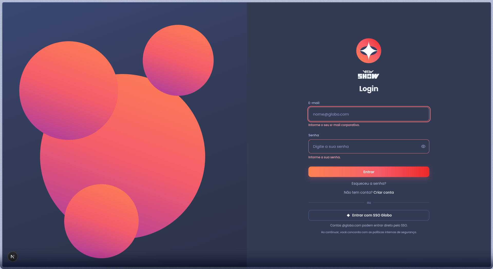
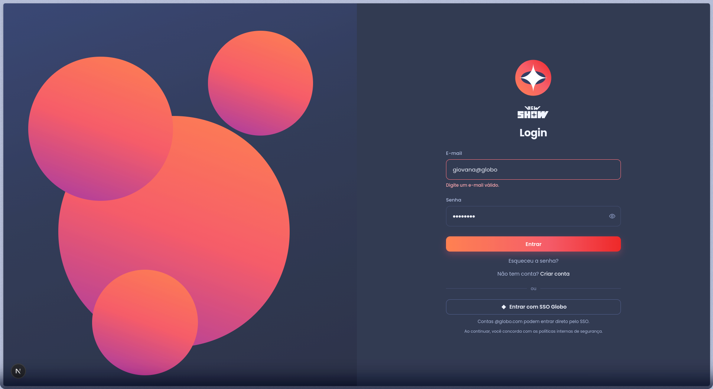
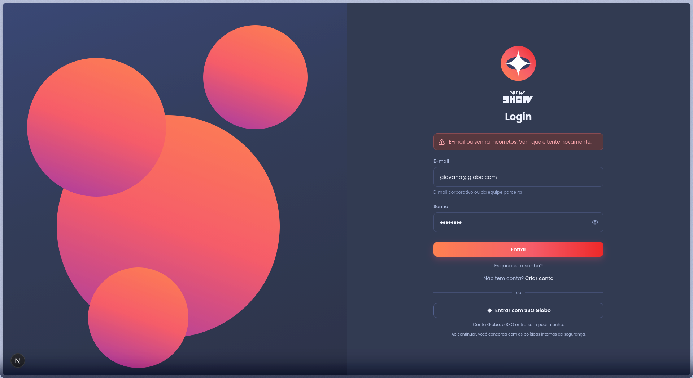
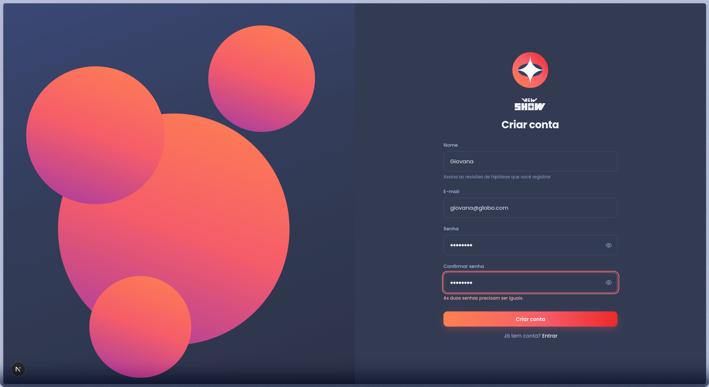
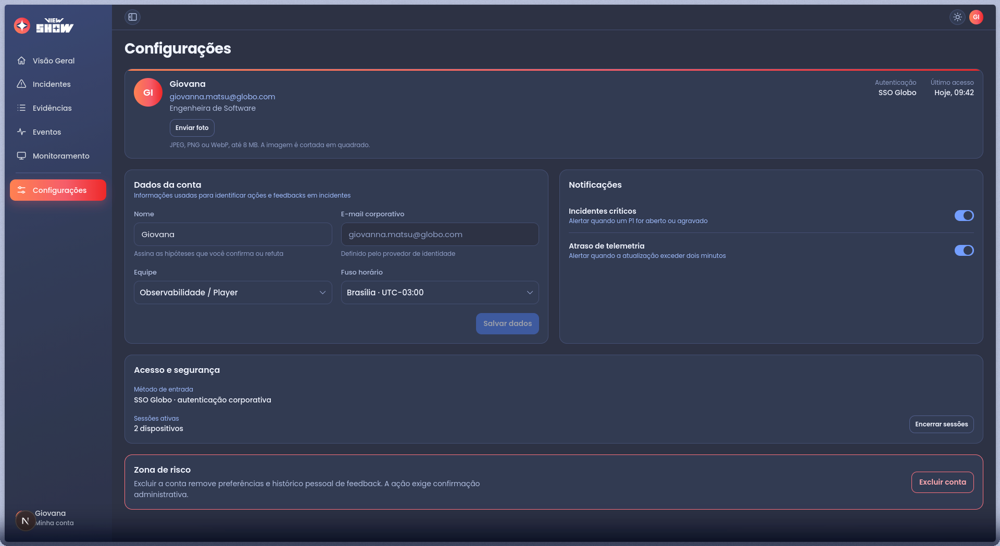
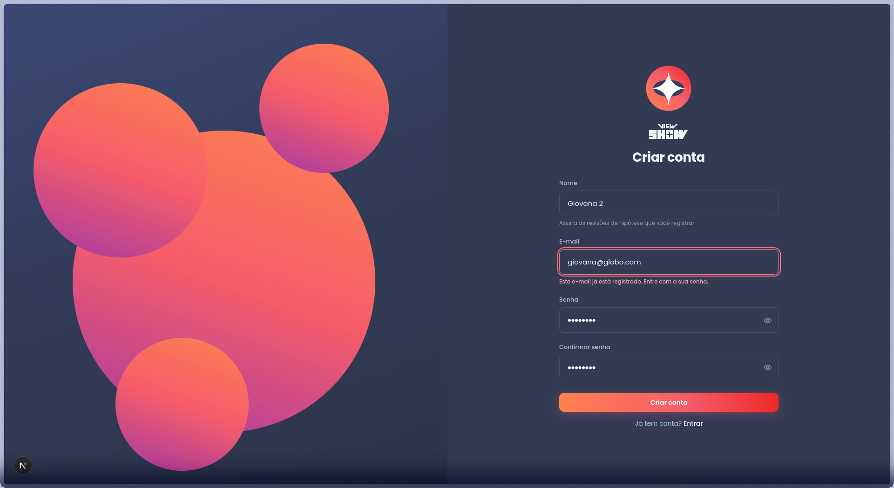
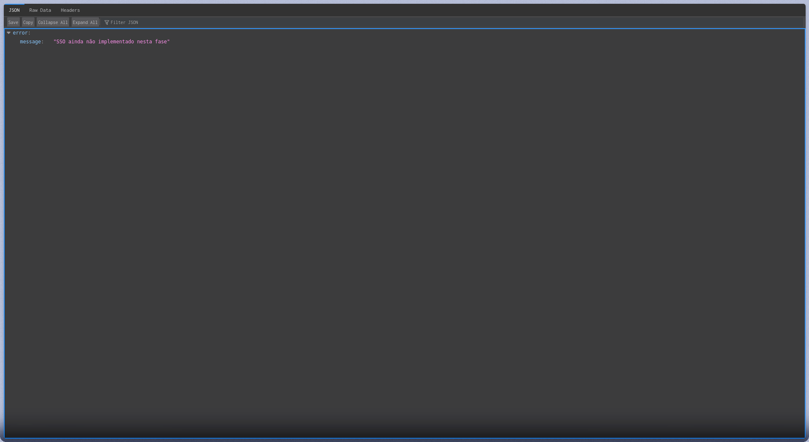
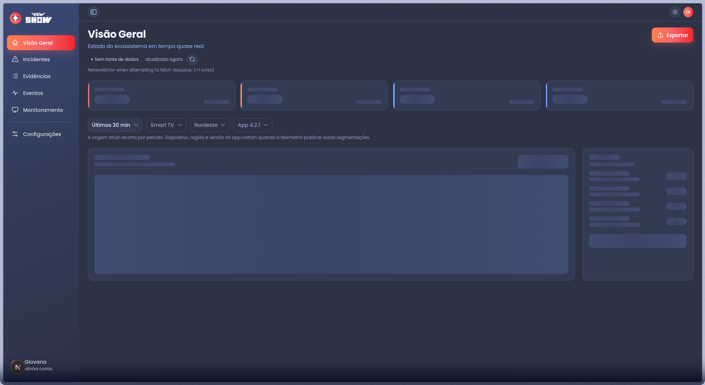
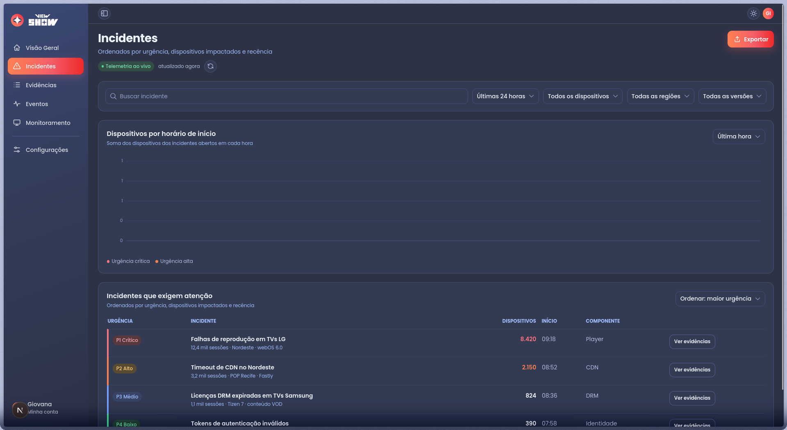
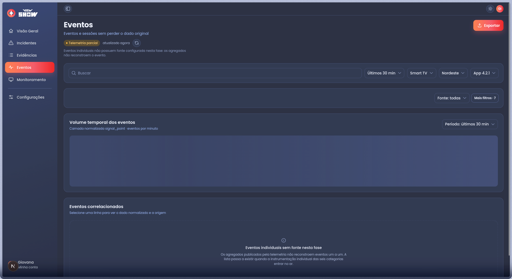

# Documentação do Front-end da aplicação

## Link do projeto no S3

Acesse o projeto aqui: <http://g05-telemetria-front.s3-website-us-east-1.amazonaws.com/login/>

## Validação de requisitos no frontend

Este documento valida o frontend do View Show contra a especificação: cada caso
produz evidência de aceite para um requisito funcional (RF), não funcional
(RNF), interface externa (RIE) ou restrição (RESTR).

O objeto avaliado é a aplicação Next.js em `apps/frontend`, que é o produto do
projeto. O painel estático em `apps/basica/frontend` não é avaliado aqui: ele
serviu ao MVP de infraestrutura e não é a interface que vai a produção.

A **[demonstração em vídeo](https://youtu.be/Gur7yoTiQI0)** percorre as telas do
painel com o frontend integrado ao backend, do login ao diagnóstico de um
incidente, e serve de apoio visual às evidências registradas neste documento.

A aplicação lê duas APIs deste mesmo repositório, e a distinção importa para
interpretar cada resultado:

| Fonte | Serviço | O que serve ao frontend |
| --- | --- | --- |
| Operacional | `apps/backend/api` (Node/Express, porta 3000) | Identidade (entrada, criação de conta, SSO), incidentes, evidências e revisão. É a única com sessão. |
| Telemetria | Flask, porta 5000 | Medição bruta: QoE, erros, segmentações e séries no tempo. |

A seção 1 fixa o critério, a seção 2 lista os casos com o resultado, a seção 3
registra a execução de 28/08/2026 com as evidências, a seção 4 rastreia
requisito a requisito e a seção 5 lista os defeitos encontrados.

## 1. Escopo e critérios de execução

| Item | Definição para esta rodada |
| --- | --- |
| Objeto | `apps/frontend`: Next.js 16.3.1 (App Router, Turbopack), React 19, TypeScript. |
| Ambiente | Máquina do grupo, `next dev` na porta 3001, API operacional na 3000 e DynamoDB Local na 8000. |
| Dados | Contas de teste criadas na hora, com e-mail exclusivo por execução. Nenhum dado pessoal real. |
| Ferramentas | `curl` para as rotas, execução direta do módulo `lib/auth.ts` pelo Node 26 e navegador com DevTools para a passagem visual. |
| Pré-condições | `.env.local` com `NEXT_PUBLIC_API_BASE_URL` e `NEXT_PUBLIC_TELEMETRY_API_BASE_URL` apontados, e as APIs correspondentes no ar, exceto onde o caso pede o contrário. |
| Aprovação | Um caso passa apenas se o resultado observado satisfizer o critério e a evidência for registrada. Regra validada fora da tela não fecha caso que promete comportamento de tela. |

Subir o ambiente:

```bash
# API operacional, na porta 3000
cd apps/backend/api && npm start

# frontend, na porta 3001
cd apps/frontend && npm run dev -- -p 3001
```

## 2. Casos de validação

| ID | Tela | Procedimento | Critério de aceite | Requisitos | Resultado |
| --- | --- | --- | --- | --- | --- |
| VF-01 | Todas as rotas | Requisitar as 11 rotas publicadas. | Toda rota responde, e a raiz redireciona para a entrada. | RF07 | Passou (seção 3.2) |
| VF-02 | `/login` | Enviar com os campos vazios e com e-mail malformado. | Cada campo inválido produz mensagem própria, o envio é bloqueado e o foco vai ao primeiro campo com erro. | RF04, RNF03 | Passou (E-01 a E-09, N-01, N-02) |
| VF-03 | `/criar-conta` | Enviar com nome vazio, e-mail malformado, senha de 7 caracteres e confirmação diferente. | Cada regra recusa o envio com a sua mensagem. | RF04, RNF03 | Passou (E-10 a E-15, N-04, N-05) |
| VF-04 | `/criar-conta` | Criar conta com e-mail inédito e senha de 8 caracteres ou mais. | A conta nasce no provedor, a sessão abre na resposta e o nome passa a assinar o painel. | RF04, RIE01 | Passou. A conta nasce, a sessão abre e o nome escolhido assina o painel (A-04, N-06) |
| VF-05 | `/criar-conta` | Repetir a criação com um e-mail já registrado. | A recusa aparece no campo de e-mail, não como erro genérico do formulário. | RF04, RNF03 | Passou (A-03, N-07) |
| VF-06 | `/login` | Entrar com senha errada e com a credencial correta. | Credencial inválida produz mensagem de erro; a correta abre a sessão. | RF04, RNF04 | Passou (A-01, A-02, N-03) |
| VF-07 | `/login` | Acionar "Entrar com SSO Globo". | A indisponibilidade do SSO é comunicada dentro da aplicação. | RF04, RIE01, RESTR01 | Falhou. A pessoa é levada para fora da aplicação, até a resposta crua do provedor (D1, N-08) |
| VF-08 | `/visao-geral` | Desligar as duas APIs de propósito e abrir o painel. É teste de falha provocada: o objetivo é ver o que a interface faz quando fica sem fonte. | Cada bloco sem fonte declara a indisponibilidade e o motivo, sem inventar número. | RF07, RF08, RNF03 | Passou com ressalva. Com a queda provocada, nenhum número foi inventado e a ausência de fonte foi declarada; a forma de comunicar tem duas ressalvas (D3, D4, N-09) |
| VF-09 | `/incidentes` | Usar busca, filtros cumulativos e ordenação. | O recorte aplicado muda o conteúdo listado e o estado vazio é explícito. | RF07, RF09 | Parcial. Os controles existem e a lista veio servida pela API; a aplicação de um recorte não foi capturada (N-10) |
| VF-10 | `/eventos` | Expandir uma linha para ver dado normalizado e origem bruta. | A linha mostra o dado normalizado e a origem correspondente. | RF05 | Não executável nesta fase. Não há evento individual publicado, e a tela declara isso (N-11) |

## 3. Resultado da execução

### 3.1 Ambiente da rodada

| Item | Valor |
| --- | --- |
| Data | 28/08/2026 |
| Commit | `4361181` |
| Frontend | `next dev` 16.3.1 com Turbopack, porta 3001, lendo `.env.local` |
| API operacional | `apps/backend/api` na porta 3000, com DynamoDB Local (`amazon/dynamodb-local`) na porta 8000 |
| API de telemetria | Não iniciada nesta rodada |
| Runtime | Node.js v26.5.0 |
| Navegador | Firefox, janela de 1920 x 1050 |
| Verificações executadas | 11 rotas, 19 regras de entrada, 5 chamadas de identidade e 11 passos no navegador |

As regras de validação foram executadas importando o próprio módulo do
frontend, sem reimplementar nada:

```bash
node --input-type=module -e '
process.env.NEXT_PUBLIC_API_BASE_URL = "http://localhost:3000";
const m = await import("./lib/auth.ts");
console.log(m.validateEmail("giovana@globo"));
'
```

### 3.2 Rotas servidas

| Rota | Status |
| --- | --- |
| `/` | `307` para `/login` |
| `/login` | `200` |
| `/criar-conta` | `200` |
| `/recuperar-senha` | `200` |
| `/visao-geral` | `200` |
| `/incidentes` | `200` |
| `/eventos` | `200` |
| `/evidencias` | `200` |
| `/monitoramento` | `200` |
| `/configuracoes` | `200` |
| `/design-system` | `200` |

### 3.3 Validação de entradas do usuário

Cada linha é uma entrada submetida às regras que o formulário aplica no envio,
com a mensagem devolvida na execução.

| # | Campo | Entrada | Resultado observado | Requisitos |
| --- | --- | --- | --- | --- |
| E-01 | E-mail (entrada) | `""` | "Informe o seu e-mail corporativo." | RF04, RNF03 |
| E-02 | E-mail (entrada) | `"   "` | "Informe o seu e-mail corporativo." O espaço em branco não passa por preenchimento. | RF04, RNF03 |
| E-03 | E-mail (entrada) | `"giovana@globo"` | "Digite um e-mail válido." Domínio sem ponto é recusado. | RF04, RNF03 |
| E-04 | E-mail (entrada) | `"giovana matsu@globo.com"` | "Digite um e-mail válido." Espaço no meio é recusado. | RF04, RNF03 |
| E-05 | E-mail (entrada) | `"@globo.com"` | "Digite um e-mail válido." Sem parte local é recusado. | RF04, RNF03 |
| E-06 | E-mail (entrada) | `"giovana.matsu@globo.com"` | Aceito. | RF04 |
| E-07 | E-mail (entrada) | `"  giovana.matsu@globo.com  "` | Aceito. O valor é aparado antes de validar. | RF04 |
| E-08 | Senha (entrada) | `""` | "Informe a sua senha." | RF04, RNF03 |
| E-09 | Senha (entrada) | `"x"` | Aceito. Na entrada só o preenchimento é exigido: força e expiração são do provedor. | RF04 |
| E-10 | Nome (criar conta) | `""` | "Informe o seu nome." | RF04, RNF03 |
| E-11 | Nome (criar conta) | `"   "` | "Informe o seu nome." | RF04, RNF03 |
| E-12 | Nome (criar conta) | `"Giovana Matsu"` | Aceito. | RF04 |
| E-13 | Senha (criar conta) | `""` | "Escolha uma senha." | RF04, RNF03 |
| E-14 | Senha (criar conta) | `"1234567"` | "A senha precisa de pelo menos 8 caracteres." | RF04, RNF03 |
| E-15 | Senha (criar conta) | `"12345678"` | Aceito, no limite da regra. | RF04 |
| E-16 | Reconhecimento de conta Globo | `"giovana.matsu@globo.com"` | Reconhecido como corporativo. | RF04 |
| E-17 | Reconhecimento de conta Globo | `"GIOVANA@GLOBO.COM"` | Reconhecido. A comparação é feita em caixa baixa. | RF04 |
| E-18 | Reconhecimento de conta Globo | `"a@gmail.com"` | Não corporativo. A entrada segue permitida, o SSO é que deixa de ser sugerido. | RF04 |
| E-19 | Reconhecimento de conta Globo | `"semarroba"` | Não corporativo, sem quebrar com valor sem `@`. | RF04, RNF03 |

Duas decisões de produto ficam registradas por essas linhas:

- **A entrada aceita a equipe parceira.** E-06 e E-18 mostram a regra em vigor no
  acesso: o e-mail válido entra, e o domínio corporativo é o que ganha o atalho
  do SSO, que dispensa a senha.
- **A senha da entrada não tem regra de força.** E-09 aceita um caractere. O
  mínimo de oito só existe onde a senha nasce (E-14), o que é coerente com
  delegar a política ao provedor.

### 3.4 Identidade contra a API operacional

As chamadas partiram do módulo de autenticação do frontend, com
`NEXT_PUBLIC_API_BASE_URL` apontado para a API operacional em execução.

| # | Ação | Resposta da API | Resultado no frontend |
| --- | --- | --- | --- |
| A-01 | Entrar com credencial válida | `200` com cookie de sessão | Sessão aberta, sem mensagem de erro |
| A-02 | Entrar com senha errada | `401` | "E-mail ou senha incorretos. Verifique e tente novamente." |
| A-03 | Criar conta com e-mail já registrado | `409` | "Este e-mail já está registrado. Entre com a sua senha.", associada ao campo de e-mail |
| A-04 | Criar conta com e-mail inédito | `201` com cookie de sessão | Conta criada e nome devolvido para assinar o painel |
| A-05 | Endereço de SSO | `501` em `GET /auth/sso` | A aplicação navega até essa resposta em vez de tratá-la (D1) |

A-04 gravou a conta no DynamoDB Local pela API operacional, e A-02 comprova que
a credencial errada é recusada pelo provedor, não pela tela. O contrato de
identidade (RIE01) fica exercitado nos dois sentidos.

### 3.5 Passagem no navegador

Dez passos exercitam o caminho normal da aplicação. O N-09 é de outra natureza:
as duas APIs foram desligadas de propósito antes dele, para observar como a
interface se comporta sem fonte. A tela vazia ali é o resultado esperado do teste
de falha provocada, e o que se avalia é a forma como a ausência é comunicada, não
o fato de não haver número.

| Passo | Tela | Ação | Resultado observado | Figura |
| --- | --- | --- | --- | --- |
| N-01 | `/login` | Enviar com os dois campos vazios | As duas mensagens aparecem ao mesmo tempo, cada uma sob o seu campo, com a borda em vermelho e o foco no e-mail. O envio não acontece. | 1 |
| N-02 | `/login` | E-mail `giovana@globo`, senha preenchida | "Digite um e-mail válido." apenas no e-mail. O campo de senha, preenchido, não recebe erro. | 2 |
| N-03 | `/login` | Credencial recusada pelo provedor | Alerta no topo do formulário: "E-mail ou senha incorretos. Verifique e tente novamente." O texto de apoio muda para "Conta Globo: o SSO entra sem pedir senha." ao reconhecer o domínio. | 3 |
| N-04 | `/criar-conta` | Senha com 6 caracteres | "A senha precisa de pelo menos 8 caracteres." no campo de senha, com o foco nele. Nome e e-mail, válidos, ficam sem erro. | 4 |
| N-05 | `/criar-conta` | Confirmação diferente da senha | "As duas senhas precisam ser iguais." no campo de confirmação, com o foco nele. | 5 |
| N-06 | `/configuracoes` | Conferir o perfil depois de criar a conta | O nome escolhido pela pessoa assina o painel, na navegação e no cartão de perfil, sem passar de novo pela entrada. | 6 |
| N-07 | `/criar-conta` | Repetir um e-mail já registrado | "Este e-mail já está registrado. Entre com a sua senha." no campo de e-mail, com foco, e não como erro genérico no topo. | 7 |
| N-08 | `/login` | Acionar o SSO | A navegação sai da aplicação e para no visualizador de JSON do navegador, com `{"error":{"message":"SSO ainda não implementado nesta fase"}}`. | 8 |
| N-09 | `/visao-geral` | Desligar as duas APIs de propósito e recarregar | A tela esvazia como se espera da falha provocada: selo "Sem fonte de dados", motivo "NetworkError when attempting to fetch resource. (+1 aviso)" e nenhum número no lugar do dado que não veio. Os cartões e o gráfico ficam em esqueleto. A barra de filtros declara que dispositivo, região e versão voltam quando a telemetria publicar as segmentações. | 9 |
| N-10 | `/incidentes` | Abrir a tela com a API operacional no ar | Selo "Telemetria ao vivo", busca por incidente, quatro filtros e ordenação por urgência. A lista trouxe quatro incidentes, de P1 a P4, com dispositivos, horário de início e componente. | 10 |
| N-11 | `/eventos` | Procurar a linha para expandir | Selo "Telemetria parcial" com o motivo declarado, e o bloco de eventos correlacionados no estado de indisponível: "Os agregados publicados pela telemetria não reconstroem eventos um a um." Não há linha para expandir nesta fase. | 11 |

<div align="center">
	
	<p><em>Figura 1 - N-01, envio com os dois campos vazios. Fonte: Autoria própria, 2026.</em></p>
</div>

<div align="center">
	
	<p><em>Figura 2 - N-02, e-mail sem domínio completo. Fonte: Autoria própria, 2026.</em></p>
</div>

<div align="center">
	
	<p><em>Figura 3 - N-03, credencial recusada pelo provedor. Fonte: Autoria própria, 2026.</em></p>
</div>

<div align="center">
	
	<p><em>Figura 4 - N-04, senha abaixo do mínimo. Fonte: Autoria própria, 2026.</em></p>
</div>

<div align="center">
	
	<p><em>Figura 5 - N-05, confirmação diferente da senha. Fonte: Autoria própria, 2026.</em></p>
</div>

<div align="center">
	
	<p><em>Figura 6 - N-06, perfil depois da criação da conta. Fonte: Autoria própria, 2026.</em></p>
</div>

<div align="center">
	
	<p><em>Figura 7 - N-07, e-mail já registrado. Fonte: Autoria própria, 2026.</em></p>
</div>

<div align="center">
	
	<p><em>Figura 8 - N-08, o SSO leva a pessoa para fora da aplicação. Fonte: Autoria própria, 2026.</em></p>
</div>

<div align="center">
	
	<p><em>Figura 9 - N-09, painel com as duas APIs desligadas de propósito. Fonte: Autoria própria, 2026.</em></p>
</div>

<div align="center">
	
	<p><em>Figura 10 - N-10, incidentes servidos pela API operacional. Fonte: Autoria própria, 2026.</em></p>
</div>

<div align="center">
	
	<p><em>Figura 11 - N-11, ausência de evento individual declarada na tela. Fonte: Autoria própria, 2026.</em></p>
</div>

## 4. Matriz de rastreabilidade

### 4.1 Requisitos funcionais

| Requisito | Casos desta rodada | Resultado | Situação |
| --- | --- | --- | --- |
| RF01 Ingestão multiplataforma | Nenhum | Não avaliado | Fora do frontend. O requisito é servido pela API de ingestão. |
| RF02 Ingestão de eventos | Nenhum | Não avaliado | Fora do frontend. |
| RF03 Normalização | Nenhum | Não avaliado | Fora do frontend. A tela consome o dado já normalizado. |
| RF04 Cadastro e login | VF-02 a VF-07, E-01 a E-19, A-01 a A-05, N-01 a N-08 | Parcial | Cadastro, entrada, recusa de credencial, recusa de e-mail duplicado e validação campo a campo funcionam na tela. A lacuna é o SSO, que não está implementado nesta fase (D1). |
| RF05 Bruto e normalizado | VF-10, N-11 | Não atendido nesta fase | A tela declara que evento individual não tem fonte publicada, então o par bruto e normalizado não existe para ser exibido. A recusa é explícita, não silenciosa. |
| RF06 Cobertura mínima de eventos | Nenhum | Não avaliado | Fora do frontend. |
| RF07 Dashboard de navegação | VF-01, VF-08, VF-09, N-09, N-10 | Parcial | As 11 rotas respondem e a tela de incidentes lê a API. Na falha provocada de N-09, o painel declarou a ausência de fonte e não inventou número; as ressalvas são manter os blocos em esqueleto (D3) e mostrar a mensagem crua do navegador (D4). Os filtros cumulativos existem; o recorte aplicado não foi capturado. |
| RF08 Métricas e alertas | VF-08, N-09 | Parcial | Os blocos de métrica existem e, no teste de falha provocada, nenhum número foi inventado no lugar do dado ausente. Não há alerta implementado. |
| RF09 Consultas para análise de falhas | VF-09, N-10 | Parcial | Busca, quatro filtros e ordenação por urgência estão na tela, com a lista servida pela API. Falta capturar o resultado de um recorte. |
| RF10 Exportação | Nenhum | Não atendido | O botão "Exportar" aparece em `/visao-geral`, `/incidentes` e `/eventos` sem ação associada (D2). Não há CSV, XLSX nem PDF. |

### 4.2 Requisitos não funcionais, interfaces e restrições

| Requisito | Casos desta rodada | Resultado | Situação |
| --- | --- | --- | --- |
| RNF03 Tolerância a entrada inválida | E-01 a E-05, E-08, E-10, E-11, E-13, E-14, E-19, N-01 a N-05, N-07 | Passou | Toda entrada inválida é recusada com mensagem própria, o foco vai ao primeiro campo com erro e nada quebra a aplicação, inclusive valor sem `@`. A ressalva de comunicação está em D4. |
| RNF04 Confidencialidade e SSO | A-01, A-02, N-03 | Parcial | A credencial é verificada pelo provedor e a sessão volta em cookie assinado, fora do `localStorage`. O SSO corporativo não está implementado. |
| RNF07 Desempenho de carregamento | Nenhum | Não avaliado | Depende de medição com a aplicação publicada. |
| RNF14 Tempo de resposta | Nenhum | Não avaliado | Depende das APIs no ambiente publicado. |
| RIE01 Provedor de identidade | A-01 a A-05, N-08 | Parcial | Entrada e registro funcionam ponta a ponta. O SSO responde `501` e a aplicação não trata a resposta. |
| RIE02 API de ingestão | Nenhum | Não avaliado | Fora do frontend. |
| RESTR01 SSO corporativo | VF-07, N-08 | Não atendido | Sem provedor corporativo nesta fase. |
| RESTR02 Formato dos dispositivos | Nenhum | Não avaliado | Fora do frontend. |
| RNF01, RNF02, RNF05, RNF06, RNF08, RNF09, RNF11, RNF12, RNF13, RNF15 | Nenhum | Não avaliado | Fora da capacidade desta fase. Exigem fila, worker, ML, políticas de retenção, cobertura de CI, carga de escala ou alertas. |

Um requisito marcado como não avaliado permanece explícito e não deve ser
confundido com requisito atendido.

## 5. Defeitos encontrados

| # | Defeito | Evidência | Requisito afetado |
| --- | --- | --- | --- |
| D1 | O botão "Entrar com SSO Globo" leva a pessoa para fora da aplicação. Com a API configurada, a navegação vai para `/auth/sso`, que responde `501`, e o navegador exibe o JSON cru. A mensagem de indisponibilidade preparada no formulário só aparece quando a API **não** está configurada, ou seja, quando não faz falta. | Figura 8, A-05 | RF04, RIE01, RESTR01 |
| D2 | O botão "Exportar" está em três telas sem ação associada. | Figuras 9, 10 e 11; inspeção de `incidents-view.tsx`, `events-view.tsx` e `overview-view.tsx` | RF10 |
| D3 | No teste de falha provocada de N-09, com as duas APIs desligadas, os cartões e o gráfico da visão geral permanecem em estado de esqueleto, que a pessoa lê como carregamento eterno, em vez do bloco de indisponibilidade com o motivo que o design system já tem. | Figura 9 | RF07, RF08 |
| D4 | No mesmo teste, o motivo apresentado é a mensagem do navegador, "NetworkError when attempting to fetch resource.", e não a frase preparada em `warnings.ts` para esse caso. | Figura 9 | RF07, RNF03 |

D1 e D2 são divergências entre o comportamento implementado e o requisito
escrito: cabe corrigir o código ou revisar o requisito, e a decisão precisa ficar
registrada em qualquer um dos dois casos. D3 e D4 são de interface e não mudam o
dado apresentado, mas mudam o que a pessoa entende do estado do sistema. Os dois
vieram do teste de falha provocada, que é justamente a situação em que a
interface precisa se explicar melhor.

## 6. Registro dos resultados

Cada passo do roteiro está registrado com ID, tela, entrada usada, resultado
observado e figura correspondente. As capturas ficam em
`assets/testes-frontend/`, nomeadas pelo passo que as originou, e acompanham
esta tabela de rastreabilidade no relatório da sprint.

Uma falha aponta o requisito afetado e abre defeito, como na seção 5. Um
requisito marcado como não avaliado ou não atendido permanece explícito no
relatório, para que a leitura da matriz não confunda ausência de teste com
requisito cumprido.
