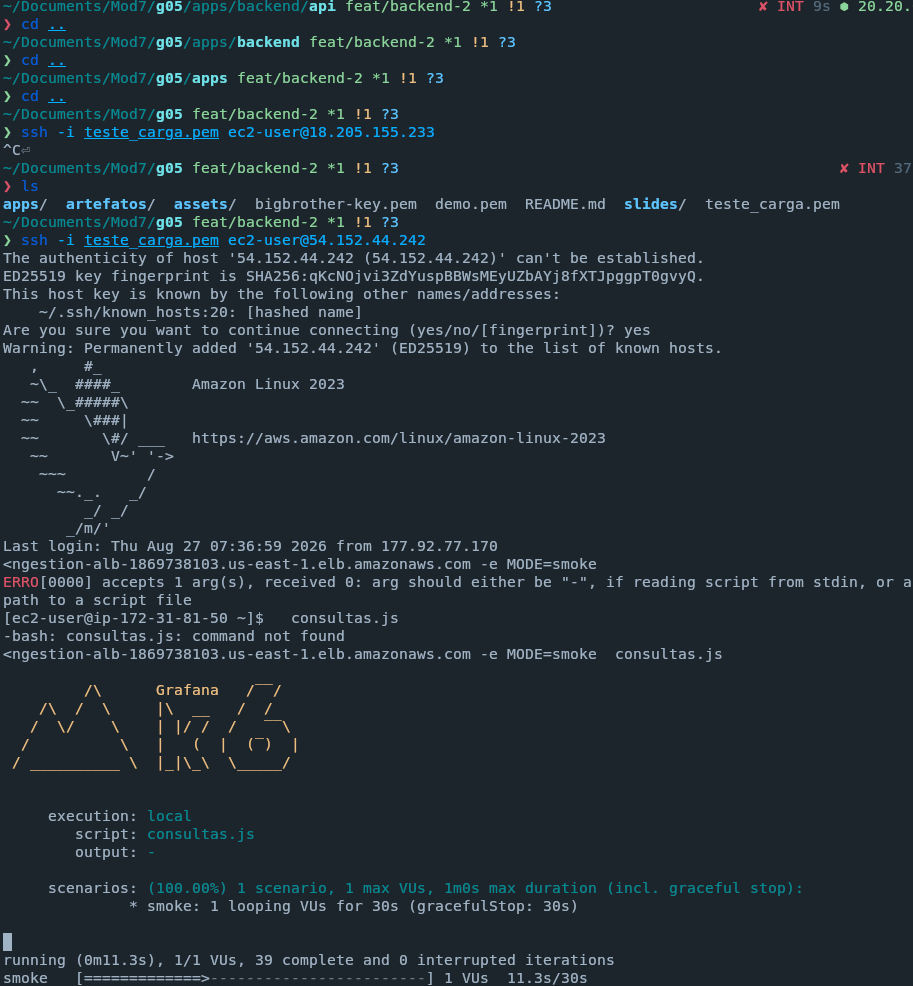
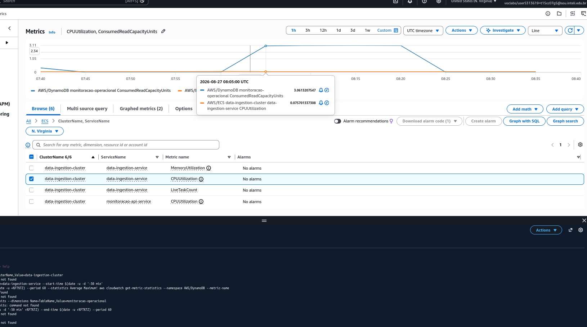

# Relatório de Testes de Desempenho — API de Consulta

> Este documento mede como a API do View Show se comporta quando muitas pessoas
> a usam ao mesmo tempo, identifica onde ela trava e explica por quê.
>
> Todos os números foram **medidos em ambiente real**, não estimados. Onde há
> projeção, está marcada como tal.

## Sumário

1. [Resumo executivo](#1-resumo-executivo)
2. [Conceitos usados neste relatório](#2-conceitos-usados-neste-relatório)
3. [O que foi testado](#3-o-que-foi-testado)
4. [Como o teste foi montado](#4-como-o-teste-foi-montado)
5. [Preparação do ambiente](#5-preparação-do-ambiente)
6. [Resultados](#6-resultados)
7. [O que o servidor mostrou](#7-o-que-o-servidor-mostrou)
8. [Diagnóstico: por que trava](#8-diagnóstico-por-que-trava)
9. [Recomendações](#9-recomendações)
10. [Limitações do teste](#10-limitações-do-teste)
11. [Reprodutibilidade](#11-reprodutibilidade)

---

## 1. Resumo executivo

&emsp; A API foi projetada para atender **137 requisições por segundo** — número
derivado do pico de audiência do Globoplay, explicado na [§4.2](#42-a-carga-de-onde-vem-o-número).
Ela aguenta **cerca de 4**.

&emsp; Sob a carga alvo, **91,9% das requisições falharam** e o tempo de resposta
estourou o limite de 2 segundos definido no requisito RNF14, chegando ao teto de
60 segundos do próprio teste.

&emsp; A causa **não é falta de servidor.** São dois defeitos de implementação:

1. **A consulta lê oito vezes mais dados do que precisa.** Ao buscar a lista de
   incidentes, o sistema também carrega todas as evidências e hipóteses ligadas a
   eles — e depois joga fora. Cerca de **87% do que é lido do banco é
   descartado**.
2. **A resposta não tem limite de tamanho.** Uma consulta de 24 horas devolve 291
   incidentes num único pacote de 135 KB. Quanto maior o período consultado,
   maior a resposta, sem teto.

&emsp; Nenhum dos dois apareceria em revisão de código ou em teste funcional: as
duas rotas **devolvem o resultado correto**. O erro está no custo para produzi-lo,
e só a carga revela isso.

## 2. Conceitos usados neste relatório

&emsp; Esta seção existe para que o restante do documento possa ser lido por
alguém que não trabalha com testes de carga no dia a dia.

### O que é um teste de desempenho

&emsp; É medir como um sistema se comporta sob uma **carga controlada**. Escolhe-se
quantas requisições por segundo serão enviadas, e observam-se três respostas do
sistema: **quanto tempo demora**, **quantas requisições ele consegue concluir** e
**quantas dão erro**.

&emsp; A carga é a variável que você controla. As outras três são a resposta do
sistema — você não as escolhe, você as descobre.

### Requisição, vazão e latência

| Termo | O que significa |
| --- | --- |
| **Requisição** | Um pedido feito à API. Por exemplo: "me dê a lista de incidentes das últimas 24 horas". |
| **Vazão** (*throughput*) | Quantas requisições por segundo o sistema consegue **concluir**. É o que mede a capacidade. |
| **Latência** | Quanto tempo uma requisição leva para ser respondida. |
| **Taxa de erro** | Fração das requisições que falharam ou estouraram o tempo limite. |

### Por que percentil, e não média

&emsp; Este relatório usa **p(95)** e **mediana** em vez de média, e a razão é
importante.

&emsp; **p(95) significa: 95% das requisições foram mais rápidas que este valor.**
Um p(95) de 589 ms quer dizer que 95 em cada 100 pessoas esperaram menos de 589
milissegundos — e 5 esperaram mais.

&emsp; A média esconde justamente essas 5. Um sistema com média de 180 ms pode ter
5% das requisições demorando mais de 3 segundos, e são essas 5% que geram
reclamação. A média dilui o problema; o percentil o expõe.

&emsp; A **mediana** (p(50)) é o valor do meio: metade das requisições foi mais
rápida, metade mais lenta. Usada aqui para comparar rotas entre si.

### Usuário virtual (VU)

&emsp; A ferramenta de teste simula usuários com o que chama de **VU** (*virtual
user*). Um VU **não é uma pessoa**: é um laço de repetição que envia uma
requisição, espera a resposta e envia a próxima.

&emsp; Isso importa porque 800 VUs não significam 800 pessoas. A carga real é o
número de VUs dividido pelo tempo que cada um leva por ciclo. Se cada requisição
demora 10 segundos, 800 VUs produzem apenas 80 requisições por segundo — não 800.

### Modelo aberto e modelo fechado

&emsp; Existem duas formas de gerar carga, e a escolha muda o resultado:

- **Modelo fechado:** cada usuário virtual espera a resposta antes de pedir de
  novo. Se a API fica lenta, todos esperam mais e **a carga cai sozinha**.
- **Modelo aberto:** a ferramenta envia um número fixo de requisições por segundo,
  independentemente de a API estar respondendo ou não.

&emsp; Este teste usa **modelo aberto**, porque é o que reproduz a realidade: um
operador que abre o painel não espera outro terminar. E, principalmente, porque o
modelo fechado **esconderia a saturação** — a carga diminuiria justamente quando o
sistema começasse a falhar, mascarando o problema que o teste existe para achar.

### Saturação

&emsp; Um sistema está **saturado** quando aumentar a carga não aumenta mais a
quantidade de trabalho concluído. O sinal característico é: você dobra o número de
usuários e a vazão fica igual — ou piora, porque agora há uma fila.

&emsp; O erro costuma aparecer **depois** da saturação. Quando as requisições
começam a falhar, o sistema já estava no teto havia algum tempo.

### Vocabulário da infraestrutura

| Termo | O que significa |
| --- | --- |
| **vCPU** | Unidade de processamento. A API deste teste roda com **0,25 vCPU** — um quarto de um núcleo de processador. |
| **DynamoDB** | O banco de dados usado. Guarda registros identificados por duas chaves: uma de partição (`pk`, "em que gaveta está") e uma de ordenação (`sk`, "em que posição da gaveta"). |
| **Query** | Consulta ao banco que busca dentro de uma gaveta específica. É eficiente, ao contrário de varrer o banco inteiro. |
| **RCU** | *Read Capacity Unit*. Unidade que o DynamoDB usa para medir volume de leitura. Quanto mais bytes lidos, mais RCU consumidos. |
| **Payload** | O conteúdo da resposta — o pacote de dados que trafega da API até quem pediu. |
| **Fan-out** | Quando uma única requisição do usuário se desdobra em várias consultas ao banco. Aqui, uma consulta de 24 h vira 25 Queries. |

## 3. O que foi testado

&emsp; O alvo é a **API de consulta e diagnóstico** do View Show, que alimenta o
painel usado pelas equipes de Engenharia, SRE e Produto. Ela roda em contêiner na
AWS e é acessada por um balanceador de carga público.

| Item | Valor |
| --- | --- |
| Serviço | `monitoracao-api-service` (ECS Fargate) |
| Capacidade da instância | **0,25 vCPU · 0,5 GB de memória** |
| Instâncias em execução | 1 |
| Banco de dados | DynamoDB, tabela `monitoracao-operacional` |
| Entrada | Application Load Balancer, público |

### 3.1 Uma correção de escopo

&emsp; A arquitetura atual **não possui endpoint de ingestão de dados** — suas
rotas são de consulta (listar incidentes, resumo do painel), diagnóstico e
curadoria. Isso muda qual requisito se aplica: o critério de aprovação não é o
RNF03 (ingestão sem perdas), e sim o **RNF14**, que trata do tempo de resposta das
consultas.

### 3.2 Rotas exercitadas

&emsp; O teste distribui as requisições entre quatro rotas reais do painel, com
custos diferentes de propósito:

| Apelido no teste | Rota | Consultas ao banco | Papel no experimento |
| --- | --- | ---: | --- |
| `leve` | `GET /incidents?window=15m` | 2 | consulta curta, pouco dado |
| `pesada` | `GET /incidents?window=24h` | **25** | pior caso real, é o que a tela de incidentes usa |
| `bundle` | `GET /incidents/:id/evidence` | 1 | **grupo de controle** — ver §6.2 |
| `summary` | `GET /dashboard/summary` | 25 | primeira tela que o usuário abre |

&emsp; Duas rotas ficaram **deliberadamente fora** da carga:

- `POST /diagnose` **grava** no banco a cada chamada. Sob a carga alvo, seriam
  ~25 mil escritas e a base cresceria durante o teste, contaminando a medição.
- `PATCH /hypothesis/review` promove casos ao *golden set* — o conjunto de dados
  curados manualmente. Carga ali corromperia dado que não pode ser reconstruído.

## 4. Como o teste foi montado

### 4.1 Ferramenta

&emsp; **k6**, versão 2.2.0. O script está versionado no repositório em
[`artefatos/testes-carga/k6/consultas.js`](./testes-carga/k6/consultas.js), de
modo que qualquer pessoa possa reproduzir as rodadas.

### 4.2 A carga: de onde vem o número

&emsp; O alvo de 137 requisições por segundo não foi escolhido por conveniência.
Ele vem do volume real da operação:

```
4,1 milhões de sessões simultâneas em pico de evento ao vivo
      ↑ registrado na análise de negócios do projeto

÷ 1.000   ← fator de escala do MVP, arbitrário e declarado

= 137 requisições por segundo   ← alvo do teste
```

&emsp; O divisor de 1.000 é uma escolha da equipe, não um dado. **Extrapolar o
resultado deste teste linearmente para o pico real é hipótese, não conclusão** —
e está listada nas limitações da §10.

### 4.3 Critérios de aprovação

&emsp; O teste passa ou falha em quatro critérios, e três deles vêm de requisitos
já documentados do projeto:

| Critério | Valor | De onde vem |
| --- | --- | --- |
| Tempo de resposta | **p(95) < 2000 ms** | **RNF14** — *"retornar os resultados de uma busca filtrada em até 2 segundos para 95% das solicitações"* |
| Taxa de erro | **< 1%** | **RNF09** — disponibilidade mínima de 99,9% |
| Vazão mínima | **> 130 req/s** | o alvo de 137 com 5% de folga — decisão da equipe |
| Contrato das respostas | **> 99% corretas** | verificação de que o teste está medindo algo real (§5.2) |

### 4.4 De onde o teste foi executado

&emsp; O gerador de carga rodou de uma instância EC2 `c7a.large` **na mesma região
da API** (`us-east-1`). A escolha por uma instância de desempenho fixo — e não uma
de desempenho variável, mais barata — evita que o próprio gerador vire o gargalo
em rodadas longas.



&emsp; **Por que isso importa tanto.** Se o teste rodasse de um notebook na rede da
faculdade, boa parte do tempo medido seria distância física até os servidores da
Amazon na Virgínia — e seria atribuída à API. A diferença medida:

| Origem do teste | Tempo só para abrir a conexão |
| --- | ---: |
| Máquina local (fora da AWS) | **~135 ms** |
| Instância EC2 em `us-east-1` | **~1,4 ms** |

&emsp; Quase 100 vezes de diferença. Testar do notebook consumiria sozinho **um
terço** do orçamento de 2 segundos do RNF14, sem que a API tivesse feito nada.

## 5. Preparação do ambiente

### 5.1 O banco de teste precisava de volume

&emsp; O script de povoamento existente no repositório cria **4 incidentes** —
suficiente para o painel exibir algo plausível durante o desenvolvimento, mas
inútil para medir desempenho: as consultas voltariam quase vazias.

&emsp; Foi escrito um povoamento específico para carga:

| | Povoamento original | Povoamento de carga |
| --- | ---: | ---: |
| Incidentes | 4 | **300** |
| Registros totais | 11 | **2.341** |
| Casos curados | 3 | 120 |

&emsp; O gerador usa uma semente fixa, de modo que duas execuções produzem
exatamente a mesma base — o que torna duas rodadas de teste comparáveis entre si.

### 5.2 O dado tem prazo de validade — e isso quase invalidou o teste

&emsp; Os registros são organizados em "gavetas por hora". A consulta calcula quais
gavetas abrir **no momento em que é feita**, e o povoamento grava **no momento em
que roda**. Com o passar do tempo, os dados saem do alcance das consultas curtas:

| Período consultado | Gavetas abertas | Alcance para trás |
| --- | ---: | --- |
| 15 minutos ou 1 hora | 2 | ~1 hora |
| Padrão (6 horas) | 7 | ~6 horas |
| 24 horas | **25** | ~25 horas |

&emsp; Na primeira tentativa, a consulta de 24 horas devolveu **lista vazia**: o
povoamento tinha mais de 25 horas e havia saído de todas as janelas. Um teste
executado naquele momento **teria passado em todos os critérios medindo o
nada**.

&emsp; Por isso o script inclui uma verificação chamada `pesada: lista não vazia`.
Ela não mede desempenho — ela confirma que o teste está medindo alguma coisa. Foi
o que impediu um falso positivo.

## 6. Resultados

### 6.1 Rodada 1 — base vazia, 1 usuário, 30 segundos

&emsp; Executada **antes** do povoamento. Serve para medir o **custo fixo** da API:
quanto ela gasta sem ter dado nenhum para processar.

| Métrica | Resultado |
| --- | ---: |
| Verificações de contrato | ✗ 77,63% (a de "lista não vazia" falhou, como esperado) |
| Tempo de resposta p(95) | ✓ 208,7 ms |
| Taxa de erro | ✓ 0,00% |
| Vazão | 11,39 req/s |
| Dados trafegados | 121 kB |

| Rota | Consultas ao banco | Mediana |
| --- | ---: | ---: |
| `leve` | 2 | 6,67 ms |
| `bundle` | 1 | 7,52 ms |
| `pesada` | 25 | **105,35 ms** |

&emsp; **O que isso mostra:** mesmo sem dado algum para devolver, disparar 25
consultas custa ~99 ms a mais do que disparar 2. As consultas são feitas em
paralelo — se o paralelismo fosse plenamente eficaz, o tempo total tenderia ao da
consulta mais lenta, não à soma delas.

### 6.2 Rodada 2 — com 291 incidentes, 1 usuário, 30 segundos


| Métrica | Base vazia | **Com dado** | Variação |
| --- | ---: | ---: | ---: |
| Verificações de contrato | 77,63% | **100,00%** | — |
| Tempo de resposta p(95) | 208,7 ms | **589,3 ms** | 2,8× pior |
| Vazão | 11,39 req/s | **3,84 req/s** | 3× menor |
| Dados trafegados | 121 kB | **7,1 MB** | 59× |

| Rota | Base vazia | Com dado | Variação |
| --- | ---: | ---: | ---: |
| `bundle` — 1 consulta | 7,52 ms | **7,58 ms** | **praticamente igual** |
| `leve` — 2 consultas, 15 itens | 6,67 ms | 11,03 ms | 1,7× |
| `pesada` — 25 consultas, 291 itens | 105,35 ms | **399,78 ms** | **3,8×** |

&emsp; **A rota `bundle` é o grupo de controle deste experimento.** Ela busca as
evidências de um incidente específico por um caminho diferente das outras, e
praticamente não se moveu ao acrescentarmos dados.

&emsp; Isso é decisivo: se a API tivesse ficado mais lenta de forma geral — por
sobrecarga do banco, da rede ou da máquina — o `bundle` teria piorado junto. Ele
não piorou. **O problema está especificamente na rota que devolve listas grandes.**

&emsp; Separando o custo dessa rota:

```
tempo com dado    400 ms
tempo sem dado    105 ms   ← custo de disparar 25 consultas
                  ─────
custo do volume   295 ms   ← 74% do total é processar o que voltou
```

### 6.3 Rodada 3 — carga alvo de 137 req/s

&emsp; Duração: 30 segundos de aquecimento e 3 minutos de carga plena.

| Critério | Resultado |
| --- | --- |
| Contrato das respostas | ✗ **8,19%** correto |
| Tempo de resposta p(95) | ✗ **60 s** (teto do teste) |
| Taxa de erro | ✗ **91,90%** |
| Vazão mínima | ✗ **39,34 req/s** de 137 pretendidas |

| Métrica | Valor |
| --- | ---: |
| Requisições enviadas | 10.034 |
| Requisições com falha | 9.222 |
| **Requisições concluídas com sucesso** | **~3,2 por segundo** |
| Requisições que nem chegaram a ser enviadas | **17.801** |
| Usuários virtuais alocados | até 800 |

&emsp; **O achado central do teste:**

> **800 usuários virtuais concluíram menos requisições por segundo (~3,2) do que
> um único usuário virtual (3,84).**

&emsp; Essa é a definição de saturação. O sistema já estava no seu limite com **um
cliente sequencial**; tudo o que se acrescentou depois virou fila.

&emsp; As **17.801 requisições descartadas** reforçam o quadro: a ferramenta não
conseguiu nem iniciar 64% da carga pretendida, porque todos os seus usuários
virtuais estavam presos aguardando respostas anteriores.

### 6.4 Rodada 4 — repetição da rodada 3

&emsp; A mesma carga foi executada uma segunda vez, em outro momento, para
verificar se o resultado se repete:

| | 1ª execução | 2ª execução |
| --- | ---: | ---: |
| Taxa de erro | 91,90% | **94,76%** |
| Vazão | 39,34 req/s | 41,48 req/s |
| Vazão útil | ~3,2 req/s | ~2,2 req/s |
| Requisições descartadas | 17.801 | 17.274 |

&emsp; O comportamento é reprodutível. Dois experimentos independentes com o mesmo
desfecho sustentam a conclusão melhor do que um.

## 7. O que o servidor mostrou

&emsp; A ferramenta de carga mostra o **sintoma**, visto de fora: a resposta
demorou, ou não veio. Para saber a **causa**, é preciso olhar o servidor durante a
rodada.

### 7.1 Processamento


| Medida | Valor |
| --- | ---: |
| Uso de processamento (pico) | **99,93%** |

&emsp; O gráfico mostra um platô no topo entre 08:05 e 08:22 UTC. Como a instância
tem **0,25 vCPU** reservados, 100% de utilização significa um quarto de núcleo
inteiramente consumido — que é todo o processamento disponível.

### 7.2 Banco de dados

| Medida | Valor |
| --- | ---: |
| Volume de leitura | **58.000 RCU por minuto** (~967 por segundo) |
| Requisições recusadas por excesso | **zero** |

&emsp; **O banco não foi o gargalo.** Ele atendeu tudo o que lhe foi pedido, sem
recusar nenhuma requisição. Mas o *volume* pedido é anormalmente alto para o
resultado devolvido — e é essa anomalia que leva ao diagnóstico da §8.

### 7.3 Um erro de medição, e por que ele está documentado aqui



&emsp; A primeira leitura do monitoramento indicou **processamento em 0,092%** —
ou seja, máquina ociosa — durante uma rodada com 91,9% de falha. Isso é
contraditório, e levou temporariamente a um diagnóstico errado.

&emsp; Eram **três erros encadeados**:

| # | Erro | Consequência |
| --- | --- | --- |
| 1 | Leitura feita de **outro serviço** do mesmo cluster, de nome parecido | mediu-se uma máquina ociosa, não a que atendia as requisições |
| 2 | Estatística em **média** de 5 minutos, em vez de **máximo** | um pico de 3 minutos foi diluído pelos minutos ociosos ao redor |
| 3 | Volume de leitura também em **média**, em vez de **soma** | apareceu como "3" em vez de 58.000 |

&emsp; Este registro é deliberado. **Cada uma das leituras erradas apontava para
uma causa diferente e uma recomendação diferente** — e o erro só foi detectado ao
cruzar a métrica com o comportamento observado do lado do cliente, que era
incompatível com uma máquina ociosa.

&emsp; A lição prática: uma métrica isolada, lida com a estatística errada, produz
uma conclusão confiante e falsa.

## 8. Diagnóstico: por que trava

&emsp; O volume de leitura de 967 RCU por segundo é cerca de **oito vezes maior**
do que o resultado devolvido justificaria. A explicação está em como os registros
são identificados no banco.

### 8.1 A chave que não separa nada

&emsp; Cada registro tem uma chave de ordenação (`sk`). No código atual:

```
Incidente   →  INCIDENT#<id>
Evidência   →  INCIDENT#<id>#EVIDENCE#001
Hipótese    →  INCIDENT#<id>#HYPOTHESIS#0000000001
```

&emsp; **Os três começam com `INCIDENT#`.**

&emsp; E a consulta que lista incidentes pede exatamente isso — "me traga tudo que
começa com `INCIDENT#`" — e depois, já com tudo carregado na memória, filtra em
código para ficar só com os incidentes.

&emsp; O resultado é que **cada consulta lê a gaveta inteira**: incidentes,
evidências e hipóteses. As duas últimas categorias são lidas do banco,
transferidas pela rede, convertidas em objetos na memória — e descartadas.

&emsp; O povoamento quantifica o desperdício: **2.341 registros para 300
incidentes**. Uma consulta de 24 horas lê cerca de 2.300 registros para devolver
291. **Aproximadamente 87% de todo o trabalho é jogado fora.**

### 8.2 A cadeia completa, com cada elo medido

```
a chave de ordenação não distingue incidente de evidência
        ↓
a consulta traz a gaveta inteira        → 967 RCU/s          (medido)
        ↓
o servidor converte ~2.300 objetos      → CPU em 99,93%      (medido)
        ↓
a resposta sai com 135 KB, sem limite   → 7,1 MB em 30 s     (medido)
        ↓
a capacidade trava em ~4 req/s          → 3,84 req/s         (medido)
        ↓
sob 137 req/s: 91,9% de erro, p(95) de 60 s                  (medido)
```

### 8.3 O segundo defeito: resposta sem limite de tamanho

&emsp; Independentemente da chave, a rota que lista incidentes **não pagina**: ela
devolve tudo o que encontrou num único pacote. Uma janela de 24 horas produz 291
incidentes e 135 KB.

&emsp; O problema não é o tamanho atual — é que ele **não tem teto**. Quanto maior
o período consultado, ou quanto mais incidentes existirem, maior a resposta. Um
sistema em produção real, com meses de histórico, produziria respostas de megabytes.

## 9. Recomendações

| # | Correção | Esforço | Ganho estimado |
| --- | --- | --- | --- |
| **1** | **Separar os prefixos das chaves**: usar `EVIDENCE#…` e `HYPOTHESIS#…` em vez de `INCIDENT#…` para os registros filhos | 2 linhas de código + repovoar a base | ~8× menos leitura e menos processamento |
| **2** | **Paginar** a rota de listagem (limite de itens + marcador de continuação) | médio | coloca teto no tamanho da resposta |
| **3** | **Aumentar a capacidade** da instância acima de 0,25 vCPU | configuração | ganho proporcional, mas ver ressalva abaixo |

&emsp; **A ordem importa.** As correções 1 e 2 são defeitos de projeto que
**nenhuma quantidade de processamento resolve**: o custo por requisição continua
crescendo com o período consultado. Aumentar a capacidade antes de corrigi-los
apenas desloca o ponto de travamento, sem eliminá-lo — e multiplica a conta de
infraestrutura.

&emsp; A correção 1 **não afeta** a rota `bundle`, que localiza os registros por um
caminho diferente, independente do prefixo. O filtro em código torna-se redundante
e pode ser removido.

&emsp; **Projeção, ainda a validar por medição:** com a correção 1, a rota `pesada`
deve cair de ~400 ms para a faixa de 120 a 180 ms, e o volume de leitura para algo
entre 7 e 10 mil RCU por minuto. A rota `bundle` deve permanecer inalterada — é
ela que confirma que a mudança atingiu o alvo certo.

## 10. Limitações do teste

&emsp; Um teste demonstra que, **naquela carga, naquele ambiente e naquele
cenário**, os critérios foram ou não atendidos. Fora disso, não afirma nada. As
restrições desta rodada:

1. **Dados sintéticos.** Os 300 incidentes foram gerados por algoritmo e não
   reproduzem a distribuição real de tamanho, variedade ou concentração no tempo.
2. **Poucas partições do banco.** Os identificadores são sequenciais, o que
   concentra a leitura em poucas gavetas. O teste **não** avalia o comportamento
   com dados bem distribuídos.
3. **Camada de inteligência artificial desativada.** A rota de diagnóstico não
   invocou o modelo de linguagem durante o teste; sua latência real não foi medida.
4. **Duas rotas de escrita ficaram fora**, pelas razões explicadas na §3.2.
5. **O limite de 2 segundos vem do RNF14**, que trata de busca no dashboard. Um
   acordo de nível de serviço específico para esta API, negociado com o parceiro,
   mudaria o critério.
6. **Uma única instância, sem escala automática.** O resultado descreve a
   capacidade de uma máquina, não da arquitetura com escalonamento ativo.
7. **O fator de escala de 1.000** aplicado ao pico de audiência é uma escolha da
   equipe. Extrapolar linearmente para o volume real é hipótese não validada.

### Questão em aberto

&emsp; Nas três rodadas de carga, a mediana do tempo de resposta ficou cravada em
**10.001 ms** — em rotas de custo completamente diferente, inclusive na `bundle`,
que faz uma única consulta. Um valor constante assim sugere um tempo limite
configurado em algum ponto do caminho, e não uma fila natural. A origem não foi
identificada e permanece como item de investigação.

## 11. Reprodutibilidade

| Artefato | Caminho |
| --- | --- |
| Script de teste | [`artefatos/testes-carga/k6/consultas.js`](./testes-carga/k6/consultas.js) |
| Povoamento de carga | [`artefatos/testes-carga/seed-carga.js`](./testes-carga/seed-carga.js) |
| Roteiro de execução | [`artefatos/testes-carga/README.md`](./testes-carga/README.md) |
| Resumos exportados | `artefatos/testes-carga/resumo-*.json` |

```bash
# 1. povoar a base (com credencial AWS configurada)
cd apps/backend/api && CLEAN=1 node scripts/seed-carga.js

# 2. na instância EC2, em us-east-1
k6 run -e BASE_URL=<endereço> -e MODE=smoke consultas.js
k6 run -e BASE_URL=<endereço> -e MODE=load --summary-export=resumo-load.json consultas.js
```

&emsp; O povoamento aceita a variável `KEY_SCHEME=v2`, que grava com os prefixos
corrigidos da recomendação 1. Isso permite **medir o ganho sem republicar a
aplicação**, porque a consulta que está no ar passa a encontrar apenas incidentes.
É prova de conceito — a correção definitiva exige alterar o código e reconstruir a
imagem do contêiner.

---

### Conclusão

&emsp; A API **não atende ao requisito RNF14** sob a carga pretendida, e a
distância não é pequena: a capacidade medida é de **cerca de 4 requisições por
segundo**, contra as 137 do alvo — um fator de aproximadamente **34 vezes**.

&emsp; A causa, no entanto, não é dimensionamento. É uma condição de busca que faz
cada consulta ler oito vezes mais dados do que devolve, somada a respostas sem
limite de tamanho. **São dois defeitos de código, revelados por medição.**

&emsp; Vale sublinhar o motivo pelo qual não haviam sido percebidos antes: as duas
rotas **funcionam e devolvem o resultado correto**. Nenhum teste funcional as
reprovaria, e nenhuma revisão de código isolada apontaria o problema. O defeito
está no custo de produzir a resposta certa — e esse custo só se torna visível
quando várias pessoas usam o sistema ao mesmo tempo.
