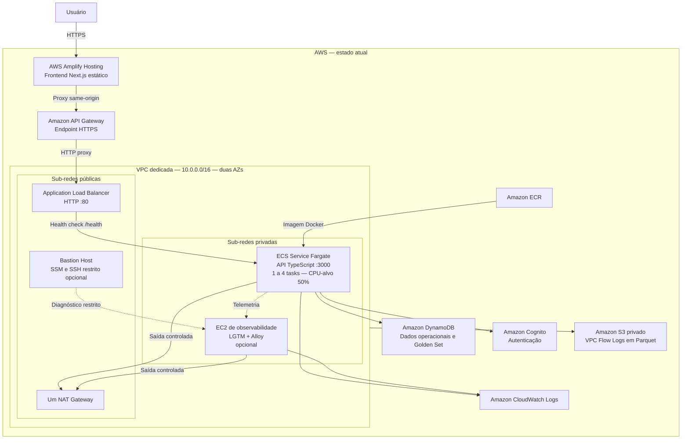
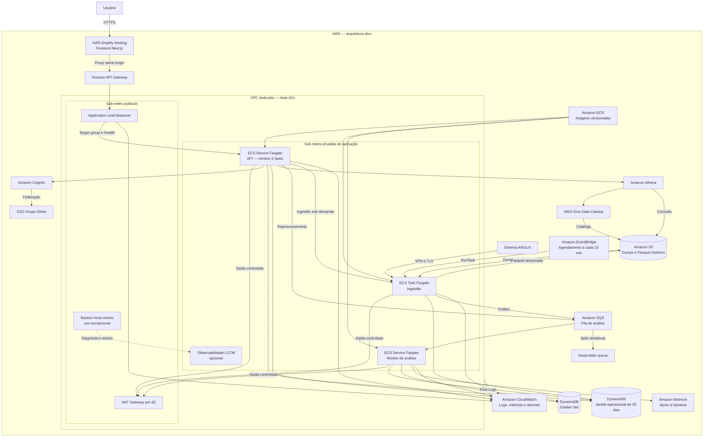

# Infraestrutura e Integração

> Este documento apresenta a infraestrutura em nuvem do View Show, a integração entre seus módulos e o plano de implantação na AWS, considerando o estado implementado e a arquitetura-alvo definida para o projeto.

## Sumário

1. [Introdução](#1-introdução)
2. [Diagramas de implantação](#2-diagramas-de-implantação)
3. [Componentes e justificativas](#3-componentes-e-justificativas)
4. [Plano de deploy na AWS](#4-plano-de-deploy-na-aws)
5. [Evidências e vídeos](#5-evidências-e-vídeos)

---

## 1. Introdução

&emsp;Este artefato descreve a infraestrutura em nuvem do View Show e a integração entre o frontend Next.js, a API TypeScript e os serviços de ingestão e análise. O texto consolida as decisões registradas na arquitetura oficial e na modelagem da solução, com ênfase em disponibilidade, escalabilidade, segurança, observabilidade e rollback.

&emsp;Para preservar a rastreabilidade, o documento distingue dois momentos. O **estado atual** corresponde aos recursos declarados em Terraform e passíveis de evidência na conta AWS; a **arquitetura-alvo** representa a evolução já definida nos documentos canônicos, mas ainda sujeita a implementação e validação. Nenhum recurso planejado deve ser apresentado nos vídeos como se estivesse provisionado.

&emsp;A arquitetura mantém AWS Amplify, Amazon ECS com AWS Fargate e Amazon DynamoDB. Portanto, não prevê migração para EC2 Auto Scaling Group nem para Amazon RDS. A decisão evita contradizer a arquitetura inicial e a modelagem de dados, que adotam processamento em contêineres gerenciados e persistência distribuída. O CloudFront é tratado somente como evolução opcional da entrega do frontend.

## 2. Diagramas de implantação

### 2.1 Estado atual declarado no Terraform

&emsp;No estado atual, o Terraform declara uma VPC dedicada com sub-redes públicas e privadas em duas AZs. O Amplify publica o frontend estático e encaminha as rotas dinâmicas ao API Gateway. O gateway fornece HTTPS para o ALB público, que direciona as requisições à API em tasks Fargate privadas. O backend integra-se ao DynamoDB, Cognito e CloudWatch.

<div align="center">

<strong>Figura 1: Diagrama de implantação da infraestrutura atual</strong>

</div>



<div align="center">

Fonte: Material produzido pelos autores (2026).

</div>

&emsp;As tasks não recebem IP público e utilizam o NAT ou os endpoints de gateway para S3 e DynamoDB. O bastion usa IMDSv2, volume criptografado e SSM por padrão; SSH só é liberado quando `bastion_admin_cidr` recebe um CIDR restrito. A configuração mantém um único NAT Gateway e mínimo padrão de uma task para reduzir custos do Learner Lab, portanto ainda não oferece alta disponibilidade completa.

### 2.2 Arquitetura-alvo

&emsp;A arquitetura-alvo preserva Fargate e DynamoDB e completa o fluxo definido nos artefatos de arquitetura e modelagem. A solução separa entrada pública, processamento privado e dados, distribui os serviços em duas Zonas de Disponibilidade (AZs) e adiciona ingestão agendada, processamento assíncrono e camada analítica.

<div align="center">

<strong>Figura 2: Diagrama de implantação da arquitetura-alvo</strong>

</div>



<div align="center">

Fonte: Material produzido pelos autores (2026).

</div>

## 3. Componentes e justificativas

<div align="center">

<sup>Tabela 1: Componentes da infraestrutura e justificativas arquiteturais</sup>

</div>

| Componente | Estado | Descrição e justificativa |
| --- | --- | --- |
| Terraform | Atual e alvo | Mantém a infraestrutura como código, possibilitando revisão por plano salvo, repetibilidade e rastreabilidade. |
| VPC e sub-redes | Atual e alvo | A VPC `10.0.0.0/16` separa ingresso público e computação privada em duas AZs. Essa divisão reduz a exposição direta das tasks. |
| NAT Gateway e endpoints | Atual; ampliado no alvo | Um NAT fornece saída às sub-redes privadas, enquanto endpoints de gateway atendem S3 e DynamoDB. Um segundo NAT por AZ permanece como evolução de disponibilidade. |
| Bastion Host e SSM | Atual | O bastion atende à evidência administrativa com SSM por padrão e SSH opcional restrito. Tasks Fargate não recebem acesso SSH. |
| Amplify Hosting | Atual e alvo | Publica o export estático do Next.js, fornece HTTPS e mantém o proxy same-origin para a API, reduzindo problemas de CORS e sessão. |
| API Gateway e ALB | Atual e alvo | O API Gateway expõe HTTPS e o ALB público distribui tráfego apenas para tasks privadas saudáveis, verificadas em `/health`. |
| ECS/Fargate — API | Atual e alvo | Executa o backend sem administrar instâncias EC2. ECS Service Auto Scaling mantém de uma a quatro tasks e usa target tracking de 50% de CPU por padrão. |
| ECS/Fargate — ingestão | Alvo | Executa cargas agendadas ou sob demanda de forma isolada e idempotente, sem manter capacidade ociosa entre execuções. |
| ECS/Fargate — worker | Alvo | Consome a fila de análise de forma assíncrona e permite escalar consumidores conforme a profundidade da fila. |
| EventBridge, SQS e DLQ | Alvo | O EventBridge agenda a ingestão; SQS desacopla produtores e consumidores; a DLQ preserva mensagens que excedem as tentativas de processamento. |
| DynamoDB | Atual e alvo | Armazena dados operacionais e o Golden Set em tabelas separadas, com baixa latência e cobrança sob demanda, conforme a modelagem. |
| S3, Glue e Athena | S3 atual para logs; dados no alvo | O S3 já recebe Flow Logs privados em Parquet. No pipeline-alvo, também mantém dados históricos; o Glue cataloga os conjuntos e o Athena executa consultas analíticas. |
| Cognito e SSO | Cognito atual; federação no alvo | Centraliza autenticação e, no alvo, integra a identidade corporativa do Grupo Globo sem armazenar credenciais na aplicação. |
| Bedrock | Configurável; desativado padrão | O runtime possui integração opcional para apoio à geração de hipóteses, mas permanece desligada porque o Learner Lab não disponibiliza o serviço. |
| ECR | Atual e alvo | Armazena imagens da API com tag derivada do conteúdo do build, permitindo rastrear a versão usada pela task definition. |
| CloudWatch, Flow Logs e LGTM | Parcial atual; ampliado no alvo | O CloudWatch recebe logs da API; Flow Logs registram tráfego da VPC em S3 com retenção de 30 dias. A stack LGTM em EC2 privada permanece opcional e acessível por túnel SSM. |

<div align="center">

<sup>Fonte: Material produzido pelos autores (2026).</sup>

</div>

&emsp;O uso de Fargate substitui deliberadamente o requisito literal de EC2 Auto Scaling Group, e o DynamoDB substitui o RDS conforme a modelagem. A elasticidade da API já é implementada pelo ECS Service Auto Scaling; entretanto, o mínimo padrão de uma task e o NAT único priorizam custo e não comprovam alta disponibilidade integral. Essa divergência deve ser apresentada ao avaliador de forma explícita.

## 4. Plano de deploy na AWS

### 4.1 Pré-requisitos e estado Terraform

&emsp;O deploy requer Terraform 1.7 ou superior, Docker em execução, Node.js 22, npm, AWS CLI e a key pair `vockey` na região `us-east-1`. O Terraform usa a cadeia padrão de credenciais da AWS; portanto, `AWS_PROFILE` deve apontar para o perfil do Learner Lab quando ele não for o perfil padrão. A equipe deve conferir a identidade antes de gerar o plano:

```bash
aws sts get-caller-identity --region us-east-1
```

&emsp;Não existe mais a variável obrigatória `aws_account_id`. O namespace `g05-s3` e a região `us-east-1` já são os padrões aceitos, de modo que a stack pode ser planejada sem arquivo `terraform.tfvars`. O estado legado pertence a outra conta e não pode ser adotado. O novo estado local é necessário para o teardown e precisa ser preservado até sua execução explícita.

#### 4.1.1 Execução manual simplificada

&emsp;Para compreender e executar o fluxo básico manualmente, deve-se entrar no diretório da infraestrutura, inicializar o Terraform, revisar o plano exibido e confirmar sua aplicação:

```bash
cd apps/fullstack
terraform init
terraform plan
terraform apply
```

&emsp;Nessa modalidade, o `terraform apply` calcula novamente o plano e solicita confirmação antes de modificar a AWS. O procedimento é adequado para demonstrações e execução assistida, mas não garante que o conteúdo aplicado seja exatamente o mesmo plano revisado anteriormente.

#### 4.1.2 Execução controlada com plano salvo

&emsp;Para a entrega e para execuções automatizadas, recomenda-se salvar o plano, validar seu conteúdo no gate do projeto e aplicar exatamente o arquivo aprovado. Após entrar em `apps/fullstack`, a sequência controlada é:

```bash
cd apps/fullstack
terraform init -backend=false -input=false
terraform fmt -check -recursive
terraform validate
npm --prefix ../backend/api run test:ci-policy

mkdir -p .terraform-artifacts
terraform plan \
  -input=false \
  -out=.terraform-artifacts/g05-s3.tfplan
terraform show -json \
  .terraform-artifacts/g05-s3.tfplan | \
  node ../../scripts/ci/validate-terraform-create-plan.mjs
terraform apply \
  -input=false \
  .terraform-artifacts/g05-s3.tfplan
```

&emsp;Os argumentos `-backend=false` e `-input=false` evitam, respectivamente, a configuração de um backend remoto e as solicitações interativas. O argumento `-out` registra o plano em um arquivo binário, que é inspecionado pelo gate antes de ser fornecido ao `terraform apply`. O gate aceita somente o conjunto conhecido de criações; qualquer alteração, substituição, remoção, importação ou endereço inesperado interrompe o procedimento.

&emsp;O `apply` executa scripts locais para construir e publicar a imagem da API, compilar e publicar o frontend e gerenciar o bucket dos Flow Logs. Por isso, Docker, Node.js e AWS CLI precisam permanecer disponíveis durante toda a execução.

&emsp;Um CIDR administrativo pode ser informado apenas quando houver necessidade de SSH no bastion. O padrão `null` mantém somente o acesso por SSM:

```bash
terraform plan \
  -input=false \
  -var='bastion_admin_cidr=203.0.113.10/32' \
  -out=.terraform-artifacts/g05-s3.tfplan
```

&emsp;O endereço acima é ilustrativo e deve ser substituído pelo IPv4 público do responsável. A validação rejeita `0.0.0.0/0`.

### 4.2 Etapas de provisionamento

<div align="center">

<sup>Tabela 2: Etapas de provisionamento da infraestrutura na AWS</sup>

</div>

| Etapa | Situação | Recursos e ações | Critério de aceite |
| --- | --- | --- | --- |
| 1. Identidade | Atual | Selecionar o perfil AWS, executar `aws sts get-caller-identity` e confirmar a região. | Conta e região conferidas antes do plano. |
| 2. Rede e segurança | Atual | Criar VPC, duas sub-redes públicas, duas privadas, Internet Gateway, NAT único, endpoints S3/DynamoDB, rotas, Security Groups e bastion. | Tasks sem IP público; saída privada funcional; SSH global inexistente. |
| 3. Observabilidade de rede | Atual | Criar bucket privado por script controlado pelo Terraform e habilitar VPC Flow Logs em Parquet com retenção de 30 dias. | Flow Log ativo e objetos disponíveis no prefixo informado pelo output. |
| 4. Aplicação | Atual | Criar ECR, publicar imagem `linux/amd64`, registrar task definition e implantar a API no ECS/Fargate atrás do ALB e do API Gateway. | Target saudável e `/health` respondendo pelos endpoints HTTP e HTTPS. |
| 5. Escala | Atual | Configurar Application Auto Scaling entre uma e quatro tasks, com target tracking de 50% de CPU e cooldowns de 60/120 segundos. | Política visível no ECS e alteração de `desired_count` não revertida pelo Terraform. |
| 6. Dados e autenticação | Atual | Criar tabelas DynamoDB operacional e Golden Set e configurar o Cognito. | Tabelas ativas e variáveis do Cognito presentes na task definition. |
| 7. Frontend | Atual | Compilar o Next.js, publicar o pacote no Amplify e configurar rewrites para `/api/*`, `/auth/*` e `/health`. | Navegação e chamadas same-origin funcionais. |
| 8. Telemetria da aplicação | Parcial | Enviar logs ao CloudWatch e, por opt-in, criar a EC2 privada com LGTM e acesso por túnel SSM. | Logs consultáveis; stack opcional acessível sem exposição pública. |
| 9. Pipeline de dados | Alvo | Adicionar ingestão Fargate, EventBridge, SQS, DLQ, worker, S3 histórico, Glue e Athena. | Fluxo assíncrono e consultas históricas validados antes de serem apresentados como implementados. |

<div align="center">

<sup>Fonte: Material produzido pelos autores (2026).</sup>

</div>

&emsp;O autoescalonamento implementado aplica-se somente à API. Os padrões são mínimo `1`, máximo `4` e CPU-alvo de `50%`; podem ser alterados pelas variáveis `ecs_capacidade_minima`, `ecs_capacidade_maxima` e `ecs_cpu_alvo`. Para maior disponibilidade, a configuração recomendada para produção é mínimo `2` e `quantidade_tasks=2`, após validar a cota e o orçamento do laboratório.

&emsp;O Terraform atual não declara deployment circuit breaker nem rollback automático do ECS. A recuperação operacional consiste em reaplicar uma task definition que aponte para a tag de conteúdo anterior e verificar o health check antes de prosseguir. Como evolução, devem ser adicionados circuit breaker e alarmes do CloudWatch. No pipeline de dados futuro, `datasetVersion`, manifesto ativo, outbox, idempotência e DLQ deverão proteger a consistência. O Terraform recupera infraestrutura, mas não substitui uma estratégia de restauração de dados.

### 4.3 Evolução opcional para CloudFront

&emsp;O CloudFront não substitui o Terraform: o serviço seria provisionado por ele. A migração é opcional e depende da permissão `cloudfront:CreateDistribution`, indisponível no laboratório utilizado. Caso aprovada, deve seguir estes passos:

1. publicar o export estático em bucket S3 privado, versionado e protegido por Origin Access Control;
2. criar a distribuição com HTTPS, compressão e `index.html` como objeto raiz, tratando as rotas do export Next.js;
3. manter o API Gateway como origem dinâmica para `/api/*`, `/auth/*` e `/health`, com cache desabilitado e encaminhamento de cookies e cabeçalhos;
4. validar primeiro o domínio `*.cloudfront.net` e, se houver domínio próprio, usar certificado ACM em `us-east-1` e alias no Route 53;
5. executar testes funcionais, alterar o DNS somente após aprovação e manter o Amplify durante a estabilização.

&emsp;Em caso de falha, o DNS retorna ao Amplify e a distribuição é invalidada quando necessário. Essa evolução não altera as decisões de computação e persistência da arquitetura-alvo.

### 4.4 Como encontrar o link do deploy

&emsp;No estado atual, o endereço público do painel está no output `painel_url`, e o endpoint HTTPS da API está em `api_url_https`:

```bash
cd apps/fullstack
terraform output -raw painel_url
terraform output -raw api_url_https
terraform output rede_vpc
terraform output bastion_acesso
terraform output ecs_auto_scaling
terraform output flow_logs
```

&emsp;Os quatro últimos outputs apoiam a gravação das evidências de rede, segurança, escala e observabilidade. Se a migração opcional for implementada, o Terraform deverá expor também o domínio do CloudFront e o alias do Route 53. Esses comandos apenas consultam o estado e não alteram recursos.

## 5. Evidências e vídeos

&emsp;O Vídeo 2 já está disponível e documenta a integração entre frontend e backend. O link do Vídeo 1 deve ser incluído após a gravação e a conferência das evidências de infraestrutura.

### 5.1 Vídeo 1 — infraestrutura provisionada (5 a 7 minutos)

**Link:** _Pendente de inclusão após a gravação._

- apresentar a VPC `10.0.0.0/16`, duas sub-redes públicas, duas privadas, rotas, endpoints S3/DynamoDB e o único NAT Gateway;
- demonstrar o bastion com SSM, IMDSv2, volume criptografado e ausência de SSH aberto para `0.0.0.0/0`;
- mostrar ALB, target group do tipo IP, health check `/health`, tasks Fargate privadas e política de escala entre 1 e 4 tasks com CPU-alvo de 50%;
- apresentar as tabelas DynamoDB, o bucket privado e os VPC Flow Logs;
- concluir com o CloudWatch e, somente se habilitada, a stack LGTM privada;
- declarar objetivamente que Fargate e DynamoDB substituem EC2 ASG e RDS na arquitetura adotada.

### 5.2 Vídeo 2 — integração frontend e backend (2 a 4 minutos)

**Link:** [Assistir no Google Drive](https://drive.google.com/file/d/1962YkNJ1X2MjZvk6rEfJerdvEHx8yC9T/view?usp=sharing) · 2 min 40 s

&emsp;O vídeo demonstra a validação funcional da aplicação e a comunicação entre os serviços no ambiente implantado na AWS.

- **Validação funcional:** apresentação da suíte automatizada com 70 testes que cobrem domínio, casos de uso, adaptadores de persistência e contrato HTTP, seguida das verificações de disponibilidade da API, recusa de escrita sem sessão e autenticação pelo Cognito.
- **Comunicação entre serviços:** revisão de uma hipótese pela interface, com acompanhamento da mesma requisição no painel de rede do navegador, nos logs do contêiner ECS Fargate e na releitura do estado pela API. O diagnóstico passa de `pending` para `confirmed` e permanece após o recarregamento da página, evidenciando a persistência pelo fluxo Amplify → API Gateway → Application Load Balancer → ECS Fargate → DynamoDB.
