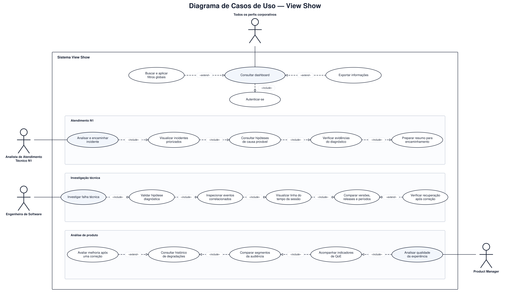

# Modelagem do Sistema

> Este documento apresenta a modelagem estrutural e comportamental do View Show
> por meio de diagramas UML e descrições textuais. A modelagem foi construída com
> base nos requisitos funcionais, não funcionais e decisões arquiteturais do projeto.

## Sumário

1. [Introdução](#1-introdução)
2. [Diagrama de casos de uso](#2-diagrama-de-casos-de-uso)
3. [Descrições dos casos de uso](#3-descrições-dos-casos-de-uso)
4. [Diagrama de classes](#4-diagrama-de-classes)
5. [Diagramas de sequência](#5-diagramas-de-sequência)
6. [Rastreabilidade da modelagem](#6-rastreabilidade-da-modelagem)
7. [Validação e consistência](#7-validação-e-consistência)
8. [Referências](#8-referências)

---

## 1. Introdução

### 1.1 Objetivo

Este artefato tem como objetivo modelar o sistema View Show com base nos
requisitos e funcionalidades definidos nas etapas anteriores do projeto.

A modelagem utiliza diagramas UML e descrições textuais para representar:

- as interações entre os atores e o sistema;
- os fluxos principais, alternativos e de exceção;
- a estrutura lógica das classes;
- as interações temporais entre componentes;
- a rastreabilidade entre requisitos e elementos da modelagem.

### 1.2 Escopo da modelagem

A modelagem de casos de uso contempla a aplicação web interna do View Show,
utilizada por equipes do Globoplay para consultar telemetria, analisar e encaminhar
incidentes, investigar falhas técnicas e acompanhar a qualidade da experiência
(QoE). O recorte corresponde às telas de Login, Visão Geral, Incidentes,
Evidências, Eventos e Monitoramento previstas para o MVP e para a Sprint 3.

Não fazem parte da modelagem de casos de uso:

- a emissão de telemetria pelos frontends do Globoplay;
- os processos internos de ingestão, enfileiramento, normalização e armazenamento;
- a execução de correções, deploys ou rollbacks em produção.

Esses elementos viabilizam o produto, mas não são metas iniciadas diretamente
pelas personas na interface. Integrações e componentes técnicos são tratados nos
artefatos de arquitetura, backend e requisitos.

### 1.3 Documentos de referência

| Documento | Utilização neste artefato |
| --- | --- |
| [Especificação de requisitos](../sprint1/requisitos.md) | Identificação dos requisitos e casos de uso |
| [Entendimento da experiência do usuário](../sprint1/entendimento_ux.md) | Identificação das personas, jornadas e objetivos observáveis no frontend |
| [Arquitetura inicial](../sprint2/arquitetura-inicial.md) | Identificação de componentes e integrações |
| [Documentação de frontend](../sprint2/frontend.md) | Validação dos fluxos de interface |
| [Documentação de backend](../sprint2/backend-sprint-2.md) | Validação de serviços, entidades e operações |

### 1.4 Convenções adotadas

- Casos de uso são identificados como `UC-XX`.
- Requisitos funcionais são identificados como `RFXX`.
- Requisitos não funcionais são identificados como `RNFXX`.
- Classes, métodos e atributos utilizam os nomes empregados no sistema.
- Cada diagrama deve possuir título, fonte e uma descrição que explique como
  interpretá-lo.
- Sempre que possível, a fonte editável do diagrama e sua versão em SVG devem
  ser versionadas no repositório.

---

## 2. Diagrama de casos de uso

### 2.1 Atores

| Ator | Responsabilidade principal |
| --- | --- |
| Todos os perfis corporativos | Acessar o dashboard, filtrar consultas e exportar informações. |
| Analista de Atendimento Técnico N1 | Priorizar e encaminhar incidentes com contexto suficiente. |
| Engenheira de Software | Validar hipóteses e investigar tecnicamente as falhas. |
| Product Manager | Analisar QoE e priorizar problemas pelo impacto na audiência. |

O ator **Todos os perfis corporativos** concentra funções comuns aos três perfis.
O SSO e os frontends do Globoplay foram omitidos porque o diagrama representa o
uso da aplicação web, e não seu contexto técnico.

### 2.2 Catálogo de casos de uso

| Grupo | Casos de uso | Requisitos relacionados |
| --- | --- | --- |
| Compartilhados | UC-01 Consultar dashboard; UC-02 Autenticar-se; UC-03 Buscar e aplicar filtros; UC-04 Exportar informações | RF04, RF07, RF08, RF09, RF10, RNF04, RNF07, RNF14 |
| Atendimento N1 | UC-05 Analisar e encaminhar incidente; UC-06 Visualizar incidentes; UC-07 Consultar hipóteses; UC-08 Verificar evidências; UC-09 Preparar resumo | RF07, RF08, RF09, RNF08, RNF10, RNF13, RNF15 |
| Investigação técnica | UC-10 Investigar falha; UC-11 Validar hipótese; UC-12 Inspecionar eventos; UC-13 Visualizar linha do tempo; UC-14 Comparar versões e períodos; UC-15 Verificar recuperação | RF05, RF06, RF07, RF08, RF09, RNF05, RNF08, RNF10, RNF14 |
| Análise de produto | UC-16 Analisar qualidade da experiência; UC-17 Acompanhar QoE; UC-18 Comparar segmentos; UC-19 Consultar histórico; UC-20 Avaliar melhoria | RF07, RF08, RF09, RNF05, RNF14, RNF15 |

### 2.3 Diagrama

**Figura 1 — Diagrama de casos de uso do View Show.**  
Fonte: Material produzido pelos autores (2026).

### 2.4 Raciocínio de construção e leitura

A fronteira **Sistema View Show** contém somente metas executadas pelas personas
na aplicação web. Ingestão, filas, normalização, armazenamento, deploy e rollback
ficam fora porque são processos técnicos ou externos à interação do usuário.

Os casos foram derivados das telas de Login, Visão Geral, Incidentes, Evidências,
Eventos e Monitoramento. O eixo superior reúne recursos compartilhados; as faixas
inferiores separam Atendimento N1, Investigação Técnica e Análise de Produto. As
faixas organizam responsabilidades e não representam uma sequência obrigatória.

Uma associação indica participação do ator. `include` identifica uma capacidade
necessária ao objetivo de origem, enquanto `extend` identifica uma ação opcional
ou condicionada. A seta aponta para o caso incluído ou estendido.

### 2.5 Relações principais

| Grupo | Relações | Justificativa |
| --- | --- | --- |
| Compartilhados | UC-01 inclui UC-02; UC-03 e UC-04 estendem UC-01 | Autenticação é obrigatória; filtros e exportação são acionados conforme a necessidade. |
| Atendimento N1 | UC-05 inclui progressivamente UC-06, UC-07, UC-08 e UC-09 | A triagem parte da priorização e chega ao resumo fundamentado para encaminhamento. |
| Investigação técnica | UC-10 inclui progressivamente UC-11, UC-12, UC-13 e UC-14; UC-15 estende UC-14 | A investigação valida a hipótese com eventos e comparação; a recuperação só é verificada após uma correção externa. |
| Análise de produto | UC-16 inclui progressivamente UC-17, UC-18 e UC-19; UC-20 estende UC-19 | A análise parte dos indicadores, compara segmentos e histórico e, quando aplicável, mede a melhoria posterior. |

---

## 3. Descrições dos casos de uso

### 3.1 Casos de uso compartilhados

| Caso de uso | Comportamento essencial | Resultado ou limite |
| --- | --- | --- |
| **UC-01 — Consultar dashboard** | Validar a sessão e apresentar indicadores, evolução temporal e incidentes do período selecionado. | Mantém o contexto para aprofundamento; sinaliza dados parciais. |
| **UC-02 — Autenticar-se** | Delegar a autenticação ao SSO corporativo e validar token, domínio e permissões. | Cria uma sessão autorizada sem armazenar senhas. |
| **UC-03 — Buscar e aplicar filtros globais** | Combinar período, dispositivo, versão, região, conteúdo ou componente e atualizar a consulta. | Preserva o recorte entre telas; busca filtrada com P95 de até 2 s e sem PII. |
| **UC-04 — Exportar informações** | Gerar CSV, XLSX ou PDF a partir da consulta atual. | Inclui período, filtros e fonte; anonimiza os dados e registra a operação. |

### 3.2 Atendimento N1

| Caso de uso | Comportamento essencial | Resultado ou limite |
| --- | --- | --- |
| **UC-05 — Analisar e encaminhar incidente** | Revisar impacto, recorte, hipóteses e evidências e selecionar a fila responsável. | Produz encaminhamento contextualizado; a decisão permanece humana. |
| **UC-06 — Visualizar incidentes priorizados** | Listar ocorrências por severidade, impacto, duração ou horário. | Permite selecionar o incidente; informa quando impacto ou dados não estão disponíveis. |
| **UC-07 — Consultar hipóteses de causa provável** | Exibir hipóteses ordenadas com confiança e justificativa. | Comunica incerteza e nunca apresenta hipótese como causa confirmada. |
| **UC-08 — Verificar evidências do diagnóstico** | Consultar fonte, horário, qualidade e comparação com o comportamento de referência. | Distingue evidência de inferência e explicita lacunas ou atrasos. |
| **UC-09 — Preparar resumo para encaminhamento** | Reunir incidente, impacto, recorte, hipótese e evidências em um resumo revisável. | Mantém autoria e contexto e não encaminha automaticamente. |

### 3.3 Investigação técnica

| Caso de uso | Comportamento essencial | Resultado ou limite |
| --- | --- | --- |
| **UC-10 — Investigar falha técnica** | Revisar a hipótese, inspecionar eventos, reconstruir a sessão e comparar versões ou períodos. | Registra conclusão confirmada, refutada ou inconclusiva; não altera a produção. |
| **UC-11 — Validar hipótese diagnóstica** | Confirmar, refutar ou manter inconclusiva a hipótese com justificativa. | Preserva autoria e histórico da decisão. |
| **UC-12 — Inspecionar eventos correlacionados** | Filtrar e abrir eventos `request`, `vitals`, `screen_view`, `video_view`, `session` e `error`. | Exibe dados anonimizados e sinaliza duplicidade, atraso ou payload inválido. |
| **UC-13 — Visualizar linha do tempo da sessão** | Ordenar os eventos e destacar o marco da falha, lacunas e mudanças correlacionadas. | Preserva fuso horário e não infere ordem quando os timestamps são inconfiáveis. |
| **UC-14 — Comparar versões, releases e períodos** | Comparar séries equivalentes mantendo filtros e tamanho da amostra. | Evidencia regressões sem confundir correlação com causalidade. |
| **UC-15 — Verificar recuperação após correção** | Comparar janelas equivalentes antes e depois de uma correção executada fora do sistema. | Classifica recuperação como confirmada, parcial, ausente ou inconclusiva. |

### 3.4 Análise de produto

| Caso de uso | Comportamento essencial | Resultado ou limite |
| --- | --- | --- |
| **UC-16 — Analisar qualidade da experiência** | Examinar métricas agregadas, segmentos e recorrências para priorizar problemas. | Identifica recortes prioritários sem inferir métricas externas como NPS ou retenção. |
| **UC-17 — Acompanhar indicadores de QoE** | Visualizar a evolução de inicialização, buffering, bitrate, resolução, latência e erros. | Exibe definição, unidade, período, amostra e limitações de cobertura. |
| **UC-18 — Comparar segmentos da audiência** | Aplicar os mesmos indicadores a plataformas, dispositivos, versões, regiões ou conteúdos. | Destaca segmentos degradados com critérios equivalentes e amostra mínima. |
| **UC-19 — Consultar histórico de degradações** | Pesquisar incidentes e degradações anteriores por período, segmento ou componente. | Mantém até um ano de histórico, com 30 dias em acesso rápido. |
| **UC-20 — Avaliar melhoria após uma correção** | Comparar a QoE antes e depois da correção no mesmo segmento. | Registra melhora, estabilidade, piora ou inconclusão sem atribuir causalidade indevida. |

---

## 4. Diagrama de classes

### 4.1 Objetivo e escopo

[EXPLICAR qual visão estrutural será representada: domínio, aplicação,
persistência ou combinação controlada dessas visões.]

### 4.2 Diagrama

<!--
Inserir o diagrama de classes exportado em SVG ou PNG.

Exemplo:

-->

[INSERIR DIAGRAMA DE CLASSES UML]

**Figura 2 — Diagrama de classes do View Show.**  
Fonte: Material produzido pelos autores (2026).

### 4.3 Descrição das classes

| Classe | Estereótipo/camada | Responsabilidade | Principais atributos | Principais operações |
| --- | --- | --- | --- | --- |
| `[Classe]` | Entidade | [RESPONSABILIDADE] | `[atributo: Tipo]` | `[metodo(): Retorno]` |
| `[Classe]` | Serviço | [RESPONSABILIDADE] | `[atributo: Tipo]` | `[metodo(): Retorno]` |
| `[Classe]` | Repositório | [RESPONSABILIDADE] | `[atributo: Tipo]` | `[metodo(): Retorno]` |

### 4.4 Relacionamentos

| Origem | Relação | Destino | Multiplicidade | Justificativa |
| --- | --- | --- | --- | --- |
| `[ClasseA]` | Associação | `[ClasseB]` | `1 — 0..*` | [JUSTIFICATIVA] |
| `[ClasseA]` | Composição | `[ClasseB]` | `1 — 1..*` | [JUSTIFICATIVA] |
| `[ClasseA]` | Generalização | `[ClasseB]` | — | [JUSTIFICATIVA] |
| `[ClasseA]` | Dependência | `[ClasseB]` | — | [JUSTIFICATIVA] |

### 4.5 Regras e invariantes do modelo

| ID | Classe(s) envolvida(s) | Regra |
| --- | --- | --- |
| INV-01 | `[Classe]` | [REGRA QUE DEVE PERMANECER VERDADEIRA] |
| INV-02 | `[ClasseA]`, `[ClasseB]` | [REGRA DE CONSISTÊNCIA] |

### 4.6 Decisões de modelagem

[EXPLICAR as principais decisões, abstrações, padrões empregados e elementos
omitidos deliberadamente para manter o diagrama legível.]

---

## 5. Diagramas de sequência

> Deve existir pelo menos um diagrama de sequência para cada fluxo considerado
> crítico. Os cenários escolhidos devem estar ligados a um caso de uso descrito
> na Seção 3.

### 5.1 Catálogo de diagramas de sequência

| ID | Cenário | Caso de uso | Tipo de fluxo | Responsável |
| --- | --- | --- | --- | --- |
| DS-01 | [CENÁRIO PRINCIPAL] | UC-XX | Básico | [Nome] |
| DS-02 | [CENÁRIO ALTERNATIVO] | UC-XX/A1 | Alternativo | [Nome] |
| DS-03 | [CENÁRIO DE FALHA] | UC-XX/E1 | Exceção | [Nome] |

### 5.2 DS-XX — [Nome do cenário]

#### Objetivo

[EXPLICAR o comportamento representado e por que ele é relevante.]

#### Caso de uso relacionado

- **Caso de uso:** UC-XX — [NOME].
- **Fluxo representado:** Básico, A1 ou E1.
- **Pré-condição:** [CONDIÇÃO].
- **Resultado esperado:** [RESULTADO].

#### Participantes

| Participante | Tipo | Responsabilidade |
| --- | --- | --- |
| `[Ator]` | Ator | [RESPONSABILIDADE] |
| `[Interface]` | Boundary | [RESPONSABILIDADE] |
| `[Controlador]` | Control | [RESPONSABILIDADE] |
| `[Entidade]` | Entity | [RESPONSABILIDADE] |
| `[Sistema externo]` | Sistema | [RESPONSABILIDADE] |

#### Diagrama

<!--
Inserir o diagrama de sequência exportado em SVG ou PNG.

Exemplo:

-->

[INSERIR DIAGRAMA DE SEQUÊNCIA UML]

**Figura X — Diagrama de sequência do cenário [NOME].**  
Fonte: Material produzido pelos autores (2026).

#### Descrição textual da sequência

| Ordem | Origem | Destino | Mensagem/operação | Resultado |
| --- | --- | --- | --- | --- |
| 1 | `[Ator]` | `[Interface]` | `[acao()]` | [RESULTADO] |
| 2 | `[Interface]` | `[Controlador]` | `[operacao()]` | [RESULTADO] |
| 3 | `[Controlador]` | `[Entidade/Serviço]` | `[operacao()]` | [RESULTADO] |
| 4 | `[Serviço]` | `[Controlador]` | `[retorno]` | [RESULTADO] |
| 5 | `[Controlador]` | `[Interface]` | `[resposta]` | [RESULTADO] |

#### Fragmentos combinados

| Fragmento | Condição de guarda | Comportamento |
| --- | --- | --- |
| `alt` | `[condição]` | [CAMINHOS ALTERNATIVOS] |
| `opt` | `[condição]` | [COMPORTAMENTO OPCIONAL] |
| `loop` | `[condição de repetição]` | [REPETIÇÃO] |
| `break` | `[condição de interrupção]` | [INTERRUPÇÃO] |

#### Tratamento de erros

[EXPLICAR timeout, indisponibilidade de dependências, dados inválidos,
reprocessamento, mensagens de erro e estado preservado.]

---

## 6. Rastreabilidade da modelagem

A rastreabilidade abaixo registra a origem funcional dos casos de uso. As
ligações com classes e diagramas de sequência serão acrescentadas quando as
Seções 4 e 5 forem concluídas.

| Área ou origem funcional | Casos de uso | Requisitos relacionados | Evidência |
| --- | --- | --- | --- |
| Login e acesso | UC-02 | RF04, RNF04, RIE01, RESTR01 | [Seção 2.2](#22-catálogo-de-casos-de-uso) e [Seção 3.1](#31-casos-de-uso-compartilhados) |
| Visão Geral | UC-01, UC-03, UC-04 | RF07, RF08, RF10, RNF07, RNF14 | [Seção 2.2](#22-catálogo-de-casos-de-uso) e [Seção 3.1](#31-casos-de-uso-compartilhados) |
| Incidentes | UC-05, UC-06 | RF07, RF08, RF09, RNF10, RNF15 | [Seção 3.2](#32-atendimento-n1) |
| Evidências e hipóteses | UC-07, UC-08, UC-09, UC-11 | RF07, RF09, RNF08, RNF13 | [Seção 3.2](#32-atendimento-n1) e [Seção 3.3](#33-investigação-técnica) |
| Eventos correlacionados | UC-12, UC-13 | RF05, RF06, RF09, RNF10, RNF14 | [Seção 3.3](#33-investigação-técnica) |
| Monitoramento e comparação | UC-14 a UC-20 | RF07, RF08, RF09, RF10, RNF05, RNF14, RNF15 | [Seção 3.3](#33-investigação-técnica) e [Seção 3.4](#34-análise-de-produto) |
| Pipeline de telemetria | Não representado neste diagrama | RF01, RF02, RF03, RNF01, RNF02, RNF03, RNF06, RNF11, RNF12, RIE02, RESTR02 | Excluído da fronteira conforme a [Seção 1.2](#12-escopo-da-modelagem) |

---

## 7. Validação e consistência

### 7.1 Lista de verificação

#### Casos de uso

- [x] Todos os atores possuem objetivos claros.
- [x] Todos os casos de uso do diagrama possuem descrição textual.
- [x] Cada caso de uso apresenta seu comportamento essencial e resultado esperado.
- [x] Relações `include` e `extend` possuem justificativa.
- [x] Os casos de uso estão ligados a requisitos existentes.

#### Diagrama de classes

- [ ] As classes representam conceitos ou componentes relevantes.
- [ ] Atributos e operações possuem tipos.
- [ ] Associações possuem multiplicidades.
- [ ] Composição, agregação, herança e dependência foram usadas corretamente.
- [ ] As classes mencionadas nos diagramas de sequência existem no diagrama.
- [ ] O diagrama é consistente com a implementação ou explicita diferenças.

#### Diagramas de sequência

- [ ] Cada diagrama referencia um caso de uso e um fluxo específico.
- [ ] As mensagens aparecem em ordem temporal.
- [ ] Chamadas síncronas, assíncronas e retornos estão diferenciados.
- [ ] Alternativas e exceções usam fragmentos combinados.
- [ ] Participantes correspondem a atores, interfaces, serviços ou classes reais.
- [ ] O resultado final corresponde às pós-condições do caso de uso.

### 7.2 Pendências consolidadas

| ID | Pendência | Impacto | Responsável | Prazo | Status |
| --- | --- | --- | --- | --- | --- |
| P-01 | [PENDÊNCIA] | Alto/Médio/Baixo | [Nome] | DD/MM | Aberta |
| P-02 | [PENDÊNCIA] | Alto/Médio/Baixo | [Nome] | DD/MM | Aberta |

### 7.3 Revisão cruzada

| Entrega | Autor principal | Revisor | Resultado |
| --- | --- | --- | --- |
| Casos de uso e descrições | Pessoa 1 | Pessoa 2 | [PENDENTE/APROVADO] |
| Diagrama de classes | Pessoa 2 | Pessoa 3 | [PENDENTE/APROVADO] |
| Diagramas de sequência | Pessoa 3 | Pessoa 1 | [PENDENTE/APROVADO] |
| Rastreabilidade e consistência final | Equipe | Equipe | [PENDENTE/APROVADO] |

---

## 8. Referências

LARMAN, Craig. *Utilizando UML e padrões: uma introdução à análise e ao projeto
orientados a objetos e ao desenvolvimento iterativo*. Porto Alegre: Bookman.
Disponível em:
https://integrada.minhabiblioteca.com.br/reader/books/9788577800476.
Acesso em: DD mês AAAA.

OBJECT MANAGEMENT GROUP. *Unified Modeling Language — UML*. Disponível em:
https://www.omg.org/spec/UML/. Acesso em: DD mês AAAA.

GRUPO 05 — OS BIG BROTHERS. *Especificação de requisitos: Monitoramento de
Frontend Globoplay*. 2026. Disponível em:
[requisitos.md](../sprint1/requisitos.md).
