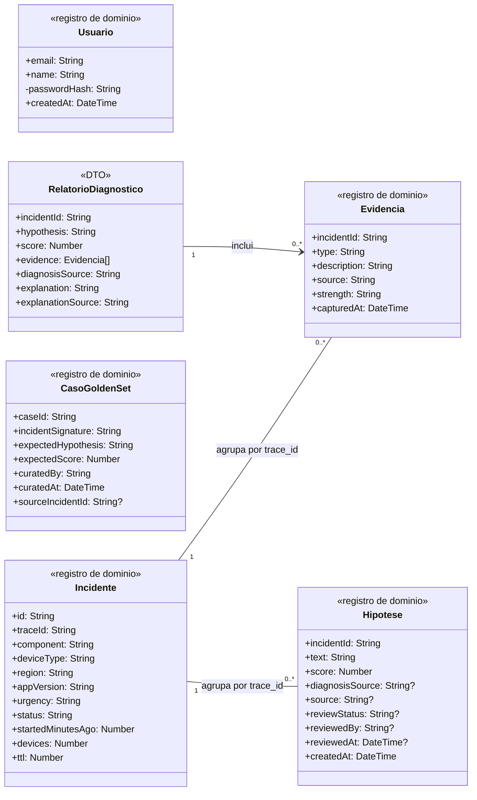
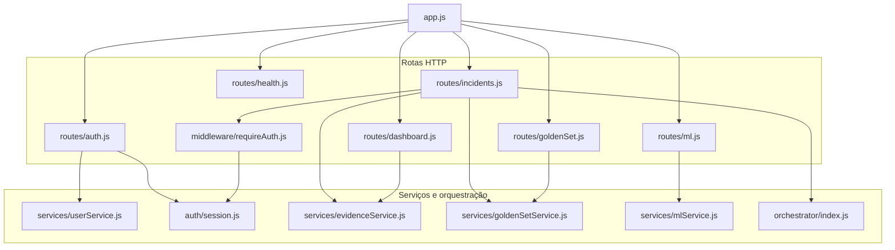
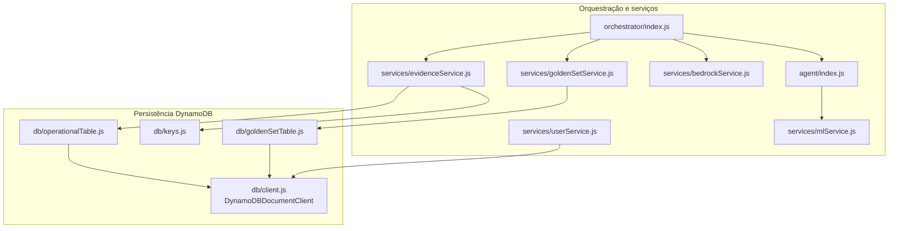
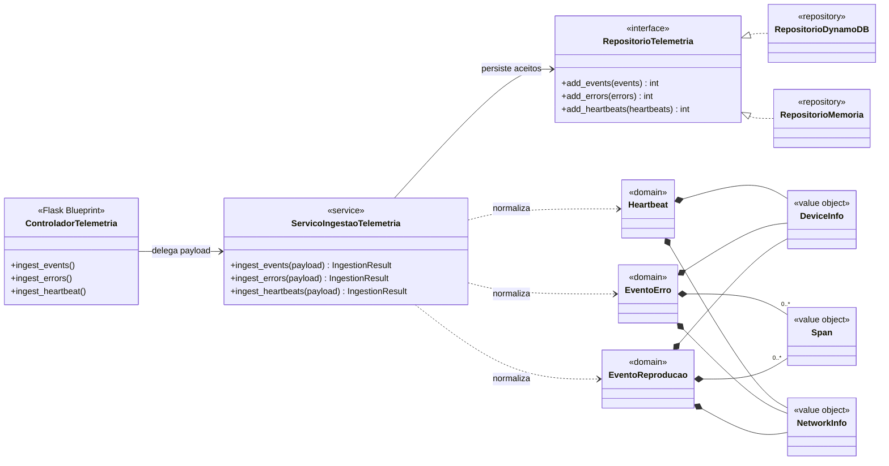

# Modelagem do Sistema — View Show

> Este documento apresenta a modelagem estrutural e comportamental do View Show
> por meio de diagramas UML e descrições textuais. A modelagem foi construída com
> base nos requisitos funcionais, não funcionais e decisões arquiteturais do projeto.

## Sumário

1. [Introdução](#1-introdução)
2. [Diagrama de casos de uso](#2-diagrama-de-casos-de-uso)
3. [Descrições dos casos de uso](#3-descrições-dos-casos-de-uso)
4. [Diagrama de classes](#4-diagrama-de-classes)
5. [Diagramas de sequência](#5-diagramas-de-sequência)
6. [Rastreabilidade da modelagem](#6-rastreabilidade-da-modelagem)
7. [Validação e consistência](#7-validação-e-consistência)
8. [Referências](#8-referências)

---

## 1. Introdução

### 1.1 Objetivo

Este artefato tem como objetivo modelar o sistema View Show com base nos
requisitos e funcionalidades definidos nas etapas anteriores do projeto.

A modelagem utiliza diagramas UML e descrições textuais para representar:

- as interações entre os atores e o sistema;
- os fluxos principais, alternativos e de exceção;
- a estrutura lógica das classes;
- as interações temporais entre componentes;
- a rastreabilidade entre requisitos e elementos da modelagem.

### 1.2 Escopo da modelagem

A modelagem contempla as funcionalidades pertencentes ao escopo da Sprint 3 e
ao MVP do View Show.

[DESCREVER quais módulos, funcionalidades e fronteiras estão incluídos.]

Não fazem parte desta modelagem:

- [ITEM FORA DO ESCOPO];
- [ITEM FORA DO ESCOPO];
- [ITEM FORA DO ESCOPO].

### 1.3 Documentos de referência

| Documento | Utilização neste artefato |
| --- | --- |
| [Especificação de requisitos](../sprint1/requisitos.md) | Identificação dos requisitos e casos de uso |
| [Arquitetura inicial](../sprint2/arquitetura-inicial.md) | Identificação de componentes e integrações |
| [Documentação de frontend](../sprint2/frontend.md) | Validação dos fluxos de interface |
| [Documentação de backend](../sprint2/backend-sprint-2.md) | Validação de serviços, entidades e operações |

### 1.4 Convenções adotadas

- Casos de uso são identificados como `UC-XX`.
- Requisitos funcionais são identificados como `RFXX`.
- Requisitos não funcionais são identificados como `RNFXX`.
- Fluxos alternativos são identificados como `A1`, `A2`, etc.
- Fluxos de exceção são identificados como `E1`, `E2`, etc.
- Classes, métodos e atributos utilizam os nomes empregados no sistema.
- Cada diagrama deve possuir título, fonte e uma descrição que explique como
  interpretá-lo.
- Sempre que possível, a fonte editável do diagrama e sua versão em SVG devem
  ser versionadas no repositório.

---

## 2. Diagrama de casos de uso

### 2.1 Atores

| ID | Ator | Tipo | Descrição |
| --- | --- | --- | --- |
| AT-01 | [NOME DO ATOR] | Primário | [OBJETIVO E RESPONSABILIDADE] |
| AT-02 | [NOME DO ATOR] | Secundário | [SERVIÇO PRESTADO AO SISTEMA] |
| AT-03 | [SISTEMA EXTERNO] | Sistema | [FORMA DE INTEGRAÇÃO] |

### 2.2 Catálogo de casos de uso

A tabela abaixo deve ser validada contra os requisitos da Sprint 1 antes da
elaboração do diagrama.

| ID | Caso de uso | Ator principal | Requisitos relacionados | Responsável | Status |
| --- | --- | --- | --- | --- | --- |
| UC-01 | Autenticar usuário | Usuário interno | RF04, RNF04 | [Nome] | A fazer |
| UC-02 | Ingerir eventos de telemetria | Aplicação frontend | RF01, RF02, RF06 | [Nome] | A fazer |
| UC-03 | Normalizar eventos | Sistema de processamento | RF03 | [Nome] | A fazer |
| UC-04 | Visualizar eventos | Usuário interno | RF05, RF07 | [Nome] | A fazer |
| UC-05 | Filtrar e investigar falhas | Usuário interno | RF07, RF09 | [Nome] | A fazer |
| UC-06 | Consultar métricas e alertas | Usuário interno | RF08 | [Nome] | A fazer |
| UC-07 | Exportar dados | Usuário interno | RF10 | [Nome] | A fazer |
| UC-XX | [OUTRO CASO DE USO] | [ATOR] | [RFXX] | [Nome] | A fazer |

> Os casos acima são candidatos iniciais. A equipe deve confirmar se representam
> o comportamento efetivamente entregue na Sprint 3.

### 2.3 Diagrama

<!--
Inserir o diagrama de casos de uso exportado em SVG ou PNG.

Exemplo:

Também é recomendado disponibilizar a fonte editável:
[Arquivo-fonte do diagrama](../../assets/modelagem/casos-de-uso.puml)
-->

[INSERIR DIAGRAMA DE CASOS DE USO]

**Diagrama x — Diagrama de casos de uso do View Show.**
Fonte: Material produzido pelos autores (2026).

### 2.4 Descrição geral

[EXPLICAR os limites do sistema, os atores, os principais casos de uso e as
relações `include`, `extend` ou generalizações presentes no diagrama.]

### 2.5 Relações entre casos de uso

| Origem | Relação | Destino | Justificativa |
| --- | --- | --- | --- |
| UC-XX | `include` | UC-YY | [COMPORTAMENTO OBRIGATÓRIO REUTILIZADO] |
| UC-XX | `extend` | UC-ZZ | [COMPORTAMENTO OPCIONAL OU CONDICIONAL] |
| [ATOR/UC] | Generalização | [ATOR/UC] | [JUSTIFICATIVA] |

---

## 3. Descrições dos casos de uso

> Duplicar a subseção seguinte para cada caso de uso identificado no diagrama.
> A estrutura segue as seções solicitadas para uma descrição em estilo completo.

### 3.1 UC-XX — [Nome do caso de uso]

#### Escopo

[IDENTIFICAR o sistema ou subsistema tratado pelo caso de uso.]

#### Nível

[OBJETIVO DO USUÁRIO, SUBFUNÇÃO OU RESUMO.]

#### Atores

- **Ator principal:** [ATOR QUE INICIA O CASO DE USO].
- **Atores secundários:** [ATORES OU SISTEMAS DE APOIO].

#### Interessados e interesses

| Interessado | Interesse |
| --- | --- |
| [USUÁRIO OU ÁREA] | [RESULTADO OU GARANTIA ESPERADA] |
| [ADMINISTRADOR] | [INTERESSE] |
| [SISTEMA EXTERNO] | [INTERESSE] |

#### Pré-condições

- [CONDIÇÃO QUE DEVE SER VERDADEIRA ANTES DO INÍCIO];
- [CONDIÇÃO ADICIONAL].

#### Pós-condições

**Em caso de sucesso:**

- [ESTADO GARANTIDO APÓS O SUCESSO];
- [DADO CRIADO, ALTERADO OU DISPONIBILIZADO].

**Garantias mínimas:**

- [ESTADO PRESERVADO MESMO QUANDO O OBJETIVO NÃO É CONCLUÍDO];
- [REGISTRO, AUDITORIA OU AUSÊNCIA DE ALTERAÇÃO INDEVIDA].

#### Fluxo Básico

| Passo | Responsável | Ação |
| --- | --- | --- |
| 1 | Ator principal | [AÇÃO QUE INICIA O CASO DE USO] |
| 2 | Sistema | [VALIDAÇÃO OU PROCESSAMENTO] |
| 3 | Sistema | [RESPOSTA OU SOLICITAÇÃO] |
| 4 | Ator principal | [PRÓXIMA INTERAÇÃO] |
| 5 | Sistema | [PROCESSAMENTO] |
| 6 | Sistema | [RESULTADO DE SUCESSO] |

#### Fluxos alternativos

##### Alternativas

| ID | Passo de origem | Condição | Fluxo | Retorno |
| --- | --- | --- | --- | --- |
| A1 | Passo X | [CONDIÇÃO ALTERNATIVA] | [AÇÕES EXECUTADAS] | Passo Y |
| A2 | Passo X | [CONDIÇÃO ALTERNATIVA] | [AÇÕES EXECUTADAS] | Encerra |

##### Exceções

| ID | Passo de origem | Exceção | Resposta do sistema | Estado final |
| --- | --- | --- | --- | --- |
| E1 | Passo X | [ERRO DE VALIDAÇÃO] | [MENSAGEM E TRATAMENTO] | [ESTADO] |
| E2 | Passo X | [INDISPONIBILIDADE] | [FALLBACK OU REGISTRO] | [ESTADO] |

#### Requisitos especiais

| ID | Requisito especial | Origem |
| --- | --- | --- |
| RE-01 | [SEGURANÇA, DESEMPENHO, USABILIDADE OU AUDITORIA] | RNFXX |
| RE-02 | [RESTRIÇÃO DE INTERFACE OU TECNOLOGIA] | RNFXX/RIE/RESTR |

#### Lista de variantes

| Variação | Possibilidades | Impacto no caso de uso |
| --- | --- | --- |
| Canal ou interface | [WEB, API, PROCESSO AUTOMÁTICO] | [IMPACTO] |
| Formato de entrada | [JSON, CSV, OUTRO] | [IMPACTO] |
| Perfil de usuário | [PERFIL A, PERFIL B] | [IMPACTO] |

#### Frequência de ocorrência

[INFORMAR a frequência esperada, o volume estimado e possíveis períodos de pico.]

#### Problemas em aberto

| ID | Problema ou decisão pendente | Responsável | Prazo | Status |
| --- | --- | --- | --- | --- |
| PA-01 | [QUESTÃO A SER RESOLVIDA] | [Nome] | DD/MM | Aberto |
| PA-02 | [QUESTÃO A SER RESOLVIDA] | [Nome] | DD/MM | Aberto |

---

## 4. Diagrama de classes

### 4.1. Objetivo e escopo

&emsp;Esta seção documenta duas partes implementadas do backend, mantidas como contextos separados no repositório:

- a API Node.js de consulta, diagnóstico e curadoria, em <code>apps/backend/api</code>;
- a API Flask de ingestão e normalização de telemetria, em <code>apps/basica/backend</code>.

&emsp;Para evitar misturar entidades de domínio com módulos de infraestrutura em uma única figura, a modelagem foi dividida em três visões complementares: modelo de domínio e DTO de diagnóstico, dependências da API Node.js e contexto de ingestão Flask. Nos diagramas de dependências, módulos JavaScript e componentes Flask recebem estereótipos UML para dar rastreabilidade ao código; isso não significa que todos sejam classes em tempo de execução.

&emsp;O frontend permanece fora do escopo porque apenas consome as APIs. Também não são representados componentes futuros ainda ausentes do código, como um job ARGUS/SQS. Essa exclusão não abrange a ingestão Flask, que já implementa os endpoints de eventos, erros e heartbeat, validação, normalização e persistência relacionados a RF01–RF03 e RF06.

### 4.2. Diagramas

#### 4.2.1. Modelo de domínio e relatório de diagnóstico

**Figura x — Modelo de domínio e DTO da API de diagnóstico.**
Fonte: Material produzido pelos autores (2026), com base em <code>apps/backend/api/src</code>.

&emsp;As ligações acima são associações lógicas usadas para recuperar o bundle pelo <code>trace_id</code>; não representam chave estrangeira, exclusão em cascata ou ciclo de vida transacional no DynamoDB. Os campos <code>reviewedBy</code> e <code>sourceIncidentId</code> são valores escalares copiados, por isso não foram desenhados como associações estruturais com <code>Usuario</code> ou <code>Incidente</code>.

&emsp;O atributo <code>passwordHash</code> é mantido porque esta visão descreve fielmente a implementação atual da API Node.js. Ele constitui, porém, uma dívida técnica: RF04, RNF04 e RESTR01 determinam que a autenticação do produto-alvo seja delegada ao SSO corporativo e que o View Show não armazene senhas. Sua presença não representa uma decisão arquitetural aprovada e deve ser removida quando a integração federada substituir a sessão local do protótipo.

#### 4.2.2. Rotas e serviços da API Node.js

**Figura x — Dependências entre rotas e serviços da API Node.js.**
Fonte: Material produzido pelos autores (2026), com base nos <code>require</code> de <code>apps/backend/api/src</code>.

#### 4.2.3. Orquestração e persistência da API Node.js

**Figura x — Dependências de orquestração e persistência da API Node.js.**
Fonte: Material produzido pelos autores (2026), com base nos <code>require</code> de <code>apps/backend/api/src</code>.

&emsp;<code>TabelaOperacional</code> representa especificamente o módulo <code>db/operationalTable.js</code>, não a tabela física. O serviço de usuários contorna esse wrapper e envia <code>GetCommand</code> e <code>PutCommand</code> diretamente pelo <code>DynamoDBDocumentClient</code>. Essa exceção à fronteira do repositório de incidentes está explícita na Figura x.

#### 4.2.4. Contexto implementado de ingestão Flask

**Figura x — Classes principais do contexto Flask de ingestão.**
Fonte: Material produzido pelos autores (2026), com base em <code>apps/basica/backend/app</code>.

### 4.3. Descrição dos elementos

#### 4.3.1. Domínio e DTO

| Elemento | Tipo | Responsabilidade | Principais atributos | Origem no código |
|:---|:---|:---|:---|:---|
| <code>Usuario</code> | Registro de domínio | Representa a conta local do protótipo, identificada como dívida técnica a ser substituída pela identidade federada. | <code>email</code>, <code>name</code>, <code>passwordHash</code>, <code>createdAt</code> | <code>src/services/userService.js</code>; item <code>USER#&lt;email&gt;</code> |
| <code>Incidente</code> | Registro de domínio | Agrupa uma falha ou degradação detectada. | <code>id</code>, <code>traceId</code>, componente, dispositivo, região, versão e estado | item <code>INCIDENT#&lt;id&gt;</code> na tabela operacional |
| <code>Evidencia</code> | Registro de domínio | Sinal coletado em favor ou contra uma hipótese. | <code>incidentId</code>, tipo, descrição, origem, força e captura | item v2 <code>EVIDENCE#&lt;id&gt;#&lt;seq&gt;</code> |
| <code>Hipotese</code> | Registro de domínio | Diagnóstico gerado ou semeado e seu estado opcional de revisão humana. | texto, score, origem, revisão e criação | item v2 <code>HYPOTHESIS#&lt;id&gt;#&lt;epoch&gt;</code> |
| <code>CasoGoldenSet</code> | Registro de domínio | Diagnóstico confirmado e indexado por assinatura determinística. | identificador, assinatura, hipótese e score esperados, curadoria e incidente de origem opcional | <code>src/services/goldenSetService.js</code> |
| <code>RelatorioDiagnostico</code> | DTO | Retorno não persistido do orquestrador. | <code>incidentId</code>, hipótese, score, <code>evidence</code>, origem e explicação | objeto retornado por <code>orchestrator.diagnose()</code> |

#### 4.3.2. API Node.js

| Elemento | Camada | Responsabilidade | Origem no código |
|:---|:---|:---|:---|
| <code>AplicacaoExpress</code> | Bootstrap HTTP | Registra os seis routers e os middlewares globais. | <code>src/app.js</code> |
| <code>ControladorAutenticacao</code> | HTTP | Expõe login, cadastro e o stub de SSO. | <code>src/routes/auth.js</code> |
| <code>ControladorIncidentes</code> | HTTP | Expõe listagem, detalhe, evidências, hipótese, revisão e diagnóstico. | <code>src/routes/incidents.js</code> |
| <code>ControladorDashboard</code> | HTTP | Expõe o resumo agregado de incidentes. | <code>src/routes/dashboard.js</code> |
| <code>ControladorGoldenSet</code> | HTTP | Busca um caso curado por assinatura. | <code>src/routes/goldenSet.js</code> |
| <code>ControladorML</code> | HTTP | Expõe diretamente o contrato mockado de análise. | <code>src/routes/ml.js</code> |
| <code>ControladorHealth</code> | HTTP | Expõe o estado básico do processo. | <code>src/routes/health.js</code> |
| <code>MiddlewareAutenticacao</code> | Middleware | Protege a revisão de hipótese com cookie de sessão válido. | <code>src/middleware/requireAuth.js</code> |
| <code>ServicoUsuario</code> | Serviço | Cria e autentica contas; acessa o cliente DynamoDB diretamente e usa memória como fallback local. | <code>src/services/userService.js</code> |
| <code>GerenciadorSessao</code> | Serviço | Assina, verifica e interpreta o cookie de sessão. | <code>src/auth/session.js</code> |
| <code>ServicoEvidencias</code> | Serviço | Consulta incidentes e bundles e grava/revisa hipóteses. | <code>src/services/evidenceService.js</code> |
| <code>ServicoGoldenSet</code> | Serviço | Consulta casos por assinatura e promove hipóteses confirmadas. | <code>src/services/goldenSetService.js</code> |
| <code>ServicoML</code> | Serviço | Analisa a entrada segundo um contrato atualmente mockado. | <code>src/services/mlService.js</code> |
| <code>ServicoExplicacao</code> | Serviço | Produz explicação via Bedrock ou template de fallback. | <code>src/services/bedrockService.js</code> |
| <code>Orquestrador</code> | Orquestração | Escolhe golden set ou agente, persiste a hipótese e monta o relatório. | <code>src/orchestrator/index.js</code> |
| <code>AgenteInvestigador</code> | Orquestração | Combina incidente, evidências e o score do serviço de ML. | <code>src/agent/index.js</code> |
| <code>TabelaOperacional</code> | Persistência | Wrapper de Query, Put e Update para incidentes, evidências e hipóteses. | <code>src/db/operationalTable.js</code> |
| <code>TabelaGoldenSet</code> | Persistência | Wrapper de Get, Query e escrita curada da golden set. | <code>src/db/goldenSetTable.js</code> |
| <code>ClienteDynamoDB</code> | Infraestrutura | Instância compartilhada de <code>DynamoDBDocumentClient</code>. | <code>src/db/client.js</code> |
| <code>ChavesDynamoDB</code> | Infraestrutura | Monta chaves v2 e classifica itens dos schemas v1 e v2. | <code>src/db/keys.js</code> |

#### 4.3.3. Ingestão Flask

| Elemento | Camada | Responsabilidade | Origem no código |
|:---|:---|:---|:---|
| <code>ControladorTelemetria</code> | HTTP | Recebe eventos, erros e heartbeat nos endpoints <code>/v1/telemetry</code>. | <code>app/controllers/telemetry.py</code> |
| <code>ServicoIngestaoTelemetria</code> | Serviço | Valida lotes, normaliza itens, separa aceitos e rejeitados e persiste os aceitos. | <code>app/services/ingestion.py</code> |
| <code>RepositorioTelemetria</code> | Porta | Define o contrato de persistência e consulta da telemetria. | <code>app/repositories/base.py</code> |
| <code>RepositorioDynamoDB</code> | Adaptador | Implementa o contrato usando DynamoDB. | <code>app/repositories/dynamodb.py</code> |
| <code>RepositorioMemoria</code> | Adaptador | Implementa o mesmo contrato para execução local e testes. | <code>app/repositories/memory.py</code> |
| <code>EventoReproducao</code>, <code>EventoErro</code>, <code>Heartbeat</code> | Domínio | Representam os três tipos persistidos pela ingestão. | <code>app/domain/models.py</code> |
| <code>DeviceInfo</code>, <code>NetworkInfo</code>, <code>Span</code> | Objetos de valor | Estruturam dispositivo, rede e trechos de trace. | <code>app/domain/models.py</code> |

#### 4.3.4. Mapeamento entre nomes conceituais e persistidos

&emsp; Os diagramas usam nomes conceituais em português e camelCase para leitura. A tabela
abaixo torna explícita a tradução para os objetos efetivamente persistidos.

| Elemento conceitual | Campo ou representação física | Obrigatoriedade e observação |
|:---|:---|:---|
| <code>Incidente.traceId</code> | <code>trace_id</code> | Obrigatório nos itens do bundle e chave do GSI <code>trace-index</code>. |
| <code>Evidencia.seq</code> | último segmento de <code>sk</code> | Não existe como atributo separado; é codificado com três dígitos na chave. |
| <code>Hipotese.origem</code> | <code>diagnosisSource</code> ou <code>source</code> | Diagnósticos gerados usam <code>diagnosisSource</code>; hipóteses do seed usam <code>source</code>. |
| <code>Hipotese.reviewStatus</code> | <code>reviewStatus</code> | Opcional até ocorrer revisão humana. |
| <code>Hipotese.reviewedBy</code> | <code>reviewedBy</code> | Opcional até ocorrer revisão humana; contém um e-mail copiado. |
| <code>Hipotese.reviewedAt</code> | <code>reviewedAt</code> | Opcional até ocorrer revisão humana. |
| <code>CasoGoldenSet.caseId</code> | <code>case_id</code> | Obrigatório e usado como chave primária. |
| <code>CasoGoldenSet.incidentSignature</code> | <code>incident_signature</code> | Obrigatório. |
| <code>CasoGoldenSet.expectedHypothesis</code> | <code>expected_hypothesis</code> | Obrigatório. |
| <code>CasoGoldenSet.expectedScore</code> | <code>expected_score</code> | Obrigatório. |
| <code>CasoGoldenSet.curatedBy</code> | <code>curated_by</code> | Obrigatório. |
| <code>CasoGoldenSet.curatedAt</code> | <code>curated_at</code> | Obrigatório. |
| <code>CasoGoldenSet.sourceIncidentId</code> | <code>source_incident_id</code> | Opcional; casos carregados pelo seed não possuem esse campo. |
| Identidade técnica do item | <code>pk</code> e <code>sk</code> | Infraestrutura de persistência, omitida dos registros de domínio. |

#### 4.3.5. Versões do schema da tabela operacional

| Tipo | Schema v2 — novas escritas | Schema v1 — somente leitura legada |
|:---|:---|:---|
| Incidente | <code>INCIDENT#&lt;id&gt;</code> | igual ao v2 |
| Evidência | <code>EVIDENCE#&lt;id&gt;#&lt;seq:3&gt;</code> | <code>INCIDENT#&lt;id&gt;#EVIDENCE#&lt;seq&gt;</code> |
| Hipótese | <code>HYPOTHESIS#&lt;id&gt;#&lt;epoch:10&gt;</code> | <code>INCIDENT#&lt;id&gt;#HYPOTHESIS#&lt;epoch&gt;</code> |

&emsp; <code>db/keys.js</code> gera apenas chaves v2 para novas escritas e reconhece os dois
formatos durante a transição. Todos os itens relacionados carregam o mesmo
<code>trace_id</code>; <code>getIncidentBundle()</code> consulta o GSI
<code>trace-index</code> por esse valor e remonta o bundle sem depender do prefixo de
<code>sk</code>.

### 4.4. Relacionamentos e dependências

| Origem | Relação | Destino | Multiplicidade | Justificativa |
|:---|:---|:---|:---|:---|
| <code>Incidente</code> | Associação | <code>Evidencia</code> | <code>1 — 0..*</code> | Compartilham <code>trace_id</code>, mas não há exclusão em cascata nem transação de ciclo de vida. |
| <code>Incidente</code> | Associação | <code>Hipotese</code> | <code>1 — 0..*</code> | O bundle reúne as hipóteses pelo GSI; cada item possui persistência e TTL próprios. |
| <code>RelatorioDiagnostico</code> | Associação | <code>Evidencia</code> | <code>1 — 0..*</code> | O retorno de <code>diagnose()</code> inclui o array <code>evidence</code>. |
| <code>ControladorIncidentes</code> | Dependência | serviços de evidências, golden set, orquestrador e autenticação | — | Corresponde aos imports reais de <code>routes/incidents.js</code>. |
| <code>ControladorGoldenSet</code> | Dependência | <code>ServicoGoldenSet</code> | — | A rota consulta diretamente o serviço por assinatura. |
| <code>ControladorML</code> | Dependência | <code>ServicoML</code> | — | A rota expõe diretamente <code>mlService.analyze()</code>. |
| <code>Orquestrador</code> | Dependência | evidências, golden set, explicação e agente | — | Decide a origem do diagnóstico e combina o resultado. |
| <code>AgenteInvestigador</code> | Dependência | <code>ServicoML</code> | — | Recebe dados prontos e delega o cálculo do score. |
| <code>ServicoEvidencias</code> | Dependência | <code>TabelaOperacional</code> e <code>ChavesDynamoDB</code> | — | Usa o wrapper para persistência e o módulo de chaves para schema/classificação. |
| <code>ServicoUsuario</code> | Dependência | <code>ClienteDynamoDB</code> | — | Envia comandos diretamente, sem importar <code>TabelaOperacional</code>. |
| <code>TabelaOperacional</code>, <code>TabelaGoldenSet</code> | Dependência | <code>ClienteDynamoDB</code> | — | Ambos os wrappers compartilham o cliente de baixo nível. |
| <code>ServicoIngestaoTelemetria</code> | Dependência | <code>RepositorioTelemetria</code> | — | Persiste registros normalizados por meio do contrato. |
| Adaptadores DynamoDB e memória | Realização | <code>RepositorioTelemetria</code> | — | Implementam a mesma porta de persistência. |

&emsp;<code>reviewedBy</code> e <code>source_incident_id</code> são valores escalares sem integridade referencial; por isso não recebem multiplicidades nem associações no diagrama.

### 4.5. Regras, garantias e limitações

| ID | Elemento(s) | Regra, garantia ou limitação |
|:---|:---|:---|
| INV-01 | <code>Usuario</code> | Enquanto o desvio local do protótipo existir, a senha não pode ser persistida em texto puro; a conformidade final exige remover também o hash e delegar a autenticação ao SSO. |
| INV-02 | <code>CasoGoldenSet</code> | A promoção para a golden set é disparada somente pela rota de revisão humana quando <code>status = "confirmed"</code>; orquestrador e agente não promovem casos. |
| INV-03 | <code>Incidente</code>, <code>Evidencia</code>, <code>Hipotese</code> | Itens do mesmo incidente compartilham <code>trace_id</code>, permitindo recuperar o bundle por uma consulta ao GSI, tanto para chaves v2 quanto para itens v1 legados. |
| REG-04 | <code>Hipotese</code> | A leitura considera mais recente a hipótese cujo último segmento de <code>sk</code> é lexicograficamente maior. |
| LIM-01 | <code>Hipotese</code> | Hipóteses geradas usam epoch em segundos e <code>PutCommand</code> sem condição. Duas gravações para o mesmo incidente no mesmo segundo podem usar a mesma chave e a segunda pode sobrescrever a primeira; preservação integral do histórico não é garantida. |
| GAR-01 | <code>ServicoExplicacao</code> | Uma falha específica na chamada ao Bedrock é capturada e substituída por explicação baseada em template. |
| LIM-02 | <code>Orquestrador</code> | <code>diagnose()</code> retorna <code>null</code> quando o incidente não existe e pode propagar falhas de persistência, golden set, agente ou ML; portanto não há garantia de produzir sempre um relatório. |

### 4.6. Decisões de modelagem

- **Visões separadas para legibilidade.** Domínio, dependências da API Node.js e ingestão Flask foram divididos em três figuras. Isso evita cruzar relações de natureza diferente e mantém os nomes dos arquivos rastreáveis.
- **Registros de domínio sem métodos próprios.** Na API Node.js, usuário, incidente, evidência, hipótese e caso da golden set são objetos literais persistidos. Métodos aparecem nos módulos de serviço, orquestração e infraestrutura que realmente os implementam.
- **Fronteira de persistência representada como implementada.** <code>TabelaOperacional</code> e <code>TabelaGoldenSet</code> são wrappers de acesso que compartilham <code>ClienteDynamoDB</code>. <code>ServicoUsuario</code> também compartilha o cliente, mas acessa a tabela física diretamente; essa exceção está documentada em vez de ser reinterpretada como uso do wrapper operacional.
- **Transição de schema explícita.** Novas escritas usam v2; v1 permanece apenas como formato legado reconhecido por <code>itemTypeFromSk()</code>. O GSI por <code>trace_id</code> desacopla a remontagem do bundle do prefixo da chave de ordenação.
- **Referências escalares não viram associações estruturais.** E-mail do revisor e identificador do incidente de origem não possuem chave estrangeira ou garantia de existência. Eles aparecem apenas no mapeamento de campos.
- **DTO explícito e completo.** <code>RelatorioDiagnostico</code> não corresponde a uma classe concreta, mas representa exatamente o objeto literal devolvido pelo orquestrador, incluindo <code>evidence</code>.
- **Ingestão existente em contexto próprio.** O backend Flask implementa coleta, validação, normalização e persistência de telemetria e foi modelado separadamente. Componentes futuros de fila/worker não foram inventados.

---

## 5. Diagramas de sequência

> Deve existir pelo menos um diagrama de sequência para cada fluxo considerado
> crítico. Os cenários escolhidos devem estar ligados a um caso de uso descrito
> na Seção 3.

### 5.1 Catálogo de diagramas de sequência

| ID | Cenário | Caso de uso | Tipo de fluxo | Responsável |
| --- | --- | --- | --- | --- |
| DS-01 | [CENÁRIO PRINCIPAL] | UC-XX | Básico | [Nome] |
| DS-02 | [CENÁRIO ALTERNATIVO] | UC-XX/A1 | Alternativo | [Nome] |
| DS-03 | [CENÁRIO DE FALHA] | UC-XX/E1 | Exceção | [Nome] |

### 5.2 DS-XX — [Nome do cenário]

#### Objetivo

[EXPLICAR o comportamento representado e por que ele é relevante.]

#### Caso de uso relacionado

- **Caso de uso:** UC-XX — [NOME].
- **Fluxo representado:** Básico, A1 ou E1.
- **Pré-condição:** [CONDIÇÃO].
- **Resultado esperado:** [RESULTADO].

#### Participantes

| Participante | Tipo | Responsabilidade |
| --- | --- | --- |
| `[Ator]` | Ator | [RESPONSABILIDADE] |
| `[Interface]` | Boundary | [RESPONSABILIDADE] |
| `[Controlador]` | Control | [RESPONSABILIDADE] |
| `[Entidade]` | Entity | [RESPONSABILIDADE] |
| `[Sistema externo]` | Sistema | [RESPONSABILIDADE] |

#### Diagrama

<!--
Inserir o diagrama de sequência exportado em SVG ou PNG.

Exemplo:

-->

[INSERIR DIAGRAMA DE SEQUÊNCIA UML]

**Figura x — Diagrama de sequência do cenário [NOME].**
Fonte: Material produzido pelos autores (2026).

#### Descrição textual da sequência

| Ordem | Origem | Destino | Mensagem/operação | Resultado |
| --- | --- | --- | --- | --- |
| 1 | `[Ator]` | `[Interface]` | `[acao()]` | [RESULTADO] |
| 2 | `[Interface]` | `[Controlador]` | `[operacao()]` | [RESULTADO] |
| 3 | `[Controlador]` | `[Entidade/Serviço]` | `[operacao()]` | [RESULTADO] |
| 4 | `[Serviço]` | `[Controlador]` | `[retorno]` | [RESULTADO] |
| 5 | `[Controlador]` | `[Interface]` | `[resposta]` | [RESULTADO] |

#### Fragmentos combinados

| Fragmento | Condição de guarda | Comportamento |
| --- | --- | --- |
| `alt` | `[condição]` | [CAMINHOS ALTERNATIVOS] |
| `opt` | `[condição]` | [COMPORTAMENTO OPCIONAL] |
| `loop` | `[condição de repetição]` | [REPETIÇÃO] |
| `break` | `[condição de interrupção]` | [INTERRUPÇÃO] |

#### Tratamento de erros

[EXPLICAR timeout, indisponibilidade de dependências, dados inválidos,
reprocessamento, mensagens de erro e estado preservado.]

---

## 6. Rastreabilidade da modelagem

| Requisito | Caso de uso | Classes principais | Diagrama de sequência | Evidência |
| --- | --- | --- | --- | --- |
| RF01 | UC-02 | `[ClasseA]`, `[ClasseB]` | DS-XX | [SEÇÃO/LINK] |
| RF04 | UC-01 | `[ClasseA]`, `[ClasseB]` | DS-XX | [SEÇÃO/LINK] |
| RF07 | UC-04, UC-05 | `[ClasseA]`, `[ClasseB]` | DS-XX | [SEÇÃO/LINK] |
| RF10 | UC-07 | `[ClasseA]`, `[ClasseB]` | DS-XX | [SEÇÃO/LINK] |

---

## 7. Validação e consistência

### 7.1 Lista de verificação

#### Casos de uso

- [ ] Todos os atores possuem objetivos claros.
- [ ] Todos os casos de uso do diagrama possuem descrição textual.
- [ ] Os fluxos básicos terminam em uma pós-condição de sucesso.
- [ ] Fluxos alternativos e de exceção referenciam passos do fluxo básico.
- [ ] Relações `include` e `extend` possuem justificativa.
- [ ] Os casos de uso estão ligados a requisitos existentes.

#### Diagrama de classes

- [ ] As classes representam conceitos ou componentes relevantes.
- [ ] Atributos e operações possuem tipos.
- [ ] Associações possuem multiplicidades.
- [ ] Composição, agregação, herança e dependência foram usadas corretamente.
- [ ] As classes mencionadas nos diagramas de sequência existem no diagrama.
- [ ] O diagrama é consistente com a implementação ou explicita diferenças.

#### Diagramas de sequência

- [ ] Cada diagrama referencia um caso de uso e um fluxo específico.
- [ ] As mensagens aparecem em ordem temporal.
- [ ] Chamadas síncronas, assíncronas e retornos estão diferenciados.
- [ ] Alternativas e exceções usam fragmentos combinados.
- [ ] Participantes correspondem a atores, interfaces, serviços ou classes reais.
- [ ] O resultado final corresponde às pós-condições do caso de uso.

### 7.2 Pendências consolidadas

| ID | Pendência | Impacto | Responsável | Prazo | Status |
| --- | --- | --- | --- | --- | --- |
| P-01 | [PENDÊNCIA] | Alto/Médio/Baixo | [Nome] | DD/MM | Aberta |
| P-02 | [PENDÊNCIA] | Alto/Médio/Baixo | [Nome] | DD/MM | Aberta |

### 7.3 Revisão cruzada

| Entrega | Autor principal | Revisor | Resultado |
| --- | --- | --- | --- |
| Casos de uso e descrições | Pessoa 1 | Pessoa 2 | [PENDENTE/APROVADO] |
| Diagrama de classes | Pessoa 2 | Pessoa 3 | [PENDENTE/APROVADO] |
| Diagramas de sequência | Pessoa 3 | Pessoa 1 | [PENDENTE/APROVADO] |
| Rastreabilidade e consistência final | Equipe | Equipe | [PENDENTE/APROVADO] |

---

## 8. Referências

LARMAN, Craig. *Utilizando UML e padrões: uma introdução à análise e ao projeto orientados a objetos e ao desenvolvimento iterativo*. 3. ed. Porto Alegre: Bookman, 2007. E-book. Disponível em: https://integrada.minhabiblioteca.com.br/reader/books/9788577800476. Acesso em: 6 set. 2026.

OBJECT MANAGEMENT GROUP. *OMG Unified Modeling Language (OMG UML)*. Version 2.5.1. 2017. Disponível em: https://www.omg.org/spec/UML/2.5.1. Acesso em: 6 set. 2026.

GRUPO 05 — OS BIG BROTHERS. *Especificação de requisitos: Monitoramento de Frontend Globoplay*. 2026. Disponível em: [requisitos.md](../sprint1/requisitos.md).
