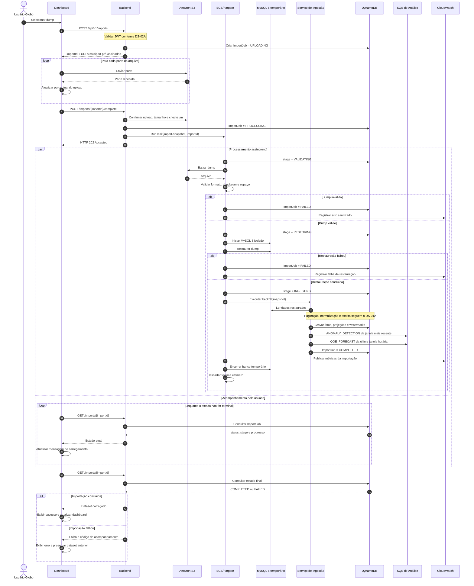
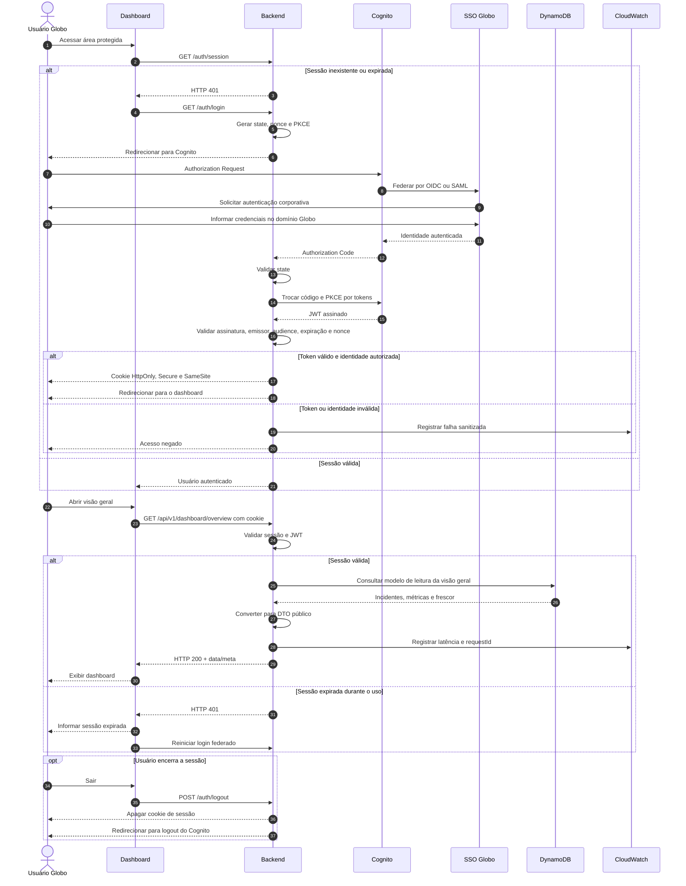
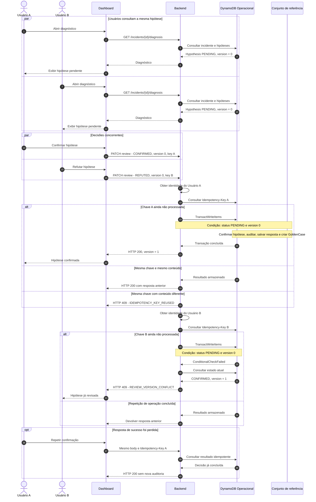
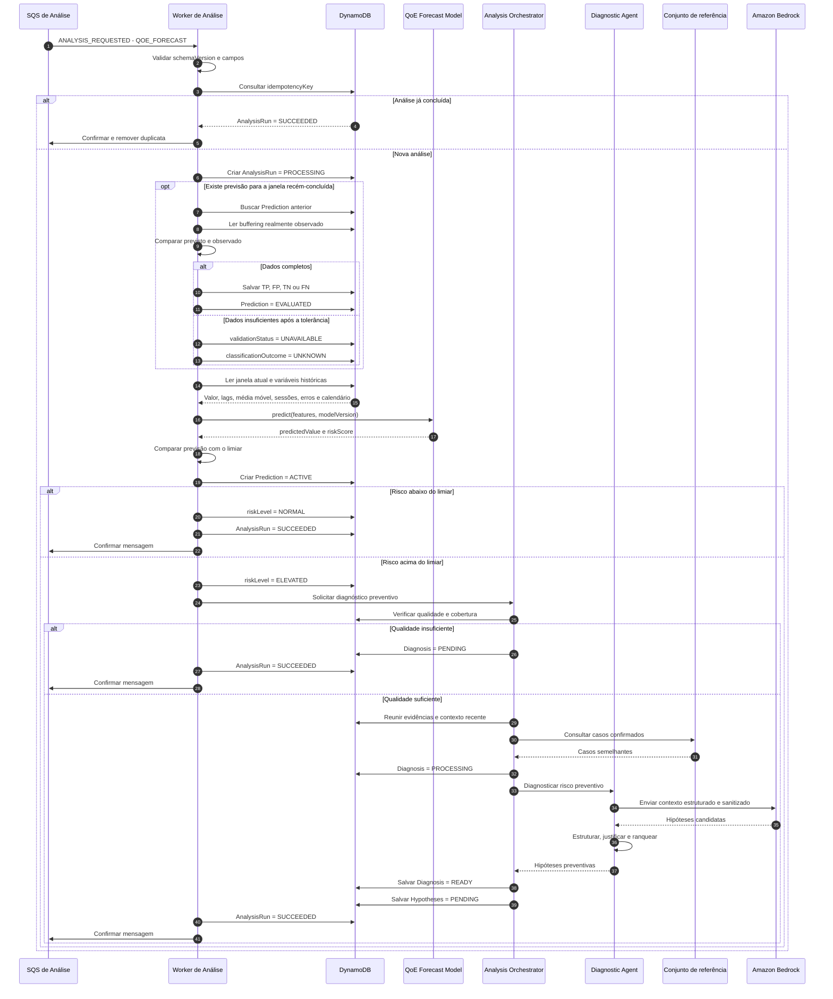
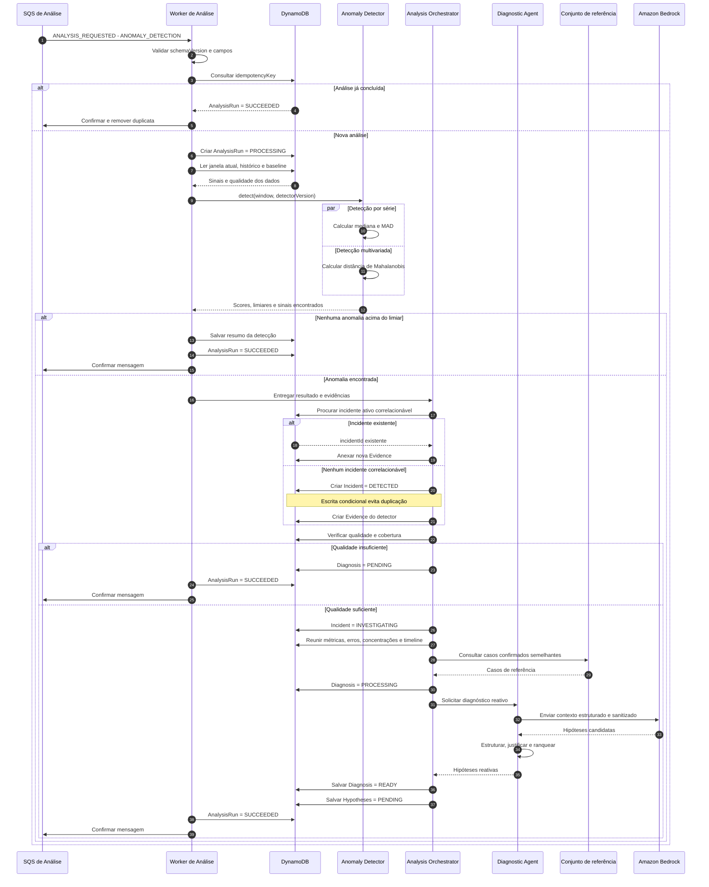
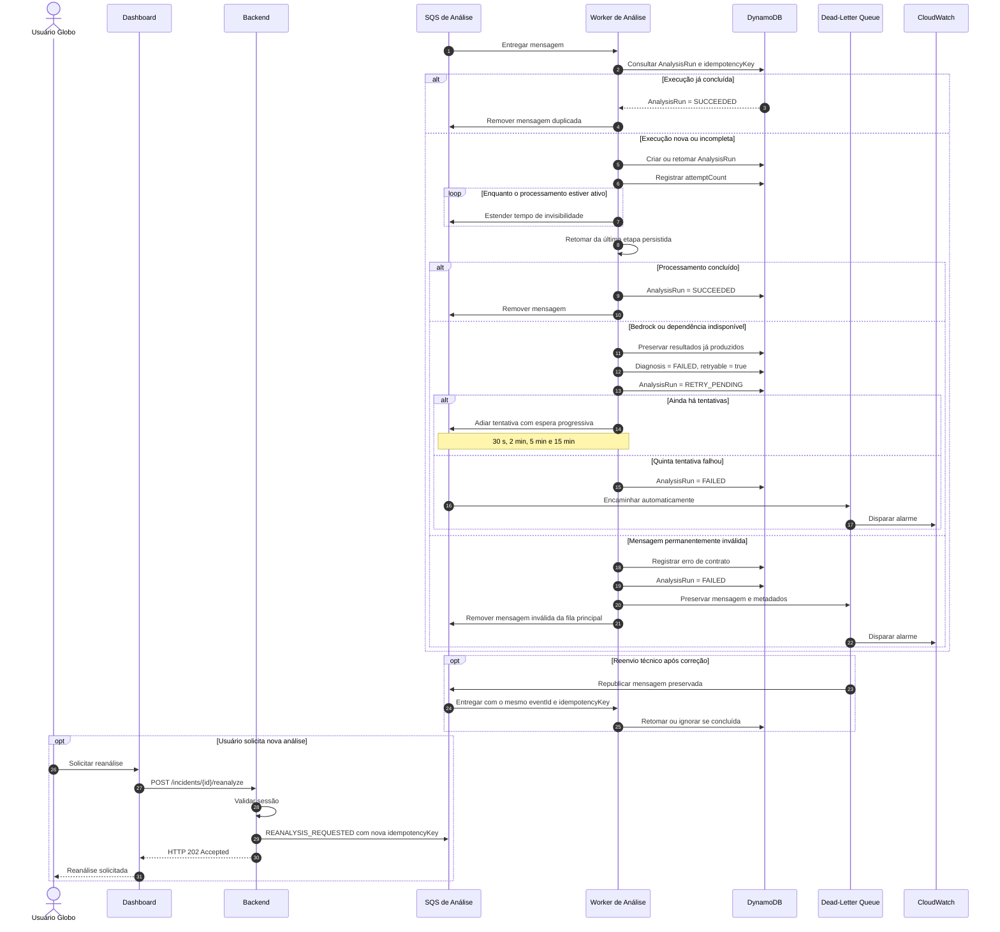
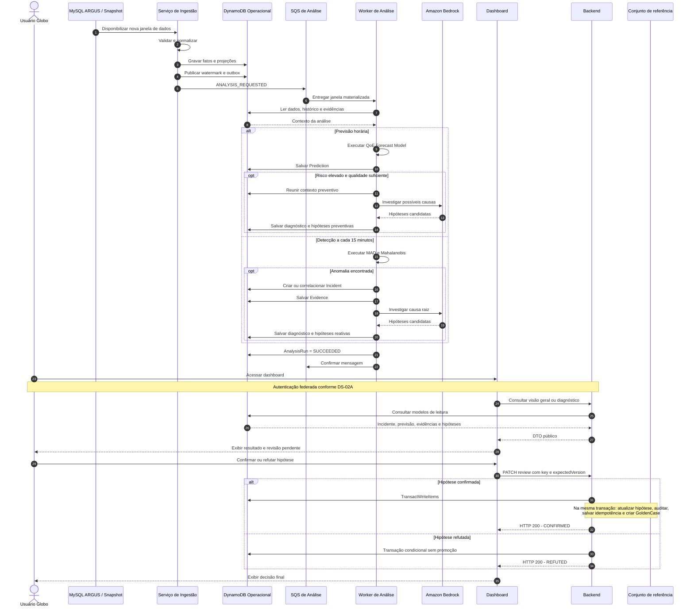

# Modelagem do Sistema — View Show

> Este documento apresenta a modelagem estrutural e comportamental do View Show
> por meio de diagramas UML e descrições textuais. A modelagem foi construída com
> base nos requisitos funcionais, não funcionais e decisões arquiteturais do projeto.

## Sumário

1. [Introdução](#1-introdução)
2. [Diagrama de casos de uso](#2-diagrama-de-casos-de-uso)
3. [Descrições dos casos de uso](#3-descrições-dos-casos-de-uso)
4. [Diagrama de classes](#4-diagrama-de-classes)
5. [Diagramas de sequência](#5-diagramas-de-sequência)
6. [Rastreabilidade da modelagem](#6-rastreabilidade-da-modelagem)
7. [Validação e consistência](#7-validação-e-consistência)
8. [Referências](#8-referências)

---

## 1. Introdução

### 1.1 Objetivo

Este artefato tem como objetivo modelar o sistema View Show com base nos
requisitos e funcionalidades definidos nas etapas anteriores do projeto.

A modelagem utiliza diagramas UML e descrições textuais para representar:

- as interações entre os atores e o sistema;
- os fluxos principais, alternativos e de exceção;
- a estrutura lógica das classes;
- as interações temporais entre componentes;
- a rastreabilidade entre requisitos e elementos da modelagem.

### 1.2 Escopo da modelagem

A modelagem contempla as funcionalidades pertencentes ao escopo da Sprint 3 e
ao MVP do View Show.

[DESCREVER quais módulos, funcionalidades e fronteiras estão incluídos.]

Não fazem parte desta modelagem:

- [ITEM FORA DO ESCOPO];
- [ITEM FORA DO ESCOPO];
- [ITEM FORA DO ESCOPO].

### 1.3 Documentos de referência

| Documento | Utilização neste artefato |
| --- | --- |
| [Especificação de requisitos](../sprint1/requisitos.md) | Identificação dos requisitos e casos de uso |
| [Arquitetura inicial](../sprint2/arquitetura-inicial.md) | Identificação de componentes e integrações |
| [Documentação de frontend](../sprint2/frontend.md) | Validação dos fluxos de interface |
| [Documentação de backend](../sprint2/backend-sprint-2.md) | Validação de serviços, entidades e operações |

### 1.4 Convenções adotadas

- Casos de uso são identificados como `UC-XX`.
- Requisitos funcionais são identificados como `RFXX`.
- Requisitos não funcionais são identificados como `RNFXX`.
- Fluxos alternativos são identificados como `A1`, `A2`, etc.
- Fluxos de exceção são identificados como `E1`, `E2`, etc.
- Classes, métodos e atributos utilizam os nomes empregados no sistema.
- Cada diagrama deve possuir título, fonte e uma descrição que explique como
  interpretá-lo.
- Sempre que possível, a fonte editável do diagrama e sua versão em SVG devem
  ser versionadas no repositório.

---

## 2. Diagrama de casos de uso

### 2.1 Atores

| ID | Ator | Tipo | Descrição |
| --- | --- | --- | --- |
| AT-01 | [NOME DO ATOR] | Primário | [OBJETIVO E RESPONSABILIDADE] |
| AT-02 | [NOME DO ATOR] | Secundário | [SERVIÇO PRESTADO AO SISTEMA] |
| AT-03 | [SISTEMA EXTERNO] | Sistema | [FORMA DE INTEGRAÇÃO] |

### 2.2 Catálogo de casos de uso

A tabela abaixo deve ser validada contra os requisitos da Sprint 1 antes da
elaboração do diagrama.

| ID | Caso de uso | Ator principal | Requisitos relacionados | Responsável | Status |
| --- | --- | --- | --- | --- | --- |
| UC-01 | Autenticar usuário | Usuário interno | RF04, RNF04 | [Nome] | A fazer |
| UC-02 | Ingerir eventos de telemetria | Aplicação frontend | RF01, RF02, RF06 | [Nome] | A fazer |
| UC-03 | Normalizar eventos | Sistema de processamento | RF03 | [Nome] | A fazer |
| UC-04 | Visualizar eventos | Usuário interno | RF05, RF07 | [Nome] | A fazer |
| UC-05 | Filtrar e investigar falhas | Usuário interno | RF07, RF09 | [Nome] | A fazer |
| UC-06 | Consultar métricas e alertas | Usuário interno | RF08 | [Nome] | A fazer |
| UC-07 | Exportar dados | Usuário interno | RF10 | [Nome] | A fazer |
| UC-XX | [OUTRO CASO DE USO] | [ATOR] | [RFXX] | [Nome] | A fazer |

> Os casos acima são candidatos iniciais. A equipe deve confirmar se representam
> o comportamento efetivamente entregue na Sprint 3.

### 2.3 Diagrama

<!--
Inserir o diagrama de casos de uso exportado em SVG ou PNG.

Exemplo:

Também é recomendado disponibilizar a fonte editável:
[Arquivo-fonte do diagrama](../../assets/modelagem/casos-de-uso.puml)
-->

[INSERIR DIAGRAMA DE CASOS DE USO]

**Figura 1 — Diagrama de casos de uso do View Show.**  
Fonte: Material produzido pelos autores (2026).

### 2.4 Descrição geral

[EXPLICAR os limites do sistema, os atores, os principais casos de uso e as
relações `include`, `extend` ou generalizações presentes no diagrama.]

### 2.5 Relações entre casos de uso

| Origem | Relação | Destino | Justificativa |
| --- | --- | --- | --- |
| UC-XX | `include` | UC-YY | [COMPORTAMENTO OBRIGATÓRIO REUTILIZADO] |
| UC-XX | `extend` | UC-ZZ | [COMPORTAMENTO OPCIONAL OU CONDICIONAL] |
| [ATOR/UC] | Generalização | [ATOR/UC] | [JUSTIFICATIVA] |

---

## 3. Descrições dos casos de uso

> Duplicar a subseção seguinte para cada caso de uso identificado no diagrama.
> A estrutura segue as seções solicitadas para uma descrição em estilo completo.

### 3.1 UC-XX — [Nome do caso de uso]

#### Escopo

[IDENTIFICAR o sistema ou subsistema tratado pelo caso de uso.]

#### Nível

[OBJETIVO DO USUÁRIO, SUBFUNÇÃO OU RESUMO.]

#### Atores

- **Ator principal:** [ATOR QUE INICIA O CASO DE USO].
- **Atores secundários:** [ATORES OU SISTEMAS DE APOIO].

#### Interessados e interesses

| Interessado | Interesse |
| --- | --- |
| [USUÁRIO OU ÁREA] | [RESULTADO OU GARANTIA ESPERADA] |
| [ADMINISTRADOR] | [INTERESSE] |
| [SISTEMA EXTERNO] | [INTERESSE] |

#### Pré-condições

- [CONDIÇÃO QUE DEVE SER VERDADEIRA ANTES DO INÍCIO];
- [CONDIÇÃO ADICIONAL].

#### Pós-condições

**Em caso de sucesso:**

- [ESTADO GARANTIDO APÓS O SUCESSO];
- [DADO CRIADO, ALTERADO OU DISPONIBILIZADO].

**Garantias mínimas:**

- [ESTADO PRESERVADO MESMO QUANDO O OBJETIVO NÃO É CONCLUÍDO];
- [REGISTRO, AUDITORIA OU AUSÊNCIA DE ALTERAÇÃO INDEVIDA].

#### Fluxo Básico

| Passo | Responsável | Ação |
| --- | --- | --- |
| 1 | Ator principal | [AÇÃO QUE INICIA O CASO DE USO] |
| 2 | Sistema | [VALIDAÇÃO OU PROCESSAMENTO] |
| 3 | Sistema | [RESPOSTA OU SOLICITAÇÃO] |
| 4 | Ator principal | [PRÓXIMA INTERAÇÃO] |
| 5 | Sistema | [PROCESSAMENTO] |
| 6 | Sistema | [RESULTADO DE SUCESSO] |

#### Fluxos alternativos

##### Alternativas

| ID | Passo de origem | Condição | Fluxo | Retorno |
| --- | --- | --- | --- | --- |
| A1 | Passo X | [CONDIÇÃO ALTERNATIVA] | [AÇÕES EXECUTADAS] | Passo Y |
| A2 | Passo X | [CONDIÇÃO ALTERNATIVA] | [AÇÕES EXECUTADAS] | Encerra |

##### Exceções

| ID | Passo de origem | Exceção | Resposta do sistema | Estado final |
| --- | --- | --- | --- | --- |
| E1 | Passo X | [ERRO DE VALIDAÇÃO] | [MENSAGEM E TRATAMENTO] | [ESTADO] |
| E2 | Passo X | [INDISPONIBILIDADE] | [FALLBACK OU REGISTRO] | [ESTADO] |

#### Requisitos especiais

| ID | Requisito especial | Origem |
| --- | --- | --- |
| RE-01 | [SEGURANÇA, DESEMPENHO, USABILIDADE OU AUDITORIA] | RNFXX |
| RE-02 | [RESTRIÇÃO DE INTERFACE OU TECNOLOGIA] | RNFXX/RIE/RESTR |

#### Lista de variantes

| Variação | Possibilidades | Impacto no caso de uso |
| --- | --- | --- |
| Canal ou interface | [WEB, API, PROCESSO AUTOMÁTICO] | [IMPACTO] |
| Formato de entrada | [JSON, CSV, OUTRO] | [IMPACTO] |
| Perfil de usuário | [PERFIL A, PERFIL B] | [IMPACTO] |

#### Frequência de ocorrência

[INFORMAR a frequência esperada, o volume estimado e possíveis períodos de pico.]

#### Problemas em aberto

| ID | Problema ou decisão pendente | Responsável | Prazo | Status |
| --- | --- | --- | --- | --- |
| PA-01 | [QUESTÃO A SER RESOLVIDA] | [Nome] | DD/MM | Aberto |
| PA-02 | [QUESTÃO A SER RESOLVIDA] | [Nome] | DD/MM | Aberto |

---

## 4. Diagrama de classes

### 4.1 Objetivo e escopo

[EXPLICAR qual visão estrutural será representada: domínio, aplicação,
persistência ou combinação controlada dessas visões.]

### 4.2 Diagrama

<!--
Inserir o diagrama de classes exportado em SVG ou PNG.

Exemplo:

-->

[INSERIR DIAGRAMA DE CLASSES UML]

**Figura 2 — Diagrama de classes do View Show.**  
Fonte: Material produzido pelos autores (2026).

### 4.3 Descrição das classes

| Classe | Estereótipo/camada | Responsabilidade | Principais atributos | Principais operações |
| --- | --- | --- | --- | --- |
| `[Classe]` | Entidade | [RESPONSABILIDADE] | `[atributo: Tipo]` | `[metodo(): Retorno]` |
| `[Classe]` | Serviço | [RESPONSABILIDADE] | `[atributo: Tipo]` | `[metodo(): Retorno]` |
| `[Classe]` | Repositório | [RESPONSABILIDADE] | `[atributo: Tipo]` | `[metodo(): Retorno]` |

### 4.4 Relacionamentos

| Origem | Relação | Destino | Multiplicidade | Justificativa |
| --- | --- | --- | --- | --- |
| `[ClasseA]` | Associação | `[ClasseB]` | `1 — 0..*` | [JUSTIFICATIVA] |
| `[ClasseA]` | Composição | `[ClasseB]` | `1 — 1..*` | [JUSTIFICATIVA] |
| `[ClasseA]` | Generalização | `[ClasseB]` | — | [JUSTIFICATIVA] |
| `[ClasseA]` | Dependência | `[ClasseB]` | — | [JUSTIFICATIVA] |

### 4.5 Regras e invariantes do modelo

| ID | Classe(s) envolvida(s) | Regra |
| --- | --- | --- |
| INV-01 | `[Classe]` | [REGRA QUE DEVE PERMANECER VERDADEIRA] |
| INV-02 | `[ClasseA]`, `[ClasseB]` | [REGRA DE CONSISTÊNCIA] |

### 4.6 Decisões de modelagem

[EXPLICAR as principais decisões, abstrações, padrões empregados e elementos
omitidos deliberadamente para manter o diagrama legível.]

---

## 5. Diagramas de sequência

&emsp;Os diagramas de sequência são diagramas de interação da UML utilizados para
representar, em ordem temporal, as mensagens trocadas entre os participantes de
um comportamento. A disposição das linhas de vida e das mensagens permite
identificar responsabilidades, dependências e caminhos alternativos durante a
realização de um cenário. Essa representação segue os conceitos de interação
definidos pela especificação UML 2.5.1 (OBJECT MANAGEMENT GROUP, 2017) e a
abordagem apresentada por Larman (2007).

&emsp;Larman (2007) diferencia os Diagramas de Sequência do Sistema, que tratam o
sistema como uma caixa-preta, dos diagramas de interação empregados no projeto
orientado a objetos, que detalham os participantes internos e suas mensagens.
Nesta seção, adota-se a segunda perspectiva em nível de componentes e serviços.
Por esse motivo, os diagramas apresentam elementos internos do View Show, como
o Backend, os workers, as filas e os serviços de armazenamento.

&emsp;No View Show, esses diagramas descrevem como os dados saem do ARGUS, tornam-se
informações analisáveis e chegam aos usuários. A seção contempla a ingestão
periódica e por snapshot, a autenticação, a consulta, a revisão humana, a
previsão de degradações, a detecção de incidentes e a recuperação de falhas.
Cada diagrama é acompanhado por uma explicação de seu objetivo e das decisões
arquiteturais necessárias para compreender o fluxo.

&emsp;Esta seção registra a representação acadêmica produzida durante a sprint. A
versão técnica mantida para orientar o desenvolvimento, acompanhada dos
contratos de dados, eventos e API, está em
[Fluxos integrados do View Show](../arquitetura/fluxos.md).

### 5.1 Catálogo de diagramas de sequência

&emsp;Os oito diagramas foram organizados por cenário e vinculados aos casos de uso
que realizam ou apoiam. A Tabela 5.1 funciona como índice da seção e diferencia
as interações iniciadas pelo usuário dos processos técnicos executados de forma
assíncrona.

<strong>Tabela 5.1: Catálogo dos diagramas de sequência</strong>

| ID | Cenário | Casos de uso relacionados | Tipo de fluxo | Responsável |
| --- | --- | --- | --- | --- |
| DS-01A | Sincronização com o MySQL vivo | UC-01, UC-06, UC-17, UC-19 | Suporte técnico | Equipe de arquitetura |
| DS-01B | Importação de snapshot pela interface | UC-01, UC-06, UC-17, UC-19 | Suporte técnico/alternativo | Equipe de arquitetura |
| DS-02A | Autenticação federada e consulta | UC-01, UC-02 | Básico | Equipe de arquitetura |
| DS-02B | Revisão concorrente e promoção ao conjunto de referência | UC-07, UC-11 | Concorrente | Equipe de arquitetura |
| DS-03A | Previsão preventiva e validação posterior | UC-16, UC-17, UC-19 | Suporte técnico/assíncrono | Equipe de arquitetura |
| DS-03B | Detecção reativa e diagnóstico por IA | UC-05 a UC-08, UC-10, UC-12, UC-13 | Suporte técnico/assíncrono | Equipe de arquitetura |
| DS-03C | Falha, novas tentativas, DLQ e reanálise | UC-10 | Exceção/alternativo | Equipe de arquitetura |
| DS-04 | Visão geral ponta a ponta | UC-01, UC-02, UC-05 a UC-08, UC-10, UC-11, UC-16, UC-17, UC-19 | Resumo | Equipe de arquitetura |

Fonte: Material produzido pelos autores (2026).

&emsp;Os diagramas automáticos de ingestão e análise representam mecanismos
técnicos que viabilizam os objetivos dos usuários. Por isso, a relação com
os casos de uso é de suporte, e não a definição de novos casos. A importação
de snapshot e a solicitação de reanálise permanecem como fluxos técnico e
alternativo, respectivamente, até a equipe decidir se devem ser formalizadas
como casos de uso independentes.

### 5.2 Convenções

&emsp;As mensagens estão dispostas de cima para baixo na ordem em que ocorrem. Os
fragmentos `alt`, `opt`, `loop` e `par` indicam, respectivamente, alternativas
exclusivas, comportamentos condicionais, repetições e atividades concorrentes.
As mensagens enviadas à SQS representam comunicação assíncrona; retornos e
chamadas diretas representam comunicação síncrona. Horários são registrados em
UTC e as operações repetíveis empregam identificadores idempotentes, de modo
que uma mesma solicitação possa ser repetida sem duplicar seu efeito.

&emsp;Os diagramas representam componentes lógicos da aplicação. Os participantes
identificam papéis ou serviços responsáveis por cada interação, enquanto as
mensagens expressam as responsabilidades exercidas no cenário. Elementos como
sub-redes, rotas, ALB e NAT Gateway pertencem ao diagrama de implantação e foram
omitidos para preservar a legibilidade. O termo `Prediction` identifica uma
previsão de risco futuro, enquanto `Incident` identifica uma degradação já
observada nos dados.

### 5.3 Ingestão e disponibilização dos dados

&emsp;A ingestão transforma os registros operacionais do ARGUS em fatos e projeções
consultáveis pelo View Show. O mesmo serviço processa tanto a fonte MySQL ativa
quanto os snapshots enviados pela interface, preservando as regras de
normalização e persistência. Esses fluxos fornecem os dados utilizados nos
casos de uso UC-01, UC-06, UC-17 e UC-19.

#### 5.3.1 DS-01A — Sincronização com o MySQL vivo

&emsp;A sincronização periódica mantém o DynamoDB atualizado com os dados produzidos
pelo ARGUS. A cada 15 minutos, o EventBridge inicia uma tarefa no Fargate e o
Serviço de Ingestão tenta obter no DynamoDB um **bloqueio temporário com
expiração**. Esse bloqueio, também denominado *lease*, concede a uma única
execução o direito de atualizar a janela; caso a tarefa seja interrompida, a
expiração permite que uma execução posterior continue o processamento.

<strong>Diagrama 3: Sincronização dos dados do MySQL vivo do ARGUS</strong>

Fonte: Material produzido pelos autores (2026).

&emsp;Depois de obter o bloqueio, o serviço recupera as credenciais no Secrets
Manager e acessa o MySQL pela rede privada, com transporte protegido por TLS.
Os registros são lidos em páginas, normalizados e identificados por
`recordId`. O `payloadHash` permite reconhecer quando o conteúdo não mudou e
evita escritas desnecessárias. Registros novos ou alterados são persistidos
diretamente no DynamoDB; objetos que ultrapassam o tamanho autorizado são
armazenados no S3, mantendo-se no banco apenas a referência correspondente.

&emsp;O marcador da última janela completa publicada é denominado *watermark*. Sua
atualização ocorre na mesma transação que cria o registro de saída pendente,
conhecido como *outbox*. Esse registro garante que uma solicitação de análise
não seja perdida caso a comunicação com a SQS falhe: a execução seguinte
localiza o item pendente e republica a mensagem com a mesma chave de
idempotência. Se outra sincronização mantiver o bloqueio, a nova tentativa é
encerrada como `SKIPPED_LOCKED`, sem interferir na tarefa ativa.

#### 5.3.2 DS-01B — Importação de snapshot pela interface

&emsp;A importação de snapshot permite carregar pela interface uma cópia do banco
do ARGUS sem interromper o conjunto de dados que já está disponível. O arquivo
é enviado diretamente ao S3 por partes, mediante endereços temporários
gerados pelo Backend. Concluído o envio, uma tarefa Fargate restaura o dump em
um MySQL 8 isolado e reutiliza o mesmo processo de normalização empregado na
sincronização periódica. Enquanto a tarefa é executada, o Dashboard consulta
periodicamente o estado do `ImportJob`, prática denominada *polling*, para
apresentar o progresso ao usuário.

<strong>Diagrama 4: Importação assíncrona de um snapshot do ARGUS</strong>

Fonte: Material produzido pelos autores (2026).

&emsp;O Backend responde com HTTP 202 porque a restauração e a ingestão continuam
de forma assíncrona. O MySQL temporário e seu volume existem apenas durante a
tarefa e são descartados ao final. Depois da restauração, todos os dados são
ingeridos, mas apenas a janela de 15 minutos mais recente e a última janela
horária completa seguem automaticamente para análise. O novo conjunto somente
se torna visível quando as projeções e os marcadores de publicação estiverem
concluídos.

&emsp;As falhas são tratadas de modo a preservar um estado utilizável. Um schema
incompatível não avança o marcador da ingestão; uma falha de publicação mantém
o registro de saída pendente; e um dump inválido ou impossível de restaurar
encerra o `ImportJob` como `FAILED`. Em todos esses casos, o conjunto de dados
anterior continua disponível. Quando o fluxo termina com sucesso, os fatos e
projeções estão no DynamoDB e a solicitação de análise foi publicada ou está
protegida pelo mecanismo de saída transacional. A ingestão não consulta nem
modifica o conjunto de diagnósticos confirmados.

### 5.4 Backend, autenticação e revisão

&emsp;Os fluxos do Backend representam as interações iniciadas pelos usuários
corporativos. O primeiro garante uma sessão autenticada antes de disponibilizar
o dashboard; o segundo registra a decisão humana sobre uma hipótese diagnóstica.
Essas interações realizam os casos de uso UC-01, UC-02, UC-07 e UC-11. O
Dashboard atua como interface, enquanto o Backend concentra a validação da
sessão, a consulta ao DynamoDB e a aplicação das regras de revisão.

#### 5.4.1 DS-02A — Autenticação federada e consulta

&emsp;A autenticação federada permite que o View Show reconheça a identidade
corporativa sem armazenar senhas. Quando não existe sessão válida, o Backend
direciona o usuário ao Cognito, que delega a autenticação ao SSO da Globo.
Somente depois da validação do retorno o sistema cria a sessão e consulta o
modelo de leitura da visão geral.

<strong>Diagrama 5: Autenticação federada e consulta do dashboard</strong>

Fonte: Material produzido pelos autores (2026).

&emsp;O SSO da Globo autentica o usuário, enquanto o Cognito atua como intermediário
de identidade e emite tokens assinados no formato JWT. O Backend conclui o
fluxo OAuth segundo o padrão *Backend for Frontend* (BFF). O padrão PKCE
(*Proof Key for Code Exchange*) vincula o pedido de autenticação à troca
posterior do código, reduzindo o risco de sua utilização indevida. O navegador
recebe somente um cookie `HttpOnly`, `Secure` e
`SameSite`, inacessível ao JavaScript. As respostas públicas também ocultam
chaves e detalhes físicos do DynamoDB.

&emsp;Uma sessão inexistente, expirada ou associada a uma identidade não autorizada
interrompe a consulta antes do acesso aos dados. As falhas são registradas sem
credenciais ou tokens e o usuário é direcionado novamente ao processo de
autenticação.

#### 5.4.2 DS-02B — Revisão concorrente e promoção ao conjunto de referência

&emsp;A revisão de hipóteses permite que uma pessoa confirme ou refute a causa
provável apresentada pelo sistema. Como dois usuários podem abrir o mesmo
diagnóstico, o Backend utiliza a versão conhecida pelo revisor para aceitar
somente a primeira decisão válida. Uma hipótese confirmada passa a integrar o
*golden set*, isto é, o conjunto de diagnósticos humanos confirmados que serve
como referência para análises futuras.

<strong>Diagrama 6: Revisão concorrente e promoção de hipótese ao conjunto de referência</strong>

Fonte: Material produzido pelos autores (2026).

&emsp;A identidade do revisor vem da sessão. A requisição informa
`Idempotency-Key` e `expectedVersion`; a escrita exige `status = PENDING` e a
versão esperada. A primeira decisão válida é terminal. Somente `CONFIRMED`
inclui a criação do `GoldenCase` na transação; `REFUTED` permanece no histórico
operacional.

&emsp;Requisições sem a versão esperada são rejeitadas sem alterar a hipótese. Se
outra pessoa concluir a revisão primeiro, o Backend responde com conflito e
preserva a decisão vencedora. A chave de idempotência permite devolver o mesmo
resultado quando uma requisição é repetida, sem duplicar a auditoria ou o caso
confirmado. Ao final, cada hipótese revisada possui uma única decisão humana,
final e auditável.

### 5.5 Worker de Análise

&emsp;O Worker de Análise consome de forma assíncrona as janelas materializadas pela
ingestão e coordena três responsabilidades: antecipar degradações, reconhecer
anomalias já observadas e recuperar processamentos interrompidos. Essas
atividades não são iniciadas diretamente pelos atores, mas fornecem previsões,
incidentes, evidências e hipóteses para os casos de uso UC-05 a UC-08, UC-10,
UC-12, UC-13, UC-16, UC-17 e UC-19.

&emsp;O orquestrador de análise permanece um módulo interno do Worker. Ele combina os
resultados dos modelos, recupera informações do DynamoDB e consulta casos
humanos confirmados antes de solicitar ao agente diagnóstico uma explicação
para o risco ou incidente. O Amazon Bedrock apoia a geração das hipóteses, mas
não substitui a decisão humana.

#### 5.5.1 DS-03A — Previsão preventiva e validação posterior

&emsp;A previsão preventiva estima, a cada janela horária completa, o risco de
degradação da experiência na hora seguinte. Antes de produzir uma nova
previsão, o Worker compara a estimativa anterior com o valor efetivamente
observado. Essa validação permite acompanhar a qualidade do modelo e registrar
se ele reconheceu corretamente a ocorrência ou a ausência de uma degradação.

<strong>Diagrama 7: Previsão preventiva e validação da previsão anterior</strong>

Fonte: Material produzido pelos autores (2026).

&emsp;A previsão executa após uma janela horária completa e registra o limiar e a
versão do modelo. A mesma execução compara a previsão anterior com o valor
observado e classifica o resultado como `TP`, `FP`, `TN`, `FN` ou `UNKNOWN`.
Risco normal não aciona o agente; risco elevado exige qualidade mínima. Uma
hipótese preventiva não é um incidente e continua sujeita à revisão humana.
As classificações `TP`, `FP`, `TN` e `FN` representam, respectivamente,
verdadeiro positivo, falso positivo, verdadeiro negativo e falso negativo;
`UNKNOWN` indica que os dados disponíveis não permitem avaliar a previsão.

#### 5.5.2 DS-03B — Detecção reativa e diagnóstico por IA

&emsp;A detecção reativa examina cada nova janela de 15 minutos para identificar
alterações relevantes em relação ao comportamento histórico. O detector aplica
o desvio absoluto mediano (MAD) às séries individuais e a distância de
Mahalanobis ao conjunto de variáveis correlacionadas. A primeira técnica
identifica valores afastados do padrão de uma métrica; a segunda verifica se a
combinação entre várias métricas se tornou atípica.

<strong>Diagrama 8: Detecção reativa e diagnóstico automático por IA</strong>

Fonte: Material produzido pelos autores (2026).

&emsp;MAD e Mahalanobis permanecem módulos internos do mesmo Worker. O detector
produz scores e evidências; o `Analysis Orchestrator` cria ou correlaciona o
incidente. O resultado estatístico torna-se uma evidência associada ao
incidente. Quando há qualidade e cobertura suficientes, o agente consulta o
contexto recente e o conjunto de casos confirmados para produzir hipóteses
justificadas. O incidente permanece disponível mesmo quando o diagnóstico por
IA não pode ser concluído.

#### 5.5.3 DS-03C — Recuperação de falhas, mensagens não processadas e reanálise

&emsp;A recuperação de falhas evita que uma indisponibilidade transitória descarte o
resultado já produzido. O Worker registra cada tentativa e retoma a partir da
última etapa persistida. Entre as tentativas, aplica-se uma espera progressiva,
denominada *backoff*, para reduzir a pressão sobre a dependência indisponível.
Depois do limite configurado, a mensagem segue para a *Dead-Letter Queue*
(DLQ), fila separada que conserva mensagens não processadas para inspeção e
reenvio controlado. O mesmo fluxo permite que um usuário autenticado solicite
uma nova análise do incidente.

<strong>Diagrama 9: Recuperação de falhas, DLQ e reanálise</strong>

Fonte: Material produzido pelos autores (2026).

&emsp;Os valores iniciais adotados para a fila foram reunidos na Tabela 5.2. Eles
delimitam o tempo concedido a cada processamento, o número de tentativas e o
período disponível para uma recuperação manual.

<strong>Tabela 5.2: Parâmetros operacionais da fila de análise</strong>

| Configuração | Valor inicial |
| --- | ---: |
| Tipo da fila | SQS Standard |
| Tempo de invisibilidade da mensagem | 5 minutos |
| Renovação durante o processamento | A cada 60 segundos |
| Máximo de recebimentos | 5 |
| Retenção da fila principal | 4 dias |
| Retenção da DLQ | 14 dias |
| Espera máxima por novas mensagens | 20 segundos |
| Alarme | Uma ou mais mensagens na DLQ |

Fonte: Material produzido pelos autores (2026).

&emsp;Mensagens duplicadas são tratadas por idempotência. O Worker retoma da última
etapa persistida, e uma falha no Bedrock não remove previsão, incidente ou
evidências nem produz uma hipótese artificial. Erros permanentes seguem
diretamente para a DLQ; falhas transitórias usam a espera progressiva e o
reenvio automático após o quinto recebimento.

&emsp;Ao concluir uma solicitação, o Worker registra a execução como `SUCCEEDED`.
Cada previsão preserva a versão do modelo, o limiar, a janela-alvo e, quando
disponível, o resultado de sua validação. Toda anomalia persistida permanece
associada à evidência que a fundamenta e, quando aplicável, a um incidente. As
hipóteses continuam pendentes até a revisão humana, enquanto mensagens que não
puderam ser processadas permanecem recuperáveis na DLQ.

### 5.6 Visão geral ponta a ponta

&emsp;O fluxo ponta a ponta sintetiza como os processos anteriores se conectam. Ele
começa quando o ARGUS ou um snapshot disponibiliza dados, acompanha sua
normalização e análise e termina quando o usuário consulta o resultado e decide
sobre uma hipótese. Essa visão não substitui os diagramas detalhados; sua função
é evidenciar a continuidade entre a origem operacional, o processamento
automático e a intervenção humana.

<strong>Diagrama 10: Visão geral ponta a ponta da plataforma View Show</strong>

Fonte: Material produzido pelos autores (2026).

&emsp;Na primeira parte, o DS-01A detalha a sincronização do MySQL e o DS-01B
detalha a importação de snapshots. Depois da publicação na fila, o DS-03A
descreve a previsão horária, o DS-03B apresenta a detecção de incidentes e o
DS-03C mostra a recuperação de falhas. A interação do usuário é aprofundada no
DS-02A, para autenticação e consulta, e no DS-02B, para revisão de hipóteses.

&emsp;Ao final do percurso, a janela ingerida está disponível no DynamoDB e a análise
foi processada de forma idempotente. Uma previsão continua distinta de um
incidente observado, enquanto uma anomalia pode criar ou reforçar um incidente.
As hipóteses permanecem pendentes até a decisão humana e somente as confirmadas
passam a integrar o conjunto de referência. O `traceId`, identificador de
correlação propagado entre os componentes, permite acompanhar uma execução ao
longo de todo o fluxo.

### 5.7 Rastreabilidade interna

&emsp;Para evitar que os processos técnicos sejam interpretados como casos de uso
independentes, a Tabela 5.3 registra a natureza de cada relação. Ela também
resume a principal decisão arquitetural demonstrada por cada diagrama.

<strong>Tabela 5.3: Rastreabilidade dos diagramas de sequência</strong>

| Diagrama | Casos de uso | Natureza da relação | Decisão principal |
| --- | --- | --- | --- |
| DS-01A | UC-01, UC-06, UC-17, UC-19 | Suporte técnico | Escrita direta no DynamoDB e saída transacional |
| DS-01B | UC-01, UC-06, UC-17, UC-19 | Suporte técnico | Upload no S3 e MySQL temporário no Fargate |
| DS-02A | UC-01, UC-02 | Realização | SSO federado com Backend for Frontend |
| DS-02B | UC-07, UC-11 | Realização | Concorrência otimista e promoção transacional |
| DS-03A | UC-16, UC-17, UC-19 | Suporte técnico | Previsão horária e validação posterior |
| DS-03B | UC-05 a UC-08, UC-10, UC-12, UC-13 | Suporte técnico | Detecção a cada 15 minutos e diagnóstico por IA |
| DS-03C | UC-10 | Exceção e alternativa | Repetição controlada, DLQ e reanálise |
| DS-04 | UC-01, UC-02, UC-05 a UC-08, UC-10, UC-11, UC-16, UC-17, UC-19 | Síntese | Continuidade do dado até a decisão humana |

Fonte: Material produzido pelos autores (2026).

---

## 6. Rastreabilidade da modelagem

| Requisito | Caso de uso | Classes principais | Diagrama de sequência | Evidência |
| --- | --- | --- | --- | --- |
| RF01 | UC-02 | `[ClasseA]`, `[ClasseB]` | DS-XX | [SEÇÃO/LINK] |
| RF04 | UC-01 | `[ClasseA]`, `[ClasseB]` | DS-XX | [SEÇÃO/LINK] |
| RF07 | UC-04, UC-05 | `[ClasseA]`, `[ClasseB]` | DS-XX | [SEÇÃO/LINK] |
| RF10 | UC-07 | `[ClasseA]`, `[ClasseB]` | DS-XX | [SEÇÃO/LINK] |

---

## 7. Validação e consistência

### 7.1 Lista de verificação

#### Casos de uso

- [ ] Todos os atores possuem objetivos claros.
- [ ] Todos os casos de uso do diagrama possuem descrição textual.
- [ ] Os fluxos básicos terminam em uma pós-condição de sucesso.
- [ ] Fluxos alternativos e de exceção referenciam passos do fluxo básico.
- [ ] Relações `include` e `extend` possuem justificativa.
- [ ] Os casos de uso estão ligados a requisitos existentes.

#### Diagrama de classes

- [ ] As classes representam conceitos ou componentes relevantes.
- [ ] Atributos e operações possuem tipos.
- [ ] Associações possuem multiplicidades.
- [ ] Composição, agregação, herança e dependência foram usadas corretamente.
- [ ] As classes mencionadas nos diagramas de sequência existem no diagrama.
- [ ] O diagrama é consistente com a implementação ou explicita diferenças.

#### Diagramas de sequência

- [ ] Cada diagrama referencia um caso de uso e um fluxo específico.
- [ ] As mensagens aparecem em ordem temporal.
- [ ] Chamadas síncronas, assíncronas e retornos estão diferenciados.
- [ ] Alternativas e exceções usam fragmentos combinados.
- [ ] Participantes correspondem a atores, interfaces, serviços ou classes reais.
- [ ] O resultado final corresponde às pós-condições do caso de uso.

### 7.2 Pendências consolidadas

| ID | Pendência | Impacto | Responsável | Prazo | Status |
| --- | --- | --- | --- | --- | --- |
| P-01 | [PENDÊNCIA] | Alto/Médio/Baixo | [Nome] | DD/MM | Aberta |
| P-02 | [PENDÊNCIA] | Alto/Médio/Baixo | [Nome] | DD/MM | Aberta |

### 7.3 Revisão cruzada

| Entrega | Autor principal | Revisor | Resultado |
| --- | --- | --- | --- |
| Casos de uso e descrições | Pessoa 1 | Pessoa 2 | [PENDENTE/APROVADO] |
| Diagrama de classes | Pessoa 2 | Pessoa 3 | [PENDENTE/APROVADO] |
| Diagramas de sequência | Pessoa 3 | Pessoa 1 | [PENDENTE/APROVADO] |
| Rastreabilidade e consistência final | Equipe | Equipe | [PENDENTE/APROVADO] |

---

## 8. Referências

LARMAN, Craig. *Utilizando UML e padrões: uma introdução à análise e ao projeto
orientados a objetos e ao desenvolvimento iterativo*. 3. ed. Porto Alegre:
Bookman, 2007. E-book. Disponível em:
https://app.minhabiblioteca.com.br/books/9788577800476. Acesso em: 6 set. 2026.

OBJECT MANAGEMENT GROUP. *OMG Unified Modeling Language (OMG UML)*. Version
2.5.1. 2017. Disponível em:
https://www.omg.org/spec/UML/2.5.1. Acesso em: 6 set. 2026.

GRUPO 05 — OS BIG BROTHERS. *Especificação de requisitos: Monitoramento de
Frontend Globoplay*. 2026. Disponível em:
[requisitos.md](../sprint1/requisitos.md).
