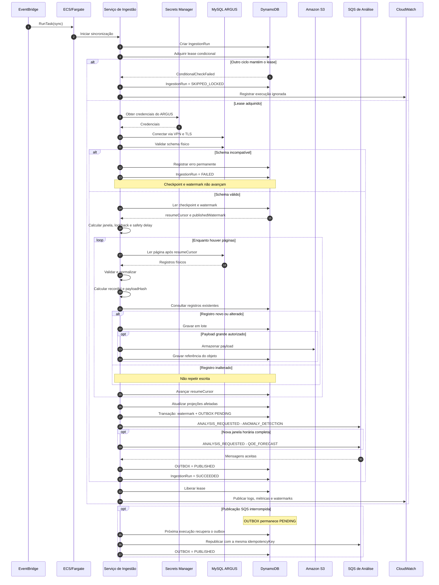
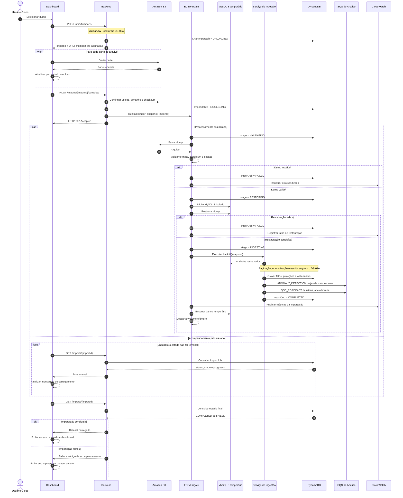
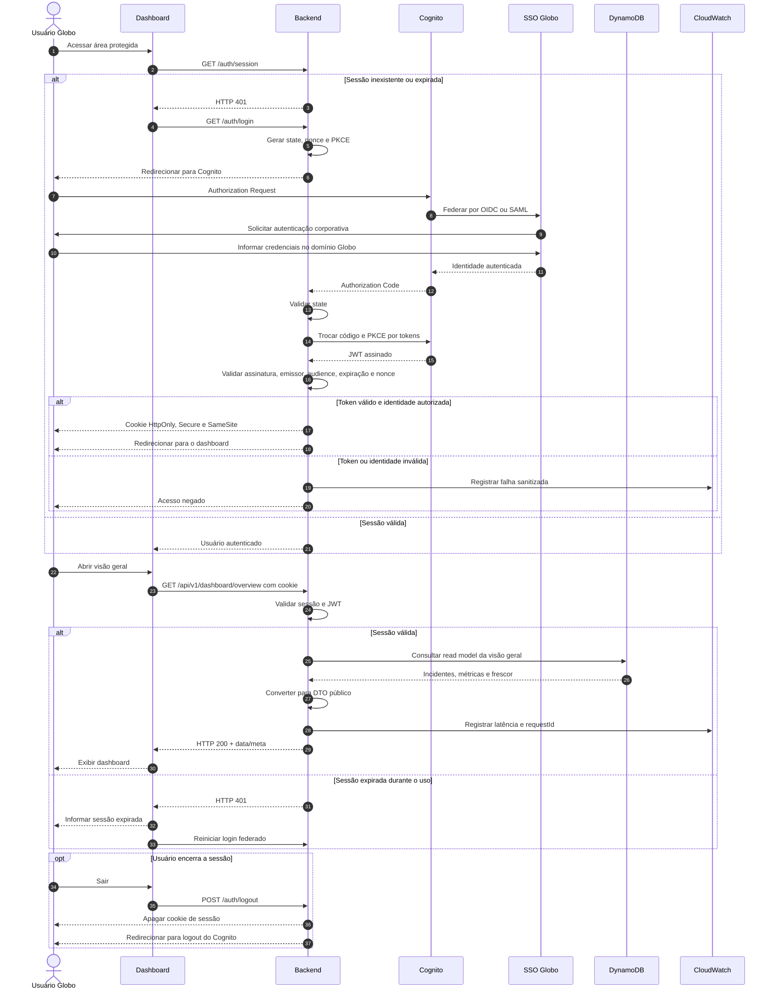
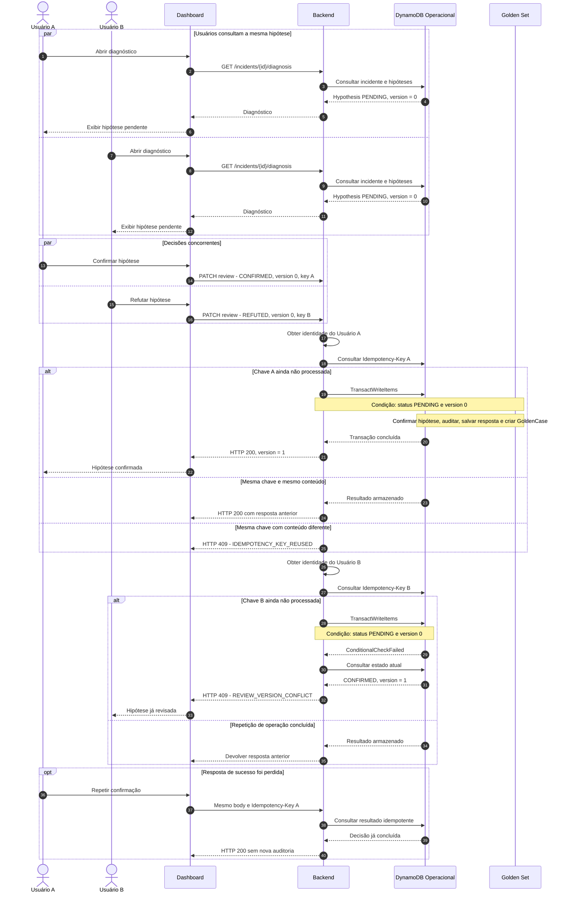
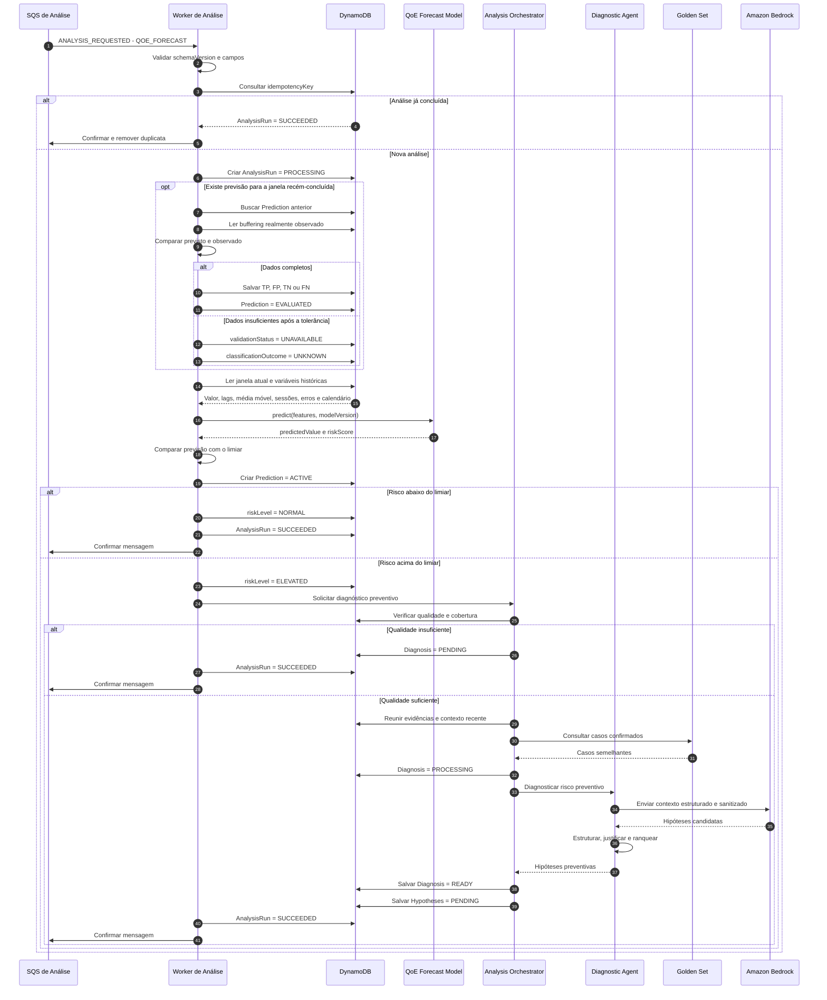
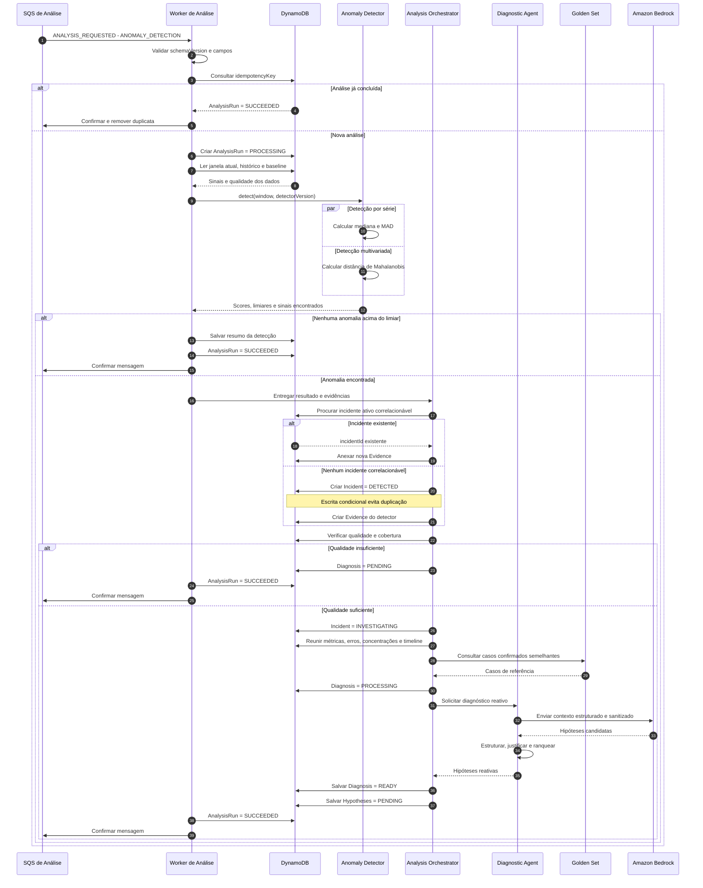
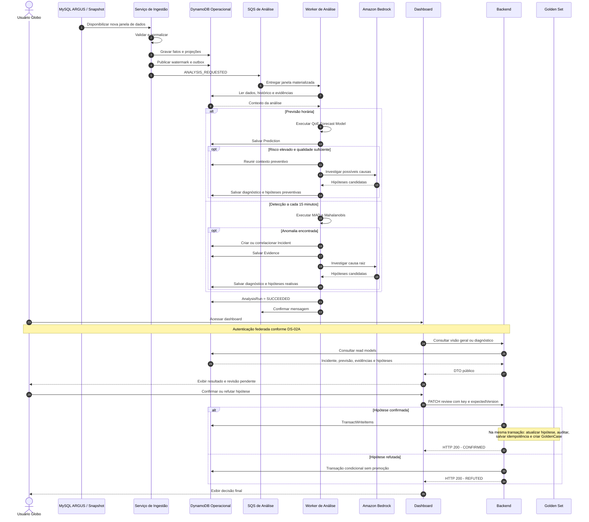

# Modelagem do Sistema — View Show

> Este documento apresenta a modelagem estrutural e comportamental do View Show
> por meio de diagramas UML e descrições textuais. A modelagem foi construída com
> base nos requisitos funcionais, não funcionais e decisões arquiteturais do projeto.

## Sumário

1. [Introdução](#1-introdução)
2. [Diagrama de casos de uso](#2-diagrama-de-casos-de-uso)
3. [Descrições dos casos de uso](#3-descrições-dos-casos-de-uso)
4. [Diagrama de classes](#4-diagrama-de-classes)
5. [Diagramas de sequência](#5-diagramas-de-sequência)
6. [Rastreabilidade da modelagem](#6-rastreabilidade-da-modelagem)
7. [Validação e consistência](#7-validação-e-consistência)
8. [Referências](#8-referências)

---

## 1. Introdução

### 1.1 Objetivo

Este artefato tem como objetivo modelar o sistema View Show com base nos
requisitos e funcionalidades definidos nas etapas anteriores do projeto.

A modelagem utiliza diagramas UML e descrições textuais para representar:

- as interações entre os atores e o sistema;
- os fluxos principais, alternativos e de exceção;
- a estrutura lógica das classes;
- as interações temporais entre componentes;
- a rastreabilidade entre requisitos e elementos da modelagem.

### 1.2 Escopo da modelagem

A modelagem contempla as funcionalidades pertencentes ao escopo da Sprint 3 e
ao MVP do View Show.

[DESCREVER quais módulos, funcionalidades e fronteiras estão incluídos.]

Não fazem parte desta modelagem:

- [ITEM FORA DO ESCOPO];
- [ITEM FORA DO ESCOPO];
- [ITEM FORA DO ESCOPO].

### 1.3 Documentos de referência

| Documento | Utilização neste artefato |
| --- | --- |
| [Especificação de requisitos](../sprint1/requisitos.md) | Identificação dos requisitos e casos de uso |
| [Arquitetura inicial](../sprint2/arquitetura-inicial.md) | Identificação de componentes e integrações |
| [Documentação de frontend](../sprint2/frontend.md) | Validação dos fluxos de interface |
| [Documentação de backend](../sprint2/backend-sprint-2.md) | Validação de serviços, entidades e operações |

### 1.4 Convenções adotadas

- Casos de uso são identificados como `UC-XX`.
- Requisitos funcionais são identificados como `RFXX`.
- Requisitos não funcionais são identificados como `RNFXX`.
- Fluxos alternativos são identificados como `A1`, `A2`, etc.
- Fluxos de exceção são identificados como `E1`, `E2`, etc.
- Classes, métodos e atributos utilizam os nomes empregados no sistema.
- Cada diagrama deve possuir título, fonte e uma descrição que explique como
  interpretá-lo.
- Sempre que possível, a fonte editável do diagrama e sua versão em SVG devem
  ser versionadas no repositório.

---

## 2. Diagrama de casos de uso

### 2.1 Atores

| ID | Ator | Tipo | Descrição |
| --- | --- | --- | --- |
| AT-01 | [NOME DO ATOR] | Primário | [OBJETIVO E RESPONSABILIDADE] |
| AT-02 | [NOME DO ATOR] | Secundário | [SERVIÇO PRESTADO AO SISTEMA] |
| AT-03 | [SISTEMA EXTERNO] | Sistema | [FORMA DE INTEGRAÇÃO] |

### 2.2 Catálogo de casos de uso

A tabela abaixo deve ser validada contra os requisitos da Sprint 1 antes da
elaboração do diagrama.

| ID | Caso de uso | Ator principal | Requisitos relacionados | Responsável | Status |
| --- | --- | --- | --- | --- | --- |
| UC-01 | Autenticar usuário | Usuário interno | RF04, RNF04 | [Nome] | A fazer |
| UC-02 | Ingerir eventos de telemetria | Aplicação frontend | RF01, RF02, RF06 | [Nome] | A fazer |
| UC-03 | Normalizar eventos | Sistema de processamento | RF03 | [Nome] | A fazer |
| UC-04 | Visualizar eventos | Usuário interno | RF05, RF07 | [Nome] | A fazer |
| UC-05 | Filtrar e investigar falhas | Usuário interno | RF07, RF09 | [Nome] | A fazer |
| UC-06 | Consultar métricas e alertas | Usuário interno | RF08 | [Nome] | A fazer |
| UC-07 | Exportar dados | Usuário interno | RF10 | [Nome] | A fazer |
| UC-XX | [OUTRO CASO DE USO] | [ATOR] | [RFXX] | [Nome] | A fazer |

> Os casos acima são candidatos iniciais. A equipe deve confirmar se representam
> o comportamento efetivamente entregue na Sprint 3.

### 2.3 Diagrama

<!--
Inserir o diagrama de casos de uso exportado em SVG ou PNG.

Exemplo:

Também é recomendado disponibilizar a fonte editável:
[Arquivo-fonte do diagrama](../../assets/modelagem/casos-de-uso.puml)
-->

[INSERIR DIAGRAMA DE CASOS DE USO]

**Figura 1 — Diagrama de casos de uso do View Show.**  
Fonte: Material produzido pelos autores (2026).

### 2.4 Descrição geral

[EXPLICAR os limites do sistema, os atores, os principais casos de uso e as
relações `include`, `extend` ou generalizações presentes no diagrama.]

### 2.5 Relações entre casos de uso

| Origem | Relação | Destino | Justificativa |
| --- | --- | --- | --- |
| UC-XX | `include` | UC-YY | [COMPORTAMENTO OBRIGATÓRIO REUTILIZADO] |
| UC-XX | `extend` | UC-ZZ | [COMPORTAMENTO OPCIONAL OU CONDICIONAL] |
| [ATOR/UC] | Generalização | [ATOR/UC] | [JUSTIFICATIVA] |

---

## 3. Descrições dos casos de uso

> Duplicar a subseção seguinte para cada caso de uso identificado no diagrama.
> A estrutura segue as seções solicitadas para uma descrição em estilo completo.

### 3.1 UC-XX — [Nome do caso de uso]

#### Escopo

[IDENTIFICAR o sistema ou subsistema tratado pelo caso de uso.]

#### Nível

[OBJETIVO DO USUÁRIO, SUBFUNÇÃO OU RESUMO.]

#### Atores

- **Ator principal:** [ATOR QUE INICIA O CASO DE USO].
- **Atores secundários:** [ATORES OU SISTEMAS DE APOIO].

#### Interessados e interesses

| Interessado | Interesse |
| --- | --- |
| [USUÁRIO OU ÁREA] | [RESULTADO OU GARANTIA ESPERADA] |
| [ADMINISTRADOR] | [INTERESSE] |
| [SISTEMA EXTERNO] | [INTERESSE] |

#### Pré-condições

- [CONDIÇÃO QUE DEVE SER VERDADEIRA ANTES DO INÍCIO];
- [CONDIÇÃO ADICIONAL].

#### Pós-condições

**Em caso de sucesso:**

- [ESTADO GARANTIDO APÓS O SUCESSO];
- [DADO CRIADO, ALTERADO OU DISPONIBILIZADO].

**Garantias mínimas:**

- [ESTADO PRESERVADO MESMO QUANDO O OBJETIVO NÃO É CONCLUÍDO];
- [REGISTRO, AUDITORIA OU AUSÊNCIA DE ALTERAÇÃO INDEVIDA].

#### Fluxo Básico

| Passo | Responsável | Ação |
| --- | --- | --- |
| 1 | Ator principal | [AÇÃO QUE INICIA O CASO DE USO] |
| 2 | Sistema | [VALIDAÇÃO OU PROCESSAMENTO] |
| 3 | Sistema | [RESPOSTA OU SOLICITAÇÃO] |
| 4 | Ator principal | [PRÓXIMA INTERAÇÃO] |
| 5 | Sistema | [PROCESSAMENTO] |
| 6 | Sistema | [RESULTADO DE SUCESSO] |

#### Fluxos alternativos

##### Alternativas

| ID | Passo de origem | Condição | Fluxo | Retorno |
| --- | --- | --- | --- | --- |
| A1 | Passo X | [CONDIÇÃO ALTERNATIVA] | [AÇÕES EXECUTADAS] | Passo Y |
| A2 | Passo X | [CONDIÇÃO ALTERNATIVA] | [AÇÕES EXECUTADAS] | Encerra |

##### Exceções

| ID | Passo de origem | Exceção | Resposta do sistema | Estado final |
| --- | --- | --- | --- | --- |
| E1 | Passo X | [ERRO DE VALIDAÇÃO] | [MENSAGEM E TRATAMENTO] | [ESTADO] |
| E2 | Passo X | [INDISPONIBILIDADE] | [FALLBACK OU REGISTRO] | [ESTADO] |

#### Requisitos especiais

| ID | Requisito especial | Origem |
| --- | --- | --- |
| RE-01 | [SEGURANÇA, DESEMPENHO, USABILIDADE OU AUDITORIA] | RNFXX |
| RE-02 | [RESTRIÇÃO DE INTERFACE OU TECNOLOGIA] | RNFXX/RIE/RESTR |

#### Lista de variantes

| Variação | Possibilidades | Impacto no caso de uso |
| --- | --- | --- |
| Canal ou interface | [WEB, API, PROCESSO AUTOMÁTICO] | [IMPACTO] |
| Formato de entrada | [JSON, CSV, OUTRO] | [IMPACTO] |
| Perfil de usuário | [PERFIL A, PERFIL B] | [IMPACTO] |

#### Frequência de ocorrência

[INFORMAR a frequência esperada, o volume estimado e possíveis períodos de pico.]

#### Problemas em aberto

| ID | Problema ou decisão pendente | Responsável | Prazo | Status |
| --- | --- | --- | --- | --- |
| PA-01 | [QUESTÃO A SER RESOLVIDA] | [Nome] | DD/MM | Aberto |
| PA-02 | [QUESTÃO A SER RESOLVIDA] | [Nome] | DD/MM | Aberto |

---

## 4. Diagrama de classes

### 4.1 Objetivo e escopo

[EXPLICAR qual visão estrutural será representada: domínio, aplicação,
persistência ou combinação controlada dessas visões.]

### 4.2 Diagrama

<!--
Inserir o diagrama de classes exportado em SVG ou PNG.

Exemplo:

-->

[INSERIR DIAGRAMA DE CLASSES UML]

**Figura 2 — Diagrama de classes do View Show.**  
Fonte: Material produzido pelos autores (2026).

### 4.3 Descrição das classes

| Classe | Estereótipo/camada | Responsabilidade | Principais atributos | Principais operações |
| --- | --- | --- | --- | --- |
| `[Classe]` | Entidade | [RESPONSABILIDADE] | `[atributo: Tipo]` | `[metodo(): Retorno]` |
| `[Classe]` | Serviço | [RESPONSABILIDADE] | `[atributo: Tipo]` | `[metodo(): Retorno]` |
| `[Classe]` | Repositório | [RESPONSABILIDADE] | `[atributo: Tipo]` | `[metodo(): Retorno]` |

### 4.4 Relacionamentos

| Origem | Relação | Destino | Multiplicidade | Justificativa |
| --- | --- | --- | --- | --- |
| `[ClasseA]` | Associação | `[ClasseB]` | `1 — 0..*` | [JUSTIFICATIVA] |
| `[ClasseA]` | Composição | `[ClasseB]` | `1 — 1..*` | [JUSTIFICATIVA] |
| `[ClasseA]` | Generalização | `[ClasseB]` | — | [JUSTIFICATIVA] |
| `[ClasseA]` | Dependência | `[ClasseB]` | — | [JUSTIFICATIVA] |

### 4.5 Regras e invariantes do modelo

| ID | Classe(s) envolvida(s) | Regra |
| --- | --- | --- |
| INV-01 | `[Classe]` | [REGRA QUE DEVE PERMANECER VERDADEIRA] |
| INV-02 | `[ClasseA]`, `[ClasseB]` | [REGRA DE CONSISTÊNCIA] |

### 4.6 Decisões de modelagem

[EXPLICAR as principais decisões, abstrações, padrões empregados e elementos
omitidos deliberadamente para manter o diagrama legível.]

---

## 5. Diagramas de sequência

> Deve existir pelo menos um diagrama de sequência para cada fluxo considerado
> crítico. Os cenários escolhidos devem estar ligados a um caso de uso descrito
> na Seção 3.

### 5.1 Catálogo de diagramas de sequência

| ID | Cenário | Casos de uso relacionados | Tipo de fluxo | Responsável |
| --- | --- | --- | --- | --- |
| DS-01A | Sincronização com o MySQL vivo | UC-01, UC-06, UC-17, UC-19 | Suporte técnico | Equipe de arquitetura |
| DS-01B | Importação de snapshot pela interface | UC-01, UC-06, UC-17, UC-19 | Suporte técnico/alternativo | Equipe de arquitetura |
| DS-02A | Autenticação federada e consulta | UC-01, UC-02 | Básico | Equipe de arquitetura |
| DS-02B | Revisão concorrente e promoção ao golden set | UC-07, UC-11 | Concorrente | Equipe de arquitetura |
| DS-03A | Previsão preventiva e validação posterior | UC-16, UC-17, UC-19 | Suporte técnico/assíncrono | Equipe de arquitetura |
| DS-03B | Detecção reativa e diagnóstico por IA | UC-05 a UC-08, UC-10, UC-12, UC-13 | Suporte técnico/assíncrono | Equipe de arquitetura |
| DS-03C | Falha, retry, DLQ e reanálise | UC-10 | Exceção/alternativo | Equipe de arquitetura |
| DS-04 | Visão geral ponta a ponta | UC-01, UC-02, UC-05 a UC-08, UC-10, UC-11, UC-16, UC-17, UC-19 | Resumo | Equipe de arquitetura |

Os diagramas automáticos de ingestão e análise representam mecanismos
técnicos que viabilizam os objetivos dos usuários. Por isso, a relação com
os casos de uso é de suporte, e não a definição de novos casos. A importação
de snapshot e a solicitação de reanálise permanecem como fluxos técnico e
alternativo, respectivamente, até a equipe decidir se devem ser formalizadas
como casos de uso independentes.

### 5.2 Convenções

- Setas contínuas representam chamadas síncronas; mensagens para a SQS são
  assíncronas mesmo quando a notação visual usa a mesma ponta de seta.
- `alt` representa caminhos mutuamente exclusivos.
- `opt` representa comportamento condicional.
- `loop` representa paginação, polling ou novas tentativas.
- Os diagramas apresentam componentes lógicos. ALB, NAT Gateway, sub-redes e
  rotas pertencem ao diagrama de implantação.
- Mensagens e timestamps utilizam UTC.
- Operações repetíveis utilizam identificadores idempotentes.
- `Prediction` representa risco futuro; `Incident` representa degradação
  observada ou importada.

### 5.3 DS-01 — Ingestão e disponibilização dos dados

#### 5.3.1 Objetivo

Representar como o View Show sincroniza dados do MySQL vivo do ARGUS ou de um
snapshot enviado pela interface, normaliza os registros, persiste fatos e
projeções no DynamoDB e publica solicitações para o Worker de Análise.

#### 5.3.2 Casos de uso relacionados

- **UC-01 — Consultar dashboard.**
- **UC-06 — Visualizar incidentes priorizados.**
- **UC-17 — Acompanhar indicadores de QoE.**
- **UC-19 — Consultar histórico de degradações.**
- **Tipo de relação:** suporte técnico à disponibilização dos dados
  consumidos por esses casos de uso.
- **Pré-condição:** origem disponível e configuração válida.
- **Resultado esperado:** novas janelas materializadas e solicitações de análise
  publicadas sem duplicação.

#### 5.3.3 Participantes

| Participante | Tipo | Responsabilidade |
| --- | --- | --- |
| EventBridge | Serviço AWS | Acionar a sincronização a cada 15 minutos |
| ECS/Fargate | Infraestrutura | Executar as tarefas de sincronização e importação |
| Serviço de Ingestão | Controle | Coordenar leitura, normalização e persistência |
| Secrets Manager | Serviço AWS | Fornecer credenciais da origem |
| MySQL ARGUS | Sistema externo | Disponibilizar os dados internos da Globo |
| Dashboard e Backend | Boundary/Control | Receber o dump e acompanhar a importação |
| Amazon S3 | Persistência | Armazenar dumps e payloads grandes autorizados |
| DynamoDB Operacional | Persistência | Armazenar fatos, projeções, controle e outbox |
| SQS de Análise | Mensageria | Entregar solicitações ao Worker de Análise |
| CloudWatch | Observabilidade | Receber logs, métricas e alarmes |

#### 5.3.4 DS-01A — Sincronização com o MySQL vivo

**Figura 3 — Sincronização dos dados do MySQL vivo do ARGUS.** 
Fonte: Material produzido pelos autores (2026).

| Etapa | Comportamento |
| --- | --- |
| Inicialização | EventBridge inicia uma task Fargate a cada 15 minutos |
| Exclusão mútua | O lease impede sincronizações concorrentes |
| Leitura | A ingestão acessa o MySQL por VPN/TLS e pagina por chave natural |
| Idempotência | `recordId` e `payloadHash` evitam duplicação e escrita desnecessária |
| Persistência | Dados são gravados diretamente no DynamoDB |
| Publicação | Watermark e outbox antecedem o envio para a SQS |
| Recuperação | Um outbox pendente é republicado na execução seguinte |

#### 5.3.5 DS-01B — Importação de snapshot pela interface

**Figura 4 — Importação assíncrona de um snapshot do ARGUS.** 
Fonte: Material produzido pelos autores (2026).

| Etapa | Comportamento |
| --- | --- |
| Upload | Qualquer usuário autenticado envia o dump diretamente ao S3 |
| Processamento | O Backend responde HTTP 202 e inicia uma task Fargate |
| Restauração | MySQL 8 e volume efêmero existem apenas durante a task |
| Ingestão | O backfill reutiliza os contratos e regras do DS-01A |
| Análise | Somente a janela mais recente é analisada automaticamente |
| Acompanhamento | O Dashboard consulta o `ImportJob` por polling |
| Conclusão | O novo dataset aparece somente após projeções e watermarks |

#### 5.3.6 Tratamento de erros e pós-condições

| Situação | Tratamento | Estado preservado |
| --- | --- | --- |
| Lease ocupado | Finaliza como `SKIPPED_LOCKED` | Execução ativa continua |
| Schema incompatível | Falha sem avançar watermark | Dataset publicado permanece |
| Falha transitória | Até cinco tentativas com backoff e jitter | Cursor do último chunk |
| Falha de publicação | Mantém outbox pendente | Janela já materializada |
| Dump inválido | `ImportJob = FAILED` | Dataset anterior permanece visível |
| Falha de restauração | Encerra e descarta o ambiente temporário | DynamoDB não é substituído |

Ao final do fluxo bem-sucedido, os fatos e projeções estão disponíveis no
DynamoDB, o watermark representa somente janelas completas e a solicitação de
análise correspondente está publicada ou protegida pelo outbox. A ingestão não
lê nem escreve no golden set.

### 5.4 DS-02 — Backend, autenticação e revisão

#### 5.4.1 Objetivo

Representar o acesso de usuários internos ao View Show, a consulta autenticada
dos dados e a revisão concorrente de hipóteses com promoção atômica ao golden
set.

#### 5.4.2 Casos de uso relacionados

- **UC-01 — Consultar dashboard:** realizado pela consulta autenticada do
  DS-02A.
- **UC-02 — Autenticar-se:** realizado pelo fluxo federado do DS-02A.
- **UC-07 — Consultar hipóteses de causa provável:** realizado pela abertura do
  diagnóstico no DS-02B.
- **UC-11 — Validar hipótese diagnóstica:** realizado pela confirmação ou
  refutação concorrente no DS-02B.

#### 5.4.3 Participantes

| Participante | Tipo | Responsabilidade |
| --- | --- | --- |
| Usuário Globo | Ator | Autenticar-se, consultar e revisar hipóteses |
| Dashboard | Boundary | Iniciar login e apresentar dados |
| Backend | Controle | Concluir OAuth, validar sessão e servir a API |
| Cognito | Serviço de identidade | Federar identidade e emitir JWT |
| SSO Globo | Sistema externo | Autenticar o usuário corporativo |
| DynamoDB Operacional | Persistência | Fornecer read models e receber revisões |
| Golden Set | Persistência | Receber casos confirmados |
| CloudWatch | Observabilidade | Registrar acessos, falhas e latência |

#### 5.4.4 DS-02A — Autenticação federada e consulta

**Figura 5 — Autenticação federada e consulta do dashboard.** 
Fonte: Material produzido pelos autores (2026).

O SSO da Globo autentica o usuário, o Cognito atua como broker e emissor dos
JWTs e o Backend conclui o fluxo OAuth no padrão BFF. O navegador recebe apenas
um cookie seguro e inacessível ao JavaScript. Não existe cadastro, senha ou
armazenamento local de credenciais. As respostas públicas não expõem `pk`,
`sk`, TTL ou outros detalhes físicos do DynamoDB.

#### 5.4.5 DS-02B — Revisão concorrente e promoção ao golden set

**Figura 6 — Revisão concorrente e promoção de hipótese ao golden set.** 
Fonte: Material produzido pelos autores (2026).

A identidade do revisor vem da sessão. A requisição informa
`Idempotency-Key` e `expectedVersion`; a escrita exige `status = PENDING` e a
versão esperada. A primeira decisão válida é terminal. Somente `CONFIRMED`
inclui a criação do `GoldenCase` na transação; `REFUTED` permanece no histórico
operacional.

#### 5.4.6 Tratamento de erros e pós-condições

| Situação | Resposta | Estado preservado |
| --- | --- | --- |
| Sessão ausente ou expirada | HTTP 401 | Recurso inalterado |
| Identidade não autorizada | HTTP 403 | Recurso inalterado |
| Recurso inexistente | HTTP 404 | Nenhuma escrita |
| `expectedVersion` ausente | HTTP 422 | Hipótese inalterada |
| Outra decisão venceu | HTTP 409 | Primeira decisão preservada |
| Chave reutilizada com outro body | HTTP 409 | Operação original preservada |
| Falha transacional | HTTP 503 | Nenhum estado parcial |
| Repetição após resposta perdida | HTTP 200 | Sem duplicar auditoria ou golden set |

Ao final, o usuário possui uma sessão federada válida para as consultas e cada
hipótese revisada apresenta exatamente uma decisão humana final e auditável.

### 5.5 DS-03 — Worker de Análise

#### 5.5.1 Objetivo

Representar o consumo assíncrono das janelas materializadas, a previsão
preventiva, a detecção reativa, o diagnóstico por IA e a recuperação de falhas.

#### 5.5.2 Casos de uso relacionados

- **UC-05 — Analisar e encaminhar incidente.**
- **UC-06 — Visualizar incidentes priorizados.**
- **UC-07 — Consultar hipóteses de causa provável.**
- **UC-08 — Verificar evidências do diagnóstico.**
- **UC-10 — Investigar falha técnica.**
- **UC-12 — Inspecionar eventos correlacionados.**
- **UC-13 — Visualizar linha do tempo da sessão.**
- **UC-16 — Analisar qualidade da experiência.**
- **UC-17 — Acompanhar indicadores de QoE.**
- **UC-19 — Consultar histórico de degradações.**

Os fluxos do Worker não são iniciados por atores. DS-03A fornece previsões
para UC-16, UC-17 e UC-19; DS-03B fornece incidentes, hipóteses, evidências e
eventos para UC-05 a UC-08, UC-10, UC-12 e UC-13; DS-03C representa a exceção
técnica e a solicitação de reanálise como fluxo alternativo de UC-10.

#### 5.5.3 Participantes

| Participante | Tipo | Responsabilidade |
| --- | --- | --- |
| SQS de Análise | Mensageria | Entregar solicitações de análise |
| Worker de Análise | Controle | Validar mensagens e coordenar o processamento |
| QoE Forecast Model | Serviço de domínio | Prever risco de buffering da próxima hora |
| Anomaly Detector | Serviço de domínio | Executar MAD e Mahalanobis |
| Analysis Orchestrator | Controle | Coordenar evidências, incidentes e diagnósticos |
| Diagnostic Agent | Serviço de aplicação | Produzir hipóteses de causa |
| Golden Set | Persistência | Fornecer casos confirmados como referência |
| Amazon Bedrock | Serviço externo | Apoiar a geração de hipóteses |
| DynamoDB | Persistência | Armazenar execuções e resultados |
| DLQ | Mensageria | Reter mensagens que esgotaram as tentativas |

#### 5.5.4 DS-03A — Previsão preventiva e validação posterior

**Figura 7 — Previsão preventiva e validação da previsão anterior.** 
Fonte: Material produzido pelos autores (2026).

A previsão executa após uma janela horária completa e registra o limiar e a
versão do modelo. A mesma execução compara a previsão anterior com o valor
observado e classifica o resultado como `TP`, `FP`, `TN`, `FN` ou `UNKNOWN`.
Risco normal não aciona o agente; risco elevado exige qualidade mínima. Uma
hipótese preventiva não é um incidente e continua sujeita à revisão humana.

#### 5.5.5 DS-03B — Detecção reativa e diagnóstico por IA

**Figura 8 — Detecção reativa e diagnóstico automático por IA.** 
Fonte: Material produzido pelos autores (2026).

MAD e Mahalanobis permanecem módulos internos do mesmo Worker. O detector
produz scores e evidências; o `Analysis Orchestrator` cria ou correlaciona o
incidente. O resultado estatístico vira `Evidence`. O incidente permanece
disponível mesmo quando o diagnóstico por IA não pode ser concluído.

#### 5.5.6 DS-03C — Falha, retry, DLQ e reanálise

**Figura 9 — Recuperação de falhas, DLQ e reanálise.** 
Fonte: Material produzido pelos autores (2026).

| Configuração | Valor inicial |
| --- | ---: |
| Tipo da fila | SQS Standard |
| Visibility timeout | 5 minutos |
| Renovação durante o processamento | A cada 60 segundos |
| Máximo de recebimentos | 5 |
| Retenção da fila principal | 4 dias |
| Retenção da DLQ | 14 dias |
| Long polling | 20 segundos |
| Alarme | Uma ou mais mensagens na DLQ |

Mensagens duplicadas são tratadas por idempotência. O Worker retoma da última
etapa persistida, e uma falha no Bedrock não remove previsão, incidente ou
evidências nem produz uma hipótese artificial. Erros permanentes seguem
diretamente para a DLQ; falhas transitórias usam backoff e redrive automático
após o quinto recebimento.

#### 5.5.7 Pós-condições

- Toda mensagem concluída possui um `AnalysisRun = SUCCEEDED`.
- Toda previsão registra `modelVersion`, limiar, janela-alvo e resultado da
  validação quando disponível.
- Toda anomalia persistida está ligada a uma evidência e, quando aplicável, a
  um incidente.
- Hipóteses produzidas pelo agente permanecem `PENDING` até revisão humana.
- Mensagens não processáveis permanecem recuperáveis na DLQ.

### 5.6 DS-04 — Visão geral ponta a ponta

#### 5.6.1 Objetivo

Apresentar uma visão resumida do caminho completo dos dados, desde o ARGUS até
a análise automática, consulta no dashboard, revisão humana e promoção ao
golden set. Detalhes internos são apresentados nos diagramas anteriores.

#### 5.6.2 Participantes

| Participante | Responsabilidade |
| --- | --- |
| MySQL ARGUS/Snapshot | Fornecer dados operacionais |
| Serviço de Ingestão | Normalizar e materializar janelas |
| DynamoDB Operacional | Armazenar fatos e resultados |
| SQS de Análise | Desacoplar ingestão e análise |
| Worker de Análise | Executar previsão, detecção e diagnóstico |
| Amazon Bedrock | Apoiar a geração de hipóteses |
| Dashboard | Apresentar dados e receber a decisão humana |
| Backend | Autenticar, consultar e revisar hipóteses |
| Golden Set | Armazenar casos confirmados |

#### 5.6.3 Diagrama

**Figura 10 — Visão geral ponta a ponta da plataforma View Show.** 
Fonte: Material produzido pelos autores (2026).

#### 5.6.4 Referências aos diagramas detalhados

| Trecho | Diagrama detalhado |
| --- | --- |
| MySQL vivo, paginação, checkpoints e outbox | DS-01A |
| Upload e importação do dump | DS-01B |
| Login federado e consultas | DS-02A |
| Concorrência e golden set | DS-02B |
| Previsão e validação | DS-03A |
| Detecção e incidente | DS-03B |
| Retry, DLQ e reanálise | DS-03C |

#### 5.6.5 Pós-condições

- A janela ingerida está disponível no DynamoDB.
- A solicitação de análise foi processada de forma idempotente.
- Previsões não são apresentadas como incidentes confirmados.
- Anomalias podem gerar ou reforçar incidentes.
- Hipóteses permanecem pendentes até uma revisão humana.
- Somente hipóteses confirmadas entram no golden set.
- Todo o fluxo pode ser correlacionado pelo `traceId`.

### 5.7 Rastreabilidade interna

#### 5.7.1 Relação com os casos de uso atuais

| Diagrama | Natureza da relação | Casos de uso |
| --- | --- | --- |
| DS-01A | Suporte técnico: materializa dados vivos | UC-01, UC-06, UC-17, UC-19 |
| DS-01B | Suporte técnico: materializa dados de snapshot | UC-01, UC-06, UC-17, UC-19 |
| DS-02A | Realiza autenticação e consulta | UC-01, UC-02 |
| DS-02B | Realiza consulta e validação de hipótese | UC-07, UC-11 |
| DS-03A | Suporte técnico: produz previsões de QoE | UC-16, UC-17, UC-19 |
| DS-03B | Suporte técnico: produz incidentes e diagnósticos | UC-05 a UC-08, UC-10, UC-12, UC-13 |
| DS-03C | Fluxo de exceção e alternativa de reanálise | UC-10 |
| DS-04 | Resume as relações anteriores | UC-01, UC-02, UC-05 a UC-08, UC-10, UC-11, UC-16, UC-17, UC-19 |

#### 5.7.2 Decisões arquiteturais

| Decisão arquitetural | Diagrama |
| --- | --- |
| Escrita direta no DynamoDB | DS-01A e DS-01B |
| Upload e MySQL temporário no Fargate | DS-01B |
| Outbox transacional | DS-01A |
| SSO federado e BFF | DS-02A |
| Concorrência otimista | DS-02B |
| Promoção transacional ao golden set | DS-02B |
| Previsão horária | DS-03A |
| Validação TP/FP/TN/FN | DS-03A |
| Detecção a cada 15 minutos | DS-03B |
| Retry e DLQ | DS-03C |
| Fluxo completo | DS-04 |

---

## 6. Rastreabilidade da modelagem

| Requisito | Caso de uso | Classes principais | Diagrama de sequência | Evidência |
| --- | --- | --- | --- | --- |
| RF01 | UC-02 | `[ClasseA]`, `[ClasseB]` | DS-XX | [SEÇÃO/LINK] |
| RF04 | UC-01 | `[ClasseA]`, `[ClasseB]` | DS-XX | [SEÇÃO/LINK] |
| RF07 | UC-04, UC-05 | `[ClasseA]`, `[ClasseB]` | DS-XX | [SEÇÃO/LINK] |
| RF10 | UC-07 | `[ClasseA]`, `[ClasseB]` | DS-XX | [SEÇÃO/LINK] |

---

## 7. Validação e consistência

### 7.1 Lista de verificação

#### Casos de uso

- [ ] Todos os atores possuem objetivos claros.
- [ ] Todos os casos de uso do diagrama possuem descrição textual.
- [ ] Os fluxos básicos terminam em uma pós-condição de sucesso.
- [ ] Fluxos alternativos e de exceção referenciam passos do fluxo básico.
- [ ] Relações `include` e `extend` possuem justificativa.
- [ ] Os casos de uso estão ligados a requisitos existentes.

#### Diagrama de classes

- [ ] As classes representam conceitos ou componentes relevantes.
- [ ] Atributos e operações possuem tipos.
- [ ] Associações possuem multiplicidades.
- [ ] Composição, agregação, herança e dependência foram usadas corretamente.
- [ ] As classes mencionadas nos diagramas de sequência existem no diagrama.
- [ ] O diagrama é consistente com a implementação ou explicita diferenças.

#### Diagramas de sequência

- [ ] Cada diagrama referencia um caso de uso e um fluxo específico.
- [ ] As mensagens aparecem em ordem temporal.
- [ ] Chamadas síncronas, assíncronas e retornos estão diferenciados.
- [ ] Alternativas e exceções usam fragmentos combinados.
- [ ] Participantes correspondem a atores, interfaces, serviços ou classes reais.
- [ ] O resultado final corresponde às pós-condições do caso de uso.

### 7.2 Pendências consolidadas

| ID | Pendência | Impacto | Responsável | Prazo | Status |
| --- | --- | --- | --- | --- | --- |
| P-01 | [PENDÊNCIA] | Alto/Médio/Baixo | [Nome] | DD/MM | Aberta |
| P-02 | [PENDÊNCIA] | Alto/Médio/Baixo | [Nome] | DD/MM | Aberta |

### 7.3 Revisão cruzada

| Entrega | Autor principal | Revisor | Resultado |
| --- | --- | --- | --- |
| Casos de uso e descrições | Pessoa 1 | Pessoa 2 | [PENDENTE/APROVADO] |
| Diagrama de classes | Pessoa 2 | Pessoa 3 | [PENDENTE/APROVADO] |
| Diagramas de sequência | Pessoa 3 | Pessoa 1 | [PENDENTE/APROVADO] |
| Rastreabilidade e consistência final | Equipe | Equipe | [PENDENTE/APROVADO] |

---

## 8. Referências

LARMAN, Craig. *Utilizando UML e padrões: uma introdução à análise e ao projeto
orientados a objetos e ao desenvolvimento iterativo*. Porto Alegre: Bookman.
Disponível em:
https://integrada.minhabiblioteca.com.br/reader/books/9788577800476.
Acesso em: DD mês AAAA.

OBJECT MANAGEMENT GROUP. *Unified Modeling Language — UML*. Disponível em:
https://www.omg.org/spec/UML/. Acesso em: DD mês AAAA.

GRUPO 05 — OS BIG BROTHERS. *Especificação de requisitos: Monitoramento de
Frontend Globoplay*. 2026. Disponível em:
[requisitos.md](../sprint1/requisitos.md).
