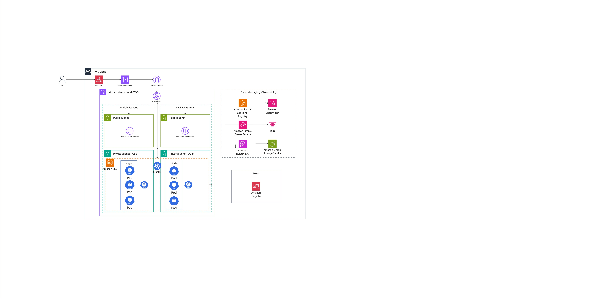

# Arquitetura Final — Amazon EKS

> Este documento especifica a arquitetura de implantação do View Show na AWS com Amazon EKS e perfis Fargate. A aplicação é publicada por manifests Kubernetes YAML versionados; Helm é usado somente para instalar e atualizar os controladores externos AWS Load Balancer Controller e KEDA.

## Sumário

1. [Escopo](#1-escopo)
2. [Diagrama de implantação](#2-diagrama-de-implantação)
3. [Componentes da arquitetura](#3-componentes-da-arquitetura)
4. [Organização e publicação dos manifests](#4-organização-e-publicação-dos-manifests)
5. [Plano de implantação](#5-plano-de-implantação)
6. [Segurança, escala e observabilidade](#6-segurança-escala-e-observabilidade)
7. [Evidências de aceite](#7-evidências-de-aceite)

---

## 1. Escopo

&emsp;A arquitetura executa a API, a ingestão e o worker de análise em Pods Amazon EKS Fargate. O frontend Next.js permanece no AWS Amplify. A entrada HTTP é feita por API Gateway e Application Load Balancer (ALB). Os Pods executam apenas em sub-redes privadas e acessam serviços AWS por roles IAM associadas às ServiceAccounts.

&emsp;A infraestrutura AWS é declarada por Terraform. Os recursos da aplicação são declarados em YAML e aplicados com `kubectl`. Não há Helm Chart próprio e não há Kustomize na solução. Helm instala apenas os charts oficiais, com versões fixas, do AWS Load Balancer Controller e do KEDA.

## 2. Diagrama de implantação

<div align="center">

<strong>Figura 1: Diagrama de implantação da arquitetura final com Amazon EKS</strong>


Fonte: Material produzido pelos autores (2026).

</div>

&emsp;O diagrama organiza a solução em região AWS, VPC, AZs, sub-redes públicas, sub-redes privadas, serviços gerenciados e componentes externos. As setas indicam requisições, identidade, dados, processamento assíncrono, observabilidade e operações de entrega.

## 3. Componentes da arquitetura

<div align="center">

<sup>Tabela 1: Componentes e responsabilidades da arquitetura final</sup>

</div>

| Camada | Componente | Configuração e responsabilidade |
| --- | --- | --- |
| Experiência | AWS Amplify | Publica o frontend Next.js e encaminha `/api`, `/auth` e `/health` pela mesma origem do dashboard. |
| Borda HTTP | API Gateway | Fornece HTTPS para o proxy same-origin do Amplify e encaminha as requisições ao ALB. |
| Borda HTTP | Application Load Balancer | Opera nas duas sub-redes públicas, valida `/health` e usa targets IP para os Pods Fargate. |
| Rede | VPC e sub-redes | Usa a VPC `10.0.0.0/16`, com duas sub-redes públicas e duas privadas em AZs distintas. Os Pods não recebem IP público. |
| Rede | Internet Gateway, NAT e endpoints | Internet Gateway atende a borda pública; um NAT Gateway por AZ fornece saída resiliente; endpoints de gateway dão acesso privado a S3 e DynamoDB. |
| Orquestração | Amazon EKS | Fornece o control plane Kubernetes gerenciado. |
| Orquestração | Perfis EKS Fargate | Selecionam Pods por namespace e rótulo e os executam em sub-redes privadas. A arquitetura usa perfis elegíveis para `kube-system`, `keda`, `fargate-container-insights` e `view-show`. |
| Orquestração | AWS Load Balancer Controller | É instalado pelo chart oficial da AWS, com versão fixa. Observa `Ingress` e `Service`, e reconcilia ALB, listeners, regras e targets IP. |
| Orquestração | Metrics Server e KEDA | O Metrics Server fornece as métricas de recursos do HPA da API. O KEDA consulta a profundidade da SQS e cria o HPA externo do worker. |
| API | `Deployment`, `Service` e `Ingress` | A API inicia com duas réplicas, expõe um `Service` `ClusterIP`, recebe regras de `Ingress` e responde a probes em `/health`. |
| Ingestão | `CronJob` | Executa janelas idempotentes de coleta, registra histórico no S3 e produz mensagens de análise. |
| Análise | `Deployment` de worker | Consome a SQS, processa análises e persiste os resultados no DynamoDB. |
| Identidade AWS | ServiceAccounts e IRSA | Cada workload possui uma ServiceAccount e uma role IAM de privilégio mínimo. A pod execution role do Fargate não concede permissões à aplicação. |
| Dados | DynamoDB | Armazena as tabelas operacional e Golden Set. |
| Dados | S3, SQS e DLQ | S3 armazena histórico; SQS desacopla produtores e consumidor; DLQ retém mensagens que excedem as tentativas configuradas. |
| Autenticação | Cognito e SSO | Cognito centraliza sessão e federação corporativa OIDC ou SAML. |
| Entrega | ECR | Armazena imagens. Os manifests referenciam cada imagem por digest. |
| Observabilidade | CloudWatch | É a fonte autoritativa de logs, métricas e alarmes da borda, dos Pods, dos mecanismos de escala e da SQS/DLQ. O roteador nativo do Fargate envia logs e um coletor ADOT compatível com Fargate envia métricas dos Pods. A stack Grafana/Loki/Tempo existente é transitória e não compõe o aceite do EKS. |

<div align="center">

<sup>Fonte: Material produzido pelos autores (2026).</sup>

</div>

## 4. Organização e publicação dos manifests

### 4.1 Estrutura do repositório

&emsp;Os recursos Kubernetes da aplicação devem ficar no diretório `k8s/`. Os arquivos usam YAML puro, sem templating. O nome numérico mantém uma ordem explícita de aplicação e facilita a revisão do diff em pull requests.

```text
k8s/
  00-namespace.yaml
  10-serviceaccounts.yaml
  20-api-deployment.yaml
  21-api-service.yaml
  22-api-hpa.yaml
  30-worker-deployment.yaml
  31-ingestion-cronjob.yaml
  32-worker-scaling.yaml
  40-ingress.yaml
```

&emsp;Os valores estáveis da aplicação ficam nos manifests. Dados sensíveis não são versionados em YAML nem incluídos na imagem. A distribuição de segredos deve usar um mecanismo compatível com EKS Fargate e preservar a separação de permissões por ServiceAccount.

### 4.2 Imagens e versões

&emsp;A API, o worker e a ingestão usam imagens no ECR identificadas por digest. A atualização de versão ocorre por alteração explícita do campo `image` nos arquivos `20-api-deployment.yaml`, `30-worker-deployment.yaml` e `31-ingestion-cronjob.yaml`. A alteração é revisada em pull request e permite recuperar uma revisão anterior do manifest sem resolver tags mutáveis.

### 4.3 Fluxo de publicação

&emsp;O fluxo de publicação é declarativo e não depende de chart próprio:

```bash
kubectl diff -f k8s/
kubectl apply -f k8s/
```

&emsp;O comando é executado com o contexto correto do cluster EKS e somente após a revisão dos manifests. `kubectl apply` cria ou atualiza os recursos declarados no diretório. A remoção de recursos é explícita, por exemplo com `kubectl delete -f k8s/31-ingestion-cronjob.yaml`; não é usado `--prune` no fluxo inicial.

### 4.4 Controladores externos e uso restrito de Helm

&emsp;Helm não empacota nem publica a aplicação. Ele instala o AWS Load Balancer Controller oficial no namespace `kube-system` e o KEDA oficial no namespace `keda`. As versões dos charts e os valores obrigatórios — nome do cluster, região, VPC e ServiceAccounts com IRSA — devem ficar registrados no script ou procedimento de infraestrutura. O Metrics Server é instalado como add-on da comunidade gerenciado por EKS Add-ons, com versão compatível com o cluster.

&emsp;Essa separação mantém os manifests da aplicação pequenos, legíveis e auditáveis, sem replicar localmente os recursos internos dos controladores. O arquivo `32-worker-scaling.yaml` versiona apenas os recursos `TriggerAuthentication` e `ScaledObject` específicos do View Show.

## 5. Plano de implantação

### 5.1 Pré-requisitos

&emsp;O deploy requer Terraform, Docker, Node.js, npm, AWS CLI, `kubectl` e Helm. Helm é necessário apenas para instalar ou atualizar o AWS Load Balancer Controller e o KEDA. A conta deve ter permissões para EKS, Fargate profiles, IAM/OIDC, ELBv2, ECR, DynamoDB, S3, SQS, Cognito e CloudWatch.

```bash
aws sts get-caller-identity --region us-east-1
aws eks list-clusters --region us-east-1
kubectl version --client
helm version
```

### 5.2 Etapas de provisionamento

<div align="center">

<sup>Tabela 2: Etapas de provisionamento da arquitetura final na AWS</sup>

</div>

| Etapa | Recursos e ações | Critério de aceite |
| --- | --- | --- |
| 1. Identidade e cotas | Confirmar conta, região, permissões, quotas EKS/Fargate e capacidade de IP das sub-redes privadas. | Conta e região conferidas; capacidade compatível com Pods e add-ons. |
| 2. Rede e segurança | Provisionar VPC, duas sub-redes públicas, duas privadas, rotas, Security Groups, endpoints S3/DynamoDB, NAT por AZ e tags de descoberta do ALB. | Pods sem IP público; ALB descoberto nas duas AZs; saída privada funcional. |
| 3. EKS e Fargate | Provisionar control plane, provider OIDC, pod execution role e perfis Fargate para `kube-system`, `keda`, `fargate-container-insights` e `view-show`. | Cluster ativo; CoreDNS, controladores, coletor e Pods elegíveis em sub-redes privadas. |
| 4. Add-ons e controladores | Instalar o Metrics Server como add-on do EKS e as versões aprovadas do AWS Load Balancer Controller e KEDA por Helm. | Metrics Server disponível; controladores `Ready`, ServiceAccounts corretas e reconciliação habilitada. |
| 5. Identidade da aplicação | Criar ServiceAccounts e roles IRSA da API, worker e ingestão, além da role de leitura da SQS usada pelo KEDA. | Cada Pod assume somente a role prevista; KEDA consulta apenas os atributos da fila necessários à escala. |
| 6. Imagens e manifests | Publicar imagens no ECR por digest e aplicar os manifests do diretório `k8s/`. | Campos `image` da API, worker e `CronJob` usam URIs ECR imutáveis no formato `repositório@sha256:<digest>`. |
| 7. Entrada HTTP | Aplicar o `Ingress`, validar o ALB, os targets IP e o endpoint `/health`, e integrar o API Gateway. | Targets IP saudáveis e resposta funcional pelo dashboard. |
| 8. Dados e fila | Validar DynamoDB, S3, SQS/DLQ, ingestão idempotente e consumo pelo worker. | Dados persistidos, mensagem processada e falha encaminhada à DLQ. |
| 9. Escala e observabilidade | Configurar HPA da API, `ScaledObject` do worker, roteador nativo de logs do Fargate, coletor ADOT, dashboards e alarmes CloudWatch. | HPA da API reage a CPU; KEDA escala o worker de 0 a 4 réplicas pela SQS; logs dos containers e métricas por Pod podem ser consultados no CloudWatch e os alarmes mudam de estado no teste. |
| 10. Corte e legado | Alterar a integração do API Gateway do ALB ECS para o ALB EKS, cumprir a janela de validação e desprovisionar os recursos exclusivos do ambiente anterior. | Tráfego estável no EKS por 30 minutos, sem alarme crítico, rollback inicial testado e, após aprovação, recursos legados ausentes no estado final do Terraform. |

<div align="center">

<sup>Fonte: Material produzido pelos autores (2026).</sup>

</div>

### 5.3 Recuperação operacional

&emsp;No primeiro corte para o EKS, a versão anterior não é um release Kubernetes: é a API executada no ECS/Fargate. O rollback inicial restaura a integração do API Gateway para o ALB do ECS. Por isso, o serviço ECS e seu ALB permanecem saudáveis e sem alterações durante a janela de validação, e a troca de integração de ida e volta deve ser testada antes da desativação do legado.

&emsp;Nos releases seguintes, o rollback da aplicação é feito aplicando uma revisão anterior dos manifests, que referencia digests de imagem já conhecidos. O rollback da infraestrutura continua sendo feito exclusivamente por Terraform, com plano revisado. Depois que o ambiente ECS for removido, ele deixa de ser uma rota de rollback; a recuperação passa a usar somente a revisão Kubernetes anterior.

### 5.4 Coexistência e desativação do ambiente anterior

&emsp;O ECS/Fargate, o ALB legado e a EC2 opcional de Grafana/Loki/Tempo são recursos transitórios de migração e, por isso, não aparecem no diagrama da arquitetura final. Eles permanecem provisionados apenas até que as evidências funcionais e operacionais anteriores ao desligamento tenham sido coletadas, o tráfego pelo EKS fique 30 minutos sem alarmes críticos e o rollback inicial para o ALB do ECS tenha sido exercitado com sucesso.

&emsp;Após esses critérios e a aprovação do corte, um plano Terraform revisado remove, no mesmo ciclo do laboratório, os recursos exclusivos do ECS, o ALB legado e a EC2 de observabilidade. ECR, grupos de logs e dados persistentes seguem suas políticas próprias de retenção. Não se mantêm os dois ambientes ativos de um dia para o outro apenas para rollback, evitando custo sem um critério operacional associado.

## 6. Segurança, escala e observabilidade

### 6.1 Segurança

- Apenas o ALB recebe tráfego público; Pods Fargate ficam em sub-redes privadas.
- Security Groups permitem acesso à porta da API somente a partir do security group do ALB.
- Cada workload recebe uma role IAM própria por IRSA.
- Endpoints de gateway evitam que o acesso a S3 e DynamoDB dependa do NAT Gateway.
- Segredos não são incluídos em imagens nem em manifests versionados.
- Imagens são referenciadas por digest e possuem origem rastreável no ECR.

### 6.2 Escala e disponibilidade

&emsp;A API usa HPA por utilização de CPU, com alvo de 70%, mínimo de duas e máximo de quatro réplicas. O worker usa KEDA com o scaler `aws-sqs-queue`: uma mensagem visível ativa o `Deployment`, cada réplica atende ao alvo de cinco mensagens visíveis ou em processamento, e a escala varia de zero a quatro réplicas. O polling ocorre a cada 30 segundos e a redução para zero aguarda 300 segundos sem demanda. A autenticação do scaler usa IRSA, sem credenciais estáticas. O ALB opera em duas sub-redes públicas e envia tráfego somente a Pods saudáveis.

&emsp;EKS Fargate não suporta `DaemonSet` nem `topologySpreadConstraints`. Agentes de observabilidade por nó devem ser substituídos por sidecars ou coletores compatíveis. A distribuição da API entre AZs é validada por perfis Fargate separados por sub-rede/AZ e por testes de implantação; ela não é presumida somente pelo scheduler.

### 6.3 Observabilidade

&emsp;O CloudWatch é a fonte autoritativa de aceite. O roteador nativo do EKS Fargate, configurado pelo `ConfigMap` `aws-logging` no namespace `aws-observability`, envia `stdout` e `stderr` dos containers ao CloudWatch Logs. Um AWS Distro for OpenTelemetry Collector executado como `StatefulSet` no namespace `fargate-container-insights`, com IRSA própria, envia métricas de CPU, memória e rede por Pod ao Container Insights; não é usado `DaemonSet`.

&emsp;Dashboards e alarmes devem cobrir saúde dos targets do ALB, latência e erros da API, réplicas do HPA, estado do `ScaledObject`, profundidade e idade da SQS, mensagens da DLQ, duração e resultado do `CronJob` e falhas de integração com DynamoDB, S3 e Cognito.

&emsp;A stack Grafana, Prometheus, Loki, Tempo e Alloy declarada em `apps/fullstack/observability-aws.tf` continua disponível somente durante a migração para consultar e comparar a telemetria do ECS. Ela não recebe novos agentes no EKS Fargate, não é requisito da etapa 9 e é desprovisionada junto com o ambiente legado conforme a seção 5.4. Essa decisão evita manter duas fontes de aceite e uma EC2 sem alta disponibilidade na arquitetura final.

## 7. Evidências de aceite

- cluster EKS ativo, perfis Fargate criados e Pods em sub-redes privadas;
- AWS Load Balancer Controller saudável e `Ingress` reconciliado;
- ALB em duas sub-redes públicas com targets IP `healthy` no endpoint `/health`;
- autenticação pelo Amplify, API Gateway e Cognito;
- API e worker executando com roles IRSA de menor privilégio;
- manifests da API, do worker e do `CronJob` exibindo URIs ECR por digest `sha256`, conferidas contra os digests publicados;
- execução do `CronJob`, escrita no S3, envio à SQS, consumo pelo worker e persistência no DynamoDB;
- mensagem de falha encaminhada à DLQ;
- HPA da API e KEDA do worker demonstrados sob carga, inclusive ativação a partir de zero e limite de quatro réplicas;
- logs dos containers no CloudWatch Logs, métricas de CPU/memória/rede por Pod no Container Insights e transição de estado dos alarmes registrada;
- rollback do corte inicial para o ALB do ECS exercitado antes da remoção do legado;
- aplicação e rollback de uma revisão anterior dos manifests validados para releases seguintes;
- plano Terraform de remoção do ECS/ALB e da EC2 de observabilidade revisado após a janela de estabilidade, seguido de evidência de que os recursos legados deixaram de existir na conta e não constam no estado final.

## Referências técnicas

- [Gerenciamento declarativo com `kubectl apply`](https://kubernetes.io/docs/tasks/manage-kubernetes-objects/declarative-config/)
- [AWS Load Balancer Controller no EKS](https://docs.aws.amazon.com/eks/latest/userguide/aws-load-balancer-controller.html)
- [Amazon EKS com AWS Fargate](https://docs.aws.amazon.com/eks/latest/userguide/fargate.html)
- [Perfis Fargate](https://docs.aws.amazon.com/eks/latest/userguide/fargate-profile.html)
- [IAM Roles for Service Accounts](https://docs.aws.amazon.com/eks/latest/userguide/iam-roles-for-service-accounts.html)
- [Metrics Server no Amazon EKS](https://docs.aws.amazon.com/eks/latest/userguide/metrics-server.html)
- [Logs do Amazon EKS Fargate](https://docs.aws.amazon.com/eks/latest/userguide/fargate-logging.html)
- [Container Insights com ADOT no EKS Fargate](https://aws-otel.github.io/docs/getting-started/container-insights/eks-fargate/)
- [Escala orientada a eventos com KEDA no Amazon EKS](https://docs.aws.amazon.com/solutions/event-driven-application-autoscaling-with-keda-on-amazon-eks/)
- [Scaler AWS SQS do KEDA](https://keda.sh/docs/latest/scalers/aws-sqs/)
