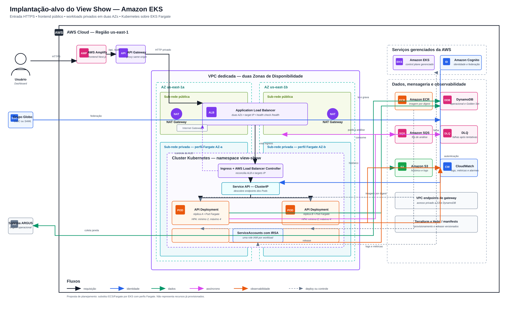

# Arquitetura Final

> Este documento apresenta a arquitetura final proposta para o View Show, a integração entre seus módulos e o plano de implantação na AWS com Amazon EKS e AWS Fargate.

## Sumário

1. [Introdução](#1-introdução)
2. [Diagramas de implantação](#2-diagramas-de-implantação)
3. [Componentes e justificativas](#3-componentes-e-justificativas)
4. [Plano de deploy na AWS](#4-plano-de-deploy-na-aws)
5. [Evidências e validação](#5-evidências-e-validação)

---

## 1. Introdução

&emsp;Este artefato documenta a arquitetura final proposta para o View Show com Amazon EKS e perfis Fargate. O foco está nos elementos novos da solução: orquestração Kubernetes, workloads privados em duas Zonas de Disponibilidade (AZs), roteamento por `Ingress`, identidade IAM por ServiceAccount, processamento assíncrono e operação observável.

&emsp;A decisão por EKS com perfis Fargate elimina a administração de instâncias EC2 para os workloads da aplicação, mas mantém os recursos próprios do Kubernetes necessários à operação: `Deployment`, `Service`, `Ingress`, `CronJob`, HPA, namespaces e políticas de identidade. DynamoDB, S3, SQS/DLQ, Cognito, ECR e CloudWatch compõem a camada de serviços gerenciados.

&emsp;A entrada pública é formada por AWS Amplify, API Gateway e Application Load Balancer (ALB). A computação permanece privada na VPC; somente a borda de acesso recebe tráfego externo. A arquitetura deve ser implementada, validada e evidenciada antes de ser apresentada como provisionada.

## 2. Diagramas de implantação

### 2.1 Arquitetura final proposta

&emsp;A arquitetura final usa o caminho público Amplify → API Gateway → ALB e executa a aplicação em Pods do EKS Fargate nas sub-redes privadas. A API é um `Deployment` com pelo menos duas réplicas, a ingestão é um `CronJob` e o consumidor assíncrono é um `Deployment` de worker. O AWS Load Balancer Controller reconcilia o `Ingress` e registra Pods saudáveis como targets IP no ALB.

<div align="center">

<strong>Figura 1: Diagrama de implantação da arquitetura final com Amazon EKS</strong>


Fonte: Material produzido pelos autores (2026).

</div>

&emsp;As setas do diagrama distinguem requisições, identidade, dados, processamento assíncrono, observabilidade e operações de entrega. A representação do `Ingress` e do `Service` é lógica: o controlador interpreta esses recursos Kubernetes e registra os IPs dos Pods no target group do ALB, que entrega o tráfego diretamente aos targets saudáveis.

## 3. Componentes e justificativas

<div align="center">

<sup>Tabela 1: Componentes da infraestrutura e justificativas arquiteturais</sup>

</div>

| Camada | Componente | Descrição e justificativa |
| --- | --- | --- |
| Entrega | Terraform | Mantém a infraestrutura como código, permite revisão por plano salvo, repetibilidade e rastreabilidade. Os recursos EKS devem ser provisionados sem alterações manuais na conta. |
| Rede | VPC e sub-redes | A VPC `10.0.0.0/16` separa a entrada pública da computação privada em duas AZs. Os Pods Fargate não recebem IP público. |
| Rede | Internet Gateway, NAT e endpoints | O Internet Gateway atende a camada pública. Os endpoints de gateway dão acesso privado a S3 e DynamoDB. A arquitetura final prevê um NAT Gateway por AZ para saída resiliente. |
| Experiência | Amplify Hosting | Publica o frontend Next.js e mantém os rewrites same-origin para `/api`, `/auth` e `/health`, reduzindo problemas de CORS, cookies e sessão. |
| Borda HTTP | API Gateway e ALB | O API Gateway oferece a origem HTTPS utilizada pelo Amplify. O ALB público distribui apenas para targets IP saudáveis, verificados em `/health`, nas duas sub-redes públicas. |
| Orquestração | Amazon EKS | Control plane Kubernetes gerenciado. Centraliza o agendamento, os recursos de rede e a operação dos workloads sem expor Pods diretamente à internet. |
| Orquestração | Perfis EKS Fargate | Selecionam Pods por namespace e rótulo e os executam apenas nas sub-redes privadas. Devem existir perfis elegíveis para os add-ons e perfis separados por AZ quando a distribuição controlada for necessária. |
| Orquestração | AWS Load Balancer Controller | Observa `Ingress` e `Service`, cria ou reconcilia regras e targets IP do ALB. |
| Workload | EKS/Fargate — API | Um `Deployment` com duas réplicas iniciais, `Service` `ClusterIP`, `Ingress`, probes em `/health` e HPA entre duas e quatro réplicas. |
| Workload | EKS/Fargate — ingestão | Um `CronJob` executa janelas idempotentes de ingestão. |
| Workload | EKS/Fargate — worker | Um `Deployment` consome trabalhos da SQS e pode escalar por profundidade de fila com KEDA ou HPA baseado em métrica externa. |
| Identidade | IRSA e ServiceAccounts | Cada workload recebe uma identidade Kubernetes e uma role IAM com privilégio mínimo. A pod execution role do Fargate não substitui as permissões da aplicação. |
| Dados | DynamoDB | Armazena as tabelas operacional e Golden Set, com acesso restrito às roles da API e do worker. |
| Dados | S3, SQS e DLQ | S3 armazena dados históricos e logs; SQS desacopla produtores e consumidores; a DLQ retém mensagens que excedem as tentativas configuradas. |
| Identidade | Cognito e SSO | Centraliza autenticação e federação corporativa OIDC ou SAML sem distribuir credenciais do SSO aos Pods. |
| Entrega | ECR | Armazena imagens de contêiner. Os manifests devem referenciar imagens por digest para associar cada release a conteúdo imutável. |
| Observabilidade | CloudWatch | Recebe logs, métricas e alarmes da borda e dos workloads, incluindo Pods, HPA e SQS/DLQ. |

<div align="center">

<sup>Fonte: Material produzido pelos autores (2026).</sup>

</div>

&emsp;A arquitetura final usa recursos Kubernetes para explicitar a operação de cada workload, a política de escala, o roteamento e a identidade AWS. Essa flexibilidade exige que manifests, add-ons, políticas Kubernetes e roles IAM sejam versionados e revisados junto com a aplicação.

## 4. Plano de deploy na AWS

### 4.1 Pré-requisitos e infraestrutura como código

&emsp;A migração requer Terraform, Docker, Node.js, npm, AWS CLI, `kubectl` e Helm disponíveis na estação de deploy. A equipe deve usar as credenciais válidas do AWS Academy ou da conta alvo, confirmar a região `us-east-1` e validar previamente as permissões de EKS, Fargate profiles, IAM/OIDC, ELBv2 e AWS Load Balancer Controller.

```bash
aws sts get-caller-identity --region us-east-1
aws eks list-clusters --region us-east-1
```

&emsp;Os comandos acima apenas consultam a conta. O deploy deve começar somente depois que o cluster, as roles, os add-ons e os manifests Kubernetes estiverem revisados e validados em ambiente controlado.

&emsp;A arquitetura exige duas AZs, tags de descoberta de sub-rede para o AWS Load Balancer Controller, CIDRs compatíveis com o número de Pods e add-ons e um NAT Gateway por AZ para saída resiliente. A criação dos perfis Fargate exige uma pod execution role; as permissões de cada aplicação permanecem nas roles IRSA vinculadas às respectivas ServiceAccounts.

### 4.2 Etapas de provisionamento

<div align="center">

<sup>Tabela 2: Etapas de provisionamento da arquitetura final na AWS</sup>

</div>

| Etapa | Recursos e ações | Critério de aceite |
| --- | --- | --- |
| 1. Identidade e cotas | Selecionar o perfil AWS, executar `aws sts get-caller-identity`, confirmar a região e verificar permissões, quotas EKS/Fargate e disponibilidade de IPs. | Conta, região, permissões e capacidade conferidas antes do plano. |
| 2. Rede e segurança | Criar ou revisar VPC, duas sub-redes públicas, duas privadas, rotas, Security Groups, endpoints S3/DynamoDB, NAT por AZ e tags de sub-rede. | Pods sem IP público; ALB descoberto em duas AZs; saída privada e endpoints funcionais. |
| 3. Control plane e Fargate | Criar cluster EKS, provider OIDC, pod execution role e perfis Fargate para `kube-system` e `view-show`. | Cluster ativo; CoreDNS e Pods elegíveis executando em sub-redes privadas. |
| 4. Add-ons e identidade | Instalar AWS Load Balancer Controller e o mecanismo de métricas aprovado. Criar ServiceAccounts e roles IRSA com privilégio mínimo. | Controlador saudável; roles assumidas apenas pelos workloads autorizados. |
| 5. Imagens e workloads | Publicar imagens no ECR por digest e aplicar Helm chart ou manifests de API, worker, `CronJob`, `Service`, `Ingress`, HPA e `ConfigMap`/segredos compatíveis. | Pods `Ready`; API com duas réplicas e referências de imagem rastreáveis. |
| 6. Entrada HTTP | Permitir que o controlador reconcilie o ALB e os targets IP. Validar `/health`, regras de `Ingress` e integração do API Gateway. | Targets IP saudáveis e resposta funcional pelo endpoint de teste. |
| 7. Dados e pipeline | Validar DynamoDB, S3, SQS/DLQ, ingestão idempotente e consumo do worker com as roles IRSA. | Dados persistidos; uma mensagem processada e uma falha controlada encaminhada à DLQ. |
| 8. Escala e observabilidade | Configurar HPA da API, KEDA ou HPA externo do worker, dashboards e alarmes do CloudWatch. | Escala observável e logs/métricas disponíveis para borda, Pods e fila. |
| 9. Corte e rollback | Liberar a nova integração da borda somente após aceite e manter uma rota de retorno para a versão anterior durante a estabilização. | Dashboard íntegro após o corte; retorno para a versão anterior validado. |

<div align="center">

<sup>Fonte: Material produzido pelos autores (2026).</sup>

</div>

&emsp;A API inicia com duas réplicas e HPA entre duas e quatro réplicas como ponto de partida. O worker não deve ser escalado somente por CPU quando a carga relevante é a profundidade da fila; a equipe deve aprovar KEDA ou métricas externas antes de configurar o autoscaling. O `CronJob` e o worker devem ser idempotentes e preservar correlação suficiente para reprocessamento pela DLQ.

### 4.3 Corte e recuperação operacional

&emsp;O corte não altera o frontend. Depois de validar Pods, `Ingress`, targets IP e autenticação, a integração do API Gateway passa a apontar para o ALB reconciliado pelo EKS. Caso os health checks, a autenticação, o DynamoDB ou o consumo da fila falhem, a integração da borda retorna à versão anterior e os workloads são analisados sem interrupção do dashboard.

&emsp;O rollback de aplicação usa a imagem por digest e uma revisão anterior de Helm ou manifest. O rollback de infraestrutura deve ser feito somente por Terraform, com plano revisado, para evitar divergência entre a conta AWS, o estado Terraform e os recursos criados pelo AWS Load Balancer Controller.

### 4.4 Restrições de EKS Fargate

&emsp;Os Pods Fargate são executados apenas em sub-redes privadas e usam targets IP no ALB. `DaemonSet` e `topologySpreadConstraints` não são suportados nesse modo. Portanto, agentes de observabilidade por nó precisam ser substituídos por sidecars ou coletores compatíveis, e a distribuição da API entre AZs deve ser validada com perfis Fargate separados por sub-rede/AZ; ela não pode ser presumida apenas pelo scheduler.

&emsp;EKS Pod Identity depende de um agente em `DaemonSet` e não atende workloads Fargate. A arquitetura final usa IRSA para conceder permissões às aplicações. A pod execution role existe para a infraestrutura Fargate registrar Pods e obter imagens, não para fornecer permissões de negócio ao código em execução.

## 5. Evidências e validação

&emsp;Após a implementação, a demonstração da arquitetura final deve comprovar a topologia e a comunicação efetivamente executadas, sem substituir evidência por capturas estáticas do diagrama. A documentação, os vídeos e os relatórios devem identificar recursos planejados como planejados até que sua execução seja comprovada.

### 5.1 Evidências de infraestrutura

- cluster EKS ativo, perfis Fargate criados e Pods elegíveis nas duas sub-redes privadas;
- AWS Load Balancer Controller saudável e `Ingress` reconciliado;
- ALB em duas sub-redes públicas com targets IP `healthy` no endpoint `/health`;
- regras de Security Group impedindo acesso direto externo aos Pods;
- ServiceAccounts associadas às roles IRSA corretas;
- endpoints de gateway de S3 e DynamoDB e, quando aprovado, NAT Gateway por AZ;
- CloudWatch com logs, métricas e alarmes dos workloads Kubernetes.

### 5.2 Evidências de integração e dados

- acesso do dashboard pelo Amplify e chamadas same-origin por API Gateway;
- autenticação federada pelo Cognito e recusa de operações sem sessão válida;
- leitura e escrita no DynamoDB pela API e pelo worker;
- execução do `CronJob`, persistência de histórico no S3, envio à SQS e consumo pelo worker;
- mensagem de falha encaminhada à DLQ após o limite configurado;
- alteração observável de réplicas da API pelo HPA e do worker pelo mecanismo de escala aprovado;
- rollback do API Gateway para a revisão anterior validado antes da estabilização definitiva da nova versão.

### 5.3 Referências técnicas

- [Amazon EKS on AWS Fargate — considerações e targets IP](https://docs.aws.amazon.com/eks/latest/userguide/fargate.html)
- [Perfis Fargate — seletores, sub-redes e restrições de distribuição](https://docs.aws.amazon.com/eks/latest/userguide/fargate-profile.html)
- [IAM Roles for Service Accounts — IRSA](https://docs.aws.amazon.com/eks/latest/userguide/iam-roles-for-service-accounts.html)
- [AWS Load Balancer Controller e targets IP](https://docs.aws.amazon.com/eks/latest/best-practices/load-balancing.html)
