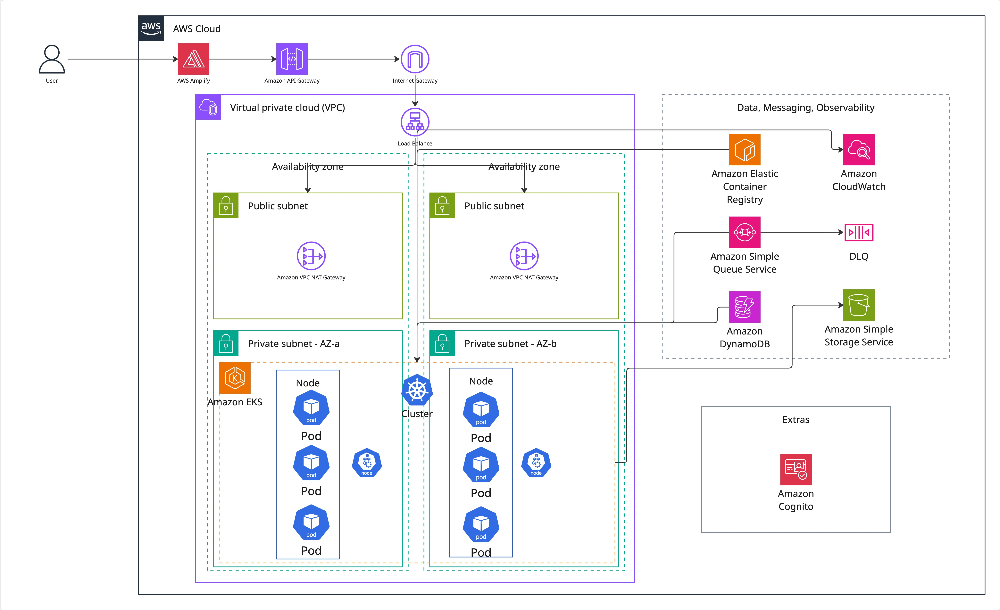
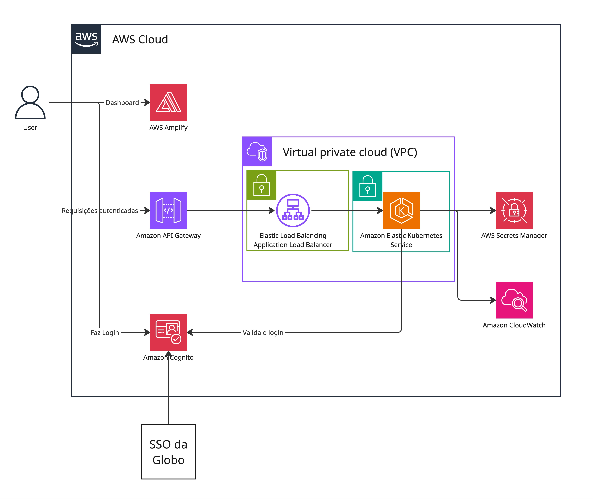
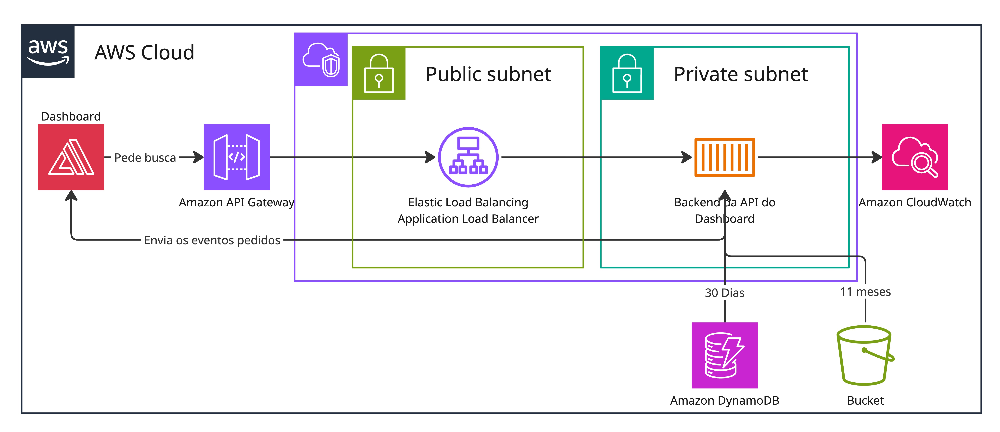
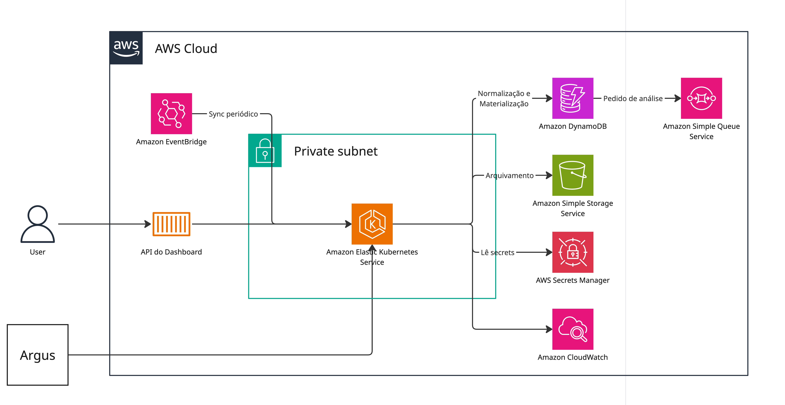
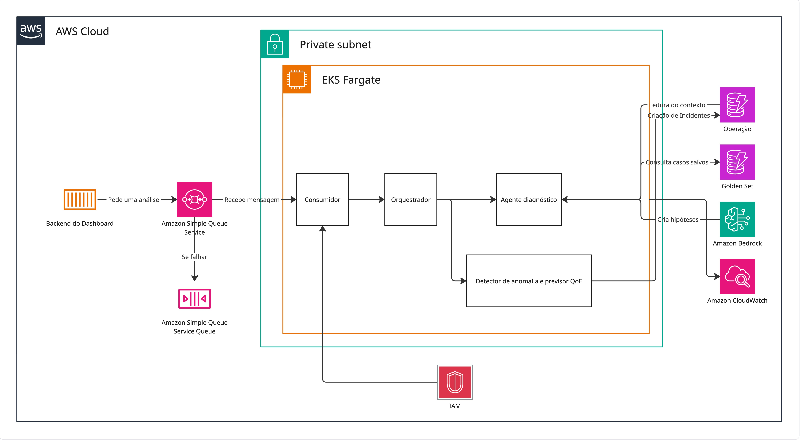

# Arquitetura Final — Cenário Amazon EKS

> Este documento especifica uma arquitetura de referência do View Show com Amazon EKS e AWS Fargate. O cenário foi elaborado para completar o artefato de conteinerização da Sprint 4 e demonstrar como os módulos do projeto poderiam ser implantados em Kubernetes. A implantação utilizada pelo projeto permanece em Amazon ECS com AWS Fargate; este documento não representa uma migração operacional nem substitui a infraestrutura ECS existente.

## Sumário

1. [Objetivo e enquadramento](#1-objetivo-e-enquadramento)
2. [Diagramas de implantação](#2-diagramas-de-implantação)
3. [Componentes e responsabilidades](#3-componentes-e-responsabilidades)
4. [Conteinerização e publicação no EKS](#4-conteinerização-e-publicação-no-eks)
5. [Integração entre os módulos](#5-integração-entre-os-módulos)
6. [Plano de implantação do cenário](#6-plano-de-implantação-do-cenário)
7. [Segurança, escala, observabilidade e validação](#7-segurança-escala-observabilidade-e-validação)
8. [Plano de recuperação de falhas](#8-plano-de-recuperação-de-falhas)

---

## 1. Objetivo e enquadramento

&emsp;O objetivo deste artefato é detalhar uma alternativa de implantação em Kubernetes para a API, a ingestão e o Worker de Análise do View Show. No cenário documentado, esses workloads são executados em Pods do Amazon EKS sobre AWS Fargate, dentro de sub-redes privadas distribuídas em duas zonas de disponibilidade. O frontend Next.js permanece no AWS Amplify e os serviços gerenciados de identidade, dados, mensageria, inteligência artificial e observabilidade continuam na AWS.

&emsp;O EKS é tratado como cenário arquitetural para o artefato de conteinerização. A equipe continuará utilizando a implantação existente em ECS com Fargate para o desenvolvimento e a demonstração do projeto. Portanto, não há corte de tráfego, desativação do ECS ou evidência de cluster EKS provisionado como parte do MVP. Nas seções seguintes, o cenário é descrito como se fosse implantado para permitir a análise completa de rede, workloads, segurança, escala e operação.

## 2. Diagramas de implantação

### 2.1 Visão geral

<div align="center">

<strong>Figura 1: Visão geral do cenário de implantação com Amazon EKS</strong>


Fonte: Material produzido pelos autores (2026).

</div>

&emsp;A visão geral organiza a solução em AWS Cloud, VPC, duas zonas de disponibilidade, sub-redes públicas e privadas e serviços gerenciados. O API Gateway recebe as chamadas do dashboard, o Application Load Balancer distribui o tráfego para os workloads privados e o ECR armazena as imagens dos contêineres. DynamoDB, S3, SQS, DLQ, Cognito e CloudWatch permanecem externos ao cluster e são consumidos por APIs gerenciadas da AWS.

&emsp;Os elementos identificados como `Node` no desenho representam capacidade lógica de execução do EKS Fargate. A solução não cria grupos de nós EC2 administrados pela equipe: cada Pod elegível é executado pela infraestrutura serverless do Fargate. A distribuição entre zonas de disponibilidade é um objetivo de implantação que deve ser verificado; ela não é garantida apenas pela presença de duas sub-redes no diagrama.

### 2.2 Acesso e autenticação

<div align="center">

<strong>Figura 2: Implantação do acesso ao dashboard e da autenticação</strong>


Fonte: Material produzido pelos autores (2026).

</div>

&emsp;O navegador carrega o dashboard publicado pelo Amplify. As chamadas autenticadas seguem pelo API Gateway e pelo ALB até o Backend API executado no EKS Fargate. No cenário alvo, o Cognito realiza a federação OIDC ou SAML com o SSO corporativo da Globo, enquanto o backend valida a identidade e mantém a sessão segura. Essa federação depende do IdP corporativo do parceiro; a configuração disponível no projeto usa o provedor nativo do Cognito. O Secrets Manager armazena somente segredos e parâmetros sensíveis da aplicação; tokens de usuário não são persistidos nele. Logs, métricas e falhas do fluxo são encaminhados ao CloudWatch.

### 2.3 Dashboard e consulta de dados

<div align="center">

<strong>Figura 3: Implantação do fluxo de consulta do dashboard</strong>


Fonte: Material produzido pelos autores (2026).

</div>

&emsp;O Backend API é a única interface pública para consultas e comandos do dashboard. Intervalos contidos nos últimos 30 dias são lidos das projeções do DynamoDB. Os 11 meses anteriores permanecem em Parquet no S3, com schemas e partições registrados no Glue Data Catalog e consultas executadas pelo Athena. Glue e Athena foram abstraídos no desenho para preservar a legibilidade, mas continuam obrigatórios no contrato de dados.

&emsp;Quando uma janela atravessa a fronteira entre as camadas quente e histórica, o backend consulta os dois níveis sob o mesmo `datasetVersion`, combina os resultados e elimina duplicatas por identificador canônico. O frontend não escolhe a origem física e não recebe nomes de tabelas, chaves ou caminhos do S3.

### 2.4 Ingestão e publicação de análises

<div align="center">

<strong>Figura 4: Implantação do serviço de ingestão</strong>


Fonte: Material produzido pelos autores (2026).

</div>

&emsp;A ingestão recebe execuções periódicas e importações solicitadas pelo dashboard. Ela lê o ARGUS ou um snapshot restaurado, valida o schema, normaliza os registros, materializa fatos e projeções no DynamoDB e arquiva o histórico em Parquet no S3. Depois da materialização, registra watermark e outbox e publica na SQS somente a referência da janela pronta para análise.

&emsp;A seta do EventBridge para o runtime representa a responsabilidade lógica de agendamento definida pela arquitetura do projeto. Na versão mais simples do cenário EKS, a periodicidade é materializada por um `CronJob` Kubernetes. Uma implantação que preserve o EventBridge deve adicionar uma integração autenticada para iniciar o Job. Os dois mecanismos não devem executar simultaneamente a mesma janela. Credenciais do ARGUS são lidas do Secrets Manager e a execução é observada pelo CloudWatch.

### 2.5 Worker, orquestrador e diagnóstico

<div align="center">

<strong>Figura 5: Implantação do Worker de Análise e do agente diagnóstico</strong>


Fonte: Material produzido pelos autores (2026).

</div>

&emsp;O Backend API pode publicar uma solicitação de reanálise na SQS. O consumidor do Worker recebe a mensagem, verifica idempotência e entrega a execução ao orquestrador interno. O orquestrador seleciona o detector de anomalias, o previsor de QoE ou o agente diagnóstico conforme o tipo do evento. Esses elementos são módulos internos do mesmo workload e não representam serviços ou deploys independentes.

&emsp;O Worker lê contexto e grava previsões, incidentes, evidências e estado no DynamoDB operacional. O agente consulta o Golden Set somente para leitura e envia ao Bedrock um contexto limitado e sanitizado. O Bedrock produz hipóteses candidatas, nunca uma decisão definitiva. A promoção de um diagnóstico ao Golden Set depende de revisão humana autenticada pelo Backend API. Mensagens que excedem as tentativas configuradas seguem para a DLQ; IAM com IRSA limita as permissões e o CloudWatch recebe logs, métricas e alarmes.

## 3. Componentes e responsabilidades

<div align="center">

<sup>Tabela 1: Componentes do cenário EKS</sup>

</div>

| Camada | Componente | Responsabilidade no cenário |
| --- | --- | --- |
| Experiência | AWS Amplify | Publicar o frontend Next.js e encaminhar as rotas dinâmicas do dashboard. |
| Borda HTTP | API Gateway | Expor HTTPS e encaminhar requisições autenticadas ao ALB. |
| Borda HTTP | Application Load Balancer | Operar nas sub-redes públicas, verificar `/health` e encaminhar tráfego para targets IP. |
| Rede | VPC, sub-redes, Internet Gateway e NAT | Isolar os workloads em sub-redes privadas e fornecer entrada e saída controladas em duas AZs. |
| Orquestração | Amazon EKS | Fornecer o control plane Kubernetes gerenciado. |
| Execução | EKS Fargate | Executar Pods sem grupos de nós EC2 administrados pela equipe. |
| Controladores | AWS Load Balancer Controller, Metrics Server e KEDA | Reconciliar o ALB, fornecer métricas ao HPA e escalar o Worker pela profundidade da SQS. |
| API | Backend API | Validar sessão, atender consultas, iniciar importações, publicar reanálises e registrar revisões humanas. |
| Ingestão | `CronJob` e Jobs sob demanda | Normalizar dados, materializar a camada quente, arquivar o histórico e publicar solicitações de análise. |
| Agendamento | EventBridge Scheduler | Representar a cadência de 15 minutos definida na arquitetura canônica quando houver integração externa de acionamento. |
| Análise | Worker de Análise | Consumir a SQS e executar orquestrador, modelos de detecção/previsão e agente diagnóstico. |
| Mensageria | SQS e DLQ | Desacoplar ingestão, reanálise e Worker e preservar falhas que excedam as tentativas. |
| Dados quentes | DynamoDB operacional | Manter fatos, projeções, execuções, outbox, previsões, incidentes, evidências e hipóteses dos últimos 30 dias. |
| Referência | DynamoDB Golden Set | Manter somente diagnósticos confirmados por revisão humana. |
| Histórico | S3, Glue Data Catalog e Athena | Manter 11 meses em Parquet, catalogar partições e executar consultas históricas. |
| Identidade | Cognito e SSO Globo | Manter a sessão e, no cenário alvo, autenticar identidades corporativas por OIDC ou SAML. |
| Segredos | Secrets Manager | Armazenar credenciais da origem e parâmetros sensíveis sem incluí-los nas imagens ou manifests. |
| IA | Amazon Bedrock | Produzir hipóteses candidatas a partir de contexto sanitizado. |
| Identidade AWS | ServiceAccounts e IRSA | Conceder a cada workload somente as permissões necessárias nos serviços AWS. |
| Imagens | Amazon ECR | Armazenar imagens imutáveis referenciadas por digest. |
| Observabilidade | Amazon CloudWatch | Centralizar logs, métricas, dashboards e alarmes da borda, workloads, filas e integrações. |

<div align="center">

<sup>Fonte: Material produzido pelos autores (2026).</sup>

</div>

## 4. Conteinerização e publicação no EKS

### 4.1 Workloads Kubernetes

&emsp;O cenário utiliza recursos Kubernetes pequenos e explícitos. O Backend API é um `Deployment` com `Service` `ClusterIP`, `Ingress`, probes de saúde e HPA. O Worker de Análise é outro `Deployment`, sem entrada pública, escalado pelo KEDA a partir da profundidade da SQS. A ingestão periódica é um `CronJob`; importações e reprocessamentos usam Jobs sob demanda baseados na mesma imagem e nos mesmos contratos.

```text
k8s/
  00-namespace.yaml
  10-serviceaccounts.yaml
  11-api-securitygrouppolicy.yaml
  20-api-deployment.yaml
  21-api-service.yaml
  22-api-hpa.yaml
  30-worker-deployment.yaml
  31-ingestion-cronjob.yaml
  32-worker-scaling.yaml
  40-ingress.yaml
```

&emsp;A API, a ingestão e o Worker possuem ServiceAccounts e roles IRSA distintas. A pod execution role do Fargate permite somente a inicialização da infraestrutura do Pod e não concede permissões de aplicação.

&emsp;O arquivo `11-api-securitygrouppolicy.yaml` associa aos Pods da API o Security Group específico criado pelo Terraform. Esse grupo aceita a porta 3000 somente a partir do Security Group do ALB. O Security Group do cluster permanece associado para preservar a comunicação com CoreDNS e com o control plane.

### 4.2 Segredos e configuração sensível

&emsp;`AUTH_COOKIE_SECRET`, `CURSOR_SECRET`, `COGNITO_CLIENT_SECRET` e credenciais de origem são gerados ou registrados pelo Terraform no Secrets Manager, que permanece como fonte de verdade. O mesmo ciclo de infraestrutura cria um `Secret` Kubernetes separado por workload, criptografado por chave KMS e consumido por `envFrom.secretRef`.

&emsp;Esses `Secret` não fazem parte de `k8s/` e não são aplicados por `kubectl apply`. O RBAC não concede `get` nem `list` de `Secret` às ServiceAccounts da aplicação; os valores chegam aos contêineres pelo kubelet. O Secrets Store CSI Driver não é adotado porque sua instalação depende de `DaemonSet`, recurso incompatível com EKS Fargate.

### 4.3 Imagens e versões

&emsp;As imagens são publicadas no ECR e referenciadas nos manifests por digest no formato `repositório@sha256:<digest>`. Tags mutáveis não são usadas como identidade de release. A alteração de versão acontece por mudança explícita dos manifests, permitindo revisão em merge request e recuperação de uma revisão anterior.

### 4.4 Publicação simples

&emsp;A aplicação não possui Helm Chart próprio e não usa Kustomize. Os manifests são YAML puro e o deploy é declarativo:

```bash
kubectl diff -f k8s/
kubectl apply -f k8s/
```

&emsp;A remoção de recursos é explícita; o fluxo inicial não utiliza `--prune`. Helm é reservado aos charts oficiais, com versão fixa, do AWS Load Balancer Controller e do KEDA. O Metrics Server é instalado como EKS Add-on compatível com a versão do cluster.

## 5. Integração entre os módulos

### 5.1 Autenticação e acesso

1. O navegador carrega o dashboard no Amplify.
2. O Cognito federa a autenticação com o SSO corporativo.
3. O dashboard envia chamadas ao API Gateway usando a sessão estabelecida.
4. O API Gateway encaminha a requisição ao ALB e ao Backend API privado.
5. O backend valida a identidade, executa a operação e registra telemetria no CloudWatch.

### 5.2 Consulta operacional e histórica

1. O backend resolve `datasetVersion`, janela e filtros recebidos.
2. Consultas de até 30 dias usam `Query` nas projeções do DynamoDB.
3. Períodos anteriores usam Athena sobre partições Parquet catalogadas no Glue.
4. Janelas híbridas combinam as duas respostas e removem duplicatas.
5. O dashboard recebe somente DTOs públicos, metadados de frescor e avisos de parcialidade.

### 5.3 Ingestão e outbox

1. O `CronJob` inicia o `sync` periódico ou um Job atende a uma solicitação sob demanda.
2. A ingestão lê o ARGUS ou o snapshot restaurado usando credenciais do Secrets Manager.
3. Registros são validados, normalizados e persistidos no DynamoDB e no histórico Parquet.
4. Watermark e outbox são gravados de forma consistente após a materialização da janela.
5. A solicitação de análise é publicada na SQS sem transportar todos os registros de origem.

### 5.4 Análise e revisão humana

1. O Worker consome a mensagem e verifica `eventId`, `idempotencyKey` e estado persistido.
2. O orquestrador escolhe detecção, previsão ou reanálise.
3. Resultados intermediários são preservados no DynamoDB operacional.
4. Quando necessário, o agente consulta o Golden Set e solicita hipóteses ao Bedrock.
5. Uma pessoa autenticada confirma, refuta ou mantém a hipótese pendente; somente confirmações criam um `GoldenCase`.

## 6. Plano de implantação do cenário

<div align="center">

<sup>Tabela 2: Etapas previstas para uma implantação EKS</sup>

</div>

| Etapa | Ações | Critério de validação |
| --- | --- | --- |
| 1. Rede | Preparar VPC, duas sub-redes públicas, duas privadas, rotas, NAT, endpoints e Security Groups. | Pods sem IP público e ALB disponível nas duas AZs. |
| 2. Cluster | Criar EKS com criptografia KMS de `Secret`, provider OIDC, pod execution role e perfis Fargate para os namespaces necessários. Configurar o CoreDNS gerenciado com `computeType: Fargate`. | Control plane ativo, Pods elegíveis em sub-redes privadas, CoreDNS em execução no Fargate e resolução interna funcional. |
| 3. Controladores | Instalar Load Balancer Controller e KEDA por Helm e Metrics Server como add-on. | Controladores `Ready` e reconciliação habilitada. |
| 4. Identidade e segredos | Criar ServiceAccounts, roles IRSA, SecurityGroupPolicy da API, entradas do Secrets Manager e `Secret` Kubernetes por workload. | Cada Pod assume somente a role prevista; segredos não aparecem nos manifests versionados nem nas imagens. |
| 5. Imagens | Construir e publicar API, ingestão e Worker no ECR por digest. | Digests dos manifests correspondem às imagens publicadas. |
| 6. Aplicação | Aplicar namespace, ServiceAccounts, Deployments, CronJob, HPA, KEDA, Service e Ingress. | Pods `Ready`, probes saudáveis e Jobs concluídos. |
| 7. Entrada e autenticação | Integrar ALB, API Gateway, Amplify, Cognito e SSO. | Dashboard acessível e sessão validada pelo backend. |
| 8. Dados e mensageria | Validar DynamoDB, S3, Glue, Athena, SQS, DLQ, Secrets Manager e Bedrock. | Fluxos de consulta, ingestão, análise e falha exercitados. |
| 9. Observabilidade | Configurar logs do Fargate, métricas por Pod, dashboards e alarmes CloudWatch. | Logs correlacionáveis e alarmes alterando de estado em teste controlado. |
| 10. Recuperação | Aplicar revisão anterior dos manifests e dos digests de imagem. | Rollback da aplicação executado sem alteração destrutiva dos dados. |

<div align="center">

<sup>Fonte: Material produzido pelos autores (2026).</sup>

</div>

&emsp;Esta tabela descreve como o cenário seria implantado e validado. Ela não afirma que essas etapas foram executadas na conta do projeto. As evidências operacionais efetivas continuam associadas ao ambiente ECS com Fargate documentado na Sprint 3.

## 7. Segurança, escala, observabilidade e validação

### 7.1 Segurança

- Somente o ALB recebe tráfego destinado aos workloads; os Pods permanecem em sub-redes privadas.
- A `SecurityGroupPolicy` associa aos Pods da API o grupo que libera a porta 3000 somente a partir do Security Group do ALB, mantendo também o grupo do cluster para DNS e control plane.
- API, ingestão e Worker utilizam roles IRSA diferentes e de menor privilégio.
- Credenciais e parâmetros sensíveis ficam no Secrets Manager e não nos manifests ou imagens.
- Contextos enviados ao Bedrock são limitados, sanitizados e não incluem tokens ou credenciais.
- Imagens são identificadas por digest e possuem origem rastreável no ECR.

### 7.2 Escala e disponibilidade

&emsp;A API usa HPA por CPU, com alvo inicial de 70%, mínimo de duas e máximo de quatro réplicas. O Worker usa KEDA com o scaler da SQS, variando de zero a quatro réplicas conforme mensagens visíveis ou em processamento. O ALB opera em duas sub-redes públicas e encaminha tráfego somente a targets saudáveis.

&emsp;Todos os contêineres declaram `resources.requests` e `resources.limits`. No EKS Fargate, os requests determinam o tamanho da capacidade provisionada e fornecem a base de cálculo para o HPA.

<div align="center">

<sup>Tabela 3: Recursos iniciais dos workloads</sup>

</div>

| Workload | CPU solicitada/limite | Memória solicitada/limite | Escala |
| --- | --- | --- | --- |
| Backend API | `250m` / `250m` | `256Mi` / `256Mi` | HPA de 2 a 4 réplicas. |
| Worker de Análise | `250m` / `250m` | `256Mi` / `256Mi` | KEDA de 0 a 4 réplicas. |
| Ingestão | `250m` / `250m` | `256Mi` / `256Mi` | Uma execução por Job, com concorrência controlada. |

<div align="center">

<sup>Fonte: Material produzido pelos autores (2026).</sup>

</div>

&emsp;Os valores são pontos de partida e devem ser revistos com métricas do Container Insights. Como o Fargate não redimensiona um Pod em execução, alterações exigem uma nova revisão do manifest e a recriação do Pod.

&emsp;O EKS Fargate não utiliza `DaemonSet` para agentes por nó. A distribuição entre AZs deve ser conferida durante os testes, pois a simples seleção de múltiplas sub-redes não comprova dispersão dos Pods. Falhas do Bedrock não removem previsões, incidentes ou evidências já produzidas; falhas permanentes de mensagens seguem para a DLQ.

### 7.3 Observabilidade

&emsp;O CloudWatch é a fonte de logs, métricas e alarmes do cenário. O roteador nativo de logs do EKS Fargate envia `stdout` e `stderr` dos contêineres. Um coletor compatível com Fargate, como o AWS Distro for OpenTelemetry, fornece métricas de CPU, memória e rede por Pod sem depender de `DaemonSet`.

&emsp;Dashboards e alarmes devem cobrir saúde do ALB, latência e erros da API, réplicas do HPA, escala do Worker, profundidade e idade da SQS, mensagens da DLQ, duração da ingestão, partições históricas, falhas do Bedrock e acesso aos serviços de dados.

### 7.4 Critérios de validação do cenário

- os cinco diagramas possuem correspondência textual neste documento;
- API, ingestão e Worker estão representados como workloads independentes e conteinerizados;
- Pods não recebem IP público e usam identidade AWS por workload;
- o fluxo Amplify → API Gateway → ALB → Backend API está definido;
- autenticação Cognito e federação com SSO estão separadas das permissões IAM dos workloads;
- CoreDNS está configurado para Fargate e a resolução interna faz parte dos critérios do cluster;
- `SecurityGroupPolicy`, criptografia KMS e distribuição de segredos por workload estão definidas;
- consultas recentes e históricas mantêm a divisão DynamoDB e S3/Glue/Athena;
- a ingestão materializa os dados antes de publicar uma solicitação de análise;
- o Worker mantém orquestrador, modelos e agente diagnóstico como módulos internos;
- Bedrock produz hipóteses candidatas e a confirmação permanece humana;
- SQS, DLQ, CloudWatch, Secrets Manager, ECR e Golden Set possuem responsabilidades documentadas;
- publicação e rollback usam manifests versionados e imagens identificadas por digest;
- o caráter documental do EKS e a continuidade operacional do ECS com Fargate estão explicitados.

## 8. Plano de recuperação de falhas

&emsp;O plano de recuperação de falhas do cenário EKS protege a disponibilidade da API, a continuidade dos fluxos assíncronos e a integridade dos dados processados pela aplicação. A estratégia separa falhas locais de contêineres e Pods, tratadas automaticamente pelo Kubernetes, de falhas em dependências externas, que exigem interrupção segura, persistência do estado e retomada controlada.

&emsp;A API, a ingestão e o Worker não mantêm estado de negócio exclusivamente em memória. Execuções, watermarks, outbox, previsões, incidentes, evidências e hipóteses são persistidos nos serviços de dados da AWS. Dessa forma, a recriação de um contêiner ou Pod não elimina o estado necessário para concluir, repetir ou investigar uma operação.

### 8.1 Estratégias de replicação de serviços

&emsp;O Backend API é o workload com requisito direto de disponibilidade ao usuário. Ele utiliza um `Deployment` com mínimo de duas réplicas e HPA configurado entre duas e quatro réplicas, com escala orientada pela utilização de CPU. A existência de duas réplicas garante que a perda isolada de um Pod, de um contêiner ou de uma instância de execução não interrompa integralmente o acesso ao dashboard.

&emsp;O ALB encaminha requisições somente para targets saudáveis. Quando uma réplica deixa de estar pronta para receber tráfego, ela é removida do conjunto de destinos até recuperar sua disponibilidade. As demais réplicas continuam atendendo as chamadas, sem que o frontend precise identificar a falha ou escolher uma rota alternativa.

&emsp;A implantação deve distribuir a capacidade do Fargate entre sub-redes de mais de uma zona de disponibilidade. Como o EKS Fargate não suporta `topologySpreadConstraints`, essa distribuição depende dos perfis Fargate e das sub-redes associadas a eles, devendo ser confirmada durante a implantação. A presença de múltiplas zonas reduz o impacto de uma falha localizada de infraestrutura.

&emsp;Para interrupções planejadas, como atualização de plataforma ou manutenção, o cenário deve declarar um `PodDisruptionBudget` para a API com pelo menos uma réplica disponível. Esse recurso limita indisponibilidades voluntárias simultâneas, sem substituir a replicação em zonas distintas nem proteger contra falhas involuntárias de infraestrutura.

&emsp;O Worker de Análise usa uma estratégia diferente. Ele não atende requisições HTTP e pode permanecer com zero réplicas quando não houver demanda. A durabilidade é fornecida pela SQS: a mensagem permanece armazenada até que o processamento seja concluído com sucesso. Quando há mensagens pendentes, o KEDA cria ou amplia réplicas do Worker; caso uma delas falhe, outra réplica pode retomar o consumo da fila.

&emsp;A ingestão periódica não é replicada de forma concorrente, pois duas execuções sobre a mesma janela podem provocar processamento duplicado ou disputa pelo watermark. O `CronJob` utiliza política de concorrência controlada e Jobs sob demanda usam identificadores de execução e idempotência para assegurar que a mesma janela seja materializada uma única vez.

### 8.2 Fallback automático e degradação controlada

&emsp;O fallback automático da API é realizado pela combinação entre probes, `Service`, ALB e réplicas do `Deployment`. Uma réplica temporariamente indisponível deixa de receber novas chamadas; o tráfego segue para as réplicas restantes que permanecem prontas. Esse mecanismo é transparente para o dashboard e não depende de troca manual de endereço, reinicialização do navegador ou alteração do frontend.

&emsp;O fluxo assíncrono possui fallback orientado pela fila. Se o Worker falhar antes de concluir uma mensagem, a mensagem volta a ficar disponível após o tempo de visibilidade configurado na SQS. O Worker reprocessa a solicitação usando `eventId`, `idempotencyKey` e o estado persistido, evitando que uma nova tentativa crie registros duplicados. Mensagens que excedem o número de tentativas definido são enviadas para a DLQ, onde permanecem isoladas até análise e reprocessamento controlado.

&emsp;A indisponibilidade do Bedrock não impede a preservação dos resultados determinísticos do pipeline. O Worker grava previsões, incidentes e evidências já calculados e registra a hipótese diagnóstica como pendente. Quando o serviço de IA voltar a responder, somente a etapa de diagnóstico é reexecutada. Dessa forma, a aplicação degrada a funcionalidade de hipótese automatizada sem descartar o resultado analítico anterior.

&emsp;Uma falha de origem no ARGUS não autoriza a publicação de dados parciais. A ingestão encerra a execução sem avançar o watermark nem gravar uma referência de outbox para uma janela incompleta. Após a normalização da origem, a mesma janela pode ser executada novamente; quando houver um snapshot validado, ele pode ser utilizado como origem alternativa de recuperação.

&emsp;Falhas temporárias em DynamoDB, S3, Athena, SQS ou Bedrock devem receber novas tentativas limitadas, com espera progressiva e registro de telemetria. A aplicação não deve transformar a falha de uma dependência externa em reinicialização contínua dos Pods. Se a dependência continuar indisponível, a operação é interrompida de forma controlada, sem inventar resultados, sem apagar registros já confirmados e sem marcar a execução como concluída.

### 8.3 Reinicialização de contêineres e recomposição de Pods

&emsp;Os `Deployments` da API e do Worker devem utilizar probes distintas para inicialização, disponibilidade e atividade. A probe de inicialização protege aplicações que ainda estão carregando configuração, estabelecendo conexões ou preparando recursos internos. Enquanto ela não for concluída, o Kubernetes não trata o contêiner como disponível para tráfego ou como falha de atividade.

&emsp;A probe de disponibilidade verifica se a API pode atender requisições com segurança. Quando ela falha, o Pod continua existindo, mas deixa de receber novas chamadas pelo `Service` e pelo ALB. Essa separação permite que uma indisponibilidade transitória, como uma conexão ainda não estabelecida, seja tratada sem reinicializar imediatamente o processo.

&emsp;A probe de atividade identifica situações em que o contêiner continua em execução, mas não consegue mais progredir, como bloqueios permanentes, deadlocks ou perda irrecuperável de comunicação interna. Após o número de falhas configurado, o kubelet encerra e reinicia o contêiner. Como os `Deployments` usam política de reinicialização contínua, o processo é recomposto automaticamente sem intervenção manual.

&emsp;A probe de atividade deve verificar apenas a saúde local do processo. Dependências externas, como Bedrock, SQS ou DynamoDB, não devem provocar sua falha direta, pois isso poderia reiniciar simultaneamente todas as réplicas durante uma indisponibilidade externa e ampliar o incidente. Essas dependências são tratadas pela lógica de fallback e pelas tentativas controladas da aplicação.

&emsp;A finalização de Pods deve respeitar um período de encerramento gracioso. Antes de terminar, a API deixa de aceitar novas requisições e conclui as chamadas em andamento dentro do limite configurado. Jobs de ingestão utilizam limite de tentativas e duração máxima de execução, evitando que um processo falho permaneça indefinidamente em execução ou seja iniciado em paralelo a uma execução ainda ativa.

### 8.4 Contingência para falhas críticas

<div align="center">

<sup>Tabela 4: Resposta a falhas críticas</sup>

</div>

| Cenário | Resposta automática | Contingência operacional | Preservação de dados |
| --- | --- | --- | --- |
| Falha de um contêiner da API | A probe de atividade reinicia o contêiner; a probe de disponibilidade remove o Pod do tráfego. | Investigar logs, eventos do Pod e métricas quando houver reinicializações recorrentes. | A API não mantém estado de negócio exclusivamente no contêiner. |
| Perda de um Pod ou indisponibilidade localizada | O `Deployment` recompõe a réplica e o ALB mantém o tráfego em targets saudáveis. | Confirmar a distribuição dos Pods entre zonas e ampliar temporariamente o número de réplicas, se necessário. | O estado continua em DynamoDB, S3 e SQS. |
| Acúmulo ou falha de mensagens | O KEDA ajusta a capacidade do Worker; a SQS mantém as mensagens pendentes. | Investigar a causa, corrigir o processamento e reencaminhar mensagens da DLQ. | A idempotência impede duplicidade em reprocessamentos. |
| Falha da origem de ingestão | O Job não publica janela parcial nem avança watermark e outbox. | Reexecutar a janela após normalização da origem ou utilizar snapshot validado. | A última versão consistente permanece disponível. |
| Indisponibilidade do Bedrock | A hipótese fica pendente; os resultados determinísticos permanecem persistidos. | Reexecutar somente o diagnóstico após a recuperação do serviço. | Previsões, incidentes e evidências não são removidos. |
| Release ou imagem defeituosa | Pods que não ficam saudáveis não recebem tráfego. | Reaplicar a revisão anterior dos manifests e os digests de imagem validados. | O rollback altera a aplicação, não remove dados operacionais. |
| Erro de dados, exclusão acidental ou corrupção | A operação afetada é interrompida antes de confirmar novos resultados. | Restaurar o ponto consistente mais recente e reprocessar somente as janelas necessárias. | DynamoDB deve possuir recuperação pontual habilitada e o S3 deve manter versionamento dos objetos históricos. |
| Indisponibilidade prolongada de serviço AWS | Alarmes identificam a dependência afetada; operações passam a falhar de forma controlada. | Suspender Jobs que dependam do serviço, preservar a fila e retomar o processamento após a normalização. | Mensagens, versões de dataset e resultados já confirmados permanecem preservados. |

<div align="center">

<sup>Fonte: Material produzido pelos autores (2026).</sup>

</div>

### 8.5 Procedimento operacional durante incidentes

&emsp;Os alarmes do CloudWatch devem identificar indisponibilidade de targets do ALB, aumento de erros HTTP, reinicializações recorrentes de Pods, saturação do HPA, crescimento ou envelhecimento de mensagens da SQS, volume de mensagens na DLQ, falhas de ingestão e erros de integração com Bedrock ou serviços de dados.

&emsp;Diante de um incidente, a equipe deve primeiro classificar a falha como local ao workload, relacionada a uma dependência externa, relacionada à integridade dos dados ou relacionada a uma versão publicada. Em seguida, deve conter o impacto sem destruir evidências: suspender Jobs de ingestão quando a origem estiver inconsistente, preservar mensagens na SQS quando o Worker não puder concluir o processamento e impedir a publicação de novas versões enquanto o rollback estiver em curso.

&emsp;A recuperação deve utilizar o menor escopo necessário. Falhas de contêiner são tratadas pela reinicialização automática; falhas de mensagem exigem reprocessamento pela DLQ; falhas de versão exigem retorno ao digest anterior; e falhas de dados exigem restauração do ponto consistente e reprocessamento da janela afetada. Após a recuperação, logs, métricas, mensagens e identificadores de execução devem permanecer disponíveis para análise da causa e prevenção de recorrência.