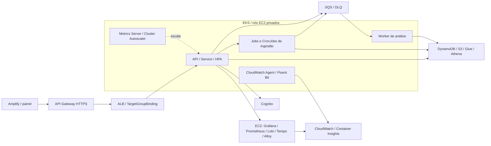

# Aplicação final — Kubernetes na AWS

## 1. Arquitetura entregue

O runtime ECS/Fargate e o EventBridge Scheduler foram substituídos por EKS 1.35, Deployments, Jobs e CronJobs. Amplify, Cognito, DynamoDB, S3, Glue, Athena e SQS permanecem na arquitetura. Implementação no [PR !97](https://git.inteli.edu.br/graduacao/2026-2a/t15/g05/-/merge_requests/97), na branch `feat/ecs-to-kubernetes`.

Os Pods usam nós privados. A API cria Jobs em `view-show-imports` e controla o CronJob sync em `view-show`; o Worker consome SQS quando habilitado. MySQL é um sidecar temporário dos snapshots; os dados duráveis ficam nos serviços AWS.

## 2. Arquivos Docker e contextos de build

O contexto é o diretório de cada Dockerfile. O build `linux/amd64` usa [publicar-imagem.mjs](../../apps/fullstack/scripts/publicar-imagem.mjs), responsável por login ECR e build/push. API e Worker usam tags derivadas das fontes; ingestão no lab usa `@sha256`. O ECR da API é mutável; ingestão e análise são imutáveis.

1. **API — [apps/backend/api/Dockerfile](../../apps/backend/api/Dockerfile).** Dois estágios com `node:22.22.0-bookworm-slim`, fixado por digest. O build copia `package.json`, lockfile e manifesto de `contracts`, instala com `npm ci`, copia `tsconfig*.json`, `src` e `contracts`, compila TypeScript e remove dependências de desenvolvimento. Dependências: Express, SDKs AWS, OpenTelemetry e contratos compartilhados. O runtime instala `dumb-init`, recebe os manifestos, `node_modules`, `dist` e os contratos compilados; roda como `node` com `ENTRYPOINT ["dumb-init", "--"]` e `CMD ["node", "dist/index.js"]`. Expõe `3000` e possui healthcheck HTTP em `/health`.
2. **Ingestão — [apps/backend/ingestion-data/Dockerfile](../../apps/backend/ingestion-data/Dockerfile).** Estágio único com `python:3.12.11-slim-bookworm`, fixado por digest. Instala `default-mysql-client=1.1.0` e as dependências de `requirements.txt` com versões e hashes, incluindo boto3, PyMySQL, PyArrow e jsonschema. Copia `domain`, `application`, `ports`, `adapters`, `bootstrap`, `contracts` e `scripts`. Executa como `ingestion`, UID `10001`, com `ENTRYPOINT ["python", "-m", "bootstrap"]`; o `CMD ["--help"]` é substituído pelos argumentos de cada workload. Não expõe porta HTTP e usa `/tmp/ingestion` para trabalho temporário.
3. **Worker — [apps/backend/agentic/Dockerfile](../../apps/backend/agentic/Dockerfile).** Dois estágios com `node:20-bookworm-slim`; essa base usa tag, sem digest fixado no Dockerfile. O build copia manifestos e lockfile, instala com `npm ci`, copia `tsconfig.json` e `src`, compila TypeScript e remove dependências de desenvolvimento. Dependências: SDKs AWS de SQS, S3, DynamoDB e Bedrock. O runtime recebe manifestos, `node_modules` e `dist`, roda como `node` e inicia com `CMD ["node", "dist/src/bootstrap/analysis-worker.js"]`, sem `ENTRYPOINT` próprio ou porta publicada. Modelos e catálogos são carregados da configuração/S3, não incorporados à imagem.

| Filtro do contexto | Conteúdo excluído |
| --- | --- |
| [api/.dockerignore](../../apps/backend/api/.dockerignore) | `node_modules`, `.env*` exceto `.env.example`, testes, cobertura, deploy, scripts, builds `dist`, cache npm e `*.tsbuildinfo`. |
| [ingestion-data/.dockerignore](../../apps/backend/ingestion-data/.dockerignore) | Git, `.env*`, ambientes/cache Python, testes, dependências de desenvolvimento, logs, builds, bancos locais, Parquet e arquivos temporários/spool. |
| [agentic/.dockerignore](../../apps/backend/agentic/.dockerignore) | `node_modules`, `dist`, testes, scripts, modelos, dados e logs. O Dockerfile copia apenas os arquivos e diretórios enumerados acima. |

MySQL usa imagem pronta: [ingestion-variables.tf](../../apps/fullstack/ingestion-variables.tf) fornece `imagem_mysql_snapshot`, fixada por digest. Inicia com `mysqld` e parâmetros de [ingestion-runtime.tf](../../apps/fullstack/ingestion-runtime.tf), incluindo buffer InnoDB de 3 GiB e binlog desativado. Conexão local `127.0.0.1:3306`, sem Service público.

## 3. Manifests Kubernetes: origem e conteúdo

Os manifests são **gerados**, em vez de manter um YAML por componente. A correspondência entre arquivos, recursos e diagrama é:

| Arquivo | Recursos ou configuração produzida | Componente do diagrama |
| --- | --- | --- |
| [fullstack/workloads.tf](../../apps/fullstack/workloads.tf) | Define imagens, argumentos, CPU, memória, ambiente e referências a segredos dos sete workloads. | API, ingestão e Worker |
| [fullstack/kubernetes-outputs.tf](../../apps/fullstack/kubernetes-outputs.tf) | Exporta `kubernetes_deployment`: workloads, namespaces, roles, ALB, réplicas e flags; `kubernetes_runbook` fornece os comandos operacionais. | Integração Terraform → EKS |
| [kubernetes/render.mjs](../../apps/kubernetes/render.mjs) | Gera Namespace, ServiceAccount, Secret, Deployment, CronJob, Service, TargetGroupBinding, HPA, PDB, NetworkPolicy, Role e RoleBinding; configura Pods e probes. | Todos os workloads no EKS |
| [chart/Chart.yaml](../../apps/kubernetes/chart/Chart.yaml) | Declara o chart `view-show`, versão `1.0.0`, compatível com Kubernetes ≥ 1.33. | Release da aplicação |
| [chart/values.yaml](../../apps/kubernetes/chart/values.yaml) | Declara `resources: []`; o deploy fornece os valores reais gerados pelo renderer. | Entrada do release |
| [chart/templates/resources.yaml](../../apps/kubernetes/chart/templates/resources.yaml) | Serializa cada recurso em YAML. Preserva a suspensão de sync controlada pelo painel e as réplicas da API controladas pelo HPA nos upgrades. | API/HPA e CronJob sync |
| [kubernetes/deploy.mjs](../../apps/kubernetes/deploy.mjs) | Aplica namespaces, instala controllers e o release por Helm, aguarda rollout e targets saudáveis no ALB. | EKS, ALB, escala e observabilidade |
| [kubernetes/run-job.mjs](../../apps/kubernetes/run-job.mjs) | Clona o template de backfill em um Job manual; valida conta, cluster e snapshot S3 versionado e cria Secret MySQL por Job. | Ingestão de snapshot |

### Recursos gerados e parâmetros relevantes

| Recurso | Configuração efetiva em `render.mjs` |
| --- | --- |
| `Deployment/api` | Usa o comando do Dockerfile, porta nomeada `http:3000` e probes startup/readiness/liveness em `/health`. `RollingUpdate` com `maxUnavailable=0`, `maxSurge=1`; recursos vêm de `cpu_task`/`memoria_task` (defaults: `250m`/`512Mi`). |
| `Deployment/analysis-worker` | Criado somente com `analysis_worker_habilitado=true`. Uma réplica, `500m` CPU e `1024Mi`, comando do Dockerfile, configuração da fila/modelo/provider e 120 s para encerramento. |
| `Service/api` e `TargetGroupBinding/api` | Service `ClusterIP`, seletor `app.kubernetes.io/name=api`, porta `3000` → `targetPort=http`. O binding associa esse Service ao target group Terraform com `targetType=ip`; autoriza tráfego TCP/3000 do security group do ALB. |
| `HorizontalPodAutoscaler/api` | Alvo `Deployment/api`, defaults de 1–4 réplicas, CPU média alvo de 50% e estabilização de redução por 300 s. Metrics Server fornece a métrica; Cluster Autoscaler ajusta os nós, não as réplicas. |
| `PodDisruptionBudget/api` | Seletor da API e `maxUnavailable=1`; os Deployments também distribuem Pods entre hosts com `maxSkew=1`. |
| `Namespace`, `NetworkPolicy` | Namespaces principal e de imports com Pod Security `baseline`. `deny-ingress` bloqueia entrada por padrão; `api-ingress` libera TCP/3000 para Pods da API. Essas políticas não restringem egress. |
| `ServiceAccount`, `Role`, `RoleBinding` | Conta por workload; somente API monta token Kubernetes. `argus-scheduler` permite `get/patch` apenas em `ingestion-sync`; `import-launcher`, no namespace de imports, permite criar/ler Jobs e ler o template `ingestion-import`, sem acesso Kubernetes a Secrets. |
| `Secret/<workload>-env` | Tipo `Opaque`; variáveis de senha/segredo e valores do Secrets Manager viram `secretKeyRef`. Os valores são enviados ao Helm por stdin, sem arquivo de valores sensíveis versionado. |

**Entrada e escala adotadas:** não existem Ingress, ScaledObject ou TriggerAuthentication do KEDA nesta implementação. Em [apigateway.tf](../../apps/fullstack/apigateway.tf), a rota `ANY /{proxy+}` encaminha por HTTP proxy ao ALB. Em [alb.tf](../../apps/fullstack/alb.tf), o listener HTTP/80 encaminha ao target group da API, com healthcheck `/health` na porta 3000. O Load Balancer Controller registra os IPs pelo TargetGroupBinding. A escala é por HPA/CPU; o Worker mantém uma réplica quando habilitado, sem escala por profundidade da SQS.

### CronJobs e comandos

Todos usam `timeZone=Etc/UTC`, `concurrencyPolicy=Forbid`, tolerância de atraso de 300 s, histórico de 2 sucessos/5 falhas e Jobs com `backoffLimit=0`, `restartPolicy=Never` e TTL de 7 dias. O prazo é 24 h para snapshots e 1 h para os demais. A concorrência é impedida por agenda; locks da aplicação protegem operações entre agendas distintas.

| CronJob | Comando sobre `python -m bootstrap` | Agenda e acionamento |
| --- | --- | --- |
| `ingestion-backfill` | `backfill --run-id <id>` no Job manual | `0 0 1 1 *`, permanentemente suspenso como template; acionado por `run-job.mjs`. |
| `ingestion-import` | `import-dump --import-id <id>` | Mesmo template suspenso, em `view-show-imports`; a API cria um Job por importação. |
| `ingestion-sync` | `sync` | `*/15 * * * *`; habilitação por configuração/painel. |
| `ingestion-incremental-export` | `export-incremental` | `*/15 * * * *`; habilitação por `incremental_s3_enabled`. |
| `ingestion-incremental-ingest` | `ingest-incremental --limit 20` | `*/5 * * * *`; mesma flag de incremental. |

Snapshots têm MySQL em `initContainers` com `restartPolicy=Always`: o startup probe executa `mysqladmin ping` antes do worker iniciar e o sidecar encerra ao concluir o Job. Os volumes `emptyDir` reservam 128 GiB para MySQL e 64 GiB para `/tmp`; cada contêiner recebe 4 GiB de memória e limite de CPU de 1 core nos defaults. No modo padrão, o request também é 1 core por contêiner; no lab, é `500m`. Aplicações usam filesystem raiz somente leitura, UID `1000` (API/análise) ou `10001` (ingestão) e `/tmp` gravável; o MySQL inicia com UID `0` e capacidades limitadas de inicialização. Os volumes são temporários.

O [launcher da API](../../apps/backend/api/src/modules/imports/adapters/kubernetes-import-worker-launcher.ts) usa nome determinístico e recupera o mesmo Job em HTTP 409. O campo histórico `taskArn` passa a armazenar `k8s://namespace/jobs/name/uid`. O [scheduler da API](../../apps/backend/api/src/modules/argus/adapters/kubernetes-argus-scheduler.ts) altera `spec.suspend` do CronJob, substituindo a integração EventBridge.

## 4. Configurações complementares e arquivos responsáveis

Os caminhos Terraform abaixo ficam em `apps/fullstack`. Terraform prepara a infraestrutura e as fontes dos segredos; **os Secrets Kubernetes e o RBAC são criados por `render.mjs`/Helm**, não por um provider Kubernetes no Terraform.

| Arquivo | Responsabilidade |
| --- | --- |
| [eks.tf](../../apps/fullstack/eks.tf) | Cluster, managed node group, launch template, access entry do administrador, endpoint privado/público restrito por CIDR, roles/OIDC, add-ons VPC CNI com NetworkPolicy, CoreDNS e kube-proxy; tags de descoberta do Autoscaler e Pod Identity do CloudWatch no modo gerenciado. Defaults: 2–6 nós `m6i.xlarge`, EBS de 300 GiB. |
| [eks-existing-iam.tf](../../apps/fullstack/eks-existing-iam.tf) | Seleciona `managed` ou `learner-lab-existing`; valida conta, LabRole/LabInstanceProfile e capacidade de disco, impedindo o modo compartilhado em produção. |
| [kubernetes-iam.tf](../../apps/fullstack/kubernetes-iam.tf) | Policies AWS de API, backfill/sync e análise para os serviços de dados, autenticação e filas. |
| [ingestion-imports.tf](../../apps/fullstack/ingestion-imports.tf) | Policies de upload/importação, proteção do manifesto ACTIVE no modo gerenciado e alarmes/filtros de importação. |
| [ingestion-runtime.tf](../../apps/fullstack/ingestion-runtime.tf) | Build/digest da ingestão, ambiente e argumentos MySQL; policies de exportação/ingestão incremental. |
| [api-runtime.tf](../../apps/fullstack/api-runtime.tf) | Gera segredos de cookie e cursor que o renderer transforma em Secrets Kubernetes. |
| [cognito.tf](../../apps/fullstack/cognito.tf) | Pool/client de autenticação; fornece ID e segredo do client usados pela API. |
| [ingestion-messaging.tf](../../apps/fullstack/ingestion-messaging.tf) | Filas SQS/DLQs, fontes de segredo MySQL snapshot/live no Secrets Manager e senha snapshot gerada no lab. |
| [ecr.tf](../../apps/fullstack/ecr.tf) | Repositório, hash das fontes e publicação da imagem API. |
| [ingestion-ecr.tf](../../apps/fullstack/ingestion-ecr.tf) | Repositório ECR imutável/escaneado da ingestão. |
| [analysis-worker.tf](../../apps/fullstack/analysis-worker.tf) | Repositório/build do Worker e publicação dos modelos/catálogos no S3 quando configurados. |
| [vpc.tf](../../apps/fullstack/vpc.tf), [network.tf](../../apps/fullstack/network.tf) | Respectivamente VPC/sub-redes/rotas/NAT e security groups usados por ALB, nós e comunicação da API. |
| [administration-iam.tf](../../apps/fullstack/administration-iam.tf) | Roles/instance profiles de bastion e observabilidade, SSM e leitura de CloudWatch no modo gerenciado. |
| [observability-aws.tf](../../apps/fullstack/observability-aws.tf) | EC2 privada da observabilidade, regras de telemetria, senha Grafana e configuração inicial. |
| [ingestion-observability.tf](../../apps/fullstack/ingestion-observability.tf) | Dashboard CloudWatch, métricas e alarmes de ingestão/EKS. |
| [eks-iam-moves.tf](../../apps/fullstack/eks-iam-moves.tf), [migration.tf](../../apps/fullstack/migration.tf) | Respectivamente mantém endereços de estado IAM ao introduzir recursos condicionais e retém logs/DLQ legados sem destruí-los. |
| [validate-create-plan.mjs](../../apps/scripts/terraform/validate-create-plan.mjs) | Valida planos e recusa exclusão/substituição de dados persistentes; libera retirada do runtime ECS somente com a opção de migração. |

**Controllers e valores Helm:** [deploy.mjs](../../apps/kubernetes/deploy.mjs) fixa Load Balancer Controller chart `1.14.0`/imagem `v2.14.1` com cluster, região, VPC e ServiceAccount; Metrics Server `3.14.0`; Cluster Autoscaler chart `9.59.0`/imagem `v1.35.0` com descoberta pelo nome do cluster e região; CloudWatch Observability `6.7.0` no namespace `amazon-cloudwatch`, com Application Signals desativado. Anotações IRSA são adicionadas no modo gerenciado. [load-balancer-policy.json](../../apps/kubernetes/load-balancer-policy.json) contém a policy AWS do controller; [cloudwatch-application.conf](../../apps/kubernetes/cloudwatch-application.conf) configura Fluent Bit para mesclar logs JSON na raiz e preservar métricas EMF.

**Grafana e telemetria:** [observability/aws/docker-compose.yml](../../apps/fullstack/observability/aws/docker-compose.yml) enumera imagens prontas de Grafana, Prometheus, Loki, Tempo e Alloy, redes, portas e volumes persistentes. [user-data.sh.tftpl](../../apps/fullstack/observability/aws/user-data.sh.tftpl) instala Docker/Compose, grava configurações e inicia a pilha; [validate-user-data.sh](../../apps/fullstack/observability/aws/validate-user-data.sh) verifica sua renderização. [view-show-aws.json.tftpl](../../apps/fullstack/observability/aws/view-show-aws.json.tftpl) define o dashboard AWS e [cloudwatch-datasource.yml](../../apps/fullstack/observability/aws/cloudwatch-datasource.yml) sua autenticação pela role EC2. O deploy atualiza o dashboard por SSM preservando os volumes.

## 5. Adaptação ao AWS Academy e implantação

No laboratório, a criação de roles/policies/OIDC é bloqueada. O modo `learner-lab-existing` utiliza a role de cluster fornecida pelo Academy, `LabRole` nos nós e `LabInstanceProfile` nas EC2 administrativas. Os Pods obtêm credenciais rotacionadas por IMDSv2 com hop limit 2; nenhuma credencial da CLI é copiada para eles. As permissões AWS são compartilhadas nesse modo, embora namespaces e RBAC continuem separados. O modo gerenciado usa IRSA por workload e hop limit 1.

O lab usou dois nós `i3.large`, EBS de 100 GiB e `eks_node_instance_store=true`: AL2023/nodeadm prepara SSDs locais em RAID0 para kubelet/containerd, com cerca de 397 GiB temporários por nó, suficientes para os 192 GiB reservados por snapshot.

Terraform provisiona AWS/publica imagens; depois, `node apps/kubernetes/deploy.mjs` instala o runtime. Entradas em [terraform.tfvars.example](../../apps/fullstack/terraform.tfvars.example); estado, tfvars e outputs sensíveis não são versionados. O kubeconfig do lab não reassume `voclabs`. O [runbook Kubernetes](../../apps/kubernetes/README.md) detalha comandos, segredos, manutenção e rollback. A [.gitlab-ci.yml](../../.gitlab-ci.yml) executa validações e disponibiliza deploy manual na `develop` por runner autorizado.

## 6. Validação e limites da entrega

Na implantação de **01/10/2026**, o EKS 1.35 ficou com dois nós Ready, API disponível e componentes de rede, escala, logs e Grafana operacionais. Um Job derivado do template de importação validou MySQL, acesso S3/DynamoDB pela LabRole e encerramento de worker/sidecar com código zero. Os testes IT-AWS-01, 02 e 05 de [live-aws.integration.test.ts](../../apps/backend/api/tests/live-aws.integration.test.ts) passaram, cobrindo painel/health, login/proteção de sessão e reserva idempotente de multipart; usuário e dados temporários foram removidos.

Os contratos dos manifests estão em [render.test.mjs](../../apps/kubernetes/tests/render.test.mjs), os cenários Terraform em [kubernetes.tftest.hcl](../../apps/fullstack/tests/kubernetes.tftest.hcl) e as proteções do plano em [validate-terraform-learner-update-plan.test.mjs](../../apps/scripts/tests/validate-terraform-learner-update-plan.test.mjs). Também foram verificados API, políticas de CI, scripts Python, Helm e schemas Kubernetes.

Análise e agendas automáticas ficaram desabilitadas; snapshot completo e sync live não foram executados e exigem dados/credenciais/modelos aprovados. A validação se refere a 01/10/2026. O PR ainda tem conflitos com mudanças posteriores da `develop`; a implementação documentada pertence à branch da feature.
