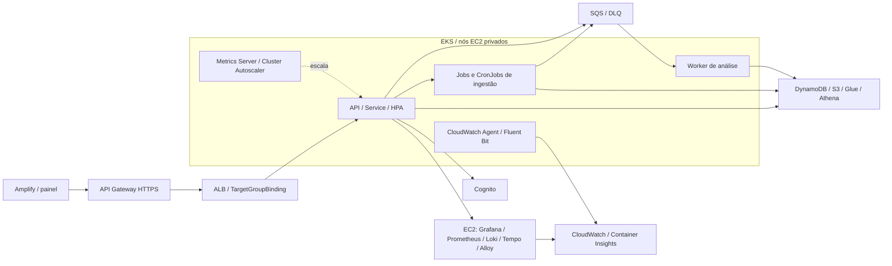

# Aplicação final: implantação em Kubernetes

## 1. Arquitetura da aplicação

Na quinta sprint, a execução do View Show foi migrada do ECS/Fargate para o Amazon Elastic Kubernetes Service (EKS) 1.35. Os serviços passaram a utilizar Deployments e Jobs, e os agendamentos do EventBridge Scheduler foram substituídos por CronJobs. Os serviços de autenticação, armazenamento e comunicação assíncrona foram preservados.

Na organização apresentada na Figura 1, o painel no Amplify acessa a API pelo API Gateway e pelo Application Load Balancer (ALB). A API inicia importações e controla a sincronização periódica. A ingestão processa os dados e publica solicitações na SQS para o Worker de Análise, quando habilitado.

*Figura 1 — Organização da aplicação após a migração para Kubernetes. Fonte: implementação do projeto.*

Os Pods são executados em nós EC2 de sub-redes privadas. A API e os agendamentos utilizam o namespace `view-show`; as importações iniciadas pelo painel utilizam `view-show-imports`. O MySQL dos snapshots é temporário e acompanha cada Job de importação ou backfill. O armazenamento persistente permanece nos serviços AWS representados no diagrama.

## 2. Conteinerização dos componentes

Os três Dockerfiles utilizam seus respectivos diretórios como contexto de construção. O script [publicar-imagem.mjs](../../apps/fullstack/scripts/publicar-imagem.mjs) realiza a autenticação no ECR e a construção e publicação para a arquitetura `linux/amd64`.

As tags da API e do Worker são derivadas das fontes; a ingestão no laboratório utiliza uma referência `@sha256`. O ECR da API permite alterar tags, enquanto ingestão e análise utilizam tags imutáveis.

### 2.1. API

O arquivo [apps/backend/api/Dockerfile](../../apps/backend/api/Dockerfile) utiliza a imagem `node:22.22.0-bookworm-slim`, fixada por digest, em dois estágios. No primeiro, são copiados `package.json`, o lockfile e o manifesto do módulo `contracts`. Após a instalação com `npm ci`, são acrescentados os arquivos `tsconfig*.json` e os diretórios `src` e `contracts`. A compilação TypeScript é seguida pela remoção das dependências de desenvolvimento. Express, SDKs AWS, OpenTelemetry e os contratos compartilhados compõem as dependências de execução.

O segundo estágio recebe os manifestos, `node_modules`, `dist` e os contratos compilados. A instalação de `dumb-init` permite encaminhar sinais ao processo principal. O contêiner executa como usuário `node`, com `ENTRYPOINT ["dumb-init", "--"]` e `CMD ["node", "dist/index.js"]`. A porta declarada é `3000`, e a verificação de saúde consulta `/health` por HTTP.

### 2.2. Ingestão de dados

O arquivo [apps/backend/ingestion-data/Dockerfile](../../apps/backend/ingestion-data/Dockerfile) utiliza um único estágio, baseado em `python:3.12.11-slim-bookworm`, também fixado por digest. São instalados `default-mysql-client=1.1.0` e os pacotes de `requirements.txt`, com versões e hashes verificados. Entre as dependências estão boto3, PyMySQL, PyArrow e jsonschema. A imagem recebe os diretórios `domain`, `application`, `ports`, `adapters`, `bootstrap`, `contracts` e `scripts`.

A execução utiliza o usuário `ingestion`, de UID `10001`, e o comando `ENTRYPOINT ["python", "-m", "bootstrap"]`. O argumento padrão `CMD ["--help"]` é substituído conforme a operação, como importação, backfill ou sincronização. O componente não publica porta HTTP e utiliza `/tmp/ingestion` como diretório de trabalho temporário.

### 2.3. Worker de Análise

O arquivo [apps/backend/agentic/Dockerfile](../../apps/backend/agentic/Dockerfile) possui dois estágios baseados em `node:20-bookworm-slim`. Diferentemente das bases anteriores, essa referência utiliza tag, sem digest fixado. O estágio de construção copia os manifestos e o lockfile, instala os pacotes com `npm ci`, acrescenta `tsconfig.json` e `src`, compila o código e remove as dependências de desenvolvimento. Os SDKs AWS utilizados permitem acesso a SQS, S3, DynamoDB e Bedrock.

O estágio de execução recebe os manifestos, `node_modules` e `dist`, utiliza o usuário `node` e inicia o processo com `CMD ["node", "dist/src/bootstrap/analysis-worker.js"]`. Não há `ENTRYPOINT` próprio nem porta publicada. Os modelos e catálogos são obtidos pela configuração e pelo S3, sem serem incorporados à imagem.

### 2.4. Contextos de construção e imagem MySQL

Os arquivos `.dockerignore` delimitam o contexto de construção, conforme a Tabela 1.

| Arquivo | Conteúdo excluído do contexto |
| --- | --- |
| [api/.dockerignore](../../apps/backend/api/.dockerignore) | `node_modules`, `.env*` exceto `.env.example`, testes, cobertura, diretórios de implantação, scripts, `dist`, cache npm e `*.tsbuildinfo`. |
| [ingestion-data/.dockerignore](../../apps/backend/ingestion-data/.dockerignore) | Git, `.env*`, ambientes e caches Python, testes, dependências de desenvolvimento, logs, resultados de compilação, bancos locais, Parquet e arquivos temporários ou de spool. |
| [agentic/.dockerignore](../../apps/backend/agentic/.dockerignore) | `node_modules`, `dist`, testes, scripts, modelos, dados e logs. O Dockerfile copia somente os arquivos e diretórios indicados na subseção 2.3. |

*Tabela 1 — Filtros dos contextos de construção das imagens.*

O MySQL utiliza uma imagem pronta, referenciada por digest na variável `imagem_mysql_snapshot` de [ingestion-variables.tf](../../apps/fullstack/ingestion-variables.tf). O comando `mysqld` recebe os parâmetros de [ingestion-runtime.tf](../../apps/fullstack/ingestion-runtime.tf), incluindo buffer InnoDB de 3 GiB e desativação do binlog. A comunicação com a ingestão ocorre por `127.0.0.1:3306`, dentro do mesmo Pod, sem publicação dessa porta por um Service.

## 3. Organização dos recursos Kubernetes

Os manifests são gerados a partir das configurações Terraform e aplicados por um chart Helm. A Tabela 2 relaciona os arquivos desse processo aos recursos e componentes da Figura 1.

| Arquivo | Recursos ou configuração produzida | Componente da Figura 1 |
| --- | --- | --- |
| [fullstack/workloads.tf](../../apps/fullstack/workloads.tf) | Imagens, argumentos, CPU, memória, variáveis de ambiente e referências a segredos dos sete workloads. | API, ingestão e Worker |
| [fullstack/kubernetes-outputs.tf](../../apps/fullstack/kubernetes-outputs.tf) | Outputs de configuração dos workloads, namespaces, roles, ALB e réplicas; comandos operacionais em `kubernetes_runbook`. | Integração da infraestrutura com o EKS |
| [kubernetes/render.mjs](../../apps/kubernetes/render.mjs) | Namespace, ServiceAccount, Secret, Deployment, CronJob, Service, TargetGroupBinding, HPA, PDB, NetworkPolicy, Role e RoleBinding, incluindo configuração dos Pods e verificações de saúde. | Componentes internos ao EKS |
| [chart/Chart.yaml](../../apps/kubernetes/chart/Chart.yaml) | Metadados do chart `view-show`, versão `1.0.0`, compatível com Kubernetes ≥ 1.33. | Implantação da aplicação |
| [chart/values.yaml](../../apps/kubernetes/chart/values.yaml) | Lista inicial `resources: []`, preenchida pelo processo de implantação com os recursos gerados. | Entrada da configuração Helm |
| [chart/templates/resources.yaml](../../apps/kubernetes/chart/templates/resources.yaml) | Serialização em YAML e preservação da suspensão de sync e das réplicas controladas pelo HPA. | API/HPA e CronJob de sync |
| [kubernetes/deploy.mjs](../../apps/kubernetes/deploy.mjs) | Aplicação dos namespaces, controladores e chart; verificação dos Deployments e dos destinos do ALB. | EKS, ALB, escala e observabilidade |
| [kubernetes/run-job.mjs](../../apps/kubernetes/run-job.mjs) | Job manual de backfill, validação de conta/cluster/snapshot S3 e Secret MySQL por Job. | Ingestão de snapshot |

*Tabela 2 — Arquivos responsáveis pela geração e aplicação dos manifests.*

### 3.1. Serviços, acesso e dimensionamento

A Tabela 3 apresenta os parâmetros de `render.mjs`; os valores padrão podem ser alterados na infraestrutura.

| Recurso | Configuração |
| --- | --- |
| `Deployment/api` | Comando do Dockerfile, porta nomeada `http:3000` e probes de inicialização, prontidão e atividade em `/health`. Atualização `RollingUpdate`, com `maxUnavailable=0` e `maxSurge=1`. CPU e memória vêm de `cpu_task` e `memoria_task`; padrões de `250m` e `512Mi`. |
| `Deployment/analysis-worker` | Criado quando `analysis_worker_habilitado=true`. Uma réplica, CPU de `500m`, memória de `1024Mi`, comando do Dockerfile e configuração de fila, modelo e provedor. Prazo de encerramento de 120 s. |
| `Service/api` e `TargetGroupBinding/api` | Service `ClusterIP`, com seletor `app.kubernetes.io/name=api`, porta `3000` e `targetPort=http`. O binding associa o Service ao grupo de destino do ALB com `targetType=ip` e autoriza TCP/3000 a partir do security group do ALB. |
| `HorizontalPodAutoscaler/api` | Alvo `Deployment/api`; padrões de 1 a 4 réplicas, utilização média de CPU de 50% e janela de estabilização de 300 s para redução. O Metrics Server fornece as métricas. |
| `PodDisruptionBudget/api` | Seletor dos Pods da API e `maxUnavailable=1`. Os Deployments também distribuem os Pods entre hosts com `maxSkew=1`. |
| `Namespace` e `NetworkPolicy` | Namespaces principal e de importação com Pod Security `baseline`. A política `deny-ingress` bloqueia entrada por padrão; `api-ingress` permite TCP/3000 nos Pods da API. Não há restrição de saída por essas políticas. |
| `ServiceAccount`, `Role` e `RoleBinding` | Conta por workload, com montagem de token Kubernetes somente na API. `argus-scheduler` autoriza `get/patch` em `ingestion-sync`; `import-launcher` permite criar e consultar Jobs e consultar o template `ingestion-import`, sem acesso Kubernetes a Secrets. |
| `Secret/<workload>-env` | Tipo `Opaque`; senhas, segredos da aplicação e valores do Secrets Manager são referenciados por `secretKeyRef`. Os valores são enviados ao Helm pela entrada padrão, sem arquivo de valores sensíveis versionado. |

*Tabela 3 — Configurações dos recursos Kubernetes da aplicação.*

O acesso externo utiliza a rota `ANY /{proxy+}` de [apigateway.tf](../../apps/fullstack/apigateway.tf), encaminhada ao ALB por HTTP proxy. O listener HTTP/80 de [alb.tf](../../apps/fullstack/alb.tf) direciona as requisições à API, cujo grupo de destino verifica `/health` na porta 3000. O Load Balancer Controller registra os IPs dos Pods por meio do TargetGroupBinding. Portanto, a configuração implantada não utiliza um recurso Ingress.

O dimensionamento da API utiliza o HPA com métricas de CPU, enquanto o Cluster Autoscaler ajusta a quantidade de nós. O Worker mantém uma réplica quando habilitado. Não foram utilizados ScaledObject ou TriggerAuthentication do KEDA, nem dimensionamento do Worker pela profundidade da fila SQS.

### 3.2. Processamento e agendamentos

Os CronJobs utilizam o fuso `Etc/UTC` e `concurrencyPolicy=Forbid`, que impede execuções simultâneas da mesma agenda. O atraso máximo para início é de 300 s, e o histórico mantém dois Jobs bem-sucedidos e cinco com falha. Os Jobs têm `backoffLimit=0`, `restartPolicy=Never` e retenção após término de sete dias. A duração máxima é de 24 h para snapshots e de 1 h para os demais processos. Entre agendas distintas, o controle de concorrência permanece sob os mecanismos de bloqueio da aplicação.

| CronJob | Argumentos de `python -m bootstrap` | Agenda e acionamento |
| --- | --- | --- |
| `ingestion-backfill` | `backfill --run-id <id>` no Job manual | `0 0 1 1 *`, mantido suspenso como template; acionamento por `run-job.mjs`. |
| `ingestion-import` | `import-dump --import-id <id>` | Template suspenso com a mesma agenda, em `view-show-imports`; a API cria um Job por importação. |
| `ingestion-sync` | `sync` | `*/15 * * * *`; habilitação pela configuração ou pelo painel. |
| `ingestion-incremental-export` | `export-incremental` | `*/15 * * * *`; habilitação por `incremental_s3_enabled`. |
| `ingestion-incremental-ingest` | `ingest-incremental --limit 20` | `*/5 * * * *`; habilitação pela mesma variável do processo incremental. |

*Tabela 4 — Comandos e agendamentos da ingestão.*

Nos snapshots, o MySQL é declarado em `initContainers` com `restartPolicy=Always`, constituindo um sidecar nativo. O probe executa `mysqladmin ping` antes de iniciar a ingestão, e o MySQL encerra quando o Job termina. Os volumes `emptyDir` reservam 128 GiB para os dados MySQL e 64 GiB para `/tmp`. Na configuração padrão, cada contêiner recebe 4 GiB de memória e limite de CPU de um núcleo. A reserva de CPU também é de um núcleo no modo gerenciado e de `500m` no laboratório.

A API e o Worker utilizam UID `1000`; a ingestão utiliza UID `10001`. Esses componentes possuem sistema de arquivos raiz somente para leitura e volume gravável em `/tmp`. O MySQL inicia com UID `0` e capacidades limitadas para inicialização. Os volumes do snapshot são temporários e não substituem o armazenamento persistente da aplicação.

O [adaptador de importação da API](../../apps/backend/api/src/modules/imports/adapters/kubernetes-import-worker-launcher.ts) atribui um nome determinístico ao Job e recupera a execução existente diante de uma resposta HTTP 409. Para manter a compatibilidade dos registros, o campo `taskArn` passa a armazenar `k8s://namespace/jobs/name/uid`. O [adaptador de agendamento](../../apps/backend/api/src/modules/argus/adapters/kubernetes-argus-scheduler.ts) altera `spec.suspend` do CronJob de sync.

## 4. Infraestrutura e configurações complementares

O Terraform provisiona AWS e prepara os segredos; `render.mjs` e Helm criam os Secrets Kubernetes e o RBAC. A Tabela 5 identifica os arquivos de configuração. Os arquivos `.tf` estão em `apps/fullstack`.

| Arquivo | Responsabilidade |
| --- | --- |
| [eks.tf](../../apps/fullstack/eks.tf) | Cluster, nós, acesso administrativo e endpoints restritos por CIDR; roles/OIDC, VPC CNI, CoreDNS, kube-proxy, descoberta do Autoscaler e Pod Identity do CloudWatch. Padrão de 2 a 6 nós `m6i.xlarge`, com EBS de 300 GiB. |
| [eks-existing-iam.tf](../../apps/fullstack/eks-existing-iam.tf) | Seleção do modo IAM e validação de conta, roles, instance profile e disco. Impede identidades compartilhadas em produção. |
| [kubernetes-iam.tf](../../apps/fullstack/kubernetes-iam.tf) | Políticas AWS da API, backfill, sync e análise para dados, autenticação e filas. |
| [ingestion-imports.tf](../../apps/fullstack/ingestion-imports.tf) | Políticas de upload/importação, proteção de ACTIVE no modo gerenciado e alarmes. |
| [ingestion-runtime.tf](../../apps/fullstack/ingestion-runtime.tf) | Construção e digest da ingestão, ambiente, argumentos MySQL e políticas incrementais. |
| [api-runtime.tf](../../apps/fullstack/api-runtime.tf) | Geração dos segredos de cookie e cursor da API. |
| [cognito.tf](../../apps/fullstack/cognito.tf) | Pool e client Cognito, incluindo o segredo utilizado pela API. |
| [ingestion-messaging.tf](../../apps/fullstack/ingestion-messaging.tf) | SQS/DLQs e segredos MySQL snapshot/live no Secrets Manager; geração da senha de snapshot no laboratório. |
| [ecr.tf](../../apps/fullstack/ecr.tf) | Repositório, identificação das fontes e publicação da imagem API. |
| [ingestion-ecr.tf](../../apps/fullstack/ingestion-ecr.tf) | Repositório ECR da ingestão, com tags imutáveis e análise de vulnerabilidades. |
| [analysis-worker.tf](../../apps/fullstack/analysis-worker.tf) | Repositório e imagem do Worker; publicação de modelos/catálogos no S3. |
| [vpc.tf](../../apps/fullstack/vpc.tf) e [network.tf](../../apps/fullstack/network.tf) | Respectivamente, VPC, sub-redes, rotas e NAT; security groups do ALB e dos nós. |
| [administration-iam.tf](../../apps/fullstack/administration-iam.tf) | Roles e instance profiles administrativos, SSM e leitura de CloudWatch. |
| [observability-aws.tf](../../apps/fullstack/observability-aws.tf) | EC2 privada da observabilidade, regras de telemetria, senha Grafana e configuração inicial. |
| [ingestion-observability.tf](../../apps/fullstack/ingestion-observability.tf) | Dashboard CloudWatch, métricas e alarmes de ingestão e EKS. |
| [eks-iam-moves.tf](../../apps/fullstack/eks-iam-moves.tf) e [migration.tf](../../apps/fullstack/migration.tf) | Respectivamente, preservação dos endereços IAM no estado e retenção dos logs/DLQ legados. |
| [validate-create-plan.mjs](../../apps/scripts/terraform/validate-create-plan.mjs) | Rejeição de exclusões/substituições de dados persistentes; retirada do ECS somente na opção de migração. |

*Tabela 5 — Arquivos de infraestrutura e suas responsabilidades.*

A instalação dos controladores é definida em [deploy.mjs](../../apps/kubernetes/deploy.mjs). São utilizadas as seguintes versões: Load Balancer Controller, chart `1.14.0` e imagem `v2.14.1`; Metrics Server, chart `3.14.0`; Cluster Autoscaler, chart `9.59.0` e imagem `v1.35.0`; e CloudWatch Observability, chart `6.7.0`. Os valores Helm incluem nome do cluster, região, VPC e ServiceAccount para o controlador do ALB, e nome do cluster e região para a descoberta dos nós pelo Autoscaler. O CloudWatch utiliza o namespace `amazon-cloudwatch`, com Application Signals desativado.

As anotações IRSA são configuradas no modo gerenciado. A política AWS do controlador do ALB está em [load-balancer-policy.json](../../apps/kubernetes/load-balancer-policy.json). O arquivo [cloudwatch-application.conf](../../apps/kubernetes/cloudwatch-application.conf) configura o Fluent Bit para incorporar o conteúdo JSON à raiz dos registros e preservar métricas no formato EMF.

A configuração da observabilidade em EC2 está em [observability/aws/docker-compose.yml](../../apps/fullstack/observability/aws/docker-compose.yml), que especifica as imagens de Grafana, Prometheus, Loki, Tempo e Alloy, suas portas, redes e volumes. O script [user-data.sh.tftpl](../../apps/fullstack/observability/aws/user-data.sh.tftpl) instala Docker e Compose e inicia os serviços; sua renderização é verificada por [validate-user-data.sh](../../apps/fullstack/observability/aws/validate-user-data.sh). O dashboard AWS está em [view-show-aws.json.tftpl](../../apps/fullstack/observability/aws/view-show-aws.json.tftpl), e a autenticação da fonte CloudWatch pela role EC2 é definida em [cloudwatch-datasource.yml](../../apps/fullstack/observability/aws/cloudwatch-datasource.yml). A atualização do dashboard ocorre por SSM, preservando os volumes existentes.

## 5. Implantação no AWS Academy

O bloqueio de criação de roles, políticas IAM e provedores OIDC no AWS Academy exigiu o modo `learner-lab-existing`. A configuração utiliza a role de cluster fornecida pelo laboratório, `LabRole` nos nós e `LabInstanceProfile` nas instâncias administrativas. Os Pods obtêm credenciais temporárias por IMDSv2, com limite de saltos 2, sem cópias das credenciais da CLI.

Os componentes compartilham as permissões AWS da LabRole, mantendo namespaces e RBAC separados. Esse arranjo difere do isolamento previsto para produção: no modo gerenciado, há IRSA por workload e limite de saltos 1.

Foram utilizados dois nós `i3.large`, volumes EBS de 100 GiB e `eks_node_instance_store=true`. O AL2023/nodeadm configura os SSDs locais em RAID0 para kubelet e containerd. A capacidade temporária observada foi de aproximadamente 397 GiB por nó, suficiente para a reserva de 192 GiB dos Pods de snapshot.

Primeiro, o Terraform provisiona AWS e publica as imagens; depois, `node apps/kubernetes/deploy.mjs` instala os recursos no cluster. As entradas estão em [terraform.tfvars.example](../../apps/fullstack/terraform.tfvars.example). Estado, tfvars e outputs sensíveis não são versionados. O kubeconfig do laboratório utiliza a sessão `voclabs` já assumida.

Os procedimentos de manutenção, segredos e reversão estão no [runbook Kubernetes](../../apps/kubernetes/README.md). A [.gitlab-ci.yml](../../.gitlab-ci.yml) executa as validações e disponibiliza a implantação manual na branch `develop`, por um runner autorizado.

## 6. Verificação da implantação

A implantação de 1º de outubro de 2026 foi verificada com dois nós em estado Ready, API disponível e serviços de rede, dimensionamento, coleta de logs e Grafana em execução. Um Job derivado do template de importação confirmou a inicialização do MySQL, o acesso ao S3 e ao DynamoDB pela LabRole e o encerramento do worker e do sidecar com código zero.

Os testes IT-AWS-01, 02 e 05 de [live-aws.integration.test.ts](../../apps/backend/api/tests/live-aws.integration.test.ts) verificaram acesso ao painel e ao endpoint de saúde, autenticação e proteção de sessão, além da reserva idempotente de uma importação multipart. O usuário e os registros temporários foram removidos após a execução.

A configuração também foi verificada pelos testes de [render.test.mjs](../../apps/kubernetes/tests/render.test.mjs), [kubernetes.tftest.hcl](../../apps/fullstack/tests/kubernetes.tftest.hcl) e [validate-terraform-learner-update-plan.test.mjs](../../apps/scripts/tests/validate-terraform-learner-update-plan.test.mjs), além das verificações da API, políticas de CI, scripts Python, chart Helm e esquemas Kubernetes.

A verificação abrangeu a API e um Job com acesso aos serviços de dados. O processamento de snapshot completo, o sync live e a análise não foram executados; o Worker e as agendas permaneceram desabilitados. Esses fluxos dependem de dados, credenciais e modelos aprovados pela equipe.
