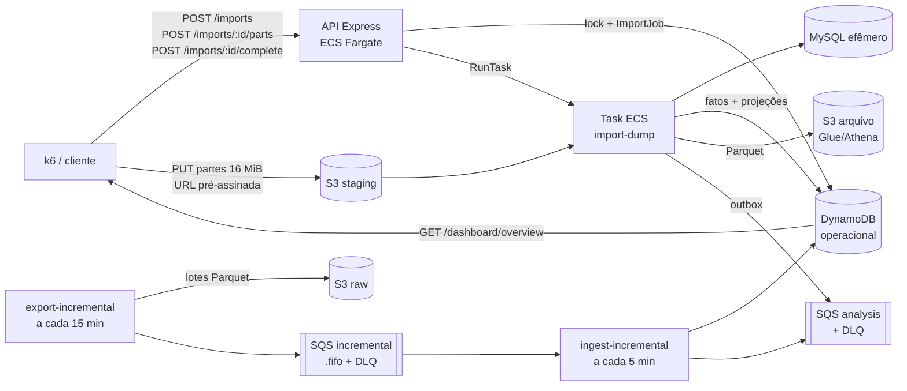

# Testes de Carga e Resiliência da Ingestão

## Visão Geral

&emsp;Este documento aprimora os testes dos requisitos não funcionais realizados na Sprint 3 ([`sprint3/testes-carga-inicial.md`](../sprint3/testes-carga-inicial.md)), agora com foco na **API de ingestão** do sistema ARGUS/View Show. Na Sprint 3, os cenários de ingestão (10 mil eventos/minuto, fila cheia e timeout) ficaram **bloqueados**, porque o adaptador de importação respondia `503 FEATURE_UNAVAILABLE` de forma incondicional. Na Sprint 4 o pipeline passou a existir de ponta a ponta: upload multipart ao S3 pela API, task ECS `import-dump`, MySQL efêmero, normalização, publicação no DynamoDB e Parquet/Glue/Athena, outbox e filas SQS com DLQ. Com isso, os cenários que antes só podiam ser planejados passam a ser executáveis contra a stack real.

&emsp;O documento cobre os três itens da entrega:

- **(1) Requisitos não funcionais e planos de teste aprimorados** — Seções 3 e 4, com os cenários de 10 mil eventos/minuto, fila cheia e timeout traduzidos para a arquitetura atual.
- **(2) Resultados dos testes de carga, com análise de desempenho e resiliência** — Seções 6, 7 e 8.
- **(3) Visualização de indicadores de observabilidade** (Grafana/Prometheus e CloudWatch) — latência, throughput, erros por segundo, uso de CPU e profundidade de fila — Seção 9.

&emsp;Para cada teste são especificados identificador, objetivo e requisito relacionado, perfil de carga ou falha injetada, pré-condições e dados de entrada, procedimento, métricas coletadas, critérios de sucesso, resultado esperado, resultados medidos, resultado obtido, situação, análise e evidências de reprodução. **Os campos marcados como _A preencher_ devem ser completados após a execução**; nenhum número deste documento deve ser escrito sem um arquivo de evidência correspondente em `assets/`.

&emsp;Os comandos de reprodução foram escritos para um terminal compatível com Bash. Dependendo do sistema operacional, a forma de definir variáveis de ambiente pode mudar.

## Priorização de execução

&emsp;A ordem de execução segue o risco para o dado, não a ordem das seções:

1. **Prioridade 1 — carga nominal de 10 mil eventos/minuto (CG-02) e perda de dados sob falha (RS-01, RS-02, RS-03).** A ingestão é a porta de entrada: se um evento aceito for perdido, duplicado ou silenciosamente descartado, tudo o que o dashboard (RF07) e a análise de falhas críticas (RF09) mostram depois fica incorreto. Esses testes validam diretamente RNF01 e RNF03.
2. **Prioridade 2 — frescor ponta a ponta (CG-03) e recuperação automática (RS-04, RS-05).** Depois de garantir que nada se perde, o risco seguinte é o dado chegar tarde demais para ser útil (RNF02) ou o sistema precisar de intervenção manual para voltar ao normal.
3. **Prioridade 3 — pico no plano de controle (CG-04), volume progressivo (CG-05) e proteções da API (RS-06).** Caracterizam capacidade e limites; o risco é menor porque, nesses cenários, a exclusão mútua e o rate limiter já impedem efeitos colaterais no dado.

## Sumário

- [Priorização de execução](#priorização-de-execução)

1. [Introdução](#1-introdução)
2. [Rastreabilidade com os critérios da entrega](#2-rastreabilidade-com-os-critérios-da-entrega)
3. [Arquitetura sob teste e evolução em relação à Sprint 3](#3-arquitetura-sob-teste-e-evolução-em-relação-à-sprint-3)
4. [Requisitos não funcionais e planos de teste aprimorados](#4-requisitos-não-funcionais-e-planos-de-teste-aprimorados)
5. [Ambiente, massa de dados e método](#5-ambiente-massa-de-dados-e-método)
6. [Testes de carga](#6-testes-de-carga)
7. [Testes de falha e resiliência](#7-testes-de-falha-e-resiliência)
8. [Resultados consolidados e análise](#8-resultados-consolidados-e-análise)
9. [Observabilidade](#9-observabilidade)
10. [Impacto nas decisões de arquitetura](#10-impacto-nas-decisões-de-arquitetura)
11. [Limitações](#11-limitações)
12. [Procedimentos de reprodução](#12-procedimentos-de-reprodução)
13. [Convenção de evidências](#13-convenção-de-evidências)

---

## 1. Introdução

### 1.1 Objetivo

&emsp;Verificar, com execução reproduzível contra a stack implantada na AWS, se a ingestão do View Show sustenta a carga nominal de **10.000 eventos por minuto** sem perda, se degrada de forma controlada diante de **fila cheia** e **timeout de dependência**, e se volta sozinha ao patamar nominal quando a falha é retirada — registrando, em paralelo, os indicadores de observabilidade que permitem explicar cada resultado.

### 1.2 Escopo

<div align="center">

<strong>Tabela 1: Componentes no escopo dos testes</strong>

</div>

| Componente | Local no repositório | Papel nos testes |
| --- | --- | --- |
| API de ingestão (plano de controle) | `apps/backend/api`, módulo `imports` — rotas `POST /api/v1/imports`, `POST /api/v1/imports/:importId/parts`, `POST /api/v1/imports/:importId/complete`, `GET /api/v1/imports/:importId`, `GET /api/v1/imports` | Porta de entrada HTTP: reserva a importação, assina as partes do upload, confirma o envio e expõe o progresso |
| Worker de ingestão (plano de dados) | `apps/backend/ingestion-data` — comandos `import-dump`, `ingest-incremental`, `export-incremental`, `publish-outbox` | Valida, normaliza e publica os eventos; é onde a vazão de 10 mil eventos/min é efetivamente medida |
| Filas | `apps/fullstack/ingestion-messaging.tf` — `*-incremental-batches.fifo` (+ DLQ) e `*-analysis` (+ DLQ, `maxReceiveCount = 5`, `visibility_timeout = 300 s`) | Onde se observa acúmulo (fila cheia), idade da mensagem mais antiga e desvio para DLQ |
| Persistência | DynamoDB operacional, S3 (staging e arquivo), Glue/Athena | Onde se confere que nenhum evento aceito foi perdido ou duplicado |
| Observabilidade | `apps/fullstack/observability/` (Prometheus, Grafana, Loki, Tempo, Alloy) e `apps/fullstack/ingestion-observability.tf` (CloudWatch, namespace `<deployment_namespace>/Ingestion`) | Fonte dos indicadores da Seção 9 |

<div align="center">

Fonte: Material produzido pelos autores (2026).

</div>

&emsp;**Fora do escopo:** a API de consulta (já coberta na Sprint 3 e na Seção 4 de [`sprint4/testes-funcionais.md`](../sprint4/testes-funcionais.md#4-testes-de-carga-funcional)), o worker de análise/ML (RNF08, RNF13) e o frontend (RNF07).

### 1.3 Convenções adotadas

- Requisitos não funcionais são identificados como `RNFXX`, conforme [`sprint1/requisitos.md`](../sprint1/requisitos.md#4-requisitos-não-funcionais-rnf-e-planos-de-teste).
- Testes de carga são identificados como `CG-XX`; testes de falha e resiliência, como `RS-XX`.
- Percentis são indicados como `p50`, `p95` e `p99`.
- **10.000 eventos/minuto = 166,67 eventos/s = 150.000 eventos por janela de 15 minutos** (a janela de detecção usada pela ingestão).
- Cada resultado é classificado em um dos estados da Tabela 2, e só neles (mesma convenção da Sprint 3).

<div align="center">

<strong>Tabela 2: Estados de classificação dos resultados</strong>

</div>

| Estado | Significado |
| --- | --- |
| Aprovado | Existe execução reproduzível e o critério foi atendido |
| Reprovado | Existe execução reproduzível e o critério não foi atendido |
| Parcial | Somente parte do critério foi executada ou atendida |
| Não executado | Existe plano, não existe execução |
| Bloqueado | Falta runtime, dependência ou autorização externa |

<div align="center">

Fonte: Material produzido pelos autores (2026).

</div>

---

## 2. Rastreabilidade com os critérios da entrega

<div align="center">

<strong>Tabela 3: Rastreabilidade entre os critérios da entrega e as seções do artefato</strong>

</div>

| Critério avaliado | Peso | Onde está | Estado |
| --- | ---: | --- | --- |
| (1) RNFs e planos de teste aprimorados, com cenários de 10 mil eventos/min, fila cheia e timeout | 3,0 | Seção 3 (mapeamento dos cenários para a arquitetura atual) e Seção 4 (matriz de RNFs e critérios objetivos) | _A preencher_ |
| (2) Resultados dos testes de carga com análise de desempenho e resiliência | 4,0 | Seções 6 e 7 (execuções), Seção 8 (análise consolidada) e Seção 11 (limitações) | _A preencher_ |
| (3) Visualização de indicadores de observabilidade (latência, throughput, erros/s, CPU) | 3,0 | Seção 9 (consultas, painéis, capturas e alertas) | _A preencher_ |

<div align="center">

Fonte: Material produzido pelos autores (2026).

</div>

---

## 3. Arquitetura sob teste e evolução em relação à Sprint 3

### 3.1 Fluxo da ingestão

&emsp;A Figura 1 mostra o caminho de um evento desde o arquivo enviado até ficar disponível para consulta, com os pontos onde cada teste mede algo.

<div align="center">

<strong>Figura 1: Fluxo da ingestão e pontos de medição</strong>

</div>



<div align="center">

Fonte: Material produzido pelos autores (2026).

</div>

&emsp;Os estados públicos do `ImportJob` são `PREPARING → UPLOADING → UPLOADED → VALIDATING → PROCESSING → READY` (ou `FAILED`). O processamento expõe os contadores `recordsRead`, `recordsWritten` e `recordsRejected`, que são a base da medição de vazão em eventos.

### 3.2 Tradução dos cenários obrigatórios para a arquitetura atual

&emsp;O plano da Sprint 1 supunha uma ingestão HTTP síncrona que respondia `429 queue_full` e `504 dependency_timeout`. A arquitetura implementada é **assíncrona e em lote**: a API só reserva e confirma a importação, e o processamento acontece numa task ECS. A Tabela 4 mostra como cada cenário exigido pela entrega é medido agora. O cenário descrito no enunciado como “abertura de venda de 10 mil eventos/minuto” corresponde, no domínio do View Show, a um **pico de audiência** (estreia, jogo ao vivo), quando o volume de telemetria sobe de uma vez.

<div align="center">

<strong>Tabela 4: Mapeamento dos cenários da Sprint 3 para a arquitetura atual</strong>

</div>

| Cenário exigido | Sprint 3 (plano original / histórico Flask) | Sprint 5 (arquitetura atual) | Testes |
| --- | --- | --- | --- |
| 10 mil eventos/min (pico de audiência) | 100 lotes/min × 100 eventos via `POST` síncrono; **bloqueado** na stack TypeScript | Janela de **150.000 eventos** (10.000/min × 15 min) processada em ≤ 15 min, medida por `recordsWritten` / duração de `PROCESSING`; e rajada de clientes no plano de controle | CG-02, CG-04, CG-05 |
| Fila cheia | `HTTP 429 queue_full` injetado por token | (a) **Acúmulo real** na FIFO incremental (2, 3 ou 4 janelas represadas), medido por `ApproximateNumberOfMessagesVisible` e `ApproximateAgeOfOldestMessage`; (b) **contrapressão explícita** na API: segunda importação recebe `409 IMPORT_IN_PROGRESS`; (c) excesso de requisições recebe `429 RATE_LIMITED` | RS-01, RS-06 |
| Timeout de dependência | `HTTP 504 dependency_timeout` injetado por token | (a) Falha/timeout do S3 ao preparar multipart → `503 UPLOAD_PREPARATION_FAILED` com lock liberado; (b) task ECS interrompida ou que não conclui no prazo → `ImportJob` em `FAILED` com mensagem segura, detectado pelo reconciliador; (c) mensagem que excede `visibility_timeout` e é reentregue | RS-02, RS-04 |
| Payload inválido | Mensagens corrompidas misturadas às válidas | Lote incremental com coluna obrigatória ausente → `QUARANTINED`; dump corrompido → `FAILED` na validação; mensagem venenosa → DLQ após 5 recebimentos | RS-03, RS-05 |
| Recuperação sem reinício | 1 min nominal após a falha | Após retirar cada falha, a próxima janela/importação volta ao patamar de CG-02 sem reinício manual de serviço | Critério comum a RS-01 a RS-05 |

<div align="center">

Fonte: Material produzido pelos autores (2026).

</div>

---

## 4. Requisitos não funcionais e planos de teste aprimorados

&emsp;Os requisitos abaixo vêm de [`sprint1/requisitos.md`](../sprint1/requisitos.md#4-requisitos-não-funcionais-rnf-e-planos-de-teste). A coluna “Plano aprimorado” substitui o plano da Sprint 3 ([Tabela 4 de `testes-carga-inicial.md`](../sprint3/testes-carga-inicial.md#41-requisitos-de-ingestão)), que estava bloqueado.

<div align="center">

<strong>Tabela 5: Requisitos não funcionais da ingestão e planos de teste aprimorados</strong>

</div>

| RNF | Descrição resumida | Plano aprimorado | Ferramenta | Critério objetivo | Testes | Estado |
| --- | --- | --- | --- | --- | --- | --- |
| RNF01 | Aceitar continuamente 10.000 eventos válidos/min sem perda | Importar uma janela sintética de 150.000 eventos válidos e medir a vazão de processamento; conferir contagem no DynamoDB/Athena | k6 (`ingestao-batch.js`, `MODE=drenagem`) + CloudWatch + consulta de contagem | `recordsWritten = 150.000`; `recordsRejected = 0`; duração de `VALIDATING+PROCESSING` ≤ 900 s (≥ 166,67 eventos/s); 0 duplicados; `checks rate==1` | CG-02, CG-05 | _A preencher_ |
| RNF02 | Evento disponível para consulta em ≤ 120 s após captura | Marcar `t0` na entrada do lote incremental, `t1` no fim da ingestão e `t2` quando o watermark de `/dashboard/overview` passar de `t0` | k6 (`MODE=frescor`) | `t2 − t0 ≤ 120 s` em 100% das amostras | CG-03 | _A preencher_ |
| RNF03 | Degradar de forma controlada sob payload inválido, fila sem capacidade e timeout; recuperar sem reinício | Injetar cada falha da Seção 7 sob carga nominal, observar a resposta e depois retirar a falha | k6 + AWS CLI (injeção) + CloudWatch | Falha sempre explícita (`409`/`429`/`503`/`FAILED`/`QUARANTINED`/DLQ); 0 eventos aceitos e não persistidos; recuperação ao patamar de CG-02 sem reinício manual | RS-01 a RS-06 | _A preencher_ |
| RNF09 | Disponibilidade das APIs ≥ 99,9% | Durante toda a bateria de ingestão, medir erro inesperado nas rotas de import (excluindo `409`/`429`/`503` esperados) | k6 `http_req_failed` | `http_req_failed rate < 0,001` nas rotas `/api/v1/imports*` | CG-01, CG-04 | _A preencher_ |
| RNF15 | Degradação sinalizada ao operador em ≤ 30 s | Durante RS-01 a RS-05, cronometrar o intervalo entre a injeção da falha e o disparo do alarme correspondente | CloudWatch Alarms / Grafana Alerting | Alarme em estado `ALARM` em ≤ 30 s (registrar o valor real, mesmo que acima) | RS-01 a RS-05 | _A preencher_ |

<div align="center">

Fonte: Material produzido pelos autores (2026).

</div>

### 4.1 O que mudou em relação à Sprint 3

<div align="center">

<strong>Tabela 6: Aprimoramentos dos planos de teste</strong>

</div>

| Aspecto | Sprint 3 | Sprint 5 |
| --- | --- | --- |
| Alvo | API de consulta; ingestão bloqueada (`503 FEATURE_UNAVAILABLE`) | Pipeline de ingestão real (API de import + task ECS + SQS) |
| Unidade de medida da carga | Requisições HTTP/s | **Eventos/min processados** (`recordsWritten`) e requisições HTTP/s no plano de controle |
| Fila cheia | Simulada por token no Flask | Acúmulo real em SQS FIFO + contrapressão `409`/`429` |
| Timeout | Atraso injetado de 250 ms | Falha real de dependência (S3, task ECS, reentrega SQS) |
| Verificação de perda | Contagem de `202` | Contagem ponta a ponta: enviado × `recordsWritten` × itens no DynamoDB × linhas no Athena |
| Observabilidade | RED da API | RED da API + CPU/memória das tasks de ingestão + profundidade/idade de fila + DLQ |

<div align="center">

Fonte: Material produzido pelos autores (2026).

</div>

---

## 5. Ambiente, massa de dados e método

### 5.1 Ambiente

<div align="center">

<strong>Tabela 7: Configuração do ambiente de execução</strong>

</div>

| Item | Valor |
| --- | --- |
| Data e janela (UTC) | _A preencher_ |
| Conta / região | _A preencher_ / `us-east-1` (AWS Academy Learner Lab) |
| Namespace da stack | _A preencher_ |
| Commit / tag do repositório | _A preencher_ |
| Imagem da API (ECR) | _A preencher_ |
| Imagem da ingestão (ECR) | _A preencher_ |
| API — tasks ECS / vCPU / memória | _A preencher_ (padrão: mín. 1, máx. 4 tasks) |
| Task `import-dump` — vCPU / memória / storage efêmero | _A preencher_ (storage configurado: 200 GiB) |
| Tasks `ingest-incremental` / `export-incremental` — agenda | _A preencher_ (padrão: 5 min / 15 min) |
| Persistência | DynamoDB `_A preencher_` (`PAY_PER_REQUEST`), bucket de staging `_A preencher_`, bucket raw `_A preencher_` |
| Filas | `_A preencher_-incremental-batches.fifo`, `_A preencher_-analysis` e respectivas DLQs |
| Rate limit da API (`rate_limit_por_minuto`) | _A preencher_ (produção: 180) |
| Gerador de carga | k6 _versão a preencher_, executado _dentro/fora da AWS — a preencher_ |
| Observabilidade | Prometheus _versão_, Grafana _versão_, CloudWatch (namespace `_A preencher_/Ingestion`) |
| Autenticação | Login real no Cognito via `POST /auth/login` (usuário técnico `_A preencher_`) |

<div align="center">

Fonte: Material produzido pelos autores (2026).

</div>

### 5.2 Massa de dados

&emsp;Os cenários de volume dependem de dumps sintéticos com quantidade **conhecida** de eventos, para que a contagem final possa ser comparada com a enviada. Cada arquivo deve ter o SHA-256 registrado.

<div align="center">

<strong>Tabela 8: Massa de dados utilizada</strong>

</div>

| ID | Arquivo | Eventos válidos | Eventos inválidos | Tamanho | SHA-256 | Usado em |
| --- | --- | ---: | ---: | --- | --- | --- |
| M-01 | `argus_dump.sql.gz` (reduzido) | _A preencher_ | 0 | _A preencher_ | _A preencher_ | CG-01 |
| M-02 | `argus_dump.sql.gz` (1 janela) | 150.000 | 0 | _A preencher_ | _A preencher_ | CG-02, RS-02 |
| M-03 | `argus_dump.sql.gz` (2 janelas) | 300.000 | 0 | _A preencher_ | _A preencher_ | CG-05 |
| M-04 | `argus_dump.sql.gz` (5 janelas) | 750.000 | 0 | _A preencher_ | _A preencher_ | CG-05 |
| M-05 | Lotes incrementais de 15 min | 150.000 por lote | 0 | _A preencher_ | _A preencher_ | CG-03, RS-01 |
| M-06 | Lote incremental com coluna obrigatória ausente | 0 | _A preencher_ | _A preencher_ | _A preencher_ | RS-03 |
| M-07 | Dump corrompido (GZIP truncado) | — | — | _A preencher_ | _A preencher_ | RS-03 |

<div align="center">

Fonte: Material produzido pelos autores (2026).

</div>

&emsp;Gerador da massa: [`apps/backend/ingestion-data/scripts/build_benchmark_snapshot.py`](../../apps/backend/ingestion-data/scripts/build_benchmark_snapshot.py), que já existe. Ele gera um `argus_dump.sql.gz` determinístico com a quantidade de linhas pedida (`--rows`) e um `manifest.json` com a contagem, e é o mesmo gerador usado no benchmark de leitura MySQL. Para M-06 e M-07 ainda não há gerador: _A preencher_.

```bash
# a partir de apps/backend/ingestion-data (exemplo para M-02)
.venv/bin/python scripts/build_benchmark_snapshot.py \
  --rows 150000 --snapshot-extracted-on <AAAA-MM-DD> --variant baseline \
  --output ../../../.artifacts/argus-benchmarks/150k/argus_dump.sql.gz \
  --manifest ../../../.artifacts/argus-benchmarks/150k/manifest.json
```

### 5.3 Método de medição

- **Vazão de eventos:** `recordsWritten ÷ (instante de READY − instante de entrada em VALIDATING)`, lidos de `GET /api/v1/imports/:importId` por polling a cada `POLL_INTERVAL_S` e confirmados pelos timestamps do `ImportJob` no DynamoDB.
- **Ausência de perda:** eventos no arquivo = `recordsRead` = `recordsWritten + recordsRejected`; e `recordsWritten` = contagem no DynamoDB para a `candidateVersion` = contagem no Athena para a mesma partição.
- **Ausência de duplicidade:** contagem de identificadores distintos igual à contagem total, na mesma consulta Athena.
- **Latência do plano de controle:** `http_req_duration` do k6 por rota (`tags: { rota }`).
- **Fila:** métricas SQS `ApproximateNumberOfMessagesVisible`, `ApproximateNumberOfMessagesNotVisible` e `ApproximateAgeOfOldestMessage`, período de 1 min.
- **Respostas esperadas × erro real:** `http.setResponseCallback(http.expectedStatuses(200, 201, 202, 409, 429, 503))` só nos cenários em que esses códigos são a resposta correta; em CG-01 e CG-02 apenas `2xx` é esperado.

### 5.4 Ferramentas e testes reaproveitados

&emsp;Como este artefato evolui a Sprint 3, a maior parte da base já existe no repositório. A Tabela 8.1 mostra o que é reaproveitado em cada teste e o que ainda precisa ser feito. Os testes automatizados já existentes (Vitest e pytest) comprovam o **comportamento** de cada falha em ambiente controlado. Os testes deste documento repetem o cenário **sob carga e contra a stack real**, medindo tempo, vazão e recuperação.

<div align="center">

<strong>Tabela 8.1: Ferramentas e testes existentes reaproveitados</strong>

</div>

| Teste | O que já existe | Origem | O que falta |
| --- | --- | --- | --- |
| CG-01 | Fluxo real `POST /imports` → DynamoDB + multipart S3 contra a AWS (IT-AWS-05, para em `UPLOADING`) | [`apps/backend/api/tests/live-aws.integration.test.ts`](../../apps/backend/api/tests/live-aws.integration.test.ts) (Sprint 4) | Seguir até `READY` e medir tempos; modo `smoke` no k6 |
| CG-02 | Modo `drenagem` (janela de 150.000 eventos, threshold `ingestion_drain_seconds p(100)<900`) | [`apps/backend/api/loadtest/k6/ingestao-batch.js`](../../apps/backend/api/loadtest/k6/ingestao-batch.js) (Sprint 3) | Atualizar o script (ver 5.5) |
| CG-02 / CG-05 (local) | Benchmark do leitor MySQL com `rowsPerSecond`, p50/p95/p99 por página e verificação de zero ausências/duplicações | [`scripts/benchmark_snapshot_reader.py`](../../apps/backend/ingestion-data/scripts/benchmark_snapshot_reader.py) + [`tests/performance/test_snapshot_reader_benchmark.py`](../../apps/backend/ingestion-data/tests/performance/test_snapshot_reader_benchmark.py) | Rodar com 150k, 300k e 750k linhas como linha de base local |
| CG-03 | Modo `frescor` (`ingestion_end_to_end_freshness_seconds p(100)<120`, polling em `/dashboard/overview`) | `ingestao-batch.js` (Sprint 3) | Atualizar o script |
| CG-04 | Exclusão mútua (`409 IMPORT_IN_PROGRESS`) e idempotência, com uma requisição concorrente | UC-IMP-03 em [`tests/gateway-http.integration.test.ts`](../../apps/backend/api/tests/gateway-http.integration.test.ts) e IT-AWS-05 (Sprint 4) | Modo `pico` no k6 (muitas requisições simultâneas) |
| RS-01 | Modo `acumulo` com `BACKLOG_BATCHES` | `ingestao-batch.js` (Sprint 3) | Atualizar o script; exportar métricas SQS |
| RS-01 (histórico) | Fila cheia com `429 queue_full` induzido por token | [`sprint2/testes-carga/k6/ingestao-resiliencia.js`](../sprint2/testes-carga/k6/ingestao-resiliencia.js) (Flask, arquitetura anterior) | Só referência; não roda na stack atual |
| RS-02 (a) | Falha do S3 ao preparar multipart → `503 UPLOAD_PREPARATION_FAILED`, job `FAILED`, lock liberado | UC-IMP-06 em `gateway-http.integration.test.ts` (Sprint 4) | Repetir contra a AWS com a falha injetada |
| RS-02 (b, c) | Retomada após perda de conexão e reinício sem efeito duplicado | [`tests/resilience/test_checkpoint_resume.py`](../../apps/backend/ingestion-data/tests/resilience/test_checkpoint_resume.py), [`test_idempotent_backfill.py`](../../apps/backend/ingestion-data/tests/resilience/test_idempotent_backfill.py), [`test_canonical_first_failures.py`](../../apps/backend/ingestion-data/tests/resilience/test_canonical_first_failures.py); flag `--disconnect-after-page` do benchmark | Parar a task real na AWS e medir o reconciliador |
| RS-02 (histórico) | Timeout com `504 dependency_timeout` induzido por token | `sprint2/testes-carga/k6/ingestao-resiliencia.js` (Flask) | Só referência |
| RS-03 | Rejeição de manifesto/schema inválido antes de publicar | [`tests/resilience/test_activation_boundaries.py`](../../apps/backend/ingestion-data/tests/resilience/test_activation_boundaries.py), [`tests/contracts/`](../../apps/backend/ingestion-data/tests/contracts/) | Gerar M-06/M-07 e rodar na AWS |
| RS-04 | Queda após escrita e reprocessamento sem fato ou evento duplicado | [`tests/resilience/test_incremental_ingest_resume.py`](../../apps/backend/ingestion-data/tests/resilience/test_incremental_ingest_resume.py), [`test_outbox_republish.py`](../../apps/backend/ingestion-data/tests/resilience/test_outbox_republish.py) | Repetir com SQS real e `visibility_timeout` de 300 s |
| RS-04 / RS-05 | Retentativa com backoff sob throttling do DynamoDB | [`tests/resilience/test_unprocessed_items.py`](../../apps/backend/ingestion-data/tests/resilience/test_unprocessed_items.py) | — |
| RS-05 | Nenhum teste de DLQ | — | Criar o cenário |
| RS-06 | Limite de taxa (`429`) medido na API de consulta | [`loadtest/k6/consultas.js`](../../apps/backend/api/loadtest/k6/consultas.js) (Sprint 3) | Aplicar às rotas `/api/v1/imports*` |
| Observabilidade | Dashboard `View Show — API (RED)`, PromQL dos quatro indicadores e alarmes CloudWatch da ingestão | [`view-show-api.json`](../../apps/fullstack/observability/grafana/provisioning/dashboards/json/view-show-api.json), [`ingestion-observability.tf`](../../apps/fullstack/ingestion-observability.tf) | Filtrar por rota de import; painel de fila e das tasks de ingestão |

<div align="center">

Fonte: Material produzido pelos autores (2026).

</div>

&emsp;Para registrar a execução dos testes automatizados existentes como evidência de apoio:

```bash
# Vitest — casos da importação (Sprint 4)
cd apps/backend/api
npm test -- --run tests/gateway-http.integration.test.ts -t "UC-IMP" --reporter=verbose

# pytest — resiliência da ingestão
cd apps/backend/ingestion-data
.venv/bin/python -m pytest tests/resilience -v
```

&emsp;Resultado dos testes existentes nesta rodada: _A preencher_ (ex.: `x/y` aprovados, arquivo em `assets/testes-carga/<data>-ingestao/`).

### 5.5 Pré-requisitos de ferramenta

- [ ] Atualizar [`loadtest/k6/ingestao-batch.js`](../../apps/backend/api/loadtest/k6/ingestao-batch.js): os modos `drenagem`, `acumulo` e `frescor` já existem, mas o script da Sprint 3 assume estados em minúsculo (`completed`) e que o contrato não expõe URLs pré-assinadas. Hoje existem `POST /api/v1/imports/:importId/parts` (assinatura de até 20 partes por chamada) e os estados em maiúsculo (`READY`/`FAILED`). _Registrar aqui o que foi alterado._
- [ ] Criar os modos `smoke` e `pico` e o parâmetro `DUMP` (arquivo a enviar).
- [ ] Trocar a sessão forjada por login real (`AUTH_USERNAME`/`AUTH_PASSWORD`), como já feito em `consultas.js`.
- [ ] Criar o dashboard de ingestão no Grafana (Seção 9.3) ou registrar que foi usado o CloudWatch.

---

## 6. Testes de carga

### CG-01 — Smoke da ingestão (linha de base)

<div align="center">

<strong>Tabela 9: Especificação do teste CG-01 — Smoke da ingestão</strong>

</div>

| Campo | Descrição |
| --- | --- |
| Identificador | `CG-01` |
| Já existe? | **Parcial** — IT-AWS-05 (Sprint 4) já executa o início real da importação na AWS, mas para em `UPLOADING`; falta seguir até `READY` e o modo `smoke` no k6 |
| Objetivo e requisito relacionado | Confirmar que o fluxo completo (`POST /imports` → partes → `complete` → `READY`) funciona na stack antes das rodadas de carga, e obter a linha de base de latência e duração. RNF01, RNF09 |
| Perfil de carga | 1 VU, 1 importação, dump reduzido (M-01) |
| Pré-condições e dados de entrada | Stack aplicada; nenhuma importação ativa; usuário técnico no Cognito; massa M-01 |
| Procedimento | 1. Autenticar. 2. `POST /api/v1/imports` com `Idempotency-Key`. 3. Assinar e enviar as partes. 4. `POST /complete`. 5. Polling em `GET /imports/:id` até `READY`/`FAILED`. 6. Conferir contagens |
| Métricas coletadas | `http_req_duration` por rota; duração de cada estado; `recordsRead/Written/Rejected`; CPU da task |
| Critérios de sucesso | Estado final `READY`; `recordsWritten` = eventos de M-01; `checks rate==1`; `http_req_failed == 0` |
| Resultado esperado | Importação concluída sem rejeições, com contagem igual à do arquivo |
| Resultados medidos | `http_req_duration` p50=_ · p95=_ · p99=_ ms; duração `UPLOADING`=_ s, `VALIDATING`=_ s, `PROCESSING`=_ s; `recordsWritten`=_ |
| Resultado obtido | _A preencher_ |
| Situação | _A preencher_ |
| Análise e conclusão | _A preencher_ |
| Evidências / reprodução | `k6 run -e BASE_URL=<api_url> -e AUTH_USERNAME=<email> -e AUTH_PASSWORD=<senha> -e MODE=smoke -e DUMP=<M-01> ingestao-batch.js`. Resumo em `assets/testes-carga/<data>-ingestao/resumo-cg01.json` |

<div align="center">

Fonte: Material produzido pelos autores (2026).

</div>

### CG-02 — Carga nominal de 10.000 eventos/minuto

<div align="center">

<strong>Tabela 10: Especificação do teste CG-02 — Carga nominal de 10.000 eventos/minuto</strong>

</div>

| Campo | Descrição |
| --- | --- |
| Identificador | `CG-02` |
| Já existe? | **Parcial** — modo `drenagem` de `ingestao-batch.js` (Sprint 3), bloqueado na época e desatualizado frente ao contrato atual; linha de base local em `benchmark_snapshot_reader.py` |
| Objetivo e requisito relacionado | Comprovar que a ingestão processa uma janela de 15 minutos a 10.000 eventos/min (150.000 eventos) dentro da própria janela, sem perda nem duplicidade. **RNF01** |
| Perfil de carga | Uma importação de 150.000 eventos válidos (M-02); repetida 3 vezes para medir variação |
| Pré-condições e dados de entrada | CG-01 aprovado; nenhuma importação ativa; massa M-02; observabilidade coletando |
| Procedimento | Mesmo fluxo de CG-01 com M-02; ao final, consultar DynamoDB e Athena para contagem total e distinta |
| Métricas coletadas | Vazão (eventos/s e eventos/min); duração por estado; CPU/memória/storage da task `import-dump`; consumo de capacidade do DynamoDB; throttling do DynamoDB |
| Critérios de sucesso | `recordsWritten = 150.000`; `recordsRejected = 0`; contagem DynamoDB = contagem Athena = 150.000; distintos = total; duração `VALIDATING+PROCESSING` ≤ 900 s; nenhum throttling do DynamoDB |
| Resultado esperado | Vazão ≥ 166,67 eventos/s em todas as 3 repetições |
| Resultados medidos | Ver Tabela 11 |
| Resultado obtido | _A preencher_ |
| Situação | _A preencher_ |
| Análise e conclusão | _A preencher (ex.: qual etapa domina a duração — restore do MySQL, normalização, escrita no DynamoDB ou Parquet/Athena; se a CPU ou o disco foi o limitante)_ |
| Evidências / reprodução | `k6 run ... -e MODE=drenagem -e DUMP=<M-02> ingestao-batch.js`. Resumos em `assets/testes-carga/<data>-ingestao/resumo-cg02-r{1,2,3}.json`; contagens em `contagem-cg02.txt` |

<div align="center">

Fonte: Material produzido pelos autores (2026).

</div>

<div align="center">

<strong>Tabela 11: Resultados medidos do CG-02 por repetição</strong>

</div>

| Repetição | Eventos enviados | `recordsWritten` | `recordsRejected` | Contagem DynamoDB | Contagem Athena | Duplicados | Duração `PROCESSING` (s) | Vazão (eventos/min) | CPU máx. da task (%) | Situação |
| --- | ---: | ---: | ---: | ---: | ---: | ---: | ---: | ---: | ---: | --- |
| R1 | 150.000 | _ | _ | _ | _ | _ | _ | _ | _ | _ |
| R2 | 150.000 | _ | _ | _ | _ | _ | _ | _ | _ | _ |
| R3 | 150.000 | _ | _ | _ | _ | _ | _ | _ | _ | _ |
| **Média** | — | — | — | — | — | — | _ | _ | _ | — |

<div align="center">

Fonte: Material produzido pelos autores (2026).

</div>

### CG-03 — Frescor ponta a ponta (captura → consulta)

<div align="center">

<strong>Tabela 12: Especificação do teste CG-03 — Frescor ponta a ponta</strong>

</div>

| Campo | Descrição |
| --- | --- |
| Identificador | `CG-03` |
| Já existe? | **Parcial** — modo `frescor` de `ingestao-batch.js` (Sprint 3), desatualizado frente ao contrato atual |
| Objetivo e requisito relacionado | Medir o tempo entre a entrada de um lote e sua disponibilidade na API de consulta. **RNF02** |
| Perfil de carga | Lotes incrementais de 150.000 eventos (M-05), no mínimo 5 amostras |
| Pré-condições e dados de entrada | Dataset ativo; caminho incremental habilitado (`incremental_s3_enabled=true`, `live_sync_enabled=true`) ou lote publicado manualmente na FIFO; massa M-05 |
| Procedimento | 1. Registrar `t0` ao publicar o lote. 2. Registrar `t1` quando `ingest-incremental` confirmar o lote. 3. Polling em `GET /api/v1/dashboard/overview` até `meta.freshness[].observedThrough ≥ t0`; registrar `t2` |
| Métricas coletadas | `t1 − t0` (ingestão), `t2 − t0` (ponta a ponta), idade da mensagem na FIFO |
| Critérios de sucesso | `t2 − t0 ≤ 120 s` em 100% das amostras |
| Resultado esperado | Frescor dentro de 120 s; se a agenda de 5 min do `ingest-incremental` for o limitante, registrar isso como achado de arquitetura |
| Resultados medidos | Amostras: _ ; `t1 − t0` p50=_ / máx=_ s; `t2 − t0` p50=_ / máx=_ s |
| Resultado obtido | _A preencher_ |
| Situação | _A preencher_ |
| Análise e conclusão | _A preencher_ |
| Evidências / reprodução | `k6 run ... -e MODE=frescor ingestao-batch.js`. Resumo em `resumo-cg03.json` |

<div align="center">

Fonte: Material produzido pelos autores (2026).

</div>

### CG-04 — Pico no plano de controle (“abertura de venda”)

<div align="center">

<strong>Tabela 13: Especificação do teste CG-04 — Pico no plano de controle</strong>

</div>

| Campo | Descrição |
| --- | --- |
| Identificador | `CG-04` |
| Já existe? | **Parcial** — UC-IMP-03 e IT-AWS-05 (Sprint 4) comprovam o `409` com uma requisição concorrente; falta o modo `pico` com muitas requisições simultâneas |
| Objetivo e requisito relacionado | Simular muitos clientes chegando ao mesmo tempo à API de ingestão, como na abertura de um evento ao vivo: verificar que a exclusão mútua se mantém (uma única importação vence), que as demais recebem `409` com o `importId` ativo, e que a API continua respondendo ao polling. RNF03, RNF09 |
| Perfil de carga | `ramping-arrival-rate`: 0 → _N_ req/s em 30 s, platô de 2 min, descida em 30 s. Mistura: 20% `POST /imports` (chaves distintas), 70% `GET /imports/:id`, 10% `GET /imports` |
| Pré-condições e dados de entrada | Nenhuma importação ativa no início; `rate_limit_por_minuto` elevado para a janela (registrar valor) |
| Procedimento | Executar o perfil; ao final, contar no DynamoDB os `ImportJob` não terminais e os uploads multipart abertos no S3; cancelar e limpar o que o teste criou |
| Métricas coletadas | `http_req_duration` por rota; contagem de `201`, `409`, `429`, `5xx`; CPU da API; `dropped_iterations` |
| Critérios de sucesso | Exatamente **1** `201` com importação ativa; todos os demais `POST` = `409 IMPORT_IN_PROGRESS`; exatamente 1 multipart aberto; erros inesperados (`5xx` ≠ `503` esperado) < 0,1%; p95 das rotas `GET` < 2 s |
| Resultado esperado | Exclusão mútua preservada sob concorrência e plano de controle responsivo |
| Resultados medidos | `201`=_ · `409`=_ · `429`=_ · `5xx`=_; p95 `POST`=_ ms; p95 `GET`=_ ms; CPU máx. API=_ %; multipart abertos=_ |
| Resultado obtido | _A preencher_ |
| Situação | _A preencher_ |
| Análise e conclusão | _A preencher_ |
| Evidências / reprodução | `k6 run ... -e MODE=pico ingestao-batch.js`. Resumo em `resumo-cg04.json` |

<div align="center">

Fonte: Material produzido pelos autores (2026).

</div>

### CG-05 — Volume progressivo (ponto de saturação)

<div align="center">

<strong>Tabela 14: Especificação do teste CG-05 — Volume progressivo</strong>

</div>

| Campo | Descrição |
| --- | --- |
| Identificador | `CG-05` |
| Já existe? | **Parcial** — gerador `build_benchmark_snapshot.py` e benchmark local de leitura já existem; falta a execução na AWS por volume |
| Objetivo e requisito relacionado | Descobrir até que volume a vazão se mantém acima de 10.000 eventos/min e qual recurso satura primeiro (CPU, memória, disco efêmero, DynamoDB). RNF01 (margem de escala) |
| Perfil de carga | Importações sequenciais de 150.000 (M-02), 300.000 (M-03) e 750.000 (M-04) eventos |
| Pré-condições e dados de entrada | CG-02 aprovado; massas M-02 a M-04 |
| Procedimento | Executar uma importação por volume, aguardando `READY` entre elas; registrar métricas de recurso da task |
| Métricas coletadas | Vazão por volume; CPU, memória e storage efêmero da task; consumo e throttling do DynamoDB |
| Critérios de sucesso | Exploratório — sem aprovação/reprovação; registrar o volume em que a vazão cai abaixo de 166,67 eventos/s, se houver |
| Resultado esperado | Curva volume × vazão e identificação do primeiro recurso a saturar |
| Resultados medidos | Ver Tabela 15 |
| Resultado obtido | _A preencher_ |
| Situação | _A preencher_ (exploratório) |
| Análise e conclusão | _A preencher_ |
| Evidências / reprodução | `resumo-cg05-{150k,300k,750k}.json` |

<div align="center">

Fonte: Material produzido pelos autores (2026).

</div>

<div align="center">

<strong>Tabela 15: Resultados do CG-05 por volume</strong>

</div>

| Volume (eventos) | Duração `PROCESSING` (s) | Vazão (eventos/min) | CPU máx. (%) | Memória máx. (%) | Storage efêmero máx. (%) | Throttling DynamoDB | Estado final |
| ---: | ---: | ---: | ---: | ---: | ---: | --- | --- |
| 150.000 | _ | _ | _ | _ | _ | _ | _ |
| 300.000 | _ | _ | _ | _ | _ | _ | _ |
| 750.000 | _ | _ | _ | _ | _ | _ | _ |

<div align="center">

Fonte: Material produzido pelos autores (2026).

</div>

---

## 7. Testes de falha e resiliência

&emsp;Todos os cenários seguem três fases: **nominal** (patamar de CG-02), **falha** (injeção pelo tempo indicado) e **recuperação** (falha retirada, medir o tempo até voltar ao nominal). A injeção deve ser feita apenas na stack de teste e revertida ao final; o comando de reversão deve ficar registrado no campo de evidências.

### RS-01 — Fila cheia (acúmulo de janelas)

<div align="center">

<strong>Tabela 16: Especificação do teste RS-01 — Fila cheia</strong>

</div>

| Campo | Descrição |
| --- | --- |
| Identificador | `RS-01` |
| Já existe? | **Parcial** — modo `acumulo` de `ingestao-batch.js` (Sprint 3); versão histórica com `429 queue_full` em `sprint2/testes-carga/k6/ingestao-resiliencia.js` (Flask) |
| Objetivo e requisito relacionado | Verificar que, quando chegam mais janelas do que o consumidor processa, os lotes ficam represados na fila **sem perda**, e que o backlog é drenado automaticamente depois. **RNF03** (fila sem capacidade), RNF01 |
| Falha injetada | Desabilitar a agenda do `ingest-incremental` enquanto 2, 3 e 4 lotes (M-05) são publicados na FIFO (`BACKLOG_BATCHES`); depois reabilitar |
| Duração da falha | `BACKLOG_BATCHES × 15 min` (ou lotes publicados em sequência rápida) |
| Pré-condições e dados de entrada | Dataset ativo; FIFO e DLQ vazias; massa M-05 |
| Procedimento | 1. Fase nominal com 1 lote. 2. Desabilitar consumidor e publicar N lotes. 3. Registrar profundidade e idade da fila. 4. Reabilitar e medir o tempo até a fila zerar e o watermark alcançar o último lote. 5. Conferir contagem |
| Métricas coletadas | `ApproximateNumberOfMessagesVisible`, `ApproximateAgeOfOldestMessage`, mensagens na DLQ, vazão de drenagem, contagem final |
| Resposta esperada durante a falha | Mensagens acumulam na FIFO; nenhuma vai para a DLQ; API de consulta continua servindo o último watermark |
| Critérios de sucesso | 0 mensagens na DLQ; contagem final = `N × 150.000`; 0 duplicados; backlog drenado em < `N × 15 min`; nenhum reinício manual |
| Resultado esperado | Degradação limitada a atraso de frescor, sem perda |
| Resultados medidos | Ver Tabela 17 |
| Resultado obtido | _A preencher_ |
| Situação | _A preencher_ |
| Análise e conclusão | _A preencher_ |
| Tempo até alarme (RNF15) | _A preencher_ s |
| Evidências / reprodução | `k6 run ... -e MODE=acumulo -e BACKLOG_BATCHES=<N> ingestao-batch.js`; métricas SQS exportadas em `sqs-rs01.json`. Reversão: _A preencher_ |

<div align="center">

Fonte: Material produzido pelos autores (2026).

</div>

<div align="center">

<strong>Tabela 17: Resultados do RS-01 por tamanho de backlog</strong>

</div>

| `BACKLOG_BATCHES` | Profundidade máx. da fila | Idade máx. da mensagem (s) | Mensagens na DLQ | Tempo de drenagem (s) | Limite (s) | Eventos esperados | Eventos persistidos | Duplicados | Situação |
| ---: | ---: | ---: | ---: | ---: | ---: | ---: | ---: | ---: | --- |
| 2 | _ | _ | _ | _ | 1.800 | 300.000 | _ | _ | _ |
| 3 | _ | _ | _ | _ | 2.700 | 450.000 | _ | _ | _ |
| 4 | _ | _ | _ | _ | 3.600 | 600.000 | _ | _ | _ |

<div align="center">

Fonte: Material produzido pelos autores (2026).

</div>

### RS-02 — Timeout de dependência

<div align="center">

<strong>Tabela 18: Especificação do teste RS-02 — Timeout de dependência</strong>

</div>

| Campo | Descrição |
| --- | --- |
| Identificador | `RS-02` (três variantes) |
| Já existe? | **Parcial** — (a) UC-IMP-06 (Sprint 4); (b, c) `test_checkpoint_resume.py`, `test_idempotent_backfill.py` e `test_canonical_first_failures.py` em ambiente controlado; versão histórica com `504 dependency_timeout` no Flask |
| Objetivo e requisito relacionado | Verificar que, quando uma dependência não responde, a ingestão falha de forma explícita, não deixa a vaga de importação presa e aceita uma nova tentativa sem reinício. **RNF03** (timeout de dependência) |
| Falha injetada | **(a)** S3 indisponível ao preparar o multipart (ex.: política de bucket negando `s3:CreateMultipartUpload` temporariamente); **(b)** task `import-dump` interrompida durante `PROCESSING` (`aws ecs stop-task`); **(c)** task que não conclui no prazo (`POLL_TIMEOUT_S` reduzido ou dependência lenta) |
| Duração da falha | (a) _A preencher_ s; (b) instantânea; (c) até `POLL_TIMEOUT_S` |
| Pré-condições e dados de entrada | Nenhuma importação ativa; massa M-02 |
| Procedimento | Para cada variante: iniciar importação, injetar a falha, observar resposta HTTP e estado do `ImportJob`, retirar a falha, iniciar nova importação e verificar que conclui em `READY` |
| Métricas coletadas | Status HTTP e `error.code`; estado final do job; tempo até o reconciliador marcar `FAILED`; tempo até a nova importação concluir |
| Resposta esperada durante a falha | (a) `503 UPLOAD_PREPARATION_FAILED`, job `FAILED`, lock liberado; (b) reconciliador detecta a task parada e marca `FAILED` com mensagem segura; (c) check de timeout reprova explicitamente; nenhum dado parcial ativado |
| Critérios de sucesso | Nenhum falso sucesso; nenhuma informação interna na mensagem de erro; vaga livre após a falha; nova importação conclui em `READY` com contagem correta, sem reinício manual |
| Resultado esperado | Falha explícita e recuperação automática nas três variantes |
| Resultados medidos | Ver Tabela 19 |
| Resultado obtido | _A preencher_ |
| Situação | _A preencher_ |
| Análise e conclusão | _A preencher_ |
| Tempo até alarme (RNF15) | _A preencher_ s |
| Evidências / reprodução | `resumo-rs02-{a,b,c}.json`; comando de injeção e de reversão: _A preencher_ |

<div align="center">

Fonte: Material produzido pelos autores (2026).

</div>

<div align="center">

<strong>Tabela 19: Resultados do RS-02 por variante</strong>

</div>

| Variante | Resposta HTTP / estado durante a falha | Mensagem vazou detalhe interno? | Tempo até `FAILED` (s) | Vaga liberada? | Nova importação | Tempo de recuperação (s) | Situação |
| --- | --- | --- | ---: | --- | --- | ---: | --- |
| (a) S3 indisponível | _ | _ | _ | _ | _ | _ | _ |
| (b) Task interrompida | _ | _ | _ | _ | _ | _ | _ |
| (c) Timeout de conclusão | _ | _ | _ | _ | _ | _ | _ |

<div align="center">

Fonte: Material produzido pelos autores (2026).

</div>

### RS-03 — Payload inválido misturado a dados válidos

<div align="center">

<strong>Tabela 20: Especificação do teste RS-03 — Payload inválido</strong>

</div>

| Campo | Descrição |
| --- | --- |
| Identificador | `RS-03` |
| Já existe? | **Parcial** — `test_activation_boundaries.py` e `tests/contracts/` validam a rejeição em ambiente controlado; faltam as massas M-06/M-07 e a execução na AWS |
| Objetivo e requisito relacionado | Verificar que dados inválidos são isolados sem contaminar nem bloquear os válidos. **RNF03** (payload inválido) |
| Falha injetada | (a) Lote incremental M-06 (coluna obrigatória ausente) publicado entre lotes válidos M-05; (b) dump corrompido M-07 enviado pela API |
| Pré-condições e dados de entrada | Massas M-05, M-06 e M-07 |
| Procedimento | (a) Publicar válido → inválido → válido e conferir estado de cada lote. (b) Importar M-07 e conferir estado final; em seguida importar M-02 |
| Métricas coletadas | Estado de cada lote; `recordsRejected`; contagem final; métrica `SchemaDrift` |
| Resposta esperada durante a falha | (a) Lote inválido em `QUARANTINED`; válidos persistidos. (b) `FAILED` na validação com mensagem segura; nenhum dado publicado |
| Critérios de sucesso | 0 eventos do lote inválido persistidos; 100% dos eventos válidos persistidos; importação seguinte conclui em `READY` |
| Resultado esperado | Isolamento completo do dado inválido |
| Resultados medidos | Lotes válidos persistidos=_ / _; lote inválido estado=_; M-07 estado=_; importação seguinte=_ |
| Resultado obtido | _A preencher_ |
| Situação | _A preencher_ |
| Análise e conclusão | _A preencher_ |
| Tempo até alarme (RNF15) | _A preencher_ s (alarme `*-schema-drift`) |
| Evidências / reprodução | _A preencher_ |

<div align="center">

Fonte: Material produzido pelos autores (2026).

</div>

### RS-04 — Reentrega por `visibility_timeout`

<div align="center">

<strong>Tabela 21: Especificação do teste RS-04 — Reentrega por visibility timeout</strong>

</div>

| Campo | Descrição |
| --- | --- |
| Identificador | `RS-04` |
| Já existe? | **Parcial** — `test_incremental_ingest_resume.py` e `test_outbox_republish.py` validam o reprocessamento sem duplicar com fakes; falta com SQS real |
| Objetivo e requisito relacionado | Verificar que, se o consumidor morrer no meio do processamento de um lote, a mensagem volta à fila após o `visibility_timeout` (300 s) e é reprocessada **sem duplicar** eventos. RNF03, RNF01 (sem perda) |
| Falha injetada | Interromper a task `ingest-incremental` durante o processamento de um lote |
| Pré-condições e dados de entrada | Massa M-05 publicada na FIFO |
| Procedimento | Iniciar consumo, parar a task, aguardar a reentrega e a próxima execução agendada; conferir contagem e distintos |
| Métricas coletadas | `ApproximateNumberOfMessagesNotVisible`; `ApproximateReceiveCount` da mensagem; contagem total e distinta |
| Resposta esperada durante a falha | Mensagem invisível até 300 s e depois reentregue |
| Critérios de sucesso | Contagem final = 150.000; distintos = total; mensagem não foi para a DLQ |
| Resultado esperado | Processamento idempotente após a reentrega |
| Resultados medidos | Tempo até reentrega=_ s; receive count=_; contagem=_; duplicados=_ |
| Resultado obtido | _A preencher_ |
| Situação | _A preencher_ |
| Análise e conclusão | _A preencher_ |
| Evidências / reprodução | _A preencher_ |

<div align="center">

Fonte: Material produzido pelos autores (2026).

</div>

### RS-05 — Mensagem venenosa e DLQ

<div align="center">

<strong>Tabela 22: Especificação do teste RS-05 — Mensagem venenosa e DLQ</strong>

</div>

| Campo | Descrição |
| --- | --- |
| Identificador | `RS-05` |
| Já existe? | **Não** — nenhum teste existente cobre a DLQ |
| Objetivo e requisito relacionado | Verificar que uma mensagem que falha sempre é desviada para a DLQ após `maxReceiveCount = 5` e não bloqueia as demais. RNF03 |
| Falha injetada | Publicar na fila de análise (ou na FIFO incremental) uma mensagem com referência inválida, misturada a mensagens válidas |
| Pré-condições e dados de entrada | Filas e DLQs vazias |
| Procedimento | Publicar a mensagem venenosa e N válidas; acompanhar recebimentos e profundidade da DLQ |
| Métricas coletadas | Profundidade da fila principal e da DLQ; `ApproximateReceiveCount`; mensagens válidas processadas |
| Resposta esperada durante a falha | A mensagem venenosa é tentada 5 vezes e vai para a DLQ; as válidas seguem (atenção: na fila FIFO, a mensagem bloqueia o mesmo `MessageGroupId` até ir para a DLQ — registrar esse efeito) |
| Critérios de sucesso | 1 mensagem na DLQ; 100% das válidas processadas; alarme de DLQ disparado |
| Resultado esperado | Isolamento da mensagem venenosa |
| Resultados medidos | Tempo até a DLQ=_ s; válidas processadas=_ / _; atraso causado no grupo FIFO=_ s |
| Resultado obtido | _A preencher_ |
| Situação | _A preencher_ |
| Análise e conclusão | _A preencher_ |
| Tempo até alarme (RNF15) | _A preencher_ s |
| Evidências / reprodução | _A preencher_ |

<div align="center">

Fonte: Material produzido pelos autores (2026).

</div>

### RS-06 — Proteções da API sob excesso de requisições

<div align="center">

<strong>Tabela 23: Especificação do teste RS-06 — Proteções da API</strong>

</div>

| Campo | Descrição |
| --- | --- |
| Identificador | `RS-06` |
| Já existe? | **Parcial** — medição de `429` já feita na Sprint 3, porém nas rotas de consulta; falta aplicar às rotas `/api/v1/imports*` |
| Objetivo e requisito relacionado | Verificar que, com o rate limit de produção (180 req/min por IP), o excesso de requisições à API de ingestão recebe `429 RATE_LIMITED` explícito, sem erro `5xx` nem efeito colateral no dado, e que a API volta a responder `2xx` quando a carga cai. RNF03, RNF09 |
| Falha injetada | Rajada de `GET /imports/:id` e `POST /imports` acima de 3 req/s por origem, com `rate_limit_por_minuto=180` |
| Pré-condições e dados de entrada | Rate limit no padrão de produção; uma importação ativa |
| Procedimento | Fase nominal (1 req/s) → rajada (_N_ req/s por 60 s) → recuperação (1 req/s por 60 s) |
| Métricas coletadas | Contagem por status; tempo até o primeiro `2xx` após a rajada; `5xx` |
| Resposta esperada durante a falha | `429 RATE_LIMITED` para o excedente; nenhum `5xx`; nenhuma importação extra criada |
| Critérios de sucesso | `5xx` = 0; importações criadas na rajada = 0; 100% `2xx` na fase de recuperação |
| Resultado esperado | Contrapressão explícita e recuperação automática |
| Resultados medidos | `2xx`=_ · `429`=_ · `5xx`=_; tempo de recuperação=_ s |
| Resultado obtido | _A preencher_ |
| Situação | _A preencher_ |
| Análise e conclusão | _A preencher_ |
| Evidências / reprodução | `resumo-rs06.json` |

<div align="center">

Fonte: Material produzido pelos autores (2026).

</div>

---

## 8. Resultados consolidados e análise

### 8.1 Visão geral das execuções

<div align="center">

<strong>Tabela 24: Resumo das execuções</strong>

</div>

| Teste | Requisito | Início (UTC) | Duração | Critério principal | Valor medido | Situação | Evidência |
| --- | --- | --- | --- | --- | --- | --- | --- |
| CG-01 | RNF01, RNF09 | _ | _ | `READY` e contagem igual | _ | _ | _ |
| CG-02 | RNF01 | _ | _ | ≥ 10.000 eventos/min, 0 perda | _ | _ | _ |
| CG-03 | RNF02 | _ | _ | `t2 − t0 ≤ 120 s` | _ | _ | _ |
| CG-04 | RNF03, RNF09 | _ | _ | 1 × `201`, demais `409` | _ | _ | _ |
| CG-05 | RNF01 | _ | _ | Exploratório | _ | _ | _ |
| RS-01 | RNF03 | _ | _ | 0 perda, drenagem < N × 15 min | _ | _ | _ |
| RS-02 | RNF03 | _ | _ | Falha explícita, vaga liberada | _ | _ | _ |
| RS-03 | RNF03 | _ | _ | Inválido isolado | _ | _ | _ |
| RS-04 | RNF03 | _ | _ | Reentrega sem duplicar | _ | _ | _ |
| RS-05 | RNF03 | _ | _ | Venenosa na DLQ | _ | _ | _ |
| RS-06 | RNF03, RNF09 | _ | _ | `429` sem `5xx` | _ | _ | _ |

<div align="center">

Fonte: Material produzido pelos autores (2026).

</div>

### 8.2 Análise de desempenho

&emsp;_A preencher._ Sugestão de roteiro:

- Vazão obtida em CG-02 frente à meta de 166,67 eventos/s, e margem (quantas vezes acima ou abaixo).
- Qual etapa domina a duração (upload, restore do MySQL, validação, normalização, escrita no DynamoDB, Parquet/Athena).
- Qual recurso satura primeiro em CG-05 e em que volume.
- Latência do plano de controle em CG-04 e comparação com a API de consulta da Sprint 3/4.

### 8.3 Análise de resiliência

&emsp;_A preencher._ Sugestão de roteiro:

- Para cada falha, a resposta foi explícita? Houve algum falso sucesso ou evento aceito e não persistido?
- Tempo de recuperação de cada cenário e se exigiu intervenção manual.
- Tempo entre a injeção da falha e o alarme (RNF15).

<div align="center">

<strong>Tabela 25: Resumo de resiliência</strong>

</div>

| Cenário | Falha explícita? | Perda de dados? | Duplicidade? | Recuperação automática? | Tempo de recuperação (s) | Tempo até alarme (s) |
| --- | --- | --- | --- | --- | ---: | ---: |
| RS-01 Fila cheia | _ | _ | _ | _ | _ | _ |
| RS-02 Timeout | _ | _ | _ | _ | _ | _ |
| RS-03 Payload inválido | _ | _ | _ | _ | _ | _ |
| RS-04 Reentrega | _ | _ | _ | _ | _ | _ |
| RS-05 DLQ | _ | _ | _ | _ | _ | _ |
| RS-06 Rate limit | _ | _ | _ | _ | _ | _ |

<div align="center">

Fonte: Material produzido pelos autores (2026).

</div>

### 8.4 Comparação com a Sprint 3

<div align="center">

<strong>Tabela 26: Comparação com os resultados da Sprint 3</strong>

</div>

| Cenário | Sprint 3 | Sprint 5 | Evolução |
| --- | --- | --- | --- |
| 10 mil eventos/min | Bloqueado na stack atual; histórico aprovado no Flask | _A preencher_ | _A preencher_ |
| Fila cheia | Bloqueado; histórico `429 queue_full` no Flask | _A preencher_ | _A preencher_ |
| Timeout | Bloqueado; histórico `504 dependency_timeout` no Flask | _A preencher_ | _A preencher_ |
| Frescor (RNF02) | Bloqueado | _A preencher_ | _A preencher_ |

<div align="center">

Fonte: Material produzido pelos autores (2026).

</div>

---

## 9. Observabilidade

### 9.1 Fontes de dados

&emsp;A API expõe métricas Prometheus em `/metrics` (`http_request_duration_seconds`, `http_requests_total`, `http_requests_failed_total`, com os rótulos `method`, `route` e `status_code`). As tasks de ingestão não têm porta HTTP; seus indicadores vêm do CloudWatch (Container Insights para CPU/memória/storage, namespace `<deployment_namespace>/Ingestion` para `Runs`, `StageFailures`, `StageDurationMs` e `SchemaDrift`, e `AWS/SQS` para as filas). O Grafana lê as duas fontes.

### 9.2 Indicadores obrigatórios

<div align="center">

<strong>Tabela 27: Indicadores, consultas e faixas medidas</strong>

</div>

| Indicador | Fonte | Consulta / métrica | Faixa medida na janela | Figura |
| --- | --- | --- | --- | --- |
| **Latência p95** (API de ingestão) | Prometheus | `histogram_quantile(0.95, sum by (le, route) (rate(http_request_duration_seconds_bucket{job="view-show-api", route=~"/api/v1/imports.*"}[5m])))` | _A preencher_ | Figura 2 |
| **Duração das etapas** (worker) | CloudWatch | `<namespace>/Ingestion` · `StageDurationMs` (p95, por etapa) | _A preencher_ | Figura 3 |
| **Throughput HTTP** | Prometheus | `sum by (route) (rate(http_requests_total{job="view-show-api", route=~"/api/v1/imports.*"}[5m]))` | _A preencher_ | Figura 4 |
| **Throughput de eventos** | `GET /imports/:id` / CloudWatch | `recordsWritten` ÷ duração (eventos/min) | _A preencher_ | Figura 4 |
| **Erros por segundo** | Prometheus | `sum by (status_code) (rate(http_requests_failed_total{job="view-show-api", route=~"/api/v1/imports.*"}[5m]))` | _A preencher_ | Figura 5 |
| **Falhas de etapa** | CloudWatch | `<namespace>/Ingestion` · `StageFailures` (soma/min) | _A preencher_ | Figura 5 |
| **CPU da API** | CloudWatch / Prometheus | `ECS/ContainerInsights` · `CpuUtilized / CpuReserved` do serviço da API; ou `100 * (rate(view_show_process_cpu_user_seconds_total[5m]) + rate(view_show_process_cpu_system_seconds_total[5m]))` | _A preencher_ | Figura 6 |
| **CPU / memória / storage da task de ingestão** | CloudWatch | `ECS/ContainerInsights` · `CpuUtilized/CpuReserved`, `MemoryUtilized/MemoryReserved`, `EphemeralStorageUtilized/EphemeralStorageReserved` | _A preencher_ | Figura 6 |
| **Profundidade e idade da fila** | CloudWatch | `AWS/SQS` · `ApproximateNumberOfMessagesVisible`, `ApproximateAgeOfOldestMessage` (fila incremental, fila de análise e DLQs) | _A preencher_ | Figura 7 |

<div align="center">

Fonte: Material produzido pelos autores (2026).

</div>

### 9.3 Painéis

&emsp;Dashboard utilizado: _A preencher_ (ex.: novo `view-show-ingestao.json` em `apps/fullstack/observability/grafana/provisioning/dashboards/json/`, ou dashboard do CloudWatch). Janela capturada: _A preencher_ UTC.

<div align="center">

<strong>Figura 2: Latência p95 das rotas de ingestão</strong>

<!-- -ingestao/grafana-01-latencia-p95.png" alt="Latência p95 das rotas /api/v1/imports"/> -->

_A preencher_

Fonte: Material produzido pelos autores (2026).

</div>

<div align="center">

<strong>Figura 3: Duração das etapas do worker de ingestão</strong>

_A preencher_

Fonte: Material produzido pelos autores (2026).

</div>

<div align="center">

<strong>Figura 4: Throughput (requisições/s e eventos/min)</strong>

_A preencher_

Fonte: Material produzido pelos autores (2026).

</div>

<div align="center">

<strong>Figura 5: Erros por segundo e falhas de etapa</strong>

_A preencher_

Fonte: Material produzido pelos autores (2026).

</div>

<div align="center">

<strong>Figura 6: Uso de CPU da API e da task de ingestão</strong>

_A preencher_

Fonte: Material produzido pelos autores (2026).

</div>

<div align="center">

<strong>Figura 7: Profundidade e idade das filas durante RS-01</strong>

_A preencher_

Fonte: Material produzido pelos autores (2026).

</div>

### 9.4 Leitura dos painéis à luz das rodadas

&emsp;_A preencher._ Relacionar cada pico ou platô dos gráficos com a rodada que o causou (horário de início/fim da Tabela 24), como feito na [Seção 10.3 da Sprint 3](../sprint3/testes-carga-inicial.md#103-leitura-dos-painéis-à-luz-das-rodadas). Os painéis devem contar a mesma história dos resumos k6; divergências devem ser explicadas.

### 9.5 Alertas

<div align="center">

<strong>Tabela 28: Alertas avaliados durante os testes</strong>

</div>

| Alarme | Condição | Cenário que deveria disparar | Disparou? | Tempo até `ALARM` (s) | Voltou a `OK`? |
| --- | --- | --- | --- | ---: | --- |
| `*-backfill-cpu-utilization` | CPU da task acima do limite | CG-05 | _ | _ | _ |
| `*-backfill-storage-utilization` | Storage efêmero acima do limite | CG-05 | _ | _ | _ |
| `*-failures` (`StageFailures`) | Falha em etapa da ingestão | RS-02, RS-03 | _ | _ | _ |
| `*-schema-drift` | Drift de schema | RS-03 | _ | _ | _ |
| `*-projecting-duration` | Etapa de projeção lenta | CG-05, RS-02 | _ | _ | _ |
| Profundidade da DLQ > 0 | _A preencher (existe? se não, registrar como lacuna)_ | RS-05 | _ | _ | _ |
| Idade da mensagem na FIFO | _A preencher (existe? se não, registrar como lacuna)_ | RS-01 | _ | _ | _ |

<div align="center">

Fonte: Material produzido pelos autores (2026).

</div>

---

## 10. Impacto nas decisões de arquitetura

&emsp;Esta seção registra como os resultados influenciam — ou confirmam — decisões de arquitetura. Cada linha deve apontar a evidência que a sustenta.

<div align="center">

<strong>Tabela 29: Achados e impacto nas decisões de arquitetura</strong>

</div>

| # | Achado (com evidência) | Decisão afetada | Impacto / ação proposta | Estado |
| --- | --- | --- | --- | --- |
| 1 | _A preencher_ | Ingestão em lote assíncrona (task ECS) em vez de API HTTP síncrona | _A preencher (ex.: confirmar que desacoplar o processamento da API protege o plano de controle sob pico)_ | _A preencher_ |
| 2 | _A preencher_ | Uma importação não terminal por vez (lock global) | _A preencher (ex.: o lock serializa janelas — avaliar se limita a vazão sob backlog)_ | _A preencher_ |
| 3 | _A preencher_ | Agenda de 5 min do `ingest-incremental` | _A preencher (ex.: impacto direto no RNF02 de 120 s)_ | _A preencher_ |
| 4 | _A preencher_ | Dimensionamento da task `import-dump` (vCPU/memória/disco) | _A preencher_ | _A preencher_ |
| 5 | _A preencher_ | SQS com DLQ e `maxReceiveCount = 5` | _A preencher_ | _A preencher_ |
| 6 | _A preencher_ | Autoscaling da API (mín. 1 / máx. 4, alvo 50% CPU) — já apontado como lento na Sprint 4 | _A preencher_ | _A preencher_ |
| 7 | _A preencher_ | Alertas com `for:` ≥ 2 min frente ao RNF15 de 30 s | _A preencher_ | _A preencher_ |

<div align="center">

Fonte: Material produzido pelos autores (2026).

</div>

---

## 11. Limitações

&emsp;_A preencher._ Registrar, no mínimo:

- Diferenças entre o Learner Lab e produção (ex.: todas as tasks usam `LabRole`; limites de conta; sessão expira em poucas horas).
- Se o gerador de carga rodou fora da AWS (latência de internet incluída nos tempos HTTP).
- Se a massa sintética representa a distribuição real de eventos do Globoplay.
- Cenários planejados e não executados, com o motivo.
- Diferença entre “eventos por minuto” no lote e 10 mil eventos chegando continuamente em tempo real.

---

## 12. Procedimentos de reprodução

```bash
# 1. Confirmar sessão válida do Learner Lab
aws sts get-caller-identity --region us-east-1

# 2. Aplicar a stack (ver apps/fullstack/README.md) e ler os outputs
terraform -chdir=apps/fullstack output

# 3. (Somente nas janelas de CG-04) elevar o rate limit temporariamente
terraform -chdir=apps/fullstack plan -input=false \
  -var='rate_limit_por_minuto=20000' -out=.terraform-artifacts/rate-limit-alto.tfplan
terraform -chdir=apps/fullstack apply -input=false .terraform-artifacts/rate-limit-alto.tfplan
#    ... e devolver a 180 antes do RS-06

# 4. Gerar a massa de dados (Seção 5.2)
# _A preencher_

# 5. Rodar os cenários (a partir de apps/backend/api/loadtest/k6)
export BASE_URL=<api_url_https>
export AUTH_USERNAME=<email>
export AUTH_PASSWORD=<senha>

k6 run -e MODE=smoke    -e DUMP=<M-01> --summary-export=resumo-cg01.json ingestao-batch.js
k6 run -e MODE=drenagem -e DUMP=<M-02> --summary-export=resumo-cg02-r1.json ingestao-batch.js
k6 run -e MODE=frescor                 --summary-export=resumo-cg03.json ingestao-batch.js
k6 run -e MODE=pico                    --summary-export=resumo-cg04.json ingestao-batch.js
k6 run -e MODE=acumulo -e BACKLOG_BATCHES=3 --summary-export=resumo-rs01-n3.json ingestao-batch.js

# 6. Exportar métricas das filas na janela do teste
aws cloudwatch get-metric-statistics --namespace AWS/SQS \
  --metric-name ApproximateNumberOfMessagesVisible \
  --dimensions Name=QueueName,Value=<fila> \
  --start-time <inicio> --end-time <fim> --period 60 --statistics Maximum \
  > sqs-rs01.json

# 7. Conferir contagens (Athena)
# _A preencher: consulta de COUNT(*) e COUNT(DISTINCT id) por candidateVersion_
```

&emsp;Comandos de injeção e reversão de cada falha da Seção 7: _A preencher_.

---

## 13. Convenção de evidências

&emsp;As evidências devem ser versionadas em `assets/testes-carga/<AAAA-MM-DD>-ingestao/`, somente com arquivos brutos (a descrição de cada arquivo fica neste documento):

- `resumo-<teste>.json` — resumo do k6 (`--summary-export`) de cada execução;
- `contagem-<teste>.txt` — saída das consultas de contagem (DynamoDB/Athena);
- `sqs-<teste>.json`, `cloudwatch-<metrica>-<teste>.json` — séries exportadas;
- `prometheus/<indicador>.json` — séries dos indicadores da Seção 9;
- `grafana-<nn>-<indicador>.png` — capturas dos painéis;
- `ambiente.txt` — versões, commit, imagens e parâmetros da Tabela 7.

<div align="center">

<strong>Tabela 30: Histórico de implementação</strong>

</div>

| Item | Onde foi implementado | Onde está a evidência |
| --- | --- | --- |
| CG-01 a CG-05 | _A preencher_ | _A preencher_ |
| RS-01 a RS-06 | _A preencher_ | _A preencher_ |
| Dashboard de ingestão | _A preencher_ | _A preencher_ |

<div align="center">

Fonte: Material produzido pelos autores (2026).

</div>
