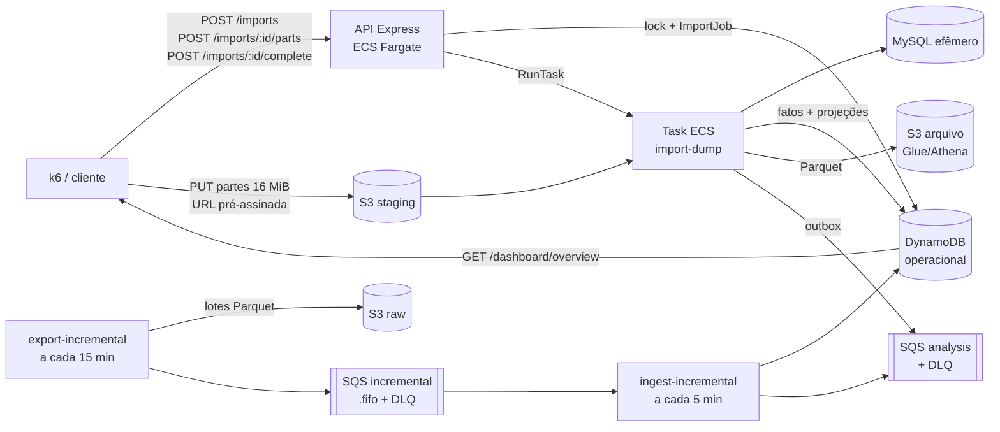

# Testes de Carga e Resiliência da Ingestão

## Visão Geral

&emsp;Este documento aprimora os testes dos requisitos não funcionais realizados nas sprints passadas ([`testes-carga-inicial.md`](../sprint3/testes-carga-inicial.md)), agora com foco na **API de ingestão** do sistema ARGUS/View Show. Naquele momento, os cenários de ingestão (10 mil eventos/minuto, fila cheia e timeout) ficaram **bloqueados**, porque o adaptador de importação respondia `503 FEATURE_UNAVAILABLE` de forma incondicional. Depois disso, o pipeline passou a existir de ponta a ponta: upload multipart ao S3 pela API, task ECS `import-dump`, MySQL efêmero, normalização, publicação no DynamoDB e Parquet/Glue/Athena, outbox e filas SQS com DLQ. Com isso, os cenários que antes só podiam ser planejados passam a ser executáveis contra a stack real.

&emsp;Para cada teste são especificados identificador, objetivo e requisito relacionado, perfil de carga ou falha injetada, pré-condições e dados de entrada, procedimento, métricas coletadas, critérios de sucesso, resultado esperado, resultados medidos, resultado obtido, situação, análise e evidências de reprodução.

&emsp;Os comandos de reprodução foram escritos para um terminal compatível com Bash. Dependendo do sistema operacional, a forma de definir variáveis de ambiente pode mudar.

## Priorização de execução

&emsp;A ordem de execução segue o risco para o dado, não a ordem das seções:

1. **Prioridade 1 — carga nominal de 10 mil eventos/minuto (CG-02) e perda de dados sob falha (RS-01, RS-02, RS-03).** A ingestão é a porta de entrada: se um evento aceito for perdido, duplicado ou silenciosamente descartado, tudo o que o dashboard (RF07) e a análise de falhas críticas (RF09) mostram depois fica incorreto. Esses testes validam diretamente RNF01 e RNF03.
2. **Prioridade 2 — frescor ponta a ponta (CG-03) e recuperação automática (RS-04, RS-05).** Depois de garantir que nada se perde, o risco seguinte é o dado chegar tarde demais para ser útil (RNF02) ou o sistema precisar de intervenção manual para voltar ao normal.
3. **Prioridade 3 — pico no plano de controle (CG-04), volume progressivo (CG-05) e proteções da API (RS-06).** Caracterizam capacidade e limites; o risco é menor porque, nesses cenários, a exclusão mútua e o rate limiter já impedem efeitos colaterais no dado.

## Sumário

- [Priorização de execução](#priorização-de-execução)

1. [Introdução](#1-introdução)
2. [Arquitetura sob teste e evolução em relação à Sprint 3](#2-arquitetura-sob-teste-e-evolução-em-relação-à-sprint-3)
3. [Requisitos não funcionais e planos de teste aprimorados](#3-requisitos-não-funcionais-e-planos-de-teste-aprimorados)
4. [Ambiente, massa de dados e método](#4-ambiente-massa-de-dados-e-método)
5. [Testes de carga](#5-testes-de-carga)
6. [Testes de falha e resiliência](#6-testes-de-falha-e-resiliência)
7. [Resultados consolidados e análise](#7-resultados-consolidados-e-análise)
8. [Observabilidade](#8-observabilidade)
9. [Impacto nas decisões de arquitetura](#9-impacto-nas-decisões-de-arquitetura)
10. [Limitações](#10-limitações)
11. [Procedimentos de reprodução](#11-procedimentos-de-reprodução)
12. [Convenção de evidências](#12-convenção-de-evidências)

---

## 1. Introdução

### 1.1 Objetivo

&emsp;Verificar, com execução reproduzível contra a stack implantada na AWS, se a ingestão do View Show sustenta a carga nominal de **10.000 eventos por minuto** sem perda, se degrada de forma controlada diante de **fila cheia** e **timeout de dependência**, e se volta sozinha ao patamar nominal quando a falha é retirada — registrando, em paralelo, os indicadores de observabilidade que permitem explicar cada resultado.

### 1.2 Escopo

<div align="center">

<strong>Tabela 1: Componentes no escopo dos testes</strong>

</div>

| Componente | Local no repositório | Papel nos testes |
| --- | --- | --- |
| API de ingestão (plano de controle) | `apps/backend/api`, módulo `imports` — rotas `POST /api/v1/imports`, `POST /api/v1/imports/:importId/parts`, `POST /api/v1/imports/:importId/complete`, `GET /api/v1/imports/:importId`, `GET /api/v1/imports` | Porta de entrada HTTP: reserva a importação, assina as partes do upload, confirma o envio e expõe o progresso |
| Worker de ingestão (plano de dados) | `apps/backend/ingestion-data` — comandos `import-dump`, `ingest-incremental`, `export-incremental`, `publish-outbox` | Valida, normaliza e publica os eventos; é onde a vazão de 10 mil eventos/min é efetivamente medida |
| Filas | `apps/fullstack/ingestion-messaging.tf` — `*-incremental-batches.fifo` (+ DLQ) e `*-analysis` (+ DLQ, `maxReceiveCount = 5`, `visibility_timeout = 300 s`) | Onde se observa acúmulo (fila cheia), idade da mensagem mais antiga e desvio para DLQ |
| Persistência | DynamoDB operacional, S3 (staging e arquivo), Glue/Athena | Onde se confere que nenhum evento aceito foi perdido ou duplicado |
| Observabilidade | `apps/fullstack/observability/` (Prometheus, Grafana, Loki, Tempo, Alloy) e `apps/fullstack/ingestion-observability.tf` (CloudWatch, namespace `<deployment_namespace>/Ingestion`) | Fonte dos indicadores da Seção 8 |

<div align="center">

Fonte: Material produzido pelos autores (2026).

</div>

### 1.3 Convenções adotadas

- Requisitos não funcionais são identificados como `RNFXX`, conforme os requisitos definidos nas sprints passadas ([`requisitos.md`](../sprint1/requisitos.md#4-requisitos-não-funcionais-rnf-e-planos-de-teste)).
- Testes de carga são identificados como `CG-XX`; testes de falha e resiliência, como `RS-XX`.
- Percentis são indicados como `p50`, `p95` e `p99`.
- **10.000 eventos/minuto = 166,67 eventos/s = 150.000 eventos por janela de 15 minutos** (a janela de detecção usada pela ingestão).
- Cada resultado é classificado em um dos estados da Tabela 2, e só neles (mesma convenção adotada nas sprints passadas).

<div align="center">

<strong>Tabela 2: Estados de classificação dos resultados</strong>

</div>

| Estado | Significado |
| --- | --- |
| Aprovado | Existe execução reproduzível e o critério foi atendido |
| Reprovado | Existe execução reproduzível e o critério não foi atendido |
| Parcial | Somente parte do critério foi executada ou atendida |
| Não executado | Existe plano, não existe execução |
| Bloqueado | Falta runtime, dependência ou autorização externa |

<div align="center">

Fonte: Material produzido pelos autores (2026).

</div>

---

## 2. Arquitetura sob teste e evolução em relação à Sprint 3

### 2.1 Fluxo da ingestão

&emsp;A Figura 1 mostra o caminho de um evento desde o arquivo enviado até ficar disponível para consulta, com os pontos onde cada teste mede algo.

<div align="center">

<strong>Figura 1: Fluxo da ingestão e pontos de medição</strong>

</div>



<div align="center">

Fonte: Material produzido pelos autores (2026).

</div>

&emsp;Os estados públicos do `ImportJob` são `PREPARING → UPLOADING → UPLOADED → VALIDATING → PROCESSING → READY` (ou `FAILED`). O processamento expõe os contadores `recordsRead`, `recordsWritten` e `recordsRejected`, que são a base da medição de vazão em eventos.

### 2.2 Tradução dos cenários obrigatórios para a arquitetura atual

&emsp;O plano elaborado nas sprints passadas supunha uma ingestão HTTP síncrona que respondia `429 queue_full` e `504 dependency_timeout`. A arquitetura implementada é **assíncrona e em lote**: a API só reserva e confirma a importação, e o processamento acontece numa task ECS. A Tabela 3 mostra como cada cenário exigido pela entrega é medido agora. O cenário descrito no enunciado como “abertura de venda de 10 mil eventos/minuto” corresponde, no domínio do View Show, a um **pico de audiência** (estreia, jogo ao vivo), quando o volume de telemetria sobe de uma vez.

<div align="center">

<strong>Tabela 3: Mapeamento dos cenários da Sprint 3 para a arquitetura atual</strong>

</div>

| Cenário exigido | Sprint 3 (plano original / histórico Flask) | Sprint 5 (arquitetura atual) | Testes |
| --- | --- | --- | --- |
| 10 mil eventos/min (pico de audiência) | 100 lotes/min × 100 eventos via `POST` síncrono; **bloqueado** na stack TypeScript | Janela de **150.000 eventos** (10.000/min × 15 min) processada em ≤ 15 min, medida por `recordsWritten` / duração de `PROCESSING`; e rajada de clientes no plano de controle | CG-02, CG-04, CG-05 |
| Fila cheia | `HTTP 429 queue_full` injetado por token | (a) **Acúmulo real** na FIFO incremental (2, 3 ou 4 janelas represadas), medido por `ApproximateNumberOfMessagesVisible` e `ApproximateAgeOfOldestMessage`; (b) **contrapressão explícita** na API: segunda importação recebe `409 IMPORT_IN_PROGRESS`; (c) excesso de requisições recebe `429 RATE_LIMITED` | RS-01, RS-06 |
| Timeout de dependência | `HTTP 504 dependency_timeout` injetado por token | (a) Falha/timeout do S3 ao preparar multipart → `503 UPLOAD_PREPARATION_FAILED` com lock liberado; (b) task ECS interrompida ou que não conclui no prazo → `ImportJob` em `FAILED` com mensagem segura, detectado pelo reconciliador; (c) mensagem que excede `visibility_timeout` e é reentregue | RS-02, RS-04 |
| Payload inválido | Mensagens corrompidas misturadas às válidas | Lote incremental com coluna obrigatória ausente → `QUARANTINED`; dump corrompido → `FAILED` na validação; mensagem venenosa → DLQ após 5 recebimentos | RS-03, RS-05 |
| Recuperação sem reinício | 1 min nominal após a falha | Após retirar cada falha, a próxima janela/importação volta ao patamar de CG-02 sem reinício manual de serviço | Critério comum a RS-01 a RS-05 |

<div align="center">

Fonte: Material produzido pelos autores (2026).

</div>

---

## 3. Requisitos não funcionais e planos de teste aprimorados

&emsp;Os requisitos abaixo foram desenvolvidos nas [sprints passadas](../sprint1/requisitos.md#4-requisitos-não-funcionais-rnf-e-planos-de-teste). A coluna “Plano aprimorado” atualiza o plano de testes elaborado anteriormente ([Tabela 4 de `testes-carga-inicial.md`](../sprint3/testes-carga-inicial.md#41-requisitos-de-ingestão)).

<div align="center">

<strong>Tabela 4: Requisitos não funcionais da ingestão e planos de teste aprimorados</strong>

</div>

| RNF | Descrição resumida | Plano aprimorado | Ferramenta | Critério objetivo | Testes | Estado |
| --- | --- | --- | --- | --- | --- | --- |
| RNF01 | Aceitar continuamente 10.000 eventos válidos/min sem perda | Importar uma janela sintética de 150.000 eventos válidos e medir a vazão de processamento; conferir contagem no DynamoDB/Athena | k6 (`ingestao-batch.js`, `MODE=drenagem`) + CloudWatch + consulta de contagem | `recordsWritten = 150.000`; `recordsRejected = 0`; duração de `VALIDATING+PROCESSING` ≤ 900 s (≥ 166,67 eventos/s); 0 duplicados; `checks rate==1` | CG-02, CG-05 | **Reprovado** — INGESTING a ~15 mil eventos/min, mas o pipeline até `READY` levou 13.915 s na R2, por PROJECTING e ARCHIVING (CG-02); no CG-05, com eventos concentrados em janelas, o pipeline ficou em 3.956 eventos/min com 150.000 (2.275 s) e 4.152 eventos/min com 300.000 (4.335 s), com ARCHIVING limitado por um núcleo de CPU |
| RNF02 | Evento disponível para consulta em ≤ 120 s após captura | Marcar `t0` na entrada do lote incremental, `t1` no fim da ingestão e `t2` quando o watermark de `/dashboard/overview` passar de `t0` | k6 (`MODE=frescor`) | `t2 − t0 ≤ 120 s` em 100% das amostras | CG-03 | **Bloqueado** — o watermark de `meta.freshness` vem da projeção OVERVIEW do dia final do manifesto ACTIVE, e o `ingest-incremental` não atualiza nenhum dos dois; sem essa atualização, `t2 − t0` não pode ser medido (CG-03, achado 10) |
| RNF03 | Degradar de forma controlada sob payload inválido, fila sem capacidade e timeout; recuperar sem reinício | Injetar cada falha da Seção 6 sob carga nominal, observar a resposta e depois retirar a falha | k6 + AWS CLI (injeção) + CloudWatch | Falha sempre explícita (`409`/`429`/`503`/`FAILED`/`QUARANTINED`/DLQ); 0 eventos aceitos e não persistidos; recuperação ao patamar de CG-02 sem reinício manual | RS-01 a RS-06 | **Parcial** — importação: falhas explícitas e recuperação automática (RS-02, RS-03b, CG-04); incremental, com a correção de `PK`/`SK`: lote inválido isolado em quarentena sem bloquear os válidos (RS-03a) reprocessamento sem perda nem duplicação após interrupção (RS-04) e mensagem venenosa desviada para a DLQ sem impedir o lote válido seguinte (RS-05); acúmulo (RS-01) reprovado em 30/09 pelo achado 9 e, com a correção implantada, aprovado com 2, 3 e 4 lotes em 05–06/10 (0 na DLQ, contagem igual à esperada, drenagem dentro do limite) |
| RNF09 | Disponibilidade das APIs ≥ 99,9% | Durante toda a bateria de ingestão, medir erro inesperado nas rotas de import (excluindo `409`/`429`/`503` esperados) | k6 `http_req_failed` | `http_req_failed rate < 0,001` nas rotas `/api/v1/imports*` | CG-01, CG-04 | **Aprovado** — 0 erro inesperado em CG-01, CG-02, CG-04 e RS-06 (os `503` são respostas seguras previstas; ver ressalva no CG-04) |
| RNF15 | Degradação sinalizada ao operador em ≤ 30 s | Durante RS-01 a RS-05, cronometrar o intervalo entre a injeção da falha e o disparo do alarme correspondente | CloudWatch Alarms / Grafana Alerting | Alarme em estado `ALARM` em ≤ 30 s (registrar o valor real, mesmo que acima) | RS-01 a RS-05 | **Reprovado** — 35 s no melhor caso; 109–190 s nas filas; sem alarme em RS-02(a)/(b) |

<div align="center">

Fonte: Material produzido pelos autores (2026).

</div>

### 3.1 O que mudou em relação à Sprint 3

<div align="center">

<strong>Tabela 5: Aprimoramentos dos planos de teste</strong>

</div>

| Aspecto | Sprint 3 | Sprint 5 |
| --- | --- | --- |
| Alvo | API de consulta; ingestão bloqueada (`503 FEATURE_UNAVAILABLE`) | Pipeline de ingestão real (API de import + task ECS + SQS) |
| Unidade de medida da carga | Requisições HTTP/s | **Eventos/min processados** (`recordsWritten`) e requisições HTTP/s no plano de controle |
| Fila cheia | Simulada por token no Flask | Acúmulo real em SQS FIFO + contrapressão `409`/`429` |
| Timeout | Atraso injetado de 250 ms | Falha real de dependência (S3, task ECS, reentrega SQS) |
| Verificação de perda | Contagem de `202` | Contagem ponta a ponta: enviado × `recordsWritten` × itens no DynamoDB × linhas no Athena |
| Observabilidade | RED da API | RED da API + CPU/memória das tasks de ingestão + profundidade/idade de fila + DLQ |

<div align="center">

Fonte: Material produzido pelos autores (2026).

</div>

---

## 4. Ambiente, massa de dados e método

### 4.1 Ambiente

<div align="center">

<strong>Tabela 6: Configuração do ambiente de execução</strong>

</div>

| Item | Valor |
| --- | --- |
| Data e janela (UTC) | 2026-09-30, a partir de 10:10 UTC (ver `execucoes.txt` para a janela de cada rodada) |
| Conta / região | `114388221188` / `us-east-1` (AWS Academy Learner Lab) |
| Namespace da stack | `view-show` (recursos `view-show-iac-*` e `view-show-ingestion-*`) |
| Commit / tag do repositório | Até 19:45 UTC: `4c9b236` (branch `feat/testes-ingestao`). A partir de 19:45 UTC: `0eded5d`, que inclui a correção de `PK`/`SK` (`cc0dbbc`, `afc303c`) e o log de causa no `ingest-incremental` (`0eded5d`). A correção de `apps/scripts/aws-learner-lab.mjs` (parâmetro `file://` no Windows) foi commitada à parte e não afeta o caminho testado |
| Imagem da API (ECR) | `view-show-iac-api:96ef64f46bff` (sem mudança na rodada) |
| Imagem da ingestão (ECR) | Até 19:45 UTC: `view-show-ingestion@sha256:1fa9cb2d7fcd…2d93`. A partir de 19:45 UTC: `view-show-ingestion:52b405d7ae76` (`sha256:2d409c86…`), implantada por `terraform apply -target` nas 5 task definitions de ingestão (**revisão 6**) e nos 3 agendamentos (`execucoes.txt`, `rs01-digest-task.txt`) |
| API — tasks ECS / vCPU / memória | 1 task em execução (autoscaling mín. 1, máx. 4, alvo 50% CPU) / 0,25 vCPU / 512 MiB (`view-show-iac-api-task:5`) |
| Task `import-dump` — vCPU / memória / storage efêmero | 2 vCPU / 8 GiB / 200 GiB (`view-show-ingestion-import:5`; revisão 6 a partir de 19:45 UTC, mesmos recursos) |
| Tasks `ingest-incremental` / `export-incremental` — agenda | 1 vCPU / 2 GiB; agendas `rate(5 minutes)` / `rate(15 minutes)`, ambas **DISABLED** (`incremental_s3_enabled=false`); consumidor disparado sob demanda por `ingestao-falhas.sh rodar-ingestao`. Exceção: no RS-01 da tarde a agenda do `ingest-incremental` foi ligada de 20:23:54 a 20:54:20 UTC e desligada de novo (`rs01-drenagem.txt`) |
| Persistência | DynamoDB `view-show-iac-operacional` (`PAY_PER_REQUEST`); bucket `view-show-ingestion-114388221188-us-east-1` (staging `staging/imports/` e raw `raw/argus/incremental/`) |
| Filas | `view-show-ingestion-incremental-batches.fifo`, `view-show-ingestion-analysis` e respectivas DLQs |
| Rate limit da API (`rate_limit_por_minuto`) | 180 (`RATE_LIMIT_PER_MINUTE` na task da API) |
| Gerador de carga | k6 v2.3.0 (imagem `grafana/k6` via Docker Desktop), executado **fora da AWS** (Windows 11, internet) contra `https://ygnmcngd28.execute-api.us-east-1.amazonaws.com` (API Gateway → ALB → ECS) |
| Observabilidade | CloudWatch (namespace `view-show/Ingestion`, `AWS/SQS`, `AWS/DynamoDB`, `ECS/ContainerInsights` habilitado) e logs `/ecs/view-show-ingestion-backfill`; Prometheus/Grafana locais **não** coletaram a API na AWS (ver Seção 10) |
| Autenticação | Login real no Cognito (`us-east-1_Yr4YHWZ4a`) via `POST /auth/login`, usuário técnico `carga-sprint5@viewshow.test` criado para os testes |
| Verificação de 2026-10-01 (~02:06 UTC, só leitura) | Cluster `view-show-iac-cluster`, com o serviço `view-show-iac-api-service` e uma task em execução (`view-show-iac-api-task:5`); nenhuma task de ingestão em execução. Task definitions `view-show-ingestion-{import,incremental-ingest,incremental-export,sync,backfill}` na **revisão 6**, todas com a imagem `view-show-ingestion@sha256:2d409c86…`. Agendamentos `sync` e `incremental-export` (`rate(15 minutes)`) e `incremental-ingest` (`rate(5 minutes)`) **DISABLED**, apontando para a revisão 6. Bucket de ingestão sem política. `visibility_timeout` de 300 s na FIFO incremental e na fila de análise; 1 mensagem na DLQ incremental (`assets/testes-carga/2026-10-01-ingestao/verificacao-ambiente.txt`, transcrição das saídas do terminal) |
| Rodada de 2026-10-01 (tarde: RS-03(a), RS-04, RS-05) | Conta `080158589617` / `us-east-1`, mesma stack `view-show`. O RS-05 ficou pausado de 16:55 a 18:36 UTC para renovar a sessão do Learner Lab e terminou às 18:45 UTC. Commit `0939869` (inclui a correção de `PK`/`SK`). Imagem da ingestão `view-show-ingestion:fix-0939869a` (`sha256:6388b798…`), nas task definitions `import:7`, `incremental-ingest:5`, `incremental-export:5`, `backfill:6` e `sync:5`; API sem mudança (`view-show-iac-api-task:4`). Agendamentos **DISABLED**; consumidor disparado sob demanda por `rodar-ingestao`. `visibility_timeout` de 300 s e `maxReceiveCount = 5` na FIFO incremental (`2026-10-01-ingestao/ambiente-rodada-tarde.txt`) |
| Rodada de 2026-10-04 (CG-05) | Novo Learner Lab: conta `145497513075` / `us-east-1`, stack criada do zero em 2026-10-04 por `node apps/scripts/aws-learner-lab.mjs setup` (mesmas variáveis validadas do script: import 2 vCPU / 8 GiB / 200 GiB, API 0,25 vCPU / 512 MiB, agendamentos **DISABLED**). Commit `d7f56de` mais a opção `--rows-per-window` do gerador. Imagem da ingestão `view-show-ingestion@sha256:90dcf1de…6a18a35` (`view-show-ingestion-import:1`); Container Insights habilitado; DynamoDB `PAY_PER_REQUEST`. API `https://hk4ooeetbi.execute-api.us-east-1.amazonaws.com`, usuário técnico `k6-ingestao@viewshow.test`. k6 (`grafana/k6` via Docker) fora da AWS, no mesmo Windows 11 (`2026-10-04-ingestao/ambiente.txt`) |
| Deploy de 2026-10-05 (correção do achado 9, antes do RS-01) | Mesma conta `145497513075`. Commit `1c0d9fa`. Imagem da ingestão `view-show-ingestion:8be4568def6e` (`sha256:08474aaa…3615`), implantada por `terraform apply -target` manual nas 5 task definitions de ingestão (revisão **`:2`**; a `:1` ficou `INACTIVE`) e nos 3 agendamentos, que passaram a apontar para a `:2` e continuam **DISABLED**. Em seguida, `terraform apply -refresh-only` para atualizar o output `ingestion_runbook`, sem alterar a AWS. O motivo do procedimento manual está na Seção 10 (`2026-10-05-ingestao/README.md`, `verificacao-pos-deploy.txt`) |
| Pré-condições do RS-01 em 2026-10-05 | Como a stack foi recriada em 2026-10-04, não havia dataset ativo (`CONTROL#DATASET / ACTIVE` ausente), e sem ele o `ingest-incremental` recusa todo lote (`ACTIVE manifest is required for incremental ingestion`). Às 15:29:49 UTC o dataset da importação de 150.000 eventos do CG-05 (`imp_01M4478AZCSGHRCRYFT3ZP7AED`, `dsv_81253140…9965`) foi ativado por `POST /api/v1/imports/{importId}/activate` (HTTP 200, `changed = true`). Para isso, às 15:29:36 UTC a senha do usuário técnico `k6-ingestao@viewshow.test` (status `RESET_REQUIRED`) foi redefinida como permanente por `aws cognito-idp admin-set-user-password`, com uma senha aleatória mantida fora do repositório (`2026-10-05-ingestao/execucoes.txt`, `ativacao-dataset-150000.json`) |
| Rodadas do RS-01 de 2026-10-05 e 2026-10-06 | Mesma conta e imagem do deploy acima (`view-show-ingestion:8be4568def6e`, `incremental-ingest:2`), dataset ativo `dsv_81253140…9965`. Agenda do `ingest-incremental` (`rate(5 minutes)`) ligada só durante a drenagem de cada rodada e desligada ao fim; `sync` e `incremental-export` **DISABLED** o tempo todo. O commit `acb13b5` (verificações adicionais nos caminhos de perda de visibilidade do heartbeat), posterior ao deploy, **não** está implantado; ele não altera o caminho sem falha exercitado pelo RS-01. Monitoramento por script local (AWS CLI) a cada ~30 s (`2026-10-05-ingestao/execucoes.txt`) |

<div align="center">

Fonte: Material produzido pelos autores (2026).

</div>

### 4.2 Massa de dados

&emsp;Os cenários de volume dependem de dumps sintéticos com quantidade **conhecida** de eventos, para que a contagem final possa ser comparada com a enviada. O SHA-256 de cada arquivo está registrado na Tabela 7.

<div align="center">

<strong>Tabela 7: Massa de dados utilizada</strong>

</div>

| ID | Arquivo | Eventos válidos | Eventos inválidos | Tamanho | SHA-256 | Usado em |
| --- | --- | ---: | ---: | --- | --- | --- |
| M-01 | `argus_dump.sql.gz` (reduzido, `--rows 1000`) | 1.000 (974 `signal_bucket` + 26 fixture) | 0 | 11.548 B | `2e98c82e…6f36373` | CG-01, RS-02, RS-03, RS-06 |
| M-02 | `argus_dump.sql.gz` (1 janela) | 150.000 | 0 | 917.703 B | `21069cb5…6feee15` | CG-02, RS-02 |
| M-03 | `argus_dump.sql.gz` (2 janelas) | 300.000 | 0 | 1.828.944 B | `6b39cf9b…6daecc` | Planejada para o CG-05; substituída por M-09 |
| M-04 | `argus_dump.sql.gz` (5 janelas) | 750.000 | 0 | 4.562.832 B | `53298f4b…19aab68a` | Planejada para o CG-05; substituída por M-10 |
| M-05 | Lotes incrementais de 15 min | 150.000 por lote | 0 | 177.684 B (Parquet) | `523e1f44…58ac9148` (janela 09:00Z; muda por janela) | CG-03, RS-01 |
| M-06 | Lote incremental com coluna obrigatória ausente | 0 | 150.000 (sem `value`) | 58.805 B (Parquet) | `bbb45f66…fe75` (janela 09:00Z; muda por janela) | RS-03 |
| M-07 | Dump corrompido (GZIP truncado, metade de M-01) | — | — | 5.774 B | `ad5e5bae…98bc689` | RS-03 |
| M-08 | `argus_dump.sql.gz` (1 janela concentrada, `--rows-per-window 150000`, `--variant cg05`) | 150.000 | 0 | 828.035 B | `b78e9d48…c024d6673a` | CG-05 |
| M-09 | `argus_dump.sql.gz` (2 janelas concentradas, idem) | 300.000 | 0 | 1.649.770 B | `c29263ab…0aabfc2f7b` | CG-05 |
| M-10 | `argus_dump.sql.gz` (5 janelas concentradas, idem) | 750.000 | 0 | 4.114.927 B | `2a6c9c79…0584c4f752` | CG-05 |

<div align="center">

Fonte: Material produzido pelos autores (2026).

</div>

&emsp;Gerador da massa: [`apps/backend/ingestion-data/scripts/build_benchmark_snapshot.py`](../../apps/backend/ingestion-data/scripts/build_benchmark_snapshot.py), que já existe. Ele gera um `argus_dump.sql.gz` determinístico com a quantidade de linhas pedida (`--rows`) e um `manifest.json` com a contagem, e é o mesmo gerador usado no benchmark de leitura MySQL. O `rowCount` do manifesto inclui as linhas de fixture das outras tabelas (com `--rows 1000`, são 974 de `signal_bucket` e 26 de fixture); ele é o `EXPECTED_EVENTS`, porque o `recordsWritten` conta o `rowCount` inteiro, como o CG-01 confirmou. Os lotes incrementais (M-05 e M-06) são gerados e publicados por [`publish_incremental_batch.py`](../../apps/backend/ingestion-data/scripts/publish_incremental_batch.py), e o dump corrompido (M-07) pelo comando `m07` de [`ingestao-falhas.sh`](../../apps/backend/api/loadtest/k6/ingestao-falhas.sh).

&emsp;As massas M-08 a M-10 do CG-05 usam a opção `--rows-per-window` do mesmo gerador. Sem ela, cada linha sintética de `signal_bucket` ocupa um bucket de 15 min com a mesma entidade, e M-02 a M-04 cobrem milhares de dias. Com `--rows-per-window 150000`, cada 150.000 linhas compartilham o mesmo `bts`, alinhado ao grão de 900 s, e cada linha tem uma entidade própria (`benchmark-cg05-000000` a `-149999`), o que mantém a chave natural `(source, entity, metric, bts)` única. Isso materializa a definição da Tabela 3 (150.000 eventos = 10.000/min × 15 min), e as 5 janelas de M-10 cabem num único dia (2026-08-29). Sem a opção, a saída continua byte a byte idêntica: M-02 regenerado com o gerador alterado manteve o SHA-256 `21069cb5…6feee15`.

```bash
# a partir de apps/backend/ingestion-data (exemplo para M-02)
.venv/bin/python scripts/build_benchmark_snapshot.py \
  --rows 150000 --snapshot-extracted-on <AAAA-MM-DD> --variant baseline \
  --output ../../../.artifacts/argus-benchmarks/150k/argus_dump.sql.gz \
  --manifest ../../../.artifacts/argus-benchmarks/150k/manifest.json

# M-05 / M-06: codifica e valida localmente, sem publicar (tirar --dry-run publica na FIFO)
.venv/bin/python scripts/publish_incremental_batch.py --variant valid --rows 150000 --dry-run
.venv/bin/python scripts/publish_incremental_batch.py --variant missing-column --rows 150000 --dry-run

# M-07: a partir de apps/backend/api/loadtest/k6
./ingestao-falhas.sh m07 <M-02>/argus_dump.sql.gz ../../../../../.artifacts/argus-benchmarks/m07/argus_dump.sql.gz
```

### 4.3 Método de medição

- **Vazão de eventos:** `recordsWritten ÷ (instante de READY − instante de entrada em VALIDATING)`, lidos de `GET /api/v1/imports/:importId` por polling a cada `POLL_INTERVAL_S` e confirmados pelos timestamps do `ImportJob` no DynamoDB.
- **Ausência de perda:** eventos no arquivo = `recordsRead` = `recordsWritten + recordsRejected`; e `recordsWritten` = contagem no DynamoDB para a `candidateVersion` = contagem no Athena para a mesma partição.
- **Ausência de duplicidade:** contagem de identificadores distintos igual à contagem total, na mesma consulta Athena.
- **Latência do plano de controle:** `http_req_duration` do k6 por rota (`tags: { rota }`).
- **Fila:** métricas SQS `ApproximateNumberOfMessagesVisible`, `ApproximateNumberOfMessagesNotVisible` e `ApproximateAgeOfOldestMessage`, período de 1 min.
- **Respostas esperadas × erro real:** `http.setResponseCallback(http.expectedStatuses(200, 201, 202, 409, 429, 503))` só nos cenários em que esses códigos são a resposta correta; em CG-01 e CG-02 apenas `2xx` é esperado.

### 4.4 Ferramentas e testes reaproveitados

&emsp;Os testes deste documento não foram criados do zero: partiram de scripts e testes automatizados das sprints passadas, que foram adaptados à API de ingestão atual. Os testes automatizados existentes (Vitest e pytest) comprovam o **comportamento** de cada falha em ambiente controlado; os testes deste documento repetem esses cenários **sob carga e contra a stack real na AWS**, medindo tempo, vazão e recuperação.

&emsp;Nos testes de carga, o script k6 [`ingestao-batch.js`](../../apps/backend/api/loadtest/k6/ingestao-batch.js), criado nas sprints passadas, foi reescrito para o contrato atual. A versão anterior esperava estados em minúsculo e não sabia enviar o arquivo; agora ele faz o upload real em partes de 16 MiB, com a assinatura das partes, o envio ao S3 e a confirmação, acompanha a importação até `READY` e mede a duração de cada estado e a vazão em eventos por segundo. Também passou a fazer login real no Cognito e ganhou os modos de smoke (CG-01), pico de requisições (CG-04) e proteção contra excesso de requisições (RS-06). Como a API não tem rota para cancelar uma importação e um upload abandonado segura a vaga por 24 horas, os modos de pico e de excesso concluem, ao final, a importação que criaram. O modo de acúmulo saiu do k6: com a trava de uma importação por vez, o acúmulo real acontece na fila incremental e passou a ser provocado pelo publicador de lotes.

&emsp;Nos testes de falha, os cenários de timeout de dependência (RS-02), payload inválido (RS-03) e reentrega de mensagens (RS-04) já eram cobertos por testes automatizados, mas só localmente. Para repeti-los na AWS, foram criados dois utilitários. O [`publish_incremental_batch.py`](../../apps/backend/ingestion-data/scripts/publish_incremental_batch.py) publica na fila incremental lotes válidos, lotes sem uma coluna obrigatória e a mensagem venenosa do RS-05, que era o único cenário sem nenhuma base. Ele usa os mesmos adaptadores do worker e substitui o `export-incremental`, que depende do MySQL de produção. O [`ingestao-falhas.sh`](../../apps/backend/api/loadtest/k6/ingestao-falhas.sh) injeta e reverte cada falha (negação de upload no S3, interrupção de tasks, agendamentos), dispara o consumidor sob demanda e exporta as métricas das filas. Os testes de fila cheia e timeout das sprints passadas, sobre a API Flask, ficam apenas como referência histórica.

&emsp;Na observabilidade, é usado o dashboard `view-show-ingestion` do CloudWatch, que já existia e mostra as filas, as DLQs e as execuções da ingestão, junto com o dashboard `View Show — API (RED)` do Grafana para a latência e os erros das rotas de importação.

&emsp;Antes da primeira rodada, esses utilitários foram validados localmente. Todos os modos do k6 passam no `k6 inspect`, e os três tipos de lote foram relidos com os adaptadores do worker: o lote válido é aceito e lido, o lote sem coluna é marcado como incompatível (quarentena) e a mensagem venenosa passa pelo parser da fila, mas falha na leitura do manifesto com erro retentável, o que a leva à DLQ (`dryrun-valid.json`, `dryrun-missing-column.json`, `dryrun-poison.json`). O fluxo de upload só pode ser exercitado contra a AWS, porque depende de URLs pré-assinadas do S3.

&emsp;Para registrar a execução dos testes automatizados existentes como evidência de apoio:

```bash
# Vitest — casos da importação
cd apps/backend/api
npm test -- --run tests/gateway-http.integration.test.ts -t "UC-IMP" --reporter=verbose

# pytest — resiliência da ingestão
cd apps/backend/ingestion-data
.venv/bin/python -m pytest tests/resilience -v
```

&emsp;Resultado dos testes existentes nesta rodada (2026-09-30, evidências em [`assets/testes-carga/2026-09-30-ingestao/`](../../assets/testes-carga/2026-09-30-ingestao/)):

<div align="center">

<strong>Tabela 7a: Execução dos testes automatizados de apoio</strong>

</div>

| Suíte | Ambiente | Resultado | Evidência |
| --- | --- | --- | --- |
| Vitest `gateway-http.integration.test.ts -t "UC-IMP"` | Windows 11, Node | **8/8 aprovados** (27 fora do filtro) | `vitest-uc-imp.txt` |
| pytest `tests/resilience` + `tests/unit/application/test_ingest_incremental.py` + `tests/unit/adapters/test_incremental_batch_keys.py` + `tests/unit/adapters/test_incremental_batch_repository.py` | Linux, contêiner `python:3.12-slim` com `requirements-dev.txt` | **148/148 aprovados** (146/146 após a correção de `PK`/`SK`; 148/148 após o log de causa) | `pytest-resiliencia-linux.txt` |
| pytest `tests/resilience` + `tests/unit/application/test_ingest_incremental.py` (suíte anterior à correção, 131 testes) | Windows 11, Python 3.12.10 (`.venv` local) | **8 reprovados, 123 aprovados** | `pytest-resiliencia-windows.txt` |

<div align="center">

Fonte: Material produzido pelos autores (2026).

</div>

&emsp;As 8 falhas no Windows (`test_crash_after_hot_write_replays_without_duplicate_fact_or_event` e 7 casos de `test_ingest_incremental.py`) têm a mesma causa: o `sync` devolve `PARTIAL` com `renewal must strictly extend lease expiration`. O relógio do Python 3.12 no Windows tem resolução grosseira (54 valores distintos de `datetime.now()` em 200 mil chamadas), então a renovação do lease logo após a aquisição recebe o mesmo `now` e é rejeitada pela regra de extensão estrita, tanto no fake (`tests/fakes.py`) quanto no adaptador real (`adapters/dynamodb/control.py`). Em Linux, onde a task roda em produção, a suíte passa inteira; o achado é de portabilidade do ambiente de desenvolvimento, não de comportamento em produção. Dois problemas de ambiente apareceram antes disso: o `.venv` não tinha `moto` (4 módulos não coletavam), e `pip install -r requirements-dev.txt` falha no Windows em modo `--require-hashes` porque `pywin32` (dependência de `docker`) não está fixado; foi instalado `moto[dynamodb,glue,s3,secretsmanager,sqs]==5.1.9` diretamente. A suíte ampliada de 148 testes não foi repetida no Windows.

### 4.5 Pré-requisitos de ferramenta

- [x] Atualizar [`loadtest/k6/ingestao-batch.js`](../../apps/backend/api/loadtest/k6/ingestao-batch.js) para o contrato atual (estados `READY`/`FAILED`, assinatura das partes em `POST /api/v1/imports/:importId/parts`, `Idempotency-Key`).
- [x] Criar os modos `smoke`, `pico` e `limite` e o parâmetro `DUMP` (arquivo a enviar).
- [x] Trocar a sessão forjada por login real (`AUTH_USERNAME`/`AUTH_PASSWORD`), como já feito em `consultas.js`.
- [x] Criar o publicador de lotes incrementais (M-05, M-06 e mensagem venenosa) e o script de injeção de falhas.
- [x] Definir o dashboard: CloudWatch `view-show-ingestion` para filas e tasks, Grafana `View Show — API (RED)` para as rotas.
- [x] Instalar o k6 na máquina que vai gerar a carga e criar o usuário técnico no Cognito (k6 via imagem Docker `grafana/k6`; usuário `carga-sprint5@viewshow.test`).
- [x] Renovar a sessão do Learner Lab e confirmar que a stack está aplicada (`./ingestao-falhas.sh recursos`). A sessão foi revogada durante a rodada (`voc-cancel-cred`) e renovada; ver Seção 10.

---

## 5. Testes de carga

### CG-01 — Smoke da ingestão (linha de base)

<div align="center">

<strong>Tabela 8: Especificação do teste CG-01 — Smoke da ingestão</strong>

</div>

| Campo | Descrição |
| --- | --- |
| Identificador | `CG-01` |
| Já existe? | **Parcial** — IT-AWS-05 (sprints passadas) já executa o início real da importação na AWS, mas para em `UPLOADING`; falta seguir até `READY` e o modo `smoke` no k6 |
| Objetivo e requisito relacionado | Confirmar que o fluxo completo (`POST /imports` → partes → `complete` → `READY`) funciona na stack antes das rodadas de carga, e obter a linha de base de latência e duração. RNF01, RNF09 |
| Perfil de carga | 1 VU, 1 importação, dump reduzido (M-01) |
| Pré-condições e dados de entrada | Stack aplicada; nenhuma importação ativa; usuário técnico no Cognito; massa M-01 |
| Procedimento | 1. Autenticar. 2. `POST /api/v1/imports` com `Idempotency-Key`. 3. Assinar e enviar as partes. 4. `POST /complete`. 5. Polling em `GET /imports/:id` até `READY`/`FAILED`. 6. Conferir contagens |
| Métricas coletadas | `http_req_duration` por rota; duração de cada estado; `recordsRead/Written/Rejected`; CPU da task |
| Critérios de sucesso | Estado final `READY`; `recordsWritten` = eventos de M-01; `checks rate==1`; `http_req_failed == 0` |
| Resultado esperado | Importação concluída sem rejeições, com contagem igual à do arquivo |
| Resultados medidos | `http_req_duration` (38 requisições) p50=145 · p95=288 · máx.=712 ms (o resumo do k6 não exporta p99); upload (1 parte) 0,6 s; `complete` → `READY` 159,7 s; `POST /imports` → `READY` 161,3 s. Etapas do worker (`StageDurationMs`): STARTING 0,1 s · RESTORING 1,3 s · VALIDATING 0,6 s · INGESTING 7,4 s · PROJECTING 8,8 s · **ARCHIVING 85,0 s** · ACTIVATING 0,2 s · PUBLISHING 0,2 s; ~55 s entre o `complete` e o início da task (provisionamento Fargate). `recordsRead`=`recordsWritten`=1.000, `recordsRejected`=0. CPU máx. da task 15,1%, memória 5,7%, storage 1,3% |
| Resultado obtido | Importação `imp_01M3RWQ11YCNGTGJPV8JN00V24` terminou em `READY` com 1.000 eventos escritos e nenhum rejeitado; 7/7 checks; `http_req_failed` = 0/38 |
| Situação | **Aprovado** |
| Análise e conclusão | O fluxo completo (reserva → assinatura → PUT S3 → `complete` → task ECS → `READY`) funciona na stack. O `recordsWritten` conta o `rowCount` inteiro do manifesto (974 de `signal_bucket` + 26 de fixture), então `EXPECTED_EVENTS = rowCount` é o valor certo para as demais rodadas. Mesmo com 1.000 eventos, 88% do tempo de processamento foi custo fixo: ~55 s de partida da task e 85 s de ARCHIVING (Parquet/Glue/Athena), contra 7,4 s de ingestão propriamente dita. A importação anterior do banco (`imp_01M3MP8T58XAG5KWNEDYZ8XDK6`, 786 eventos) usou outro dump e não serve de comparação |
| Evidências / reprodução | `k6 run -e BASE_URL=<api_url> -e AUTH_USERNAME=<email> -e AUTH_PASSWORD=<senha> -e MODE=smoke -e DUMP=<M-01> -e EXPECTED_EVENTS=1000 ingestao-batch.js`. Em `assets/testes-carga/2026-09-30-ingestao/`: `resumo-ingestao-cg01.json`, `k6-cg01.log`, `etapas-cg01.json`, `cloudwatch-recursos-cg01.json`, `imports-apos-cg01.json` |

<div align="center">

Fonte: Material produzido pelos autores (2026).

</div>

### CG-02 — Carga nominal de 10.000 eventos/minuto

<div align="center">

<strong>Tabela 9: Especificação do teste CG-02 — Carga nominal de 10.000 eventos/minuto</strong>

</div>

| Campo | Descrição |
| --- | --- |
| Identificador | `CG-02` |
| Já existe? | **Parcial** — modo `drenagem` de `ingestao-batch.js` (sprints passadas), bloqueado na época e desatualizado frente ao contrato atual; linha de base local em `benchmark_snapshot_reader.py` |
| Objetivo e requisito relacionado | Comprovar que a ingestão processa uma janela de 15 minutos a 10.000 eventos/min (150.000 eventos) dentro da própria janela, sem perda nem duplicidade. **RNF01** |
| Perfil de carga | Uma importação de 150.000 eventos válidos (M-02); repetida 3 vezes para medir variação |
| Pré-condições e dados de entrada | CG-01 aprovado; nenhuma importação ativa; massa M-02; observabilidade coletando |
| Procedimento | Mesmo fluxo de CG-01 com M-02; ao final, consultar DynamoDB e Athena para contagem total e distinta |
| Métricas coletadas | Vazão (eventos/s e eventos/min); duração por estado; CPU/memória/storage da task `import-dump`; consumo de capacidade do DynamoDB; throttling do DynamoDB |
| Critérios de sucesso | `recordsWritten = 150.000`; `recordsRejected = 0`; contagem DynamoDB = contagem Athena = 150.000; distintos = total; duração `VALIDATING+PROCESSING` ≤ 900 s; nenhum throttling do DynamoDB |
| Resultado esperado | Vazão ≥ 166,67 eventos/s em todas as 3 repetições |
| Resultados medidos | Ver Tabela 10 |
| Resultado obtido | Duas repetições com dumps distintos. **Nenhuma perda:** R2 (`imp_01M3S4ND5FAD8R12MEQESDSCMC`) terminou `READY` com 150.000 lidos e escritos, 0 rejeitados e 23/23 datasets, e a reconciliação de ARCHIVING confirmou no Athena a contagem de todas as partições (1.585 consultas `COUNT(*)`, todas `SUCCEEDED`). INGESTING atende RNF01 nas duas (601 s e 606,5 s, ≈ 14,9 mil eventos/min), mas o pipeline até `READY` não: R2 levou 13.915 s (INGESTING 606,5 + PROJECTING 1.057,1 + ARCHIVING 12.246,4 s). R1 foi interrompida em ARCHIVING pela injeção do RS-02b |
| Situação | **Reprovado** (R1 e R2) — sem perda; critério de ≤ 900 s para `VALIDATING+PROCESSING` violado por PROJECTING (~1.063 s) e ARCHIVING |
| Análise e conclusão | **Não é gargalo de capacidade:** na R2, CPU máx. da task 39,7%, memória 6,4%, storage 1,7%, 0 throttling no DynamoDB (1,75 M WCU no total, pico de 83,7 mil WCU/min, concentrado em PROJECTING). **ARCHIVING é publicação e verificação síncronas, em série, por partição diária** (Parquet → `HEAD`/`PUT` no S3 → registro no DynamoDB → partição no Glue → `COUNT(*)` no Athena com polling de 1 s, `adapters/archive/athena.py`): **7,7 s por partição, dos quais só 0,84 s são de execução no Athena** (1.323 s de 12.246 s, ~11%); os ~89% restantes são a soma das chamadas em série e da espera de fila/polling. Não há transição de classe de armazenamento nem Glacier (o lifecycle do bucket só expira prefixos de staging). É decisão de desenho, não limite de processamento, e é amplificada pela massa: o gerador espalha os 150 mil eventos por ~1.562 dias (Seção 10). **Recomendações:** (1) **paralelizar a publicação das partições** (pool limitado de workers), que ataca diretamente os ~89% do tempo que não são execução no Athena; (2) tornar a verificação assíncrona ou em lote (um `COUNT(*) … GROUP BY` partição por dataset, em vez de uma consulta por partição); (3) medir o SLA de 900 s do RNF01 até o fim de PROJECTING e tratar ARCHIVING como etapa assíncrona fora do SLA. Mesmo assim, PROJECTING (~1.063 s) sozinho passa de 900 s: a reprovação do RNF01 continua valendo sem ARCHIVING |
| Evidências / reprodução | `k6 run ... -e MODE=drenagem -e DUMP=<M-02> -e EXPECTED_EVENTS=150000 -e RUN_LABEL=cg02-r1 ingestao-batch.js` (R2: `--variant r2`, `RUN_LABEL=cg02-r2`). Em `assets/testes-carga/2026-09-30-ingestao/`: R1 — `resumo-ingestao-cg02-r1.json`, `k6-cg02-r1.log`, `etapas-cg02-r1.json`, `athena-cg02-r1.json`, `cloudwatch-recursos-cg02-r1.json`, `cloudwatch-dynamodb-cg02-r1.json`, `import-cg02-r1-antes-parada.json`, `import-cg02-r1-rs02b-final.json`; R2 — `resumo-ingestao-cg02-r2.json`, `k6-cg02-r2.log`, `etapas-cg02-r2.json`, `athena-cg02-r2.json`, `cloudwatch-recursos-cg02-r2.json`, `cloudwatch-dynamodb-cg02-r2.json`, `cg02-r2-acompanhamento.txt`, `import-cg02-r2-final.json`. Contagem DynamoDB/Athena pela reconciliação do próprio pipeline (cobertura × persistidos e `COUNT(*)` por partição); sem recontagem independente |

<div align="center">

Fonte: Material produzido pelos autores (2026).

</div>

<div align="center">

<strong>Tabela 10: Resultados medidos do CG-02 por repetição</strong>

</div>

| Repetição | Eventos enviados | `recordsWritten` | `recordsRejected` | Contagem DynamoDB | Contagem Athena | Duplicados | Duração `PROCESSING` (s) | Vazão (eventos/min) | CPU máx. da task (%) | Situação |
| --- | ---: | ---: | ---: | ---: | ---: | ---: | ---: | ---: | ---: | --- |
| R1 | 150.000 | 150.000 (INGESTING) | 0 | não medida | não medida (ARCHIVING interrompido) | não medido | 601 (INGESTING) + 1.069 (PROJECTING) + ≥ 1.694 (ARCHIVING, interrompido) | 14.975 (só INGESTING); ≤ 2.679 no pipeline até a interrupção | 38,1 | Reprovado |
| R2 | 150.000 (M-02 `--variant r2`, dump distinto) | 150.000 | 0 | 150.000 (reconciliação de cobertura) | 150.000 (1.585/1.585 `COUNT(*)` conferidos) | não medido (chaves determinísticas) | 606,5 (INGESTING) + 1.057,1 (PROJECTING) + 12.246,4 (ARCHIVING) = 13.915 até `READY` | 14.840 (só INGESTING); 647 no pipeline | 39,7 | Reprovado (sem perda) |
| R3 | 150.000 | — | — | — | — | — | — | — | — | Não executado (pendente) |
| **Média** | — | — | — | — | — | — | INGESTING 603,8; PROJECTING 1.063,1 (ARCHIVING só na R2) | 14.908 (só INGESTING) | 38,9 | — |

<div align="center">

Fonte: Material produzido pelos autores (2026).

</div>

### CG-03 — Frescor ponta a ponta (captura → consulta)

<div align="center">

<strong>Tabela 11: Especificação do teste CG-03 — Frescor ponta a ponta</strong>

</div>

| Campo | Descrição |
| --- | --- |
| Identificador | `CG-03` |
| Já existe? | **Parcial** — modo `frescor` de `ingestao-batch.js` (sprints passadas), desatualizado frente ao contrato atual |
| Objetivo e requisito relacionado | Medir o tempo entre a entrada de um lote e sua disponibilidade na API de consulta. **RNF02** |
| Perfil de carga | Lotes incrementais de 150.000 eventos (M-05), no mínimo 5 amostras |
| Pré-condições e dados de entrada | Dataset ativo; caminho incremental habilitado (`incremental_s3_enabled=true`, `live_sync_enabled=true`) ou lote publicado manualmente na FIFO; massa M-05 |
| Procedimento | 1. Registrar `t0` ao publicar o lote. 2. Registrar `t1` quando `ingest-incremental` confirmar o lote. 3. Polling em `GET /api/v1/dashboard/overview` até `meta.freshness[].observedThrough ≥ t0`; registrar `t2` |
| Métricas coletadas | `t1 − t0` (ingestão), `t2 − t0` (ponta a ponta), idade da mensagem na FIFO |
| Critérios de sucesso | `t2 − t0 ≤ 120 s` em 100% das amostras |
| Resultado esperado | Frescor dentro de 120 s |
| Resultados medidos | Nenhuma amostra de `t0`, `t1` ou `t2`: as 5 amostras com k6 estão pendentes. Foi feita uma verificação só de leitura da condição de que o critério depende — se o watermark de `meta.freshness` pode avançar depois de uma ingestão incremental |
| Resultado obtido | O watermark de `meta.freshness` não avança com a ingestão incremental, então `t2` (watermark ≥ `t0`) não ocorre por esse caminho. **Código:** `meta.freshness` é montado a partir da projeção `DATASET#<versão ativa>#VIEW#OVERVIEW#<fonte>#<dia>` (`activeOverview` em `apps/backend/api/src/modules/dashboard/adapters/dynamodb-dashboard-read-repository.ts`). O dia é o último fim de intervalo de `availableIntervals` do manifesto ACTIVE (`intervalDay`), e a fonte preferida é `live_qoe_hourly`. O `ingest-incremental` grava só fatos, via `sync` (`application/ingest_incremental.py`, `application/sync.py`): lê o `availableIntervals` do manifesto ACTIVE, mas não o atualiza e não escreve nenhuma projeção OVERVIEW. `availableIntervals` só é escrito pelo `backfill` (`application/backfill.py`), e as projeções só pelo `backfill` e pelo comando manual `rebuild-projections`; nenhum dos dois é agendado (as 3 agendas são `sync`, `incremental-ingest` e `incremental-export`). **Stack:** os fatos de `signal_bucket` de 30/09 existem — 300.000 itens em `DATASET#dsv_f58aa0f8…#FACT#TS#signal_bucket#20260930`, gravados pelo RS-01 da tarde (`rs01-drenagem.txt`). O manifesto ACTIVE continua com a versão `dsv_f58aa0f8…`, e o intervalo de `signal_bucket` e de `live_qoe_hourly` termina em 2026-09-28T18:00:00.000Z (`manifesto-active.json`). Logo a API lê a OVERVIEW de 28/09, qualquer que seja o dado ingerido depois |
| Situação | **Bloqueado** (dependência: o caminho incremental não atualiza o watermark de que o critério depende; constatado por análise de código e leitura do manifesto) |
| Análise e conclusão | **Por que Bloqueado:** o critério exige `t2 − t0 ≤ 120 s`, e `t2` só existe quando o watermark passa de `t0`. O código implantado (revisão 6) e o manifesto ACTIVE mostram que o caminho incremental não move esse watermark; a verificação pode ser repetida lendo o mesmo código e o mesmo item `CONTROL#DATASET`/`ACTIVE`. Enquanto o `ingest-incremental` não atualizar o manifesto ACTIVE e a projeção OVERVIEW (achado 10), não há como medir o frescor por esse caminho, então o teste depende dessa correção. Nenhum tempo foi medido: o resultado não diz quanto o frescor ficaria acima ou abaixo de 120 s. Fatores que pesarão nessa medição: a agenda de 5 min do consumidor e a escrita de um lote de 150.000 eventos acima do `visibility_timeout` de 300 s (runs de 482 s e 712 s no RS-01 da tarde, achado 9). Achado 10 da Seção 9 |
| Evidências / reprodução | Em `assets/testes-carga/2026-10-01-ingestao/cg03/`: `manifesto-active.json` (item `CONTROL#DATASET`/`ACTIVE` da tabela `view-show-iac-operacional`, lido em 2026-10-01 ~02:15 UTC). Em `assets/testes-carga/2026-09-30-ingestao/`: `rs01-drenagem.txt` (contagem de 300.000 fatos de 30/09). |

<div align="center">

Fonte: Material produzido pelos autores (2026).

</div>

### CG-04 — Pico no plano de controle (“abertura de venda”)

<div align="center">

<strong>Tabela 12: Especificação do teste CG-04 — Pico no plano de controle</strong>

</div>

| Campo | Descrição |
| --- | --- |
| Identificador | `CG-04` |
| Já existe? | **Parcial** — UC-IMP-03 e IT-AWS-05 (sprints passadas) comprovam o `409` com uma requisição concorrente; falta o modo `pico` com muitas requisições simultâneas |
| Objetivo e requisito relacionado | Simular muitos clientes chegando ao mesmo tempo à API de ingestão, como na abertura de um evento ao vivo: verificar que a exclusão mútua se mantém (uma única importação vence), que as demais recebem `409` com o `importId` ativo, e que a API continua respondendo ao polling. RNF03, RNF09 |
| Perfil de carga | `ramping-arrival-rate`: 0 → _N_ req/s em 30 s, platô de 2 min, descida em 30 s. Mistura: 20% `POST /imports` (chaves distintas), 70% `GET /imports/:id`, 10% `GET /imports` |
| Pré-condições e dados de entrada | Nenhuma importação ativa no início; `rate_limit_por_minuto` elevado para a janela (registrar valor) |
| Procedimento | Executar o perfil; ao final, contar no DynamoDB os `ImportJob` não terminais e os uploads multipart abertos no S3; cancelar e limpar o que o teste criou |
| Métricas coletadas | `http_req_duration` por rota; contagem de `201`, `409`, `429`, `5xx`; CPU da API; `dropped_iterations` |
| Critérios de sucesso | Exatamente **1** `201` com importação ativa; todos os demais `POST` = `409 IMPORT_IN_PROGRESS`; exatamente 1 multipart aberto; erros inesperados (`5xx` ≠ `503` esperado) < 0,1%; p95 das rotas `GET` < 2 s |
| Resultado esperado | Exclusão mútua preservada sob concorrência e plano de controle responsivo |
| Resultados medidos | 7.532 requisições (23,8 req/s de média; `PEAK_RATE=50` não foi atingido de forma sustentada pelos VUs); `POST /imports`: **`201` = 1** (12:19:44) · `409` = 1.516 (100% com o `importId` ativo) · **`503` = 71** (4,5%, espalhados de 12:20:02 a 12:22:22, 21–393 ms) · `429` = 0 · outros `5xx` = 0; `GET /imports/:id` 5.147 × `200`, `GET /imports` 764 × `200`; p95 geral 477 ms, **p95 `GET` = 431 ms**, máx. 1.360 ms; **CPU máx. da API 92,8%** (1 task de 0,25 vCPU); multipart abertos ao final = 0 (o teardown concluiu a importação `imp_01M3S43AAX45SPM5RATEJEZT9H` em `READY`) |
| Resultado obtido | Exclusão mútua preservada: um único `201` e nenhuma segunda importação criada, com o plano de controle respondendo (p95 `GET` bem abaixo de 2 s). Porém 71 `POST` concorrentes receberam `503` em vez de `409`; o autoscaling só reagiu às 12:25:54 (segunda task às 12:25:56), ~3 min depois do fim do platô |
| Situação | **Parcial** — atendidos: exatamente 1 `201`, 0 multipart órfão, `5xx` inesperados = 0, p95 `GET` < 2 s; não atendido: “todos os demais `POST` = `409`” (4,5% de `503`) |
| Análise e conclusão | A trava de uma importação ativa segura sob concorrência, que é o que protege o dado. Os `503` são respostas explícitas e seguras (sem detalhe interno) e coincidem com a CPU da única task em 92,8%: sob disputa, a leitura do registro ativo falha e a API responde o `503` seguro de UC-IMP-04/“armazenamento de controle sobrecarregado” (`import.ts:71`) em vez de `409`. O log da API não grava o `error.code`, então a distinção não pôde ser feita. O autoscaling por CPU (alvo 50%, 3 períodos de 60 s) reage tarde demais para um pico de 3 min, confirmando o achado das sprints passadas. **Desvio do plano:** o rate limit não foi elevado via `terraform apply`, porque pela URL pública (API Gateway) o limiter não atua (ver RS-06); o efeito é o mesmo de um limite elevado |
| Evidências / reprodução | `k6 run ... -e MODE=pico -e DUMP=<M-01> -e PEAK_RATE=50 -e RUN_LABEL=cg04 ingestao-batch.js`. Em `assets/testes-carga/2026-09-30-ingestao/`: `resumo-ingestao-cg04.json`, `k6-cg04.log`, `cg04-status-post.txt` (status por log da API, multipart e jobs ao final), `cloudwatch-recursos-api-cg04.json` |

<div align="center">

Fonte: Material produzido pelos autores (2026).

</div>

### CG-05 — Volume progressivo (ponto de saturação)

<div align="center">

<strong>Tabela 13: Especificação do teste CG-05 — Volume progressivo</strong>

</div>

| Campo | Descrição |
| --- | --- |
| Identificador | `CG-05` |
| Já existe? | **Parcial** — gerador `build_benchmark_snapshot.py` e benchmark local de leitura já existem; falta a execução na AWS por volume |
| Objetivo e requisito relacionado | Descobrir até que volume a vazão se mantém acima de 10.000 eventos/min e qual recurso satura primeiro (CPU, memória, disco efêmero, DynamoDB). RNF01 (margem de escala) |
| Perfil de carga | Importações sequenciais de 150.000, 300.000 e 750.000 eventos. Planejado com M-02 a M-04; executado com as massas concentradas M-08 a M-10 (desvio 2) |
| Pré-condições e dados de entrada | CG-02 aprovado; massas de 150, 300 e 750 mil eventos. **Desvio 1:** o CG-02 foi reprovado (pipeline acima de 900 s), então a pré-condição não foi atendida; o CG-05 foi executado mesmo assim, por ser exploratório e porque a pergunta dele (onde a vazão cai e o que satura) continua válida. **Desvio 2:** M-02 a M-04 espalham as linhas por ~1.562 a ~7.812 dias, o que torna o ARCHIVING inviável numa sessão (ver Análise) e contradiz a definição de "janela" da Tabela 3. As massas M-08 a M-10 concentram 150.000 eventos por janela de 15 min (Seção 4.2) |
| Procedimento | Executar uma importação por volume, aguardando `READY` entre elas; registrar métricas de recurso da task. Na rodada de 2026-10-04 os volumes foram executados em sequência na mesma stack: 150.000 (M-08) às 19:46 UTC, 300.000 (M-09) às 20:45 UTC e 750.000 (M-10) às 22:21 UTC; a execução de 750.000 foi interrompida no gerador (Tabela 14) |
| Métricas coletadas | Vazão por volume; CPU, memória e storage efêmero da task; consumo e throttling do DynamoDB |
| Critérios de sucesso | Exploratório — sem aprovação/reprovação; registrar o volume em que a vazão cai abaixo de 166,67 eventos/s, se houver |
| Resultado esperado | Curva volume × vazão e identificação do primeiro recurso a saturar |
| Resultados medidos | Ver Tabelas 14, 14a e 14b (registro campo a campo de cada execução). 2026-10-04, M-08 (150.000): k6 iniciado às 19:46:30 UTC, worker de 19:47:49 a 20:24:19 UTC (`SUCCEEDED`), `READY` já lido pelo k6 quando ele encerrou, às 20:24:31 UTC (o instante exato da transição não foi registrado); `PROCESSING` 2.275,2 s no k6 (2.188,6 s de execução do worker); 150.000 lidos = 150.000 escritos, 0 rejeitados; versão `dsv_81253140…`. Etapas: INGESTING 447,5 s, PROJECTING 958,1 s, ARCHIVING 778,2 s (as demais somam ~4 s). M-09 (300.000): k6 iniciado às 20:45:37 UTC, worker de 20:46:50 a 21:57:53 UTC (`SUCCEEDED`); `PROCESSING` 4.334,9 s no k6 (4.263,3 s no worker); 300.000 lidos = 300.000 escritos, 0 rejeitados; versão `dsv_ae410594…`. Etapas: INGESTING 868,5 s, PROJECTING 1.914,7 s, ARCHIVING 1.473,5 s |
| Resultado obtido | Os dois volumes executados terminaram `READY` sem perda, com vazão do pipeline **abaixo de 10.000/min já no menor volume**: 3.956 eventos/min (150.000) e 4.152 eventos/min (300.000). Só a etapa INGESTING passa da meta (20.111 e 20.726 eventos/min). A vazão de cada etapa ficou praticamente constante ao dobrar o volume, ou seja, o tempo cresce de forma linear e não há um ponto em que a vazão despenca. Primeiro recurso a saturar: **um núcleo de CPU** durante o ARCHIVING (CPU da task estável em ~50% de 2 vCPU, sem DynamoDB nem Athena no intervalo: ~10 min com 150.000 e ~21 min com 300.000). Segundo recurso a observar: a **memória no ARCHIVING cresce com o tamanho da partição diária** (14,5% → 26,0% de 8 GiB). DynamoDB sem throttling (pico de ~1.392 WCU/s); storage máx. 1,96% |
| Situação | **Parcial** (exploratório) — 2 de 3 volumes concluídos (150.000 e 300.000); o de 750.000 foi iniciado e interrompido no gerador, sem resultado. A vazão do pipeline já fica abaixo de 166,67 eventos/s no menor volume |
| Análise e conclusão | **Ressalva metodológica:** as massas concentradas M-08 a M-10 são adequadas ao objetivo do CG-05, porque materializam a definição de janela da Tabela 3 (150.000 eventos em 15 min) e fazem a vazão até `READY` variar com o número de eventos, e não com o número de dias. Por isso mesmo, os resultados do CG-05 **não são diretamente comparáveis** aos do CG-02 (M-02, ~1.562 dias): a distribuição temporal muda o particionamento (uma partição diária de `signal_bucket` em vez de milhares), o que altera o trabalho de PROJECTING e, principalmente, de ARCHIVING. As comparações abaixo com o CG-02 R2 servem só como referência; a única etapa cujo trabalho não depende do particionamento é INGESTING. **Por que as massas concentradas:** com M-02 a M-04, o ARCHIVING cresce com o número de partições diárias (estimados ~5 h para M-03 e ~13 h para M-04), e a vazão até `READY` mediria a quantidade de dias, não a de eventos. Na R2 do CG-02 (M-02), o ARCHIVING levou 12.246 s; com M-08 levou 778 s (15,7× menos). **O que muda na carga:** os fatos de `signal_bucket` caem todos na mesma chave diária do DynamoDB (`DATASET#{versão}#{família}#signal_bucket#20260829`), e o PROJECTING passa a processar um único grupo diário. Era o cenário com mais risco de chave quente, e mesmo assim não houve throttling: o consumo ficou em ~1.380 WCU/s durante ~15 min (PROJECTING). **Comparação com o CG-02 R2:** só a etapa INGESTING é comparável, e ela foi 26% mais rápida (447,5 s × 606,5 s); PROJECTING foi 9% mais rápido (958 s × 1.057 s); ARCHIVING não é comparável. **Onde está o gargalo:** entre 20:12:18 e 20:22:59 UTC, as 21 contagens no Athena dos datasets pequenos já tinham terminado (as 23 consultas somam 18,5 s de execução), e não houve escrita nem leitura no DynamoDB; a CPU ficou em ~50% (um núcleo cheio de 2 vCPU) e a memória subiu de 6% para 14,5% até a contagem do `signal_bucket`. É, portanto, processamento local single-thread sobre a partição de 150.000 linhas, antes da verificação no Athena. Pela estrutura do código, a hipótese é a codificação Parquet com verificação de replay (`adapters/archive/parquet.py`), mas o log do worker não registra o tempo por sub-etapa, então isso não foi confirmado. **Escala de 150.000 para 300.000:** INGESTING 1,94×, PROJECTING 2,00× e ARCHIVING 1,89× o tempo; a vazão por etapa ficou estável, e o processamento local do ARCHIVING passou de ~10 min para ~21 min (as 23 consultas no Athena somaram 19,1 s). A memória máxima do ARCHIVING subiu de 14,5% para 26,0% da task (de ~1,2 GiB para ~2,1 GiB), enquanto INGESTING e PROJECTING ficaram em ~6–7%: o ARCHIVING mantém em memória uma parte proporcional à partição diária. Por extrapolação linear (não medida), uma partição de 750.000 linhas ficaria perto de 60% de 8 GiB. **Implicação para RNF01:** o limite de 10.000 eventos/min no pipeline completo não é atendido nem com 150.000 eventos; com a segunda vCPU ociosa no ARCHIVING e a CPU em ~21% no INGESTING, a margem de escala depende de paralelizar o processamento por partição, e não de dar mais recursos à task |
| Evidências / reprodução | Em `assets/testes-carga/2026-10-04-ingestao/`: `resumo-ingestao-cg05-150000.json`, `k6-cg05-150000.log`, `etapas-cg05-150000.json`, `cloudwatch-recursos-cg05-150000.json`, `cloudwatch-dynamodb-cg05-150000.json`, `athena-cg05-150000.json` (as 23 consultas do ARCHIVING), `logs-import-cg05-150000.json` (log do worker), e os mesmos arquivos com sufixo `cg05-300000`; `k6-cg05-750000.log` (execução de 750.000 interrompida); `ambiente.txt`, `execucoes.txt`. Manifestos em `.artifacts/argus-benchmarks/cg05-{150000,300000,750000}/manifest.json`. Comandos na Seção 11.2 |

<div align="center">

Fonte: Material produzido pelos autores (2026).

</div>

<div align="center">

<strong>Tabela 14: Resultados do CG-05 por volume</strong>

</div>

| Volume (massa) | Duração `PROCESSING` (s) | Vazão (eventos/min) | CPU máx. (%) | Memória máx. (%) | Storage efêmero máx. (%) | Throttling DynamoDB | Estado final |
| ---: | ---: | ---: | ---: | ---: | ---: | --- | --- |
| 150.000 (M-08) | 2.275,2 | 3.956 (pipeline); 20.111 (só INGESTING) | 50,9 | 14,5 | 1,65 | 0 (pico ~1.394 WCU/s) | `READY` |
| 300.000 (M-09) | 4.334,9 | 4.152 (pipeline); 20.726 (só INGESTING) | 50,9 | 26,0 | 1,96 | 0 (pico ~1.392 WCU/s) | `READY` |
| 750.000 (M-10) | — | — | — | — | — | — | Interrompido: o k6 começou às 22:21:11 UTC e perdeu o contêiner aos 49 min (23:10:23 UTC, `error waiting for container: unexpected EOF`, com o Docker Desktop parado). O log não registrou o `importId`, e o estado do job na AWS não foi observado |

<div align="center">

Fonte: Material produzido pelos autores (2026).

</div>

<div align="center">

<strong>Tabela 14a: Duração e recursos por etapa no CG-05 (M-08 e M-09) e comparação com o CG-02 R2 (M-02)</strong>

</div>

| Etapa | M-08 — duração (s) | M-08 — CPU média / máx. (%) | M-08 — memória máx. (%) | M-08 — DynamoDB (WCU/s, média por min) | M-09 — duração (s) | M-09 — CPU média / máx. (%) | M-09 — memória máx. (%) | M-09 — DynamoDB (WCU/s, média por min) | CG-02 R2 (M-02) — duração (s) |
| --- | ---: | ---: | ---: | --- | ---: | ---: | ---: | --- | ---: |
| STARTING + RESTORING + VALIDATING | 3,8 | — | — | — | 5,4 | — | — | — | 3,9 |
| INGESTING | 447,5 | 21,2 / 22,9 | 6,0 | ~840 | 868,5 | 22,4 / 23,3 | 6,4 | ~860 | 606,5 |
| PROJECTING | 958,1 | 21,6 / 36,0 | 6,3 | ~1.380 | 1.914,7 | 22,0 / 50,8 | 7,0 | ~1.300 | 1.057,1 |
| ARCHIVING | 778,2 | 45,7 / 50,9 | 14,5 | ~0 (Athena: 23 consultas, 18,5 s) | 1.473,5 | 47,8 / 50,9 | 26,0 | ~0 (Athena: 23 consultas, 19,1 s) | 12.246,4 |
| ACTIVATING + PUBLISHING | 0,4 | — | — | — | 0,4 | — | — | — | 1,0 |

<div align="center">

Fonte: Material produzido pelos autores (2026).

</div>

<div align="center">

<strong>Tabela 14b: Registro das execuções concluídas do CG-05</strong>

</div>

| Campo | CG-05 — 150.000 eventos | CG-05 — 300.000 eventos |
| --- | --- | --- |
| Massa | M-08: `argus_dump.sql.gz`, `--rows-per-window 150000 --variant cg05`, SHA-256 `b78e9d48…c024d6673a` | M-09: idem, SHA-256 `c29263ab…0aabfc2f7b` |
| Eventos | 150.000: 149.974 de `signal_bucket` e 26 de fixture em 22 datasets | 300.000: 299.974 de `signal_bucket` e as mesmas 26 de fixture |
| Janela temporal | 1 janela de 15 min de `signal_bucket` (`bts` 2026-08-29T10:45:00Z, 149.974 linhas). As 21 partições diárias verificadas no ARCHIVING são todas de 29/08 | 2 janelas de 15 min (`bts` 10:45:00Z com 150.000 linhas e 11:00:00Z com 149.974), ambas em 2026-08-29. As 21 partições diárias verificadas são de 29/08 |
| Início (UTC) | k6 às 19:46:30; worker às 19:47:50,8 (`ingestion.run.started`) | k6 às 20:45:37; worker às 20:46:50,4 |
| Término (UTC) | Worker às 20:24:19,4 (`ingestion.run.finished`, `SUCCEEDED`); k6 às 20:24:31 | Worker às 21:57:53,7 (`SUCCEEDED`); k6 às 21:57:57 |
| Duração total | 2.277,7 s (37 min 58 s) do `POST /imports` a `READY`; `PROCESSING` (do `complete` a `READY`) 2.275,2 s; execução do worker 2.188,6 s | 4.337,4 s (1 h 12 min 17 s) do `POST /imports` a `READY`; `PROCESSING` 4.334,9 s; execução do worker 4.263,3 s |
| INGESTING | 447,5 s | 868,5 s |
| PROJECTING | 958,1 s | 1.914,7 s |
| ARCHIVING | 778,2 s | 1.473,5 s |
| Demais etapas | STARTING + RESTORING + VALIDATING 3,8 s; ACTIVATING + PUBLISHING 0,4 s | 5,4 s; 0,4 s |
| Chegou a `READY`? | Sim. O k6 já tinha lido `READY` quando encerrou, às 20:24:31; o instante exato da transição não foi observado | Sim. Já lido quando o k6 encerrou, às 21:57:57; o instante exato não foi observado |
| `recordsWritten` | 150.000 (lidos 150.000; rejeitados 0; `unchanged` 0) | 300.000 (lidos 300.000; rejeitados 0; `unchanged` 0) |
| Vazão pelo critério do CG-05 (`recordsWritten` ÷ `PROCESSING`) | 65,93 eventos/s = **3.956 eventos/min** | 69,21 eventos/s = **4.152 eventos/min** |
| Em relação a 10.000 eventos/min | **Abaixo** (39,6% da meta); threshold `ingestion_events_per_second min>=166.67` reprovado. Só a etapa INGESTING passa da meta (20.111 eventos/min) | **Abaixo** (41,5% da meta); mesmo threshold reprovado. Só INGESTING passa da meta (20.726 eventos/min) |
| Erros, retries, throttling e outros comportamentos | 157 requisições HTTP, 0 falhas (`http_req_failed` = 0); checks 7/7; k6 saiu com código 99 por dois thresholds reprovados (`ingestion_processing_seconds max<=900` e o de vazão), o que é esperado num teste exploratório. Log do worker sem nenhuma linha de nível `warning` ou `error` e `errorCode null`; uma única execução da task, sem nova tentativa. DynamoDB com `WriteThrottleEvents` = 0 e `ThrottledRequests` = 0 (pico de 1.394,2 WCU/s). Athena com 23/23 consultas `SUCCEEDED`. Retries internos do SDK da AWS: não observado (o worker não os registra) | 293 requisições HTTP, 0 falhas; checks 7/7; k6 com código 99 pelos mesmos dois thresholds. Log do worker sem `warning` nem `error`, `errorCode null`, uma única execução. DynamoDB sem throttling (0 e 0; pico de 1.391,6 WCU/s). Athena com 23/23 `SUCCEEDED`. Retries do SDK: não observado |
| Resultado / observação | `READY` sem perda (lidos = escritos = 150.000). O pipeline fica abaixo da meta por PROJECTING e ARCHIVING. No ARCHIVING, um núcleo de CPU fica cheio (CPU da task ~50% de 2 vCPU) com memória máxima de 14,5% | `READY` sem perda (lidos = escritos = 300.000). As etapas levaram 1,89× a 2,00× o tempo do volume anterior, então a vazão por etapa ficou estável. A memória do ARCHIVING subiu para 26,0%, e o mesmo núcleo continua sendo o gargalo |

<div align="center">

Fonte: Material produzido pelos autores (2026), a partir de `resumo-ingestao-cg05-*.json`, `etapas-cg05-*.json`, `logs-import-cg05-*.json`, `cloudwatch-dynamodb-cg05-*.json`, `athena-cg05-*.json`, `execucoes.txt` e dos manifestos das massas.

</div>

---

## 6. Testes de falha e resiliência

&emsp;Todos os cenários seguem três fases: **nominal** (patamar de CG-02), **falha** (injeção pelo tempo indicado) e **recuperação** (falha retirada, medir o tempo até voltar ao nominal). A injeção é feita apenas na stack de teste e revertida ao final; o comando de reversão fica registrado no campo de evidências.

### RS-01 — Fila cheia (acúmulo de janelas)

<div align="center">

<strong>Tabela 15: Especificação do teste RS-01 — Fila cheia</strong>

</div>

| Campo | Descrição |
| --- | --- |
| Identificador | `RS-01` |
| Já existe? | **Parcial** — modo `acumulo` de `ingestao-batch.js` (sprints passadas); versão histórica com `429 queue_full` em `sprint2/testes-carga/k6/ingestao-resiliencia.js` (Flask) |
| Objetivo e requisito relacionado | Verificar que, quando chegam mais janelas do que o consumidor processa, os lotes ficam represados na fila **sem perda**, e que o backlog é drenado automaticamente depois. **RNF03** (fila sem capacidade), RNF01 |
| Falha injetada | Desabilitar a agenda do `ingest-incremental` enquanto 2, 3 e 4 lotes (M-05) são publicados na FIFO (`BACKLOG_BATCHES`); depois reabilitar |
| Duração da falha | `BACKLOG_BATCHES × 15 min` (ou lotes publicados em sequência rápida) |
| Pré-condições e dados de entrada | Dataset ativo; FIFO e DLQ vazias; massa M-05 |
| Procedimento | 1. Fase nominal com 1 lote. 2. Desabilitar consumidor e publicar N lotes. 3. Registrar profundidade e idade da fila. 4. Reabilitar e medir o tempo até a fila zerar e o watermark alcançar o último lote. 5. Conferir contagem |
| Métricas coletadas | `ApproximateNumberOfMessagesVisible`, `ApproximateAgeOfOldestMessage`, mensagens na DLQ, vazão de drenagem, contagem final |
| Resposta esperada durante a falha | Mensagens acumulam na FIFO; nenhuma vai para a DLQ; API de consulta continua servindo o último watermark |
| Critérios de sucesso | 0 mensagens na DLQ; contagem final = `N × 150.000`; 0 duplicados; backlog drenado em < `N × 15 min`; nenhum reinício manual |
| Resultado esperado | Degradação limitada a atraso de frescor, sem perda |
| Resultados medidos | Ver Tabela 16 |
| Resultado obtido | Em 30/09 o RS-01 foi executado duas vezes, com imagens diferentes; em 2026-10-05 e 2026-10-06, já com a correção do achado 9 implantada, foi executado com 2, 3 e 4 lotes (Tabela 16). **Rodada da manhã (imagem anterior, 11:01 UTC):** fase de acúmulo aprovada — 2 lotes M-05 (janelas 10:30Z e 10:45Z, 150 mil linhas cada) ficaram represados sem perda nem desvio para a DLQ, a idade da mais antiga cresceu e os alarmes de backlog e de idade dispararam; a consulta continuou servindo o último watermark. Fase de drenagem reprovada: ao disparar o consumidor às 11:20 UTC, os 2 lotes terminaram `RETRYABLE_FAILED` em 390 ms, nenhum registro de lote foi criado e as mensagens nunca foram removidas (`NumberOfMessagesDeleted = 0`), acabando na DLQ (RS-05). **Rodada da tarde (revisão 6, com a correção de `PK`/`SK`, 20:16 UTC):** 2 lotes M-05 (janelas 19:45Z e 20:00Z) publicados com as 3 agendas desligadas ficaram represados sem perda (2 visíveis, DLQ vazia) até a agenda do `ingest-incremental` ser ligada às 20:23:54. A contagem de fatos na partição do dia foi de 0 para **300.000** (= esperado). O lote 1 terminou `COMPLETED` às 20:38:52 (`written 0`, `unchanged 150000`: os fatos já tinham sido gravados pelo primeiro run). O lote 2 terminou `RETRYABLE_FAILED`, e sua mensagem foi para a DLQ com `ApproximateReceiveCount = 6`. A drenagem não terminou dentro do limite de 1.800 s, e a agenda foi desligada às 20:54:20.<br><br>**2026-10-05, 2 lotes (imagem `8be4568def6e`, correção do achado 9):** 2 lotes M-05 (janelas 15:00Z e 15:15Z) publicados às 15:38:56 com as 3 agendas desligadas ficaram represados (2 visíveis, DLQ vazia) até a agenda ser ligada às 15:46:31. Um único run (`aa381476`, 15:47:39) recebeu as 2 mensagens e gravou os lotes em sequência: lote 1 `COMPLETED` às 15:54:39, lote 2 às 16:01:50 (**919 s** após ligar a agenda), run `SUCCEEDED` com `batchesCompleted = 2` e `batchesRetryable = 0` em 851,8 s. Os runs concorrentes disparados pela agenda (15:52:43 e 15:57:48) não receberam mensagem e terminaram vazios. Contagem na partição `20261005`: 0 → **300.000**. A fila zerou sem nenhuma mensagem na DLQ e sem linha de alerta no log. O monitor do teste falhou por erro de sintaxe (o script foi editado durante a execução), e a agenda só foi desligada às 16:36:10; a coleta final foi feita à mão (`rs01-2lotes-coleta-final.txt`).<br><br>**2026-10-05, 3 lotes (drenagem sem monitoramento):** a rodada foi interrompida durante o acúmulo, mas o processo do script continuou: ligou a agenda às 16:51:21, e ela foi desligada à mão às 16:52:32 (CloudTrail). Nesse intervalo, um run (`27a31989`, 16:52:34 → 17:12:15, 1.181 s) gravou os 3 lotes (`COMPLETED` às 16:58:58, 17:05:29 e 17:12:15), sem mensagem na DLQ nem alerta no log, e a partição foi de 300.000 para 750.000. Como a cópia do script usada nessa rodada juntava os 3 `batchId` numa só chave, o monitor não registrou o estado dos lotes durante a drenagem, e o resultado foi reconstruído depois pelos logs, pelos registros `BATCH#` e pelo CloudTrail. Por isso a rodada foi refeita.<br><br>**2026-10-06, 3 lotes:** 3 lotes M-05 (janelas 01:45Z, 02:00Z e 02:15Z) publicados às 02:32:46; agenda ligada às 02:40:07. Um único run (`179df344`, 02:41:21) recebeu as 3 mensagens e gravou os lotes em sequência, ~7 min cada: `COMPLETED` às 02:48:24, 02:55:26 e 03:02:21 (**1.334 s** após ligar a agenda; o monitor registrou a fila zerada e os 3 lotes concluídos aos 1.371 s). O run terminou `SUCCEEDED` com `batchesCompleted = 3` e `batchesRetryable = 0` em 1.259 s. Os 4 runs concorrentes (02:46, 02:51, 02:56 e 03:01) terminaram vazios em ~20 s. Contagem na partição `20261006`: 0 → **450.000**. DLQ 0, 0 linhas de alerta no log; `NumberOfMessagesReceived = 3` e `NumberOfMessagesDeleted = 3` na janela, ou seja, nenhuma reentrega.<br><br>**2026-10-06, tentativa com 4 lotes (sem validade para o critério):** publicada às 03:06:13 sem `--window-start`, a tentativa usou as 4 últimas janelas fechadas (02:00Z a 02:45Z), duas delas iguais às da rodada anterior. Como o `batchId` deriva da janela e do conteúdo, 2 dos 4 lotes (`bat_1ab61a48…`, `bat_e3855a1c…`) eram os mesmos lotes já `COMPLETED`. A fila acumulou 4 mensagens e drenou em 1.077 s, sem DLQ: o consumidor confirmou os 2 lotes repetidos sem regravá-los (`updatedAt` inalterado) e gravou os 2 novos (partição 450.000 → 750.000). A tentativa mostra que um lote reenviado não é duplicado, mas só teve 2 lotes de trabalho real; por isso não conta como execução com 4 lotes e foi refeita.<br><br>**2026-10-06, 4 lotes:** publicada às 03:58:19 com `--window-start 2026-10-06T00:00:00Z` (janelas 00:00Z, 00:15Z, 00:30Z e 00:45Z), depois de um `--dry-run` confirmar que nenhum dos 4 `batchId` tinha registro `BATCH#`. As 4 mensagens ficaram represadas (4 visíveis, DLQ vazia) até a agenda ser ligada às 04:07:32. Um único run (`baebbaf5`, 04:08:43) recebeu as 4 mensagens e gravou os lotes em sequência, ~6,5 min cada: `COMPLETED` às 04:15:23, 04:21:59, 04:28:26 e 04:35:00 (**1.649 s** após ligar a agenda; o monitor registrou a fila zerada e os 4 lotes concluídos aos 1.685 s). O run terminou `SUCCEEDED` com `batchesCompleted = 4` e `batchesRetryable = 0` em 1.578 s, e os 5 runs concorrentes (04:13, 04:18, 04:23, 04:28 e 04:33) terminaram vazios em ~20 s. Contagem na partição `20261006`: 750.000 → **1.350.000** (+600.000). DLQ 0, 0 linhas de alerta no log; `NumberOfMessagesReceived = 4` e `NumberOfMessagesDeleted = 4` na janela |
| Situação | **Aprovado** com a correção do achado 9 implantada: **2 lotes** (2026-10-05: 300.000/300.000, 0 na DLQ, 919 s de 1.800 s), **3 lotes** (2026-10-06: 450.000/450.000, 0 na DLQ, 1.334 s de 2.700 s) e **4 lotes** (2026-10-06: 600.000/600.000, 0 na DLQ, 1.649 s de 3.600 s), uma repetição válida de cada. A tentativa anterior de 4 lotes repetiu 2 lotes e não conta para o critério. Antes da correção, reprovado nas duas rodadas de 30/09: manhã, 0 de 300.000 eventos persistidos (defeito `PK`/`SK`); tarde, 300.000 de 300.000 persistidos, mas 1 mensagem na DLQ, 1 de 2 lotes sem confirmação e drenagem não concluída em 1.800 s (achado 9) |
| Análise e conclusão | **Manhã — defeito `PK`/`SK` (achado 3 da Seção 9, corrigido e implantado):** `DynamoIncrementalBatchRepository` (`adapters/dynamodb/incremental_batches.py`) gravava o registro do lote com as chaves `PK`/`SK`, mas a tabela `view-show-iac-operacional` usa `pk`/`sk` (`apps/fullstack/dynamodb.tf`). Todo `claim` falhava com `ValidationException: Missing the key pk in the item` (reproduzido localmente com o mesmo adaptador contra a tabela real). O teste do repositório usava cliente fake sem `KeySchema`, e `_process` tratava qualquer exceção do `claim` como retentável sem registrar a causa; o run terminava `SUCCEEDED` com `batchesRetryable = 2`. Corrigido nos commits `cc0dbbc` (chaves `pk`/`sk`), `afc303c` (teste de chaves) e `0eded5d` (log da causa no ramo retentável, `_log_failure`), implantados às 19:45 UTC. A rodada da tarde confirma a correção: o `claim` passou a funcionar e os fatos foram gravados.<br><br>**Tarde — defeito novo, `visibility_timeout` × tempo de escrita (achado 9 da Seção 9, sem correção):** a escrita de um lote de 150.000 eventos leva mais que o `visibility_timeout` de 300 s da FIFO. Com a agenda de 5 min, a mensagem volta a ficar visível e é recebida por outro run enquanto o primeiro ainda escreve. O segundo run muda o estado/versão do registro do lote (os registros passam a `RETRYABLE_FAILED`, versões 3, 6 e 9 em `rs01-drenagem.txt`), e a transição final do primeiro run falha por escrita condicional. Sequência observada: run de 20:24:59 recebe os 2 lotes e grava o lote 1; às 20:30:00 o run seguinte recebe as mensagens de novo e marca os 2 lotes `RETRYABLE_FAILED`; às 20:33:02 o primeiro run falha com `ConditionalWriteError` após **482 s**. O run de 20:34:51 reprocessa o lote 1 de forma idempotente (`unchanged 150000`, `COMPLETED` às 20:38:52) e começa o lote 2; os runs de 20:39:51 e 20:44:53 o marcam `RETRYABLE_FAILED`; às 20:46:44 esse run falha com `ConditionalWriteError` após **712 s**. A mensagem do lote 2 esgota os recebimentos e vai para a DLQ (~20:50). Não houve perda nem duplicação de fatos (a contagem bateu), mas o lote 2 ficou sem confirmação e o backlog não drenou. As duas linhas do `_log_failure` (`rs01-logs-ingest.txt`):<br>`20:33:02 ingest-incremental batch processing failed batch_id=bat_b4a10049…2c75 message_id=18b7ab36-5e16-4dab-bb3e-533108022e2c dataset=signal_bucket … error_type=ConditionalWriteError error=batch state or version differs from expected`<br>`20:46:44 ingest-incremental batch processing failed batch_id=bat_f68597fc…9c48 message_id=8352a6db-7694-4fbf-b6fb-86b782a4c148 dataset=signal_bucket … error_type=ConditionalWriteError error=batch state or version differs from expected`<br><br>**Lacuna de observabilidade:** os runs que encontram o lote em processamento por outro run (20:30:00, 20:40:00 e 20:45:00) terminam `SUCCEEDED`, com `batchesRetryable` = 2, 1 e 1, e não gravam nenhuma linha com a causa; só os 2 runs que falharam (`FAILED`) aparecem no log de erro. Pela métrica `Runs{status=SUCCEEDED}` e pelos logs, esses runs parecem normais. A fila em si se comportou como esperado nas duas rodadas: acumulou sem perder mensagens e reentregou após o `visibility_timeout`.<br><br>**2026-10-05 e 2026-10-06 — correção do achado 9 confirmada na AWS:** com a renovação de visibilidade, a escrita de cada lote (~7 min, acima dos 300 s da fila) deixou de provocar reentrega. Nas rodadas de 2 e 3 lotes, um único run recebeu todas as mensagens e as manteve em processamento até confirmá-las (`NumberOfMessagesReceived` igual ao número de lotes, sem novo recebimento); os runs disparados pela agenda nesse meio-tempo não receberam nada, porque o grupo FIFO ficou bloqueado enquanto havia mensagem em processamento; o `DeleteMessage` final funcionou depois de 300 s, sem `InvalidParameterValue`; e nenhuma mensagem foi para a DLQ. A renovação não gera log quando dá certo (o heartbeat só registra falhas), então a confirmação vem das métricas da fila e do estado dos lotes. O tempo de drenagem cresce linearmente com o número de lotes, ~7 min por lote, porque um run grava os lotes um de cada vez; com N lotes de 150.000 eventos, isso fica abaixo do limite de `N × 15 min` (919 s, 1.334 s e 1.649 s para 2, 3 e 4 lotes, contra 1.800 s, 2.700 s e 3.600 s). Pela mesma razão, os runs concorrentes não aceleram a drenagem: a vazão de drenagem é de ~1 lote de 150.000 eventos a cada ~6,5–7 min (~22 mil eventos/min), acima da chegada nominal de 1 lote a cada 15 min (10 mil eventos/min) |
| Tempo até alarme (RNF15) | Manhã: `incremental-queue-backlog` → `ALARM` às 11:03:05, **~118 s** após a primeira publicação (11:01:07); `incremental-queue-oldest-age` (limiar 900 s) → `ALARM` às 11:18:32, ~146 s depois de a mensagem mais antiga cruzar 900 s. Tarde: `incremental-queue-backlog` → `ALARM` às 20:19:53, **~185 s** após a primeira publicação (20:16:48); `incremental-dlq-depth` → `ALARM` às 20:52:12, **~111–152 s** depois de a DLQ aparecer com 1 mensagem (entre 20:49:40 e 20:50:21); `incremental-queue-oldest-age` voltou a `OK` às 20:56:43, mas o horário em que entrou em `ALARM` não foi registrado. 2026-10-05/06 (`rs01-alarmes.txt`): `incremental-queue-backlog` → `ALARM` **~126 s** (2 lotes, 15:41:02), **~163 s** (3 lotes de 05/10, 16:46:02), **~136 s** (3 lotes de 06/10, 02:35:02) **~109 s** (tentativa de 4 lotes, 03:08:02) e **~163 s** (4 lotes, 04:01:02) após o fim da publicação; `incremental-queue-oldest-age` → `ALARM` ~135 s, ~172 s, ~145 s, ~178 s e ~112 s depois de a mensagem mais antiga cruzar 900 s; `incremental-dlq-depth` não disparou (DLQ vazia). Todos com período de 300 s, incompatível com 30 s |
| Evidências / reprodução | `publish_incremental_batch.py --variant valid --rows 150000 --windows 2 --output rs01-<rodada>-lotes.json`; manhã: `ingestao-falhas.sh rodar-ingestao`; tarde: `ingestao-falhas.sh agenda ingest ligar` e, ao final, `agenda ingest desligar`. Em `assets/testes-carga/2026-09-30-ingestao/`. Manhã: `rs01-manha-lotes.json`, `rs01-manha-tasks.txt`, `rs01-causa-raiz.txt`, `sqs-rs01-rs05.json`. Tarde: `rs01-tarde-lotes.json`, `rs01-acumulo.txt` (acúmulo, agendas e contagem inicial), `rs01-drenagem.txt` (estado das filas e dos registros de lote a cada ~40 s, contagem final), `rs01-logs-ingest.txt` (logs dos runs), `rs01-tarde-tasks.txt` (tasks e códigos de saída), `rs01-digest-task.txt` (imagem da revisão 6), `rs01-dlq-espiar.json`, `sqs-rs01.json`. Reversão: manhã, nenhuma (o consumidor foi disparado sob demanda); tarde, agenda do `ingest-incremental` desligada às 20:54:20. As 2 mensagens da manhã foram removidas da DLQ na limpeza de 16:03:57 UTC (`execucoes.txt`); a mensagem do lote 2 da tarde foi mantida na DLQ como evidência. **2026-10-05/06**, em `assets/testes-carga/2026-10-05-ingestao/`: `rs01-<rodada>-execucao.txt` (marcos), `rs01-<rodada>-lotes.json` e `-publicacao.log` (lotes publicados), `-acumulo.txt` e `-drenagem.txt` (fila, DLQ, tasks e estado de cada lote a cada ~30 s e contagens), `-logs-ingest.json` e `-runs.txt` (logs e resumo dos runs), `sqs-rs01-<rodada>.json` (métricas SQS), `rs01-alarmes.txt` (histórico dos alarmes), com as rodadas `2lotes`, `3lotes` (05/10, sem monitoramento da drenagem), `3lotes-r2` (06/10), `4lotes` (tentativa sem validade) e `4lotes-r2` (06/10). Reversão: a agenda é desligada pelo script ao fim de cada rodada |

<div align="center">

Fonte: Material produzido pelos autores (2026).

</div>

<div align="center">

<strong>Tabela 16: Resultados do RS-01 por tamanho de backlog</strong>

</div>

| `BACKLOG_BATCHES` | Profundidade máx. da fila | Idade máx. da mensagem (s) | Mensagens na DLQ | Tempo de drenagem (s) | Limite (s) | Eventos esperados | Eventos persistidos | Duplicados | Situação |
| ---: | ---: | ---: | ---: | ---: | ---: | ---: | ---: | ---: | --- |
| 2 (manhã, imagem anterior) | 2 | 5.548 (máx. na janela 10:55–12:40) | 0 durante o acúmulo; 2 após 5 recebimentos | não drenou | 1.800 | 300.000 | 0 | — | Reprovado |
| 2 (tarde, revisão 6) | 2 | 1.957 (máx. na janela 20:16–20:56) | 0 durante o acúmulo; 1 (lote 2) após esgotar os recebimentos | não concluída em 1.800 s (lote 1 `COMPLETED` às 20:38:52, ~898 s após ligar a agenda; lote 2 na DLQ) | 1.800 | 300.000 | 300.000 | não medido (contagem de itens = esperado; sem contagem de distintos) | Reprovado |
| 2 (2026-10-05, correção do achado 9) | 2 | 1.333 (máx. na janela 15:35–16:37) | 0 | 919 (último lote `COMPLETED`; fila zerada na leitura de 16:02:42, 971 s) | 1.800 | 300.000 | 300.000 | não medido (contagem de itens = esperado; sem contagem de distintos) | Aprovado |
| 3 (2026-10-05, drenagem sem monitoramento) | 3 | 1.667 (máx. na janela 16:42–17:18) | 0 | não medido (agenda ligada só de 16:51:21 a 16:52:32; um run gravou os 3 lotes de 16:52:34 a 17:12:15, 1.181 s) | 2.700 | 450.000 | 450.000 | não medido (contagem de itens = esperado) | Parcial (refeito em 2026-10-06) |
| 3 (2026-10-06) | 3 | 1.762 (máx. na janela 02:30–03:05) | 0 | 1.334 (último lote `COMPLETED`; detectado pelo monitor aos 1.371 s) | 2.700 | 450.000 | 450.000 | não medido (contagem de itens = esperado; sem contagem de distintos) | Aprovado |
| 4 (2026-10-06, tentativa sem validade) | 4 | 1.493 (máx. na janela 03:05–03:36) | 0 | 1.077 (só 2 lotes novos; os outros 2 repetiam lotes já `COMPLETED` e foram só confirmados) | 3.600 | 600.000 | 300.000 (mais 2 lotes repetidos, sem regravação) | não medido | Não executado (refeito) |
| 4 (2026-10-06) | 4 | 2.147 (máx. na janela 03:55–04:40) | 0 | 1.649 (último lote `COMPLETED`; detectado pelo monitor aos 1.685 s) | 3.600 | 600.000 | 600.000 | não medido (contagem de itens = esperado; sem contagem de distintos) | Aprovado |

<div align="center">

Fonte: Material produzido pelos autores (2026).

</div>

### RS-02 — Timeout de dependência

<div align="center">

<strong>Tabela 17: Especificação do teste RS-02 — Timeout de dependência</strong>

</div>

| Campo | Descrição |
| --- | --- |
| Identificador | `RS-02` (três variantes) |
| Já existe? | **Parcial** — (a) UC-IMP-06 (sprints passadas); (b, c) `test_checkpoint_resume.py`, `test_idempotent_backfill.py` e `test_canonical_first_failures.py` em ambiente controlado; versão histórica com `504 dependency_timeout` no Flask |
| Objetivo e requisito relacionado | Verificar que, quando uma dependência não responde, a ingestão falha de forma explícita, não deixa a vaga de importação presa e aceita uma nova tentativa sem reinício. **RNF03** (timeout de dependência) |
| Falha injetada | **(a)** S3 indisponível ao preparar o multipart (ex.: política de bucket negando `s3:CreateMultipartUpload` temporariamente); **(b)** task `import-dump` interrompida durante `PROCESSING` (`aws ecs stop-task`); **(c)** task que não conclui no prazo (`POLL_TIMEOUT_S` reduzido ou dependência lenta) |
| Duração da falha | (a) 13 s (19:51:53–19:52:06 UTC); (b) instantânea (11:14:44 UTC); (c) `POLL_TIMEOUT_S=30` |
| Pré-condições e dados de entrada | Nenhuma importação ativa; massa M-02 |
| Procedimento | Para cada variante: iniciar importação, injetar a falha, observar resposta HTTP e estado do `ImportJob`, retirar a falha, iniciar nova importação e verificar que conclui em `READY` |
| Métricas coletadas | Status HTTP e `error.code`; estado final do job; tempo até o reconciliador marcar `FAILED`; tempo até a nova importação concluir |
| Resposta esperada durante a falha | (a) `503 UPLOAD_PREPARATION_FAILED`, job `FAILED`, lock liberado; (b) reconciliador detecta a task parada e marca `FAILED` com mensagem segura; (c) check de timeout reprova explicitamente; nenhum dado parcial ativado |
| Critérios de sucesso | Nenhum falso sucesso; nenhuma informação interna na mensagem de erro; vaga livre após a falha; nova importação conclui em `READY` com contagem correta, sem reinício manual |
| Resultado esperado | Falha explícita e recuperação automática nas três variantes |
| Resultados medidos | Ver Tabela 18 |
| Resultado obtido | As três variantes falharam de forma explícita, sem vazar detalhe interno e sem deixar a vaga presa; a importação seguinte concluiu em `READY` sem reinício manual. Em (a) o `503 UPLOAD_PREPARATION_FAILED` é síncrono; em (b) o reconciliador marcou `FAILED`/`WORKER_STOPPED` ~49 s depois da parada da task e o lease `argus` expirou sozinho (TTL ~5 min); em (c) o k6 reprovou explicitamente o check de conclusão (`estado final UPLOADED`) e a importação seguiu sozinha até `READY` |
| Situação | **Aprovado** (critério funcional); RNF15 não atendido — ver abaixo |
| Análise e conclusão | O desenho “falha explícita + vaga liberada” se sustenta contra a stack real. Dois pontos: (1) a recuperação após (b) depende da expiração do lease (~5 min); nesse intervalo o caminho incremental e uma nova importação ficam bloqueados; (2) a nova importação de recuperação usou o mesmo M-01 já importado: a versão de dataset é endereçada por conteúdo (`dsv_af5774…`), então a reimportação terminou `READY` com `recordsRead = recordsWritten = 0` — idempotência correta, sem duplicar, mas o check `recordsWritten = EXPECTED_EVENTS` do k6 reprova nesse caso. O teste de conclusão (c) só verifica o cliente: não existe prazo de conclusão no servidor que leve o job a `FAILED` |
| Tempo até alarme (RNF15) | **Nenhum alarme** em (a) e (b): `view-show-import-worker-failures` depende da métrica `Runs{status=FAILED}` emitida pelo próprio worker, que não roda em (a) e morre em (b); `view-show-import-reconciliation-failures` não disparou. Não se aplica a (c) |
| Evidências / reprodução | Em `assets/testes-carga/2026-09-30-ingestao/`: (a) `rs02a-resposta.txt`, `rs02a-politica-injetada.json`, `rs02a-imports-durante.json`, `rs02a-imports-apos.json`, `resumo-ingestao-rs02a-recuperacao.json`, `k6-rs02a-recuperacao.log`; (b) `rs02b-parar-tasks.txt`, `rs02b-monitor.txt`, `import-cg02-r1-rs02b-final.json`; (c) `resumo-ingestao-rs02c.json`, `k6-rs02c.log`; primeira tentativa de (a), às 12:10 UTC, que falhou no script: `rs02a-tentativa1-injecao.txt`, `rs02a-tentativa1-liberacao-vaga.txt`. Injeção (a): `ingestao-falhas.sh s3-negar`; reversão: `ingestao-falhas.sh s3-restaurar` (o bucket não tinha política; conferido antes e depois). Injeção (b): `ingestao-falhas.sh parar-tasks import`; sem reversão. **Ajuste:** `ingestao-falhas.sh` passou a montar os `file://` com `cygpath -m` no Git Bash (commit `05eae97`); (a) foi executado com o script corrigido |

<div align="center">

Fonte: Material produzido pelos autores (2026).

</div>

<div align="center">

<strong>Tabela 18: Resultados do RS-02 por variante</strong>

</div>

| Variante | Resposta HTTP / estado durante a falha | Mensagem vazou detalhe interno? | Tempo até `FAILED` (s) | Vaga liberada? | Nova importação | Tempo de recuperação (s) | Situação |
| --- | --- | --- | ---: | --- | --- | ---: | --- |
| (a) S3 indisponível | Política de bucket negando `s3:PutObject` em `staging/imports/*` (19:51:53–19:52:06 UTC): `POST /imports` → **`503 UPLOAD_PREPARATION_FAILED`** em 0,58 s | Não — “Não foi possível preparar o envio.” | < 1 (síncrono) | Sim — o segundo `POST` recebeu `503` de novo (0,49 s), e não `409 IMPORT_IN_PROGRESS` | M-01 → `READY` em 165 s, reimportação idempotente (0 lidos/escritos/rejeitados, mesma versão `dsv_af5774…`; 9/9 checks) | ~170 (retirada da falha → `READY`) | Aprovado |
| (b) Task interrompida | Task `import-dump` do CG-02 R1 parada em ARCHIVING (11:14:44 UTC; `STOPPED` 11:16:05, contêiner `ingestion` exit 137); `ImportJob` → `FAILED` `WORKER_STOPPED`, `retryable: true` | Não — “Não foi possível concluir a importação.” | ~130 (injeção → `FAILED`); ~49 após a task parar | Sim — lease `argus` expirou sozinho em 11:20:14 (TTL ~5 min), sem intervenção | `imp_01M3S3JWQ462MSX8EXN0E4NYJ9` (M-01) criada às 12:10:46 pela primeira tentativa de (a), que não injetou a falha por defeito do script, e concluída manualmente (`rs02a-tentativa1-injecao.txt`, `rs02a-tentativa1-liberacao-vaga.txt`) | ~5,5 min até a vaga e o lease ficarem livres | Aprovado |
| (c) Timeout de conclusão | `POLL_TIMEOUT_S=30`: k6 encerra com check reprovado (`estado final UPLOADED`), `checks` 4/5 | Não | — (o servidor não aplica prazo; o job seguiu até `READY` às ~12:29) | Sim, após o job terminar sozinho | CG-02 R2 iniciada em seguida | — | Aprovado (sem falso sucesso) |

<div align="center">

Fonte: Material produzido pelos autores (2026).

</div>

### RS-03 — Payload inválido misturado a dados válidos

<div align="center">

<strong>Tabela 19: Especificação do teste RS-03 — Payload inválido</strong>

</div>

| Campo | Descrição |
| --- | --- |
| Identificador | `RS-03` |
| Já existe? | **Parcial** — `test_activation_boundaries.py` e `tests/contracts/` validam a rejeição em ambiente controlado; faltam as massas M-06/M-07 e a execução na AWS |
| Objetivo e requisito relacionado | Verificar que dados inválidos são isolados sem contaminar nem bloquear os válidos. **RNF03** (payload inválido) |
| Falha injetada | (a) Lote incremental M-06 (coluna obrigatória ausente) publicado entre lotes válidos M-05; (b) dump corrompido M-07 enviado pela API |
| Pré-condições e dados de entrada | Massas M-05, M-06 e M-07 |
| Procedimento | (a) Publicar válido → inválido → válido e conferir estado de cada lote. (b) Importar M-07 e conferir estado final; em seguida importar M-02 |
| Métricas coletadas | Estado de cada lote; `recordsRejected`; contagem final; métrica `SchemaDrift` |
| Resposta esperada durante a falha | (a) Lote inválido em `QUARANTINED`; válidos persistidos. (b) `FAILED` na validação com mensagem segura; nenhum dado publicado |
| Critérios de sucesso | 0 eventos do lote inválido persistidos; 100% dos eventos válidos persistidos; importação seguinte conclui em `READY` |
| Resultado esperado | Isolamento completo do dado inválido |
| Resultados medidos | (a) 2026-10-01, 16:08:59–16:09:08 UTC: lotes publicados nas janelas 12:15Z (M-05, válido), 12:30Z (M-06, sem a coluna `value`) e 12:45Z (M-05, válido). Uma execução (`8da90fe8`, 16:09:41) recebeu as 3 mensagens: lote 1 `COMPLETED` às 16:17:56 (`written 150000`, ~495 s de escrita); lote 2 `QUARANTINED` às 16:17:56, `errorCode SCHEMA_INCOMPATIBLE`, `written 0`; lote 3 `COMPLETED` às 16:26:14 (`written 150000`). Contagem na partição de 01/10: 150.000 antes → **450.000** depois (+300.000 = 2 lotes válidos; 0 do inválido). As 3 mensagens voltaram a ficar visíveis durante a escrita (> 300 s), e a execução seguinte (`08c91f68`, 16:27:19) só as confirmou (558 ms); FIFO e DLQ vazias às 16:27:32. (b) M-07 `imp_01M3S40B0C0GQGJ7C1Y921DHKZ` → `FAILED` na etapa `VALIDATING` (`VALIDATION_ERROR`, `retryable: false`, `candidateVersion: null`) em ~91 s após o upload; importação seguinte (`imp_01M3S43AAX45SPM5RATEJEZT9H`, teardown do CG-04) → `READY` |
| Resultado obtido | (a) O lote inválido foi isolado em `QUARANTINED` (`SCHEMA_INCOMPATIBLE`) sem gravar nenhum evento, e os dois lotes válidos, antes e depois dele, foram gravados por inteiro (300.000 de 300.000). O lote inválido não bloqueou o seguinte. (b) O dump corrompido foi rejeitado na validação, sem publicar nada, com mensagem segura, e a importação seguinte concluiu normalmente |
| Situação | **Aprovado** — (a) e (b) |
| Análise e conclusão | O isolamento de dado inválido funciona nos dois caminhos: na importação (dump corrompido → `FAILED` em `VALIDATING`) e no incremental (lote sem coluna obrigatória → `QUARANTINED`, sem tocar nos fatos). Os critérios de sucesso foram todos atendidos. O efeito do achado 9 apareceu de novo, mas não mudou o resultado: como a escrita de cada lote válido passou de 300 s, as confirmações na fila falharam (`DeleteMessage` → `InvalidParameterValue`, recibo expirado, inclusive o `quarantine ack` do lote inválido) e a execução terminou com `batchesRetryable = 3` e `status SUCCEEDED`, embora os 3 lotes já estivessem em estado final. Foi preciso uma segunda execução só para confirmar as mensagens. Com a agenda de 5 min ligada, isso aconteceria sozinho, mas com reprocessamento concorrente (RS-01) |
| Tempo até alarme (RNF15) | (a) `view-show-ingestion-incremental-batch-quarantined` → `ALARM` às 16:28:30, **~634 s** após a quarentena (16:17:56). (b) **35 s**: `FAILED` às 12:19:37, `view-show-import-worker-failures` em `ALARM` às 12:20:12 (o `*-schema-drift` não se aplica a dump corrompido) |
| Evidências / reprodução | (a) `publish_incremental_batch.py --rows 150000` com `--variant valid`, `missing-column` e `valid` em `--window-start` T, T+15 e T+30 min, e `ingestao-falhas.sh rodar-ingestao`. Em `assets/testes-carga/2026-10-01-ingestao/`: `rs03a-lote1-valid.json`, `rs03a-lote2-missing-column.json`, `rs03a-lote3-valid.json`, `rs03a-execucao.txt` (estados dos lotes e filas a cada ~20 s, tasks, contagem antes e depois, alarme), `logs-ingest-incremental.txt`. (b) `k6 run ... -e MODE=smoke -e DUMP=<M-07> -e RUN_LABEL=rs03-m07 ingestao-batch.js`. Em `assets/testes-carga/2026-09-30-ingestao/`: `resumo-ingestao-rs03-m07.json`, `k6-rs03-m07.log`, `import-rs03-m07.json`, `dryrun-missing-column.json` |

<div align="center">

Fonte: Material produzido pelos autores (2026).

</div>

### RS-04 — Reentrega por `visibility_timeout`

<div align="center">

<strong>Tabela 20: Especificação do teste RS-04 — Reentrega por visibility timeout</strong>

</div>

| Campo | Descrição |
| --- | --- |
| Identificador | `RS-04` |
| Já existe? | **Parcial** — `test_incremental_ingest_resume.py` e `test_outbox_republish.py` validam o reprocessamento sem duplicar com fakes; falta com SQS real |
| Objetivo e requisito relacionado | Verificar que, se o consumidor morrer no meio do processamento de um lote, a mensagem volta à fila após o `visibility_timeout` (300 s) e é reprocessada **sem duplicar** eventos. RNF03, RNF01 (sem perda) |
| Falha injetada | Interromper a task `ingest-incremental` durante o processamento de um lote |
| Pré-condições e dados de entrada | Massa M-05 publicada na FIFO |
| Procedimento | Iniciar consumo, parar a task, aguardar a reentrega e a próxima execução agendada; conferir contagem e distintos |
| Métricas coletadas | `ApproximateNumberOfMessagesNotVisible`; `ApproximateReceiveCount` da mensagem; contagem total e distinta |
| Resposta esperada durante a falha | Mensagem invisível até 300 s e depois reentregue |
| Critérios de sucesso | Contagem final = 150.000; distintos = total; mensagem não foi para a DLQ |
| Resultado esperado | Processamento idempotente após a reentrega |
| Resultados medidos | 2026-10-01: 1 lote M-05 (janela 12:00Z, 150.000 eventos, `bat_2e26a42f…`) publicado às 15:36:42 UTC. **Execução 1** (`3cd0d821`): recebeu a mensagem e pôs o lote em `INGESTING` às 15:37:12; `stop-task` às 15:39:17 (~125 s de escrita), contêiner encerrado com código 137 às 15:40:31. **Reentrega:** mensagem em processamento até ~15:42:28 e visível de novo às 15:42:33, **~321 s após o recebimento** (192 s após a parada); `ApproximateReceiveCount = 2` na leitura de conferência (que conta como recebimento). **Execução 2** (`b025042d`, 15:43:04, 3 min 47 s após a parada): terminou em 371 ms com o lote em `RETRYABLE_FAILED` e `written 0`, porque o lease `argus` da task interrompida ainda não tinha expirado (TTL ~5 min); a mensagem voltou à fila. **Execução 3** (`2d20a838`, 15:56:45): lote `COMPLETED` às 16:03:27 com **`written 97000` e `unchanged 53000`** (~401 s de escrita). **Contagem final na partição de 01/10: 150.000** (= esperado). DLQ vazia durante todo o teste. Como a escrita da execução 3 passou de 300 s, a mensagem voltou a ficar visível às 16:01:59 e o `DeleteMessage` final falhou (`InvalidParameterValue`, recibo expirado); a execução 4 (`c1ce0d1b`, 16:08:05) só confirmou a mensagem (373 ms), e a fila zerou às 16:08:24 |
| Resultado obtido | A mensagem do lote interrompido voltou à fila após o `visibility_timeout` e foi reprocessada **sem perda e sem duplicação**: dos 150.000 eventos, 53.000 já tinham sido gravados pela execução interrompida e foram reconhecidos como existentes (`unchanged`), e os 97.000 restantes foram gravados no reprocessamento. A mensagem não foi para a DLQ |
| Situação | **Aprovado** — contagem final = 150.000; distintos = total; 0 mensagens na DLQ |
| Análise e conclusão | O reprocessamento é idempotente: a chave de cada fato é determinística, então o que a task interrompida já tinha escrito vira `unchanged` no reprocessamento, e o total de itens bate com o esperado (a contagem por partição conta itens distintos por `pk`/`sk`, logo distintos = total). Dois pontos para a operação: (1) **lease após interrupção** — uma nova execução iniciada antes de o lease `argus` expirar (~5 min) não processa nada e devolve o lote como `RETRYABLE_FAILED`; o comportamento é seguro, mas a recuperação real só começa depois do TTL, o mesmo efeito do RS-02(b) (achado 2); e o run termina `SUCCEEDED` com `batchesRetryable = 1`, sem registrar a causa no log; (2) **achado 9 confirmado** — com escrita acima de 300 s, o `DeleteMessage` falha por recibo expirado e a mensagem de um lote já `COMPLETED` precisa de mais uma execução para sair da fila. O tempo entre a parada e o `COMPLETED` (24 min) inclui a espera manual entre as execuções 2 e 3, sem agenda ligada, e por isso não mede a recuperação automática; com a agenda de 5 min, a primeira execução depois de o lease expirar retomaria o lote |
| Evidências / reprodução | `publish_incremental_batch.py --rows 150000 --window-start 2026-10-01T12:00:00Z`, `ingestao-falhas.sh rodar-ingestao`, `ingestao-falhas.sh parar-tasks ingest` ~120 s depois de o lote entrar em `INGESTING`, espera da reentrega e nova `rodar-ingestao` **após o lease expirar** (≥ 5 min da parada). Em `assets/testes-carga/2026-10-01-ingestao/`: `rs04-lote.json`, `rs04-execucao.txt` (estado do lote, filas e tasks a cada ~10–25 s; parada; reentrega; contagem final), `logs-ingest-incremental.txt` (início, fim e falhas de cada execução). Sem reversão: a task interrompida não é reiniciada |

<div align="center">

Fonte: Material produzido pelos autores (2026).

</div>

### RS-05 — Mensagem venenosa e DLQ

<div align="center">

<strong>Tabela 21: Especificação do teste RS-05 — Mensagem venenosa e DLQ</strong>

</div>

| Campo | Descrição |
| --- | --- |
| Identificador | `RS-05` |
| Já existe? | **Não** — nenhum teste existente cobre a DLQ |
| Objetivo e requisito relacionado | Verificar que uma mensagem que falha sempre é desviada para a DLQ após `maxReceiveCount = 5` e não bloqueia as demais. RNF03 |
| Falha injetada | Publicar na fila de análise (ou na FIFO incremental) uma mensagem com referência inválida, misturada a mensagens válidas. Em 2026-10-01: mensagem na FIFO incremental apontando para um `versionId` de manifesto inexistente (`publish_incremental_batch.py --variant poison`) |
| Pré-condições e dados de entrada | Filas e DLQs vazias |
| Procedimento | Publicar a mensagem venenosa e N válidas; acompanhar recebimentos e profundidade da DLQ |
| Métricas coletadas | Profundidade da fila principal e da DLQ; `ApproximateReceiveCount`; mensagens válidas processadas |
| Resposta esperada durante a falha | A mensagem venenosa é tentada 5 vezes e vai para a DLQ; as válidas seguem (atenção: na fila FIFO, a mensagem bloqueia o mesmo `MessageGroupId` até ir para a DLQ) |
| Critérios de sucesso | 1 mensagem na DLQ; 100% das válidas processadas; alarme de DLQ disparado |
| Resultado esperado | Isolamento da mensagem venenosa |
| Resultados medidos | **2026-10-01 (com a correção de `PK`/`SK`):** mensagem venenosa `bat_e152d07a…` (janela 13:00Z, `versionId` `k6-carga-versao-inexistente`) e 1 lote M-05 válido `bat_0778f801…` (janela 13:15Z, 150.000 eventos) publicados às 16:33:31 e 16:33:33 UTC; partição do dia com 450.000 itens antes. **Execução 1** (`54647870`, 16:34:09): recebeu as 2 mensagens na mesma chamada. A mensagem venenosa falhou na leitura do manifesto (`GetObject` → `InvalidArgument: Invalid version id specified`) e voltou como retentável, sem registro de lote. O lote válido entrou em `INGESTING` e terminou `COMPLETED` às 16:42:32 (`written 150000`), mas o `DeleteMessage` falhou por recibo expirado (run de 503 s, achado 9). **Execução 2** (16:43:23): 2º recebimento da mensagem venenosa; confirmou a mensagem do lote válido (`batchesCompleted 1`). **Execuções 3 e 4** (16:49:12 e 16:54:55): 3º e 4º recebimentos, runs de ~270 ms. **Pausa** de 16:55 a 18:36 para renovar a sessão do Learner Lab, sem nenhum recebimento no intervalo (`NumberOfMessagesReceived` no CloudWatch). **Execução 5** (18:36:51): 5º recebimento; mensagem invisível até ~18:42:12. **Execução 6** (18:42:46): a SQS moveu a mensagem venenosa para a DLQ em vez de entregá-la (DLQ com 1 visível entre 18:42:44 e 18:43:13); run de 20 s sem lote. Ao final: FIFO com 0 visíveis e 0 em processamento; DLQ com 1 mensagem (`ce7f3d75…`, `ApproximateReceiveCount = 6` na leitura do `dlq-espiar`, que conta como recebimento); `NumberOfMessagesReceived` = 7 (5 da mensagem venenosa + 2 do lote válido), `NumberOfMessagesDeleted` = 1; partição com **600.000** itens (+150.000 do lote válido, 0 da mensagem venenosa). **Rodada de 30/09 (manhã, defeito `PK`/`SK`):** 2 mensagens, 5 recebimentos úteis cada (11:20, 12:10, 12:16, 12:21, 12:27 UTC) com reentrega a cada ~300 s de invisibilidade; movidas para a DLQ no 6º recebimento (12:33:15–12:33:51); `NumberOfMessagesReceived` = 10, `NumberOfMessagesDeleted` = 0; `ApproximateReceiveCount` na DLQ = 7 (inclui a leitura do `dlq-espiar`); válidas processadas = 0 / 2 (todas falham pelo defeito) |
| Resultado obtido | **2026-10-01:** a mensagem venenosa foi tentada 5 vezes e desviada para a DLQ no 6º recebimento; o lote válido publicado logo depois dela, no mesmo `MessageGroupId`, foi gravado por inteiro já na primeira execução (150.000/150.000) e confirmado na segunda; o alarme de DLQ disparou. Os três critérios foram atendidos. **30/09:** o mecanismo de isolamento funcionou como configurado (`maxReceiveCount = 5`, depois DLQ, alarme disparado), mas a execução usou os lotes do RS-01 (que falham sempre) em vez da mensagem venenosa sintética, porque com o defeito do `claim` qualquer mensagem se comporta como venenosa. Não foi possível verificar o critério “as válidas seguem”, já que nenhuma mensagem é processada |
| Situação | **Aprovado** (2026-10-01) — 1 mensagem na DLQ após 5 recebimentos; 1 de 1 lote válido processado (150.000/150.000); alarme de DLQ disparado. Na rodada de 30/09 tinha ficado **Parcial**, sem verificar as válidas (defeito do RS-01) |
| Análise e conclusão | Com recebimentos a cada ~5 min e `visibility_timeout` de 300 s, a mensagem venenosa fica ~25–30 min na FIFO antes de ir para a DLQ (5 ciclos; ~29 min de tempo útil em 2026-10-01, sem contar a pausa). O bloqueio do grupo previsto na nota da Seção 11 foi **menor que o esperado**: o consumidor recebe várias mensagens por chamada (`MaxNumberOfMessages` > 1), e a FIFO entregou a mensagem venenosa junto com o lote válido seguinte, em ordem, nos dois primeiros recebimentos; o consumidor processa cada mensagem de forma independente, então o lote válido não esperou a mensagem venenosa sair. Pela semântica da FIFO, um lote publicado enquanto a mensagem venenosa está em processamento deve esperar até ela voltar a ficar visível (até 300 s) e então vir junto com ela; esse caso não foi medido. Dois efeitos permanecem: a falha da mensagem venenosa é permanente (manifesto inexistente), mas é tratada como retentável e consome 5 ciclos antes da DLQ; e cada run que só a recebe termina `SUCCEEDED` com `batchesRetryable = 1`. O lote válido também reproduziu o achado 9 (escrita de 503 s, confirmação só na execução seguinte). Na rodada de 30/09, o defeito `PK`/`SK` fazia **todo** lote incremental virar “venenoso”; os intervalos maiores entre os recebimentos 1 e 2 daquela rodada (11:20 → 12:10) refletem a pausa, não o sistema. **Efeito esperado da correção do achado 9 (não medido):** o lote válido recebido junto com a mensagem venenosa passa a ficar em processamento durante toda a escrita, e nesse intervalo a FIFO não entrega nada do grupo. A mensagem venenosa só volta no primeiro run agendado depois da confirmação do lote: com escrita de 300 a 600 s, o primeiro ciclo cresce ~300 s; de 600 a 900 s, ~600 s. O tempo até a DLQ pode ir de ~25–30 min para ~30–40 min quando um lote longo vem junto. O RS-05 não tem critério de tempo (Tabela 21), então isso não muda a situação do teste |
| Tempo até alarme (RNF15) | 2026-10-01: `view-show-ingestion-incremental-dlq-depth` de `OK` para `ALARM` às 18:45:24, **~131–158 s** após a chegada à DLQ (entre 18:42:46 e 18:43:13). 30/09: `ALARM` às 12:36:25, ~155–190 s após a chegada |
| Evidências / reprodução | Em `assets/testes-carga/2026-10-01-ingestao/`: `rs05-lote-poison.json`, `rs05-lote-valid.json`, `rs05-execucao.txt` (estado dos lotes e das filas a cada ~25 s, execuções, contagem antes e depois), `rs05-dlq-espiar.json`, `rs05-alarme-metricas.txt` (histórico do alarme e métricas SQS), `logs-ingest-incremental.txt`. Em `assets/testes-carga/2026-09-30-ingestao/`: `rs05-ciclos.txt` (ciclos de reentrega), `rs05-dlq-espiar.json`, `sqs-rs01-rs05.json`. Reprodução: após a publicação, repetir `ingestao-falhas.sh rodar-ingestao` a cada ~330 s até `ingestao-falhas.sh filas` mostrar a DLQ com as mensagens |

<div align="center">

Fonte: Material produzido pelos autores (2026).

</div>

### RS-06 — Proteções da API sob excesso de requisições

<div align="center">

<strong>Tabela 22: Especificação do teste RS-06 — Proteções da API</strong>

</div>

| Campo | Descrição |
| --- | --- |
| Identificador | `RS-06` |
| Já existe? | **Parcial** — medição de `429` já feita nas sprints passadas, porém nas rotas de consulta; falta aplicar às rotas `/api/v1/imports*` |
| Objetivo e requisito relacionado | Verificar que, com o rate limit de produção (180 req/min por IP), o excesso de requisições à API de ingestão recebe `429 RATE_LIMITED` explícito, sem erro `5xx` nem efeito colateral no dado, e que a API volta a responder `2xx` quando a carga cai. RNF03, RNF09 |
| Falha injetada | Rajada de `GET /imports/:id` e `POST /imports` acima de 3 req/s por origem, com `rate_limit_por_minuto=180` |
| Pré-condições e dados de entrada | Rate limit no padrão de produção; uma importação ativa |
| Procedimento | Fase nominal (1 req/s) → rajada (_N_ req/s por 60 s) → recuperação (1 req/s por 60 s) |
| Métricas coletadas | Contagem por status; tempo até o primeiro `2xx` após a rajada; `5xx` |
| Resposta esperada durante a falha | `429 RATE_LIMITED` para o excedente; nenhum `5xx`; nenhuma importação extra criada |
| Critérios de sucesso | `5xx` = 0; importações criadas na rajada = 0; 100% `2xx` na fase de recuperação |
| Resultado esperado | Contrapressão explícita e recuperação automática |
| Resultados medidos | 1.385 requisições em 4 fases (nominal 1 req/s, rajada 20 req/s por 60 s, resfriamento, recuperação); `2xx` = 1.113 · `409` = 271 · **`429` = 0** · `503` = 1 · outros `5xx` = 0; importações criadas = 0; `recovery_2xx_rate` = 100% (61/61); primeiro `2xx` após a rajada em 0,13 s; p95 = 179 ms. Diagnóstico complementar (250 requisições, 20 em paralelo): **via API Gateway 250 × `200`**; direto no ALB, 180 respostas e depois **70 × `429`** |
| Resultado obtido | Nenhum `5xx` inesperado, nenhuma importação extra (o `POST` concorrente recebeu `409 IMPORT_IN_PROGRESS` 271 vezes) e recuperação imediata; porém a rajada de ~1.200 req/min, 6,7× o limite de 180 req/min, **não recebeu nenhum `429`**. O único `503` foi um `POST /imports` na rajada (11:02:32, 25 ms), resposta explícita e segura |
| Situação | **Parcial** — `5xx` = 0, importações criadas = 0 e recuperação = 100% atendidos; a contrapressão por rate limit não ocorreu na entrada pública |
| Análise e conclusão | O rate limiter (`src/app.ts`, `rateLimiter`) conta por `request.ip` com `trust proxy = 1`. Atrás de API Gateway → ALB, o último salto do `X-Forwarded-For` é o IP de saída do API Gateway, que varia entre requisições; o contador se espalha por vários “clientes” e nunca passa de 180. Direto no ALB (sem API Gateway), o mesmo limite funciona (180 aceitas, depois `429`). **Achado de segurança/robustez**: pela URL pública (API Gateway, usada pelo Amplify) a API não tem rate limit efetivo por cliente; e o ALB fica exposto em HTTP diretamente. Ações possíveis: `trust proxy = 2` (ou lista das faixas do API Gateway) para usar o IP real do cliente, throttling nativo do API Gateway (stage/usage plan) e restringir o security group do ALB. O que protegeu o dado foi a exclusão mútua (`409`), não o limiter. O `503` isolado na rajada é compatível com a resposta segura de disputa do registro ativo (UC-IMP-04); o log da API não registra o `error.code` |
| Evidências / reprodução | `k6 run ... -e MODE=limite -e DUMP=<M-01> -e BURST_RATE=20 -e RUN_LABEL=rs06 ingestao-batch.js` (a importação ativa usada foi a do CG-02 R1, descoberta pelo `409`). Em `assets/testes-carga/2026-09-30-ingestao/`: `resumo-ingestao-rs06.json`, `k6-rs06.log`, `rs06-diagnostico-rate-limit.txt` |

<div align="center">

Fonte: Material produzido pelos autores (2026).

</div>

---

## 7. Resultados consolidados e análise

### 7.1 Visão geral das execuções

<div align="center">

<strong>Tabela 23: Resumo das execuções</strong>

</div>

| Teste | Requisito | Início (UTC) | Duração | Critério principal | Valor medido | Situação | Evidência |
| --- | --- | --- | --- | --- | --- | --- | --- |
| CG-01 | RNF01, RNF09 | 10:10:38 | 2 min 44 s | `READY` e contagem igual | `READY`, 1.000/1.000, 0 rejeitados | **Aprovado** | `resumo-ingestao-cg01.json` |
| CG-02 | RNF01 | 10:16:50 (R1), 12:29:37 (R2) | R1 60 min (interrompida); R2 3 h 53 min | ≥ 10.000 eventos/min, 0 perda, ≤ 900 s | 0 perda (150.000/150.000, 23/23 datasets); INGESTING ~15 mil/min; R2 13.915 s até `READY` | **Reprovado** | `resumo-ingestao-cg02-r*.json`, `etapas-cg02-r*.json`, `athena-cg02-r2.json` |
| CG-03 | RNF02 | 2026-10-01 ~02:15 (leitura do manifesto) | — | `t2 − t0 ≤ 120 s` | Sem amostra; watermark não avança pelo caminho incremental (ACTIVE termina em 28/09 18:00Z, fatos de 30/09 gravados) | **Bloqueado** | `2026-10-01-ingestao/cg03/manifesto-active.json`, `rs01-drenagem.txt` |
| CG-04 | RNF03, RNF09 | 12:19:40 | 5 min 18 s | 1 × `201`, demais `409` | 1 × `201`, 1.516 × `409`, 71 × `503`; p95 GET 431 ms | **Parcial** | `resumo-ingestao-cg04.json`, `cg04-status-post.txt` |
| CG-05 | RNF01 | 2026-10-04 19:46:30 (150.000), 20:45:37 (300.000) | 37 min 58 s; 1 h 12 min 18 s | Exploratório | 150.000 (M-08) e 300.000 (M-09): `READY` sem perda; 3.956 e 4.152 eventos/min no pipeline (tempo linear no volume); ARCHIVING limitado por 1 núcleo de CPU, com memória crescendo com a partição (14,5% → 26,0%); 0 throttling no DynamoDB | **Parcial** | `2026-10-04-ingestao/*-cg05-*` |
| RS-01 | RNF03 | 30/09 11:01:03 (manhã) e 20:16:48 (tarde); 2026-10-05 15:38:39 (2 lotes); 2026-10-06 02:32:24 (3 lotes) e 03:57:56 (4 lotes) | 30/09: drenagem falhou (manhã) e interrompida em 1.800 s (tarde); 2 lotes: acúmulo 8 min, drenagem 919 s; 3 lotes: acúmulo 7 min, drenagem 1.334 s; 4 lotes: acúmulo 9 min, drenagem 1.649 s | 0 perda, 0 DLQ, drenagem < N × 15 min | 30/09: 0/300.000 (`PK`/`SK`) e 300.000/300.000 com 1 mensagem na DLQ (achado 9). Com a correção: 300.000/300.000, 450.000/450.000 e 600.000/600.000, 0 na DLQ | **Aprovado** | `2026-09-30-ingestao/rs01-*`, `2026-10-05-ingestao/rs01-*`, `sqs-rs01-*.json` |
| RS-02 | RNF03 | 11:14:44 (b), 19:51:53 (a), 12:27:00 (c) | — | Falha explícita, vaga liberada | `503 UPLOAD_PREPARATION_FAILED`; `FAILED/WORKER_STOPPED` em ~130 s; timeout explícito | **Aprovado** | `rs02*` |
| RS-03 | RNF03 | 12:18:04 (b); 2026-10-01 16:08:59 (a) | (b) 1 min 36 s; (a) 18 min 33 s até a fila zerar | Inválido isolado | (b) M-07 → `FAILED` em `VALIDATING`; (a) lote M-06 `QUARANTINED` (`SCHEMA_INCOMPATIBLE`), 2 lotes válidos `COMPLETED`, +300.000 itens, 0 do inválido | **Aprovado** | `import-rs03-m07.json`, `2026-10-01-ingestao/rs03a-execucao.txt` |
| RS-04 | RNF03 | 2026-10-01 15:36:42 | 31 min 42 s até a fila zerar (inclui espera manual) | Reentrega sem duplicar | Reentregue ~321 s após o recebimento; `written 97000` + `unchanged 53000`; 150.000/150.000; 0 na DLQ | **Aprovado** | `2026-10-01-ingestao/rs04-execucao.txt` |
| RS-05 | RNF03 | 2026-10-01 16:33:31 → 18:43:13 (30/09: 11:20 → 12:33) | ~29 min de tempo útil (2 h 10 min com a pausa da sessão) | Mensagem venenosa na DLQ, válidas processadas | 1 mensagem na DLQ após 5 recebimentos; 150.000/150.000 do lote válido; alarme em ~131–158 s | **Aprovado** | `2026-10-01-ingestao/rs05-*` |
| RS-06 | RNF03, RNF09 | 11:01:16 | 4 min 3 s | `429` sem `5xx` | 0 × `429`, 0 `5xx` inesperado, 0 importação criada | **Parcial** | `resumo-ingestao-rs06.json`, `rs06-diagnostico-rate-limit.txt` |

<div align="center">

Fonte: Material produzido pelos autores (2026).

</div>

### 7.2 Análise de desempenho

- **Vazão frente à meta:** a etapa de ingestão propriamente dita (INGESTING) escreveu 150 mil eventos em ~600 s (601 s na R1, 606,5 s na R2), ≈ 250 eventos/s — **1,5× a meta** de 166,67 eventos/s. O pipeline completo não atende: só PROJECTING levou 1.069 s (R1) e 1.057,1 s (R2), e ARCHIVING levou 12.246,4 s na R2 (~3 h 24 min), com a massa sintética atual. A R2 chegou a `READY` em 13.915 s. O RNF01 é reprovado pelo que acontece **depois** da ingestão.
- **Etapa dominante:** com 1.000 eventos, o custo fixo domina (partida da task ~55–100 s e ARCHIVING 85 s). Com 150 mil, PROJECTING (pico de ~84 mil WCU/min no DynamoDB nas duas repetições) e ARCHIVING dominam. Na R2, ARCHIVING fez **1.585 consultas `COUNT(*)` no Athena, uma por partição, todas `SUCCEEDED`**, que somam 1.323 s de execução (~11% dos 12.246 s da etapa). Upload, RESTORING e VALIDATING somam poucos segundos.
- **Recurso que satura:** nenhum. Na task `import-dump`, CPU máx. 38,1% (R1) e 39,7% (R2), memória máx. 6,5% e 6,4%, storage máx. 1,7% nas duas; 0 throttling no DynamoDB (1,65 M WCU no total na R1 e 1,75 M na R2). O limitante é latência de operações em série.
- **Plano de controle:** p95 de 145–179 ms com carga baixa e 431 ms (GET) com 23,8 req/s, quando a única task de 0,25 vCPU chegou a 92,8% de CPU — em linha com o teto de ~58 req/s por vCPU medido nas sprints passadas para a API de consulta ([`testes-carga-inicial.md`](../sprint3/testes-carga-inicial.md)).

### 7.3 Análise de resiliência

- **Falha explícita:** no caminho de importação, todas as falhas foram explícitas e com mensagem segura (`409`, `503 UPLOAD_PREPARATION_FAILED`, `FAILED` com `WORKER_STOPPED`/`VALIDATION_ERROR`), sem falso sucesso. No caminho incremental, na rodada da manhã, houve **evento aceito e não persistido**: os lotes entraram na fila e nunca foram gravados (defeito `PK`/`SK`), e o run do consumidor terminou `SUCCEEDED` sem registrar a causa. Com a correção implantada (19:45 UTC), a rodada da tarde gravou os 300.000 eventos, mas um dos 2 lotes ficou sem confirmação e sua mensagem foi para a DLQ, porque a escrita do lote passa do `visibility_timeout` de 300 s (RS-01). As falhas desses runs agora aparecem no log (`_log_failure`), mas os runs que encontram o lote em uso por outro run continuam terminando `SUCCEEDED` sem registrar a causa. Na rodada de 2026-10-01, o caminho incremental mostrou isolamento e idempotência: o lote sem coluna obrigatória foi para `QUARANTINED` sem gravar nada (RS-03a) o lote interrompido no meio foi reprocessado sem perda nem duplicação (RS-04) e a mensagem venenosa foi para a DLQ após 5 recebimentos, enquanto o lote válido publicado depois dela foi gravado por inteiro (RS-05). Nas duas execuções, toda escrita acima de 300 s fez o `DeleteMessage` falhar por recibo expirado, e o run contou como “retentável” um lote que já estava em estado final. Com a correção do achado 9 implantada (2026-10-05), esse efeito desapareceu: nas rodadas do RS-01 com 2, 3 e 4 lotes, escritas de ~7 min por lote terminaram com a mensagem confirmada, sem reentrega e sem DLQ.
- **Recuperação:** a importação volta sozinha; o pior caso é a queda do worker (RS-02b), em que a vaga só fica livre após o TTL do lease (~5 min). O caminho incremental não drenou sozinho o backlog de 2 lotes em 1.800 s (RS-01, tarde de 30/09); com a correção do achado 9, drenou sozinho 2 lotes em 919 s, 3 lotes em 1.334 s e 4 lotes em 1.649 s (2026-10-05/06), ~6,5–7 min por lote, sem intervenção além de ligar a agenda. Depois de uma task de ingestão interrompida (RS-04), a recuperação também depende do TTL do lease: uma execução 3 min 47 s após a parada não processou nada, e a seguinte concluiu o lote. Nenhum cenário exigiu reinício de serviço; a única intervenção manual foi concluir a importação criada pela primeira tentativa de injeção do RS-02(a), que falhou por defeito do script (`rs02a-tentativa1-liberacao-vaga.txt`).
- **Alarmes (RNF15):** nenhum cenário ficou dentro de 30 s; todos os alarmes de ingestão usam período de 300 s.

<div align="center">

<strong>Tabela 24: Resumo de resiliência</strong>

</div>

| Cenário | Falha explícita? | Perda de dados? | Duplicidade? | Recuperação automática? | Tempo de recuperação (s) | Tempo até alarme (s) |
| --- | --- | --- | --- | --- | ---: | ---: |
| RS-01 Fila cheia — manhã (imagem anterior) | Não (consumidor reporta `SUCCEEDED`) | **Sim** — 300 mil eventos na fila e 0 persistidos | Não | Não | — | 118 (backlog) / 146 (idade) |
| RS-01 Fila cheia — tarde (revisão 6) | Parcial (2 runs `FAILED` com `ConditionalWriteError` no log; 3 runs `SUCCEEDED` sem causa) | Não — 300.000/300.000 persistidos; 1 lote sem confirmação e 1 mensagem na DLQ | Não medida (contagem = esperado) | Não (drenagem não concluída em 1.800 s) | — | 185 (backlog) / 111–152 (DLQ) |
| RS-01 Fila cheia — 2026-10-05/06 (correção do achado 9) | Sim (nenhuma falha; runs concorrentes vazios terminam `SUCCEEDED` com 0 lotes) | Não — 300.000/300.000 (2 lotes), 450.000/450.000 (3 lotes) e 600.000/600.000 (4 lotes) | Não medida (contagem = esperado); lote reenviado confirmado sem regravação (tentativa de 4 lotes) | Sim — 2 lotes em 919 s, 3 lotes em 1.334 s e 4 lotes em 1.649 s após ligar a agenda | 919 (2 lotes); 1.334 (3 lotes); 1.649 (4 lotes) | 109–163 (backlog) / 112–178 (idade) |
| RS-02 Timeout | Sim | Não | Não | Sim | ~170 (a); ~330 (b, até o lease expirar) | sem alarme (a, b) |
| RS-03 Payload inválido | Sim — (b) `FAILED`; (a) `QUARANTINED` | Não | Não | Sim | (b) ~180 (próxima importação `READY`); (a) 0 — o lote válido seguinte foi processado na mesma execução | (b) 35; (a) ~634 |
| RS-04 Reentrega | Sim (lote `RETRYABLE_FAILED` enquanto o lease não expira) | Não — 150.000/150.000 | Não — 53.000 `unchanged` no reprocessamento | Sim, após o `visibility_timeout` (~321 s) e o TTL do lease (~5 min) | ~321 (reentrega); conclusão dependente da próxima execução | sem alarme (nenhuma mensagem na DLQ) |
| RS-05 DLQ — 2026-10-01 | Sim (DLQ após 5 recebimentos) | Não — 150.000/150.000 do lote válido; 0 da mensagem venenosa | Não (contagem = esperado) | Sim — lote válido gravado na 1ª execução, sem esperar a mensagem venenosa | ~539 (publicação → lote válido `COMPLETED`); mensagem venenosa na DLQ após 5 ciclos | ~131–158 |
| RS-05 DLQ — 30/09 | Sim (DLQ) | Sim (defeito `PK`/`SK` do RS-01 da manhã) | Não | — | — | ~155–190 |
| RS-06 Rate limit | Não (`429` ausente) | Não | Não | Sim | 0,13 | — |

<div align="center">

Fonte: Material produzido pelos autores (2026).

</div>

### 7.4 Comparação com a Sprint 3

<div align="center">

<strong>Tabela 25: Comparação com os resultados da Sprint 3</strong>

</div>

| Cenário | Sprint 3 | Sprint 5 | Evolução |
| --- | --- | --- | --- |
| 10 mil eventos/min | Bloqueado na stack atual; histórico aprovado no Flask | Executado na stack real: INGESTING ~15 mil eventos/min; pipeline completo reprovado (13.915 s até `READY` para 150 mil na R2) | Deixou de ser bloqueado; o gargalo mudou de “inexistente” para PROJECTING/ARCHIVING |
| Fila cheia | Bloqueado; histórico `429 queue_full` no Flask | Acúmulo real na FIFO sem perda de mensagem; drenagem reprovada nas duas rodadas (manhã: defeito `PK`/`SK`, corrigido; tarde: eventos gravados, mas lote reentregue durante a escrita e enviado à DLQ); `429` inexistente pela entrada pública | Acúmulo medido de fato; revelou dois defeitos no consumidor (um corrigido, um pendente) e rate limit ineficaz |
| Timeout | Bloqueado; histórico `504 dependency_timeout` no Flask | Falha real de S3 e de task ECS: `503` seguro, `FAILED` em ~130 s, vaga liberada | Aprovado com dependências reais |
| Frescor (RNF02) | Bloqueado | Bloqueado por arquitetura: a ingestão incremental grava os fatos, mas não atualiza o manifesto ACTIVE nem a projeção OVERVIEW de onde sai o watermark | Continua bloqueado, agora por outro motivo; revelou que o caminho incremental não alimenta o frescor exposto pela API |

<div align="center">

Fonte: Material produzido pelos autores (2026).

</div>

---

## 8. Observabilidade

### 8.1 Fontes de dados

&emsp;A API expõe métricas Prometheus em `/metrics` (`http_request_duration_seconds`, `http_requests_total`, `http_requests_failed_total`, com os rótulos `method`, `route` e `status_code`). As tasks de ingestão não têm porta HTTP; seus indicadores vêm do CloudWatch (Container Insights para CPU/memória/storage, namespace `<deployment_namespace>/Ingestion` para `Runs`, `StageFailures`, `StageDurationMs` e `SchemaDrift`, e `AWS/SQS` para as filas). O Grafana lê as duas fontes.

### 8.2 Indicadores obrigatórios

<div align="center">

<strong>Tabela 26: Indicadores, consultas e faixas medidas</strong>

</div>

| Indicador | Fonte | Consulta / métrica | Faixa medida na janela | Figura |
| --- | --- | --- | --- | --- |
| **Latência p95** (API de ingestão) | k6 (cliente) | `http_req_duration` por modo | Prometheus não coletou a API da AWS (Seção 10); no k6, incluindo a internet: p95 179–477 ms, máx. 1.360 ms (CG-04) | — |
| **Duração das etapas** (worker) | CloudWatch / logs EMF | `view-show/Ingestion` · `StageDurationMs` | M-01: INGESTING 7,4 s, PROJECTING 8,8 s, ARCHIVING 85 s; M-02 (R1): INGESTING 601 s, PROJECTING 1.069 s, ARCHIVING > 1.694 s (interrompido); M-02 (R2): INGESTING 606,5 s, PROJECTING 1.057,1 s, ARCHIVING 12.246,4 s | `etapas-*.json` |
| **Throughput HTTP** | k6 | `http_reqs` | 0,2 req/s (smoke) a 23,8 req/s (CG-04) | resumos k6 |
| **Throughput de eventos** | `GET /imports/:id` / logs | `recordsWritten` ÷ duração | 14.975 (R1) e 14.840 (R2) eventos/min na etapa INGESTING; ≤ 2.679 eventos/min no pipeline da R1 até a interrupção; 647 eventos/min no pipeline completo da R2 | `etapas-cg02-r1.json`, `etapas-cg02-r2.json` |
| **Erros por segundo** | Logs da API (`/ecs/view-show-iac-api`) + k6 | `status >= 500` | 1 × `503` no RS-06; 71 × `503` no CG-04 (~0,4/s no platô); 0 outros `5xx` | `cg04-status-post.txt` |
| **Falhas de etapa** | CloudWatch | `view-show/Ingestion` · `Runs{status=FAILED}` | `import-dump`: 1 run `FAILED` (M-07, RS-03b); a parada do RS-02b não gerou métrica (worker morto). `ingest-incremental` (RS-01, tarde): 7 tasks, 2 com saída 1 (runs `FAILED`, `ConditionalWriteError`) e 5 com saída 0; dos 4 runs `SUCCEEDED` com log coletado, 3 tinham lotes retentáveis | `alarmes-antes.json`, `rs01-logs-ingest.txt` |
| **CPU da API** | CloudWatch | `ECS/ContainerInsights` · `CpuUtilized / CpuReserved` (família `view-show-iac-api-task`) | 3,2% (smoke/drenagem), 25,7% (RS-06), **92,8% (CG-04)** | `cloudwatch-recursos-api-*.json` |
| **CPU / memória / storage da task de ingestão** | CloudWatch | `ECS/ContainerInsights` (família `view-show-ingestion-import`) | CPU 15,1% / mem. 5,7% / storage 1,3% (M-01); CPU 38,1% / mem. 6,5% / storage 1,7% (M-02, R1); CPU 39,7% / mem. 6,4% / storage 1,7% (M-02, R2) | `cloudwatch-recursos-cg0*.json` |
| **Profundidade e idade da fila** | CloudWatch | `AWS/SQS` · visíveis, invisíveis, idade da mais antiga, recebidas/removidas | Manhã: FIFO máx. 2 mensagens, idade máx. 5.548 s, 10 recebidas / 0 removidas; DLQ: 2. Tarde: FIFO máx. 2 mensagens, idade máx. 1.957 s, 8 recebidas / 1 removida; DLQ: 1 | `sqs-rs01-rs05.json`, `sqs-rs01.json` |

<div align="center">

Fonte: Material produzido pelos autores (2026).

</div>

### 8.3 Painéis

&emsp;Dashboard disponível: `view-show-ingestion` (CloudWatch). Nesta rodada não foram feitas capturas de tela: as séries foram exportadas em JSON pela API do CloudWatch (arquivos citados na Tabela 26), nas janelas de 2026-09-30 10:10–16:24 UTC (manhã e CG-02 R2) e 20:16–20:57 UTC (RS-01 da tarde). As Figuras 2 a 7 ficam pendentes de captura numa próxima sessão.

<div align="center">

<strong>Figura 2: Latência p95 das rotas de ingestão</strong>

<!-- -ingestao/grafana-01-latencia-p95.png" alt="Latência p95 das rotas /api/v1/imports"/> -->

_Não capturada nesta rodada — séries em JSON na pasta de evidências (Tabela 26)._

Fonte: Material produzido pelos autores (2026).

</div>

<div align="center">

<strong>Figura 3: Duração das etapas do worker de ingestão</strong>

_Não capturada nesta rodada — séries em JSON na pasta de evidências (Tabela 26)._

Fonte: Material produzido pelos autores (2026).

</div>

<div align="center">

<strong>Figura 4: Throughput (requisições/s e eventos/min)</strong>

_Não capturada nesta rodada — séries em JSON na pasta de evidências (Tabela 26)._

Fonte: Material produzido pelos autores (2026).

</div>

<div align="center">

<strong>Figura 5: Erros por segundo e falhas de etapa</strong>

_Não capturada nesta rodada — séries em JSON na pasta de evidências (Tabela 26)._

Fonte: Material produzido pelos autores (2026).

</div>

<div align="center">

<strong>Figura 6: Uso de CPU da API e da task de ingestão</strong>

_Não capturada nesta rodada — séries em JSON na pasta de evidências (Tabela 26)._

Fonte: Material produzido pelos autores (2026).

</div>

<div align="center">

<strong>Figura 7: Profundidade e idade das filas durante RS-01</strong>

_Não capturada nesta rodada — séries em JSON na pasta de evidências (Tabela 26)._

Fonte: Material produzido pelos autores (2026).

</div>

### 8.4 Leitura dos painéis à luz das rodadas

&emsp;As séries exportadas contam a mesma história dos resumos do k6:

- **DynamoDB (10:16–11:17 UTC):** ~40 mil WCU/min de 10:18 a 10:28 (INGESTING do CG-02 R1), queda a ~9 mil às 10:29–10:30 e platô de ~83 mil WCU/min de 10:31 a 10:46 (PROJECTING); nenhum throttling. Depois das 10:46 o consumo cai: ARCHIVING é dominado pelo Athena, não pelo DynamoDB.
- **Athena (10:46–11:14 UTC):** 273 consultas `COUNT(*)` sequenciais, uma por partição diária, a cada ~6 s — é o platô “parado” que o k6 viu como `PROCESSING/ARCHIVING` por 28 min.
- **CPU da API:** pico de 92,8% entre 12:19 e 12:23 (CG-04); o `AlarmHigh` do target tracking só foi a `ALARM` às 12:25:54 e a segunda task subiu às 12:25:56, depois da rajada.
- **SQS:** a FIFO fica com 2 mensagens visíveis de 11:01 a 11:20 e passa a alternar com “em processamento” a cada disparo do consumidor; nenhum `NumberOfMessagesDeleted`; a DLQ vai a 2 às 12:33.

### 8.5 Alertas

<div align="center">

<strong>Tabela 27: Alertas avaliados durante os testes</strong>

</div>

| Alarme | Condição | Cenário que deveria disparar | Disparou? | Tempo até `ALARM` (s) | Voltou a `OK`? |
| --- | --- | --- | --- | ---: | --- |
| `*-backfill-cpu-utilization` | CPU da task acima de 70% | CG-05 | Não (CPU máx. 39,7% no CG-02 R2 e 50,9% no CG-05 com M-08). O alarme não detecta a saturação vista no CG-05, porque um núcleo cheio numa task de 2 vCPU aparece como ~50% | — | — |
| `*-backfill-storage-utilization` | Storage efêmero acima de 70% | CG-05 | Não (máx. 1,7% no CG-02; 1,65% no CG-05) | — | — |
| `view-show-import-worker-failures` (`Runs{status=FAILED}`) | Run do `import-dump` com falha (período 300 s) | RS-02, RS-03 | Sim em RS-03(b); **não** em RS-02(a) e (b) | 35 (RS-03b) | Sim, às 12:35:12 |
| `*-schema-drift` | Drift de schema | RS-03 | **Não** no RS-03(a): os alarmes existentes filtram `command=backfill` e `command=sync`; o lote incremental incompatível é coberto pelo alarme de quarentena (linha abaixo) | — | — |
| `view-show-ingestion-incremental-batch-quarantined` | `IncrementalBatchQuarantined` ≥ 1 (período 300 s) | RS-03(a) | Sim | ~634 (quarentena às 16:17:56; `ALARM` às 16:28:30) | Sim, às 16:43:30 |
| `view-show-ingestion-projecting-duration` | `StageDurationMs{stage=PROJECTING, command=backfill}` ≥ 300 s | CG-02 | **Não**, apesar de PROJECTING = 1.069 s no CG-02 R1 e 1.057,1 s na R2: o alarme filtra `command=backfill`, e a importação emite `command=import-dump` — **lacuna de configuração** | — | — |
| `view-show-ingestion-incremental-dlq-depth` | DLQ visível ≥ 1 (período 300 s) | RS-05, RS-01 (tarde) | Sim / Sim (não disparou em 2026-10-05/06: DLQ vazia) | ~131–158 (RS-05 de 2026-10-01: `ALARM` às 18:45:24); ~155–190 (RS-05 de 30/09) / ~111–152 (RS-01, tarde: `ALARM` às 20:52:12) | Sim, depois da limpeza da DLQ de 16:03:57 (estado `OK` desde 16:10:20 UTC, `rs01-acumulo.txt`); de novo em `ALARM` desde 20:52:12, com a mensagem do RS-01 da tarde mantida na DLQ |
| `view-show-ingestion-incremental-queue-oldest-age` / `-queue-backlog` | Idade ≥ 900 s / visíveis ≥ 1 (período 300 s) | RS-01 | Manhã: Sim / Sim; tarde: horário de `ALARM` não registrado / Sim | Manhã: ~146 após cruzar 900 s / ~118. Tarde: — / ~185 (`ALARM` às 20:19:53). 2026-10-05/06: ~112–178 após cruzar 900 s / ~109–163 após a publicação (`rs01-alarmes.txt`) | Oscilou com os recebimentos; ao fim da tarde, `OK` às 20:56:43 (idade) e 20:31:53 (backlog). Em 2026-10-05/06, voltou a `OK` depois da drenagem até a tentativa de 4 lotes (03:38:11 UTC de 2026-10-06); na rodada de 4 lotes, o backlog voltou a `OK` às 04:15:02 e a idade às 04:41:11, ~6 min depois de a fila zerar, por causa do período de 300 s |

<div align="center">

Fonte: Material produzido pelos autores (2026).

</div>

---

## 9. Impacto nas decisões de arquitetura

&emsp;Esta seção registra como os resultados influenciam — ou confirmam — decisões de arquitetura. Cada linha aponta a evidência que a sustenta.

<div align="center">

<strong>Tabela 28: Achados e impacto nas decisões de arquitetura</strong>

</div>

| # | Achado (com evidência) | Decisão afetada | Impacto / ação proposta | Estado |
| --- | --- | --- | --- | --- |
| 1 | CG-04 e RS-06: com 23,8 req/s e CPU da API em 92,8%, a importação em andamento não foi afetada, e com a task do worker parada (RS-02b) a API seguiu respondendo | Ingestão em lote assíncrona (task ECS) em vez de API HTTP síncrona | **Confirmada.** O desacoplamento isola o plano de controle do processamento pesado; manter | Confirmada |
| 2 | CG-04: 1 × `201` e 1.516 × `409` sob rajada; RS-02b: após a queda do worker, a vaga e o lease `argus` só ficaram livres ~5 min depois (TTL do lease); o lease é compartilhado com o `sync` incremental. RS-04: uma execução do `ingest-incremental` iniciada 3 min 47 s após interromper a anterior terminou em 371 ms sem processar (`RETRYABLE_FAILED`, `SUCCEEDED` sem causa no log), porque o lease da task morta ainda valia (`rs04-execucao.txt`) | Uma importação não terminal por vez (lock global) | **Confirmada para integridade**, com custo: uma importação de 150 mil eventos segura o lock por > 1 h (CG-02) e bloqueia o incremental pelo mesmo tempo. Avaliar lease mais curto com heartbeat e liberar o lock ao fim do INGESTING/PROJECTING, deixando ARCHIVING fora da seção crítica | Revisar |
| 3 | RS-01/RS-05 (manhã): nenhum lote incremental era gravado na stack — `claim` falhava com `Missing the key pk` (chaves `PK`/`SK` no adaptador × `pk`/`sk` na tabela); falha tratada como retentável sem log; lotes acabavam na DLQ (`rs01-causa-raiz.txt`) | Agenda de 5 min do `ingest-incremental` e caminho incremental como fonte de frescor (RNF02) | **Era bloqueante; corrigido.** Adaptador passou a usar `pk`/`sk` (`cc0dbbc`), com teste de chaves sobre moto com `KeySchema` `pk`/`sk` (`afc303c`, `test_incremental_batch_keys.py`) e log da exceção no ramo retentável (`0eded5d`); pytest 148/148 em Linux; implantado às 19:45 UTC (imagem `sha256:2d409c86…`, revisão 6). O RS-01 da tarde confirmou a correção: 300.000 de 300.000 eventos gravados (`rs01-drenagem.txt`). A agenda de 5 min, sozinha, ainda tende a estourar os 120 s do RNF02 | Corrigido e implantado |
| 4 | CG-02 R1: CPU máx. 38,1%, memória 6,5%, storage 1,7%, 0 throttling no DynamoDB; mesmo assim PROJECTING levou 1.069 s (~83 mil WCU/min) e ARCHIVING faz 1 consulta Athena por partição diária, em série (~6 s cada) | Dimensionamento da task `import-dump` (2 vCPU / 8 GiB / 200 GiB) | **Superdimensionada para o gargalo real.** O limitante é latência de E/S em série, não recurso. Mais vCPU não ajuda; paralelizar a escrita de projeções e a verificação do ARCHIVING (ou verificar com uma única consulta agregada por `dataset_version`) ajuda. Pode-se reduzir a task para 1 vCPU / 2–4 GiB | Revisar |
| 5 | RS-05: 5 recebimentos com reentrega a cada ~300 s e desvio para a DLQ no 6º; alarme de DLQ em ~2–3 min. Na repetição de 2026-10-01, com a mensagem venenosa sintética (manifesto inexistente), o lote válido publicado logo depois, no mesmo grupo, veio na mesma chamada de recebimento e foi gravado na 1ª execução (150.000/150.000): a mensagem venenosa não travou o grupo pelos ~25–30 min previstos. A falha permanente (`InvalidArgument` no `GetObject` do manifesto) foi tratada como retentável e consumiu 5 ciclos até a DLQ (`rs05-execucao.txt`, `logs-ingest-incremental.txt`) | SQS com DLQ e `maxReceiveCount = 5` | **Confirmada** como proteção. Classificar falhas permanentes (manifesto inexistente, `ValidationException` do RS-01) como não retentáveis, mandando a mensagem para a quarentena/DLQ na 1ª tentativa; com isso, o `maxReceiveCount` deixa de ditar o tempo de isolamento | Confirmada, com ajuste |
| 6 | CG-04: CPU 92,8% de 12:19 a 12:23 com 1 task de 0,25 vCPU; `AlarmHigh` às 12:25:54 e 2ª task às 12:25:56 (~6 min depois do início); 71 × `503` no platô | Autoscaling da API (mín. 1 / máx. 4, alvo 50% CPU) | **Confirma o achado das sprints passadas:** reage tarde para picos de minutos. Opções: mínimo de 2 tasks, 0,5 vCPU, escalonamento por `RequestCountPerTarget` do ALB ou agendado para eventos ao vivo | Revisar |
| 7 | Tempos medidos até `ALARM`: 35 s (falha de run), ~118 s (backlog), ~146 s (idade), ~131–190 s (DLQ); nenhum alarme para parada da task (RS-02b) nem para S3 indisponível (RS-02a); `projecting-duration` filtra `command=backfill` e não cobre `import-dump` | Alertas CloudWatch com período de 300 s frente ao RNF15 de 30 s | **RNF15 não atendido estruturalmente.** Período de 60 s com 1 avaliação e alarmes de métrica de alta resolução onde couber; alarme sobre `ImportJob` em `FAILED` publicado pelo reconciliador (não pelo worker); incluir `command=import-dump` no alarme de PROJECTING | Revisar |
| 8 | RS-06: pela URL pública (API Gateway) 250/250 requisições em rajada passaram; direto no ALB o limite de 180/min funcionou (70 × `429`) | Rate limit em memória por `request.ip` com `trust proxy = 1` | **Ineficaz atrás do API Gateway**: o IP visto é o do API Gateway, que varia. Usar `trust proxy` compatível com API Gateway → ALB (2 saltos) ou throttling nativo do API Gateway; restringir o ALB para aceitar só o API Gateway | Correção necessária |
| 9 | RS-01 (tarde, já com a correção do achado 3): a escrita de um lote de 150.000 eventos passa do `visibility_timeout` de 300 s da FIFO; com a agenda de 5 min, outro run recebe a mesma mensagem enquanto o primeiro ainda escreve, muda o estado/versão do registro do lote, e a transição final do primeiro falha com `ConditionalWriteError` (runs de 482 s e 712 s). Resultado: 300.000/300.000 eventos gravados, mas 1 de 2 lotes sem confirmação, mensagem na DLQ e drenagem não concluída em 1.800 s. Os runs que encontram o lote em uso terminam `SUCCEEDED` sem log da causa (`rs01-drenagem.txt`, `rs01-logs-ingest.txt`, `rs01-tarde-tasks.txt`). **Reproduzido em 2026-10-01 (RS-03a, RS-04, RS-05), com a causa no log:** em toda execução com escrita acima de 300 s (401 s, ~495 s por lote), o `DeleteMessage` final falhou com `InvalidParameterValue` (recibo de mensagem expirado); o run contou o lote como retentável (`batchesRetryable` 1 a 3) e terminou `SUCCEEDED`, embora o registro do lote já estivesse `COMPLETED`/`QUARANTINED`, e a mensagem só saiu da fila na execução seguinte (`logs-ingest-incremental.txt`) | `visibility_timeout = 300 s` da FIFO incremental × duração da escrita de um lote; agenda de 5 min do `ingest-incremental`; lease/estado do lote como proteção contra concorrência | **Corrigido no código** (`913acfc`) **e implantado em 2026-10-05** (imagem `sha256:08474aaa…`, `incremental-ingest:2`; ver Seção 10). O `ingest-incremental` mantém, numa thread separada, a visibilidade de todas as mensagens recebidas e ainda não liberadas, inclusive as que aguardam a vez. A thread verifica a cada 15 s e só chama `ChangeMessageVisibility` (300 s) quando faltam 60 s ou menos; a `visibility_timeout` da fila não muda. Com isso, depois da parada de uma task, a mensagem volta em até ~300 s, como no RS-04 (~321 s). Se uma renovação falhar, o run aborta sem finalizar nem confirmar o lote em curso e sem processar as mensagens que aguardavam; a reentrega retoma pelo estado durável do lote. A renovação não interrompe uma escrita em curso: a falha é verificada antes da validação, ao fim da escrita e antes de cada mensagem seguinte. A policy de produção da task ganha `sqs:ChangeMessageVisibility`, restrita ao ARN da fila incremental; no Learner Lab a task usa a `LabRole` e essa policy não é criada. Continua aberto: o run que encontra o lote em uso termina `SUCCEEDED` sem causa (ver o achado 11). **Só pode ser confirmado na AWS, com nova execução do RS-01:** (1) a renovação dispara durante a escrita de um lote acima de 300 s (log da renovação, mensagem estável em processamento, nenhum novo recebimento); (2) o grupo FIFO fica bloqueado como previsto enquanto o lote está em processamento, e a mensagem seguinte do grupo só é entregue depois da confirmação; (3) o `DeleteMessage` final funciona depois de 300 s; (4) a permissão restrita ao ARN é aceita (só verificável fora do Learner Lab); (5) a drenagem do RS-01 termina sem mensagem na DLQ. **Confirmado no RS-01 de 2026-10-05/06 (2, 3 e 4 lotes):** (1) e (3) um único run manteve cada mensagem em processamento durante a escrita de ~7 min por lote e a confirmou no fim, com `NumberOfMessagesReceived` igual ao número de lotes e nenhum `InvalidParameterValue` no log; (2) os runs disparados pela agenda nesse meio-tempo não receberam mensagem; (5) drenagem sem DLQ, com 300.000/300.000, 450.000/450.000 e 600.000/600.000 eventos. A renovação em si não aparece no log, porque o heartbeat só registra falhas. (4) continua não verificável no Learner Lab. O commit `acb13b5`, que reforça os caminhos de perda de visibilidade, é posterior ao deploy e não foi implantado | Corrigido, implantado e confirmado na AWS (RS-01, 2, 3 e 4 lotes); (4) não verificável no Learner Lab |
| 10 | CG-03: `meta.freshness` vem da projeção `VIEW#OVERVIEW#<fonte>#<dia>`, com o dia tirado do fim de `availableIntervals` do manifesto ACTIVE; o `ingest-incremental` não escreve essa projeção nem atualiza o manifesto (só o `backfill` e o comando manual `rebuild-projections` fazem isso). Na stack, os 300.000 fatos de 30/09 existem, mas o ACTIVE termina em 2026-09-28T18:00Z (`manifesto-active.json`, `rs01-drenagem.txt`) | Agenda de 5 min do `ingest-incremental` e caminho incremental como fonte de frescor (RNF02) | **Defeito de arquitetura, sem correção.** O caminho incremental não alimenta o que a API expõe como frescor, então o RNF02 não pode ser atendido por ele, independentemente da agenda. Opções a avaliar: projetar a OVERVIEW (e estender o intervalo disponível) no fim de cada lote incremental, ou calcular o watermark a partir dos fatos e lotes confirmados. Depois disso, medir `t2 − t0` com o CG-03 | Correção necessária |
| 11 | Análise do achado 9 (código, sem execução na AWS): com dois datasets na fila, isto é, dois `MessageGroupId`, um run concorrente pode receber o lote válido do outro grupo enquanto o primeiro run escreve. O `drain()` recebe a mensagem antes de qualquer lease; o sync tenta o lease global (`SYNC_GLOBAL` + sistema de origem, `application/sync.py`), devolve `SKIPPED_LOCKED`, e o lote é tratado como retentável sem ter falhado. Cada run concorrente soma um recebimento, e com `maxReceiveCount = 5` um lote válido pode chegar à DLQ. A correção do achado 9 não muda isso, porque a mensagem é de outro grupo. Os testes da rodada usaram um único dataset, então o caso não foi reproduzido | Lease global do sync × consumo da FIFO; `maxReceiveCount = 5`; agenda de 5 min do `ingest-incremental` | **Risco, sem correção.** Adquirir o lease antes do `ReceiveMessage` não é uma mudança pequena: antes de receber não se sabe o dataset, então teria de ser o `SYNC_GLOBAL`, que o próprio sync tenta adquirir com outro dono; seria preciso passar o lease do consumidor ao sync ou torná-lo reentrante, o que muda `sync.py`. A alternativa menor, um lease só do consumidor antes do recebimento, evita dois `ingest-incremental` simultâneos, mas não cobre o `SYNC_GLOBAL` ocupado por `sync`, backfill ou importação | Avaliação pendente |

<div align="center">

Fonte: Material produzido pelos autores (2026).

</div>

---

## 10. Limitações

&emsp;A rodada de 2026-09-30 aconteceu numa única sessão do Learner Lab e esbarrou em limites de ambiente, de massa de dados e de ferramenta. A rodada foi pausada em 30/09, por volta das 23:15 UTC, com as credenciais do Learner Lab revogadas. Em 2026-10-01 houve verificações de leitura de madrugada (ambiente e CG-03) e, à tarde (a partir de 15:36 UTC), a execução dos cenários incrementais que faltavam (RS-04 e RS-03a) na conta `080158589617` (Tabela 6). A repetição do RS-05 começou às 16:33 UTC. Ficou pausada de 16:55 a 18:36 UTC, quando a sessão do Learner Lab precisou ser renovada (sem nenhum recebimento da fila no intervalo), e terminou às 18:45 UTC. Todos os limites estão registrados abaixo, porque mudam a leitura dos números.

**Ambiente**

- **Learner Lab:** todas as tasks usam `LabRole`; a sessão dura 4 h. As credenciais foram revogadas no meio da rodada (política `voc-cancel-cred` negando tudo menos STS, entre ~09:50 e 10:10 UTC) e renovadas às 10:32 UTC; nesse intervalo só os testes via HTTP (k6) continuaram. Foram revogadas de novo por volta de 14:25 UTC, durante o ARCHIVING do CG-02 R2 (`2026-09-30-ingestao/README.md`), e renovadas antes da coleta das 19:02 UTC. O tempo da sessão foi o fator que mais limitou o número de repetições.
- **Implantação no meio da rodada:** às 19:45 UTC a correção de `PK`/`SK` e o log de causa foram implantados por `terraform apply -target` (5 task definitions de ingestão na revisão 6 e 3 agendamentos). O bastion ficou fora do escopo do `apply` (desvio do ambiente do Learner Lab, `execucoes.txt`) e continua como pendência de ambiente; até um `apply` completo, a stack pode divergir do Terraform. Os testes anteriores a 19:45 UTC usaram a imagem `sha256:1fa9cb2d…`; RS-02(a) (19:51) e RS-01 da tarde (20:16) usaram a revisão 6.
- **Deploy manual de 2026-10-05 (correção do achado 9):** como em 30/09, foi feito por `terraform apply -target`, e não pelo `node apps/scripts/aws-learner-lab.mjs update`, porque o script não roda no Windows: a validação do state usa `process.getuid()`, que não existe no Windows, e o plano é lido por `/proc/self/fd/3`, que só existe no Linux. O `plan-update baseline` parou na primeira checagem, sem gerar plano. O `apply -target` usou as mesmas variáveis do preset `baseline` e incluiu, além das 5 task definitions e da imagem, os 3 agendamentos. Eles apontam para a revisão pelo número, e `ingestao-falhas.sh agenda ingest ligar` só troca o `State`; sem a atualização, a agenda do RS-01 chamaria a `:1`, já `INACTIVE`. Os agendamentos só mudaram o `task_definition_arn` e continuam **DISABLED**. Como o `-target` não recalcula outputs, o `ingestion_runbook` continuou com a `:1` e foi atualizado por `terraform apply -refresh-only` (0 added, 0 changed, 0 destroyed). O refresh-only também gravou no state drift que já existia na AWS: normalização do provider em alarmes, metric filters, API Gateway, autoscaling, listener e NAT, e valores preenchidos pela AWS (IP público do bastion `54.162.76.194` → `3.86.70.75`, EIP, target group, rotas `0.0.0.0/0`, Cognito, criptografia do bucket de flow logs). Nenhum recurso remoto foi alterado. Antes de cada `apply` foi feito backup do state (`2026-10-05-ingestao/README.md`)
- **Gerador fora da AWS:** o k6 rodou num notebook Windows 11 (Docker), pela internet, contra o API Gateway; os tempos HTTP incluem essa latência (~130 ms de piso).
- **Uma task de API com 0,25 vCPU:** no CG-04 a CPU chegou a 92,8%, então latência e `503` do plano de controle refletem esse dimensionamento.
- **Observabilidade:** Prometheus/Grafana locais não coletavam a API da AWS (o alvo `view-show-api` aponta para `host.docker.internal:3000`); os indicadores vieram do CloudWatch (`ECS/ContainerInsights`, `AWS/DynamoDB`, `AWS/SQS`, `view-show/Ingestion`), dos logs estruturados e dos resumos do k6. Não há capturas de painel (Figuras 2 a 7).

**Massa de dados**

- **M-02 a M-04 não representam uma janela de 15 min:** `build_benchmark_snapshot.py` espaça as linhas de `signal_bucket` de 15 em 15 min (`index * 900_000` ms), então 150 mil eventos cobrem ~1.562 dias (2026-08-29 a 2028-02). Isso não afeta INGESTING, mas multiplica o ARCHIVING, que verifica cada partição diária em série no Athena (~6 s por partição). Para o CG-05 foram geradas M-08 a M-10, com 150.000 eventos por janela de 15 min (Seção 4.2); os números do CG-05 não são diretamente comparáveis aos do CG-02, exceto na etapa INGESTING.
- **Dump repetido não gera carga:** a versão de dataset é endereçada por conteúdo; reimportar o mesmo arquivo termina `READY` com 0 lidos e 0 escritos. Repetições do CG-02 exigem dumps distintos (a R2 usou `--variant r2`).
- **Distribuição sintética:** uma única entidade/métrica por linha, sem a variedade de chaves do Globoplay; a carga de escrita e de projeção pode diferir da real.
- **Lote × fluxo contínuo:** “10 mil eventos/min” foi medido como vazão de processamento de um lote, não como 10 mil eventos chegando continuamente em tempo real.

**Ferramenta**

- `ingestao-falhas.sh s3-negar`/`s3-restaurar` passavam `file:///c/...` à AWS CLI, que falha no Windows/Git Bash. **Corrigido** (`cygpath -m`, commit `05eae97`) e validado na execução do RS-02(a). Em `aws logs` no Git Bash vale `MSYS_NO_PATHCONV=1`.
- `ingestao-batch.js`, durante a rodada: o `handleSummary` substituía o resumo de texto por uma linha (os números só existiam no JSON); o threshold `ingestion_processing_seconds max<=900` aparecia como **OK com valor 0** quando a importação não chegava a `READY` (falso positivo visível no CG-02 R1); o check `recordsWritten = EXPECTED_EVENTS` reprovava em reimportação idempotente; os `503` só podiam ser contados pelo log da API. **Corrigido após a rodada** (validado com `k6 inspect` em todos os modos, sem nova execução contra a AWS): o resumo de texto lista checks, thresholds e métricas; a duração de processamento é registrada também quando a importação não chega a `READY`, a vazão entra como 0 nesse caso e há o threshold `ingestion_ready_rate rate==1`; `-e ALLOW_IDEMPOTENT=true` aceita a reimportação idempotente nas rodadas de recuperação; e o contador `explicit_503` registra os `503`. Os arquivos de evidência desta rodada foram gerados pela versão anterior.
- `comandos_logs_ingestao` do Terraform não lista o log da task `import-dump`, que escreve em `/ecs/view-show-ingestion-backfill`.
- k6 não estava instalado; foi usada a imagem `grafana/k6` v2.3.0.
- **Testes automatizados no Windows:** 8 falhas por resolução do relógio do Python 3.12 (ver Seção 4.4); `requirements-dev.txt` não instala no Windows em modo `--require-hashes` (`pywin32` sem versão fixada) e o `.venv` estava sem `moto`.

**Cenários não executados ou parciais**

- **RS-03(a) e RS-04: executados em 2026-10-01**, com uma repetição cada. Os agendamentos ficaram desligados, e cada execução do consumidor foi disparada à mão; por isso os tempos entre execuções refletem a operação do teste, não a agenda de 5 min.
- **CG-03: bloqueado, sem medição de tempo.** A verificação de 2026-10-01 (código e manifesto ACTIVE, só leitura) mostrou que o caminho incremental não atualiza o manifesto ACTIVE nem a projeção OVERVIEW de onde sai `meta.freshness` (achado 10). Enquanto isso não for corrigido, nenhuma amostra de `t2 − t0` pode ser coletada por esse caminho.
- **DLQ incremental:** a verificação de 2026-10-01 ~02:06 UTC encontrou 1 mensagem na `view-show-ingestion-incremental-batches-dlq.fifo` (`verificacao-ambiente.txt`). Ela não foi lida, de propósito, para não alterar o `ApproximateReceiveCount`, então a origem não foi confirmada; possivelmente é a do lote `bat_f68597fc…` do RS-01 da tarde (`rs01-dlq-espiar.json`), mas isso continua pendente.
- **RS-01: aprovado com uma repetição válida de cada tamanho.** Em 30/09, executado duas vezes com 2 lotes e reprovado nas duas por causas diferentes (manhã: `PK`/`SK`; tarde: `visibility_timeout`). Com a correção do achado 9 implantada, aprovado com 2 lotes (2026-10-05), 3 lotes e 4 lotes (2026-10-06), sem medida de variação entre execuções. A primeira tentativa de 4 lotes foi publicada sem `--window-start`, repetiu 2 lotes da rodada anterior e foi refeita. A primeira rodada de 3 lotes (2026-10-05) drenou sem monitoramento, por defeito na cópia do script de monitoramento, e foi refeita. O commit `acb13b5` não estava implantado nessas rodadas.
- **CG-02 R3: pendente.** Não coube no tempo das sessões de 30/09 e de 01/10 (a R2 levou 13.915 s, quase uma sessão inteira de 4 h; ver CG-02).
- **CG-05: parcial.** Executado em 2026-10-04 com 150.000 (M-08) e 300.000 (M-09) eventos, uma vez cada, com a massa concentrada e sem a pré-condição do CG-02 atendida (os dois desvios estão na Tabela 13). Sem repetição, não há medida de variação entre execuções.
- **RS-05: repetido em 2026-10-01** com a mensagem venenosa sintética e 1 lote válido, já com a correção de `PK`/`SK`, numa única repetição. Os recebimentos 4 e 5 ficaram ~100 min separados pela renovação da sessão, então o tempo total (2 h 10 min) não representa o sistema; os demais intervalos (~5–6 min) vêm do disparo manual do consumidor. Não foi medido o caso de um lote publicado enquanto a mensagem venenosa está em processamento. Na rodada de 30/09 ele tinha sido exercitado só com os lotes do RS-01 da manhã (defeito `PK`/`SK`).

## 11. Procedimentos de reprodução

&emsp;Os comandos abaixo partem da raiz do repositório. O `ingestao-falhas.sh` lê os nomes dos recursos do output `ingestion_runbook` do Terraform, então nenhum identificador precisa ser copiado à mão. Os agendamentos incrementais estão desligados na stack (`incremental_s3_enabled=false`); por isso os testes com fila disparam o consumidor sob demanda com `rodar-ingestao` (o RS-01 da tarde ligou a agenda do `ingest-incremental` com `agenda ingest ligar` para reproduzir o ritmo de 5 min, e a desligou ao final). Ligar um agendamento pelo script cria diferença em relação ao Terraform, que o desliga de novo no próximo `apply`.

### 11.1 Preparação

```bash
# Sessão do Learner Lab e recursos da stack
aws sts get-caller-identity --region us-east-1
FALHAS=apps/backend/api/loadtest/k6/ingestao-falhas.sh
K6=apps/backend/api/loadtest/k6/ingestao-batch.js
PY=apps/backend/ingestion-data/.venv/bin/python
PUB="$PY apps/backend/ingestion-data/scripts/publish_incremental_batch.py"
M=$PWD/.artifacts/argus-benchmarks
$FALHAS recursos                                 # imprime também os exports do publicador
eval "$($FALHAS recursos | grep '^export ')"
export BASE_URL=<api_url_https> AUTH_USERNAME=<email> AUTH_PASSWORD=<senha>

# Massa de dados (Seção 4.2); o rowCount de cada manifest.json é o EXPECTED_EVENTS
for n in 1000 150000 300000 750000; do
  $PY apps/backend/ingestion-data/scripts/build_benchmark_snapshot.py --rows $n \
    --snapshot-extracted-on "$(date -u +%F)" --variant baseline \
    --output $M/$n/argus_dump.sql.gz --manifest $M/$n/manifest.json
done
$FALHAS m07 $M/150000/argus_dump.sql.gz $M/m07/argus_dump.sql.gz
```

### 11.2 Testes de carga

```bash
# CG-01
k6 run -e MODE=smoke -e DUMP=$M/1000/argus_dump.sql.gz -e EXPECTED_EVENTS=1000 -e RUN_LABEL=cg01 $K6

# CG-02 — três repetições
for r in 1 2 3; do
  k6 run -e MODE=drenagem -e DUMP=$M/150000/argus_dump.sql.gz -e EXPECTED_EVENTS=150000 -e RUN_LABEL=cg02-r$r $K6
done

# CG-05 — volumes crescentes com janelas concentradas (M-08 a M-10; exploratório:
# os thresholds de vazão podem reprovar)
for n in 150000 300000 750000; do
  $PY apps/backend/ingestion-data/scripts/build_benchmark_snapshot.py --rows $n \
    --rows-per-window 150000 --snapshot-extracted-on 2026-10-04 --variant cg05 \
    --output $M/cg05-$n/argus_dump.sql.gz --manifest $M/cg05-$n/manifest.json
  k6 run -e MODE=drenagem -e DUMP=$M/cg05-$n/argus_dump.sql.gz -e EXPECTED_EVENTS=$n \
    -e SNAPSHOT_EXTRACTED_ON=2026-10-04 -e POLL_INTERVAL_S=15 -e POLL_TIMEOUT_S=10800 \
    -e RUN_LABEL=cg05-$n $K6
done

# CG-04 — elevar o rate limit só nesta janela e devolver a 180 depois
terraform -chdir=apps/fullstack apply -var='rate_limit_por_minuto=20000'
k6 run -e MODE=pico -e DUMP=$M/1000/argus_dump.sql.gz -e PEAK_RATE=50 -e RUN_LABEL=cg04 $K6
terraform -chdir=apps/fullstack apply -var='rate_limit_por_minuto=180'

# CG-03 — publicar um lote, consumir e medir até aparecer na consulta (5 amostras)
for i in 1 2 3 4 5; do
  LOTE=$($PUB --rows 150000)
  $FALHAS rodar-ingestao
  T0=$(echo "$LOTE" | python -c "import sys,json;print(json.load(sys.stdin)['publishedAt'])")
  FIM=$(echo "$LOTE" | python -c "import sys,json;print(json.load(sys.stdin)['windowEnd'])")
  k6 run -e MODE=frescor -e T0=$T0 -e EXPECT_OBSERVED_THROUGH=$FIM -e RUN_LABEL=cg03-a$i $K6
  sleep 900                                      # próxima janela de 15 min
done
```

### 11.3 Testes de falha e resiliência

```bash
# RS-01 — acúmulo: publicar N janelas sem consumir, medir e só então drenar
# Em rodadas seguidas, use --window-start em janelas ainda não usadas: sem ela, o
# publicador pega as últimas janelas fechadas e pode repetir lotes já concluídos
INICIO=$(date -u +%FT%TZ)
$PUB --rows 150000 --windows 3 --window-start 2026-10-06T00:00:00Z --output .artifacts/rs01-lotes.json
$FALHAS filas                                    # 3 mensagens visíveis
sleep 600                                        # a idade da mais antiga cresce
$FALHAS rodar-ingestao                           # repetir até a fila zerar
$FALHAS filas
$FALHAS metricas-fila "$INICIO" "$(date -u +%FT%TZ)" .artifacts/rs01-sqs.json

# RS-02 (a) — S3 indisponível ao preparar o upload: espera-se 503 UPLOAD_PREPARATION_FAILED
curl -s -c .artifacts/cookie -H 'Content-Type: application/json' \
  -d "{\"username\":\"$AUTH_USERNAME\",\"password\":\"$AUTH_PASSWORD\"}" "$BASE_URL/auth/login" >/dev/null
$FALHAS s3-negar
curl -s -b .artifacts/cookie -H 'Content-Type: application/json' -H "Idempotency-Key: rs02a-$(date +%s)" \
  -d "{\"fileName\":\"argus_dump.sql.gz\",\"sizeBytes\":1000,\"snapshotExtractedOn\":\"$(date -u +%F)\"}" \
  "$BASE_URL/api/v1/imports"
$FALHAS s3-restaurar
k6 run -e MODE=smoke -e DUMP=$M/1000/argus_dump.sql.gz -e ALLOW_IDEMPOTENT=true -e RUN_LABEL=rs02a-recuperacao $K6

# RS-02 (b) — task interrompida no meio do processamento: o k6 deve registrar FAILED
k6 run -e MODE=drenagem -e DUMP=$M/150000/argus_dump.sql.gz -e RUN_LABEL=rs02b $K6 &
sleep 120 && $FALHAS parar-tasks import
wait
k6 run -e MODE=smoke -e DUMP=$M/1000/argus_dump.sql.gz -e ALLOW_IDEMPOTENT=true -e RUN_LABEL=rs02b-recuperacao $K6

# RS-03 — válido, inválido, válido (janelas consecutivas T, T+15 e T+30 min, em UTC)
$PUB --variant valid --rows 150000 --window-start <T>
$PUB --variant missing-column --rows 150000 --window-start <T+15min>
$PUB --variant valid --rows 150000 --window-start <T+30min>
$FALHAS rodar-ingestao                           # o lote do meio deve ficar QUARANTINED
k6 run -e MODE=smoke -e DUMP=$M/m07/argus_dump.sql.gz -e RUN_LABEL=rs03-m07 $K6   # deve terminar em FAILED
k6 run -e MODE=smoke -e DUMP=$M/1000/argus_dump.sql.gz -e ALLOW_IDEMPOTENT=true -e RUN_LABEL=rs03-recuperacao $K6

# RS-04 — consumidor interrompido; a mensagem volta após o visibility_timeout (300 s)
$PUB --rows 150000
$FALHAS rodar-ingestao && sleep 60 && $FALHAS parar-tasks ingest   # ajustar o atraso para cair no meio do lote
sleep 330 && $FALHAS filas                       # mensagem visível de novo
# antes de 5 min da parada o lease da task morta ainda vale e o lote volta RETRYABLE_FAILED sem processar
$FALHAS rodar-ingestao                           # reprocessa sem duplicar (written + unchanged = 150.000)
$FALHAS rodar-ingestao                           # se a escrita passou de 300 s, só confirma a mensagem (achado 9)

# RS-05 — mensagem venenosa: um recebimento por execução, DLQ após o 5º
$PUB --variant poison --window-start <T>
$PUB --rows 150000 --window-start <T+15min>
for i in 1 2 3 4 5 6; do $FALHAS rodar-ingestao; sleep 330; done
$FALHAS filas && $FALHAS dlq-espiar              # 1 mensagem na DLQ, com 5 recebimentos

# RS-06 — rate limit de produção (180), com uma importação ativa criada pelo próprio teste
k6 run -e MODE=limite -e DUMP=$M/1000/argus_dump.sql.gz -e BURST_RATE=20 -e RUN_LABEL=rs06 $K6
```

&emsp;Observação sobre o RS-05: a fila incremental é FIFO com um único grupo por dataset, então, enquanto a mensagem venenosa está em processamento, a FIFO não entrega os lotes que chegam depois dela no mesmo grupo; eles voltam a ser entregues junto com ela quando ela fica visível de novo, e ela só sai da fila depois de 5 recebimentos (cerca de 5 × 5 minutos). O critério "não bloqueia as demais" foi interpretado como "as demais são processadas depois que a mensagem venenosa sai da fila". Na execução de 2026-10-01, porém, o lote válido veio na mesma chamada de recebimento que a mensagem venenosa e foi processado já na 1ª execução (achado 5 da Seção 9).

---

## 12. Convenção de evidências

&emsp;As evidências ficam em `assets/testes-carga/<AAAA-MM-DD>-ingestao/`, somente com arquivos brutos; a descrição de cada arquivo fica neste documento. A Tabela 29 reúne, para cada item testado ou implementado, onde ele foi implementado, quais arquivos servem de evidência e o que cada um contém.

<div align="center">

<strong>Tabela 29: Implementação e arquivos de evidência</strong>

</div>

| Item | Onde foi implementado | Arquivos de evidência | Conteúdo |
| --- | --- | --- | --- |
| CG-01 a CG-05 | `apps/backend/api/loadtest/k6/ingestao-batch.js` (modos `smoke`, `drenagem`, `pico`) | `resumo-ingestao-<teste>.json`, `k6-<teste>.log`, `etapas-<teste>.json` | Resumo do `handleSummary` e log de cada execução do k6; duração de cada etapa do worker |
| RS-01 a RS-06 | `ingestao-batch.js` (modo `limite`), `ingestao-falhas.sh`, `apps/backend/ingestion-data/scripts/publish_incremental_batch.py` | `rs0*`, `sqs-rs01-rs05.json`, `sqs-rs01.json`, `alarmes-antes.json` | Injeções e reversões, monitoramento, lotes, tasks e DLQ de cada cenário; séries das filas; estado dos alarmes antes da rodada |
| Contagem de eventos (CG-02, RS-01) | Reconciliação do próprio pipeline (cobertura × persistidos e `COUNT(*)` por partição) | `contagem-<teste>.txt`; na rodada de 2026-09-30, `athena-cg02-r2.json`, `import-cg02-r2-final.json`, `rs01-acumulo.txt` e `rs01-drenagem.txt` | Saída das consultas de contagem no DynamoDB e no Athena. Na rodada de 2026-09-30 não houve recontagem independente |
| Validação local dos lotes | `publish_incremental_batch.py --dry-run` | `dryrun-<variante>.json` | Leitura dos lotes M-05, M-06 e da mensagem venenosa com os adaptadores do worker |
| Correção `PK`/`SK` e log de causa no `ingest-incremental` | `apps/backend/ingestion-data` (commits `cc0dbbc`, `afc303c`, `0eded5d`), implantada às 19:45 UTC | `pytest-resiliencia-linux.txt`, `rs01-digest-task.txt`, `execucoes.txt` | Suíte de resiliência após a correção; digest da imagem implantada nas tasks |
| Agenda do `ingest-incremental` e frescor (RNF02, CG-03) | Agenda `view-show-ingestion-incremental-ingest` (`rate(5 minutes)`); `meta.freshness` lido da projeção OVERVIEW do dia final do manifesto ACTIVE (`dynamodb-dashboard-read-repository.ts`), que o `ingest-incremental` não atualiza (achado 10) | `2026-10-01-ingestao/cg03/manifesto-active.json`, `2026-10-01-ingestao/verificacao-ambiente.txt` | Manifesto ACTIVE lido no CG-03; estado das tasks, agendamentos e filas em 2026-10-01 |
| Dashboard de ingestão | CloudWatch `view-show-ingestion` (Terraform `ingestion-observability.tf`) | `sqs-<teste>.json`, `cloudwatch-<metrica>-<teste>.json`, `grafana-<nn>-<indicador>.png` | Séries exportadas das filas, do DynamoDB e de CPU/memória; capturas dos painéis (pendentes) |
| Indicadores da Seção 8 | Prometheus/Grafana (`apps/fullstack/observability/`) | `prometheus/<indicador>.json` | Séries dos indicadores da Seção 8 |
| Ambiente e linha do tempo | — | `execucoes.txt`, `ambiente.txt` | Linha do tempo das execuções, injeções, reversões e implantações; versões, commit, imagens e parâmetros da Tabela 6 |
| RS-01 de 2026-10-05/06 (correção do achado 9) | `publish_incremental_batch.py`, `ingestao-falhas.sh` (`agenda ingest ligar`/`desligar`, `metricas-fila`) e script local de monitoramento (AWS CLI) | Em `2026-10-05-ingestao/`: `rs01-<rodada>-{execucao,acumulo,drenagem,runs}.txt`, `rs01-<rodada>-lotes.json`, `rs01-<rodada>-publicacao.log`, `rs01-<rodada>-logs-ingest.json`, `sqs-rs01-<rodada>.json`, `rs01-alarmes.txt`, `execucoes.txt` | Marcos de cada rodada; fila, DLQ, tasks e estado de cada lote a cada ~30 s; contagem por partição antes e depois; logs e resumo dos runs; métricas SQS; histórico dos alarmes da FIFO |
| Rodada de 2026-10-01 (RS-03a, RS-04, RS-05) | `publish_incremental_batch.py` e `ingestao-falhas.sh` (`rodar-ingestao`, `parar-tasks`, `filas`, `dlq-espiar`) | Em `2026-10-01-ingestao/`: `rs0*-execucao.txt`, `rs0*-lote*.json`, `rs05-dlq-espiar.json`, `rs05-alarme-metricas.txt`, `logs-ingest-incremental.txt`, `ambiente-rodada-tarde.txt` | Linha do tempo de cada cenário com o estado dos lotes, das filas e das tasks a cada 10–25 s e a contagem de itens por partição no DynamoDB (`Select=COUNT` em `DATASET#<versão>#FACT#TS#signal_bucket#20261001`); lotes publicados; logs de início, fim e falha de cada execução do consumidor; configuração da stack exportada por consultas somente leitura |

<div align="center">

Fonte: Material produzido pelos autores (2026).

</div>
