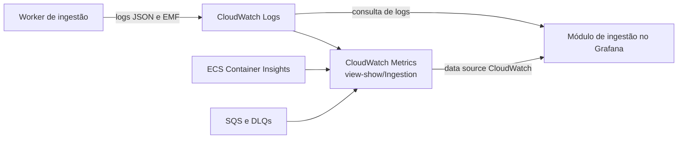

# Testes de carga finais — observabilidade da ingestão

## 1. Escopo desta contribuição

Esta seção define a observabilidade da camada de ingestão que será usada nos
testes não funcionais finais. O objetivo é responder, com evidências
reproduzíveis, se o worker processa a carga esperada, degrada de forma visível e
se recupera após falhas.

O recorte cobre os três itens da especificação:

| Item avaliado | Contribuição da ingestão |
| --- | --- |
| RNFs e planos de teste | Traduz os cenários de 10 mil eventos/min, fila cheia e timeout para sinais do pipeline batch. |
| Resultados de desempenho e resiliência | Define as medidas, critérios e evidências que devem acompanhar cada execução. |
| Grafana ou Prometheus | Implementa o módulo de ingestão no Grafana, provisionado sobre o CloudWatch. |

> **Estado após as correções do MR 90:** contrato de observabilidade definido;
> rodada histórica de 29–30/09/2026 com 72 testes locais aprovados e cenário AWS
> de 150 mil registros executado e reprovado end-to-end. O cenário de fila cheia
> permanece pendente. O dashboard corrigido foi validado na AWS em 04/10/2026:
> serviços saudáveis, expressões executadas e quatro operações verificadas na API
> e no navegador, com JSON e captura sanitizada versionados. As séries de ingestão
> permanecem sem amostras na janela histórica; esse aceite funcional não mede desempenho.
> Configuração existente e teste de componente não são apresentados como resultado
> de carga do pipeline nem como aceite AWS do dashboard reparado.

## 2. Semântica dos cenários na arquitetura batch

A ingestão atual é um worker batch em ECS/Fargate, e não uma API HTTP. Por isso,
latência, erro e saturação precisam ser interpretados no contexto de uma
execução e de sua fila.

| Cenário | Preparação e execução | Indicadores observados | Critério de aceite proposto | Estado |
| --- | --- | --- | --- | --- |
| Abertura de venda de 10 mil eventos/min | Disponibilizar uma janela equivalente a 150 mil registros em 15 minutos e executar a ingestão. | duração, lidos, escritos, inalterados, rejeitados, CPU e lag | conclusão explícita sem perda silenciosa; `lidos = escritos + inalterados + rejeitados`; vazão suficiente para drenar a janela sem crescimento contínuo do lag | Executado; reprovado end-to-end |
| Fila cheia | Produzir lotes acima da capacidade momentânea do consumidor incremental e interromper a produção após atingir o backlog planejado. | mensagens visíveis, idade da mais antiga, DLQ, lotes em quarentena e tempo de drenagem | backlog e idade ficam visíveis; não há descarte silencioso; após cessar a produção, a fila retorna a zero ou ao patamar inicial | Pendente de execução |
| Timeout | Forçar o comando ou uma dependência a exceder seu prazo controlado. | duração, `FAILED`/`PARTIAL`, etapa, código de erro, retries, backlog e execução seguinte | a run termina em estado explícito, sem permanecer indefinida; a causa é correlacionável pelo `runId`; uma execução posterior consegue retomar ou recuperar | Observado; reprovado por ausência de estado terminal |

No dashboard, `RecordsRead/300` representa a taxa de processamento, enquanto
`RecordsWritten/300` representa novas escritas; são séries separadas, com soma
de cada métrica em um período CloudWatch fixo de 300 s. A vazão histórica de uma
etapa usa sua contagem dividida pela duração medida da etapa. Uma retomada pode
gerar `RecordsUnchanged`; portanto, analisar somente escritas produziria uma
conclusão incorreta sobre capacidade e integridade.

## 3. Arquitetura de coleta

O CloudWatch permanece como fonte autoritativa porque o worker já emite métricas
EMF e a infraestrutura já coleta métricas nativas de ECS e SQS. O Grafana é a
camada de visualização, usando o data source CloudWatch configurado na stack. Não foi
criado um segundo caminho Prometheus/OTLP sem uma lacuna
comprovada, evitando duplicação de coleta, custo e manutenção.

As métricas de uma execução batch são esparsas. Ausência de amostra fora da
janela agendada significa “nenhuma execução observada”, e não zero. Painéis e
alertas não devem preencher essa ausência como sucesso.

## 4. Indicadores obrigatórios

| Indicador | Fonte e consulta a configurar no Grafana | Unidade e agregação | Interpretação |
| --- | --- | --- | --- |
| Latência | `view-show/Ingestion`: `RunDurationMs` com estatística `p95` por `command`, e `StageDurationMs` com estatística `Maximum` por `command` e `stage=PROJECTING`, em período de 300 s | milissegundos | tempo de conclusão do comando e maior duração da etapa de projeção |
| Throughput | duas séries por `command`: `RecordsRead/300` e `RecordsWritten/300`, cada uma usando a soma de sua métrica no período CloudWatch fixo de 300 s | registros/s | capacidade de leitura e persistência; deve ser lida com `RecordsUnchanged` e `RecordsRejected` |
| Erros por segundo | soma de `Runs` com `status=FAILED` ou `PARTIAL`, dividida por 300; exibir também `RecordsRejected/300`, com período CloudWatch fixo de 300 s | erros/s e registros rejeitados/s | falhas de execução e degradação de qualidade são séries distintas |
| CPU | `ECS/ContainerInsights`: `100 * CpuUtilized / CpuReserved`, com estatística `Average` para ambas as métricas, por `ClusterName` e `TaskDefinitionFamily`, em período de 300 s | percentual calculado sobre as médias | utilização da CPU reservada para a task durante a mesma janela do teste |

Quando houver poucas runs, a análise deve consultar também o valor individual
e o máximo da duração da run; o máximo de projeção exibido no dashboard é uma
métrica de etapa distinta. Um percentil calculado sobre uma única amostra não
acrescenta evidência. Para
erros raros, o painel pode exibir adicionalmente erros/min, mas a transformação
para erros/s deve permanecer disponível para atender ao critério da rubrica.

### 4.1 Indicadores complementares

| Pergunta operacional | Métrica existente | Fonte/dimensões principais | Prioridade |
| --- | --- | --- | --- |
| A run concluiu? | `Runs` | `view-show/Ingestion`; `command`, `status` | P0 |
| O dado está fresco? | `SourceLagSeconds`, `IncrementalBatchLagSeconds` | `view-show/Ingestion`; `command`, `status`, `dataset` conforme a métrica | P0 |
| Existe fila acumulada? | `ApproximateNumberOfMessagesVisible`, `ApproximateAgeOfOldestMessage` | `AWS/SQS`; `QueueName` | P0 |
| Há mensagens sem recuperação automática? | profundidade das DLQs | `AWS/SQS`; `QueueName` | P0 |
| O contrato do dado degradou? | `SchemaDrift`, `RecordsRejected`, `IncrementalBatchQuarantined` | `view-show/Ingestion`; dimensões de baixa cardinalidade já definidas pelo emissor | P0 |
| Qual etapa ficou lenta ou falhou? | `StageDurationMs`, `StageFailures` | `view-show/Ingestion`; `command`, `stage`, `status` | P1 |
| A origem MySQL degradou? | `MySqlPageDurationMs`, `MySqlRetries`, `MySqlPreflightFailures` | `view-show/Ingestion`; dimensões emitidas pelo adaptador | P1 |
| Houve pressão adicional de recurso ou destino? | memória, armazenamento efêmero, `AthenaFailures`, `ProcessedBytes`, `ArchiveFailures` | Container Insights e `view-show/Ingestion` | P1 |

P0 compõe a primeira visão operacional. P1 é diagnóstico e deve ficar em uma
linha expansível ou drill-down, para que a visão principal permaneça legível.
Dimensões com identificadores únicos, como `runId`, não devem ser usadas em
métricas; a correlação detalhada pertence aos logs.

## 5. Contrato mínimo de logs

| Evento estruturado | Nível atual | Uso |
| --- | --- | --- |
| `ingestion.run.started` | `INFO` | marca o início e permite localizar uma run pelo `runId` |
| `ingestion.run.finished` | `INFO` | registra o estado terminal, duração e contagens |
| `ingestion.run.partial` | `ERROR` | torna visível uma conclusão degradada |
| `ingestion.run.failed` | `ERROR` | registra uma falha terminal ou exceção sanitizada |

Campos comuns: `timestamp`, `level`, `service_name`, `environment`, `event`,
`message`, `runId`, `command` e, quando aplicáveis, `traceId`, `stage`, `status`,
`durationMs`, `dataset`, `datasetVersion`, `windowStart`, `windowEnd`, contagens e
`errorCode` seguro.

Os logs não devem conter payload bruto, registro individual, SQL, senha, token,
secret, connection string, corpo de requisição ou URL assinada. Retentativas
repetitivas devem ser agregadas em métrica; um log adicional só se justifica
quando muda o estado da execução ou quando as tentativas se esgotam. A busca de
um incidente começa por `runId` e então cruza `command`, etapa e janela, sem
transformar valores únicos em dimensões de métrica.

## 6. Módulo de ingestão no Grafana

O dashboard versionado em
`apps/fullstack/observability/aws/view-show-ingestion.json.tftpl` implementa uma
visão pequena, organizada em três linhas:

1. **Saúde e capacidade:** duração da run, throughput de leitura/escrita,
   erros/s e CPU — os quatro indicadores obrigatórios.
2. **Confiabilidade do dado:** lag, reconciliação das contagens, rejeitados,
   schema drift, backlog, idade da mensagem mais antiga e DLQ.
3. **Diagnóstico:** duração por etapa e eventos estruturados dos quatro comandos
   da ingestão. Métricas detalhadas de MySQL, memória, armazenamento e Athena
   permanecem no dashboard CloudWatch nativo para não sobrecarregar a visão.

O dashboard tem UID estável `view-show-ingestion`, usa o data source
`cloudwatch` e está configurado para instalação pelo mesmo `user_data` da stack
de observabilidade. O seletor único `Operação` (`operation`) associa cada um dos
quatro comandos à família ECS correspondente. A versão corrigida do commit
`5f993a5` foi validada em 04/10/2026 na instância `i-02d8393487d67a0bf`, região
`us-east-1`: cloud-init concluído, cinco containers em execução, banco do Grafana
`ok`, dashboard provisionado e data source CloudWatch saudável. Foram aceitas
32 chamadas diretas à API do Grafana: sete painéis de métricas e um de logs para
cada operação. No navegador, as cinco expressões de throughput, erros e CPU
foram enviadas e executadas com HTTP 200, sem erros; as dimensões de comando e
família ECS foram conferidas após a interpolação para as quatro opções.

A janela das métricas e da [captura sanitizada](../assets/testes-carga/2026-10-04-ingestao/grafana-ingestion.png)
é `2026-09-29T23:45:00Z–2026-09-30T03:00:00Z`. A captura mostra as duas primeiras
linhas de métricas, incluindo os quatro indicadores obrigatórios, título,
seletor, unidades e legendas. Como os grupos de logs foram recriados depois
desse benchmark, os logs foram validados separadamente entre
`2026-10-04T20:51:39.471Z` e `2026-10-04T21:06:39.471Z`, também com HTTP 200 na
API e no navegador. Os resultados por painel, operação e janela estão no
[JSON de validação](../assets/testes-carga/2026-10-04-ingestao/grafana-dashboard-validation.json).
Frames sem amostras nas métricas da ingestão e pontos esparsos de SQS não
comprovam desempenho, vazão nem sucesso do benchmark histórico.

O registro de 30/09/2026 relata implantação de uma versão anterior, respostas
da API do Grafana e observação das séries de duração de cinco etapas. A captura
citada não foi versionada e as consultas de throughput/erros não foram validadas
nessa rodada. Esse histórico não comprova o aceite do dashboard reparado nem
validação de todos os painéis; seus limites estão no registro de
[validação do Grafana da ingestão](../assets/testes-carga/2026-09-29-ingestao/grafana-ingestion-validation.md).

Cada painel deve registrar no próprio título, descrição ou documentação associada:

- data source CloudWatch, namespace, métrica e dimensões;
- estatística, período e unidade;
- comando/dataset selecionado e intervalo temporal exato do teste;
- tratamento de ausência de dados;
- RNF ou pergunta operacional respondida.

As consultas de throughput e erros/s usam período CloudWatch fixo de 300 s,
independentemente do intervalo visual do painel. CPU, throughput e falhas só
podem ser correlacionados quando usam a mesma operação e janela temporal.

## 7. Coleta e preservação das evidências

Para cada cenário executado, criar
`assets/testes-carga/<AAAA-MM-DD>-ingestao/` e preservar:

- parâmetros do cenário, horário inicial/final, ambiente e versão implantada;
- saída bruta das consultas CloudWatch usadas nos painéis;
- logs estruturados das runs selecionadas, com dados sensíveis removidos;
- captura do Grafana com título, legenda, unidade e janela temporal visíveis;
- tabela resumida com valor esperado, valor medido, resultado e limitação.

Uma captura sem consulta bruta não é evidência suficiente. Da mesma forma, uma
métrica ou alarme existente na infraestrutura deve ser descrito como
“configurado” até que uma amostra da janela do teste seja preservada.

Modelo para preenchimento após cada execução:

| Cenário | Janela UTC | Versão | Indicador | Esperado | Medido | Resultado | Evidência |
| --- | --- | --- | --- | --- | --- | --- | --- |
| 10 mil eventos/min | 29/09 23:48:59–30/09 02:56:06 UTC | `47eccb9` | latência, throughput, erros/s, CPU e reconciliação | conclusão em até 15 min | ingestão 621,536 s; projeção 1.088,407 s; sem conclusão end-to-end | Reprovado | Seção 7.1 |
| Fila cheia | Pendente | Pendente | backlog, idade, DLQ e drenagem | conforme Seção 2 | Pendente | Não executado | Pendente |
| Timeout | 29/09 23:48:59–30/09 02:56:06 UTC | `47eccb9` | estado terminal e duração | estado terminal explícito em até 3.600 s | permaneceu em `ARCHIVING`; parada controlada após 11.227,484 s | Reprovado | Seção 7.1 |

### 7.1 Resultado AWS histórico: 150 mil registros

Esta rodada de 29–30/09/2026 antecede as correções do MR 90. Os números abaixo
são medições do benchmark histórico e não validam as consultas ou a implantação
do dashboard reparado.

O teste foi executado com uma única task ECS, sem ativação do dataset e sem
paralelismo artificial. A janela observada foi de `2026-09-29T23:48:59.445Z` a
`2026-09-30T02:56:06.929Z`.

| Indicador | Resultado medido | Leitura |
| --- | ---: | --- |
| Registros lidos / escritos / rejeitados | 150.000 / 150.000 / 0 | reconciliação íntegra até a etapa `ARCHIVING` |
| Duração da ingestão | 621,536 s | 241,34 registros/s; superior à entrada equivalente de 166,67 registros/s |
| Duração da projeção | 1.088,407 s | principal etapa concluída e maior que a janela-alvo de 15 min |
| Duração end-to-end observada | 11.227,484 s | execução não concluiu; task interrompida para conter custo |
| CPU média / máxima | 33,12% / 39,99% | CPU não foi o recurso limitante |
| Estado durável final | `ARCHIVING`, sem `finishedAt` | ausência de conclusão explícita |
| Erros/s | indeterminado | não houve métrica/evento terminal após a interrupção externa |

O resultado é **reprovado end-to-end**. Embora a etapa de ingestão isolada tenha
vazão suficiente para 10 mil registros/min e a reconciliação esteja correta, a
projeção excedeu 15 minutos e o arquivamento não terminou após mais de três
horas. Assim, a arquitetura não demonstrou capacidade de concluir a janela no
prazo requerido.

Também foi identificada uma lacuna de observabilidade: o timeout de 3.600 s da
CLI encerra a espera local, mas não interrompe automaticamente a task ECS. Uma
interrupção externa produz `exitCode=137`, porém não emite
`ingestion.run.failed`, `RunDurationMs` final ou `Runs{status=FAILED}`. O painel
deve combinar métricas da aplicação com estado da task ECS e tratar run sem
heartbeat/estado terminal como falha operacional.

Evidências: [resumo estruturado](../assets/testes-carga/2026-09-29-ingestao/aws-backfill-150k-summary.json)
e [eventos selecionados](../assets/testes-carga/2026-09-29-ingestao/aws-backfill-150k-events.md).

### 7.2 Evidências locais coletadas em 29/09/2026

Os testes foram executados na revisão `e9fb599`, com Python 3.12.11 em container
descartável. Esses resultados validam instrumentação e comportamento de
componentes; não substituem as medições de latência, throughput, erros/s e CPU
do pipeline implantado.

| Teste | Resultado medido | Interpretação | Evidência bruta |
| --- | --- | --- | --- |
| Telemetria e observabilidade | 47 aprovados; 0 falhas, erros ou ignorados; 0,840 s | o contrato automatizado de logs, métricas, redaction e runtime está consistente | [JUnit de observabilidade](../assets/testes-carga/2026-09-29-ingestao/pytest-observabilidade.xml) |
| Resiliência incremental | 25 aprovados; 0 falhas, erros ou ignorados; 1,274 s | adapters S3/SQS, CLI e retomadas de exportação/ingestão passaram localmente | [JUnit de resiliência](../assets/testes-carga/2026-09-29-ingestao/pytest-resiliencia-incremental.xml) |
| Geração da massa | 150.000 registros; 917.703 bytes comprimidos; SHA-256 registrado | comprova volume e determinismo da fixture, não desempenho do pipeline | [Manifesto da massa](../assets/testes-carga/2026-09-29-ingestao/manifest-150k.json) |

O [registro completo da rodada](../assets/testes-carga/2026-09-29-ingestao/README.md)
documenta ambiente, comandos lógicos e limitações. O benchmark de leitura não
foi classificado como executado: o harness requer Docker Compose no mesmo runtime
do Python 3.12, combinação indisponível no host. Também não havia AWS CLI, logo
nenhum resultado CloudWatch ou Grafana foi inferido a partir desta rodada.

## 8. Impactos nas decisões de arquitetura

As decisões já sustentadas pela análise do código são:

- CloudWatch é a fonte única de telemetria da ingestão e Grafana será sua camada
  de visualização;
- a observabilidade usa baixa cardinalidade nas métricas e `runId` nos logs;
- backlog, idade e DLQ representam pressão e falha assíncrona melhor que códigos
  HTTP para este worker;
- vazão deve preservar a distinção entre lido, escrito, inalterado e rejeitado.

As decisões de capacidade ainda dependem dos testes. Somente os resultados podem
justificar aumento de CPU/memória, paralelismo, tamanho de lote, política de
retry, timeout ou escalabilidade do consumidor. Essa separação evita otimização
prematura e mantém o artefato auditável.

## 9. Limitações atuais

- Há evidência local, uma rodada operacional AWS histórica e aceite funcional
  do dashboard corrigido em 04/10/2026, com [JSON de validação](../assets/testes-carga/2026-10-04-ingestao/grafana-dashboard-validation.json)
  e [captura sanitizada](../assets/testes-carga/2026-10-04-ingestao/grafana-ingestion.png)
  versionados. O registro de 30/09/2026 cita uma captura não versionada. As séries
  de ingestão sem amostras e os pontos esparsos de SQS no aceite de 04/10 não
  comprovam desempenho nem sucesso do benchmark histórico.
- A proposta de 150 mil registros representa 10 mil eventos/min por 15 minutos;
  a equivalência deve ser registrada junto ao gerador de carga utilizado.
- Métricas de Scheduler, SQS e ECS dependem de Container Insights e dos recursos
  AWS estarem ativos no ambiente ensaiado.
- Os limiares definitivos devem ser calibrados com uma linha de base real; este
  documento define semântica e método, não um SLO sem evidência.

## 10. Referências e locais de manutenção

- [Teste inicial da Sprint 3](sprint3/testes-carga-inicial.md): histórico e
  limitações dos ensaios anteriores.
- [Runbook da ingestão](../apps/backend/ingestion-data/README.md): comandos
  operacionais e procedimentos duradouros.
- [Emissor de métricas CloudWatch](../apps/backend/ingestion-data/adapters/telemetry/cloudwatch_metrics.py)
  e [runtime observado](../apps/backend/ingestion-data/adapters/telemetry/runtime.py):
  contrato implementado de métricas e logs.
- [Infraestrutura de observabilidade](../apps/fullstack/ingestion-observability.tf):
  alarmes, métricas AWS e dashboard CloudWatch existentes.
- [Data source CloudWatch do Grafana](../apps/fullstack/observability/aws/cloudwatch-datasource.yml):
  integração configurada para o dashboard; aceite funcional da versão corrigida
  registrado no [JSON de 04/10/2026](../assets/testes-carga/2026-10-04-ingestao/grafana-dashboard-validation.json).

Este arquivo é a fonte da metodologia e dos resultados datados. Evidências brutas
ficam em `assets/testes-carga/`; instruções operacionais permanentes ficam no
runbook; decisões arquiteturais permanentes devem ser refletidas no documento de
arquitetura, sem copiar capturas ou resultados temporais.
