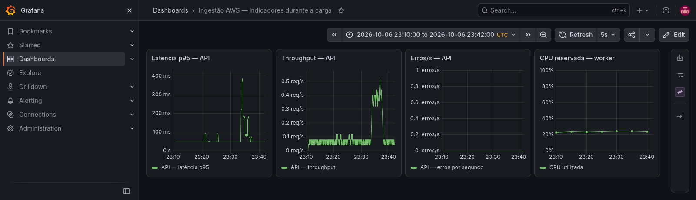
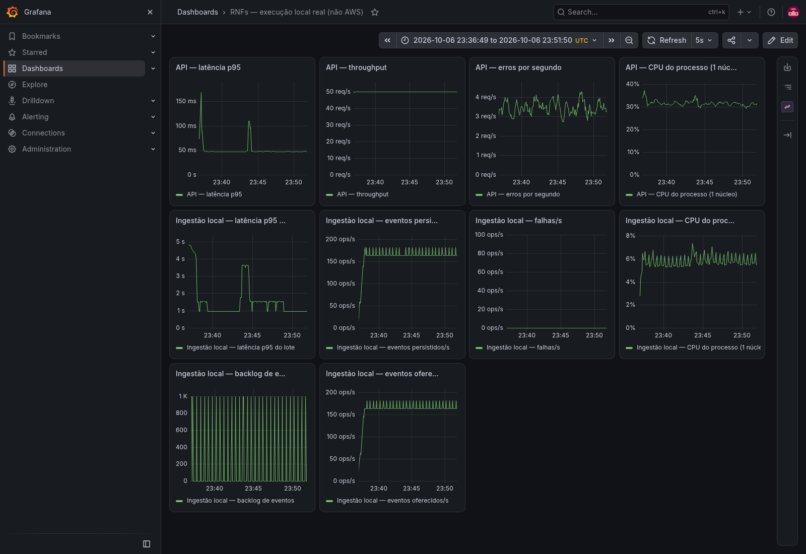
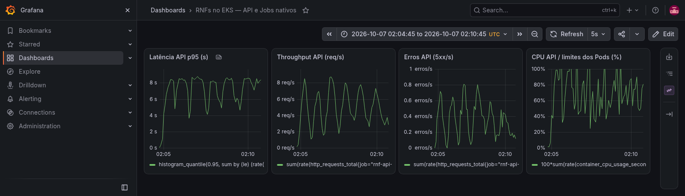
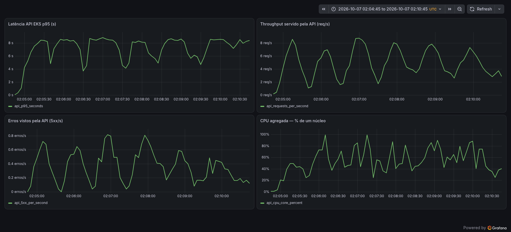
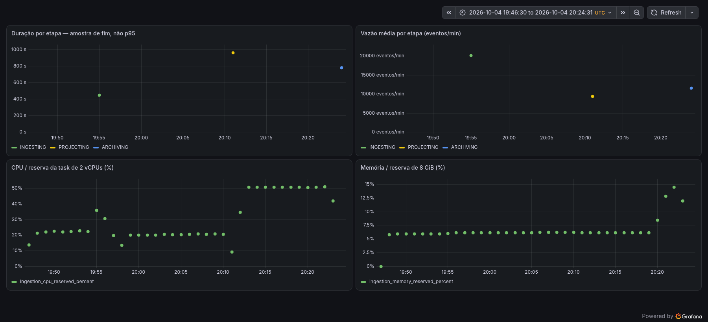
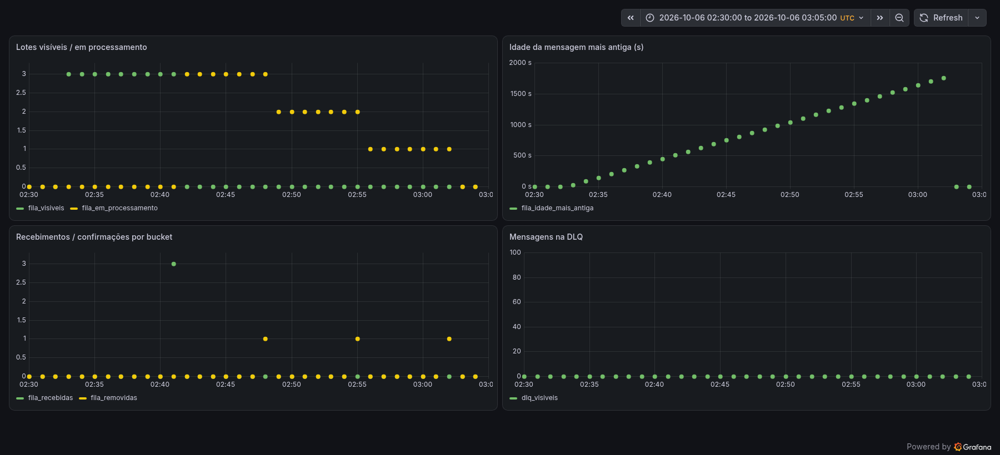

# Testes não funcionais: carga, resiliência e observabilidade

## 1. Objetivo e evolução desde a Sprint 3

Esta entrega aprimora os testes da Sprint 3 e responde aos três itens da avaliação:
planos de testes (peso 3), resultados com análise de desempenho e resiliência
(peso 4) e visualização com Grafana/Prometheus (peso 3). A pergunta central é:
**o View Show consegue receber 10.000 eventos por minuto, preservar os dados
durante falhas e informar ao operador quando está degradado?**

No domínio do projeto, a “abertura de venda” representa uma estreia ou transmissão
ao vivo que aumenta a telemetria. A aplicação recebe arquivos e lotes de eventos.
Por isso, 10.000 eventos/min equivale a 150.000 eventos por janela de 15 minutos;
não equivale a 10.000 chamadas HTTP por minuto.

| Sprint 3: antes | Fechamento: agora | O que a melhoria permite avaliar |
| --- | --- | --- |
| Ingestão bloqueada e respostas simuladas na API Flask | Upload multipart real, processamento assíncrono e acompanhamento até `READY` | O caminho completo, incluindo o trabalho depois de aceitar o upload |
| Fila cheia descrita como `429 queue_full` | Acúmulo real na SQS FIFO, consumidor pausado e drenagem de 2/3/4 lotes | Perda, confirmação, atraso e recuperação do consumidor |
| Timeout simulado por resposta HTTP | Bloqueio real de tabela MySQL, falha S3, interrupção do worker e prazo do cliente | Diferença entre dependência lenta, processo interrompido e cliente desistindo |
| Uma massa e contagem reportada pelo próprio worker | Volumes 150/300/750 mil, três repetições nominais e recontagens independentes | Capacidade, repetibilidade e integridade dos dados |
| Painéis configurados, incluindo capturas sem dados | Séries preservadas, capturas com dados e validação por query | Relação entre latência, vazão, falhas e uso de recurso |
| Runtime ECS | Linha de base ECS preservada e testes nativos em EKS dedicado | Efeito operacional da migração Kubernetes, sem misturar ambientes |

A revisão incorporada de `develop` é `d5339f3`. As execuções históricas
identificam suas contas, imagens e datas; o fechamento local e o EKS possuem
metadados próprios. O [registro de proveniência](../assets/testes-carga/2026-10-06-fechamento-aws/develop-update.json)
e os índices [AWS](../assets/testes-carga/2026-10-06-fechamento-aws/README.md) e
[local](../assets/testes-carga/2026-10-06-fechamento-local/README.md) permitem conferir essas diferenças.

A integração posterior do MR !99 acrescenta logs/traces correlacionados,
exemplares e dashboards de produção compatíveis com EKS. A
[revisão dessa integração](apoio/revisao-integracao-observabilidade.md) registra
as correções e os checks. Os resultados de carga acima continuam identificados
pela revisão e imagem medidas; a integração não é uma nova rodada de capacidade.

| Item avaliado | Onde conferir |
| --- | --- |
| 1 — RNFs e planos (3 pontos) | Seções 2 e 3: critérios, perfis e catálogo de falhas |
| 2 — Resultados e análise (4 pontos) | Seção 4: vereditos, gargalo, recuperação e colapso da API |
| 3 — Grafana/Prometheus (3 pontos) | Seção 5: cobertura, figuras e leitura dos indicadores |
| Impacto nas decisões de arquitetura | Seção 6: mudança já implementada versus proposta |
| Reprodução e detalhamento dos arquivos | Seção 7 e [anexo técnico](apoio/testes-carga-inventario.md) |

## 2. Requisitos e planos de carga

### 2.1 Critérios de aceite

| Requisito | Aceite objetivo | Como será observado |
| --- | --- | --- |
| RNF01 — capacidade e integridade | 10.000 eventos/min; nenhum evento válido perdido ou duplicado | Tempo até `READY`, contadores do worker e contagem independente no destino |
| RNF02 — frescor | Captura até consulta em ≤120 s | Publicação do lote até avanço do watermark, marcador da última janela consultável |
| RNF03 — resiliência | Falha explícita, dados preservados e recuperação após retirar a falha | Estado do job/lote, fila principal, DLQ e repetição do cenário nominal |
| RNF04 — autorização | 401/403 sem sessão e contrato correto com sessão válida | Matriz de rotas; a sessão sintética não mede o login Cognito sob carga |
| RNF07 — frontend | FCP p95 ≤30 s | Lighthouse em três telas e perfis; percentil amostral identificado |
| RNF09 — disponibilidade na carga | Falha inesperada <0,1% na janela | HTTP, timeouts e falhas de contrato; 503 continua visível no gráfico |
| RNF14 — consultas | p95 <2 s a 137 req/s | Chegada aberta, latência por rota e chegadas descartadas pelo gerador |
| RNF15 — alertas | Alarme em ≤30 s após a condição de falha | Timestamps da condição e da transição para `ALARM` |

Os demais RNFs constam na [matriz da Sprint 3](sprint3/testes-carga-inicial.md#4-requisitos-não-funcionais-e-planos-de-teste-revisados).
Retenção, cobertura de código e qualidade da IA requerem testes próprios.
Os planos específicos estão nos relatórios de [ingestão](sprint5/testes-carga-ingestao.md),
[API](sprint5/testes-de-carga-da-api.md) e [frontend](sprint5/testes-carga-finais-front.md).

### 2.2 Perfis de carga: taxa, rampa, duração e volume

A bateria distingue **volume em arquivo** de **chegada contínua**. No arquivo,
a carga entra em um único upload; a taxa de 10 mil/min define o prazo de
processamento. No contínuo, o produtor realmente envia eventos ao longo do tempo.

| Perfil e cenário | Taxa de referência / oferecida | Rampa e forma de entrada | Duração / orçamento | Volume | Execução e objetivo |
| --- | --- | --- | --- | ---: | --- |
| Nominal batch — CG-02/05 | 10.000 eventos/min de capacidade requerida | Sem rampa; um dump completo por importação | ≤900 s de processamento até `READY` | 150.000 | AWS ECS e EKS; verificar uma janela de pico |
| 2× volume — CG-05 | Mesma meta: 10.000 eventos/min | Sem rampa; duas janelas no mesmo dump | ≤1.800 s | 300.000 | ECS; verificar crescimento do tempo ao dobrar o volume |
| 5× volume — CG-05 | Mesma meta: 10.000 eventos/min | Sem rampa; cinco janelas no mesmo dump | ≤4.500 s | 750.000 | ECS; observar escala e limite de conclusão |
| Contínuo — CT-01 | 1.000 eventos/6 s = 166,67/s | Entrada direta no patamar, sem rampa | 900 s | 150.000 | Normalizador e persistência reais locais; verificar taxa oferecida e integridade |
| Pico HTTP — CG-04 | 0→50 iterações/s; mistura 20% POST e 80% GET | 30 s de subida, 120 s de patamar, 30 s de descida | 180 s + preparação/limpeza | 7.500 iterações previstas | ECS; disputa pela vaga de importação |
| Consultas — API-137 | 137 iterações/s no patamar | 30 s de subida desde 1/s, 300 s de patamar e 15 s de descida | 345 s + preparação/finalização | ≈44.197 chegadas previstas pelo executor | Local/EKS; RNF14 e saturação |

**2× e 5× acima são multiplicadores do volume, não comprovação de chegada a
20 mil ou 50 mil eventos/min.** Para testar essas taxas em uma extensão futura,
o plano é rampa linear de 60 s, patamar de 900 s e descida de 60 s: seriam
320.000 eventos a 20 mil/min e 800.000 a 50 mil/min, contando as rampas.
Esses dois perfis de chegada ainda não foram executados.

Cada rodada começa com massa determinística nova e hash registrado, destino
identificado e ausência de importação ativa. O procedimento é reservar a
importação, assinar partes, enviar o arquivo, confirmar o upload, acompanhar
os estados e comparar contagem esperada com persistência. As massas concentram
150 mil eventos por janela; uma distribuição em milhares de dias altera o
custo de particionamento e não serve como comparação direta.

O prazo proporcional é definido antes da execução: volume ÷ 166,67 eventos/s.
A rodada complementar de 750 mil conservou no bruto um threshold legado de
900 s, mais rigoroso; a análise aplica também o orçamento de 4.500 s e publica
o desvio. Encerrar a observação ao exceder o prazo não significa que o servidor
possua cancelamento automático.

## 3. Catálogo de falhas e recuperação

### 3.1 Fila cheia — RS-01

“Fila cheia” significa **acúmulo de trabalho além da capacidade de consumo**.
A SQS não tem, neste teste, um pequeno limite rígido de mensagens que devolva
`queue_full`. Uma mensagem referencia um lote de 150 mil eventos: quatro
mensagens representam 600 mil eventos esperando processamento.

Com FIFO e DLQ vazias, pausamos o consumidor, publicamos 2, 3 ou 4 lotes e
medimos mensagens visíveis, em processamento e idade da mais antiga.
Reativamos o consumo e contamos os fatos persistidos. O aceite exige DLQ vazia,
todos os lotes confirmados, contagem igual a N×150 mil e drenagem em menos de
N×900 s. Ao final, a agenda volta ao estado anterior. O critério de frescor
é medido separadamente, pois fila drenada não comprova watermark atualizado.

### 3.2 Timeout e interrupção — RS-02 e CT-02

O timeout real de dependência é o CT-02: uma segunda conexão MySQL executa
`LOCK TABLES signal_bucket WRITE`. O leitor de produção tem timeout de 1 s e
duas tentativas. Esperamos erro explícito após esgotar os retries e leitura
da mesma página depois de liberar o lock, sem reiniciar o banco.

O RS-02 cobre falha de preparação no S3, interrupção do worker e prazo do
cliente. Essas variantes exercitam mecanismos diferentes: negar acesso ao S3
não injeta latência, e reduzir o prazo de polling não cancela o job remoto.

### 3.3 Injeção, expectativa, aceite e reversão por cenário

| Falha / cenário | Injeção | Comportamento e aceite esperado | Como retirar a falha |
| --- | --- | --- | --- |
| RS-01 — acúmulo | Pausar agenda e publicar N lotes | Fila mantém mensagens; ao retomar, N×150 mil persistidos, DLQ 0 e drenagem <N×900 s | Restaurar estado original da agenda |
| RS-02a — S3 indisponível | Negar `s3:PutObject` no prefixo de staging por 13 s | `503 UPLOAD_PREPARATION_FAILED`, mensagem segura, vaga liberada; importação seguinte em `READY` | Restaurar exatamente a política anterior do bucket |
| RS-02b — worker interrompido | Parar a task de importação durante o processamento | Reconciliador marca `FAILED/WORKER_STOPPED`; após expiração da posse, nova importação pode iniciar | Aguardar TTL da posse e enviar nova importação; a task morta não é reiniciada |
| RS-02c — prazo do cliente | `POLL_TIMEOUT_S=30` | k6 reprova se `READY` não ocorreu; não apresentar upload aceito como conclusão | Voltar ao prazo nominal e observar o job remoto terminar |
| CT-02 — MySQL lento | Lock de tabela, timeout 1 s, duas tentativas | Erro MySQL 2013 explícito; mesmos registros depois da liberação | `UNLOCK TABLES` em `finally` |
| RS-03 — payload inválido | Válido → lote sem coluna `value` → válido; dump truncado em outra rodada | Inválido em quarentena/validação, zero escrita inválida; válidos preservados | Reenviar massa válida; manter inválido isolado para diagnóstico |
| RS-04 — reentrega | Interromper consumidor no meio de um lote | Após 300 s, mensagem reentregue; total 150 mil, sem duplicação e DLQ 0 | Disparar consumidor depois do TTL da posse |
| RS-05 — mensagem venenosa | Manifesto com `versionId` inexistente junto de lote válido | Cinco tentativas, mensagem na DLQ e lote válido processado; alarme disparado | Inspecionar DLQ e corrigir a referência antes de reprocessar |
| RS-06 — excesso na API | 1/s nominal →20/s por 60 s →resfriamento →1/s | Pelo menos um `429 RATE_LIMITED`, zero 5xx/importações extras e recuperação de contrato | Reduzir taxa e aguardar a janela do limiter |
| CT-03 — grupos concorrentes | Dois grupos FIFO e posse global já ocupada | Mensagens válidas devem permanecer retentáveis sem esgotar recebimentos | Liberar posse; reproducer local usa Moto e ports simulados |
| API — destino indisponível | Parar somente o DynamoDB Local da API | Falha explícita; mesmo processo da API volta ao contrato após retorno do destino | Iniciar o contêiner com o volume preservado |

O [runbook](../apps/backend/api/loadtest/lab/README.md) identifica comandos e
alvos. A injeção ocorre no ambiente de teste e preserva política/estado anterior;
o resultado publica também falhas do próprio gerador ou da preparação.

## 4. Resultados, desempenho e resiliência

### 4.1 Critério × medição × veredito

`READY` significa processamento concluído. “Censurado” significa que a
observação acabou antes da conclusão: sabemos que o prazo foi excedido, mas
não sabemos a duração final. O veredito abaixo se aplica ao escopo da rodada.

| Critério / cenário | Ambiente | Valor medido | Veredito e evidência |
| --- | --- | --- | --- |
| 150 mil/900 s e sem perda — CT-01 | Local, normalização/persistência | 150.000/150.000; 0 faltantes, extras, duplicados ou diferenças canônicas; p95 lote 1,179 s; replay 0 escritos/1.000 inalterados | **Aprovado no componente** — [resumo](../assets/testes-carga/2026-10-06-fechamento-local/stream-validated/stream-summary.json) |
| 150 mil até `READY` em ≤900 s — CG-05 | ECS, 04/10 | `READY`; 2.275,2 s de PROCESSING; 3.956 eventos/min; 150 mil escritos, 0 rejeitados | **Reprovado em capacidade** — [k6](../assets/testes-carga/2026-10-04-ingestao/resumo-ingestao-cg05-150000.json) |
| 300 mil em ≤1.800 s — CG-05 | ECS, 04/10 | `READY`; 4.334,9 s; 4.152 eventos/min; 300 mil escritos, 0 rejeitados | **Reprovado em capacidade** — [k6](../assets/testes-carga/2026-10-04-ingestao/resumo-ingestao-cg05-300000.json) |
| 750 mil em ≤4.500 s — fechamento CG-05 | ECS, 06–07/10 UTC | 750 mil recontados em 23 datasets; não concluiu no orçamento; worker interrompido, `FAILED/WORKER_STOPPED` | **Reprovado/censurado** — [análise](../assets/testes-carga/2026-10-06-fechamento-aws/cg05-750000/analysis-summary.json) |
| Três massas novas de 150 mil/900 s | ECS, fechamento | 3/3 excederam o prazo em PROJECTING; 150 mil escritos por rodada, 0 rejeitados | **Reprovado nas três** — [repetições](../assets/testes-carga/2026-10-06-fechamento-aws/nominal-repetitions/README.md) |
| Smoke de ingestão | EKS, imagem `899883cf…` | 1.000 escritos, 0 rejeitados, `READY` em 120,648 s | **Aprovado no smoke** — [k6](../assets/testes-carga/2026-10-06-fechamento-aws/eks-native/ingestion-valid/resumo-ingestao-eks-ingestion-valid.json) |
| Nominal 150 mil/900 s | EKS, mesma imagem | Upload/complete aceitos; `PROCESSING` após 904,60 s de polling; exit 99 | **Reprovado/censurado** — [k6](../assets/testes-carga/2026-10-06-fechamento-aws/eks-native/nominal-150000/resumo-ingestao-eks-nominal-150000.json) |
| p95 <2 s a 137/s — RNF14 | EKS | 43.198 requisições; p95 geral 8.000,51 ms; 93,990% de falhas HTTP; 1.003 chegadas descartadas | **Reprovado** — [k6](../assets/testes-carga/2026-10-06-fechamento-aws/eks-native/api-load-137/resumo-front-api-load.json) |
| Contrato HTTP após saturação | EKS | 35 requisições; 0 falhas inesperadas; p95 geral 658,74 ms; rota de monitoramento conserva 1×503 esperado | **Recuperação do contrato aprovada** — [smoke](../assets/testes-carga/2026-10-06-fechamento-aws/eks-native/api-recovery/resumo-front-api-smoke.json) |
| Falhas <0,1%; sem timeout/descarte | Local, soak 50/s por 30 min | 89.928 requisições; 0,0801% falha inesperada; p95 200=90,941 ms; 76 descartes | **Parcial:** fração de falhas atende; thresholds estritos reprovam — [bateria](../assets/testes-carga/2026-10-06-fechamento-local/api-battery/summary.json) |
| Frescor ≤120 s — RNF02 | ECS incremental | Nenhuma amostra de avanço; manifesto e projeção não atualizados pelo caminho incremental | **Bloqueado** — [manifesto](../assets/testes-carga/2026-10-01-ingestao/cg03/manifesto-active.json) |
| FCP p95 ≤30 s — RNF07 | Frontend autenticado AWS | 18 auditorias; FCP móvel até 1,173 s; LCP móvel acima da referência de 2,5 s | **Atende FCP nas amostras**, com melhoria de LCP — [relatório](sprint5/testes-carga-finais-front.md) |

Uma série de erro pode contar 503 que o k6 aceita apenas na rota de
monitoramento indisponível. Assim, contrato aprovado nessa rota não comprova
funcionalidade disponível. Chegadas descartadas (`dropped_iterations`) são
trabalho que o gerador não iniciou; elas não são respostas 5xx.

### 4.2 Onde o pipeline perde capacidade

A análise abaixo usa a mesma massa concentrada de 150 mil eventos da rodada
ECS de 04/10. Os tempos vêm do worker; a duração k6 inclui também partida e
observação do job. Os [brutos por etapa](../assets/testes-carga/2026-10-04-ingestao/etapas-cg05-150000.json)
e [recursos](../assets/testes-carga/2026-10-04-ingestao/cloudwatch-recursos-cg05-150000.json)
sustentam o cálculo.
O [cálculo reproduzível](../assets/testes-carga/2026-10-07-revisao/performance-analysis.json)
preserva tempos, fórmulas e a diferença para a medição k6.

| Etapa | Função | Tempo, 150 mil | Vazão N/tempo | Parcela das três etapas |
| --- | --- | ---: | ---: | ---: |
| INGESTING | Normalizar e persistir fatos | 447,512 s | 20.111 eventos/min | 20,5% |
| PROJECTING | Construir as visões usadas pela API | 958,073 s | 9.394 eventos/min | 43,9% |
| ARCHIVING | Gerar/publicar arquivo e conferir contagem | 778,185 s | 11.565 eventos/min | 35,6% |
| **Sequência das três** | O mesmo conjunto atravessa todas | **2.183,770 s** | **4.121 eventos/min** | **100%** |

Como essas etapas rodam em sequência, seus tempos se somam. Para as taxas r
em eventos/min, **r_total = 1/(1/r_ingestão + 1/r_projeção + 1/r_arquivo)**.
O resultado é 4.121 eventos/min, próximo dos 3.956 medidos pelo k6.
Os cerca de 91 s adicionais são partida, outras etapas e polling.
A média harmônica convencional seria três vezes esse valor; ela não representa
a vazão deste processamento sequencial do mesmo lote.

PROJECTING sozinho já excede os 900 s. Mesmo retirar o arquivamento do caminho
crítico deixaria INGESTING+PROJECTING em 1.405,585 s (6.403 eventos/min).
Portanto, a decisão precisa reduzir o trabalho da projeção e a soma dos tempos.

A CPU média é cerca de 21–22% nas duas primeiras etapas. No ARCHIVING ela sobe
para 45,7% de duas vCPUs, com máximo 50,9%: **um núcleo fica praticamente
ocupado e a segunda vCPU não é aproveitada**. A memória máxima cresce de 14,5%
em 150 mil para 26,0% em 300 mil; não houve throttling no DynamoDB.
Há margem de memória e de CPU agregada, mas existe trabalho local limitado
por um núcleo no arquivamento. A evidência sustenta paralelismo limitado e
instrumentação das subetapas; não sustenta apenas aumentar a reserva de CPU.

Ao dobrar o volume, INGESTING, PROJECTING e ARCHIVING levam respectivamente
1,94×, 2,00× e 1,89× mais tempo. A taxa fica semelhante: o custo cresce com o
volume, sem uma queda abrupta de capacidade nessa faixa. A massa antiga do
CG-02, distribuída por milhares de dias, gerou 1.585 consultas de reconciliação
e ARCHIVING de 12.246 s. Ela explica o efeito do particionamento, mas não é
comparação de desempenho com a massa de uma janela.

### 4.3 Resiliência: comportamento, recuperação e veredito

| Falha / ambiente | Comportamento observado | Recuperação medida | Veredito |
| --- | --- | --- | --- |
| RS-01, ECS com heartbeat | 2/3/4 lotes concluídos; +300/450/600 mil fatos; DLQ 0 | 919/1.334/1.649 s até último lote; fila zerada observada em 971/1.371/1.685 s | **Aprovado** nos limites 1.800/2.700/3.600 s; distintos não foram recontados separadamente — [relatório](sprint5/testes-carga-ingestao.md#rs-01--fila-cheia-acúmulo-de-janelas) |
| RS-02a, S3 | 503 seguro em 0,58 s; vaga liberada | ~170 s da retirada da política até `READY` | **Aprovado para indisponibilidade** — [evidência](../assets/testes-carga/2026-09-30-ingestao/rs02a-resposta.txt) |
| RS-02b, worker ECS | `FAILED/WORKER_STOPPED` em ~130 s após injeção | ~5,5 min até vaga/posse livres; não é tempo de nova importação concluída | **Falha e liberação aprovadas** — [estado final](../assets/testes-carga/2026-09-30-ingestao/import-cg02-r1-rs02b-final.json) |
| RS-02c, cliente | Prazo 30 s reprova k6; job remoto segue até `READY` | Conclusão posterior observada; duração de recuperação não medida | **Controle negativo aprovado**, sem validar deadline do servidor |
| CT-02, MySQL local | Erro 2013; duas tentativas esgotadas em 2,017 s | Mesma página em 5,866 ms depois de liberar lock | **Aprovado no leitor** — [bruto](../assets/testes-carga/2026-10-06-fechamento-local/timeout-mysql.json) |
| RS-03, inválidos | Quarentena com 0 escritos; dois válidos com +300 mil; dump inválido falha em ~91 s | Próximo lote válido concluído; FIFO vazia após 18 min 33 s da bateria | **Isolamento aprovado** — [execução](../assets/testes-carga/2026-10-01-ingestao/rs03a-execucao.txt) |
| RS-04, reentrega | Mensagem volta ~321 s após recebimento; 97 mil escritos +53 mil inalterados; total 150 mil | ~24 min até lote completo e 31 min 42 s até fila vazia, incluindo espera manual | **Integridade aprovada; tempo automático não medido** — [execução](../assets/testes-carga/2026-10-01-ingestao/rs04-execucao.txt) |
| RS-05, mensagem venenosa | Cinco tentativas →1 mensagem na DLQ; válido +150 mil; alarme | ~29 min úteis até DLQ; 2 h 10 min incluindo pausa do Lab | **Isolamento aprovado**, alerta em 131–158 s reprova RNF15 — [execução](../assets/testes-carga/2026-10-01-ingestao/rs05-execucao.txt) |
| RS-06, URL pública | Zero 429, 1×503; sem importação extra | Primeiro 2xx em 0,13 s; 61/61 contratos de recuperação | **Contrapressão reprovada** — [diagnóstico](../assets/testes-carga/2026-09-30-ingestao/rs06-diagnostico-rate-limit.txt) |
| CT-03, dois grupos locais | Mensagens válidas esgotam cinco recebimentos por posse global ocupada e vão à DLQ | Recuperação não medida | **Resiliência reprovada no reproducer** — [bruto](../assets/testes-carga/2026-10-06-fechamento-local/multidataset-contention.json) |
| API local, DynamoDB parado | Preflight acusa indisponibilidade (exit 107) | Smoke após retorno: 35 requisições, 0 falha inesperada, mesmo processo | **Recuperação comprovada**, tempo exato não medido |

**Alertas:** uma falha LeaseBusy no fechamento disparou alarme em 18,448 s,
atendendo 30 s nessa amostra ([timestamps](../assets/testes-carga/2026-10-06-fechamento-aws/timeout-operacional/alert-analysis.json)).
Nas filas, os alarmes históricos levaram mais de 100 s; RS-02a/b ficaram sem
alarme. Um período de 300 s e métricas emitidas apenas pelo worker no fim
não oferecem cobertura de ≤30 s quando o próprio worker morre.

O ACTIVE sintético usado para a carga da API EKS também causou uma tentativa
de ingestão com `DynamoControlProtocolError`. Ele foi removido às 02:26 UTC,
antes do smoke válido (02:28) e do nominal (02:31). **Esse erro de fixture não
é a causa demonstrada do timeout do nominal de 150 mil**. O nominal registra
`PROCESSING` além do orçamento; falta uma conclusão/subetapa instrumentada
para atribuir sua causa final. Ver [registro da separação](../assets/testes-carga/2026-10-06-fechamento-aws/eks-native/api-fixture-phase-closed.json).

### 4.4 Como a API entra em colapso sob carga

Na linha de base ECS, o processo saturado deixa de responder ao `/health`
dentro de 5 s. O ALB marca a task como não saudável; o ECS a substitui.
Com uma só task, a capacidade cai a zero por cerca de 45 s, o ALB produz 5xx
e o cliente esgota seu timeout de 8 s. O trabalho de clientes que já desistiram
continua na API, prolongando a saturação. A explicação e os eventos estão no
[relatório da API](sprint5/testes-de-carga-da-api.md).

No EKS, os [eventos dos Pods](../assets/testes-carga/2026-10-06-fechamento-aws/eks-native/api-events.json)
mostram falhas de probes e reinícios. O HPA chegou a quatro réplicas, mas isso
não evitou 29.292 respostas sem status HTTP (status 0 no k6), 12.323 respostas
503 e 1.003 chegadas não iniciadas. A cadeia é: saturação → health/readiness
atrasados → retirada de capacidade do balanceamento → liveness reinicia
processos → mais timeout/5xx. São evidências compatíveis com o mecanismo ECS;
o teste EKS não mediu o mesmo intervalo de 45 s nem toda a causa interna de CPU.

## 5. Observabilidade: cobertura e leitura dos gráficos

### 5.1 Cobertura dos quatro indicadores

| Ambiente / painel | Latência | Throughput | Erros/s | CPU |
| --- | --- | --- | --- | --- |
| ECS / controle de importação, figura 1 | p95 HTTP servidor | req/s de `/imports` | 5xx/s das mesmas rotas | % da reserva da task de importação |
| Local contínuo + API, figura 2 | p95 de lote e HTTP | eventos/s e req/s separados | falhas do experimento e 5xx HTTP | % de um núcleo do processo |
| EKS API, figura 4 (corrigida) | p95 HTTP servidor | req/s dos Pods coletados | 5xx/s vistos pela API | % de um núcleo, soma dos containers |
| ECS ingestão retrospectiva, figura 5 | Duração por etapa (não p95) | N/tempo por etapa (média, não taxa instantânea) | Não há série temporal completa; rejeitados=0 é agregado da rodada | % reservado, série real CloudWatch |
| SQS retrospectiva, figura 6 | Idade da mensagem mais antiga, não latência HTTP | Recebimentos/confirmações por bucket | DLQ/profundidade; não representa todos os erros/s da aplicação | Não se aplica à fila gerenciada |

As unidades precisam ser lidas junto do componente: requisições/s não equivalem
a eventos/s. O p95 do servidor exclui parte da rede que o k6 mede. Latência de
página MySQL, duração de lote e duração HTTP também são medidas diferentes;
seus percentis não podem ser somados.

As [queries e fontes](apoio/testes-carga-inventario.md) estão no anexo.
O coletor valida cada expressão exibida, status 200, valores numéricos e
ausência de erro de datasource. Uma série coletada de zeros é observação;
um painel vazio significa falta de dados.

### 5.2 Gráficos de coleta direta

**Figura 1 — Plano de controle da importação ECS, 06/10 23:10–23:42 UTC.**



O p95 sobe de cerca de 50 ms para quase 400 ms por volta de 23:33, junto do
aumento do polling. A taxa HTTP permanece inferior a 1 req/s; ela mede o
acompanhamento da importação, não a escrita de 750 mil eventos. A série de
5xx fica em zero e a CPU do worker fica perto de 20–24% da reserva.
Essa CPU baixa não comprova conclusão do pipeline, que excedeu seu prazo.
O [gate](../assets/testes-carga/2026-10-06-fechamento-aws/observability-ingestion/observability-validation.json)
confirma 376/377/377/7 amostras nos quatro painéis.

**Figura 2 — Chegada contínua e carga HTTP locais.**



As taxas oferecida e persistida ficam perto de 166,67 eventos/s, com variação
pela emissão em lotes de 1.000/6 s. Isso combina com os 150 mil recontados.
No soak HTTP aparecem cerca de 3,5 erros/s: são principalmente 503 da rota
de monitoramento indisponível, incluída na mistura. A curva móvel do p95 de
lote usa buckets de histograma; o resultado de 1,179 s vem das 150 durações
individuais. O [gate](../assets/testes-carga/2026-10-06-fechamento-local/stream-validated/observability/observability-validation.json)
aprovou dez painéis na janela 23:36:49–23:51:50 UTC.

**Figura 3 — API EKS sob saturação, 07/10 02:04:45–02:10:45 UTC.**



A latência p95 se aproxima de 8 s, o throughput servido oscila em poucos
req/s e os 5xx aparecem durante a carga. A demanda de 137/s não virou vazão
útil. Os timeouts do cliente e erros do balanceador precisam ser lidos no k6,
porque podem não alcançar o contador do servidor.

**A quarta coluna dessa captura original foi substituída:** ela divide CPU
por Pods com scrape saudável, um denominador inadequado durante reinícios.
Ela é preservada como histórico; sua unidade “% dos limites” não deve ser
usada para dimensionamento. A versão corrigida usa CPU agregada em percentual
de um núcleo e está na figura 4. Os [frames finais](../assets/testes-carga/2026-10-06-fechamento-aws/eks-native/observability-load137-final/observability-validation.json)
contêm 73 amostras por painel e a [correção](../assets/testes-carga/2026-10-06-fechamento-aws/eks-native/observability-load137/measurement-correction.json)
preserva o motivo e a fórmula.

### 5.3 Visualização retrospectiva dos brutos

As figuras seguintes são renderizações nativas do Grafana feitas sobre séries
já preservadas. Não são novas execuções de carga. A stack
[`grafana-retroativo/`](../apps/backend/api/loadtest/grafana-retroativo/README.md)
mantém timestamps, origem, transformações e hashes, e permite reabrir os gráficos
sem credenciais AWS ou cluster EKS ativo.

**Figura 4 — API EKS com a definição corrigida de CPU.**



A leitura dos três indicadores HTTP é a mesma da figura 3. A CPU agora é
`100×sum(rate(container_cpu_usage_seconds_total))`, em % de um núcleo; com
várias réplicas pode superar 100%. A curva não é % da reserva nem a CPU do gerador.

**Figura 5 — Etapas e recursos da ingestão ECS de 150 mil.**



Os tempos e taxas por etapa destacam PROJECTING: 958 s e 9.394 eventos/min.
ARCHIVING dura 778 s e a CPU aproxima-se de 50% de duas vCPUs.
Os painéis relacionam o processamento sequencial e o núcleo ocupado ao
resultado de 3.956 eventos/min. Duração e taxa por etapa são amostras agregadas;
o gráfico não inventa throughput instantâneo ou percentil a partir delas.

**Figura 6 — Fila incremental durante a recuperação de três lotes.**



O acúmulo inicial representa três mensagens/lotes, não três eventos.
Após ligar o consumidor, mensagens em processamento e confirmações mostram a
drenagem; a idade cresce enquanto há trabalho pendente e a DLQ permanece vazia.
O estado final é 450 mil fatos e três lotes confirmados. Contadores SQS são
aproximados e coletados por bucket; os tempos da seção 4 usam também logs
e estados de lote, não apenas a posição visual de uma curva.

## 6. Impacto nas decisões de arquitetura

| Evidência | Decisão e justificativa | Estado da decisão / próxima validação |
| --- | --- | --- |
| RS-01 falhava após 300 s; agora drena 2/3/4 lotes | Renovar a visibilidade de todas as mensagens recebidas, inclusive as esperando no lote | **Implementada e medida em ECS**; testar regressão dos mesmos casos no EKS |
| CT-02 esgota retries e recupera | Timeout de socket e retries limitados, evitando espera indefinida | **Mecanismo existente e verificado no componente**; deadline remoto ainda é proposta |
| Admitir apenas Jobs esperados pela API | Fixar imagem, comando, ambiente, volumes e contexto de segurança | **Corrigida e validada no EKS**: um Job válido e sete controles negativos em server dry-run |
| Etapas sequenciais entregam ~4,1 mil/min | Reduzir escrita da projeção, paralelizar arquivo com limite e avaliar reconciliação em lote | **Proposta**; medir por subetapa e repetir massa/digest equivalentes |
| API perde capacidade com probes e trabalho abandonado | Contrapressão antes da saturação, cancelar trabalho abandonado, separar liveness de readiness e avaliar capacidade mínima | **Proposta**; repetir breakpoint e verificar saúde durante a rajada |
| RS-06: 0×429 público; direto no ALB houve 70×429 em 250 chamadas | Corrigir identificação do cliente pela cadeia de proxies confiáveis e avaliar throttling na entrada | **Proposta**; repetir público/direto, com mesma origem e critérios de 429/zero 5xx |
| Grupos distintos consomem retries por posse global | Reservar consumidor antes do receive ou tratar contenção sem gastar tentativas de dados válidos | **Proposta**; regressão com grupos reais, além do reproducer Moto |
| Fila com idade alta e alertas lentos | Alertar por `ApproximateAgeOfOldestMessage`, profundidade e DLQ; preservar limiar atual de idade 900 s até definir orçamento de frescor | **Alarme de idade já existe; revisão de janela/cobertura é proposta**; medir condição→ALARM e silêncio quando worker morre |
| Watermark não avança no incremental | Publicar projeção e marcador durável da última janela consultável | **Proposta**; repetir CG-03 com timestamps até consulta |
| ACTIVE de fixture incompatível | Separar preparação de carga HTTP e de importação | **Ajuste de laboratório executado**; não atribuir o erro de fixture ao nominal posterior |

Os sete controles negativos de admissão estão em
[admission-negative-controls.json](../assets/testes-carga/2026-10-06-fechamento-aws/eks-native/admission-negative-controls.json).
A configuração de HPA mede CPU, enquanto a fila ainda não escala automaticamente
o worker por profundidade. Não há KEDA no runtime atual.

## 7. Reprodução, apresentação e rastreabilidade

O [laboratório de coleta](../apps/backend/api/loadtest/lab/README.md) descreve
dependências, preparação das massas, execução, injeção/reversão e limpeza.
Os comandos concretos dos RS históricos estão no
[relatório de ingestão](sprint5/testes-carga-ingestao.md).

Para reabrir as três visualizações retrospectivas, sem repetir carga:

```bash
python3 apps/backend/api/loadtest/grafana-retroativo/build.py
docker compose -f apps/backend/api/loadtest/grafana-retroativo/compose.yml up -d
# Abrir http://127.0.0.1:13003
```

O [README retrospectivo](../apps/backend/api/loadtest/grafana-retroativo/README.md)
informa portas, usuário local, dashboards, limites e comando de renderização.
Os JSON de origem continuam preservados e cada painel registra sua transformação.

O [anexo técnico](apoio/testes-carga-inventario.md) enumera individualmente
Dockerfiles (base, dependências, build, COPY, inicialização, usuário, portas,
contexto e `.dockerignore`), Terraform, scripts e recursos Kubernetes.
O [mapa de 34 recursos](../assets/testes-carga/2026-10-06-fechamento-local/kubernetes-resource-map.md)
explica recursos/seletores/probes/agendas; configurações novas não são atribuídas
às rodadas antigas.

A [síntese PDF](../output/pdf/sintese-testes-nao-funcionais.pdf) serve à leitura
executiva. O [auditor](../apps/backend/api/loadtest/scripts/verify-rnf-artifact.py)
confere referências, JSON, arquivos de implementação, gates e hashes;
ele verifica consistência, não a nota ou capacidade da aplicação.

O EKS de teste foi removido após a coleta, com
[registro de limpeza](../assets/testes-carga/2026-10-06-fechamento-aws/eks-native/cleanup.json).
As limitações restantes são explícitas: laboratório e massas sintéticas, login
Cognito fora da carga complementar, duração finita do soak, poucos Lighthouse,
CT-03 parcialmente emulado e falta de aprovação end-to-end do nominal EKS.
Essas limitações orientam as próximas validações da aplicação; não substituem
os resultados medidos nesta entrega.
