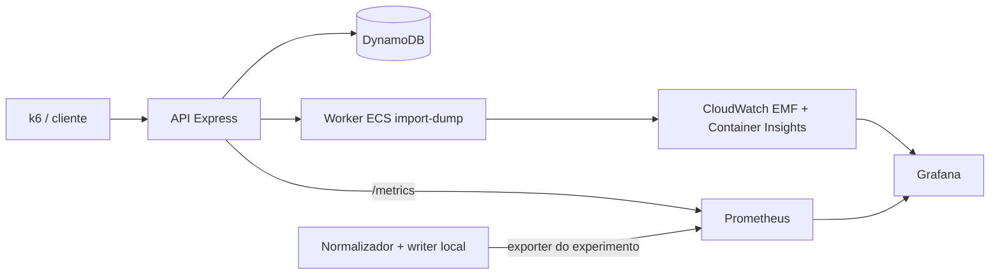

# Testes não funcionais finais: carga, resiliência e observabilidade

## 1. Objetivo, escopo e leitura da entrega

Este é o ponto de entrada da entrega que aprimora os testes da Sprint 3. A
avaliação considera três dimensões: planos de RNFs (peso 3), resultados e
análise (peso 4) e visualização de observabilidade em Grafana/Prometheus (peso 3).
Uma reprovação de capacidade é um resultado da investigação; não deve ser
convertida em aprovação nem confundida com ausência de teste.

A solução foi medida em dois ambientes isolados: a linha de base ECS e um
cluster EKS dedicado criado para este fechamento. A revisão `develop` atual é
`d5339f3`, que migra o runtime para Kubernetes; ela foi incorporada ao
fechamento. Cada conclusão identifica o ambiente e o digest da imagem, portanto
a medição ECS não é apresentada como capacidade EKS. O EKS usou o cluster
`view-show-rnf-eks`, dois nós `i3.large`, ALB dedicado e armazenamento separado;
nenhum recurso da linha de base ECS foi alterado. A
[proveniência da atualização](../assets/testes-carga/2026-10-06-fechamento-aws/develop-update.json)
registra a revisão, o cluster e os escopos.

A ingestão recebe dumps ou lotes incrementais: **10.000
eventos/min não significa 10.000 requisições HTTP/min**. A equivalência batch é
150.000 eventos por janela de 15 min. A coleta contínua complementar oferece
1.000 eventos a cada 6 s, por 15 min, aos normalizadores e à persistência reais.
Seu escopo exclui projeção, arquivamento, agendamento e rede AWS, explicitamente.

A [síntese executiva em PDF](../output/pdf/sintese-testes-nao-funcionais.pdf)
apresenta os resultados centrais e os quatro indicadores. Este documento e os
índices das evidências preservam o detalhamento necessário à avaliação técnica.

| Critério de entrega | Plano e implementação | Evidência e análise |
| --- | --- | --- |
| RNFs e cenários aprimorados | Seções 2–3; [ingestão](sprint5/testes-carga-ingestao.md), [API](sprint5/testes-de-carga-da-api.md), [frontend](sprint5/testes-carga-finais-front.md) | [Índice de execuções](../assets/testes-carga/README.md); cada resultado preserva seu ambiente e versão |
| Desempenho e resiliência | Seções 4 e 6; taxa aberta HTTP, chegada contínua de eventos, volumes e injeção real de falha | [Fechamento local](../assets/testes-carga/2026-10-06-fechamento-local/README.md), [fechamento AWS](../assets/testes-carga/2026-10-06-fechamento-aws/README.md) e relatórios detalhados da Sprint 5 |
| Grafana/Prometheus: latência, throughput, erros/s, CPU | Seção 5; consultas, unidades, dimensões, scrape e fontes identificadas | Capturas reais, respostas Grafana e séries Prometheus/CloudWatch no fechamento; captura histórica sem dados não constitui aceite |
| Impacto arquitetural | Seção 6; problema → evidência → decisão → validação | Recomendações sustentadas por resultados, distinguindo correções implantadas de propostas |
| Reprodução e apresentação | Seções 7–8; inventário individual de scripts, configurações e Dockerfiles | Manifestos de execução, hashes das evidências e verificador de links/proveniência |

O registro de [Sprint 3](sprint3/testes-carga-inicial.md) é histórico. Seu estado
“ingestão bloqueada” descreve 11/09; não é o estado atual. O relatório de ingestão
registra a aprovação do RS-01 com 2, 3 e 4 lotes em 05–06/10. Os resultados
históricos permanecem preservados sem reatribuição à revisão nova.

## 2. Requisitos e critérios verificáveis

| RNF | Critério | Cenário e medida | Interpretação |
| --- | --- | --- | --- |
| RNF01 — capacidade | 10.000 eventos/min, sem perda | CG-02: 150.000 eventos até READY em ≤900 s; CG-05: 150/300/750 mil, com orçamentos equivalentes de 900/1.800/4.500 s; CT-01: 150.000 eventos oferecidos ao longo de 900 s | INGESTING isolado não aprova o pipeline; CT-01 mede normalização/persistência locais, não o SLA end-to-end AWS |
| RNF02 — frescor | captura → consulta ≤120 s | CG-03: timestamps da publicação, conclusão e avanço do watermark | Watermark que não avança é bloqueio funcional documentado, não latência zero |
| RNF03 — resiliência | falha explícita; sem descarte; recuperação após retirar a falha | RS-01 backlog 2/3/4; RS-02 timeout; RS-03 inválidos; RS-04 reentrega; RS-05 DLQ; RS-06 contrapressão; CT-02 MySQL bloqueado; CT-03 grupos FIFO concorrentes | Sucesso do reproducer CT-03 significa que o defeito foi reproduzido; o RNF é reprovado naquele caso |
| RNF04 — autorização | 401/403 sem sessão, sucesso com sessão válida | `auth-check.js`, matriz por rota | Cookie preparado no runner não mede autenticação Cognito sob carga |
| RNF07 — frontend | FCP p95 ≤30 s | três Lighthouse por perfil e carga estática, recuperação com a mesma concorrência | /login local + 18 auditorias autenticadas AWS em três telas; p95 amostral não é o percentil da população |
| RNF09 — disponibilidade | falhas inesperadas <0,1% na carga sustentada | load/soak; 5xx, timeouts, contrato por rota e iterações descartadas | Soak de 30 min mede essa janela; não comprova disponibilidade mensal nem a janela de 12 h do plano original |
| RNF14 — consultas | p95 <2 s em 137 req/s | chegada aberta, p95 por rota, carga emitida, CPU do gerador | Reprovação com gerador insuficiente é limite inferior; os descartes precisam ser publicados |
| RNF15 — alerta | sinalização em ≤30 s | tempo injeção/condição → ALARM, com relógios e período | Nova falha LeaseBusy: alarme em 18,448 s; cancelamento externo sem métrica terminal permanece sem cobertura; período 300 s não garante≤30 s |

Os planos dos outros RNFs estão na matriz [RNF01–RNF15 da Sprint 3](sprint3/testes-carga-inicial.md#4-requisitos-não-funcionais-e-planos-de-teste-revisados).
RNF05 (retenção), RNF06 (contêineres), RNF08 (qualidade do modelo), RNF10
(usabilidade), RNF11 (schemas), RNF12 (cobertura) e RNF13 (contexto do modelo)
exigem métodos próprios; não são aprovados por throughput HTTP. Para a camada
agêntica, consultar também [testes de carga LLM](arquitetura/implementacao/camada-agentica/testes-carga-llm.md).

## 3. Cenários aprimorados e controles negativos

| ID | Preparação e procedimento | Critério, controle e reversão |
| --- | --- | --- |
| CG-02/CG-05 | dump determinístico, hash, contagem e distribuição temporal; upload multipart; aguardar READY; registrar duração de cada etapa | reconciliar lidos/escritos/inalterados/rejeitados; publicar todas as repetições; sem ativar automaticamente o dataset candidato |
| RS-01 | interromper consumidor; publicar 2/3/4 janelas; medir visíveis, invisíveis, idade e DLQ; reativar consumidor | contagem final, confirmação das mensagens e drenagem <N×900 s; devolver agenda ao estado inicial |
| CT-01 | 1.000 eventos únicos/6 s; normalizador ARGUS real e `DynamoHotRecordSink` contra DynamoDB Local, por 15 min | medir carga oferecida e persistida; atraso do produtor; comparar conjunto de chaves com query independente; regravar primeiro lote com nova chave de idempotência |
| CT-02 | leitura nominal; `LOCK TABLES signal_bucket WRITE` numa conexão MySQL separada; leitura com socket timeout de 1 s e 2 tentativas; liberar lock | observar erro MySQL 2013, retries e esgotamento; recuperar a mesma página sem reiniciar MySQL; `finally` libera o lock mesmo quando o teste falha |
| CT-03 | dois datasets em grupos FIFO distintos, lease SYNC_GLOBAL ocupado e maxReceiveCount=5 | observar se mensagens válidas chegam à DLQ sem persistência; Moto emula SQS, os ports de fonte/estado são doubles; visibility=0 acelera o reproducer e não mede tempo AWS |
| API-137 | massa de 2.500 incidentes, arrival-rate a 137/s e timeout real do cliente | medir latência/contrato/falhas por rota; incluir dropped_iterations; não mudar thresholds para aprovar |
| API-falha/recuperação | parar somente o DynamoDB Local usado pela API, manter o mesmo processo da API e depois iniciar o destino | rejeitar falso sucesso, observar 503/timeouts; repetir smoke e medir recuperação; dados do stream usam outro contêiner |
| API-soak | 50 iterações/s por 30 min, depois dos controles negativos | verificar deriva da latência, falhas, CPU e memória; comparar períodos dentro da mesma execução |

## 4. Resultados e alcance das conclusões

**CT-01 fechado:** 150.000 eventos oferecidos/persistidos ao longo de 900 s;
recontagem independente de 150.000, com zero faltantes, extras, duplicados e
diferenças nos campos canônicos. p95 dos lotes de 1.000: 1,179 s; atraso máximo
da emissão: 0,279 s; replay de 1.000: written=0, unchanged=1000. A
[verificação](../assets/testes-carga/2026-10-06-fechamento-local/stream-validated/stream-summary.json)
foi recuperada com paginação limitada após uma limitação de heap do emulador,
sem repetir a ingestão nem alterar os brutos de tempo.

**CG-05 fechado por prazo:** 750.000 fatos recontados nos 23 datasets, mas
projeção/arquivamento não concluíram no orçamento de 75 min. A interrupção
controlada produziu FAILED/WORKER_STOPPED; a observação é censurada. A recuperação
chegou a READY com 1.000 registros após uma tentativa com LeaseBusy. Ver
[análise e brutos](../assets/testes-carga/2026-10-06-fechamento-aws/README.md).

**EKS medido:** o smoke da API respondeu `/health` com 200 e a recuperação
posterior ao teste também passou. Em `API-137`, a chegada aberta produziu cerca
de 43 mil requisições, 1.003 descartes/erros de gateway e 503/timeouts; o HPA
subiu de uma para quatro réplicas, mas as probes de liveness reiniciaram Pods
sob saturação. O cenário de ingestão válido com 1.000 registros chegou a
`READY` em 120,65 s, com 1.000 escritos e zero rejeitados. O cenário nominal de
150.000 eventos aceitou o multipart e o `complete`, mas permaneceu
`PROCESSING` até o orçamento de 900 s e terminou com `exitCode=99`; não é uma
aprovação end-to-end. A causa técnica foi isolada: o fixture ACTIVE sintético
não satisfazia o contrato completo do `DynamoManifestRepository`; ele foi
removido condicionalmente da tabela EKS dedicada antes do fechamento. O índice
[EKS nativo](../assets/testes-carga/2026-10-06-fechamento-aws/README.md#execuções-eks-nativas)
contém metadata, logs, estados, recontagem e a decisão de não mascarar esse
resultado.

**Soak local:** 89.928 requisições em 30 min, 0,0801% de falha inesperada e p95
90,941 ms nas respostas 200. Os critérios de zero timeout/descarte reprovam,
mesmo com fração de falhas abaixo de 0,1%.

As tabelas de valores medidos e os estados de cada rodada estão nos READMEs de
[fechamento local](../assets/testes-carga/2026-10-06-fechamento-local/README.md) e
[fechamento AWS](../assets/testes-carga/2026-10-06-fechamento-aws/README.md).
A data, o commit do runner, o digest/tag implantado, a configuração de recursos,
o início/fim UTC e os parâmetros fazem parte da evidência. Um commit do runner
não prova que aquela revisão foi implantada; a identificação da imagem é separada.

Os resultados consolidados anteriores continuam relevantes para seus ambientes:

- CG-05 de 04/10: 150.000 em 2.275,2 s de PROCESSING (3.956 eventos/min) e
  300.000 em 4.334,9 s (4.152 eventos/min), sem perda reportada. A ingestão
  isolada ultrapassa a meta; PROJECTING/ARCHIVING impedem o SLA do pipeline.
- RS-01 de 05–06/10: 2, 3 e 4 lotes drenados em 919, 1.334 e 1.649 s,
  com 300.000, 450.000 e 600.000 eventos, fila/DLQ vazias ao final.
- API AWS de 01/10: até aproximadamente 30 req/s por task de 0,25 vCPU com
  300 incidentes; saturação a partir de 35/s e RNF14 reprovado a 137/s.
  O gerador emitiu 56% da carga prevista naquela rodada.
- Frontend de 06/10: carga, pico e recuperação nominal aprovados na exportação
  local; RNF07 apenas no /login. O relatório não extrapola para Amplify ou
  experiência autenticada.

O cenário HTTP aceita 503 somente no monitoramento explicitamente indisponível.
O dashboard de erros contabiliza esses 503; por isso `http_req_failed=0` no k6
não significa que todas as funcionalidades estão disponíveis. Respostas parciais,
snapshot desatualizado e rotas sem trabalho real são contados no sumário e limitam
a extrapolação, conforme o relatório da API.

### 5.3 Observabilidade nativa do EKS

O Prometheus implantado no namespace `view-show-rnf` descobriu a API por Pods e
os dois endpoints cAdvisor dos nós via API Kubernetes. O dashboard
[`rnf-eks.json`](../apps/backend/api/loadtest/lab/provisioning/dashboards/rnf-eks.json)
define os quatro indicadores pedidos: p95 de latência, throughput, erros 5xx/s
e CPU agregada dos containers da API. A coleta durante `API-137` preservou 73
amostras numéricas em cada painel, sem erro de datasource, e o gate ficou
`passed=true` em
[`observability-load137-final/observability-validation.json`](../assets/testes-carga/2026-10-06-fechamento-aws/eks-native/observability-load137-final/observability-validation.json).
O painel de CPU foi corrigido para uma soma de
`rate(container_cpu_usage_seconds_total)`; o denominador de request não é usado
quando a réplica reinicia. O snapshot de targets está em
[`prometheus-targets.json`](../assets/testes-carga/2026-10-06-fechamento-aws/eks-native/observability-load137-final/prometheus-targets.json).

Latência de página MySQL, duração de um lote de escrita e latência HTTP são
medidas diferentes. Não se somam percentis; não se comparam hardware, imagem,
volume ou distribuição temporal diferentes como se houvesse ganho do código.

### 4.1 Critério proporcional ao volume

Para manter o objetivo de 10.000 eventos/min, 150.000, 300.000 e 750.000
correspondem a orçamentos de 900, 1.800 e 4.500 s. O runner complementar
agora deriva esse valor e registra o orçamento no metadata. A rodada de
750 mil já iniciada conserva o threshold bruto herdado de 900 s: ele é
mais rigoroso e não será usado sozinho para concluir a curva de capacidade.
A análise usa a vazão medida e o orçamento proporcional, preservando o resultado
original do k6. Um limite explícito menor é identificado como stress.

**Alerta medido:** o evento LeaseBusy de 00:40:43,480 UTC disparou o alarme
às 00:41:01,928 UTC, em 18,448 s. Essa amostra atende os 30 s; não prova
o limite para todas as falhas, nem cobre a interrupção externa do worker
que não emite métrica terminal. A [análise](../assets/testes-carga/2026-10-06-fechamento-aws/timeout-operacional/alert-analysis.json)
preserva causa, runId, timestamps e a limitação do período de 300 s.

## 5. Observabilidade: fontes, consultas e evidência visual

| Indicador | Consulta/fonte | Unidade e limite de interpretação |
| --- | --- | --- |
| Latência API | `histogram_quantile(0.95, sum by (le) (rate(http_request_duration_seconds_bucket{job="rnf-api-aws"}[30s])))` | segundos; histograma do servidor; k6 mede também a rede |
| Throughput API | `sum(rate(http_requests_total{job="rnf-api-aws"}[30s]))` | req/s; incluir falhas e distinguir vazão útil no relatório k6 |
| Erros API | `sum(rate(http_requests_total{job="rnf-api-aws",status_code=~"5.."}[30s]))` | erros/s; 429 é contrapressão separada, e timeout do cliente é contado no k6 |
| CPU API | `100*rate(view_show_process_cpu_seconds_total{job="rnf-api-aws"}[30s])` | % de um núcleo por processo; pode exceder 100%; não é % da reserva ECS |
| Latência worker | `RunDurationMs` p95; `StageDurationMs` Maximum por comando/etapa | ms; amostras batch esparsas; percentil com uma run não prova distribuição |
| Throughput worker | `RecordsRead/300` e `RecordsWritten/300`, Sum em período 300 s | registros/s no bucket CloudWatch, não vazão instantânea; distinguir unchanged/rejected |
| Erros worker | `Runs{status=FAILED/PARTIAL}/300`, `RecordsRejected/300` | falhas/s e rejeições/s distintas; ausência de run terminal não vale zero |
| CPU worker | `100*CpuUtilized/CpuReserved`, `ECS/ContainerInsights`, família da task/cluster | % da CPU reservada; mesma janela/operação da carga |
| Laboratório contínuo | `rnf_records_offered_total`, `rnf_records_written_total`, histograma `rnf_batch_duration_seconds`, `rnf_failures_total`, `rnf_process_cpu_seconds_total`, `rnf_backlog_events` | métricas do experimento sobre componentes reais; não são métricas ECS nem um novo coletor de produção |

O coletor salva a resposta de cada painel Grafana e as séries Prometheus.
**HTTP 200 sozinho não aprova a visualização:** `collect-evidence.mjs` exige
valores numéricos, ausência de erro e janela registrada. Uma captura sem amostras
é classificada como ausência de observação. Os dashboards têm títulos, unidades,
legendas e intervalo UTC. A API tem uma réplica na coleta AWS; scrape via gateway
não substitui descoberta de todas as réplicas quando houver autoscaling.

O Grafana local consulta CloudWatch da conta do teste com o método AWS SDK
Default e credenciais temporárias no filesystem privado do contêiner, fora do
Git. Não se utiliza um par de chaves estáticas sem session token.
[Referência oficial de autenticação](https://grafana.com/docs/grafana/latest/datasources/aws-cloudwatch/aws-authentication/).

### 5.1 Evidência Grafana com dados da execução AWS

Janela: 06/10/2026 23:10–23:42 UTC, conta 239162056821. As três primeiras
séries medem exclusivamente as rotas de importação; a quarta é a CPU utilizada
sobre a reserva da task import-dump. Throughput HTTP é do plano de controle,
com vazão de eventos documentada separadamente no resultado do pipeline.
O [gate de amostras e queries](../assets/testes-carga/2026-10-06-fechamento-aws/observability-ingestion/observability-validation.json)
aprovou os quatro painéis com 376/377/377/7 amostras numéricas respectivamente.
A imagem é exportada pelo renderer nativo do Grafana, sem recomposição dos dados.

### 5.2 Fluxo contínuo e carga da API no laboratório

O [gate das queries visíveis](../assets/testes-carga/2026-10-06-fechamento-local/stream-validated/observability/observability-validation.json)
aprovou os dez painéis na janela 23:36:49–23:51:50 UTC. A vazão de eventos
oscila perto de 166,67/s pela emissão em lotes de 1.000/6 s. A curva de p95
de lote é uma aproximação móvel por histogramas; a tabela de resultados usa
percentil direto das 150 amostras da execução inteira. Os 503 da rota de
monitoramento aparecem na série de erros HTTP e são separados das falhas
inesperadas do contrato k6.

## 6. Impactos documentados nas decisões de arquitetura

| Evidência | Decisão e justificativa | Próxima validação / limite |
| --- | --- | --- |
| INGESTING atende isoladamente; pipeline não | otimizar PROJECTING e ARCHIVING antes de aumentar indiscriminadamente vCPU | medir tempo por subetapa e comparar a mesma massa/particionamento |
| RS-01 falhava depois de 300 s; heartbeat permite drenagem | renovar visibilidade de todas as mensagens ainda sob posse, incluindo espera no lote recebido | evidência AWS de 2/3/4 lotes; policy restrita não foi validada fora do Learner Lab |
| CT-03 reproduz disputa global entre dois grupos | reservar o consumidor antes do receive ou redesenhar posse/retry para não consumir maxReceiveCount por contenção | experimento de componente; mudança arquitetural requer regressão com grupos reais |
| CT-02 esgota retries e recupera após liberar MySQL | usar socket timeout e retries limitados; separar prazo do cliente do cancelamento remoto | não aprova estado terminal de uma task interrompida; precisa reconciliador externo |
| API perde capacidade quando health check mata task saturada | contrapressão rápida, cancelamento de trabalho abandonado, capacidade mínima e autoscaling adequado à rajada | repetir breakpoint com mesma imagem e volume após correção |
| CPU/latência crescem com 2.500 incidentes | substituir leitura de projeção inteira + filtro em memória por acesso indexado e cache medido | limites físicos do item DynamoDB e paginação ainda precisam tratamento |
| Frescor incremental não atualiza a projeção pública | atualizar watermark/OVERVIEW ou expor watermark durável dos lotes | RNF02 continua bloqueado até correção; não inventar t2 |
| Alarmes em 35–190 s e períodos de 300 s | janela/resolução compatíveis com 30 s e cobertura de interrupção externa | proposta, não implantação já validada |

## 7. Inventário individual dos arquivos de implementação

Os caminhos de implementação são relativos à raiz. Fontes ECS substituídas
pela migração foram congeladas e linkadas com a revisão `eca9de4`; a seção 7.2
identifica os arquivos Kubernetes atuais. O inventário explica conteúdo e
parâmetros, sem atribuir uma configuração nova à execução antiga.

| Arquivo | O que implementa / parâmetros relevantes | Componente e critério |
| --- | --- | --- |
| `apps/backend/api/loadtest/k6/front-api.js` | mistura de rotas, arrival-rate, timeout 8 s, contrato por rota, fases, descartes e thresholds | API; RNF09/14 |
| `apps/backend/api/loadtest/k6/ingestao-batch.js` | multipart, polling READY/FAILED, contadores, hash da massa, idempotência, disponibilidade e contrapressão | API + worker; RNF01/02/03/09 |
| `apps/backend/api/loadtest/k6/ingestao-falhas.sh` | resolve recursos pelo runbook; liga/desliga agenda, para tasks, injeta/restaura política S3, exporta métricas SQS; Python 3 portátil | falha e reversão; RNF03 |
| `apps/backend/api/loadtest/k6/lib/session.js` | login Cognito ou sessão HMAC; identificador de requisição | autenticação e correlação |
| `apps/backend/api/loadtest/lab/run-api.sh` | build/seed, mesmo processo durante falha/recuperação, massa 2.500, 137/s, controles e soak | execução local da API |
| `apps/backend/api/loadtest/lab/capacity-contract.mjs` | orçamento = eventos ×60/10.000; valida volume conhecido e override explícito | consistência do critério em 150/300/750 mil |
| `apps/backend/api/loadtest/lab/run-nominal-repetitions.mjs` | três massas independentes, prazo pré-definido, sampler e cleanup somente da task identificada pelo importId | repetibilidade de CG-02 |
| `apps/backend/api/loadtest/lab/run-aws-evidence.mjs` | valida conta e serviço, lê segredo em memória, executa cenário atual e salva metadata sem segredo | execução identificada AWS |
| `apps/backend/api/loadtest/lab/compose.yml` | destinos DynamoDB separados, Prometheus 19090 e Grafana 13002 em loopback; imagens fixadas | leito isolado; não altera stack AWS |
| `apps/backend/api/loadtest/lab/prometheus.yml` | scrape 5 s/timeout 4 s; API local, API AWS e exporter local | coleta de métricas |
| `apps/backend/api/loadtest/lab/provisioning/datasources/lab.yml` | UID rnf-local, proxy interno http://prometheus:9090 e intervalo 5 s | datasource Grafana |
| `apps/backend/api/loadtest/lab/provisioning/dashboards/lab.yml` | provider de arquivos, diretório e namespace de provisionamento | instalação dos dashboards |
| `apps/backend/api/loadtest/lab/provisioning/dashboards/rnf-local.json` | quatro indicadores de API e ingestão local, backlog e carga oferecida; PromQL, unidade e layout por painel | visualização local |
| `apps/backend/api/loadtest/lab/provisioning/dashboards/rnf-aws.json` | quatro indicadores API AWS e worker import-dump; Prometheus/CloudWatch | visualização da execução AWS |
| `apps/backend/api/loadtest/lab/provision-cloudwatch.mjs` | injeta credenciais temporárias no contêiner privado, renderiza template, rejeita variáveis não resolvidas | autenticação e dimensões corretas |
| `apps/backend/api/loadtest/lab/observability-contract.mjs` | exige amostras em cada query visível; não aprova expressão vazia pelos inputs ocultos | contrato de aceite visual |
| `apps/backend/api/loadtest/lab/provisioning/dashboards/rnf-ingestion-aws.json` | rotas /imports e CPU reservada do worker na mesma conta/janela | quatro indicadores durante CG-05 |
| `apps/backend/api/loadtest/lab/lighthouse-authenticated.mjs` | 18 auditorias sequenciais em três telas, sessão sintética, Chrome isolado e redaction | RNF07 autenticado, sem login Cognito |
| `apps/backend/api/loadtest/lab/fingerprint-frontend.mjs` | MIME/bytes/ETag/SHA-256 dos recursos JS/CSS observados no deploy | proveniência do frontend servido |
| `apps/backend/api/loadtest/scripts/verify-rnf-artifact.py` | links, JSON, hashes de evidências e detecção de chave AWS exposta | consistência documental |
| `apps/backend/api/loadtest/scripts/build-rnf-executive-pdf.py` | ReportLab, fontes DejaVu incorporadas, valores lidos dos JSON e quatro gráficos nativos Grafana | síntese executiva verificável |
| `apps/backend/api/loadtest/lab/collect-aws-metrics.py` | exporta CPU, memória, etapas, escrita e throttling com queries completas e janela UTC | séries CloudWatch da carga e recuperação |
| `apps/backend/api/loadtest/lab/collect-evidence.mjs` | query de cada painel, exportação Prometheus e gate de amostras/erros por painel | aceite de observabilidade |
| `apps/backend/ingestion-data/scripts/verify_rnf_stream.py` | leitura limitada a 1.000, campos canônicos/payloadHash, identidades e replay do fluxo | verificação independente CT-01 |
| `apps/backend/ingestion-data/scripts/verify_rnf_aws_count.py` | valida conta, deriva versão pelo SHA do snapshot e reconta 23 datasets com COUNT consistente | integridade de CG-05 na AWS |
| `apps/backend/ingestion-data/scripts/rnf_local_evidence.py` | timeout real MySQL; produtor paced, writer real, query independente, replay e exporter de medições | CT-01/02 |
| `apps/backend/ingestion-data/tests/resilience/test_multidataset_fifo_contention.py` | dois grupos FIFO, lease ocupado e desvio de mensagens válidas; evidência opt-in | CT-03 |
| `apps/backend/ingestion-data/scripts/build_benchmark_snapshot.py` | dump GZIP determinístico e manifesto SHA-256; rows-per-window controla particionamento | massa reproduzível |
| `apps/backend/ingestion-data/scripts/benchmark_snapshot_reader.py` | restauração real MySQL, keyset, desconexão, retries, percentis e contagem | escala 150/300/750 mil da leitura |
| `apps/backend/ingestion-data/scripts/publish_incremental_batch.py` | Parquet + manifesto S3 versionado e envelope FIFO | RS-01/03/04/05 |
| `apps/backend/ingestion-data/application/visibility_heartbeat.py` | thread, janela de renovação e perda de posse | correção da drenagem |
| `apps/backend/ingestion-data/adapters/telemetry/cloudwatch_metrics.py` | contrato EMF, namespace, nomes/unidades e dimensões de baixa cardinalidade | worker → CloudWatch |
| `apps/fullstack/observability/aws/user-data.sh.tftpl` | cloud-init e instalação dos containers/datasources/dashboards a partir dos arquivos versionados | provisionamento LGTM na AWS |
| `apps/fullstack/observability/prometheus/prometheus.yml` | scrape e alvos da pilha de desenvolvimento; 15 s/timeout 10 s | coleta histórica da API |
| `apps/fullstack/observability/prometheus/rules/view-show.yml` | expressões, severidade, janela for e runbooks de cada alerta | políticas históricas e limites de detecção |
| `apps/fullstack/observability/grafana/provisioning/datasources/datasources.yml` | UIDs e conexões Prometheus/Loki/Tempo | conexão da pilha original, preservada |
| [`ingestion-observability.tf` (ECS, base eca9de4)](../assets/testes-carga/2026-10-06-fechamento-aws/source-baseline-eca9de4/ingestion-observability.tf) | filtros, métricas, alarmes e períodos; distingue comandos e task families | detecção e RNF15 |
| `apps/fullstack/observability-aws.tf` | instância, rede/role e renderização dos dashboards no bootstrap | observabilidade AWS |
| `apps/fullstack/observability/aws/view-show-ingestion.json.tftpl` | oito consultas principais/expressões, seletor operação/família, período 300 s | latência/throughput/erros/CPU batch |
| [`ingestion-ecs.tf` (ECS, base eca9de4)](../assets/testes-carga/2026-10-06-fechamento-aws/source-baseline-eca9de4/ingestion-ecs.tf) | tasks, recursos, volumes, sidecar MySQL, entrypoints e comandos | worker sob teste |
| [`ingestion-messaging.tf` (ECS, base eca9de4)](../assets/testes-carga/2026-10-06-fechamento-aws/source-baseline-eca9de4/ingestion-messaging.tf) | FIFO, DLQs, visibility_timeout e maxReceiveCount | backlog/reentrega |
| [`ingestion-scheduler.tf` (ECS, base eca9de4)](../assets/testes-carga/2026-10-06-fechamento-aws/source-baseline-eca9de4/ingestion-scheduler.tf) | agendas e alvo ECS; periodicidade e estado habilitado | produção/consumo incremental |
| [`autoscaling.tf` (ECS, base eca9de4)](../assets/testes-carga/2026-10-06-fechamento-aws/source-baseline-eca9de4/autoscaling.tf) | min/max de tasks, alvo CPU e cooldowns | capacidade da API |
| [`ecs.tf` (ECS, base eca9de4)](../assets/testes-carga/2026-10-06-fechamento-aws/source-baseline-eca9de4/ecs.tf) | task definition, serviço, recursos, container e variáveis da API | processo HTTP e imagem implantada |
| `apps/fullstack/alb.tf` | target group, listener e health check /health com intervalo, timeout e limiares | retirada/reposição da task saturada |
| `apps/fullstack/apigateway.tf` | integração HTTP, rotas e ligação com o ALB | entrada pública e latência da rede |

### 7.1 Imagens, builds e filtros de contexto

| Dockerfile e contexto | Base, dependências e etapas | Cópias, inicialização, usuário e portas | Filtro de contexto |
| --- | --- | --- | --- |
| `apps/backend/api/Dockerfile`, contexto `apps/backend/api` | Node 22.22.0 bookworm-slim por digest; npm ci instala Express 5.2.1, SDK AWS 3.1128.0, prom-client 15.1.3 e Zod 4.5.4; build TypeScript e contracts; prune omit=dev; runtime separado com dumb-init 1.2.5-2 | build: package.json, package-lock.json, contracts/package.json, tsconfig.json, tsconfig.workspaces.json, tsconfig.base.json, src/ e contracts/; runtime: package/lock, node_modules/, dist/, contracts/package.json e contracts/dist/; USER node; ENTRYPOINT dumb-init --; CMD node dist/index.js; EXPOSE 3000 e health check /health | `apps/backend/api/.dockerignore`: exclui node_modules, dist, testes, scripts, cobertura, .env, cache e .git; permite .env.example |
| `apps/backend/ingestion-data/Dockerfile`, contexto `apps/backend/ingestion-data` | Python 3.12.11 slim-bookworm por digest; mysql-client 1.1.0; requirements com hashes: Boto3 1.40.0, PyMySQL 1.1.1, PyArrow 21.0.0 e jsonschema 4.25.1; uma etapa | requirements.txt, domain/application/ports/adapters/bootstrap/contracts/scripts; WORKDIR /app; UID 10001 ingestion; ENTRYPOINT python -m bootstrap; comando por task (import-dump, ingest-incremental etc.); /tmp gravável e rootfs read-only; sem porta HTTP | `apps/backend/ingestion-data/.dockerignore`: exclui env, venv, caches, testes, requisitos dev e dados temporários, SQLite, Parquet/spool; não exclui contracts/scripts do runtime |
| `apps/backend/agentic/Dockerfile`, contexto `apps/backend/agentic` | Node 20 bookworm-slim em build/runtime; npm ci instala SDK AWS (Bedrock/DynamoDB/S3/SQS) 3.1128.0 e OpenTelemetry; TypeScript, prune omit=dev; base por tag, sem digest neste arquivo | build: package.json, package-lock.json, tsconfig.json e src/; runtime: package/lock, node_modules/ e dist/; WORKDIR /app; USER node; CMD node dist/src/bootstrap/analysis-worker.js; consumidor de fila, sem EXPOSE HTTP | `apps/backend/agentic/.dockerignore`: exclui node_modules, dist, testes, scripts, models, data e logs |

A imagem MySQL do sidecar é separada da imagem Python. O laboratório MySQL é
configurado em `apps/backend/ingestion-data/docker-compose.test.yml`, com porta
loopback 33077, schema/fixture montados e health check. A enumeração dessas bases
não prova que todas foram usadas na mesma coleta: metadata registra a imagem
real de cada execução AWS, e o laboratório declara execução da API compilada no host.

### 7.2 Configurações da revisão Kubernetes atual (`d5339f3`)

A migração foi incorporada após as medições ECS começarem. O processamento Python,
os Dockerfiles e os cenários k6 mantêm seus arquivos; o mecanismo de lançamento,
agendamento e a unidade de CPU/escala mudaram. Os 17 testes de renderização e
14 testes dos adaptadores/configuração passaram nessa revisão, com build da API.
O [mapa individual de 34 recursos](../assets/testes-carga/2026-10-06-fechamento-local/kubernetes-resource-map.md)
identifica cada recurso da fixture e seus parâmetros; o JSON correspondente é
uma saída offline de teste, com conta/imagens/segredos sintéticos. Não constitui
manifest de uma implantação real. O detalhamento de produção está também na
[aplicação final](sprint5/aplicacao-final.md).

| Arquivo atual | Recursos, conteúdo e parâmetros relevantes | Componente |
| --- | --- | --- |
| `apps/fullstack/workloads.tf` | sete workloads: imagens, argumentos, ambiente, Secrets Manager, CPU e memória; snapshot com MySQL e Python | API, ingestão e análise |
| `apps/fullstack/kubernetes-outputs.tf` | output sensível kubernetes_deployment com namespaces, roles, imagens, ALB e escala; runbook não sensível | Terraform → renderer |
| `apps/kubernetes/render.mjs` | gera Namespaces, SA, Secrets, Deployments, cinco CronJobs, Service, TargetGroupBinding, HPA, PDB, NetworkPolicies, RBAC e admission policies | todos os workloads |
| `apps/kubernetes/chart/Chart.yaml` | chart view-show 1.0.0, Kubernetes ≥1.33 | empacotamento Helm |
| `apps/kubernetes/chart/values.yaml` | resources: [] preenchido pelo deploy; não armazena valores reais dos Secrets | entrada do chart |
| `apps/kubernetes/chart/templates/resources.yaml` | serializa cada recurso; lookup preserva suspend de sync e replicas administradas pelo HPA | agendamento e escala |
| `apps/kubernetes/deploy.mjs` | namespaces, charts dos controllers, aplicação do chart, rollout e targets ALB; segredos pela entrada padrão | instalação e validação |
| `apps/kubernetes/run-job.mjs` | Job manual, identidade de conta/cluster/S3, Secret MySQL por Job e limpeza | backfill |
| `apps/backend/api/src/modules/imports/adapters/kubernetes-import-worker-launcher.ts` | Job determinístico por importId; recupera 409; identidade k8s://namespace/jobs/name/uid | API → importação |
| `apps/backend/api/src/modules/argus/adapters/kubernetes-argus-scheduler.ts` | get/patch de spec.suspend no CronJob sync | painel → agenda |
| `apps/backend/api/src/platform/kubernetes-client.ts` | token projetado relido por request, CA do cluster, timeout 30 s e limite de resposta 4 MiB | acesso à API Kubernetes |
| `apps/fullstack/eks.tf` | EKS 1.35, nodes, access entries, OIDC/IRSA, CNI/CoreDNS/kube-proxy, descoberta de nós e Pod Identity CloudWatch | cluster e nós |
| `apps/fullstack/eks-existing-iam.tf` | guardrails para roles/profile Academy existentes e modo IAM; não presume poder criar IAM no lab | identidade |
| `apps/fullstack/kubernetes-iam.tf` | policies AWS dos workloads em modo gerenciado; compartilhamento LabRole documentado no modo Academy | acesso a dados/filas |
| `apps/fullstack/api-runtime.tf` | segredos de cookie/cursor gerados no Terraform; valores fora das evidências | sessão API |
| `apps/fullstack/ingestion-runtime.tf` | build/digest de ingestão, argumentos MySQL, ambiente e policies incrementais | Python/MySQL |
| `apps/fullstack/ingestion-messaging.tf` | FIFO/DLQs: visibility 300 s, long polling 20 s, maxReceiveCount=5; segredos MySQL | backlog e recuperação |
| `apps/fullstack/ingestion-imports.tf` | upload/importação, proteção de ACTIVE no modo gerenciado, alarmes de falha/retry/preflight/página | controle e alertas |
| `apps/fullstack/ingestion-observability.tf` | dimensões e alarmes adaptados a EKS; séries ECS antigas não demonstram cobertura Kubernetes | CloudWatch |
| `apps/kubernetes/cloudwatch-application.conf` | Fluent Bit incorpora JSON à raiz preservando EMF | logs/métricas dos Pods |
| `apps/kubernetes/load-balancer-policy.json` | permissões AWS do Load Balancer Controller | ALB → Pods |
| `apps/fullstack/migration.tf` | retenção dos logs/DLQ legados sem destroy | preservação da evidência |
| `apps/fullstack/eks-iam-moves.tf` | mudança de endereços IAM no estado sem recriação | continuidade IAM |

**Correspondência técnica dos recursos.** Deployment/api usa porta nomeada
http:3000, RollingUpdate maxUnavailable=0/maxSurge=1 e probes /health: startup
3 s ×30, readiness 5 s/timeout 3 s, liveness 15 s/timeout 3 s. Service/api
seleciona app.kubernetes.io/name=api, port=3000/targetPort=http. TargetGroupBinding
registra IPs de Pods e aceita TCP/3000 do SG do ALB. A rota externa permanece
ANY /{proxy+} no API Gateway e listener HTTP/80 no ALB; não há Ingress neste runtime.

HPA/api tem alvo Deployment/api, padrões de 1–4 réplicas, CPU 50% e redução
com estabilização de 300 s. PDB permite maxUnavailable=1. O Worker é opcional,
0–1 réplica, com encerramento de 120 s. Não há ScaledObject/TriggerAuthentication
KEDA nessa implementação; a profundidade SQS não escala o Worker automaticamente.

CronJobs usam Etc/UTC, Forbid, startingDeadlineSeconds=300, backoffLimit=0,
restartPolicy=Never e TTL=604800 s. Snapshots têm activeDeadlineSeconds=86400;
demais Jobs, 3600. Backfill/import são templates suspensos; sync/export executam
*/15 e ingest-incremental */5, com argumento --limit 20. O MySQL é sidecar
nativo com restartPolicy=Always e startup mysqladmin ping (5 s/timeout 3 s/60
falhas), volumes emptyDir temporários e isolamento do namespace de importação.
Forbid não resolve disputa de lease entre CronJobs diferentes; o defeito CT-03
continua relevante após a migração.

**Fechamento operacional EKS.** O cluster, nós, ALB, imagens por digest,
namespace/Job/UID, controles de admissão e armazenamento dedicado estão
registrados no índice nativo. Um Job válido e sete mutações negativas foram
submetidos em `dry-run=server`; todos os oito controles passaram. A bateria de
150.000 eventos foi deliberadamente encerrada como censurada quando excedeu o
orçamento, enquanto o cenário de 1.000 comprovou o caminho `READY`. A bateria
local da API continua útil para comparar regressão; ela não é somada às métricas
EKS como se fosse a mesma amostra.

## 8. Reprodução, integridade e limitações

Consultar o [README do laboratório](../apps/backend/api/loadtest/lab/README.md)
para dependências, ordem, comandos, portas e limpeza. Os scripts não imprimem
segredos da sessão. Controles negativos preservam exit codes e brutos, sem alterar
thresholds para obter aprovação. Cada pasta de evidências tem índice com SHA-256,
ambiente, versão, intervalo UTC e escopo da conclusão.

As limitações restantes são de **alcance**, não números inventados: ambiente de
laboratório, massas sintéticas, ausência de login Cognito medido e amostragem finita no
Lighthouse, scrape de uma réplica, janela finita do soak, relógios/coletas distintos,
ports emulados no CT-03 e estado funcional do frescor. Capacidade end-to-end,
disponibilidade mensal e F1 da IA não são inferidos de testes de componentes.
