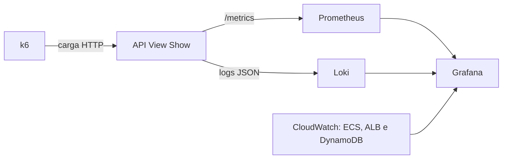

# Testes de carga inicial e observabilidade — View Show

> **Consolidação:** 10 de setembro de 2026  
> **Branch:** `feat/full-observability`, comparada com `develop`  
> **Evidência executada:** ingestão local controlada e baseline histórico da API de consulta na AWS  
> Uma configuração versionada não é apresentada como uma medição executada.

## 1. Objetivo e evidências

Este artefato consolida os planos revisados dos quinze requisitos não funcionais
da Sprint 1, os resultados disponíveis dos testes de carga e resiliência e a
visualização dos indicadores de observabilidade. Resultados locais não são
tratados como evidência de capacidade da infraestrutura AWS.

Fontes reproduzíveis:

- [requisitos e planos originais](./sprint1/requisitos.md#4-requisitos-não-funcionais-rnf-e-planos-de-teste);
- [script k6 de ingestão](./sprint2/testes-carga/k6/ingestao-resiliencia.js);
- [resultado detalhado de resiliência](./sprint2/testes-carga/RESULTADOS-INGESTAO-RESILIENCIA.md);
- [relatório histórico da API de consulta](./sprint2/testes-desempenho.md);
- [roteiro de reprodução](./sprint2/testes-carga/README.md);
- [dashboard Grafana](../apps/fullstack/observability/grafana/provisioning/dashboards/json/view-show-overview.json);
- [dashboard Grafana/AWS](../apps/fullstack/observability/aws/view-show-aws.json.tftpl);
- [alertas Prometheus](../apps/fullstack/observability/prometheus/rules/view-show.yml).

### 1.1 Rastreabilidade dos itens da entrega

| Item                              | Evidência                                                                | Estado                                                        |
| --------------------------------- | ------------------------------------------------------------------------ | ------------------------------------------------------------- |
| RNFs e planos revisados           | Matriz completa na Seção 2; cenários obrigatórios na Seção 3             | **Entregue**                                                  |
| Resultados de carga e resiliência | Três JSON brutos, critérios, comparação e análise na Seção 4             | **Entregue no ambiente local controlado**                     |
| Grafana ou Prometheus             | Dashboards e consultas de latência, throughput, erros/s e CPU na Seção 5 | **Implementado; captura preenchida da rodada atual pendente** |

Estados usados: **Aprovado** significa execução com evidência bruta e critério
atendido; **Parcial** indica que uma parte expressa do critério ainda falta;
**Não executado** indica plano sem resultado; **Bloqueado** indica ausência do
runtime, dependência ou conjunto de dados; **Histórico reprovado** identifica
uma medição útil de uma versão anterior.

## 2. RNFs e planos de teste revisados

A matriz separa testes de carga de inspeções, testes funcionais, usabilidade e
ML. A mera existência de uma métrica não aprova o requisito correspondente.

| RNF                                     | Plano revisado                                                                                                                          | Critério                                                                                                         | Evidência e estado                                                                                                                     |
| --------------------------------------- | --------------------------------------------------------------------------------------------------------------------------------------- | ---------------------------------------------------------------------------------------------------------------- | -------------------------------------------------------------------------------------------------------------------------------------- |
| **RNF01 — 10 mil eventos/min**          | Modelo aberto: 100 lotes/min × 100 eventos por pelo menos 1 min; em staging, observar fila e consumidor.                                | ≥ 10.000 aceitos/min; HTTP 202 e lote completo em 100%; p95 < 2 s; erro inesperado < 1%; zero descarte.          | 10.100 aceitos em ~60 s, p95 2,89 ms e zero descarte. **Parcial:** execução local aprovada; fila, worker e AWS pendentes.              |
| **RNF02 — ponta a ponta ≤ 120 s**       | Injetar evento com ID/timestamp na fila e consultar até o mesmo ID aparecer no dashboard.                                               | Disponível em até 120 s, incluindo fila, normalização, análise e projeção.                                       | A rodada mede somente confirmação HTTP. **Não executado.**                                                                             |
| **RNF03 — tolerância a falhas**         | Sob 10 mil eventos/min: payload inválido, fila cheia por 30 s, timeout por 30 s e 1 min de recuperação; repetir com dependências reais. | Falha explícita; lote recusado não persistido; recuperação ≥ 10 mil/min, p95 < 2 s e zero descarte sem reinício. | 429/`queue_full` e 504/`dependency_timeout`, ambos com recuperação local. **Parcial:** SQS, retry, DLQ e dependências reais pendentes. |
| **RNF04 — acesso corporativo**          | Chamar todas as rotas sem sessão, com sessão inválida, domínio externo e identidade corporativa simulada.                               | Casos inválidos em 401/403 e nenhuma credencial persistida.                                                      | Testes cobrem sessão e autorização; SSO real não está integrado. **Parcial.**                                                          |
| **RNF05 — 30 dias hot + 11 meses cold** | Inspecionar IaC e testar item vencido e partição histórica antes/depois da transição.                                                   | TTL hot, camada cold e consulta do histórico funcionando.                                                        | DynamoDB tem TTL; S3/Glue/Athena não estão provisionados. **Parcial.**                                                                 |
| **RNF06 — contêineres independentes**   | Build limpo e inicialização de normalização e ML apenas por variáveis.                                                                  | Cada imagem compila e inicia sem configuração manual do host.                                                    | API possui imagem; ingestão e análise não possuem runtimes completos. **Bloqueado.**                                                   |
| **RNF07 — FCP ≤ 30 s**                  | Executar Lighthouse ou RUM em desktop e perfil móvel, com gráficos e API integrada, no mínimo três vezes.                               | p95 de `frontend_web_vitals_fcp_seconds` ≤ 30 s.                                                                 | Coleta RUM existe, sem relatório controlado exportado. **Não executado.**                                                              |
| **RNF08 — F1 ≥ 80%**                    | Avaliar em holdout rotulado, publicando precisão, recall, F1 e matriz de confusão.                                                      | F1 ≥ 0,80 para causa raiz.                                                                                       | Golden set insuficiente e worker final ausente. **Bloqueado.**                                                                         |
| **RNF09 — disponibilidade ≥ 99,9%**     | Health check por até 12 h, com três encerramentos forçados e observação da recuperação.                                                 | Disponibilidade ≥ 99,9% e recuperação em até 2 min por falha.                                                    | Há métricas e alertas, sem janela de 12 h ou falha de contêiner. **Não executado.**                                                    |
| **RNF10 — causa em até 5 cliques**      | Teste guiado com operador, da Visão Geral até hipótese e evidência.                                                                     | Até cinco cliques em todas as tarefas.                                                                           | Métrica RUM existe, sem sessão guiada exportada. **Não executado.**                                                                    |
| **RNF11 — múltiplos schemas**           | Enviar fixtures de Smart TV, iOS, Android e Web nos protocolos moderno e legado; comparar o normalizado.                                | Todas as plataformas sem perda de campo obrigatório nem código específico por cliente.                           | Há contratos no backend legado, sem matriz completa contra o worker final. **Parcial.**                                                |
| **RNF12 — cobertura ≥ 70%**             | Gerar cobertura de todos os serviços no CI e bloquear merge abaixo do limite.                                                           | Cobertura global ≥ 70% e gate obrigatório.                                                                       | A API oferece `test:coverage`, mas o pipeline não impõe o limiar global. **Não executado.**                                            |
| **RNF13 — contexto máximo de 5 h**      | Criar histórico > 5 h e inspecionar IDs/timestamps enviados ao modelo.                                                                  | Nenhum evento anterior a `falha - 5 h` chega ao modelo.                                                          | Não existe worker final de ML. **Bloqueado.**                                                                                          |
| **RNF14 — busca p95 ≤ 2 s**             | Carga filtrada na versão atual com seed válido; correlacionar p95, CPU, 5xx e banco.                                                    | p95 ≤ 2 s, erro < 1% e contrato válido.                                                                          | Schema v1: p95 60 s e 91,90% de erro a 137 req/s. Correção aplicada, rodada nova pendente. **Histórico reprovado.**                    |
| **RNF15 — alerta em até 30 s**          | Injetar degradação com timestamp conhecido e medir até o alerta ficar visível.                                                          | Intervalo ≤ 30 s.                                                                                                | Alertas definidos, sem detector/worker e sem medição ponta a ponta. **Bloqueado.**                                                     |

## 3. Plano de carga e resiliência

### 3.1 Alvo e modelo

O alvo executado é `POST /v1/telemetry/events`, da aplicação Flask em
`apps/basica/backend`. O k6 usa `constant-arrival-rate`: 100 iterações/minuto,
cada uma com 100 eventos, totalizando 10.000 eventos/minuto. O lote respeita o
limite de 500 eventos da API.

O perfil representa emissores que agregam telemetria antes do envio. Ele mede
1,67 requisição HTTP/s e 166,67 eventos/s; não representa 10 mil conexões nem
10 mil requisições/minuto. Uma rodada de homologação deve comparar lotes de 1,
10, 100 e 500 eventos mantendo constante a vazão total de eventos.

### 3.2 Cenários obrigatórios

| Modo         | Linha do tempo                                | Contrato e critério automático                                                                                  |
| ------------ | --------------------------------------------- | --------------------------------------------------------------------------------------------------------------- |
| `carga`      | 1 min nominal                                 | ≥ 10.000 aceitos; checks 100%; p95 < 2 s; erro inesperado < 1%; zero descarte.                                  |
| `fila_cheia` | 30 s nominal → 30 s falha → 1 min recuperação | Falha sempre em 429/`queue_full`; recuperação ≥ 10.000 aceitos, checks 100%, p95 < 2 s e zero descarte.         |
| `timeout`    | 30 s nominal → 30 s falha → 1 min recuperação | Falha sempre em 504/`dependency_timeout`; recuperação ≥ 10.000 aceitos, checks 100%, p95 < 2 s e zero descarte. |

As respostas 429 e 504 são esperadas exclusivamente na fase de falha. Tags e
checks específicos impedem que uma recusa planejada seja confundida com erro
inesperado ou com sucesso.

### 3.3 Métricas do k6

| Métrica                               | Interpretação                                     |
| ------------------------------------- | ------------------------------------------------- |
| `ingestion_events_attempted`          | Eventos enviados, inclusive durante a falha.      |
| `ingestion_events_accepted`           | Soma do campo `accepted` das respostas normais.   |
| `ingestion_events_expected_rejection` | Eventos recusados deliberadamente.                |
| `ingestion_duration_ms{phase:*}`      | Latência da confirmação por fase.                 |
| `http_req_failed`                     | Falhas HTTP fora do contrato esperado.            |
| `checks{phase:*}`                     | Validação semântica de status, código e contagem. |
| `dropped_iterations`                  | Chegadas que o gerador não conseguiu iniciar.     |

A injeção de falha vem desabilitada, exige um token exclusivo e headers de
teste. Ela deve permanecer desligada fora do ambiente controlado.

## 4. Resultados e análise

### 4.1 Ambiente local

| Item             | Configuração registrada                  |
| ---------------- | ---------------------------------------- |
| Data             | 6 de setembro de 2026                    |
| Host             | Linux 7.1.8 x86_64                       |
| Gerador          | k6 v2.2.0 em imagem fixada por digest    |
| Aplicação        | Python 3.14.7 e Gunicorn 26.0.0          |
| Servidor         | 1 processo, 8 threads, `127.0.0.1:18080` |
| Persistência     | Memória, limite de 200.000 registros     |
| Timeout induzido | 250 ms                                   |

### 4.2 Resultados consolidados

| Cenário    | Tentados | Aceitos | Recusa esperada |  Checks | Erro inesperado | Descartes | p95 nominal | p95 recuperação | Resultado               |
| ---------- | -------: | ------: | --------------: | ------: | --------------: | --------: | ----------: | --------------: | ----------------------- |
| Carga      |   10.100 |  10.100 |               — | 202/202 |              0% |         0 |     2,89 ms |               — | **Aprovado localmente** |
| Fila cheia |   20.100 |  15.000 |           5.100 | 402/402 |              0% |         0 |     2,95 ms |         2,93 ms | **Aprovado localmente** |
| Timeout    |   20.100 |  15.100 |           5.000 | 402/402 |              0% |         0 |     2,85 ms |         2,68 ms | **Aprovado localmente** |

O k6 iniciou uma iteração na fronteira final em duas rodadas, gerando 10.100
em vez de 10.000 eventos. O critério `>= 10.000` trata corretamente essa
borda. Evidências brutas:

- [carga](./sprint2/testes-carga/resultados/resumo-ingestao-carga-local.json);
- [fila cheia](./sprint2/testes-carga/resultados/resumo-ingestao-fila-cheia-local.json);
- [timeout](./sprint2/testes-carga/resultados/resumo-ingestao-timeout-local.json).

O p95 nominal ficou entre 2,85 e 2,95 ms e não houve descarte. Isso comprova
que validação, parsing e escrita em memória sustentaram o patamar nesse host;
não permite extrapolação para DynamoDB, SQS ou AWS.

Na fila cheia, os lotes foram recusados explicitamente em 429. No timeout, o
p95 global chegou a 251,36 ms, coerente com o atraso de 250 ms, e as falhas
foram 504. Após a retirada das falhas, o processo voltou à taxa nominal sem
reinício. Não foram exercitados retry, DLQ, duplicação, ordenação, escalonamento
ou perda posterior a uma resposta 202.

### 4.3 Baseline histórico da API de consulta

A rodada AWS do schema v1 é útil como diagnóstico, mas não representa a versão
atual. Sob 137 req/s, apresentou p95 de 60 s, 91,90% de erro, vazão útil próxima
de 4 req/s e CPU de 99,93%. A análise levou à separação de `INCIDENT#`,
`EVIDENCE#` e `HYPOTHESIS#`.


Uma rodada pesada pós-correção é obrigatória antes de afirmar atendimento ao
RNF14 na versão atual.

## 5. Visualização de observabilidade



O dashboard **View Show — Application Observability** possui quinze painéis.
O dashboard **View Show — AWS** acrescenta ECS, ALB, DynamoDB e CloudWatch
Logs. Os arquivos provam que a visualização é reproduzível; uma captura com
séries no intervalo do teste é a evidência de execução.

### 5.1 Indicadores obrigatórios

| Indicador        | Consulta/fonte                                                                                                                     | Painel                                       | Evidência                                                           |
| ---------------- | ---------------------------------------------------------------------------------------------------------------------------------- | -------------------------------------------- | ------------------------------------------------------------------- |
| **Latência p95** | `histogram_quantile(0.95, sum by (le, route) (rate(http_request_duration_seconds_bucket{job="view-show-api"}[5m])))`               | `API latency p95`; AWS: `ALB — latência p95` | Configurado; baseline histórico possui k6.                          |
| **Throughput**   | `sum(rate(http_requests_total{job="view-show-api"}[5m]))` e `rate(ingestion_records_*_total[5m])`                                  | `API request rate`; `Ingestion throughput`   | Configurado; ingestão local possui contadores k6.                   |
| **Erros/s**      | `sum(rate(http_requests_failed_total{job="view-show-api"}[5m]))`                                                                   | `API errors per second`                      | Configurado. A razão de 5xx permanece no alerta de disponibilidade. |
| **CPU**          | `rate(view_show_process_cpu_user_seconds_total[5m]) + rate(view_show_process_cpu_system_seconds_total[5m])`; AWS: `CPUUtilization` | `API CPU usage`; `ECS — CPU e memória`       | Configurado; captura histórica registra 99,93%.                     |

As métricas `view_show_process_cpu_*` são contadores de segundos de CPU. Sua
taxa por segundo equivale à fração de um núcleo usada pelo processo; no painel
AWS, utiliza-se diretamente o percentual publicado pelo ECS.

### 5.2 Alertas relacionados

| Alerta                           | Condição                          | RNF                 |
| -------------------------------- | --------------------------------- | ------------------- |
| `ViewShowApiTargetDown`          | Target indisponível por 2 min     | RNF09               |
| `ViewShowApiHighErrorRate`       | Razão de 5xx > 0,1% por 5 min     | RNF09               |
| `ViewShowIncidentQuerySlow`      | p95 de incidentes > 2 s por 5 min | RNF14               |
| `ViewShowFrontendLcpPoor`        | LCP p95 > 4 s por 15 min          | RNF07, complementar |
| `ViewShowIngestionRunSlow`       | Duração p95 da ingestão > 120 s   | RNF02               |
| `ViewShowAgenticHighFailureRate` | Falhas do worker > 5%             | RNF03               |
| `ViewShowAgenticDlqNotEmpty`     | DLQ não vazia por 5 min           | RNF03               |

### 5.3 Como produzir a evidência visual final

1. Subir a stack pelo [runbook](../apps/fullstack/observability/README.md).
2. Confirmar os targets no Prometheus em `/targets`.
3. Registrar início, fim, commit, modo, taxa, lote e ambiente da rodada.
4. Executar o k6 no mesmo intervalo exibido pelo Grafana.
5. Capturar latência p95, throughput, erros/s e CPU no mesmo intervalo.
6. Na AWS, capturar também targets saudáveis e throttling do DynamoDB.
7. Salvar as imagens em `assets/testes-carga` e referenciá-las aqui.

## 6. Pendências de homologação

1. Repetir carga, capacidade e recuperação da consulta após a correção de chaves.
2. Repetir os três cenários de ingestão com fila, worker e banco reais.
3. Medir perda, duplicação, retry, backoff, fila, DLQ e throttling.
4. Executar o teste ponta a ponta de 120 s do RNF02.
5. Coletar CPU e memória durante a rodada atual, correlacionadas por horário.
6. Anexar capturas preenchidas do Grafana/Prometheus para os quatro indicadores.
7. Fazer pelo menos três repetições por cenário e reportar variabilidade.
8. Executar os RNFs 04 a 15 conforme a matriz da Seção 2.

## 7. Reprodução

O procedimento completo está na [suíte de carga](./sprint2/testes-carga/README.md#ingestão-10-mil-eventosminuto-e-falhas-controladas). A bateria automatizada é:

```bash
cd artefatos/sprint2/testes-carga/k6
export BASE_URL=http://127.0.0.1:18080
export FAULT_TOKEN='<segredo-exclusivo-da-rodada>'
./rodadas-ingestao.sh local
```

Cada cenário falha com status diferente de zero ao violar um threshold e
exporta seu resumo em `artefatos/sprint2/testes-carga/resultados`.
