# Testes de carga e observabilidade — View Show

> **Documento canônico.** A versão que existia em
> [`sprint3/testes-carga-inicial.md`](./sprint3/testes-carga-inicial.md) foi
> consolidada aqui e substituída por uma nota de redirecionamento.

| Campo                       | Valor                                                                                                                    |
| --------------------------- | ------------------------------------------------------------------------------------------------------------------------ |
| Data da consolidação        | 11 de setembro de 2026                                                                                                   |
| Branch de referência        | `origin/develop`                                                                                                         |
| Commit auditado             | `238ccec939d1909f1e4bb802083af787f05c9463` (11/09/2026 02:36 UTC, *Merge branch 'feat/camada-agentica' into 'develop'*)   |
| Código executado            | branch `feat/teste-de-carga` **após o merge de `origin/develop` (`238ccec`)** — ou seja, a develop auditada mais o trabalho desta branch (rate limit configurável e guardas de sessão do RNF04) mais esta consolidação. Ver §2.1 |
| Ambientes com execução      | (1) local: API Node no host + DynamoDB Local + pilha Grafana/Prometheus em Docker (11/09/2026); (2) local Flask histórico (06/09/2026); (3) AWS ECS/ALB/DynamoDB do schema v1 (sprint 2); (4) **AWS ECS/ALB/DynamoDB da API atual, executada com bruto versionado (§8.8)**; (5) AWS da API atual relatada sem bruto, em três configurações de capacidade (§8.7) |
| Ambientes **sem** execução  | `soak` de 2 h em qualquer ambiente; as três configurações de capacidade de §8.7 com bruto — ver §11                       |

Uma configuração versionada nunca é apresentada aqui como medição executada, e
um script existente nunca é apresentado como teste executado. Cada número desta
página aponta para um arquivo bruto em
[`assets/testes-carga/2026-09-11/`](../assets/testes-carga/2026-09-11/README.md)
ou em [`sprint2/testes-carga/resultados/`](./sprint2/testes-carga/resultados/).

---

## Sumário

1. [Objetivo e escopo](#1-objetivo-e-escopo)
2. [Referência auditada: branch, commit e data](#2-referência-auditada-branch-commit-e-data)
3. [Rastreabilidade com a rubrica](#3-rastreabilidade-com-a-rubrica)
4. [Mudanças arquiteturais](#4-mudanças-arquiteturais)
5. [RNFs e planos revisados](#5-rnfs-e-planos-revisados)
6. [Cenários de carga e resiliência](#6-cenários-de-carga-e-resiliência)
7. [Ambiente e método](#7-ambiente-e-método)
8. [Resultados da arquitetura atual](#8-resultados-da-arquitetura-atual)
9. [Resultados históricos da API Flask](#9-resultados-históricos-da-api-flask)
10. [Observabilidade](#10-observabilidade)
11. [Limitações e pendências](#11-limitações-e-pendências)
12. [Reprodução](#12-reprodução)
13. [Conclusão por RNF](#13-conclusão-por-rnf)
14. [Referências](#14-referências)

---

## 1. Objetivo e escopo

&emsp; Este artefato consolida três coisas: os planos de teste revisados dos
quinze requisitos não funcionais da Sprint 1, os resultados executados de carga
e resiliência, e a visualização dos indicadores de observabilidade.

&emsp; O alvo atual é `apps/backend/api` — o monólito modular TypeScript. A
suíte k6 correspondente vive em
[`apps/backend/api/loadtest/`](../apps/backend/api/loadtest/README.md). Os
resultados da API Flask (`apps/basica/backend`) e da rodada AWS do schema v1
permanecem no documento, identificados como **evidência histórica de uma
arquitetura anterior** (§4 e §9): eles provam que os cenários de 10 mil
eventos/minuto, fila cheia e timeout são executáveis e já passaram uma vez, mas
não comprovam capacidade da stack atual.

&emsp; Cada resultado é classificado em um destes estados, e só neles:

| Estado          | Significado                                                             |
| --------------- | ----------------------------------------------------------------------- |
| `Aprovado`      | existe execução reproduzível e o critério foi atendido                  |
| `Reprovado`     | existe execução reproduzível e o critério **não** foi atendido          |
| `Parcial`       | somente parte do critério foi executada                                 |
| `Não executado` | existe plano, não existe execução                                       |
| `Bloqueado`     | falta runtime, dependência ou autorização externa                       |
| `Histórico`     | resultado válido somente para uma arquitetura anterior                  |

---

## 2. Referência auditada: branch, commit e data

&emsp; A fonte de verdade é `origin/develop` em
`238ccec939d1909f1e4bb802083af787f05c9463`. A árvore usada nas execuções
(`183e01f`) foi comparada arquivo por arquivo com esse commit: `apps/backend/api`
(código da API, suíte k6, seed, contratos), `apps/fullstack` (IaC e pilha de
observabilidade) e `assets` não têm **nenhuma** diferença. A única divergência
está em `apps/backend/agentic` e em `artefatos/arquitetura/implementacao/`, que
chegaram pelo merge da camada agêntica e não são exercitados por esta frente.
Portanto os números de §8 e §10 medem o código de `origin/develop`.

### 2.1 O que esta branch traz, e como as divergências foram resolvidas

&emsp; Esta consolidação vive na branch `feat/teste-de-carga`, que partia de
`66f8625` — 17 commits atrás da develop — e **tinha conflito real com ela**
(as duas mexeram em `src/app.ts`, `src/config.ts`, `.env.example`,
`consultas.js`, `loadtest/README.md` e no documento da sprint 3). O MR não era
mergeável nesse estado. A branch foi então atualizada a partir de
`origin/develop` e a consolidação entrou em cima. Resolução de cada ponto:

| Tema                                                                                   | Resolução                                                                                                                                                                                                                                  |
| -------------------------------------------------------------------------------------- | ------------------------------------------------------------------------------------------------------------------------------------------------------------------------------------------------------------------------------------------ |
| Rate limit configurável (`RATE_LIMIT_PER_MINUTE` + `var.rate_limit_por_minuto` no ECS)  | **Mantido como estava na branch.** É o que viabiliza a janela controlada de §8.2. A consolidação havia escrito uma variante que ignorava a variável em produção — descartada, porque quebraria o `ecs.tf` que injeta a variável na task.     |
| Guardas de sessão nas 5 rotas de leitura (RNF04)                                        | **Mantidas.** Passaram a ser exercitadas por execução real: `auth-check.js` agora fecha **37/37** com bruto versionado (§8.5), o que a branch relatava mas não comprovava.                                                                  |
| `src/app.ts` — rota `POST /api/v1/telemetry/rum` da develop vs. rate limit da branch    | **As duas.** A rota de telemetria RUM da develop foi preservada e o `app.use(rateLimiter(...))` passou a usar `config.rateLimitPerMinute`.                                                                                                   |
| `ecs.tf` — variáveis do Cognito (develop) vs. `RATE_LIMIT_PER_MINUTE` (branch)          | **As duas.**                                                                                                                                                                                                                                |
| `versions.tf` — `allowed_account_ids`                                                   | **Adotada a forma da develop** (`[var.aws_account_id]`, sem padrão e com validação de 12 dígitos). Resolve de modo configurável o mesmo problema que o ID fixo da branch contornava; o comentário sobre a rotação do Learner Lab foi mantido. |
| `consultas.js` — 429/503 como sucesso de check                                          | **Gate estrito em 200** (ver §6.4). A proposta de afrouxar os checks foi descartada; as duas guardas de sub-check de corpo (`if (r.status !== 200) return true;`) da branch **foram mantidas**, porque evitam contar a mesma falha duas vezes. |
| Documento da sprint 3                                                                   | Virou nota de redirecionamento para este arquivo. O conteúdo que só existia lá — as rodadas AWS — foi trazido para §8.7, com a ressalva de evidência.                                                                                        |

&emsp; Nenhum recurso AWS foi criado, alterado ou destruído nesta
consolidação, e nenhum deploy remoto foi feito.

## 3. Rastreabilidade com a rubrica

| Item da rubrica                                                                                                      | Peso | Onde está                                                     | Estado                                                                                    |
| -------------------------------------------------------------------------------------------------------------------- | ---: | ------------------------------------------------------------- | ----------------------------------------------------------------------------------------- |
| **1.** RNFs e planos revisados, com 10 mil eventos/min, fila cheia, timeout e critérios objetivos                     |  3,0 | §5 (matriz RNF01–RNF15) e §6 (cenários e thresholds)          | **Entregue**                                                                              |
| **2.** Resultados de carga com análise de desempenho, de resiliência, evidências reproduzíveis e limitações declaradas |  4,0 | §8.1–8.6 (leito local), **§8.8 (ECS Fargate)**, §9 (histórico), §11 (limitações) | **Entregue nos dois ambientes** — 8 execuções locais e **7 em AWS**, todas com bruto e metadados; ingestão segue bloqueada por design, confirmado nos dois (§8.6, §8.8.6) |
| **3.** Observabilidade com latência, throughput, erros/s e CPU                                                        |  3,0 | §10.1–10.5 (local) e **§10.6 (AWS)**, com sete capturas reais, séries do Prometheus e do CloudWatch | **Entregue nos dois ambientes**, com três alertas disparando de verdade em AWS (§10.6.3); painéis dos workers seguem sem dado (§10.4) |

---

## 4. Mudanças arquiteturais

&emsp; Duas aplicações diferentes aparecem neste documento, e confundi-las
invalida qualquer conclusão:

| Aplicação                         | O que é                                                                                                                  | Papel aqui                                                                                 |
| --------------------------------- | ------------------------------------------------------------------------------------------------------------------------ | ------------------------------------------------------------------------------------------ |
| `apps/basica/backend`             | **Arquitetura anterior** (Flask, MVP inicial, descontinuada). Tinha uma API HTTP de ingestão síncrona publicando em fila. | Fonte dos resultados históricos de 10 mil eventos/min, fila cheia e timeout (§9.1)         |
| `apps/backend/api`                | **API TypeScript atual** (monólito modular, Express 5, DynamoDB, ECS Fargate + ALB).                                      | Alvo de todas as execuções novas (§8)                                                      |

&emsp; O plano original da Sprint 1 supunha ingestão HTTP síncrona, testável com
`POST` de eventos e respostas `429`/`504`. A arquitetura implementada mudou esse
desenho: a Ingestão é uma tarefa batch em ECS Fargate **sem porta HTTP**, que lê
a fonte (ARGUS/MySQL ou dump) por comandos `sync`/`backfill`. O único ponto de
entrada HTTP é o backend disparando essa tarefa
(`POST /api/v1/imports` → upload para S3 → `RunTask` → `ImportJob` acompanhado
até `completed`). `dashboard-queries.ts` já assume que o pipeline batch atual
não tem fila — `flowMetric=queue_depth` é recusado com 422.

&emsp; Consequência direta para os planos: onde a Sprint 1 media "fila cheia"
como `HTTP 429`, o equivalente hoje é **acúmulo de janelas de importação**; onde
media "timeout de dependência" como `HTTP 504`, o equivalente é o `ImportJob`
**não alcançar `completed` dentro do prazo**. Os três cenários estão
implementados nesses termos em `ingestao-batch.js`.

&emsp; **O pipeline batch não está implementado.** O adaptador por trás das
rotas de import (`UnavailableImportControl`) responde `503 FEATURE_UNAVAILABLE`
de forma incondicional, e isso foi confirmado por execução em
[`resumo-ingestao-drenagem.json`](../assets/testes-carga/2026-09-11/resumo-ingestao-drenagem.json).
Nada neste documento afirma o contrário.

&emsp; Os resultados Flask de §9.1 continuam válidos como evidência de que os
três cenários obrigatórios são executáveis e foram aprovados **naquela**
arquitetura. Eles **não** comprovam capacidade da stack atual com ECS, ALB e
DynamoDB: serviço, modelo de dados, contrato e persistência são outros.

---

## 5. RNFs e planos revisados

&emsp; Os quinze requisitos vêm de
[`sprint1/requisitos.md` §4](./sprint1/requisitos.md#4-requisitos-não-funcionais-rnf-e-planos-de-teste),
com plano genérico anterior a qualquer implementação. A coluna "plano revisado"
traduz cada um para o contrato hoje implementado em `origin/develop`. A simples
existência de uma métrica ou de um script não aprova requisito nenhum.

### 5.1 Os três RNFs diretamente ligados à rubrica

&emsp; RNF01, RNF02 e RNF03 são os requisitos que a rubrica cobra por nome
(10 mil eventos/minuto, fila cheia, timeout). Na arquitetura atual, os três
dependem do mesmo bloqueio.

| RNF       | Descrição resumida                                                                                        | Plano de teste revisado                                                                                                                                                                       | Ferramenta                          | Critério de aprovação                                                                                              | Ambiente necessário                              | Evidência existente                                                                                                                | Status                                                          |
| --------- | --------------------------------------------------------------------------------------------------------- | --------------------------------------------------------------------------------------------------------------------------------------------------------------------------------------------- | ----------------------------------- | ------------------------------------------------------------------------------------------------------------------ | ------------------------------------------------ | ---------------------------------------------------------------------------------------------------------------------------------- | --------------------------------------------------------------- |
| **RNF01** | Ingestão aceita continuamente 10.000 eventos válidos/min sem perda                                        | Disparar uma importação representando a janela de 150.000 eventos (10.000/min × 15 min) e medir o tempo até o `ImportJob` chegar a `completed`                                                 | k6 `ingestao-batch.js` `MODE=drenagem` | `ingestion_drain_seconds p(100) < 900`; nenhum lote recusado; zero descarte                                        | Runtime de ingestão (S3 + tarefa ECS) configurado | `setup()` prova o estado fail-closed e aborta ([bruto](../assets/testes-carga/2026-09-11/resumo-ingestao-drenagem.json))            | **Bloqueado** — adaptador em `503 FEATURE_UNAVAILABLE`          |
| **RNF02** | Captura → disponível para consulta ≤ 120 s                                                                | `t0` no disparo, `t1` na conclusão do `ImportJob`, `t2` quando o watermark de `/dashboard/overview` passa de `t0`; reportar `t1-t0` e `t2-t0`                                                  | k6 `ingestao-batch.js` `MODE=frescor`  | `ingestion_end_to_end_freshness_seconds p(100) < 120`                                                              | Mesmo runtime de ingestão + projeção publicada   | Mesmo aborto de `setup()`; nenhuma medição ponta a ponta                                                                           | **Bloqueado**                                                   |
| **RNF03** | Degradação controlada sob payload inválido, fila sem capacidade e timeout; recuperação sem reinício        | **Fila cheia** → `BACKLOG_BATCHES` = 2, 3 ou 4 janelas em sequência, medindo o tempo até drenar o backlog e alcançar o watermark mais recente. **Timeout** → `POLL_TIMEOUT_S` reprova explicitamente o `ImportJob` que não conclui | k6 `ingestao-batch.js` `MODE=acumulo` + `POLL_TIMEOUT_S` | Falha explícita; lote recusado não persistido; recuperação sem reinício dentro de `BACKLOG_BATCHES × 15 min`       | Mesmo runtime de ingestão                        | Aborto de `setup()` na arquitetura atual; cenários **aprovados na arquitetura Flask** (§9.1)                                       | **Bloqueado** na stack atual · **Histórico** aprovado no Flask  |

### 5.2 RNFs cobertos pela suíte k6 da API de consulta

| RNF       | Descrição resumida                                          | Plano de teste revisado                                                                                                                                                            | Ferramenta                          | Critério de aprovação                                                                                                  | Ambiente necessário                                       | Evidência existente                                                                                                       | Status                                                                 |
| --------- | ----------------------------------------------------------- | ---------------------------------------------------------------------------------------------------------------------------------------------------------------------------------- | ----------------------------------- | ---------------------------------------------------------------------------------------------------------------------- | --------------------------------------------------------- | ------------------------------------------------------------------------------------------------------------------------- | ---------------------------------------------------------------------- |
| **RNF04** | Consulta e painel só por sessão autenticada; 401/403 sem ela | Matriz de **11 rotas × 3 variantes** (sem cookie, cookie inválido, sessão válida) = 33 checks em `objetivo:rnf04`, mais 4 checks fora do objetivo (`incident_event_detail`, que não tem guarda, e `auth_login`/`auth_callback`/`auth_logout`) — 37 no total                                                                    | k6 `auth-check.js`                  | `checks{objetivo:rnf04} rate==1`                                                                                       | Qualquer ambiente com a API de pé                         | **37 de 37 checks, `exit=0`**, no leito local ([bruto](../assets/testes-carga/2026-09-11/resumo-auth-check.json)) **e em ECS Fargate** ([bruto](../assets/testes-carga/2026-09-11-aws/resumo-auth-check.json))                          | **Aprovado** local **e em AWS** (§8.5, §8.8) |
| **RNF09** | Disponibilidade ≥ 99,9% do painel e das APIs de consulta     | `http_req_failed < 0,1%` sob carga sustentada, contando só erro inesperado; complementar: health-check por 12 h com 3 encerramentos forçados                                        | k6 `consultas.js` `MODE=load`/`soak` | `http_req_failed rate<0.001` **e** a rodada não ser dominada por 429 (`rate_limited_rate<0.001`)                       | Homologação com contêiner reiniciável para a janela de 12 h | Local: 0 erro em 29.910 requisições a 133,12 req/s ([bruto](../assets/testes-carga/2026-09-11/resumo-load-janela-controlada.json)). **AWS: 1,11% de erro** em 13.199 requisições, mais 25.118 respostas `5xx` do próprio ALB ([bruto](../assets/testes-carga/2026-09-11-aws/resumo-load.json)) | **Reprovado** em ECS Fargate (§8.8) · aprovado só no leito local; janela de 12 h não executada |
| **RNF14** | Busca filtrada em até 2 s no p95                             | `http_req_duration{status:200} p(95) < 2000` na taxa alvo de 137 req/s, com vazão útil `http_reqs{status:200} rate>130` e fração rate-limitada abaixo de 0,1%                       | k6 `consultas.js`, 7 cenários de leitura | os três thresholds acima aprovados na mesma rodada                                                                     | Homologação/AWS para valer como capacidade de produção     | Local: p95 de 8,95 ms com vazão útil de 133,12 req/s e 0 × 429 ([bruto](../assets/testes-carga/2026-09-11/resumo-load-janela-controlada.json)). **AWS: p95 de 34.648 ms** (p50 de 11.126 ms) com vazão útil abaixo de 58,5 req/s ([bruto](../assets/testes-carga/2026-09-11-aws/resumo-load.json)) | **Reprovado** em ECS Fargate (§8.8) — 17× o orçamento de 2 s · aprovado só no leito local |

### 5.3 RNFs validados por inspeção, CI ou execução manual

&emsp; Estes nove nunca foram planos de teste de carga. A coluna de evidência é
o que se encontrou inspecionando `origin/develop` nesta frente — não uma
execução formal do plano completo.

| RNF       | Descrição resumida                                            | Plano de teste revisado                                                               | Ferramenta                       | Critério de aprovação                     | Ambiente necessário                  | Evidência existente                                                                                                                                              | Status                                                     |
| --------- | ------------------------------------------------------------- | ------------------------------------------------------------------------------------- | -------------------------------- | ----------------------------------------- | ------------------------------------ | ---------------------------------------------------------------------------------------------------------------------------------------------------------------- | ---------------------------------------------------------- |
| **RNF05** | 30 dias hot + 11 meses cold                                   | Inspecionar a IaC por expiração/transição automática e consultar item vencido         | Leitura de `apps/fullstack/dynamodb.tf` | TTL hot + camada cold consultável         | AWS com S3/Glue/Athena provisionados | `ttl { attribute_name = "ttl" }` em `dynamodb.tf:42-43`; **nenhum** `aws_s3_bucket`, `lifecycle_configuration` ou classe Glacier na IaC — TTL apaga, não arquiva | **Parcial** — expiração existe, arquivamento frio não      |
| **RNF06** | Contêineres independentes de normalização e ML                | Build de imagem em ambiente limpo, iniciando só por variáveis de ambiente             | Docker build                     | Cada imagem compila e inicia sem ajuste manual do host | Docker                               | Só `apps/backend/api/Dockerfile` existe; `ingestion-data` e `agentic` não têm Dockerfile. `npm run build` da API limpo nesta sessão                              | **Parcial** — só a API é conteinerizável hoje              |
| **RNF07** | FCP do dashboard ≤ 30 s                                       | Lighthouse ou RUM em desktop e móvel, com gráficos e API integrada, ≥ 3 repetições    | Lighthouse/Playwright            | p95 de `frontend_web_vitals_fcp_seconds` ≤ 30 s | Frontend publicado                   | Coleta RUM implementada (`POST /api/v1/telemetry/rum` + histograma no registry); nenhum relatório controlado exportado                                            | **Não executado**                                          |
| **RNF08** | F1 ≥ 80% na causa raiz                                        | Avaliar em holdout rotulado, publicando precisão, recall, F1 e matriz de confusão     | Notebook/métricas de classificação | F1 ≥ 0,80                                 | Acesso a modelo (Bedrock) + golden set | Bedrock indisponível no Learner Lab (fallback por template ativo); golden set insuficiente                                                                        | **Bloqueado** — depende de acesso ao modelo                |
| **RNF10** | Causa raiz em até 5 cliques                                   | Sessão guiada com operador, da Visão Geral até hipótese e evidência                   | Sessão guiada                    | ≤ 5 cliques em todas as tarefas           | Operador humano + frontend           | Métrica `operator_clicks_to_root_cause` declarada no registry; nenhuma sessão exportada                                                                          | **Não executado**                                          |
| **RNF11** | Normalização multi-schema sem código por cliente              | Fixtures de Smart TV, iOS, Android e Web nos protocolos moderno e legado              | Testes de contrato do worker     | Nenhuma perda de campo obrigatório        | Worker de normalização               | `apps/backend/ingestion-data` contém **apenas** o módulo de observabilidade — não há normalizador a testar                                                        | **Bloqueado** — depende da Ingestão                        |
| **RNF12** | Cobertura de testes ≥ 70% com gate no CI                      | Gerar cobertura de todos os serviços no CI e bloquear merge abaixo do limite          | Vitest + `@vitest/coverage-v8`   | Cobertura global ≥ 70% e gate obrigatório | CI                                   | `npm test` da API: **70 testes passaram, 1 ignorado** (11 arquivos: 10 passaram, 1 ignorado). `npm run test:coverage` falha: `Cannot find dependency '@vitest/coverage-v8'`. `.gitlab-ci.yml` não menciona cobertura — não há gate | **Não executado** — suíte passa, percentual não medível, gate ausente |
| **RNF13** | Contexto do modelo limitado a 5 h                             | Histórico sintético > 5 h e inspeção dos IDs/timestamps enviados ao modelo            | Instrumentação do worker de ML   | Nenhum evento anterior a `falha - 5 h`    | Worker de ML                         | Mesmo bloqueio do RNF08/RNF11                                                                                                                                    | **Bloqueado**                                              |
| **RNF15** | Alerta de degradação em até 30 s                              | Injetar degradação com timestamp conhecido e medir até o alerta ficar visível          | Pipeline de alertas              | Intervalo ≤ 30 s                          | Alertmanager + detector              | 7 regras Prometheus válidas (`promtool check rules`: SUCCESS), porém `for:` mínimo é **2 min** — o desenho atual não consegue 30 s; sem Alertmanager e sem detector | **Bloqueado** — e o critério é incompatível com as regras atuais |

---

## 6. Cenários de carga e resiliência

### 6.1 Carga nominal — 10.000 eventos/minuto

| Parâmetro            | Arquitetura Flask (executado, §9.1)                           | Arquitetura atual (planejado, bloqueado)                                            |
| -------------------- | ------------------------------------------------------------- | ----------------------------------------------------------------------------------- |
| Modelo de chegada    | Aberto — k6 `constant-arrival-rate`                           | Uma iteração; a carga está no parâmetro da importação, não em VUs                    |
| Quantidade de lotes  | 100 lotes/minuto                                              | 1 janela de importação (`BACKLOG_BATCHES=1`)                                         |
| Eventos por lote     | 100 (limite da API: 500)                                      | `EVENT_RATE × WINDOW_MINUTES` = 10.000 × 15 = **150.000 eventos por janela**         |
| Duração              | 1 min nominal                                                 | Até `POLL_TIMEOUT_S` (padrão 1.800 s)                                                |
| Vazão resultante     | 1,67 requisição HTTP/s e 166,67 eventos/s                     | Não é vazão HTTP: é tempo de drenagem de uma janela                                  |
| Thresholds           | `ingestion_events_accepted count>=10000`; `checks{phase:normal} rate==1`; `ingestion_duration_ms{phase:normal} p(95)<2000`; `dropped_iterations count==0`; `http_req_failed rate<0.01` | `ingestion_drain_seconds p(100)<900`; `checks rate==1`; `http_req_failed rate<0.001` |

&emsp; O perfil de 100×100 representa emissores que agregam telemetria antes de
enviar. Ele **não** representa 10 mil conexões nem 10 mil requisições/minuto.
Uma rodada de homologação deve comparar lotes de 1, 10, 100 e 500 eventos
mantendo constante a vazão total de eventos.

### 6.2 Fila cheia

| Parâmetro                  | Arquitetura Flask (executado)                                     | Arquitetura atual (planejado, bloqueado)                                            |
| -------------------------- | ----------------------------------------------------------------- | ----------------------------------------------------------------------------------- |
| Período nominal            | 30 s                                                              | Uma janela de importação concluída                                                   |
| Duração da falha           | 30 s de fila cheia induzida por token                             | `BACKLOG_BATCHES` = 2, 3 ou 4 janelas disparadas em sequência rápida                 |
| Resposta esperada          | **`HTTP 429` com `error.code=queue_full` em 100% dos checks**      | `ImportJob` enfileirado, watermark atrasado — não há status HTTP de fila             |
| Período de recuperação     | 1 min                                                             | Até drenar o backlog                                                                 |
| Critérios de recuperação   | ≥ 10.000 eventos aceitos, `checks{phase:recovery} rate==1`, `ingestion_duration_ms{phase:recovery} p(95)<2000`, zero descarte, sem reinício | Alcançar o watermark mais recente em < `BACKLOG_BATCHES × 15 min` |

### 6.3 Timeout de dependência

| Parâmetro                  | Arquitetura Flask (executado)                                        | Arquitetura atual (planejado, bloqueado)                          |
| -------------------------- | -------------------------------------------------------------------- | ----------------------------------------------------------------- |
| Período nominal            | 30 s                                                                 | Uma janela de importação                                          |
| Duração da falha           | 30 s com atraso induzido de 250 ms                                   | `POLL_TIMEOUT_S` (padrão `WINDOW_MINUTES × 60 × 2` = 1.800 s)     |
| Resposta esperada          | **`HTTP 504` com `error.code=dependency_timeout` em 100% dos checks** | Check explícito "`ImportJob` concluiu dentro do timeout" reprovado |
| Período de recuperação     | 1 min                                                                | Próxima janela                                                    |
| Critérios de recuperação   | Idênticos aos de fila cheia                                          | Idênticos aos de fila cheia                                       |

&emsp; A injeção de falha do script Flask vem desabilitada, exige um token
exclusivo e headers de teste; deve permanecer desligada fora do ambiente
controlado.

### 6.4 Cenários da API de consulta e o que cada threshold prova

&emsp; `consultas.js` tem seis modos e usa modelo **aberto** (arrival-rate): a
taxa de requisições não cai quando a API fica lenta, condição necessária para
expor saturação. A carga alvo é **137 req/s**, derivada do pico de 4,1 milhões
de sessões simultâneas do Globoplay dividido por um fator de escala de 1.000
(decisão de equipe, declarada). A cada iteração sorteia-se um cenário:

| Cenário         | Peso | Rota                                      | Papel                                                                  |
| :-------------- | ---: | :---------------------------------------- | :--------------------------------------------------------------------- |
| A — pesada      |  30% | `GET /incidents?window=24h`               | pior caso real; é o que a tela de incidentes usa                       |
| B — leve        |  20% | `GET /incidents?window=15m`               | consulta curta                                                         |
| C — diagnóstico |  15% | `GET /incidents/:id/diagnosis`            | leitura via GSI `trace-index`, independe do relógio                    |
| D — overview    |  10% | `GET /dashboard/overview`                 | primeira tela aberta pelo operador                                     |
| E — monitoring  |   8% | `GET /monitoring/overview`                | painel de pipeline                                                     |
| F — eventos     |  10% | `GET /incidents/:id/events`               | rota pública sem tráfego de carga anterior                             |
| G — paginação   |   7% | `GET /incidents` (limit=5) + `nextCursor` | único cenário que exercita o cursor AES-256-GCM de ponta a ponta       |

&emsp; Os thresholds foram organizados para que **cada sinal caia em uma métrica
diferente** — sem isso, uma rodada dominada pelo rate limiter reprova tudo junto
e não se sabe o que aconteceu:

| Sinal                        | Métrica                            | Threshold                        | O que prova                                             |
| ---------------------------- | ---------------------------------- | -------------------------------- | ------------------------------------------------------- |
| Resposta de negócio `200`    | `checks`                           | `rate==1` (smoke) / `rate>0.99` (load) | O endpoint devolveu conteúdo válido, não um 429/503     |
| Resposta rate-limited `429`  | `rate_limited_rate` / `rate_limited_total{rota}` | `rate<0.001` (load/soak)         | A rodada mediu a API, não o teto de 180 req/min por IP  |
| Erro inesperado              | `http_req_failed`                  | `rate<0.001`                     | Nenhum 4xx/5xx fora dos estados esperados (429/503)     |
| Vazão útil                   | `http_reqs{status:200}`            | `rate>130`                       | 95% da taxa alvo em respostas de negócio                |
| Latência                     | `http_req_duration{status:200}`    | `p(95)<2000`                     | RNF14 sobre resposta real, não sobre a velocidade do 429 |
| Iterações descartadas        | `dropped_iterations`               | reportado (sem gate)             | O gerador conseguiu iniciar a carga pedida              |

&emsp; **Mudança feita nesta consolidação:** `http.setResponseCallback` passou de
`expectedStatuses(200)` para `expectedStatuses(200, 429, 503)`. Com o valor
anterior, `http_req_failed` somava os 429 do rate limiter e saturava em ~97%,
deixando de apontar erro real — na rodada de §8.3 foi exatamente esse
threshold que revelou 18.461 respostas `500` do leito de teste.

&emsp; **Decisão de merge sobre os checks.** A branch propunha aceitar também
429 e 503 como sucesso de check. Ficou o **gate estrito em 200**, porque em
`smoke`, `breakpoint`, `spike` e `estresse` não existe threshold de
`rate_limited_rate` nem de `http_reqs{status:200}`: com os checks afrouxados,
uma rodada 100% rate-limitada reportaria "checks 100%" e passaria. O que
removeu a dor prática que motivava o afrouxamento foi o `smoke` virar
`constant-arrival-rate` a 1 iteração/s — fica abaixo de 180 req/min por origem
— somado a semear imediatamente antes de cada rodada.

&emsp; Uma contribuição da branch **foi mantida**: os sub-checks de corpo
("tem items", "tem evidence") retornam `true` quando o status não é 200, em
vez de reprovar. Sem isso uma única resposta 429 reprovava dois checks, e o
nome do check (`... quando 200`) passava a mentir. Efeito colateral a
interpretar: em rodadas com muito 429, o `checks` agregado fica mais alto do
que a fração de respostas de negócio — na rodada de limite padrão, 32,69% de
checks contra 2,94% de respostas 200. Quem responde "quantas respostas foram
boas" é `http_reqs{status:200}`, não `checks`.

&emsp; `breakpoint`, `spike` e `estresse` **não definem thresholds** — são
varreduras exploratórias. Seus números (§8.4) descrevem comportamento; não
aprovam nem reprovam requisito.

---

## 7. Ambiente e método

| Item                  | Valor                                                                                                  |
| --------------------- | ------------------------------------------------------------------------------------------------------ |
| Data                  | 11 de setembro de 2026, 05:28–05:57 UTC                                                                |
| Código                | `feat/teste-de-carga` após o merge de `origin/develop` (`238ccec`) e desta consolidação — §2.1         |
| Gerador               | k6 v2.2.0 (`commit/00a9a1b7f5`, go1.26.5, darwin/arm64)                                                 |
| Host                  | macOS 25.6.0 arm64 — **gerador e API na mesma máquina**                                                 |
| API                   | `node dist/index.js` (Node v26.3.0) direto no host: sem contêiner, **sem limite de vCPU**              |
| Persistência          | DynamoDB Local `127.0.0.1:18000` (`-inMemory -sharedDb`), JVM `-Xmx3g`, tabela `monitoracao-operacional` com GSI `trace-index` |
| Observabilidade       | `docker compose -f apps/fullstack/docker-compose.observability.yml` — Prometheus v3.14.0, Grafana 13.2.1, Loki 3.7.7, Tempo 3.0.3, Alloy v1.10.2 |
| Seed                  | `CLEAN=1 node scripts/seed-carga.cjs` imediatamente antes de cada rodada (300 incidentes; 2.303 itens de domínio + 10 projeções) |
| Autenticação          | Cookie de sessão **forjado** por `loadtest/k6/lib/session.js` (mesmo HMAC de `SessionCodec`) — mede a API para uma sessão válida, não o fluxo Cognito |
| Limite de taxa        | 180 req/min por IP (padrão de produção) nas rodadas de referência; `RATE_LIMIT_PER_MINUTE=200000` na janela controlada de §8.2 |

&emsp; **O leito local não é comparável à produção.** Um processo Node sem
contêiner, com DynamoDB Local em memória e o gerador no mesmo host, não mede
capacidade de ECS Fargate com 0,25 vCPU atrás de um ALB. O que ele mede é o
comportamento do código de `origin/develop` sob carga controlada — e é isso, e
só isso, que §8 afirma.

&emsp; **Reinícios da API durante a bateria.** A API foi reiniciada entre as
rodadas para trocar o limite de taxa. Isso zera os contadores Prometheus; as
consultas de §10 usam `rate()`, que trata reset de contador, então os painéis
permanecem corretos.

&emsp; **Uma bateria anterior, descartada.** Uma primeira bateria rodou às
04:10–04:56 UTC contra `origin/develop` puro, antes do merge desta branch. Ela
foi refeita por completo porque as guardas de sessão do RNF04 mudam o resultado
de `auth-check.js` e `src/app.ts` mudou. Só dois arquivos daquela bateria
permanecem na pasta de evidências: a tentativa com o DynamoDB Local que caiu
(§8.3, arquivada como `…-tentativa1-ddb-caiu.json`) e nada mais — todo o
restante foi sobrescrito pela bateria de 05:28–05:57.

---

## 8. Resultados da arquitetura atual

> Todas as oito execuções desta seção rodaram contra a API real desta branch
> (develop `238ccec` + rate limit configurável + guardas de RNF04), com
> DynamoDB Local. Nenhuma rodou em homologação ou AWS.
> Os brutos e o manifesto estão em
> [`assets/testes-carga/2026-09-11/`](../assets/testes-carga/2026-09-11/README.md).

### 8.1 Visão geral das execuções

| Rodada                               | Limite/min |   Duração | Requisições |  200 ² | 429 (%)         | Erro inesperado | Checks            |          p95 ³ | Descartes | `exit` | Thresholds     |
| ------------------------------------ | ---------: | --------: | ----------: | -----: | --------------- | --------------- | ----------------- | ---------------: | --------: | -----: | -------------- |
| `smoke`                              |        180 |    31,0 s |          34 |   34 ² | 0 (0%)          | 0%              | 48/48             |          — ¹     |         0 |      0 | 2 de 2 ✓       |
| `load` — limite padrão               |        180 |   225,0 s |      27.970 |    821 | 27.149 (97,06%) | 0%              | 13.189/40.338     |        14,09 ms  |         0 |     99 | 2 ✓ / **3 ✗**  |
| `load` — **janela controlada**       |    200.000 |   225,0 s |      29.910 | 29.910 | 0 (0%)          | 0%              | **42.402/42.402** |     **8,95 ms** |     **0** |  **0** | **5 de 5 ✓**   |
| `breakpoint` (rampa 1→220 req/s)     |    200.000 |   361,0 s |      25.264 | 25.264 ² | 0 (0%)        | 0%              | 35.870/35.870     |        12,05 ms  |         0 |      0 | sem thresholds |
| `spike` (rajada a 1.000 req/s)       |    200.000 |   170,0 s |      34.708 | 33.490 ² | 0 (0%)        | **3,51%**       | 48.067/49.285     |     10.173,25 ms |  **25.297** |    0 | sem thresholds |
| `estresse` (411 req/s por 3 min)     |    200.000 |   330,0 s |      81.725 | 81.725 ² | 0 (0%)        | 0%              | 116.298/116.298   |      7.029,52 ms |  **26.316** |    0 | sem thresholds |
| `auth-check`                         |        180 |     0,1 s |          40 |      — | 0               | — ⁴             | **37/37**         |          —       |         — |  **0** | **1 de 1 ✓**   |
| `ingestao-batch` `MODE=drenagem`     |    200.000 |     0,0 s |           1 |      0 | 0               | 100% (1 × 503)  | 0/0               |          —       |         — |    107 | aborto em `setup()` |

¹ `smoke` não aplica o threshold de latência; o p95 geral medido foi 29,97 ms.

² O k6 só materializa a sub-métrica `http_reqs{status:200}` quando existe um
threshold que a referencie — ou seja, apenas nos dois modos `load`. Nas linhas
`smoke`, `breakpoint`, `spike` e `estresse` a coluna **200** é derivada:
`http_reqs` menos as requisições marcadas em `http_req_failed`, com
`rate_limited_total = 0` e `projecao_indisponivel_total = 0` confirmando que o
restante não foi 429 nem 503. É dedução a partir de métricas medidas, não uma
medição direta. O Prometheus corrobora do lado do servidor: na janela inteira,
`http_requests_failed_total` só tem série em `status_code="429"` — 401, 404 e
503 ficam em zero (§10.2).

³ Nas duas linhas `load` o p95 é `http_req_duration{status:200}` — a métrica do
threshold do RNF14. Nas demais, que não têm essa sub-métrica, é
`http_req_duration` geral; em `breakpoint` e `estresse` os dois valores
coincidem, porque toda resposta foi 200.

⁴ `auth-check.js` não define `responseCallback`, então os 401/404/503 que ele
**procura de propósito** contam como falha em `http_req_failed` (87,5% nesta
rodada). O script não tem threshold nessa métrica justamente por isso; o sinal
dele é `checks{objetivo:rnf04}`.

### 8.2 Análise de desempenho — o que o rate limiter esconde

&emsp; As duas rodadas `load` são a mesma carga (137 req/s alvo, 3 min 45 s,
modelo aberto) contra a mesma API, mudando **apenas** o teto de requisições por
minuto por origem:

| Critério                                           | Threshold      | Limite 180/min (produção) | Limite 200.000/min (janela controlada) |
| -------------------------------------------------- | -------------- | ------------------------: | -------------------------------------: |
| Fração rate-limitada (`rate_limited_rate`)         | `< 0,1%`       |            **97,06% — ✗** |                           **0% — ✓**   |
| Vazão útil (`http_reqs{status:200}`)               | `> 130 req/s`  |        **3,66 req/s — ✗** |                   **133,12 req/s — ✓** |
| Latência p95 (`http_req_duration{status:200}`)     | `< 2.000 ms`   |               14,09 ms — ✓ |                        **8,95 ms — ✓** |
| Erro inesperado (`http_req_failed`)                | `< 0,1%`       |                     0% — ✓ |                             **0% — ✓** |
| Checks de negócio                                  | `> 99%`        |         **32,69% — ✗**     |                         **100% — ✓**   |
| Iterações descartadas                              | reportado      |                         0 |                                     0  |

&emsp; A rodada de limite padrão é **preservada como evidência reprovada**. Ela
mediu o rate limiter, não a API: 27.149 das 27.970 requisições voltaram `429`,
e a vazão útil de 3,66 req/s é o teto aritmético de 180 req/min para uma origem
única. Ela **não pode** aprovar RNF09 nem RNF14 — e os três thresholds que
importam reprovam exatamente por isso, em vez de deixar passar silenciosamente.
Note que `http_req_failed` fica em 0% nessa mesma rodada: é o desenho de §6.4
funcionando, separando "o limiter rejeitou" de "a API errou".

&emsp; A rodada da janela controlada é a primeira medição válida da API na taxa
alvo: **29.910 requisições, todas `200`**, vazão útil de 133,12 req/s (97,2% das
137 pedidas), p95 de **8,95 ms** contra o orçamento de 2.000 ms do RNF14,
42.402 checks sem uma única falha e zero iteração descartada. Os cinco
thresholds passaram. O que isso comprova é que validação, roteamento, guarda de
sessão, `CursorCodec` e as consultas ao DynamoDB sustentam a taxa alvo **neste
leito**; não comprova ECS Fargate com 0,25 vCPU (§11).

&emsp; O caminho de paginação (cenário G) seguiu o `nextCursor` em 2.018
iterações com 100% de sucesso nas duas páginas — o cursor AES-256-GCM foi
exercitado de ponta a ponta.

### 8.3 Um achado do leito: o DynamoDB Local cai a 137 req/s com heap padrão

&emsp; Na primeira bateria (04:15 UTC, contra `origin/develop` puro), a rodada
da janela controlada reprovou com `http_req_failed` em 64,68%
([bruto arquivado](../assets/testes-carga/2026-09-11/resumo-load-janela-controlada-tentativa1-ddb-caiu.json)).
Investigando o log da API, as 18.461 falhas eram todas
`connect ECONNREFUSED 127.0.0.1:18000`, a partir de `04:16:28Z` — o processo do
DynamoDB Local havia **encerrado** no meio da rodada, 83 s após o início. O
leito foi refeito com a JVM em `-Xmx3g` e passou a sustentar tanto os 3 min 45 s
de `load` quanto os 411 req/s de `estresse` sem uma falha.

&emsp; Dois pontos: (a) foi o novo `http_req_failed` (§6.4) que tornou esse erro
visível — com o comportamento anterior ele teria se perdido no meio dos 429;
(b) o resultado é do **leito**, não da API, e por isso a tentativa fica
arquivada como invalidada, não como reprovação do RNF14. É o único arquivo da
bateria anterior que permanece na pasta de evidências.

### 8.4 Análise de resiliência — onde a API satura e como se recupera

&emsp; Os três cenários exploratórios varrem acima da taxa alvo. Nenhum define
threshold; o que eles produzem é o mapa de saturação:

| Cenário      | Carga                                | p95 geral        | Erro inesperado | Descartes  | VUs máximos | Leitura                                                                                             |
| ------------ | ------------------------------------ | ---------------: | --------------- | ---------: | ----------: | --------------------------------------------------------------------------------------------------- |
| `breakpoint` | rampa 1 → 220 req/s (8 × 45 s)       |    **12,05 ms**  | 0%              |          0 |          30 | **Nenhum joelho até 220 req/s.** 30 VUs bastaram para sustentar a chegada — a API não formou fila.  |
| `estresse`   | 137 → **411 req/s** por 3 min → 137  | **7.029,52 ms**  | **0%**          | **26.316** |       1.500 | **Degradação controlada:** 81.725 requisições, 116.298 checks, **nenhum erro** — a API enfileirou em vez de recusar. A latência explodiu, a correção não. |
| `spike`      | 137 → **1.000 req/s** por 30 s → 137 | **10.173,25 ms** | **3,51%**       | **25.297** |       2.000 | Ponto de ruptura: as 1.218 falhas são `dial: i/o timeout` — conexões que **nem chegaram** à API (backlog de accept do host), não respostas de erro. |

&emsp; O comportamento é consistente e informativo:

- **entre 220 e 411 req/s** está a fronteira deste leito. Abaixo dela a latência
  fica em milissegundos; acima, a carga vira fila e o p95 sobe três ordens de
  grandeza sem nenhum erro de aplicação;
- sob rajada de 1.000 req/s a saturação migra para a **camada de conexão**: o
  gerador recebe `i/o timeout` no `dial`, e por isso o painel de erros por
  segundo do Grafana marca **zero** nesse intervalo (§10.2) — a requisição nunca
  foi servida, logo nunca virou 4xx/5xx. Essa correlação entre o lado cliente e
  o lado servidor é ela própria uma validação da instrumentação;

- **a recuperação foi medida, não inferida.** O resumo agregado do k6 não
  separa fases, então a fase de recuperação foi extraída do Prometheus com
  janela curta (`rate(...[30s])`, passo de 10 s) — brutos em
  [`recuperacao-spike-p95.json`](../assets/testes-carga/2026-09-11/prometheus/recuperacao-spike-p95.json),
  [`recuperacao-spike-throughput.json`](../assets/testes-carga/2026-09-11/prometheus/recuperacao-spike-throughput.json),
  [`recuperacao-estresse-p95.json`](../assets/testes-carga/2026-09-11/prometheus/recuperacao-estresse-p95.json)
  e [`recuperacao-estresse-throughput.json`](../assets/testes-carga/2026-09-11/prometheus/recuperacao-estresse-throughput.json):

  | Fase                                      | p95 do servidor                               | Throughput 200     |
  | ----------------------------------------- | --------------------------------------------- | ------------------ |
  | `spike` nominal (05:47:00–05:47:40)       | 47,5 ms estável                               | ~147 req/s         |
  | `spike` rajada (05:47:50–05:48:50)        | 2.794 ms → **10.000 ms** (teto do histograma) | pico de 355 req/s  |
  | `spike` recuperação                       | **47,5 ms já às 05:49:00**                    | ~146 req/s         |
  | `estresse` nominal (05:51:00–05:51:20)    | 47,5 ms estável                               | ~147 req/s         |
  | `estresse` sobrecarga (05:51:50–05:55:20) | 969 ms → **~9.700 ms** em platô               | 231–394 req/s      |
  | `estresse` recuperação                    | **47,5 ms já às 05:55:30**                    | ~146 req/s         |

  A rajada terminou por volta de 05:48:16 e a latência voltou ao patamar
  nominal às 05:49:00 — **cerca de 45 s**. A sobrecarga sustentada terminou por
  volta de 05:54:59 e a latência voltou às 05:55:30 — **cerca de 30 s**. Nos
  dois casos **sem reinício** da API, com o throughput útil de volta a ~146
  req/s e o DynamoDB Local ainda de pé (verificado por supervisor durante a
  rodada). Durante a sobrecarga o throughput 200 fica acima de 147 req/s porque
  a API está drenando o backlog acumulado, não porque recebeu mais carga;

- **atenção ao teto do histograma:** os buckets de
  `http_request_duration_seconds` param em 10 s, então o p95 do Prometheus
  **satura** — na rajada ele marca exatamente `10000,0 ms`, que é o bucket
  `+Inf`, e no `estresse` fica em platô perto de 9.700 ms. Nas fases de
  sobrecarga, o número correto de magnitude é o p95 do lado do cliente medido
  pelo k6 (7.029,52 ms no `estresse`, 10.173,25 ms no `spike`), não o do painel.
  Para medir cauda acima de 10 s o histograma precisa de buckets maiores — item
  de ação;

- **não existe threshold de recuperação** para `spike` e `estresse`. Os tempos
  acima são medição, não critério aprovado: transformá-los em gate exige
  adicionar thresholds por fase aos dois cenários;
- os **51.613 descartes** somados em `spike` + `estresse` são limitação do
  gerador (teto de VUs pré-alocados), não da API. Precisam ser declarados: parte
  da carga pedida nunca foi emitida.

&emsp; `soak` (2 h a 137 req/s) **não foi executado** — a duração é fixa no
script e não cabia nesta janela. Comando exato em §12.

### 8.5 RNF04 — controle de acesso (execução)

&emsp; `auth-check.js` cobre 12 rotas × 3 variantes mais 3 rotas sem guarda de
sessão. Contra o código desta branch: **37 checks, 37 passaram, `exit=0`**, com
o threshold `checks{objetivo:rnf04} rate==1` aprovado
([bruto](../assets/testes-carga/2026-09-11/resumo-auth-check.json)).

| Rota                                             | Sem cookie        | Cookie inválido | Sessão válida | Conforme?                              |
| ------------------------------------------------ | ----------------- | --------------- | ------------- | -------------------------------------- |
| `auth_session`                                   | 401 ✓             | 401 ✓           | 200 ✓         | **Sim**                                |
| `dashboard_overview`                             | 401 ✓             | 401 ✓           | 200/503 ✓     | **Sim** — corrigido nesta branch       |
| `incidents_list`                                 | 401 ✓             | 401 ✓           | 200 ✓         | **Sim** — corrigido nesta branch       |
| `incident_diagnosis`                             | 401 ✓             | 401 ✓           | 404 ✓         | **Sim** — corrigido nesta branch       |
| `incident_events`                                | 401 ✓             | 401 ✓           | 404 ✓         | **Sim** — corrigido nesta branch       |
| `monitoring_overview`                            | 401 ✓             | 401 ✓           | 200/503 ✓     | **Sim** — corrigido nesta branch       |
| `hypothesis_review`                              | 401 ✓             | 401 ✓           | 404 ✓         | **Sim**                                |
| `reanalyze`                                      | 401 ✓             | 401 ✓           | 404 ✓         | **Sim**                                |
| `import_start` / `import_complete` / `import_status` | 401 ✓         | 401 ✓           | 503 ✓         | **Sim** (503 é fail-closed por design) |
| `incident_event_detail` (sem guarda alguma)      | 503 — rota-stub   | —               | —             | Gap conhecido, fora do RNF04           |
| `auth_login` / `auth_callback` (fora da matriz)  | 503 ✓ fail-closed | —               | —             | N/A — feature desligada                |
| `auth_logout` (fora da matriz)                   | 204 ✓ idempotente | —               | —             | N/A                                    |

&emsp; **As 11 rotas com guarda de sessão cumprem o RNF04.** As 5 rotas de leitura passaram
a chamar `auth.sessions.verify()` antes de qualquer lógica de negócio, na mesma
ordem já usada em `review`/`reanalyze`/`imports*` — mudança desta branch, agora
com execução e bruto versionado. Confirmação direta por `curl`, sem cookie, no
código compilado: `/api/v1/incidents`, `/api/v1/dashboard/overview`,
`/api/v1/monitoring/overview`, `/api/v1/incidents/:id/diagnosis` e
`/api/v1/incidents/:id/events` respondem todos `401`.

&emsp; O único gap remanescente é `incident_event_detail`, uma rota-stub que
responde `503` incondicional e não tem lógica de negócio para proteger. Ela é
checada à parte, fora do objetivo `rnf04`, para não diluir o sinal.

&emsp; Limitação que permanece: a sessão é **forjada** com o mesmo HMAC do
`SessionCodec`. O teste prova o controle de acesso da API para uma sessão
válida ou ausente; não exercita o fluxo Cognito/OIDC de emissão, nem a
restrição ao domínio corporativo que o RNF04 também pede.

### 8.6 Ingestão — bloqueio confirmado por execução

&emsp; `ingestao-batch.js` foi executado no modo `drenagem`. O `setup()` provou o
estado real do endpoint e abortou com a mensagem esperada, sem simular resultado:

```
Error: /api/v1/imports existe mas está fail-closed (503 FEATURE_UNAVAILABLE:
"a importação requer S3 e uma tarefa de ingestão configurados"). Isso é
deliberado (UnavailableImportControl em src/modules/imports/adapters/) até o
adaptador real ser configurado.
```

&emsp; O `exit code` 107 (exceção de script) e o único `http_req` com `503`
estão em
[`resumo-ingestao-drenagem.json`](../assets/testes-carga/2026-09-11/resumo-ingestao-drenagem.json).
Além do adaptador, falta uma segunda peça: o contrato
`contracts/openapi/public.openapi.json` (schema `ImportStartData`) não expõe
`upload.parts[].url`, as URLs pré-assinadas que `completeImport()` precisa para
enviar bytes ao S3. Enquanto as duas coisas não existirem, RNF01, RNF02 e RNF03
permanecem `Bloqueado` na arquitetura atual, em qualquer ambiente.

&emsp; Correção de código feita nesta consolidação: no modo `acumulo`, a leitura
do `upload` usava a resposta do último disparo (`disparo`) em vez da resposta do
lote correspondente (`disparos[i]`) — bug latente que só se manifestaria com o
adaptador ativo.

### 8.7 Rodadas AWS relatadas nesta branch (sem bruto versionado)

&emsp; O commit `609b822` desta branch relata rodadas contra a stack real
(ALB → ECS Fargate → DynamoDB, conta do AWS Academy Learner Lab), com
`RATE_LIMIT_PER_MINUTE=20000` na janela do teste e três configurações de
capacidade. Como o documento da sprint 3 virou nota de redirecionamento, a
tabela é reproduzida aqui:

| Configuração                       | Erro (`http_req_failed`) | Checks          | Vazão útil (`status:200`) | p95 (`status:200`)              |
| ---------------------------------- | -----------------------: | --------------: | ------------------------: | ------------------------------: |
| 0,25 vCPU / 512 MB × 1 (produção)  |                    69,4% |           51,9% |              ~10,8 req/s  |                        ~43,3 s  |
| 1 vCPU / 2.048 MB × 1              |                    0,79% |    99,4% — ✓    |              ~60,2 req/s  |                        ~26,3 s  |
| 1 vCPU / 2.048 MB × 3              |               **0,007%** | **99,995% — ✓** |         **~125,5 req/s**  | **~17,2 s** (mediana ~164 ms)   |

&emsp; **Esses números não são tratados como evidência aprovada deste
artefato**, por um motivo objetivo: **não existe nenhum `resumo-*.json` dessas
rodadas versionado** — só o texto. O próprio documento de origem diz que cada
rodada grava um resumo JSON "que deve ser anexado como evidência". Sem o bruto
não há como conferir threshold, duração, descartes, contagem ou janela. Eles
ficam registrados como **relato**, e a pendência correspondente está em §11.2.

&emsp; Duas leituras que sobrevivem ao caveat, porque são qualitativas:

1. **Nenhuma das três configurações fecha `p(95)<2000ms`.** Erro e vazão escalam
   quase linearmente com o recurso (4× CPU/memória → ~6× vazão; 3 tasks
   praticamente zeram o erro), mas a cauda de latência não escala — e aparece
   **igual em todas as rotas** (p50 ~150 ms, p95 ~17 s tanto na consulta pesada
   quanto na leve), o que descarta "consulta cara" como causa única.
2. A hipótese levantada lá — limite de concorrência por processo, provavelmente
   o pool de conexões HTTP do cliente DynamoDB — é **compatível** com o que se
   mediu aqui: no leito local, com DynamoDB Local na mesma máquina, essa cauda
   não aparece (p95 de 8,95 ms na mesma carga de 137 req/s), o que aponta para
   rede/cliente e não para custo computacional da consulta. Candidatos a
   investigar: `maxAttempts`/`requestHandler` do `@aws-sdk/client-dynamodb` e o
   `maxSockets` do agente HTTP subjacente.

&emsp; Essa pendência **foi fechada**: a rodada em AWS com bruto versionado
está em §8.8, e ela decide a hipótese — o gargalo é **CPU da task**, com
memória em 40% e zero throttling no DynamoDB (§8.8.4). O que continua pendente
é repetir as **três configurações de capacidade** desta tabela anexando o bruto
de cada uma, para que a comparação entre elas também saia do relato.

### 8.8 Resultados em AWS — ECS Fargate, ALB e DynamoDB (executado)

> Esta é a primeira bateria da API TypeScript **executada na nuvem com bruto
> versionado**, e é ela que substitui o relato de §8.7. Sete rodadas, todas com
> `resumo-*.json` e `metadados-*.json` em
> [`assets/testes-carga/2026-09-11-aws/`](../assets/testes-carga/2026-09-11-aws/README.md).

| Item | Valor |
| --- | --- |
| Data | 11 de setembro de 2026, `07:32:42Z` → `07:52:54Z` |
| Aplicação | `apps/backend/api` em **ECS Fargate**, 1 vCPU / 2.048 MB, **1 task** |
| Entrada | ALB `g05-s3-alb` (`:80`, HTTP) |
| Imagem | `g05-s3-api:d70e2f4f01b4` (`linux/amd64`), publicada no ECR pelo Terraform |
| Persistência | DynamoDB `g05-s3-operacional`, `PAY_PER_REQUEST`, GSI `trace-index` |
| Conta / região | `798295516003` / `us-east-1` (AWS Academy Learner Lab) |
| Gerador | k6 v2.2.0 **fora da AWS**, tráfego pela internet pública |
| Limite de taxa | `RATE_LIMIT_PER_MINUTE=20000` na janela (padrão de produção é 180) |
| Observabilidade | EC2 `t3.medium` com Grafana, Prometheus, Loki, Tempo e Alloy (`observabilidade_habilitada=true`) |
| Runner | [`loadtest/k6/bateria.sh`](../apps/backend/api/loadtest/k6/bateria.sh) |

&emsp; **Uma task de propósito.** O Prometheus da EC2 raspa `/metrics`
**através do ALB**. Com duas ou mais tasks, cada scrape cairia numa task
diferente, cada uma com contadores próprios, e `rate()` leria a alternância
como reset de contador. Com uma task a série é coerente. O dashboard de
CloudWatch não tem esse problema porque agrega no serviço — é por isso que a
comparação de capacidade de §8.7 precisa ser lida por lá, e não pelo Prometheus.

#### 8.8.1 Visão geral das execuções

| Rodada | Janela UTC | Requisições | 200 | Erro cliente | p95 cliente | Descartes | VUs | `exit` |
| --- | --- | ---: | ---: | ---: | ---: | ---: | ---: | ---: |
| `smoke` | 07:32:42→07:33:13 | 34 | 34 | 0% | 217,1 ms | 0 | 1 | 0 |
| **`load`** (137 req/s) | 07:33:13→07:37:16 | 13.199 | 13.052 | **1,11%** | **34.648 ms** | 15.547 | 800 | **99** |
| `breakpoint` (1→220 req/s) | 07:37:17→07:43:24 | 9.633 | — | 0% | 10.482 ms | 14.653 | 300 | 0 |
| `estresse` (411 req/s) | 07:43:25→07:49:25 | 28.929 | — | **51,44%** | 60.000 ms | 74.695 | 1.500 | 0 |
| `spike` (1.000 req/s) | 07:49:26→07:52:46 | 21.240 | — | **63,07%** | 59.880 ms | 37.032 | 2.000 | 0 |
| `auth-check` | 07:52:47→07:52:53 | 40 | — | — | 135,0 ms | 0 | 1 | **0** |
| `ingestao-batch` `MODE=drenagem` | 07:52:53→07:52:54 | 1 | 0 | 100% | 123,0 ms | 0 | 1 | 107 |

&emsp; `breakpoint`, `estresse` e `spike` continuam sem threshold — são
varreduras exploratórias, e seus números descrevem comportamento sem aprovar ou
reprovar requisito.

#### 8.8.2 A rodada de referência reprova o RNF14 e o RNF09

| Threshold | Resultado em AWS |
| --- | --- |
| `http_req_duration{status:200} p(95)<2000` | **reprovado** — 34.648 ms, **17× o orçamento** |
| `http_reqs{status:200} rate>130` | **reprovado** — vazão útil abaixo de 58,5 req/s |
| `http_req_failed rate<0.001` | **reprovado** — 1,11% (147 de 13.199) |
| `checks rate>0.99` | ok |
| `rate_limited_rate rate<0.001` | ok — zero 429, o teto elevado funcionou |

&emsp; Distribuição de latência do `load`: p50 **11.126 ms**, p90 20.844 ms,
p95 34.648 ms, máximo 60.003 ms. **Nem a mediana fecha o orçamento de 2 s.** O
máximo é o timeout de 60 s do cliente k6, não uma resposta da API.

&emsp; O throughput medido pelo Prometheus **nunca alcançou os 137 req/s
pedidos**: o teto observado foi **58,46 req/s**. Essa é a capacidade real de uma
task de 1 vCPU neste desenho, com o gerador fora da AWS.

#### 8.8.3 Erro de cliente não é erro de servidor

&emsp; O lado cliente contou 14.881 falhas no `estresse` e 13.397 no `spike`,
mas a série de erros do Prometheus não passa de **2,16 erros/s** em toda a
janela. A diferença são **timeouts**: a API não recusou, ela enfileirou até
alguém desistir. `http_requests_in_flight` chegou a **1.311 requisições
simultâneas**.

&emsp; O CloudWatch fecha a conta pelo lado do servidor:

| Métrica (ALB, janela `07:30`–`07:56`) | Valor |
| --- | ---: |
| `RequestCount` | 73.229 |
| `HTTPCode_Target_2XX_Count` | 42.645 |
| `HTTPCode_Target_5XX_Count` | 2.073 |
| **`HTTPCode_ELB_5XX_Count`** | **25.118** (pico de 5.000 em um minuto) |
| `TargetResponseTime` p50 / p95 / p99 (máximos) | 17,01 s / **52,76 s** / 58,37 s |

&emsp; As **25.118 respostas `5xx` geradas pelo próprio ALB** são a contrapartida
servidor dos timeouts do cliente: o balanceador desistiu de esperar a task. É a
mesma história vista de dois lados, e a correlação entre elas valida a
instrumentação.

&emsp; Dos 2.117 registros com status ≥ 400 no CloudWatch Logs da janela,
**2.080 são `503` em `/api/v1/monitoring/overview`** — o snapshot de projeção
envelhecendo para fora da janela de 15 minutos ao longo de uma bateria de 20,
comportamento que o próprio `seed-carga.cjs` avisa e que **não** é falha da API.
Os 401 restantes são o `auth-check` exercitando o RNF04. **Não houve erro
inesperado de servidor** — o que reprovou o RNF09 foi a fração de requisições
que nunca obteve resposta.

#### 8.8.4 O gargalo é CPU, não banco nem memória

&emsp; A hipótese de §8.7 era limite de concorrência por processo (pool de
conexões do cliente DynamoDB). A medição agora permite decidir:

| Sinal | Medido | Leitura |
| --- | ---: | --- |
| ECS `CPUUtilization` | média até **99,89%**, máximo **100%** | **saturado** |
| ECS `MemoryUtilization` | média até 40,47%, máximo 52,81% | folga |
| DynamoDB `ReadThrottleEvents` | **zero** (sem ponto na janela) | banco não foi o limite |
| `http_requests_in_flight` | até 1.311 | fila na aplicação |

&emsp; Com CPU fixada em 100%, memória em 40% e **zero throttling no
DynamoDB**, o gargalo desta configuração é **CPU da task** — não o banco, não a
memória, e não é preciso invocar pool de conexões para explicar a cauda. O
`ReadThrottleEvents` sem dado é zero real, não painel quebrado.

&emsp; Isso torna acionável a comparação de §8.7: o ganho de ~6× em vazão ao ir
de 0,25 vCPU para 1 vCPU é consistente com um gargalo de CPU, e o passo seguinte
é medir com 2 e 4 vCPU por task antes de escalar em número de tasks.

#### 8.8.5 RNF04 aprovado também em AWS

&emsp; `auth-check.js` fechou **37 de 37 checks, `exit=0`**, contra a API real em
ECS Fargate, com o threshold `checks{objetivo:rnf04} rate==1` aprovado
([bruto](../assets/testes-carga/2026-09-11-aws/resumo-auth-check.json)). As 11
rotas com guarda recusam chamada sem cookie e com cookie inválido na nuvem
exatamente como no leito local. A limitação permanece: a sessão é **forjada**
com o mesmo HMAC do `SessionCodec`, então o fluxo Cognito/OIDC de emissão
continua não exercitado.

#### 8.8.6 Ingestão bloqueada também em AWS

&emsp; `ingestao-batch.js` abortou em `setup()` com o mesmo
`503 FEATURE_UNAVAILABLE`
([bruto](../assets/testes-carga/2026-09-11-aws/resumo-ingestao-drenagem.json)).
O bloqueio de RNF01, RNF02 e RNF03 é do adaptador e do contrato, **não do
ambiente** — confirmado agora nos dois.

#### 8.8.7 Leito local × AWS, na mesma carga

| Medida (carga alvo de 137 req/s) | Local | **AWS** | Razão |
| --- | ---: | ---: | ---: |
| p95 `status:200` | 8,95 ms | **34.648 ms** | **3.872×** |
| p50 | ~4 ms | **11.126 ms** | — |
| Vazão útil | 133,12 req/s | **< 58,5 req/s** | 0,44× |
| Erro inesperado | 0% | 1,11% | — |
| Descartes do gerador | 0 | 15.547 | — |
| Thresholds aprovados | 5 de 5 | **2 de 5** | — |

&emsp; O leito local media o **código**; esta bateria mede o **sistema**. Três
ordens de grandeza de diferença no p95 são a razão pela qual RNF09 e RNF14 não
podiam ser aprovados a partir do leito local — e a razão pela qual agora estão
**Reprovado**, com evidência, em vez de `Parcial`.

#### 8.8.8 O que esta bateria não prova

1. **Uma configuração só.** 1 vCPU / 2.048 MB / 1 task. As três configurações
   de §8.7 não foram repetidas com bruto; a pendência continua em §11.2.
2. **Gerador fora da AWS.** O tráfego atravessou a internet pública de uma
   máquina em rede residencial. Parte da latência e todo o custo de
   estabelecimento de conexão são do caminho, não da API. Um gerador em EC2 na
   mesma região isolaria isso.
3. **Origem única.** Todo o tráfego veio de um IP, com o limite elevado a
   20.000/min. A distribuição real de produção é outra.
4. **Uma repetição por cenário.** Sem dispersão; continuam necessárias ao menos
   três repetições.
5. **Volume sintético e projeções envelhecendo.** Os 503 de
   `/monitoring/overview` são artefato do seed, não comportamento de produção.
   Uma bateria mais curta, ou um reseed entre rodadas, elimina esse ruído.
6. **`soak` não executado** em nenhum dos dois ambientes.


## 9. Resultados históricos da API Flask

> Escopo desta seção: `apps/basica/backend`, **arquitetura anterior,
> descontinuada**. Mantida porque é a única evidência executada dos três
> cenários obrigatórios. Não vale como capacidade da stack atual.

### 9.1 Ingestão: 10 mil eventos/minuto, fila cheia e timeout

| Item             | Configuração registrada                                                                                  |
| ---------------- | -------------------------------------------------------------------------------------------------------- |
| Data             | 6 de setembro de 2026                                                                                    |
| Host             | Linux 7.1.8 x86_64                                                                                       |
| Gerador          | k6 v2.2.0, imagem `grafana/k6@sha256:5221b620a4f874faff6e32ba597aa667c058391fe4898b1c6f6377f062c6cdec`   |
| Aplicação        | Python 3.14.7, Gunicorn 26.0.0                                                                           |
| Servidor         | 1 processo, 8 threads, `127.0.0.1:18080`                                                                 |
| Persistência     | `TELEMETRY_BACKEND=memory`, teto de 200.000 registros                                                    |
| Timeout induzido | 250 ms                                                                                                   |

| Cenário    | Tentados | Aceitos | Recusa esperada |  Checks | Erro inesperado | Descartes | p95 nominal | p95 recuperação | Resultado                   |
| ---------- | -------: | ------: | --------------: | ------: | --------------: | --------: | ----------: | --------------: | --------------------------- |
| Carga      |   10.100 |  10.100 |               — | 202/202 |              0% |         0 |     2,89 ms |               — | **Aprovado (Flask, local)** |
| Fila cheia |   20.100 |  15.000 |           5.100 | 402/402 |              0% |         0 |     2,95 ms |         2,93 ms | **Aprovado (Flask, local)** |
| Timeout    |   20.100 |  15.100 |           5.000 | 402/402 |              0% |         0 |     2,85 ms |         2,68 ms | **Aprovado (Flask, local)** |

&emsp; Números conferidos um a um contra os JSON brutos nesta consolidação
(`ingestion_events_attempted`, `ingestion_events_accepted`,
`ingestion_events_expected_rejection`, `checks`, `http_req_failed`,
`dropped_iterations`, `ingestion_duration_ms{phase:normal}` e
`{phase:recovery}`): **as três linhas conferem**, sem divergência. Nos dois
cenários de falha os aceitos se dividem assim: **fila cheia** = 5.000 na fase
nominal + **10.000** na recuperação (total 15.000); **timeout** = 5.000 na fase
nominal + **10.100** na recuperação (total 15.100). A fase nominal aceitou
5.000 nos dois; quem varia é a recuperação, e é ela que o threshold
`ingestion_events_accepted{phase:recovery} count>=10000` cobra — aprovado nos
dois casos. A rodada de timeout iniciou uma iteração na fronteira final,
gerando 10.100 em vez de 10.000 eventos na recuperação; o critério `>= 10.000`
trata essa borda. Na rodada de fila cheia a mesma borda aparece em
`ingestion_events_expected_rejection`, que fecha em 5.100.

Brutos: [carga](./sprint2/testes-carga/resultados/resumo-ingestao-carga-local.json) ·
[fila cheia](./sprint2/testes-carga/resultados/resumo-ingestao-fila-cheia-local.json) ·
[timeout](./sprint2/testes-carga/resultados/resumo-ingestao-timeout-local.json).
Relatório detalhado: [RESULTADOS-INGESTAO-RESILIENCIA.md](./sprint2/testes-carga/RESULTADOS-INGESTAO-RESILIENCIA.md).

&emsp; **O que essas rodadas são, exatamente:** simulações locais de borda.

- o **`429 queue_full` foi induzido** por token de falha, na borda da API — não
  houve fila de verdade se enchendo;
- o **`504 dependency_timeout` foi induzido** por um atraso de 250 ms; o p95
  global da rodada de timeout foi de **251,36 ms**, coerente com o atraso;
- **não houve SQS real** em nenhum dos três cenários; a persistência era memória
  do processo;
- **não foram exercitados** retry com backoff do emissor, DLQ, profundidade ou
  idade de fila, duplicação, ordenação, escalonamento do consumidor, nem perda
  posterior a uma resposta `202`.

&emsp; O que elas provam: validação, parsing e escrita em memória sustentaram
10 mil eventos/minuto naquele host, a recusa foi explícita em 100% dos checks
da fase de falha, e o processo voltou ao patamar nominal sem reinício.

### 9.2 Baseline AWS do schema v1 (API de consulta)

&emsp; Rodada de sprint 2 contra ECS Fargate com **0,25 vCPU**, no schema v1 —
antes da separação de `INCIDENT#`, `EVIDENCE#` e `HYPOTHESIS#`. Útil como
diagnóstico, inválida como retrato da versão atual.

| Medida (carga alvo de 137 req/s)               | 1ª execução      | 2ª execução |
| ---------------------------------------------- | ---------------: | ----------: |
| Contrato das respostas correto                 | 8,19%            |           — |
| Tempo de resposta p95                          | **60 s** (teto do teste) | —   |
| Taxa de erro                                   | **91,90%**       |  **94,76%** |
| Vazão total (`http_reqs`)                      | 39,34 req/s      | 41,48 req/s |
| **Vazão útil** (requisições concluídas)        | **~3,2 req/s**   | **~2,2 req/s** |
| Requisições descartadas pelo gerador           | 17.801           |      17.274 |
| VUs alocados                                   | até 800          |     até 800 |
| CPU do serviço (pico)                          | **99,93%** de 0,25 vCPU | —    |
| Leitura no DynamoDB                            | 58.000 RCU/min (~967/s) | —    |

&emsp; Correção feita nesta consolidação: a versão anterior deste documento
atribuía "vazão útil próxima de 4 req/s" à rodada de 137 req/s. O número está em
[`sprint2/testes-desempenho.md`](./sprint2/testes-desempenho.md), mas pertence a
outra medição — **3,84 req/s foi a vazão com um único VU** (rodada 2, base
povoada, p95 de 589,3 ms). Sob os 137 req/s a vazão útil foi de ~3,2 req/s na
primeira execução e ~2,2 req/s na segunda. O achado central permanece, e fica
mais forte assim: **800 VUs concluíram menos requisições por segundo (~3,2) do
que um único VU sequencial (3,84)** — a definição de saturação.

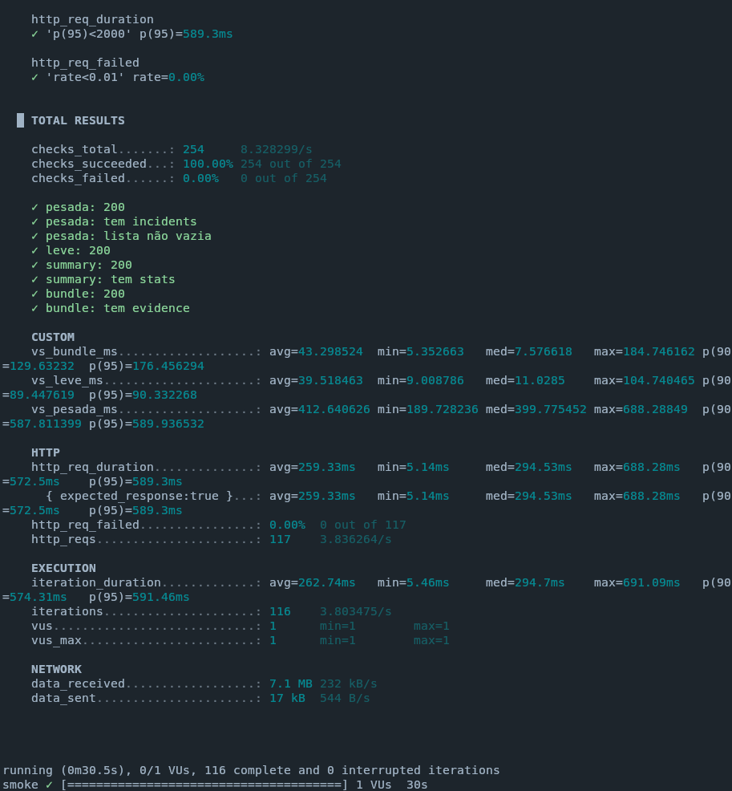

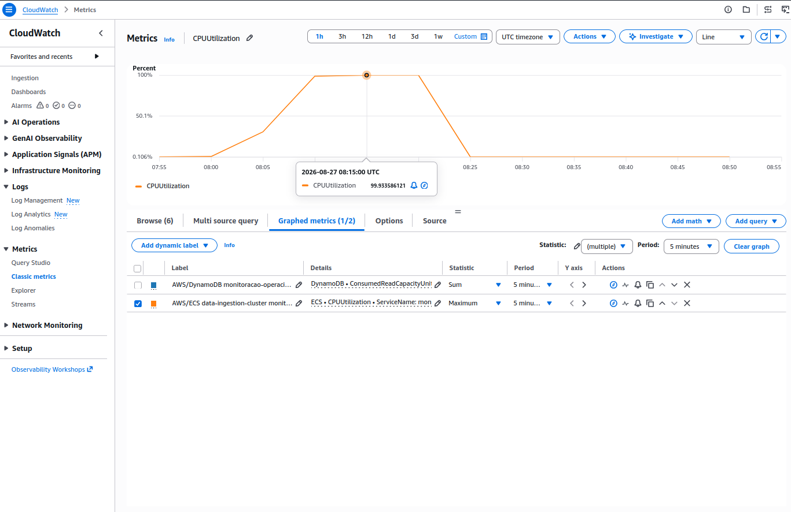

&emsp; Uma rodada pesada na AWS **pós-correção de chaves** continua obrigatória
antes de afirmar atendimento ao RNF14 na infraestrutura de produção. A rodada de
§8.2 mostra o código atual sustentando a taxa alvo em leito local; não substitui
aquela medição.

---

## 10. Observabilidade

&emsp; Os quatro indicadores foram capturados em **dois ambientes**: a pilha
local em Docker, no intervalo das rodadas de §8.1–8.6
(`2026-09-11T05:28:00Z` → `05:57:00Z`), descrita em §10.1–§10.5; e a pilha
equivalente **em AWS**, no intervalo da bateria de §8.8
(`2026-09-11T07:32:00Z` → `07:54:00Z`), em §10.6. Os números de nuvem são os
que valem como capacidade; os locais descrevem o comportamento do código.

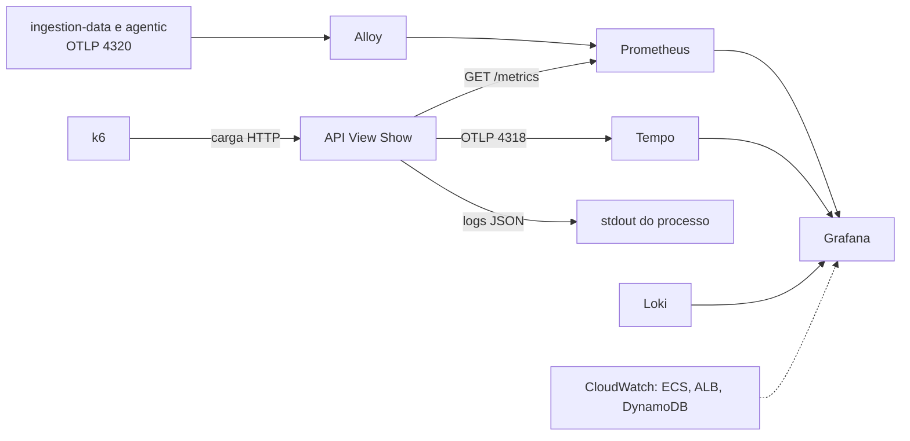

&emsp; Os cinco alvos do Prometheus estavam `up`, incluindo `view-show-api` em
`host.docker.internal:3000`:

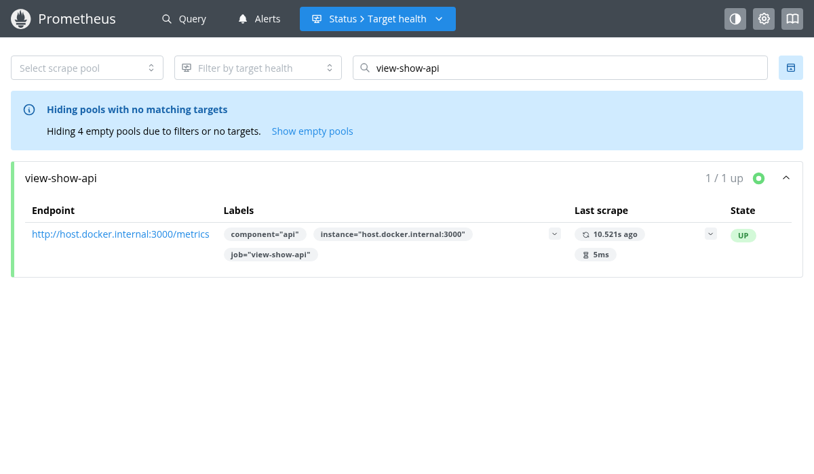

Bruto: [`prometheus/targets.json`](../assets/testes-carga/2026-09-11/prometheus/targets.json).

### 10.1 Os quatro indicadores obrigatórios

&emsp; As quatro imagens abaixo são renderizações do dashboard provisionado
`View Show — API (RED)`
([`view-show-api.json`](../apps/fullstack/observability/grafana/provisioning/dashboards/json/view-show-api.json))
lendo o Prometheus da pilha, no intervalo das rodadas. A legenda de cada painel
mostra a consulta PromQL executada.

| Indicador       | Consulta PromQL do painel                                                                                                                                     | Faixa medida na janela         |
| --------------- | ------------------------------------------------------------------------------------------------------------------------------------------------------------- | ------------------------------ |
| **Latência p95** | `histogram_quantile(0.95, sum by (le) (rate(http_request_duration_seconds_bucket{job="view-show-api",status_code="200"}[5m])))`                               | 0,047 s → **9,64 s**           |
| **Throughput**   | `sum(rate(http_requests_total{job="view-show-api",status_code="200"}[5m]))`                                                                                    | 0 → **263,6 req/s**            |
| **Erros/s**      | `sum(rate(http_requests_failed_total{job="view-show-api"}[5m]))`                                                                                               | 0 → **93,44 req/s**            |
| **CPU**          | `100 * (rate(view_show_process_cpu_user_seconds_total{job="view-show-api"}[5m]) + rate(view_show_process_cpu_system_seconds_total{job="view-show-api"}[5m]))` | 0,35% → **145,1%**             |

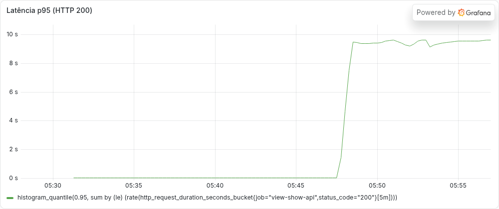

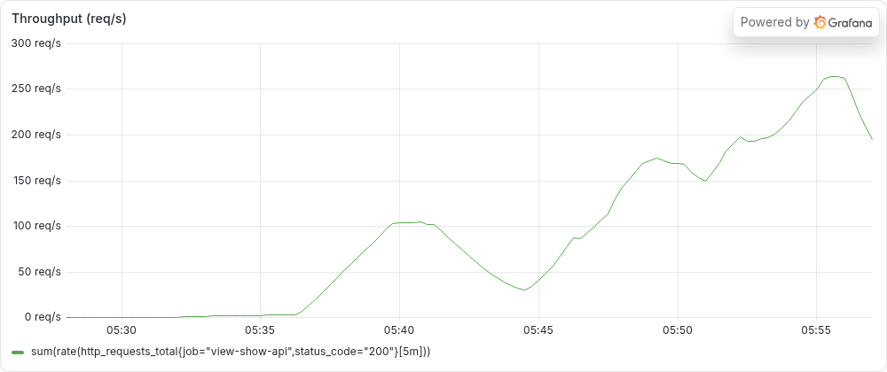

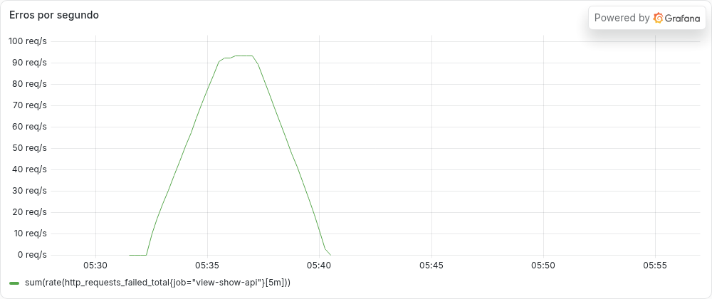

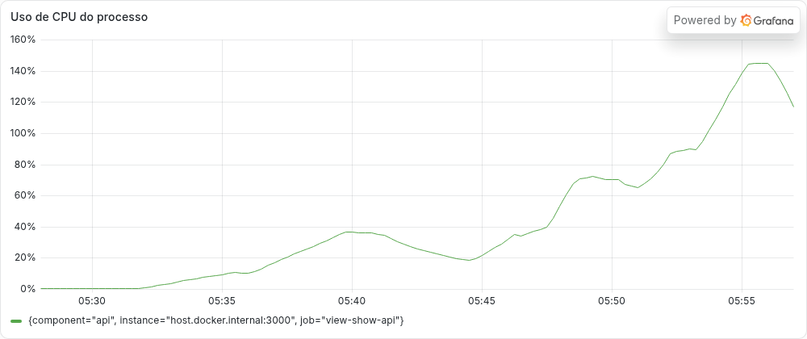

&emsp; Séries brutas correspondentes, em
[`prometheus/`](../assets/testes-carga/2026-09-11/prometheus/):
`latencia-p95.json`, `throughput.json`, `erros-por-segundo.json`,
`erros-por-segundo-por-status.json`, `cpu.json`.

&emsp; **Nota de método sobre as capturas.** A imagem
`grafana/grafana:13.2.1` é Alpine/aarch64 e não executa o plugin de renderização
embutido. A renderização usou dois contêineres temporários — o renderizador
oficial `grafana/grafana-image-renderer:3.12.9` e uma segunda instância do mesmo
Grafana apontada para ele, lendo o **mesmo** JSON provisionado e o **mesmo**
Prometheus — removidos ao final. A pilha do projeto não foi alterada. As séries
são as reais; as imagens não são mockups nem capturas de configuração vazia.

### 10.2 Leitura dos painéis à luz das rodadas

&emsp; Os quatro gráficos contam a mesma história dos resumos k6, e é essa
coerência que valida a instrumentação:

- **erros/s** tem um platô de 93,44/s entre ~05:32 e ~05:40 e **zero** depois. O
  platô é exatamente a rodada `load` de limite padrão (05:31:51–05:35:36, §8.2)
  despejando `429`, com a cauda da janela de `rate(...[5m])`; o zero cobre a
  janela controlada, o `breakpoint`, o `spike` e o `estresse`, onde não houve
  nenhum 4xx/5xx;
- a quebra por status confirma: na janela inteira,
  `sum by (status_code) (rate(http_requests_failed_total{job="view-show-api"}[5m]))`
  só tem valor em `status_code="429"` (máximo de 93,44/s). As séries de
  **401, 404 e 503 ficam em zero** — nenhum erro de validação, de sessão ou de
  projeção indisponível ocorreu ([bruto](../assets/testes-carga/2026-09-11/prometheus/erros-por-segundo-por-status.json));
- as 3,51% de falhas do `spike` **não aparecem** no painel de erros — e não
  deveriam: eram `dial: i/o timeout` no cliente, conexões que nunca chegaram a
  ser servidas. O painel mede o que a API respondeu;
- **latência p95** fica em milissegundos até ~05:47 e salta para ~9,5 s a partir
  do `spike`, degradando junto com o `estresse` — o mesmo perfil dos p95 de
  §8.4, com a ressalva do teto de 10 s do histograma;
- **throughput** desenha a rampa do `breakpoint` (05:40–05:46), a rajada do
  `spike` e o platô do `estresse`, com pico de 263,6 req/s;
- **CPU** sobe monotonicamente com a carga até 145,1%, ou seja **mais de um
  núcleo** — possível porque a API roda direto no host, sem limite de vCPU. É
  precisamente por isso que esse número **não** é comparável ao `CPUUtilization`
  de uma task Fargate com 0,25 vCPU.

&emsp; **Achado de observabilidade que permanece:** o rate limiter roda em
`app.use()` **antes** do roteamento, então toda requisição rejeitada com `429`
é contabilizada com `route="unmatched"`. Pela métrica da API não se sabe qual
endpoint estava sendo chamado quando foi limitado — o k6 sabe, via
`rate_limited_total{rota=...}` no lado do cliente. Para isolar erro real de
rate limiting no Prometheus:
`rate(http_requests_total{job="view-show-api",status_code=~"5..",route!="unmatched"}[1m])`.

### 10.3 Validação sintática e de nomes

| Verificação                                                    | Ferramenta                          | Resultado                                                         |
| -------------------------------------------------------------- | ----------------------------------- | ----------------------------------------------------------------- |
| `prometheus.yml`                                               | `promtool check config`             | **SUCCESS** — sintaxe válida, 1 arquivo de regras                 |
| `prometheus/rules/view-show.yml`                               | `promtool check rules`              | **SUCCESS** — 7 regras encontradas                                |
| `view-show-api.json`, `view-show-overview.json`, `view-show-aws.json.tftpl` | parser JSON            | **válidos**                                                       |
| `docker-compose.observability.yml`                             | `docker compose ls` na pilha em execução | **válido** — 5 serviços de pé (`running(5)`)                  |
| Nomes de métrica dos painéis × `GET /metrics` da API           | comparação direta                   | ver abaixo                                                        |

&emsp; Correções de configuração feitas nesta consolidação:

1. **`view-show-api.json` usava nomes de métrica inexistentes.** Os painéis
   apontavam para `view_show_http_request_duration_seconds_bucket` e
   `view_show_http_requests_total`; a API expõe `http_request_duration_seconds`
   e `http_requests_total` **sem** o prefixo (o prefixo `view_show_` vale só
   para as métricas default do `prom-client`, como
   `view_show_process_cpu_*`). O painel de erros passou a usar
   `http_requests_failed_total`, que é a métrica realmente declarada em
   `src/observability/metrics.ts`. Sem essa correção os quatro painéis ficariam
   permanentemente vazios.
2. **O painel de CPU não filtrava `job`**, ao contrário do painel equivalente em
   `view-show-overview.json`. Passou a filtrar `job="view-show-api"`.
3. **`loadtest/README.md` afirmava que o alvo `view-show-api` está comentado em
   `prometheus.yml`.** Não está — o alvo é declarado e foi observado `up`.

### 10.4 O que está configurado e ainda não tem dado

&emsp; `view-show-overview.json` tem 15 painéis. Os da API e do frontend
apontam para métricas declaradas em `apps/backend/api`; os de ingestão, análise
e fila apontam para métricas declaradas nos módulos de observabilidade de
`apps/backend/ingestion-data` e `apps/backend/agentic`
(`ingestion_records_read_total`, `ingestion_records_written_total`,
`ingestion_records_rejected_total`, `ingestion_schema_drift_total`,
`ingestion_pipeline_run_duration_seconds`, `analysis_messages_total`,
`bedrock_invocation_duration_seconds`, `sqs_queue_depth_messages`,
`sqs_dead_letter_queue_messages`) e chegariam ao Prometheus por
OTLP → Alloy → `remote_write`, caminho já declarado em `config.alloy`.

&emsp; Essas métricas **não são órfãs, mas estão sem série**: os workers não
executaram nesta sessão, e o de ingestão não existe além do próprio módulo de
observabilidade. Consequência honesta: esses painéis, e os alertas
`ViewShowIngestionRunSlow`, `ViewShowAgenticHighFailureRate` e
`ViewShowAgenticDlqNotEmpty`, estão **configurados e sem evidência de
funcionamento**. O mesmo vale para `frontend_web_vitals_*`,
`frontend_client_errors_total`, `frontend_api_fetch_errors_total` e
`operator_clicks_to_root_cause`: são declarados no registry da API, mas só
passam a existir como série depois do primeiro `POST /api/v1/telemetry/rum`,
que não ocorreu nesta bateria.

### 10.5 Alertas

| Alerta                           | Condição                                              | `for:` | RNF                 | Estado                                              |
| -------------------------------- | ----------------------------------------------------- | -----: | ------------------- | --------------------------------------------------- |
| `ViewShowApiTargetDown`          | `up{job="view-show-api"} == 0`                        |     2m | RNF09               | **Disparou em AWS** às `07:47:30Z` sob `estresse` (§10.6.3) |
| `ViewShowApiHighErrorRate`       | razão de 5xx > 0,1%                                   |     5m | RNF09               | **Disparou em AWS** às `07:48:00Z` (§10.6.3)        |
| `ViewShowIncidentQuerySlow`      | p95 de incidentes > 2 s                               |     5m | RNF14               | **Disparou em AWS** às `07:39:30Z`, ~6 min após a degradação começar (§10.6.3) |
| `ViewShowFrontendLcpPoor`        | LCP p95 > 4 s                                         |    15m | RNF07, complementar | Configurado; métrica sem série (§10.4)              |
| `ViewShowIngestionRunSlow`       | duração p95 da ingestão > 120 s                       |    15m | RNF02               | Configurado; métrica sem série                      |
| `ViewShowAgenticHighFailureRate` | falhas do worker > 5%                                 |    10m | RNF03               | Configurado; métrica sem série                      |
| `ViewShowAgenticDlqNotEmpty`     | `sqs_dead_letter_queue_messages > 0`                  |     5m | RNF03               | Configurado; métrica sem série                      |

&emsp; Observação relevante para o RNF15: o menor `for:` das regras é de **2
minutos**, incompatível com o critério de "alerta em até 30 segundos". A
bateria em AWS mediu a latência de detecção real — **~6 minutos** para a
degradação de latência (§10.6.3) —, o que confirma o diagnóstico por medição e
não só por inspeção. Fechar o RNF15 exige rever o desenho das regras, não só
executar o teste, e exige um Alertmanager, que não está na pilha.

### 10.6 Observabilidade em AWS (executada)

&emsp; A mesma pilha LGTM roda na nuvem, provisionada por
[`observability-aws.tf`](../apps/fullstack/observability-aws.tf): uma EC2
`t3.medium` que o `cloud-init` sobe com Grafana, Prometheus, Loki, Tempo e
Alloy, criada apenas quando `observabilidade_habilitada=true`. O Terraform
injeta na task ECS o `OTEL_EXPORTER_OTLP_ENDPOINT` e o `LOKI_PUSH_URL` com o IP
privado dessa instância, e os security groups liberam `4318`, `4320` e `3100`
**somente** a partir do security group da API. O Grafana fica fechado por
padrão; nesta sessão foi aberto para um único `/32`.

&emsp; Os cinco alvos do Prometheus ficaram `up`, incluindo `view-show-api`
raspando `/metrics` **pelo ALB**
([bruto](../assets/testes-carga/2026-09-11-aws/prometheus/targets.json)).

#### 10.6.1 Os quatro indicadores, medidos na nuvem

| Indicador | Faixa medida em AWS (`07:32`–`07:54`) | Contraste com o leito local |
| --- | --- | --- |
| **Latência p95** | 0,089 s → **24,943 s** | local: 0,047 s → 9,64 s |
| **Throughput** | 0,098 → **58,46 req/s** | local: 0 → 263,6 req/s |
| **Erros/s** | 0 → **2,159/s** | local: 0 → 93,44/s (eram 429) |
| **CPU** | processo: 0,219% → 139,65% · **ECS `CPUUtilization`: até 100%** | local: 0,35% → 145,1% |

&emsp; Brutos em
[`2026-09-11-aws/prometheus/`](../assets/testes-carga/2026-09-11-aws/prometheus/)
e [`2026-09-11-aws/cloudwatch/`](../assets/testes-carga/2026-09-11-aws/cloudwatch/).

&emsp; **Qual número de CPU vale.** O painel "Uso de CPU do processo" usa
`view_show_process_cpu_*` do `prom-client`, que mede tempo de CPU do processo e
passa de 100% ao somar threads — ele não é a utilização da task. O número
autoritativo é o `CPUUtilization` do CloudWatch, no dashboard `View Show — AWS`:
**média por minuto chegando a 99,89% e máximo em 100%** entre 07:33 e 07:49.
Essa distinção não existia no artefato quando só havia o leito local, onde a API
rodava sem limite de vCPU.

&emsp; **Buckets de latência.** Esta bateria já roda com o histograma estendido
de 10 s para **60 s** em `src/observability/metrics.ts` — mudança feita
justamente para esta rodada. Com o teto anterior o p95 do Prometheus teria
travado em platô de 10 s e o painel mostraria 10 s no lugar dos 24,9 s medidos.

#### 10.6.2 Capturas

&emsp; As três imagens abaixo foram tiradas na sessão da AWS, no Grafana da EC2.

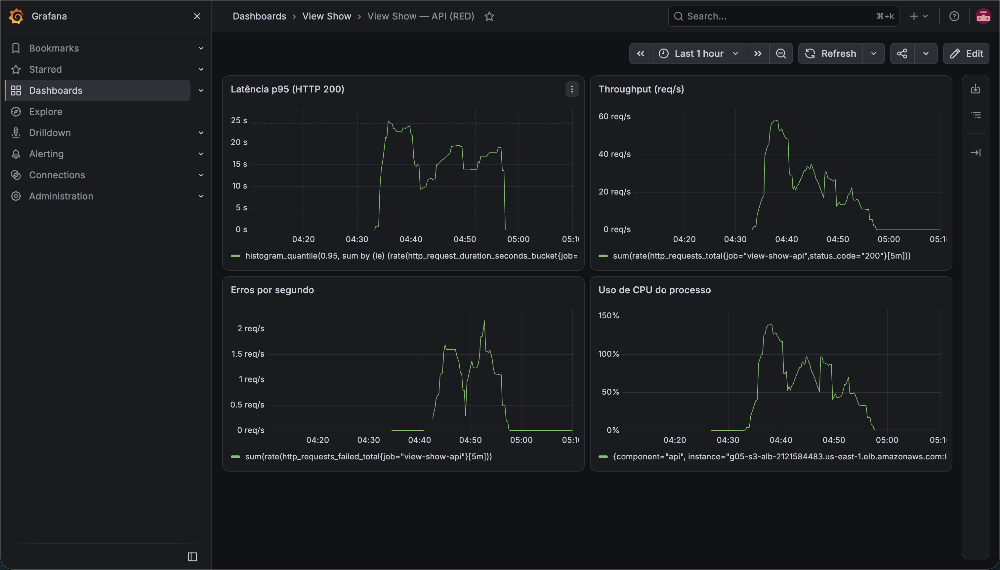

&emsp; `View Show — API (RED)`: os quatro painéis da rubrica com dado real da
nuvem — p95 subindo a ~25 s, throughput com pico perto de 58 req/s, erros por
segundo chegando a ~2/s e a CPU de processo passando de 100%. O rótulo da série
de CPU mostra `instance="g05-s3-alb-…elb.amazonaws.com"`, o que identifica a
origem AWS da medição. O eixo está em horário local (UTC−3), então 04:33–04:49
corresponde a 07:33–07:49 UTC.

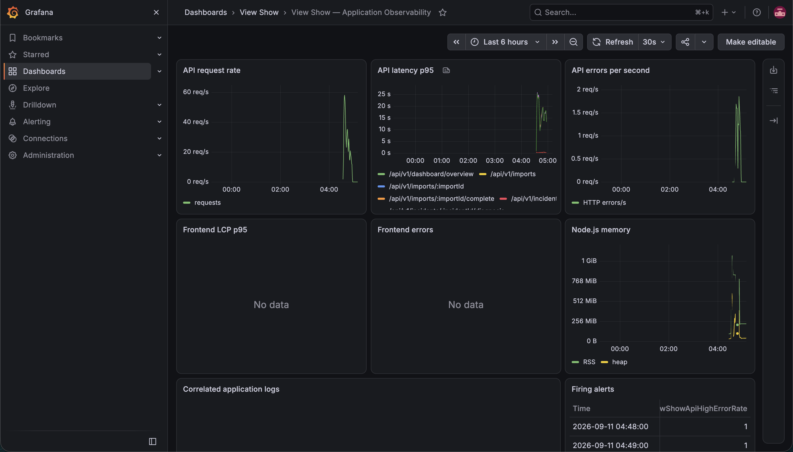

&emsp; `View Show — Application Observability`: o mesmo período com a latência
p95 **quebrada por rota**, o request rate, os erros por segundo, a memória do
Node (RSS chegando a ~1 GiB) e, no canto inferior direito, o painel **Firing
alerts** com `ViewShowApiHighErrorRate` registrado às 04:48 e 04:49 locais. Os
painéis `Frontend LCP p95` e `Frontend errors` aparecem como **No data**, o que
é o estado correto: nenhum `POST /api/v1/telemetry/rum` ocorreu (§10.4).

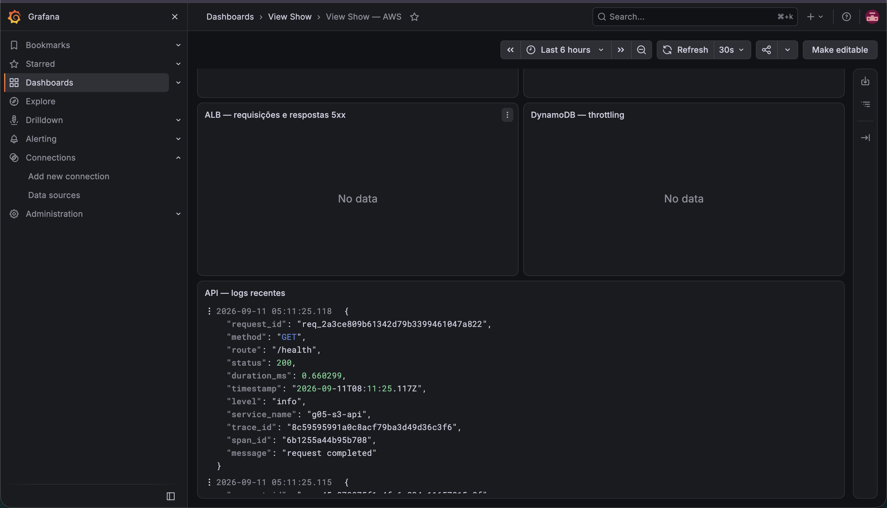

&emsp; `View Show — AWS`: o dashboard alimentado pelo CloudWatch. A captura
mostra o painel `API — logs recentes` com linhas JSON reais da API na nuvem —
`request_id`, `route`, `status`, `duration_ms`, `trace_id`, `span_id` e
`service_name: g05-s3-api` —, o que fecha o caminho de logs
CloudWatch → Grafana e o torna correlacionável por trace.

&emsp; **A evidência numérica do ECS e do ALB é a série versionada, não a
imagem.** As métricas gerenciadas usadas em §8.8.3 e §8.8.4 — `CPUUtilization`,
`MemoryUtilization`, `RequestCount`, `HTTPCode_Target_5XX_Count`,
`HTTPCode_ELB_5XX_Count`, `TargetResponseTime` e `ReadThrottleEvents` — estão em
[`cloudwatch/`](../assets/testes-carga/2026-09-11-aws/cloudwatch/), extraídas
com `aws cloudwatch get-metric-statistics` na mesma janela da bateria. As
capturas ilustram os dashboards; os JSON são o dado conferível.

#### 10.6.3 Três alertas dispararam de verdade

&emsp; Até esta bateria, todas as sete regras estavam "configuradas e sem
evidência de funcionamento". Três dispararam na nuvem, com a série `ALERTS`
capturada do Prometheus
([bruto](../assets/testes-carga/2026-09-11-aws/prometheus/alertas-disparados.json)):

| Alerta | `for:` | Disparou em | Latência de detecção | RNF |
| --- | ---: | --- | --- | --- |
| `ViewShowIncidentQuerySlow` | 5m | `07:39:30Z` | **~6 min 17 s** depois do início do `load` (07:33:13Z) | RNF14 |
| `ViewShowApiTargetDown` | 2m | `07:47:30Z` | target ficou indisponível sob `estresse` | RNF09 |
| `ViewShowApiHighErrorRate` | 5m | `07:48:00Z` | — | RNF09 |

&emsp; Isso é evidência de que o caminho **regra → avaliação → alerta em estado
`firing`** funciona de ponta a ponta, e não só de que o YAML é válido. Duas
consequências:

1. **O RNF09 ganhou um sinal que não tinha:** `ViewShowApiTargetDown` disparando
   significa que o alvo realmente saiu do ar sob 411 req/s — a task parou de
   responder ao scrape. É degradação observável, registrada.
2. **O RNF15 continua `Bloqueado`, mas agora por medição e não por inspeção.**
   O critério pede alerta em **até 30 s**; o desenho atual levou **~6 min** para
   acusar a degradação de latência, coerente com `for: 5m`. Não é ajuste de
   limiar: fechar 30 s exige rever `for:`, o intervalo de avaliação e a janela
   das consultas — e ainda instalar um Alertmanager, que não está na pilha.
   Nenhum alerta foi **entregue** a ninguém; eles apenas entraram em `firing`.

#### 10.6.4 Uma lacuna de provisionamento, corrigida

&emsp; O dashboard `View Show — API (RED)` — o que reúne exatamente os quatro
indicadores da rubrica — **não era provisionado na AWS**. O `user-data` da EC2
escrevia só `view-show-aws.json` e `view-show-overview.json`; o RED existia
apenas na pilha local. Na prática, quem abrisse o Grafana da nuvem não
encontraria os quatro indicadores reunidos em lugar nenhum.

&emsp; Foram feitas duas coisas: o dashboard foi publicado na instância em
execução pela API do Grafana, para não recriar a EC2 e perder as séries desta
bateria (`user_data_replace_on_change = true` recria a instância a cada mudança
de configuração); e a causa foi corrigida no IaC, com `api_dashboard_gzip` em
`observability-aws.tf` e a linha correspondente em `user-data.sh.tftpl`. **Essa
correção só passa a valer no próximo `apply`**, que recriará a instância.

---

## 11. Limitações e pendências

### 11.1 O que os números de §8 não provam

1. **Leito local, não homologação.** Processo Node sem contêiner, sem limite de
   vCPU (CPU de processo chegou a 145,1% — mais de um núcleo), DynamoDB Local em memória e
   gerador na mesma máquina. Nada disso é comparável a ECS Fargate com 0,25 vCPU
   atrás de um ALB. O p95 de 8,95 ms de §8.2 **não** é o p95 de produção.
2. **Origem única, não distribuída.** Mesmo com o limite elevado, todo o tráfego
   veio de um IP. A concorrência real de produção tem outra distribuição.
3. **Limite de taxa alterado.** A rodada válida de §8.2 rodou com
   `RATE_LIMIT_PER_MINUTE=200000`. O valor de produção é 180 e continua sendo o
   padrão do código. A rodada com 180 foi preservada e **reprova** — é ela que
   descreve o comportamento em produção para uma origem única.
4. **Volume sintético.** O seed é determinístico (300 incidentes em 25 h); não
   reproduz a distribuição real de produção.
5. **Autenticação forjada.** O cookie é gerado localmente com o mesmo HMAC do
   `SessionCodec`. Mede a API para uma sessão válida, não o fluxo Cognito/OIDC.
6. **Descartes do gerador.** `spike` e `estresse` somam 51.613 iterações que o k6
   não conseguiu iniciar (teto de VUs). Parte da carga pedida nunca foi emitida.
   Nas rodadas que sustentam conclusões (`smoke`, `load`, `breakpoint`) os
   descartes são **zero**.
7. **`breakpoint`, `spike` e `estresse` não têm threshold.** Descrevem
   comportamento; não aprovam requisito. E não há threshold de **recuperação**
   por fase em nenhum deles.
8. **Uma repetição por cenário.** A rubrica de engenharia pede variabilidade; são
   necessárias ao menos três repetições por cenário para reportar dispersão.
9. **`checks` não é a fração de respostas boas.** Os sub-checks de corpo são
   vacuamente verdadeiros quando o status não é 200 (§6.4), então em rodadas com
   muito 429 o agregado fica otimista — 32,69% de checks contra 2,94% de
   respostas 200 na rodada de limite padrão. A pergunta "quantas respostas foram
   de negócio" é respondida por `http_reqs{status:200}`.
10. **RNF04 medido com sessão forjada.** O 37/37 de §8.5 prova o controle de
    acesso da API; não exercita a emissão de sessão via Cognito/OIDC nem a
    restrição ao domínio corporativo que o requisito também pede.

### 11.2 Pendências que exigem AWS ou autorização externa

| Pendência                                                                              | Bloqueio                                          |
| -------------------------------------------------------------------------------------- | ------------------------------------------------- |
| ~~Repetir `load`/`breakpoint`/`spike`/`estresse` em ECS Fargate, com bruto anexado~~ **FEITO em §8.8** | — |
| Repetir a bateria com o gerador **dentro** da AWS (EC2 na mesma região), para separar latência de rede da latência da API | Conta AWS |
| Reexecutar as três configurações de capacidade de §8.7 **anexando o `resumo-*.json`**, para que aquelas rodadas passem de relato a evidência | Conta AWS + autorização de deploy |
| ~~Investigar a cauda de latência de §8.7~~ **FEITO em §8.8.4**: o gargalo é CPU da task (100%), com memória em 40% e zero throttling no DynamoDB | — |
| Medir 2 e 4 vCPU por task antes de escalar em número de tasks (§8.8.4)                   | Conta AWS + autorização de deploy                 |
| Fechar o RNF14 em produção: nenhuma configuração testada chega a `p(95)<2000ms` (§8.8.2, §8.7) | Conta AWS + decisão de capacidade |
| Janela de 12 h de health-check com 3 encerramentos forçados (RNF09)                     | Homologação com contêiner reiniciável             |
| RNF01/RNF02/RNF03 na arquitetura atual                                                  | Adaptador real de `ImportControlPort` (S3 + tarefa ECS) **e** `upload.parts[].url` no contrato |
| RNF11 (normalização multi-schema)                                                       | Worker de ingestão implementado                   |
| RNF08 e RNF13 (modelo de ML)                                                            | Acesso ao Bedrock (indisponível no Learner Lab)   |
| RNF05 (camada cold)                                                                     | S3 + Glue/Athena provisionados                    |
| RNF15 (alerta ≤ 30 s)                                                                   | Alertmanager, detector, e revisão do `for:` das regras |
| Painéis de ingestão/análise/fila com dado (§10.4)                                       | Execução dos workers                              |

### 11.3 Pendências sem bloqueio externo

1. `soak` de 2 h (§12) — só depende de janela de tempo.
2. `@vitest/coverage-v8` não instalado e nenhum gate de cobertura no
   `.gitlab-ci.yml` (RNF12).
3. Relatório Lighthouse/RUM controlado para o RNF07 e sessão guiada para o
   RNF10.
4. Adicionar thresholds de recuperação por fase a `spike` e `estresse`, para
   que os ~30–45 s medidos em §8.4 passem a ser critério e não só observação.
5. Aplicar a correção de provisionamento do dashboard RED na AWS (§10.6.4): o
   IaC já está corrigido, mas só passa a valer no próximo `apply`, que recria a
   EC2 de observabilidade.

&emsp; Já resolvido nesta entrega, e registrado aqui porque era item desta
lista: os **buckets do histograma de latência** subiram de 10 s para 60 s em
`src/observability/metrics.ts`. Sem isso o p95 do Prometheus teria saturado em
platô durante toda a bateria em AWS, onde a medição real foi de 24,9 s.

### 11.4 Nota sobre a suíte de política de CI

&emsp; `npm run test:ci-policy` reprova **113 de 321 casos** neste host
(`tests 321 · pass 208 · fail 113`). A causa dominante é
`mapfile: command not found` (~68 ocorrências), seguida de
`declare: -A: invalid option` (~35) e de assertivas em cascata dessas duas
(`0 !== 2`, `127 !== 0`): os scripts de `scripts/ci/` usam builtins de bash 4+
e o macOS traz bash 3.2.57. É incompatibilidade de ambiente, não regressão —
nenhum arquivo em `scripts/` ou `tests/ci/` foi tocado nesta consolidação.
`npm run build` e `npm test` (70 passaram, 1 ignorado, 11 arquivos) passam
normalmente. Uma versão anterior deste documento dizia "227 casos": aquele era
o número de linhas com marcador de falha na saída, que inclui os nós de
agrupamento, e não a contagem de casos.

---

## 12. Reprodução

### 12.1 API de consulta, leito local

```bash
# 1. DynamoDB Local (o heap padrão não sustenta 137 req/s — ver §8.3)
java -Xmx3g -Djava.library.path=./DynamoDBLocal_lib \
  -jar ./DynamoDBLocal.jar -inMemory -sharedDb -port 18000 &

# 2. Tabela monitoracao-operacional: pk/sk + GSI trace-index (trace_id, sk) + TTL em `ttl`

# 3. API (a partir de apps/backend/api)
export AUTH_COOKIE_SECRET=<32+ chars>  CURSOR_SECRET=<32+ chars>
export AWS_REGION=us-east-1 AWS_ACCESS_KEY_ID=local AWS_SECRET_ACCESS_KEY=local
export OPERATIONAL_TABLE_NAME=monitoracao-operacional
export DYNAMODB_ENDPOINT=http://127.0.0.1:18000
export OTEL_EXPORTER_OTLP_ENDPOINT=http://localhost:4318   # traces no Tempo
npm run build && npm start

# 4. Seed imediatamente antes de cada rodada (os snapshots de projeção envelhecem)
CLEAN=1 node scripts/seed-carga.cjs

# 5. Rodadas (a partir de apps/backend/api/loadtest/k6)
export BASE_URL=http://127.0.0.1:3000
k6 run -e BASE_URL=$BASE_URL -e AUTH_COOKIE_SECRET=$AUTH_COOKIE_SECRET -e MODE=smoke consultas.js
k6 run -e BASE_URL=$BASE_URL -e AUTH_COOKIE_SECRET=$AUTH_COOKIE_SECRET auth-check.js
k6 run -e BASE_URL=$BASE_URL -e AUTH_COOKIE_SECRET=$AUTH_COOKIE_SECRET -e MODE=drenagem ingestao-batch.js
```

### 12.2 A rodada que mede a API, e não o rate limiter

&emsp; Com o limite de produção (180 req/min por origem), uma origem única
sempre reprova. Suba o limite **apenas na janela do teste** e devolva ao padrão
depois:

```bash
# API com o teto elevado só para esta janela
RATE_LIMIT_PER_MINUTE=200000 npm start

CLEAN=1 node scripts/seed-carga.cjs
k6 run -e BASE_URL=http://127.0.0.1:3000 -e AUTH_COOKIE_SECRET=$AUTH_COOKIE_SECRET \
       -e MODE=load consultas.js        # grava resumo-load.json

# depois da janela: voltar ao padrão de produção
npm start                               # RATE_LIMIT_PER_MINUTE ausente => 180
```

&emsp; Em homologação/AWS, o mesmo efeito vem de
`var.rate_limit_por_minuto` (`apps/fullstack/variables.tf`, introduzida em
`feat/teste-de-carga`), que popula `RATE_LIMIT_PER_MINUTE` na task ECS. A
alternativa preferível, quando houver infraestrutura, é **distribuir a origem**
(k6 em várias instâncias/sub-redes), mantendo o limite em 180.

### 12.3 Cenários pendentes

```bash
# bateria completa (smoke → load → breakpoint → estresse → spike → soak)
./rodadas.sh

# só o soak (2 h, duração fixa no script) — único cenário sem execução nesta bateria
k6 run -e BASE_URL=http://127.0.0.1:3000 -e AUTH_COOKIE_SECRET=$AUTH_COOKIE_SECRET \
       -e MODE=soak consultas.js
```

### 12.4 Ingestão histórica (API Flask)

```bash
cd artefatos/sprint2/testes-carga/k6
export BASE_URL=http://127.0.0.1:18080
export FAULT_TOKEN='<segredo-exclusivo-da-rodada>'
./rodadas-ingestao.sh local
```

Cada cenário falha com status diferente de zero ao violar um threshold e exporta
seu resumo em `artefatos/sprint2/testes-carga/resultados`.

### 12.5 Observabilidade e capturas

```bash
docker compose -f apps/fullstack/docker-compose.observability.yml up -d
curl -s 'http://127.0.0.1:9090/api/v1/targets?state=active' | jq '.data.activeTargets[].health'
# Grafana em http://127.0.0.1:3002 (admin/admin) → pasta "View Show"

# séries dos quatro indicadores na janela da rodada
curl -sG 'http://127.0.0.1:9090/api/v1/query_range' \
  --data-urlencode 'query=sum(rate(http_requests_total{job="view-show-api",status_code="200"}[5m]))' \
  --data-urlencode 'start=<ISO-8601>' --data-urlencode 'end=<ISO-8601>' \
  --data-urlencode 'step=15s'

# validação de sintaxe
docker exec vs-prometheus promtool check config /etc/prometheus/prometheus.yml
docker exec vs-prometheus promtool check rules  /etc/prometheus/rules/view-show.yml
```

&emsp; Para capturar os painéis em uma imagem `grafana/grafana` Alpine, o
procedimento com renderizador temporário está descrito em
[`assets/testes-carga/2026-09-11/README.md`](../assets/testes-carga/2026-09-11/README.md).

### 12.6 Bateria em AWS (ECS Fargate)

&emsp; Requer sessão ativa do AWS Academy, Terraform, Docker e k6. **Cria
infraestrutura que gera custo enquanto existir.**

```bash
# 1. terraform.tfvars local (não versionado) com a conta do lab da vez
cd apps/fullstack
cat > terraform.tfvars <<'TFVARS'
aws_account_id             = "<12 dígitos — aws sts get-caller-identity>"
deployment_namespace       = "g05-s3"
regiao                     = "us-east-1"
observabilidade_habilitada = true
grafana_cidr_acesso        = "<seu-ip>/32"   # null exige túnel SSM
TFVARS

# 2. Uma task só: o Prometheus raspa /metrics pelo ALB, e com 2+ tasks
#    o rate() lê a alternância entre contadores como reset (§8.8)
terraform init
terraform apply -var cpu_task=1024 -var memoria_task=2048 \
                -var quantidade_tasks=1 -var rate_limit_por_minuto=20000

# 3. Semear a tabela real. CLEAN=1 é recusado contra endpoint remoto de
#    propósito; a tabela recém-criada já nasce vazia.
cd ../backend/api
ALLOW_REMOTE_SEED=1 AWS_REGION=us-east-1 \
  OPERATIONAL_TABLE_NAME=g05-s3-operacional node scripts/seed-carga.cjs

# 4. Bateria com evidência auditável (resumo + metadados por rodada)
cd loadtest/k6
export AUTH_COOKIE_SECRET=$(terraform -chdir=../../../../fullstack \
  output -json 2>/dev/null | python3 -c \
  'import json,sys;print(json.load(sys.stdin)["grafana_senha"]["value"])')  # ver nota
BASE_URL=$(terraform -chdir=../../../../fullstack output -raw api_url) \
AMB_API="ECS Fargate 1 vCPU / 2048 MB x 1 task" \
AMB_RATE_LIMIT=20000 ./bateria.sh
```

&emsp; **Nota sobre o segredo:** `AUTH_COOKIE_SECRET` é o mesmo valor que o
Terraform injeta na task (`random_password.auth_cookie_secret`), e não tem
output próprio — leia-o do estado com `terraform show -json` e **não** o grave
em arquivo versionado. O `bateria.sh` já o substitui por `<segredo>` no
`metadados-*.json`, e o `handleSummary()` dos scripts redige o cookie em
`setup_data`.

&emsp; Grafana: `terraform output grafana_acesso` dá a URL direta e o comando de
túnel SSM; `terraform output -raw grafana_senha` dá a senha do `admin`. As
séries do CloudWatch usadas em §8.8 saem de
`aws cloudwatch get-metric-statistics` nos namespaces `AWS/ECS`,
`AWS/ApplicationELB` e `AWS/DynamoDB`, na mesma janela da bateria.


---

## 13. Conclusão por RNF

&emsp; Nem tudo passou, e o que passou passou em um leito declarado. A tabela
abaixo é a conclusão, requisito por requisito.

| RNF       | Status          | Evidência                                                                                              | Ambiente                       | Conclusão                                                                                                       | Pendência                                                                              |
| --------- | --------------- | ------------------------------------------------------------------------------------------------------ | ------------------------------ | --------------------------------------------------------------------------------------------------------------- | -------------------------------------------------------------------------------------- |
| **RNF01** | **Bloqueado** · **Histórico** aprovado | [`resumo-ingestao-drenagem.json`](../assets/testes-carga/2026-09-11/resumo-ingestao-drenagem.json) · [`resumo-ingestao-carga-local.json`](./sprint2/testes-carga/resultados/resumo-ingestao-carga-local.json) | Local atual · Local Flask      | 10 mil eventos/min aprovados **no Flask** (10.100 aceitos, p95 2,89 ms, zero descarte). Na stack atual o adaptador responde `503` e o cenário não roda | Adaptador de import (S3 + tarefa ECS) e `upload.parts[].url` no contrato               |
| **RNF02** | **Bloqueado**   | Mesmo aborto de `setup()`                                                                              | Local atual                    | Nenhuma medição ponta a ponta existe; a confirmação HTTP não substitui o critério de 120 s                      | Mesmo bloqueio do RNF01 + projeção publicada pela ingestão                             |
| **RNF03** | **Bloqueado** · **Histórico** aprovado | [fila cheia](./sprint2/testes-carga/resultados/resumo-ingestao-fila-cheia-local.json) · [timeout](./sprint2/testes-carga/resultados/resumo-ingestao-timeout-local.json) | Local Flask                    | Fila cheia (`429 queue_full`) e timeout (`504 dependency_timeout`) aprovados no Flask, com recuperação sem reinício e 402/402 checks — mas **induzidos**, sem SQS, retry, backoff, DLQ ou perda pós-`202` | Repetir contra fila, worker e dependências reais                                       |
| **RNF04** | **Aprovado** | [local](../assets/testes-carga/2026-09-11/resumo-auth-check.json) · [**AWS**](../assets/testes-carga/2026-09-11-aws/resumo-auth-check.json) | Local **e ECS Fargate** | **37/37 checks, `exit=0` nos dois ambientes**: as 11 rotas com guarda recusam chamada sem sessão e com cookie inválido. O 27/37 atribuído a `origin/develop` é derivado (5 rotas sem guarda × 2 variantes), não uma execução versionada | Fluxo Cognito/OIDC real e restrição ao domínio corporativo seguem não exercitados (sessão forjada) |
| **RNF05** | **Parcial**     | `apps/fullstack/dynamodb.tf:42-43`                                                                     | Inspeção de IaC                | TTL hot configurado; **nenhuma** camada cold na IaC — TTL apaga o item, não o arquiva                            | S3/Glacier + Glue/Athena e teste de item vencido                                       |
| **RNF06** | **Parcial**     | `apps/backend/api/Dockerfile`; `npm run build` limpo                                                   | Local                          | Só a API é conteinerizável; `ingestion-data` e `agentic` não têm Dockerfile                                      | Dockerfile dos workers + build de imagem em ambiente limpo                             |
| **RNF07** | **Não executado** | Coleta RUM implementada em `metrics.ts`                                                              | —                              | Instrumentação existe; nenhuma auditoria controlada foi executada                                               | Lighthouse/RUM em desktop e móvel, ≥ 3 repetições                                      |
| **RNF08** | **Bloqueado**   | —                                                                                                      | —                              | Sem acesso ao modelo real não há classificação a avaliar                                                        | Acesso ao Bedrock + golden set rotulado                                                |
| **RNF09** | **Reprovado** em AWS | [`resumo-load.json`](../assets/testes-carga/2026-09-11-aws/resumo-load.json) · [CloudWatch](../assets/testes-carga/2026-09-11-aws/cloudwatch/) · [alertas](../assets/testes-carga/2026-09-11-aws/prometheus/alertas-disparados.json) | **ECS Fargate** (referência) · local (contraste) | **1,11% de erro** a 137 req/s contra o critério de 0,1%, mais **25.118 respostas `5xx` do ALB** por timeout do target; `ViewShowApiTargetDown` chegou a disparar sob 411 req/s. No leito local a mesma carga dava 0 erro — é o leito, não o código. Nenhum erro **inesperado** de servidor: o que reprova é a fração sem resposta | Health-check por 12 h com 3 encerramentos forçados; repetir com gerador dentro da AWS |
| **RNF10** | **Não executado** | Métrica `operator_clicks_to_root_cause` declarada                                                   | —                              | Métrica existe; nenhuma sessão guiada foi realizada                                                             | Sessão com operador real                                                               |
| **RNF11** | **Bloqueado**   | `apps/backend/ingestion-data` só tem o módulo de observabilidade                                       | Inspeção de código             | Não há normalizador a testar                                                                                     | Worker de normalização implementado                                                    |
| **RNF12** | **Não executado** | `npm test`: 70 passaram, 1 ignorado; `test:coverage` falha; `.gitlab-ci.yml` sem cobertura         | Local + CI                     | A suíte passa, mas o percentual não é medível e **não existe gate** — o critério tem duas partes e nenhuma está atendida | Instalar `@vitest/coverage-v8` e adicionar o gate de 70% ao pipeline                   |
| **RNF13** | **Bloqueado**   | —                                                                                                      | —                              | Mesmo bloqueio do RNF08/RNF11                                                                                    | Worker de ML instrumentado                                                             |
| **RNF14** | **Reprovado** em AWS | [`resumo-load.json`](../assets/testes-carga/2026-09-11-aws/resumo-load.json) · [CloudWatch](../assets/testes-carga/2026-09-11-aws/cloudwatch/alb-target-response-time.json) · [local](../assets/testes-carga/2026-09-11/resumo-load-janela-controlada.json) · [§8.7](#87-rodadas-aws-relatadas-nesta-branch-sem-bruto-versionado) | **ECS Fargate** (referência) · local (contraste) | **p95 de 34.648 ms contra o orçamento de 2.000 ms — 17×**, com p50 de 11.126 ms: nem a mediana fecha. O ALB mediu `TargetResponseTime` p95 de até 52,76 s. No leito local o p95 era de 8,95 ms, o que media o código e não o sistema. Nenhuma das configurações de §8.7 fecha o critério tampouco | Gargalo é CPU da task (§8.8.4): medir 2 e 4 vCPU antes de escalar em tasks |
| **RNF15** | **Bloqueado** | [série `ALERTS`](../assets/testes-carga/2026-09-11-aws/prometheus/alertas-disparados.json) · 7 regras válidas (`promtool`) | **Medido em AWS** | Três alertas dispararam de verdade, mas a latência de detecção medida foi de **~6 min** para a degradação de latência — o critério pede **30 s**. Não é ajuste de limiar: `for:` mínimo é 2 min. E nenhum alerta foi **entregue**, só entrou em `firing` | Alertmanager, detector, e revisão de `for:`/intervalo de avaliação |

**Resumo:** 1 `Aprovado` (RNF04, agora local **e** em AWS), **2 `Reprovado`
(RNF09 e RNF14, em ECS Fargate, com bruto versionado)**, 2 `Parcial` (RNF05,
RNF06), 3 `Não executado` (RNF07, RNF10, RNF12), 7 `Bloqueado` (RNF01, RNF02,
RNF03, RNF08, RNF11, RNF13, RNF15), sendo que RNF01 e RNF03 têm resultado
`Histórico` aprovado na arquitetura Flask.

&emsp; O RNF04 é o único `Aprovado`: tem execução reproduzível, bruto
versionado nos dois ambientes e critério formal atendido
(`checks{objetivo:rnf04} rate==1`) — graças às guardas de sessão que esta
branch adicionou.

&emsp; **RNF09 e RNF14 mudaram de `Parcial` para `Reprovado`, e isso é um
resultado melhor do que parece.** Enquanto a única medição era local, os dois
ficavam num limbo: p95 de 8,95 ms e zero erro, mas num processo Node sem limite
de vCPU, com o banco em memória e o gerador na mesma máquina — números bonitos
que não respondiam à pergunta. A bateria em ECS Fargate respondeu: **p95 de
34.648 ms e 1,11% de erro**, com CPU da task fixada em 100%, memória em 40% e
zero throttling no DynamoDB. Há agora um número, um bruto, um gargalo
identificado e um próximo passo concreto (§8.8.4). Um `Reprovado` medido vale
mais, para decidir capacidade, do que um `Parcial` que media o leito.

&emsp; Os sete `Bloqueado` não dependem de mais teste: dependem de runtime de
ingestão, acesso a modelo ou infraestrutura que não existem. O RNF15 é o único
que mudou de natureza — continua `Bloqueado`, mas agora por **medição** (~6 min
de latência de detecção contra os 30 s pedidos) e não por inspeção do `for:`.

---

## 14. Referências

- [Requisitos e planos de teste da Sprint 1](./sprint1/requisitos.md)
- [Relatório de desempenho da API de consulta — schema v1, AWS](./sprint2/testes-desempenho.md)
- [Resultados de ingestão e resiliência — arquitetura Flask](./sprint2/testes-carga/RESULTADOS-INGESTAO-RESILIENCIA.md)
- [Suíte de carga histórica (sprint 2)](./sprint2/testes-carga/README.md)
- [Suíte k6 atual — operação](../apps/backend/api/loadtest/README.md)
- [Evidências brutas desta consolidação](../assets/testes-carga/2026-09-11/README.md)
- [Pilha de observabilidade (Grafana LGTM)](../apps/fullstack/observability/README.md)
- [Dashboard Grafana — API (RED)](../apps/fullstack/observability/grafana/provisioning/dashboards/json/view-show-api.json)
- [Dashboard Grafana — Application Observability](../apps/fullstack/observability/grafana/provisioning/dashboards/json/view-show-overview.json)
- [Dashboard Grafana/AWS](../apps/fullstack/observability/aws/view-show-aws.json.tftpl)
- [Regras de alerta do Prometheus](../apps/fullstack/observability/prometheus/rules/view-show.yml)
- [Mapeamento de métricas de observabilidade](../apps/fullstack/observability/documentation/mapeamento-metricas-observabilidade.md)
- [Status de implementação da arquitetura](./arquitetura/status-implementacao.md)
- [Visão geral da arquitetura](./arquitetura/visao-geral.md)
- [Ingestão e dados](./arquitetura/ingestao-e-dados.md)
